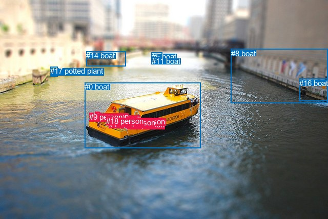
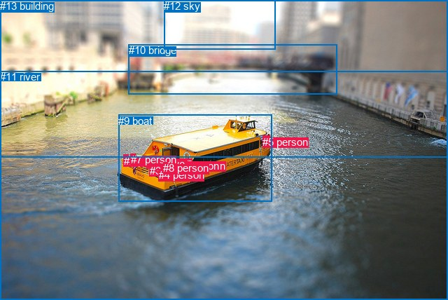

# 图片 1591：2389803.jpg

随机样本序号：243。图片 SHA256：`255cd94a851a122273899d78823eac29d825a8a184709e1c49c22da3088a72f3`。

红色框表示人，蓝色框表示其他物体。两个模式分别保留自身框编号，可依据位置比较对应对象。

## 自动检测框与输出

人的框编号：`[1, 2, 3, 4, 6, 7, 9, 10, 12, 13, 15, 18]`。状态：`ok`。

### 自动检测全部物体框

| 编号 | 类别 | 是否为人 | 检测分数 | 像素坐标 xyxy |
|---|---|---|---|---|
| 0 | boat | False | 0.9994 | 165.4, 161.1, 391.4, 289.5 |
| 1 | person | True | 0.9491 | 208.0, 222.4, 221.4, 239.0 |
| 2 | person | True | 0.9357 | 258.2, 228.7, 267.3, 241.2 |
| 3 | person | True | 0.9281 | 239.9, 233.8, 249.5, 245.9 |
| 4 | person | True | 0.9147 | 186.0, 218.8, 194.5, 232.0 |
| 5 | boat | False | 0.8935 | 295.9, 102.2, 316.5, 120.0 |
| 6 | person | True | 0.8928 | 231.7, 230.9, 239.2, 240.9 |
| 7 | person | True | 0.8476 | 252.8, 227.1, 260.1, 241.9 |
| 8 | boat | False | 0.7515 | 450.7, 95.9, 639.2, 201.7 |
| 9 | person | True | 0.7231 | 174.4, 220.3, 182.6, 228.7 |
| 10 | person | True | 0.7069 | 248.2, 235.1, 257.0, 244.1 |
| 11 | boat | False | 0.5699 | 295.7, 111.0, 315.5, 120.3 |
| 12 | person | True | 0.5546 | 248.6, 228.8, 259.4, 243.6 |
| 13 | person | True | 0.5493 | 212.7, 233.9, 224.0, 244.1 |
| 14 | boat | False | 0.4920 | 168.3, 100.3, 245.5, 129.4 |
| 15 | person | True | 0.4910 | 230.0, 231.4, 239.1, 247.2 |
| 16 | boat | False | 0.4723 | 584.3, 153.6, 640.0, 197.9 |
| 17 | potted plant | False | 0.3917 | 98.5, 130.3, 112.9, 149.2 |
| 18 | person | True | 0.3740 | 207.1, 227.5, 217.8, 241.3 |

### 自动检测 Top50 人相关候选

评分物体对：342；人相关物体对：300；输出关系：50。

| 排名 | 主语编号与类别 | 关系 | 宾语编号与类别 | 类型 | 人与人 | 排序分数 | 原始融合 logit |
|---|---|---|---|---|---|---|---|
| 1 | #4 person | on | #0 boat | spatial | False | 0.97868 | 3.8266 |
| 2 | #18 person | on | #0 boat | spatial | False | 0.97752 | 3.7722 |
| 3 | #9 person | on | #0 boat | spatial | False | 0.97725 | 3.7603 |
| 4 | #1 person | on | #0 boat | spatial | False | 0.97680 | 3.7400 |
| 5 | #6 person | in | #0 boat | spatial | False | 0.97440 | 3.6393 |
| 6 | #13 person | on | #0 boat | spatial | False | 0.97353 | 3.6049 |
| 7 | #7 person | in | #0 boat | spatial | False | 0.97294 | 3.5821 |
| 8 | #12 person | in | #0 boat | spatial | False | 0.97273 | 3.5743 |
| 9 | #15 person | in | #0 boat | spatial | False | 0.97236 | 3.5604 |
| 10 | #3 person | in | #0 boat | spatial | False | 0.97218 | 3.5538 |
| 11 | #10 person | in | #0 boat | spatial | False | 0.97129 | 3.5213 |
| 12 | #2 person | in | #0 boat | spatial | False | 0.96932 | 3.4530 |
| 13 | #7 person | riding | #0 boat | semantic | False | 0.96922 | 3.4496 |
| 14 | #18 person | riding | #0 boat | semantic | False | 0.96749 | 3.3932 |
| 15 | #2 person | riding | #0 boat | semantic | False | 0.96652 | 3.3627 |
| 16 | #6 person | riding | #0 boat | semantic | False | 0.96648 | 3.3617 |
| 17 | #15 person | riding | #0 boat | semantic | False | 0.96611 | 3.3503 |
| 18 | #12 person | riding | #0 boat | semantic | False | 0.96520 | 3.3227 |
| 19 | #1 person | riding | #0 boat | semantic | False | 0.96408 | 3.2899 |
| 20 | #10 person | riding | #0 boat | semantic | False | 0.96377 | 3.2808 |
| 21 | #13 person | riding | #0 boat | semantic | False | 0.96314 | 3.2630 |
| 22 | #3 person | riding | #0 boat | semantic | False | 0.96303 | 3.2600 |
| 23 | #15 person | wearing | #6 person | semantic | True | 0.95912 | 3.1555 |
| 24 | #12 person | wearing | #10 person | semantic | True | 0.95703 | 3.1033 |
| 25 | #4 person | riding | #0 boat | semantic | False | 0.95033 | 2.9515 |
| 26 | #9 person | riding | #0 boat | semantic | False | 0.92343 | 2.4898 |
| 27 | #12 person | in | #10 person | spatial | True | 0.86611 | 1.8670 |
| 28 | #15 person | in | #6 person | spatial | True | 0.83756 | 1.6401 |
| 29 | #1 person | wearing | #18 person | semantic | True | 0.76750 | 1.1942 |
| 30 | #12 person | wearing | #7 person | semantic | True | 0.74500 | 1.0721 |
| 31 | #1 person | in | #18 person | spatial | True | 0.65164 | 0.6262 |
| 32 | #7 person | in | #12 person | spatial | True | 0.59270 | 0.3751 |
| 33 | #0 boat | carrying | #1 person | semantic | False | 0.59192 | 0.3719 |
| 34 | #12 person | in | #7 person | spatial | True | 0.56999 | 0.2818 |
| 35 | #0 boat | carrying | #12 person | semantic | False | 0.56429 | 0.2586 |
| 36 | #0 boat | carrying | #18 person | semantic | False | 0.55452 | 0.2189 |
| 37 | #0 boat | carrying | #6 person | semantic | False | 0.55144 | 0.2065 |
| 38 | #0 boat | carrying | #7 person | semantic | False | 0.54289 | 0.1720 |
| 39 | #0 boat | carrying | #2 person | semantic | False | 0.53531 | 0.1415 |
| 40 | #0 boat | carrying | #15 person | semantic | False | 0.52865 | 0.1147 |
| 41 | #0 boat | carrying | #3 person | semantic | False | 0.52541 | 0.1017 |
| 42 | #18 person | in | #1 person | spatial | True | 0.51630 | 0.0652 |
| 43 | #0 boat | carrying | #13 person | semantic | False | 0.48897 | -0.0441 |
| 44 | #0 boat | carrying | #10 person | semantic | False | 0.48273 | -0.0691 |
| 45 | #7 person | wearing | #10 person | semantic | True | 0.45787 | -0.1689 |
| 46 | #10 person | in | #12 person | spatial | True | 0.45148 | -0.1947 |
| 47 | #7 person | in | #10 person | spatial | True | 0.43481 | -0.2623 |
| 48 | #1 person | on | #13 person | spatial | True | 0.43132 | -0.2765 |
| 49 | #7 person | wearing | #12 person | semantic | True | 0.43026 | -0.2808 |
| 50 | #6 person | in | #15 person | spatial | True | 0.41439 | -0.3459 |

### 自动检测逐条人相关 GT 核验

R@50：25.00%；命中 1/4。

| GT 主语编号 | GT 关系 | GT 宾语编号 | 结果阶段 | 匹配预测主语编号 | 匹配预测宾语编号 |
|---|---|---|---|---|---|
| 0 | on | 9 | hit50 | [1] | [0] |
| 0 | sitting on | 9 | wrong_predicate | [1] | [0] |
| 1 | on | 9 | wrong_predicate | [2] | [0] |
| 1 | sitting on | 9 | wrong_predicate | [2] | [0] |

## 真实框与输出

人的框编号：`[0, 1, 2, 3, 4, 5, 6, 7, 8]`。

### 真实框全部物体框

| 编号 | 类别 | 是否为人 | 检测分数 | 像素坐标 xyxy |
|---|---|---|---|---|
| 0 | person | True | GT | 210.0, 223.0, 221.0, 235.0 |
| 1 | person | True | GT | 257.0, 228.0, 267.0, 240.0 |
| 2 | person | True | GT | 177.0, 221.0, 183.0, 229.0 |
| 3 | person | True | GT | 214.0, 235.0, 224.0, 244.0 |
| 4 | person | True | GT | 227.0, 241.0, 236.0, 257.0 |
| 5 | person | True | GT | 375.0, 194.0, 385.0, 208.0 |
| 6 | person | True | GT | 248.0, 228.0, 259.0, 244.0 |
| 7 | person | True | GT | 187.0, 219.0, 194.0, 232.0 |
| 8 | person | True | GT | 233.0, 231.0, 239.0, 240.0 |
| 9 | boat | False | GT | 169.0, 164.0, 388.0, 288.0 |
| 10 | bridge | False | GT | 184.0, 63.0, 482.0, 134.0 |
| 11 | river | False | GT | 0.0, 101.0, 640.0, 428.0 |
| 12 | sky | False | GT | 234.0, 0.0, 393.0, 70.0 |
| 13 | building | False | GT | 0.0, 0.0, 640.0, 225.0 |

### 真实框 Top50 人相关候选

评分物体对：182；人相关物体对：162；输出关系：50。

| 排名 | 主语编号与类别 | 关系 | 宾语编号与类别 | 类型 | 人与人 | 排序分数 | 原始融合 logit |
|---|---|---|---|---|---|---|---|
| 1 | #7 person | on | #9 boat | spatial | False | 0.97932 | 3.8579 |
| 2 | #6 person | in | #9 boat | spatial | False | 0.97920 | 3.8516 |
| 3 | #5 person | on | #9 boat | spatial | False | 0.97915 | 3.8493 |
| 4 | #1 person | in | #9 boat | spatial | False | 0.97872 | 3.8283 |
| 5 | #2 person | on | #9 boat | spatial | False | 0.97746 | 3.7697 |
| 6 | #8 person | in | #9 boat | spatial | False | 0.97656 | 3.7297 |
| 7 | #0 person | on | #9 boat | spatial | False | 0.97416 | 3.6296 |
| 8 | #3 person | in | #9 boat | spatial | False | 0.97362 | 3.6082 |
| 9 | #4 person | in | #9 boat | spatial | False | 0.96967 | 3.4648 |
| 10 | #8 person | riding | #9 boat | semantic | False | 0.95677 | 3.0971 |
| 11 | #6 person | riding | #9 boat | semantic | False | 0.95079 | 2.9613 |
| 12 | #0 person | riding | #9 boat | semantic | False | 0.94364 | 2.8179 |
| 13 | #3 person | riding | #9 boat | semantic | False | 0.94351 | 2.8156 |
| 14 | #1 person | riding | #9 boat | semantic | False | 0.93878 | 2.7302 |
| 15 | #7 person | riding | #9 boat | semantic | False | 0.93198 | 2.6175 |
| 16 | #4 person | riding | #9 boat | semantic | False | 0.92334 | 2.4887 |
| 17 | #2 person | in | #11 river | spatial | False | 0.90179 | 2.2173 |
| 18 | #2 person | riding | #9 boat | semantic | False | 0.89395 | 2.1317 |
| 19 | #7 person | in | #11 river | spatial | False | 0.88926 | 2.0832 |
| 20 | #0 person | in | #11 river | spatial | False | 0.81401 | 1.4763 |
| 21 | #5 person | riding | #9 boat | semantic | False | 0.78295 | 1.2830 |
| 22 | #8 person | in | #11 river | spatial | False | 0.66553 | 0.6880 |
| 23 | #3 person | in | #11 river | spatial | False | 0.60005 | 0.4057 |
| 24 | #9 boat | in | #5 person | spatial | False | 0.59789 | 0.3967 |
| 25 | #9 boat | carrying | #6 person | semantic | False | 0.53478 | 0.1393 |
| 26 | #9 boat | carrying | #1 person | semantic | False | 0.50970 | 0.0388 |
| 27 | #5 person | in | #11 river | spatial | False | 0.50932 | 0.0373 |
| 28 | #9 boat | carrying | #0 person | semantic | False | 0.48862 | -0.0455 |
| 29 | #9 boat | carrying | #8 person | semantic | False | 0.47161 | -0.1137 |
| 30 | #7 person | standing on | #11 river | semantic | False | 0.46792 | -0.1285 |
| 31 | #6 person | in | #11 river | spatial | False | 0.45561 | -0.1780 |
| 32 | #2 person | standing on | #11 river | semantic | False | 0.42156 | -0.3164 |
| 33 | #4 person | in | #11 river | spatial | False | 0.39173 | -0.4401 |
| 34 | #9 boat | carrying | #3 person | semantic | False | 0.33307 | -0.6943 |
| 35 | #9 boat | wearing | #5 person | semantic | False | 0.31298 | -0.7862 |
| 36 | #0 person | standing on | #11 river | semantic | False | 0.28598 | -0.9150 |
| 37 | #9 boat | in | #4 person | spatial | False | 0.21645 | -1.2865 |
| 38 | #9 boat | carrying | #7 person | semantic | False | 0.20001 | -1.3862 |
| 39 | #9 boat | carrying | #4 person | semantic | False | 0.19867 | -1.3946 |
| 40 | #8 person | sitting on | #11 river | semantic | False | 0.19827 | -1.3972 |
| 41 | #9 boat | in | #1 person | spatial | False | 0.19168 | -1.4392 |
| 42 | #9 boat | in | #2 person | spatial | False | 0.16054 | -1.6542 |
| 43 | #9 boat | in | #3 person | spatial | False | 0.15060 | -1.7299 |
| 44 | #9 boat | in | #7 person | spatial | False | 0.14743 | -1.7549 |
| 45 | #1 person | in | #11 river | spatial | False | 0.14477 | -1.7762 |
| 46 | #6 person | sitting on | #11 river | semantic | False | 0.14082 | -1.8085 |
| 47 | #0 person | in | #3 person | spatial | True | 0.13875 | -1.8257 |
| 48 | #3 person | sitting on | #11 river | semantic | False | 0.13431 | -1.8634 |
| 49 | #9 boat | in | #6 person | spatial | False | 0.13363 | -1.8692 |
| 50 | #0 person | standing on | #3 person | semantic | True | 0.12126 | -1.9805 |

### 真实框逐条人相关 GT 核验

R@50：25.00%；命中 1/4。

| GT 主语编号 | GT 关系 | GT 宾语编号 | 结果阶段 | 匹配预测主语编号 | 匹配预测宾语编号 |
|---|---|---|---|---|---|
| 0 | on | 9 | hit50 | [0] | [9] |
| 0 | sitting on | 9 | wrong_predicate | [0] | [9] |
| 1 | on | 9 | wrong_predicate | [1] | [9] |
| 1 | sitting on | 9 | wrong_predicate | [1] | [9] |

## 全部人相关 GT

| 主语编号与类别 | 关系 | 宾语编号与类别 |
|---|---|---|
| #0 person | on | #9 boat |
| #0 person | sitting on | #9 boat |
| #1 person | on | #9 boat |
| #1 person | sitting on | #9 boat |

原始记录、全部人相关物体对的两项预测与分项分数见 [逐图证据 JSON](../evidence/cases/1591.json)。全部56类 logits 保留于本机 HOR/output/random500/logits/。

<!-- HOR_COMPLETE_RESULTS -->

## 六组条件的完整输出对照

以下保留同一图片三种框与候选模式、两种谓词输出规则的全部 Top50。框编号各自在所属模式内解释。

### 自动检测框完整枚举：空间与语义各保留一个谓词

| 排名 | 主语编号与类别 | 谓词 | 宾语编号与类别 | 分组 | 排序分数 | predicate logit | pair logit |
|---|---|---|---|---|---|---|---|
| 1 | #4 person | on | #0 boat | spatial | 0.9786819 | 3.6334052 | 0.1932418 |
| 2 | #18 person | on | #0 boat | spatial | 0.9775152 | 3.4975753 | 0.2745970 |
| 3 | #9 person | on | #0 boat | spatial | 0.9772522 | 3.6110473 | 0.1492297 |
| 4 | #1 person | on | #0 boat | spatial | 0.9767964 | 3.4482818 | 0.2916870 |
| 5 | #6 person | in | #0 boat | spatial | 0.9744030 | 3.3351083 | 0.3042405 |
| 6 | #13 person | on | #0 boat | spatial | 0.9735300 | 3.3112941 | 0.2936225 |
| 7 | #7 person | in | #0 boat | spatial | 0.9729354 | 3.2483764 | 0.3337128 |
| 8 | #12 person | in | #0 boat | spatial | 0.9727294 | 3.2483764 | 0.3259177 |
| 9 | #15 person | in | #0 boat | spatial | 0.9723583 | 3.2682881 | 0.2921091 |
| 10 | #3 person | in | #0 boat | spatial | 0.9721795 | 3.2616506 | 0.2921152 |
| 11 | #10 person | in | #0 boat | spatial | 0.9712881 | 3.2081065 | 0.3132042 |
| 12 | #2 person | in | #0 boat | spatial | 0.9693208 | 3.0877409 | 0.3652715 |
| 13 | #7 person | riding | #0 boat | semantic | 0.9692191 | 3.1158834 | 0.3337128 |
| 14 | #18 person | riding | #0 boat | semantic | 0.9674904 | 3.1185713 | 0.2745970 |
| 15 | #2 person | riding | #0 boat | semantic | 0.9665197 | 2.9974732 | 0.3652715 |
| 16 | #6 person | riding | #0 boat | semantic | 0.9664844 | 3.0574117 | 0.3042405 |
| 17 | #15 person | riding | #0 boat | semantic | 0.9661132 | 3.0581446 | 0.2921091 |
| 18 | #12 person | riding | #0 boat | semantic | 0.9651980 | 2.9967403 | 0.3259177 |
| 19 | #1 person | riding | #0 boat | semantic | 0.9640805 | 2.9982061 | 0.2916870 |
| 20 | #10 person | riding | #0 boat | semantic | 0.9637653 | 2.9676266 | 0.3132042 |
| 21 | #13 person | riding | #0 boat | semantic | 0.9631360 | 2.9693370 | 0.2936225 |
| 22 | #3 person | riding | #0 boat | semantic | 0.9630303 | 2.9678707 | 0.2921152 |
| 23 | #15 person | wearing | #6 person | semantic | 0.9591229 | 3.6923327 | -0.5368822 |
| 24 | #12 person | wearing | #10 person | semantic | 0.9570279 | 3.5469918 | -0.4437113 |
| 25 | #4 person | riding | #0 boat | semantic | 0.9503320 | 2.7582092 | 0.1932418 |
| 26 | #9 person | riding | #0 boat | semantic | 0.9234255 | 2.3405972 | 0.1492297 |
| 27 | #12 person | in | #10 person | spatial | 0.8661061 | 2.3106704 | -0.4437113 |
| 28 | #15 person | in | #6 person | spatial | 0.8375551 | 2.1770306 | -0.5368822 |
| 29 | #1 person | wearing | #18 person | semantic | 0.7674996 | 1.7309933 | -0.5367472 |
| 30 | #12 person | wearing | #7 person | semantic | 0.7450000 | 1.4917665 | -0.4196455 |
| 31 | #1 person | in | #18 person | spatial | 0.6516379 | 1.1629939 | -0.5367472 |
| 32 | #7 person | in | #12 person | spatial | 0.5926956 | 0.8087592 | -0.4336392 |
| 33 | #0 boat | carrying | #1 person | semantic | 0.5919191 | 1.4537058 | -1.0818012 |
| 34 | #12 person | in | #7 person | spatial | 0.5699877 | 0.7014465 | -0.4196455 |
| 35 | #0 boat | carrying | #12 person | semantic | 0.5642948 | 1.1100869 | -0.8514762 |
| 36 | #0 boat | carrying | #18 person | semantic | 0.5545176 | 1.3449917 | -1.1260508 |
| 37 | #0 boat | carrying | #6 person | semantic | 0.5514402 | 1.2269564 | -1.0204649 |
| 38 | #0 boat | carrying | #7 person | semantic | 0.5428926 | 1.0244732 | -0.8524800 |
| 39 | #0 boat | carrying | #2 person | semantic | 0.5353124 | 0.7988887 | -0.6574034 |
| 40 | #0 boat | carrying | #15 person | semantic | 0.5286486 | 1.1217370 | -1.0070171 |
| 41 | #0 boat | carrying | #3 person | semantic | 0.5254122 | 1.0314631 | -0.9297268 |
| 42 | #18 person | in | #1 person | spatial | 0.5162984 | 0.6580801 | -0.5928635 |
| 43 | #0 boat | carrying | #13 person | semantic | 0.4889708 | 1.0106926 | -1.0548167 |
| 44 | #0 boat | carrying | #10 person | semantic | 0.4827336 | 0.7734580 | -0.8425512 |
| 45 | #7 person | wearing | #10 person | semantic | 0.4578674 | 0.2872190 | -0.4561498 |
| 46 | #10 person | in | #12 person | spatial | 0.4514767 | 0.2268467 | -0.4215529 |
| 47 | #7 person | in | #10 person | spatial | 0.4348062 | 0.1938815 | -0.4561498 |
| 48 | #1 person | on | #13 person | spatial | 0.4313213 | 0.2680235 | -0.5444858 |
| 49 | #7 person | wearing | #12 person | semantic | 0.4302635 | 0.1528630 | -0.4336392 |
| 50 | #6 person | in | #15 person | spatial | 0.4143874 | 0.1901178 | -0.5359750 |

GT 命中：1/4，R@50=25.00%。

| GT主语 | GT谓词 | GT宾语 | 结果阶段 | 匹配主语框 | 匹配宾语框 |
|---|---|---|---|---|---|
| 0 | on | 9 | hit50 | [1] | [0] |
| 0 | sitting on | 9 | wrong_predicate | [1] | [0] |
| 1 | on | 9 | wrong_predicate | [2] | [0] |
| 1 | sitting on | 9 | wrong_predicate | [2] | [0] |

### 自动检测框完整枚举：每对只保留一个谓词

| 排名 | 主语编号与类别 | 谓词 | 宾语编号与类别 | 分组 | 排序分数 | predicate logit | pair logit |
|---|---|---|---|---|---|---|---|
| 1 | #4 person | on | #0 boat | single | 0.9786819 | 3.6334052 | 0.1932418 |
| 2 | #18 person | on | #0 boat | single | 0.9775152 | 3.4975753 | 0.2745970 |
| 3 | #9 person | on | #0 boat | single | 0.9772522 | 3.6110473 | 0.1492297 |
| 4 | #1 person | on | #0 boat | single | 0.9767964 | 3.4482818 | 0.2916870 |
| 5 | #6 person | in | #0 boat | single | 0.9744030 | 3.3351083 | 0.3042405 |
| 6 | #13 person | on | #0 boat | single | 0.9735300 | 3.3112941 | 0.2936225 |
| 7 | #7 person | in | #0 boat | single | 0.9729354 | 3.2483764 | 0.3337128 |
| 8 | #12 person | in | #0 boat | single | 0.9727294 | 3.2483764 | 0.3259177 |
| 9 | #15 person | in | #0 boat | single | 0.9723583 | 3.2682881 | 0.2921091 |
| 10 | #3 person | in | #0 boat | single | 0.9721795 | 3.2616506 | 0.2921152 |
| 11 | #10 person | in | #0 boat | single | 0.9712881 | 3.2081065 | 0.3132042 |
| 12 | #2 person | in | #0 boat | single | 0.9693208 | 3.0877409 | 0.3652715 |
| 13 | #15 person | wearing | #6 person | single | 0.9591229 | 3.6923327 | -0.5368822 |
| 14 | #12 person | wearing | #10 person | single | 0.9570279 | 3.5469918 | -0.4437113 |
| 15 | #1 person | wearing | #18 person | single | 0.7674996 | 1.7309933 | -0.5367472 |
| 16 | #12 person | wearing | #7 person | single | 0.7450000 | 1.4917665 | -0.4196455 |
| 17 | #7 person | in | #12 person | single | 0.5926956 | 0.8087592 | -0.4336392 |
| 18 | #0 boat | carrying | #1 person | single | 0.5919191 | 1.4537058 | -1.0818012 |
| 19 | #0 boat | carrying | #12 person | single | 0.5642948 | 1.1100869 | -0.8514762 |
| 20 | #0 boat | carrying | #18 person | single | 0.5545176 | 1.3449917 | -1.1260508 |
| 21 | #0 boat | carrying | #6 person | single | 0.5514402 | 1.2269564 | -1.0204649 |
| 22 | #0 boat | carrying | #7 person | single | 0.5428926 | 1.0244732 | -0.8524800 |
| 23 | #0 boat | carrying | #2 person | single | 0.5353124 | 0.7988887 | -0.6574034 |
| 24 | #0 boat | carrying | #15 person | single | 0.5286486 | 1.1217370 | -1.0070171 |
| 25 | #0 boat | carrying | #3 person | single | 0.5254122 | 1.0314631 | -0.9297268 |
| 26 | #18 person | in | #1 person | single | 0.5162984 | 0.6580801 | -0.5928635 |
| 27 | #0 boat | carrying | #13 person | single | 0.4889708 | 1.0106926 | -1.0548167 |
| 28 | #0 boat | carrying | #10 person | single | 0.4827336 | 0.7734580 | -0.8425512 |
| 29 | #7 person | wearing | #10 person | single | 0.4578674 | 0.2872190 | -0.4561498 |
| 30 | #10 person | in | #12 person | single | 0.4514767 | 0.2268467 | -0.4215529 |
| 31 | #1 person | on | #13 person | single | 0.4313213 | 0.2680235 | -0.5444858 |
| 32 | #6 person | in | #15 person | single | 0.4143874 | 0.1901178 | -0.5359750 |
| 33 | #18 person | in | #13 person | single | 0.3642379 | 0.0282683 | -0.5852855 |
| 34 | #0 boat | carrying | #4 person | single | 0.3561719 | 0.6080561 | -1.2000743 |
| 35 | #0 boat | carrying | #9 person | single | 0.2306092 | -0.0026898 | -1.2021846 |
| 36 | #13 person | in | #18 person | single | 0.1689463 | -1.0188949 | -0.5742189 |
| 37 | #13 person | in | #1 person | single | 0.1685580 | -1.0066721 | -0.5892092 |
| 38 | #3 person | on | #10 person | single | 0.1678869 | -1.1825254 | -0.4181525 |
| 39 | #10 person | in | #7 person | single | 0.1611447 | -1.2322452 | -0.4174901 |
| 40 | #12 person | on | #3 person | single | 0.1408858 | -1.3001680 | -0.5077845 |
| 41 | #7 person | in | #2 person | single | 0.1349104 | -1.4062161 | -0.4520061 |
| 42 | #10 person | on | #3 person | single | 0.1263611 | -1.4304092 | -0.5031137 |
| 43 | #12 person | holding | #2 person | single | 0.1231941 | -1.5136797 | -0.4488444 |
| 44 | #2 person | on | #12 person | single | 0.1152093 | -1.4494660 | -0.5891347 |
| 45 | #3 person | on | #12 person | single | 0.1144554 | -1.6470716 | -0.3989460 |
| 46 | #2 person | on | #7 person | single | 0.1064673 | -1.5483413 | -0.5790036 |
| 47 | #9 person | on | #4 person | single | 0.0805347 | -1.8515558 | -0.5835488 |
| 48 | #4 person | in | #9 person | single | 0.0708457 | -2.0243616 | -0.5494084 |
| 49 | #2 person | on | #10 person | single | 0.0707688 | -1.9637396 | -0.6112000 |
| 50 | #6 person | in | #3 person | single | 0.0705661 | -2.0764699 | -0.5015566 |

GT 命中：1/4，R@50=25.00%。

| GT主语 | GT谓词 | GT宾语 | 结果阶段 | 匹配主语框 | 匹配宾语框 |
|---|---|---|---|---|---|
| 0 | on | 9 | hit50 | [1] | [0] |
| 0 | sitting on | 9 | wrong_predicate | [1] | [0] |
| 1 | on | 9 | wrong_predicate | [2] | [0] |
| 1 | sitting on | 9 | wrong_predicate | [2] | [0] |

### 真实框完整枚举：空间与语义各保留一个谓词

| 排名 | 主语编号与类别 | 谓词 | 宾语编号与类别 | 分组 | 排序分数 | predicate logit | pair logit |
|---|---|---|---|---|---|---|---|
| 1 | #7 person | on | #9 boat | spatial | 0.9793233 | 3.6712298 | 0.1866236 |
| 2 | #6 person | in | #9 boat | spatial | 0.9791968 | 3.5289311 | 0.3226943 |
| 3 | #5 person | on | #9 boat | spatial | 0.9791486 | 3.5353999 | 0.3138632 |
| 4 | #1 person | in | #9 boat | spatial | 0.9787153 | 3.4687486 | 0.3595040 |
| 5 | #2 person | on | #9 boat | spatial | 0.9774616 | 3.6219363 | 0.1478015 |
| 6 | #8 person | in | #9 boat | spatial | 0.9765622 | 3.4218411 | 0.3078488 |
| 7 | #0 person | on | #9 boat | spatial | 0.9741581 | 3.3330722 | 0.2965063 |
| 8 | #3 person | in | #9 boat | spatial | 0.9736153 | 3.3147511 | 0.2934802 |
| 9 | #4 person | in | #9 boat | spatial | 0.9696695 | 3.2010236 | 0.2637793 |
| 10 | #8 person | riding | #9 boat | semantic | 0.9567741 | 2.7892780 | 0.3078488 |
| 11 | #6 person | riding | #9 boat | semantic | 0.9507936 | 2.6385775 | 0.3226943 |
| 12 | #0 person | riding | #9 boat | semantic | 0.9436353 | 2.5213890 | 0.2965063 |
| 13 | #3 person | riding | #9 boat | semantic | 0.9435131 | 2.5221219 | 0.2934802 |
| 14 | #1 person | riding | #9 boat | semantic | 0.9387849 | 2.3706889 | 0.3595040 |
| 15 | #7 person | riding | #9 boat | semantic | 0.9319790 | 2.4308705 | 0.1866236 |
| 16 | #4 person | riding | #9 boat | semantic | 0.9233426 | 2.2248750 | 0.2637793 |
| 17 | #2 person | in | #11 river | spatial | 0.9017950 | 2.9841723 | -0.7668418 |
| 18 | #2 person | riding | #9 boat | semantic | 0.8939464 | 1.9839001 | 0.1478015 |
| 19 | #7 person | in | #11 river | spatial | 0.8892622 | 3.0173593 | -0.9341321 |
| 20 | #0 person | in | #11 river | spatial | 0.8140131 | 2.6164398 | -1.1401397 |
| 21 | #5 person | riding | #9 boat | semantic | 0.7829547 | 0.9691057 | 0.3138632 |
| 22 | #8 person | in | #11 river | spatial | 0.6655328 | 1.9079695 | -1.2199204 |
| 23 | #3 person | in | #11 river | spatial | 0.6000451 | 1.5335994 | -1.1279461 |
| 24 | #9 boat | in | #5 person | spatial | 0.5978890 | 0.6713552 | -0.2746783 |
| 25 | #9 boat | carrying | #6 person | semantic | 0.5347788 | 1.0233083 | -0.8839681 |
| 26 | #9 boat | carrying | #1 person | semantic | 0.5096998 | 0.7491918 | -0.7103878 |
| 27 | #5 person | in | #11 river | spatial | 0.5093235 | 1.3238516 | -1.2865530 |
| 28 | #9 boat | carrying | #0 person | semantic | 0.4886211 | 1.0475736 | -1.0930967 |
| 29 | #9 boat | carrying | #8 person | semantic | 0.4716067 | 0.9169235 | -1.0306191 |
| 30 | #7 person | standing on | #11 river | semantic | 0.4679208 | 0.8056388 | -0.9341321 |
| 31 | #6 person | in | #11 river | spatial | 0.4556082 | 1.2229538 | -1.4009898 |
| 32 | #2 person | standing on | #11 river | semantic | 0.4215575 | 0.4504590 | -0.7668418 |
| 33 | #4 person | in | #11 river | spatial | 0.3917282 | 0.6209064 | -1.0609601 |
| 34 | #9 boat | carrying | #3 person | semantic | 0.3330718 | 0.3686910 | -1.0630152 |
| 35 | #9 boat | wearing | #5 person | semantic | 0.3129801 | -0.5115452 | -0.2746783 |
| 36 | #0 person | standing on | #11 river | semantic | 0.2859761 | 0.2251315 | -1.1401397 |
| 37 | #9 boat | in | #4 person | spatial | 0.2164458 | -0.4034109 | -0.8830889 |
| 38 | #9 boat | carrying | #7 person | semantic | 0.2000126 | -0.1762471 | -1.2099682 |
| 39 | #9 boat | carrying | #4 person | semantic | 0.1986745 | -0.5115108 | -0.8830889 |
| 40 | #8 person | sitting on | #11 river | semantic | 0.1982654 | -0.1772504 | -1.2199204 |
| 41 | #9 boat | in | #1 person | spatial | 0.1916761 | -0.7287681 | -0.7103878 |
| 42 | #9 boat | in | #2 person | spatial | 0.1605371 | -0.4231000 | -1.2311373 |
| 43 | #9 boat | in | #3 person | spatial | 0.1505951 | -0.6669264 | -1.0630152 |
| 44 | #9 boat | in | #7 person | spatial | 0.1474340 | -0.5449018 | -1.2099682 |
| 45 | #1 person | in | #11 river | spatial | 0.1447681 | -0.0809259 | -1.6953136 |
| 46 | #6 person | sitting on | #11 river | semantic | 0.1408250 | -0.4074650 | -1.4009898 |
| 47 | #0 person | in | #3 person | spatial | 0.1387488 | -1.2714224 | -0.5542983 |
| 48 | #3 person | sitting on | #11 river | semantic | 0.1343061 | -0.7354641 | -1.1279461 |
| 49 | #9 boat | in | #6 person | spatial | 0.1336308 | -0.9852622 | -0.8839681 |
| 50 | #0 person | standing on | #3 person | semantic | 0.1212641 | -1.4262152 | -0.5542983 |

GT 命中：1/4，R@50=25.00%。

| GT主语 | GT谓词 | GT宾语 | 结果阶段 | 匹配主语框 | 匹配宾语框 |
|---|---|---|---|---|---|
| 0 | on | 9 | hit50 | [0] | [9] |
| 0 | sitting on | 9 | wrong_predicate | [0] | [9] |
| 1 | on | 9 | wrong_predicate | [1] | [9] |
| 1 | sitting on | 9 | wrong_predicate | [1] | [9] |

### 真实框完整枚举：每对只保留一个谓词

| 排名 | 主语编号与类别 | 谓词 | 宾语编号与类别 | 分组 | 排序分数 | predicate logit | pair logit |
|---|---|---|---|---|---|---|---|
| 1 | #7 person | on | #9 boat | single | 0.9793233 | 3.6712298 | 0.1866236 |
| 2 | #6 person | in | #9 boat | single | 0.9791968 | 3.5289311 | 0.3226943 |
| 3 | #5 person | on | #9 boat | single | 0.9791486 | 3.5353999 | 0.3138632 |
| 4 | #1 person | in | #9 boat | single | 0.9787153 | 3.4687486 | 0.3595040 |
| 5 | #2 person | on | #9 boat | single | 0.9774616 | 3.6219363 | 0.1478015 |
| 6 | #8 person | in | #9 boat | single | 0.9765622 | 3.4218411 | 0.3078488 |
| 7 | #0 person | on | #9 boat | single | 0.9741581 | 3.3330722 | 0.2965063 |
| 8 | #3 person | in | #9 boat | single | 0.9736153 | 3.3147511 | 0.2934802 |
| 9 | #4 person | in | #9 boat | single | 0.9696695 | 3.2010236 | 0.2637793 |
| 10 | #2 person | in | #11 river | single | 0.9017950 | 2.9841723 | -0.7668418 |
| 11 | #7 person | in | #11 river | single | 0.8892622 | 3.0173593 | -0.9341321 |
| 12 | #0 person | in | #11 river | single | 0.8140131 | 2.6164398 | -1.1401397 |
| 13 | #8 person | in | #11 river | single | 0.6655328 | 1.9079695 | -1.2199204 |
| 14 | #3 person | in | #11 river | single | 0.6000451 | 1.5335994 | -1.1279461 |
| 15 | #9 boat | in | #5 person | single | 0.5978890 | 0.6713552 | -0.2746783 |
| 16 | #9 boat | carrying | #6 person | single | 0.5347788 | 1.0233083 | -0.8839681 |
| 17 | #9 boat | carrying | #1 person | single | 0.5096998 | 0.7491918 | -0.7103878 |
| 18 | #5 person | in | #11 river | single | 0.5093235 | 1.3238516 | -1.2865530 |
| 19 | #9 boat | carrying | #0 person | single | 0.4886211 | 1.0475736 | -1.0930967 |
| 20 | #9 boat | carrying | #8 person | single | 0.4716067 | 0.9169235 | -1.0306191 |
| 21 | #6 person | in | #11 river | single | 0.4556082 | 1.2229538 | -1.4009898 |
| 22 | #4 person | in | #11 river | single | 0.3917282 | 0.6209064 | -1.0609601 |
| 23 | #9 boat | carrying | #3 person | single | 0.3330718 | 0.3686910 | -1.0630152 |
| 24 | #9 boat | in | #4 person | single | 0.2164458 | -0.4034109 | -0.8830889 |
| 25 | #9 boat | carrying | #7 person | single | 0.2000126 | -0.1762471 | -1.2099682 |
| 26 | #9 boat | in | #2 person | single | 0.1605371 | -0.4231000 | -1.2311373 |
| 27 | #1 person | in | #11 river | single | 0.1447681 | -0.0809259 | -1.6953136 |
| 28 | #0 person | in | #3 person | single | 0.1387488 | -1.2714224 | -0.5542983 |
| 29 | #8 person | in | #4 person | single | 0.0991312 | -1.7471251 | -0.4597899 |
| 30 | #6 person | on | #1 person | single | 0.0846972 | -1.9781041 | -0.4020688 |
| 31 | #1 person | on | #6 person | single | 0.0626647 | -2.1493258 | -0.5559168 |
| 32 | #4 person | in | #8 person | single | 0.0547517 | -2.2842350 | -0.5644045 |
| 33 | #3 person | in | #0 person | single | 0.0445294 | -2.4806488 | -0.5854068 |
| 34 | #2 person | on | #7 person | single | 0.0436518 | -2.5092046 | -0.5776734 |
| 35 | #0 person | standing on | #8 person | single | 0.0354777 | -2.7362561 | -0.5664721 |
| 36 | #0 person | standing on | #4 person | single | 0.0335657 | -2.8629975 | -0.4971098 |
| 37 | #7 person | standing on | #0 person | single | 0.0325572 | -2.6866829 | -0.7049741 |
| 38 | #8 person | in | #2 person | single | 0.0321336 | -2.8048973 | -0.6002959 |
| 39 | #7 person | in | #2 person | single | 0.0310065 | -2.8852606 | -0.5567989 |
| 40 | #2 person | in | #13 building | single | 0.0297696 | -1.7592974 | -1.7247466 |
| 41 | #7 person | in | #13 building | single | 0.0295976 | -1.6772091 | -1.8128091 |
| 42 | #4 person | in | #3 person | single | 0.0271313 | -3.0053878 | -0.5741727 |
| 43 | #8 person | sitting on | #6 person | single | 0.0256638 | -3.2052877 | -0.4313867 |
| 44 | #3 person | on | #4 person | single | 0.0256415 | -3.1320558 | -0.5055098 |
| 45 | #6 person | in | #2 person | single | 0.0252953 | -2.9661245 | -0.6853912 |
| 46 | #6 person | in | #8 person | single | 0.0243912 | -3.1464520 | -0.5423890 |
| 47 | #7 person | standing on | #3 person | single | 0.0222003 | -3.0459418 | -0.7392582 |
| 48 | #8 person | sitting on | #3 person | single | 0.0221441 | -3.2459102 | -0.5418826 |
| 49 | #0 person | in | #13 building | single | 0.0216451 | -2.0388000 | -1.7722924 |
| 50 | #3 person | standing on | #8 person | single | 0.0203936 | -3.2897830 | -0.5821452 |

GT 命中：1/4，R@50=25.00%。

| GT主语 | GT谓词 | GT宾语 | 结果阶段 | 匹配主语框 | 匹配宾语框 |
|---|---|---|---|---|---|
| 0 | on | 9 | hit50 | [0] | [9] |
| 0 | sitting on | 9 | wrong_predicate | [0] | [9] |
| 1 | on | 9 | wrong_predicate | [1] | [9] |
| 1 | sitting on | 9 | wrong_predicate | [1] | [9] |

### 真实框400候选：空间与语义各保留一个谓词

| 排名 | 主语编号与类别 | 谓词 | 宾语编号与类别 | 分组 | 排序分数 | predicate logit | pair logit |
|---|---|---|---|---|---|---|---|
| 1 | #6 person | in | #9 boat | spatial | 0.9791968 | 3.5289311 | 0.3226943 |
| 2 | #5 person | on | #9 boat | spatial | 0.9791486 | 3.5353999 | 0.3138632 |
| 3 | #1 person | in | #9 boat | spatial | 0.9785766 | 3.4621110 | 0.3595040 |
| 4 | #7 person | on | #9 boat | spatial | 0.9785311 | 3.6328273 | 0.1866236 |
| 5 | #2 person | on | #9 boat | spatial | 0.9765999 | 3.5835338 | 0.1478015 |
| 6 | #8 person | in | #9 boat | spatial | 0.9765622 | 3.4218411 | 0.3078488 |
| 7 | #0 person | on | #9 boat | spatial | 0.9741581 | 3.3330722 | 0.2965063 |
| 8 | #3 person | in | #9 boat | spatial | 0.9736153 | 3.3147511 | 0.2934802 |
| 9 | #4 person | in | #9 boat | spatial | 0.9696695 | 3.2010236 | 0.2637793 |
| 10 | #8 person | riding | #9 boat | semantic | 0.9555227 | 2.7594309 | 0.3078488 |
| 11 | #6 person | riding | #9 boat | semantic | 0.9507936 | 2.6385775 | 0.3226943 |
| 12 | #0 person | riding | #9 boat | semantic | 0.9420266 | 2.4915423 | 0.2965063 |
| 13 | #3 person | riding | #9 boat | semantic | 0.9419012 | 2.4922752 | 0.2934802 |
| 14 | #1 person | riding | #9 boat | semantic | 0.9370470 | 2.3408418 | 0.3595040 |
| 15 | #7 person | riding | #9 boat | semantic | 0.9319790 | 2.4308705 | 0.1866236 |
| 16 | #4 person | riding | #9 boat | semantic | 0.9212031 | 2.1950278 | 0.2637793 |
| 17 | #2 person | in | #11 river | spatial | 0.9064360 | 3.0377164 | -0.7668418 |
| 18 | #2 person | riding | #9 boat | semantic | 0.8939464 | 1.9839001 | 0.1478015 |
| 19 | #7 person | in | #11 river | spatial | 0.8886069 | 3.0107217 | -0.9341321 |
| 20 | #0 person | in | #11 river | spatial | 0.8219837 | 2.6699848 | -1.1401397 |
| 21 | #5 person | riding | #9 boat | semantic | 0.7829547 | 0.9691057 | 0.3138632 |
| 22 | #8 person | in | #11 river | spatial | 0.6721975 | 1.9380612 | -1.2199204 |
| 23 | #3 person | in | #11 river | spatial | 0.5984511 | 1.5269618 | -1.1279461 |
| 24 | #9 boat | in | #5 person | spatial | 0.5978890 | 0.6713552 | -0.2746783 |
| 25 | #9 boat | carrying | #6 person | semantic | 0.5350686 | 1.0244732 | -0.8839681 |
| 26 | #9 boat | carrying | #1 person | semantic | 0.5096998 | 0.7491918 | -0.7103878 |
| 27 | #9 boat | carrying | #0 person | semantic | 0.4955597 | 1.0753350 | -1.0930967 |
| 28 | #5 person | in | #11 river | spatial | 0.4867593 | 1.2335777 | -1.2865530 |
| 29 | #9 boat | carrying | #8 person | semantic | 0.4644049 | 0.8879976 | -1.0306191 |
| 30 | #7 person | standing on | #11 river | semantic | 0.4622617 | 0.7828913 | -0.9341321 |
| 31 | #6 person | in | #11 river | spatial | 0.4622561 | 1.2497263 | -1.4009898 |
| 32 | #2 person | standing on | #11 river | semantic | 0.4344926 | 0.5032973 | -0.7668418 |
| 33 | #4 person | in | #11 river | spatial | 0.3830121 | 0.5841775 | -1.0609601 |
| 34 | #9 boat | carrying | #3 person | semantic | 0.3330718 | 0.3686910 | -1.0630152 |
| 35 | #9 boat | wearing | #5 person | semantic | 0.3129801 | -0.5115452 | -0.2746783 |
| 36 | #0 person | standing on | #11 river | semantic | 0.2852270 | 0.2214599 | -1.1401397 |
| 37 | #9 boat | in | #4 person | spatial | 0.2210209 | -0.3766384 | -0.8830889 |
| 38 | #9 boat | carrying | #7 person | semantic | 0.2044917 | -0.1484857 | -1.2099682 |
| 39 | #9 boat | carrying | #4 person | semantic | 0.1988600 | -0.5103459 | -0.8830889 |
| 40 | #8 person | sitting on | #11 river | semantic | 0.1982654 | -0.1772504 | -1.2199204 |
| 41 | #9 boat | in | #1 person | spatial | 0.1955972 | -0.7036550 | -0.7103878 |
| 42 | #9 boat | in | #2 person | spatial | 0.1600903 | -0.4264188 | -1.2311373 |
| 43 | #9 boat | in | #3 person | spatial | 0.1503829 | -0.6685858 | -1.0630152 |
| 44 | #9 boat | in | #7 person | spatial | 0.1472255 | -0.5465612 | -1.2099682 |
| 45 | #1 person | in | #11 river | spatial | 0.1435398 | -0.0908823 | -1.6953136 |
| 46 | #6 person | sitting on | #11 river | semantic | 0.1421040 | -0.3969340 | -1.4009898 |
| 47 | #0 person | in | #3 person | spatial | 0.1419791 | -1.2446501 | -0.5542983 |
| 48 | #9 boat | in | #6 person | spatial | 0.1338230 | -0.9836028 | -0.8839681 |
| 49 | #3 person | sitting on | #11 river | semantic | 0.1308457 | -0.7655559 | -1.1279461 |
| 50 | #0 person | standing on | #3 person | semantic | 0.1224813 | -1.4148414 | -0.5542983 |

GT 命中：1/4，R@50=25.00%。

| GT主语 | GT谓词 | GT宾语 | 结果阶段 | 匹配主语框 | 匹配宾语框 |
|---|---|---|---|---|---|
| 0 | on | 9 | hit50 | [0] | [9] |
| 0 | sitting on | 9 | wrong_predicate | [0] | [9] |
| 1 | on | 9 | wrong_predicate | [1] | [9] |
| 1 | sitting on | 9 | wrong_predicate | [1] | [9] |

### 真实框400候选：每对只保留一个谓词

| 排名 | 主语编号与类别 | 谓词 | 宾语编号与类别 | 分组 | 排序分数 | predicate logit | pair logit |
|---|---|---|---|---|---|---|---|
| 1 | #6 person | in | #9 boat | single | 0.9791968 | 3.5289311 | 0.3226943 |
| 2 | #5 person | on | #9 boat | single | 0.9791486 | 3.5353999 | 0.3138632 |
| 3 | #1 person | in | #9 boat | single | 0.9785766 | 3.4621110 | 0.3595040 |
| 4 | #7 person | on | #9 boat | single | 0.9785311 | 3.6328273 | 0.1866236 |
| 5 | #2 person | on | #9 boat | single | 0.9765999 | 3.5835338 | 0.1478015 |
| 6 | #8 person | in | #9 boat | single | 0.9765622 | 3.4218411 | 0.3078488 |
| 7 | #0 person | on | #9 boat | single | 0.9741581 | 3.3330722 | 0.2965063 |
| 8 | #3 person | in | #9 boat | single | 0.9736153 | 3.3147511 | 0.2934802 |
| 9 | #4 person | in | #9 boat | single | 0.9696695 | 3.2010236 | 0.2637793 |
| 10 | #2 person | in | #11 river | single | 0.9064360 | 3.0377164 | -0.7668418 |
| 11 | #7 person | in | #11 river | single | 0.8886069 | 3.0107217 | -0.9341321 |
| 12 | #0 person | in | #11 river | single | 0.8219837 | 2.6699848 | -1.1401397 |
| 13 | #8 person | in | #11 river | single | 0.6721975 | 1.9380612 | -1.2199204 |
| 14 | #3 person | in | #11 river | single | 0.5984511 | 1.5269618 | -1.1279461 |
| 15 | #9 boat | in | #5 person | single | 0.5978890 | 0.6713552 | -0.2746783 |
| 16 | #9 boat | carrying | #6 person | single | 0.5350686 | 1.0244732 | -0.8839681 |
| 17 | #9 boat | carrying | #1 person | single | 0.5096998 | 0.7491918 | -0.7103878 |
| 18 | #9 boat | carrying | #0 person | single | 0.4955597 | 1.0753350 | -1.0930967 |
| 19 | #5 person | in | #11 river | single | 0.4867593 | 1.2335777 | -1.2865530 |
| 20 | #9 boat | carrying | #8 person | single | 0.4644049 | 0.8879976 | -1.0306191 |
| 21 | #6 person | in | #11 river | single | 0.4622561 | 1.2497263 | -1.4009898 |
| 22 | #4 person | in | #11 river | single | 0.3830121 | 0.5841775 | -1.0609601 |
| 23 | #9 boat | carrying | #3 person | single | 0.3330718 | 0.3686910 | -1.0630152 |
| 24 | #9 boat | in | #4 person | single | 0.2210209 | -0.3766384 | -0.8830889 |
| 25 | #9 boat | carrying | #7 person | single | 0.2044917 | -0.1484857 | -1.2099682 |
| 26 | #9 boat | in | #2 person | single | 0.1600903 | -0.4264188 | -1.2311373 |
| 27 | #1 person | in | #11 river | single | 0.1435398 | -0.0908823 | -1.6953136 |
| 28 | #0 person | in | #3 person | single | 0.1419791 | -1.2446501 | -0.5542983 |
| 29 | #8 person | in | #4 person | single | 0.1016236 | -1.7195232 | -0.4597899 |
| 30 | #6 person | on | #1 person | single | 0.0841655 | -1.9849823 | -0.4020688 |
| 31 | #1 person | on | #6 person | single | 0.0619448 | -2.1616490 | -0.5559168 |
| 32 | #4 person | in | #8 person | single | 0.0560660 | -2.2591219 | -0.5644045 |
| 33 | #3 person | in | #0 person | single | 0.0461964 | -2.4421492 | -0.5854068 |
| 34 | #2 person | beside | #7 person | single | 0.0435313 | -2.5120947 | -0.5776734 |
| 35 | #0 person | standing on | #8 person | single | 0.0355091 | -2.7353380 | -0.5664721 |
| 36 | #0 person | standing on | #4 person | single | 0.0335062 | -2.8648336 | -0.4971098 |
| 37 | #7 person | standing on | #0 person | single | 0.0321437 | -2.6998923 | -0.7049741 |
| 38 | #8 person | in | #2 person | single | 0.0316149 | -2.8217063 | -0.6002959 |
| 39 | #7 person | in | #2 person | single | 0.0302183 | -2.9118257 | -0.5567989 |
| 40 | #7 person | in | #13 building | single | 0.0288382 | -1.7039819 | -1.8128091 |
| 41 | #2 person | in | #13 building | single | 0.0282159 | -1.8145018 | -1.7247466 |
| 42 | #4 person | in | #3 person | single | 0.0271532 | -3.0045581 | -0.5741727 |
| 43 | #3 person | on | #4 person | single | 0.0259083 | -3.1214342 | -0.5055098 |
| 44 | #8 person | sitting on | #6 person | single | 0.0257958 | -3.2000222 | -0.4313867 |
| 45 | #6 person | in | #2 person | single | 0.0253773 | -2.9628057 | -0.6853912 |
| 46 | #6 person | in | #8 person | single | 0.0247142 | -3.1329620 | -0.5423890 |
| 47 | #7 person | standing on | #3 person | single | 0.0224687 | -3.0336504 | -0.7392582 |
| 48 | #8 person | sitting on | #3 person | single | 0.0221441 | -3.2459102 | -0.5418826 |
| 49 | #0 person | in | #13 building | single | 0.0215925 | -2.0412891 | -1.7722924 |
| 50 | #3 person | standing on | #8 person | single | 0.0204120 | -3.2888651 | -0.5821452 |

GT 命中：1/4，R@50=25.00%。

| GT主语 | GT谓词 | GT宾语 | 结果阶段 | 匹配主语框 | 匹配宾语框 |
|---|---|---|---|---|---|
| 0 | on | 9 | hit50 | [0] | [9] |
| 0 | sitting on | 9 | wrong_predicate | [0] | [9] |
| 1 | on | 9 | wrong_predicate | [1] | [9] |
| 1 | sitting on | 9 | wrong_predicate | [1] | [9] |
