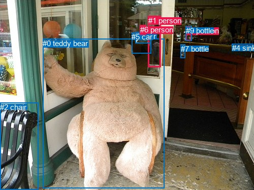
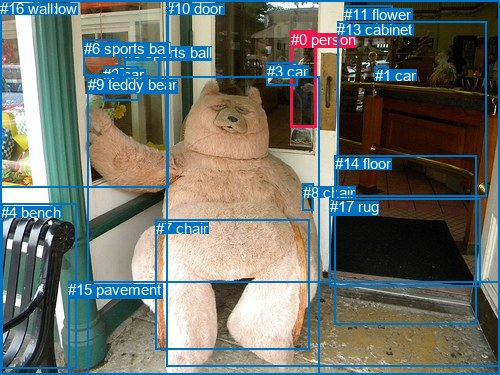

# 图片 1594：2390073.jpg

随机样本序号：14。图片 SHA256：`c3f1e039b14bec40394cec0cdcaf31f06c71cbe2723276731b209a16d0d39f11`。

红色框表示人，蓝色框表示其他物体。两个模式分别保留自身框编号，可依据位置比较对应对象。

## 自动检测框与输出

人的框编号：`[1, 6, 8]`。状态：`ok`。

### 自动检测全部物体框

| 编号 | 类别 | 是否为人 | 检测分数 | 像素坐标 xyxy |
|---|---|---|---|---|
| 0 | teddy bear | False | 0.9960 | 84.3, 76.6, 323.6, 371.3 |
| 1 | person | True | 0.9485 | 291.7, 31.7, 317.0, 132.0 |
| 2 | chair | False | 0.9134 | 0.0, 202.6, 75.5, 375.0 |
| 3 | car | False | 0.7840 | 266.3, 63.0, 297.6, 86.0 |
| 4 | sink | False | 0.5544 | 456.6, 86.0, 498.4, 96.0 |
| 5 | car | False | 0.5399 | 259.2, 64.3, 297.9, 105.8 |
| 6 | person | True | 0.4347 | 275.8, 49.6, 287.4, 68.5 |
| 7 | bottle | False | 0.3995 | 355.5, 87.5, 364.5, 114.1 |
| 8 | person | True | 0.3962 | 365.8, 51.8, 377.7, 81.0 |
| 9 | bottle | False | 0.3733 | 365.8, 51.8, 377.6, 81.0 |

### 自动检测 Top50 人相关候选

评分物体对：90；人相关物体对：48；输出关系：50。

| 排名 | 主语编号与类别 | 关系 | 宾语编号与类别 | 类型 | 人与人 | 排序分数 | 原始融合 logit |
|---|---|---|---|---|---|---|---|
| 1 | #1 person | looking at | #0 teddy bear | semantic | False | 0.96555 | 3.3331 |
| 2 | #1 person | looking at | #5 car | semantic | False | 0.94151 | 2.7786 |
| 3 | #1 person | beside | #5 car | spatial | False | 0.92204 | 2.4704 |
| 4 | #1 person | looking at | #3 car | semantic | False | 0.91274 | 2.3475 |
| 5 | #0 teddy bear | looking at | #1 person | semantic | False | 0.90511 | 2.2554 |
| 6 | #6 person | beside | #3 car | spatial | False | 0.90455 | 2.2488 |
| 7 | #0 teddy bear | beside | #1 person | spatial | False | 0.89852 | 2.1808 |
| 8 | #1 person | beside | #3 car | spatial | False | 0.89374 | 2.1295 |
| 9 | #6 person | beside | #5 car | spatial | False | 0.88520 | 2.0426 |
| 10 | #6 person | driving on | #3 car | semantic | False | 0.88033 | 1.9955 |
| 11 | #6 person | driving on | #5 car | semantic | False | 0.87765 | 1.9704 |
| 12 | #1 person | looking at | #6 person | semantic | True | 0.81487 | 1.4820 |
| 13 | #6 person | looking at | #0 teddy bear | semantic | False | 0.80910 | 1.4442 |
| 14 | #1 person | beside | #0 teddy bear | spatial | False | 0.78853 | 1.3161 |
| 15 | #7 bottle | on | #8 person | spatial | False | 0.73867 | 1.0391 |
| 16 | #8 person | over | #7 bottle | spatial | False | 0.73757 | 1.0334 |
| 17 | #9 bottle | parked on | #8 person | semantic | False | 0.73032 | 0.9962 |
| 18 | #8 person | parked on | #9 bottle | semantic | False | 0.72089 | 0.9489 |
| 19 | #9 bottle | attached to | #8 person | spatial | False | 0.66788 | 0.6986 |
| 20 | #8 person | parked on | #7 bottle | semantic | False | 0.66196 | 0.6721 |
| 21 | #0 teddy bear | beside | #6 person | spatial | False | 0.65358 | 0.6348 |
| 22 | #8 person | attached to | #9 bottle | spatial | False | 0.65323 | 0.6333 |
| 23 | #0 teddy bear | looking at | #6 person | semantic | False | 0.59403 | 0.3807 |
| 24 | #6 person | looking at | #1 person | semantic | True | 0.55682 | 0.2283 |
| 25 | #0 teddy bear | beside | #8 person | spatial | False | 0.52813 | 0.1126 |
| 26 | #8 person | looking at | #0 teddy bear | semantic | False | 0.51020 | 0.0408 |
| 27 | #1 person | beside | #6 person | spatial | True | 0.46738 | -0.1307 |
| 28 | #5 car | parked on | #6 person | semantic | False | 0.45761 | -0.1700 |
| 29 | #6 person | beside | #1 person | spatial | True | 0.43814 | -0.2487 |
| 30 | #5 car | beside | #6 person | spatial | False | 0.41676 | -0.3361 |
| 31 | #7 bottle | parked on | #8 person | semantic | False | 0.39713 | -0.4175 |
| 32 | #3 car | parked on | #6 person | semantic | False | 0.38396 | -0.4728 |
| 33 | #8 person | parked on | #4 sink | semantic | False | 0.34856 | -0.6254 |
| 34 | #1 person | looking at | #7 bottle | semantic | False | 0.34712 | -0.6317 |
| 35 | #8 person | parked on | #3 car | semantic | False | 0.32173 | -0.7458 |
| 36 | #1 person | sitting on | #4 sink | semantic | False | 0.29666 | -0.8633 |
| 37 | #3 car | beside | #6 person | spatial | False | 0.29366 | -0.8777 |
| 38 | #5 car | beside | #1 person | spatial | False | 0.29008 | -0.8950 |
| 39 | #1 person | beside | #7 bottle | spatial | False | 0.23606 | -1.1744 |
| 40 | #8 person | parked on | #5 car | semantic | False | 0.22506 | -1.2364 |
| 41 | #1 person | looking at | #8 person | semantic | True | 0.19273 | -1.4324 |
| 42 | #8 person | on | #4 sink | spatial | False | 0.19083 | -1.4446 |
| 43 | #1 person | looking at | #9 bottle | semantic | False | 0.18945 | -1.4536 |
| 44 | #1 person | leaning on | #4 sink | spatial | False | 0.18734 | -1.4674 |
| 45 | #3 car | beside | #1 person | spatial | False | 0.18564 | -1.4786 |
| 46 | #6 person | beside | #0 teddy bear | spatial | False | 0.17817 | -1.5288 |
| 47 | #5 car | looking at | #1 person | semantic | False | 0.17032 | -1.5833 |
| 48 | #0 teddy bear | sitting on | #8 person | semantic | False | 0.16684 | -1.6082 |
| 49 | #1 person | looking at | #2 chair | semantic | False | 0.16162 | -1.6462 |
| 50 | #7 bottle | beside | #1 person | spatial | False | 0.14560 | -1.7695 |

### 自动检测逐条人相关 GT 核验

本图没有人相关 GT，R@50 无分母；预测候选继续展示。

## 真实框与输出

人的框编号：`[0]`。

### 真实框全部物体框

| 编号 | 类别 | 是否为人 | 检测分数 | 像素坐标 xyxy |
|---|---|---|---|---|
| 0 | person | True | GT | 291.0, 31.0, 317.0, 128.0 |
| 1 | car | False | GT | 375.0, 67.0, 389.0, 80.0 |
| 2 | car | False | GT | 103.0, 66.0, 139.0, 100.0 |
| 3 | car | False | GT | 267.0, 63.0, 298.0, 86.0 |
| 4 | bench | False | GT | 1.0, 204.0, 77.0, 369.0 |
| 5 | sports ball | False | GT | 125.0, 44.0, 160.0, 82.0 |
| 6 | sports ball | False | GT | 84.0, 40.0, 120.0, 76.0 |
| 7 | chair | False | GT | 156.0, 220.0, 310.0, 350.0 |
| 8 | chair | False | GT | 303.0, 184.0, 314.0, 211.0 |
| 9 | teddy bear | False | GT | 88.0, 76.0, 320.0, 374.0 |
| 10 | door | False | GT | 166.0, 0.0, 500.0, 366.0 |
| 11 | flower | False | GT | 344.0, 6.0, 392.0, 27.0 |
| 12 | window | False | GT | 0.0, 0.0, 169.0, 187.0 |
| 13 | cabinet | False | GT | 337.0, 21.0, 486.0, 196.0 |
| 14 | floor | False | GT | 335.0, 155.0, 477.0, 324.0 |
| 15 | pavement | False | GT | 68.0, 281.0, 500.0, 375.0 |
| 16 | wall | False | GT | 0.0, 0.0, 500.0, 375.0 |
| 17 | rug | False | GT | 330.0, 198.0, 480.0, 286.0 |

### 真实框 Top50 人相关候选

评分物体对：306；人相关物体对：34；输出关系：50。

| 排名 | 主语编号与类别 | 关系 | 宾语编号与类别 | 类型 | 人与人 | 排序分数 | 原始融合 logit |
|---|---|---|---|---|---|---|---|
| 1 | #0 person | in | #16 wall | spatial | False | 0.97314 | 3.5899 |
| 2 | #0 person | in | #10 door | spatial | False | 0.97025 | 3.4847 |
| 3 | #0 person | looking at | #9 teddy bear | semantic | False | 0.79407 | 1.3496 |
| 4 | #0 person | looking at | #3 car | semantic | False | 0.67220 | 0.7181 |
| 5 | #0 person | in | #3 car | spatial | False | 0.65307 | 0.6326 |
| 6 | #0 person | looking at | #16 wall | semantic | False | 0.64627 | 0.6027 |
| 7 | #0 person | looking at | #10 door | semantic | False | 0.63293 | 0.5448 |
| 8 | #9 teddy bear | looking at | #0 person | semantic | False | 0.62742 | 0.5212 |
| 9 | #0 person | beside | #9 teddy bear | spatial | False | 0.55179 | 0.2079 |
| 10 | #3 car | beside | #0 person | spatial | False | 0.52360 | 0.0945 |
| 11 | #3 car | driving | #0 person | semantic | False | 0.47451 | -0.1021 |
| 12 | #9 teddy bear | in | #0 person | spatial | False | 0.28418 | -0.9238 |
| 13 | #0 person | in | #13 cabinet | spatial | False | 0.18898 | -1.4566 |
| 14 | #0 person | looking at | #13 cabinet | semantic | False | 0.15133 | -1.7242 |
| 15 | #0 person | in | #12 window | spatial | False | 0.07303 | -2.5410 |
| 16 | #11 flower | over | #0 person | spatial | False | 0.04656 | -3.0194 |
| 17 | #0 person | in | #1 car | spatial | False | 0.04555 | -3.0423 |
| 18 | #1 car | on | #0 person | spatial | False | 0.04470 | -3.0620 |
| 19 | #0 person | looking at | #2 car | semantic | False | 0.04116 | -3.1482 |
| 20 | #5 sports ball | on | #0 person | spatial | False | 0.03971 | -3.1857 |
| 21 | #16 wall | in | #0 person | spatial | False | 0.03913 | -3.2009 |
| 22 | #2 car | on | #0 person | spatial | False | 0.03625 | -3.2804 |
| 23 | #10 door | in | #0 person | spatial | False | 0.03381 | -3.3528 |
| 24 | #0 person | in | #2 car | spatial | False | 0.02998 | -3.4769 |
| 25 | #0 person | in | #11 flower | spatial | False | 0.02718 | -3.5776 |
| 26 | #0 person | looking at | #12 window | semantic | False | 0.02374 | -3.7164 |
| 27 | #0 person | in | #5 sports ball | spatial | False | 0.02317 | -3.7413 |
| 28 | #0 person | looking at | #5 sports ball | semantic | False | 0.02217 | -3.7865 |
| 29 | #0 person | looking at | #1 car | semantic | False | 0.02202 | -3.7935 |
| 30 | #0 person | on | #14 floor | spatial | False | 0.02088 | -3.8479 |
| 31 | #6 sports ball | in | #0 person | spatial | False | 0.02084 | -3.8500 |
| 32 | #13 cabinet | on | #0 person | spatial | False | 0.02042 | -3.8706 |
| 33 | #0 person | walking on | #14 floor | semantic | False | 0.01955 | -3.9148 |
| 34 | #2 car | looking at | #0 person | semantic | False | 0.01794 | -4.0024 |
| 35 | #0 person | holding | #11 flower | semantic | False | 0.01727 | -4.0411 |
| 36 | #0 person | looking at | #6 sports ball | semantic | False | 0.01558 | -4.1459 |
| 37 | #8 chair | on | #0 person | spatial | False | 0.01441 | -4.2251 |
| 38 | #11 flower | holding | #0 person | semantic | False | 0.01440 | -4.2257 |
| 39 | #0 person | in | #6 sports ball | spatial | False | 0.01419 | -4.2411 |
| 40 | #0 person | on | #15 pavement | spatial | False | 0.01336 | -4.3022 |
| 41 | #0 person | on | #7 chair | spatial | False | 0.01240 | -4.3779 |
| 42 | #17 rug | in front of | #0 person | spatial | False | 0.01222 | -4.3927 |
| 43 | #1 car | parked on | #0 person | semantic | False | 0.01212 | -4.4005 |
| 44 | #0 person | standing on | #15 pavement | semantic | False | 0.01052 | -4.5437 |
| 45 | #13 cabinet | looking at | #0 person | semantic | False | 0.00974 | -4.6219 |
| 46 | #4 bench | beside | #0 person | spatial | False | 0.00776 | -4.8511 |
| 47 | #0 person | beside | #4 bench | spatial | False | 0.00769 | -4.8607 |
| 48 | #10 door | holding | #0 person | semantic | False | 0.00764 | -4.8672 |
| 49 | #12 window | in | #0 person | spatial | False | 0.00736 | -4.9036 |
| 50 | #5 sports ball | looking at | #0 person | semantic | False | 0.00727 | -4.9168 |

### 真实框逐条人相关 GT 核验

本图没有人相关 GT，R@50 无分母；预测候选继续展示。

## 全部人相关 GT

| 主语编号与类别 | 关系 | 宾语编号与类别 |
|---|---|---|

原始记录、全部人相关物体对的两项预测与分项分数见 [逐图证据 JSON](../evidence/cases/1594.json)。全部56类 logits 保留于本机 HOR/output/random500/logits/。

<!-- HOR_COMPLETE_RESULTS -->

## 六组条件的完整输出对照

以下保留同一图片三种框与候选模式、两种谓词输出规则的全部 Top50。框编号各自在所属模式内解释。

### 自动检测框完整枚举：空间与语义各保留一个谓词

| 排名 | 主语编号与类别 | 谓词 | 宾语编号与类别 | 分组 | 排序分数 | predicate logit | pair logit |
|---|---|---|---|---|---|---|---|
| 1 | #1 person | looking at | #0 teddy bear | semantic | 0.9655455 | 4.0428376 | -0.7097835 |
| 2 | #1 person | looking at | #5 car | semantic | 0.9415083 | 3.0203009 | -0.2417024 |
| 3 | #1 person | beside | #5 car | spatial | 0.9220436 | 2.7121449 | -0.2417024 |
| 4 | #1 person | looking at | #3 car | semantic | 0.9127351 | 2.6294632 | -0.2819655 |
| 5 | #0 teddy bear | looking at | #1 person | semantic | 0.9051141 | 3.3589969 | -1.1036109 |
| 6 | #6 person | beside | #3 car | spatial | 0.9045488 | 2.3249483 | -0.0761275 |
| 7 | #0 teddy bear | beside | #1 person | spatial | 0.8985162 | 3.2844567 | -1.1036109 |
| 8 | #1 person | beside | #3 car | spatial | 0.8937401 | 2.4114923 | -0.2819655 |
| 9 | #6 person | beside | #5 car | spatial | 0.8851969 | 2.0834670 | -0.0408760 |
| 10 | #6 person | driving on | #3 car | semantic | 0.8803283 | 2.0716701 | -0.0761275 |
| 11 | #6 person | driving on | #5 car | semantic | 0.8776488 | 2.0112262 | -0.0408760 |
| 12 | #1 person | looking at | #6 person | semantic | 0.8148730 | 1.7704144 | -0.2884238 |
| 13 | #6 person | looking at | #0 teddy bear | semantic | 0.8090996 | 2.3248472 | -0.8806775 |
| 14 | #1 person | beside | #0 teddy bear | spatial | 0.7885326 | 2.0258865 | -0.7097835 |
| 15 | #7 bottle | on | #8 person | spatial | 0.7386743 | 1.5132332 | -0.4741435 |
| 16 | #8 person | over | #7 bottle | spatial | 0.7375655 | 1.1390777 | -0.1057242 |
| 17 | #9 bottle | parked on | #8 person | semantic | 0.7303178 | 1.3792381 | -0.3830029 |
| 18 | #8 person | parked on | #9 bottle | semantic | 0.7208918 | 1.3191476 | -0.3702579 |
| 19 | #9 bottle | attached to | #8 person | spatial | 0.6678756 | 1.0815949 | -0.3830029 |
| 20 | #8 person | parked on | #7 bottle | semantic | 0.6619631 | 0.7777791 | -0.1057242 |
| 21 | #0 teddy bear | beside | #6 person | spatial | 0.6535766 | 2.0791802 | -1.4443822 |
| 22 | #8 person | attached to | #9 bottle | spatial | 0.6532271 | 1.0035129 | -0.3702579 |
| 23 | #0 teddy bear | looking at | #6 person | semantic | 0.5940319 | 1.8250408 | -1.4443822 |
| 24 | #6 person | looking at | #1 person | semantic | 0.5568165 | 0.3023930 | -0.0741414 |
| 25 | #0 teddy bear | beside | #8 person | spatial | 0.5281321 | 2.0459881 | -1.9333407 |
| 26 | #8 person | looking at | #0 teddy bear | semantic | 0.5102044 | 1.2192497 | -1.1784263 |
| 27 | #1 person | beside | #6 person | spatial | 0.4673834 | 0.1577716 | -0.2884238 |
| 28 | #5 car | parked on | #6 person | semantic | 0.4576117 | 0.1140103 | -0.2839716 |
| 29 | #6 person | beside | #1 person | spatial | 0.4381355 | -0.1745911 | -0.0741414 |
| 30 | #5 car | beside | #6 person | spatial | 0.4167621 | -0.0521083 | -0.2839716 |
| 31 | #7 bottle | parked on | #8 person | semantic | 0.3971255 | 0.0566869 | -0.4741435 |
| 32 | #3 car | parked on | #6 person | semantic | 0.3839593 | -0.2171574 | -0.2556191 |
| 33 | #8 person | parked on | #4 sink | semantic | 0.3485627 | 0.0554366 | -0.6807999 |
| 34 | #1 person | looking at | #7 bottle | semantic | 0.3471172 | -0.0800781 | -0.5516570 |
| 35 | #8 person | parked on | #3 car | semantic | 0.3217266 | -0.2492342 | -0.4966140 |
| 36 | #1 person | sitting on | #4 sink | semantic | 0.2966560 | 0.4485936 | -1.3118663 |
| 37 | #3 car | beside | #6 person | spatial | 0.2936597 | -0.6220565 | -0.2556191 |
| 38 | #5 car | beside | #1 person | spatial | 0.2900762 | -0.7450526 | -0.1499615 |
| 39 | #1 person | beside | #7 bottle | spatial | 0.2360592 | -0.6227508 | -0.5516570 |
| 40 | #8 person | parked on | #5 car | semantic | 0.2250586 | -0.7600307 | -0.4763957 |
| 41 | #1 person | looking at | #8 person | semantic | 0.1927322 | -0.5538678 | -0.8784856 |
| 42 | #8 person | on | #4 sink | spatial | 0.1908344 | -0.7637973 | -0.6807999 |
| 43 | #1 person | looking at | #9 bottle | semantic | 0.1894494 | -0.5832620 | -0.8703302 |
| 44 | #1 person | leaning on | #4 sink | spatial | 0.1873445 | -0.1554918 | -1.3118663 |
| 45 | #3 car | beside | #1 person | spatial | 0.1856426 | -1.3602464 | -0.1183299 |
| 46 | #6 person | beside | #0 teddy bear | spatial | 0.1781726 | -0.6480999 | -0.8806775 |
| 47 | #5 car | looking at | #1 person | semantic | 0.1703247 | -1.4333665 | -0.1499615 |
| 48 | #0 teddy bear | sitting on | #8 person | semantic | 0.1668392 | 0.3251448 | -1.9333407 |
| 49 | #1 person | looking at | #2 chair | semantic | 0.1616197 | 0.3962183 | -2.0424440 |
| 50 | #7 bottle | beside | #1 person | spatial | 0.1456015 | -1.4198215 | -0.3497026 |

没有人相关 GT，本条件的召回率无分母。

### 自动检测框完整枚举：每对只保留一个谓词

| 排名 | 主语编号与类别 | 谓词 | 宾语编号与类别 | 分组 | 排序分数 | predicate logit | pair logit |
|---|---|---|---|---|---|---|---|
| 1 | #1 person | looking at | #0 teddy bear | single | 0.9655455 | 4.0428376 | -0.7097835 |
| 2 | #1 person | looking at | #5 car | single | 0.9415083 | 3.0203009 | -0.2417024 |
| 3 | #1 person | looking at | #3 car | single | 0.9127351 | 2.6294632 | -0.2819655 |
| 4 | #0 teddy bear | looking at | #1 person | single | 0.9051141 | 3.3589969 | -1.1036109 |
| 5 | #6 person | beside | #3 car | single | 0.9045488 | 2.3249483 | -0.0761275 |
| 6 | #6 person | beside | #5 car | single | 0.8851969 | 2.0834670 | -0.0408760 |
| 7 | #1 person | looking at | #6 person | single | 0.8148730 | 1.7704144 | -0.2884238 |
| 8 | #6 person | looking at | #0 teddy bear | single | 0.8090996 | 2.3248472 | -0.8806775 |
| 9 | #7 bottle | on | #8 person | single | 0.7386743 | 1.5132332 | -0.4741435 |
| 10 | #8 person | over | #7 bottle | single | 0.7375655 | 1.1390777 | -0.1057242 |
| 11 | #9 bottle | parked on | #8 person | single | 0.7303178 | 1.3792381 | -0.3830029 |
| 12 | #8 person | parked on | #9 bottle | single | 0.7208918 | 1.3191476 | -0.3702579 |
| 13 | #0 teddy bear | beside | #6 person | single | 0.6535766 | 2.0791802 | -1.4443822 |
| 14 | #6 person | looking at | #1 person | single | 0.5568165 | 0.3023930 | -0.0741414 |
| 15 | #0 teddy bear | beside | #8 person | single | 0.5281321 | 2.0459881 | -1.9333407 |
| 16 | #8 person | looking at | #0 teddy bear | single | 0.5102044 | 1.2192497 | -1.1784263 |
| 17 | #5 car | parked on | #6 person | single | 0.4576117 | 0.1140103 | -0.2839716 |
| 18 | #3 car | parked on | #6 person | single | 0.3839593 | -0.2171574 | -0.2556191 |
| 19 | #8 person | parked on | #4 sink | single | 0.3485627 | 0.0554366 | -0.6807999 |
| 20 | #1 person | looking at | #7 bottle | single | 0.3471172 | -0.0800781 | -0.5516570 |
| 21 | #8 person | parked on | #3 car | single | 0.3217266 | -0.2492342 | -0.4966140 |
| 22 | #1 person | sitting on | #4 sink | single | 0.2966560 | 0.4485936 | -1.3118663 |
| 23 | #5 car | beside | #1 person | single | 0.2900762 | -0.7450526 | -0.1499615 |
| 24 | #8 person | parked on | #5 car | single | 0.2250586 | -0.7600307 | -0.4763957 |
| 25 | #1 person | looking at | #8 person | single | 0.1927322 | -0.5538678 | -0.8784856 |
| 26 | #1 person | looking at | #9 bottle | single | 0.1894494 | -0.5832620 | -0.8703302 |
| 27 | #3 car | beside | #1 person | single | 0.1856426 | -1.3602464 | -0.1183299 |
| 28 | #1 person | looking at | #2 chair | single | 0.1616197 | 0.3962183 | -2.0424440 |
| 29 | #7 bottle | beside | #1 person | single | 0.1456015 | -1.4198215 | -0.3497026 |
| 30 | #6 person | sitting on | #4 sink | single | 0.1402383 | -0.4977865 | -1.3155258 |
| 31 | #8 person | looking at | #1 person | single | 0.1153476 | -1.5540149 | -0.4832301 |
| 32 | #9 bottle | looking at | #1 person | single | 0.1146478 | -1.5541785 | -0.4899418 |
| 33 | #6 person | looking at | #7 bottle | single | 0.0875068 | -1.8541541 | -0.4903100 |
| 34 | #4 sink | in front of | #6 person | single | 0.0593560 | -1.5203397 | -1.2426718 |
| 35 | #3 car | parked on | #8 person | single | 0.0543231 | -2.2791207 | -0.5778308 |
| 36 | #5 car | parked on | #8 person | single | 0.0501702 | -2.2784193 | -0.6624424 |
| 37 | #8 person | parked on | #6 person | single | 0.0498701 | -2.3829150 | -0.5642629 |
| 38 | #9 bottle | parked on | #6 person | single | 0.0496176 | -2.3828979 | -0.5696201 |
| 39 | #4 sink | in front of | #8 person | single | 0.0463784 | -1.9447162 | -1.0787164 |
| 40 | #7 bottle | in front of | #6 person | single | 0.0453488 | -2.3841383 | -0.6628245 |
| 41 | #4 sink | in front of | #1 person | single | 0.0437602 | -1.8611817 | -1.2231033 |
| 42 | #6 person | looking at | #2 chair | single | 0.0329752 | -1.1001511 | -2.2783163 |
| 43 | #6 person | parked on | #9 bottle | single | 0.0304661 | -2.7584591 | -0.7017403 |
| 44 | #6 person | parked on | #8 person | single | 0.0297416 | -2.7734818 | -0.7115356 |
| 45 | #2 chair | sitting on | #1 person | single | 0.0265093 | -1.7855678 | -1.8178267 |
| 46 | #8 person | parked on | #2 chair | single | 0.0104139 | -2.1883743 | -2.3657701 |
| 47 | #2 chair | sitting on | #6 person | single | 0.0081906 | -2.5811100 | -2.2154312 |
| 48 | #2 chair | sitting on | #8 person | single | 0.0077305 | -2.5841322 | -2.2706838 |

没有人相关 GT，本条件的召回率无分母。

### 真实框完整枚举：空间与语义各保留一个谓词

| 排名 | 主语编号与类别 | 谓词 | 宾语编号与类别 | 分组 | 排序分数 | predicate logit | pair logit |
|---|---|---|---|---|---|---|---|
| 1 | #0 person | in | #16 wall | spatial | 0.9731409 | 3.6926417 | -0.1027155 |
| 2 | #0 person | in | #10 door | spatial | 0.9702505 | 3.7391038 | -0.2543614 |
| 3 | #0 person | looking at | #9 teddy bear | semantic | 0.7940697 | 2.0596046 | -0.7099712 |
| 4 | #0 person | looking at | #3 car | semantic | 0.6721987 | 0.9600425 | -0.2418962 |
| 5 | #0 person | in | #3 car | spatial | 0.6530719 | 0.8744659 | -0.2418962 |
| 6 | #0 person | looking at | #16 wall | semantic | 0.6462678 | 0.7053895 | -0.1027155 |
| 7 | #0 person | looking at | #10 door | semantic | 0.6329256 | 0.7991495 | -0.2543614 |
| 8 | #9 teddy bear | looking at | #0 person | semantic | 0.6274188 | 1.6685266 | -1.1473675 |
| 9 | #0 person | beside | #9 teddy bear | spatial | 0.5517928 | 0.9178882 | -0.7099712 |
| 10 | #3 car | beside | #0 person | spatial | 0.5236014 | 0.2237368 | -0.1292608 |
| 11 | #3 car | driving | #0 person | semantic | 0.4745090 | 0.0272083 | -0.1292608 |
| 12 | #9 teddy bear | in | #0 person | spatial | 0.2841762 | 0.2235279 | -1.1473675 |
| 13 | #0 person | in | #13 cabinet | spatial | 0.1889807 | -0.5962415 | -0.8604053 |
| 14 | #0 person | looking at | #13 cabinet | semantic | 0.1513330 | -0.8637788 | -0.8604053 |
| 15 | #0 person | in | #12 window | spatial | 0.0730331 | -1.2079618 | -1.3330431 |
| 16 | #11 flower | over | #0 person | spatial | 0.0465586 | -2.2189882 | -0.8003783 |
| 17 | #0 person | in | #1 car | spatial | 0.0455505 | -2.1450150 | -0.8972988 |
| 18 | #1 car | on | #0 person | spatial | 0.0447016 | -2.4869192 | -0.5750953 |
| 19 | #0 person | looking at | #2 car | semantic | 0.0411613 | -1.7818022 | -1.3664212 |
| 20 | #5 sports ball | on | #0 person | spatial | 0.0397078 | -2.0745404 | -1.1111507 |
| 21 | #16 wall | in | #0 person | spatial | 0.0391326 | -2.1166387 | -1.0842419 |
| 22 | #2 car | on | #0 person | spatial | 0.0362484 | -2.1031435 | -1.1772959 |
| 23 | #10 door | in | #0 person | spatial | 0.0338051 | -2.0795760 | -1.2731783 |
| 24 | #0 person | in | #2 car | spatial | 0.0299760 | -2.1105039 | -1.3664212 |
| 25 | #0 person | in | #11 flower | spatial | 0.0271840 | -2.5057001 | -1.0718663 |
| 26 | #0 person | looking at | #12 window | semantic | 0.0237439 | -2.3833544 | -1.3330431 |
| 27 | #0 person | in | #5 sports ball | spatial | 0.0231744 | -2.2480111 | -1.4932466 |
| 28 | #0 person | looking at | #5 sports ball | semantic | 0.0221718 | -2.2932663 | -1.4932466 |
| 29 | #0 person | looking at | #1 car | semantic | 0.0220217 | -2.8961585 | -0.8972988 |
| 30 | #0 person | on | #14 floor | spatial | 0.0208785 | -2.4997058 | -1.3482277 |
| 31 | #6 sports ball | in | #0 person | spatial | 0.0208364 | -2.5972991 | -1.2526991 |
| 32 | #13 cabinet | on | #0 person | spatial | 0.0204197 | -2.5687356 | -1.3018899 |
| 33 | #0 person | walking on | #14 floor | semantic | 0.0195538 | -2.5666113 | -1.3482277 |
| 34 | #2 car | looking at | #0 person | semantic | 0.0179437 | -2.8251138 | -1.1772959 |
| 35 | #0 person | holding | #11 flower | semantic | 0.0172743 | -2.9692426 | -1.0718663 |
| 36 | #0 person | looking at | #6 sports ball | semantic | 0.0155819 | -2.5152028 | -1.6307361 |
| 37 | #8 chair | on | #0 person | spatial | 0.0144137 | -2.8362126 | -1.3888415 |
| 38 | #11 flower | holding | #0 person | semantic | 0.0144042 | -3.4253497 | -0.8003783 |
| 39 | #0 person | in | #6 sports ball | spatial | 0.0141876 | -2.6103616 | -1.6307361 |
| 40 | #0 person | on | #15 pavement | spatial | 0.0133581 | -2.8809292 | -1.4212533 |
| 41 | #0 person | on | #7 chair | spatial | 0.0123955 | -2.6740191 | -1.7039267 |
| 42 | #17 rug | in front of | #0 person | spatial | 0.0122158 | -3.1692853 | -1.2234465 |
| 43 | #1 car | parked on | #0 person | semantic | 0.0121223 | -3.8254147 | -0.5750953 |
| 44 | #0 person | standing on | #15 pavement | semantic | 0.0105225 | -3.1224036 | -1.4212533 |
| 45 | #13 cabinet | looking at | #0 person | semantic | 0.0097387 | -3.3199692 | -1.3018899 |
| 46 | #4 bench | beside | #0 person | spatial | 0.0077594 | -2.9982443 | -1.8528223 |
| 47 | #0 person | beside | #4 bench | spatial | 0.0076854 | -2.7845206 | -2.0761924 |
| 48 | #10 door | holding | #0 person | semantic | 0.0076361 | -3.5940280 | -1.2731783 |
| 49 | #12 window | in | #0 person | spatial | 0.0073648 | -3.3228180 | -1.5808295 |
| 50 | #5 sports ball | looking at | #0 person | semantic | 0.0072695 | -3.8056149 | -1.1111507 |

没有人相关 GT，本条件的召回率无分母。

### 真实框完整枚举：每对只保留一个谓词

| 排名 | 主语编号与类别 | 谓词 | 宾语编号与类别 | 分组 | 排序分数 | predicate logit | pair logit |
|---|---|---|---|---|---|---|---|
| 1 | #0 person | in | #16 wall | single | 0.9731409 | 3.6926417 | -0.1027155 |
| 2 | #0 person | in | #10 door | single | 0.9702505 | 3.7391038 | -0.2543614 |
| 3 | #0 person | looking at | #9 teddy bear | single | 0.7940697 | 2.0596046 | -0.7099712 |
| 4 | #0 person | looking at | #3 car | single | 0.6721987 | 0.9600425 | -0.2418962 |
| 5 | #9 teddy bear | looking at | #0 person | single | 0.6274188 | 1.6685266 | -1.1473675 |
| 6 | #3 car | beside | #0 person | single | 0.5236014 | 0.2237368 | -0.1292608 |
| 7 | #0 person | in | #13 cabinet | single | 0.1889807 | -0.5962415 | -0.8604053 |
| 8 | #0 person | in | #12 window | single | 0.0730331 | -1.2079618 | -1.3330431 |
| 9 | #11 flower | over | #0 person | single | 0.0465586 | -2.2189882 | -0.8003783 |
| 10 | #0 person | in | #1 car | single | 0.0455505 | -2.1450150 | -0.8972988 |
| 11 | #1 car | on | #0 person | single | 0.0447016 | -2.4869192 | -0.5750953 |
| 12 | #0 person | looking at | #2 car | single | 0.0411613 | -1.7818022 | -1.3664212 |
| 13 | #5 sports ball | on | #0 person | single | 0.0397078 | -2.0745404 | -1.1111507 |
| 14 | #16 wall | in | #0 person | single | 0.0391326 | -2.1166387 | -1.0842419 |
| 15 | #2 car | on | #0 person | single | 0.0362484 | -2.1031435 | -1.1772959 |
| 16 | #10 door | in | #0 person | single | 0.0338051 | -2.0795760 | -1.2731783 |
| 17 | #0 person | in | #11 flower | single | 0.0271840 | -2.5057001 | -1.0718663 |
| 18 | #0 person | in | #5 sports ball | single | 0.0231744 | -2.2480111 | -1.4932466 |
| 19 | #0 person | on | #14 floor | single | 0.0208785 | -2.4997058 | -1.3482277 |
| 20 | #6 sports ball | in | #0 person | single | 0.0208364 | -2.5972991 | -1.2526991 |
| 21 | #13 cabinet | on | #0 person | single | 0.0204197 | -2.5687356 | -1.3018899 |
| 22 | #0 person | looking at | #6 sports ball | single | 0.0155819 | -2.5152028 | -1.6307361 |
| 23 | #8 chair | on | #0 person | single | 0.0144137 | -2.8362126 | -1.3888415 |
| 24 | #0 person | on | #15 pavement | single | 0.0133581 | -2.8809292 | -1.4212533 |
| 25 | #0 person | on | #7 chair | single | 0.0123955 | -2.6740191 | -1.7039267 |
| 26 | #17 rug | in front of | #0 person | single | 0.0122158 | -3.1692853 | -1.2234465 |
| 27 | #4 bench | beside | #0 person | single | 0.0077594 | -2.9982443 | -1.8528223 |
| 28 | #0 person | beside | #4 bench | single | 0.0076854 | -2.7845206 | -2.0761924 |
| 29 | #12 window | in | #0 person | single | 0.0073648 | -3.3228180 | -1.5808295 |
| 30 | #0 person | on | #17 rug | single | 0.0070968 | -3.4306085 | -1.5103803 |
| 31 | #14 floor | in | #0 person | single | 0.0064287 | -3.6106730 | -1.4298666 |
| 32 | #0 person | wearing | #8 chair | single | 0.0063382 | -3.7448509 | -1.3099566 |
| 33 | #7 chair | on | #0 person | single | 0.0027682 | -3.7511568 | -2.1356163 |
| 34 | #15 pavement | in | #0 person | single | 0.0022787 | -4.4728065 | -1.6090420 |

没有人相关 GT，本条件的召回率无分母。

### 真实框400候选：空间与语义各保留一个谓词

| 排名 | 主语编号与类别 | 谓词 | 宾语编号与类别 | 分组 | 排序分数 | predicate logit | pair logit |
|---|---|---|---|---|---|---|---|
| 1 | #0 person | in | #16 wall | spatial | 0.9731409 | 3.6926417 | -0.1027155 |
| 2 | #0 person | in | #10 door | spatial | 0.9702505 | 3.7391038 | -0.2543614 |
| 3 | #0 person | looking at | #9 teddy bear | semantic | 0.7941837 | 2.0603018 | -0.7099712 |
| 4 | #0 person | looking at | #3 car | semantic | 0.6721987 | 0.9600425 | -0.2418962 |
| 5 | #0 person | in | #3 car | spatial | 0.6523196 | 0.8711472 | -0.2418962 |
| 6 | #0 person | looking at | #16 wall | semantic | 0.6462678 | 0.7053895 | -0.1027155 |
| 7 | #0 person | looking at | #10 door | semantic | 0.6329256 | 0.7991495 | -0.2543614 |
| 8 | #9 teddy bear | looking at | #0 person | semantic | 0.6273373 | 1.6681781 | -1.1473675 |
| 9 | #0 person | beside | #9 teddy bear | spatial | 0.5518072 | 0.9179463 | -0.7099712 |
| 10 | #3 car | beside | #0 person | spatial | 0.5236087 | 0.2237659 | -0.1292608 |
| 11 | #3 car | driving | #0 person | semantic | 0.4745090 | 0.0272083 | -0.1292608 |
| 12 | #9 teddy bear | in | #0 person | spatial | 0.2841762 | 0.2235279 | -1.1473675 |
| 13 | #0 person | in | #13 cabinet | spatial | 0.1894899 | -0.5929227 | -0.8604053 |
| 14 | #0 person | looking at | #13 cabinet | semantic | 0.1513330 | -0.8637788 | -0.8604053 |
| 15 | #0 person | in | #12 window | spatial | 0.0729770 | -1.2087915 | -1.3330431 |
| 16 | #0 person | in | #1 car | spatial | 0.0455595 | -2.1448073 | -0.8972988 |
| 17 | #1 car | on | #0 person | spatial | 0.0450548 | -2.4786797 | -0.5750953 |
| 18 | #11 flower | over | #0 person | spatial | 0.0449346 | -2.2561929 | -0.8003783 |
| 19 | #0 person | looking at | #2 car | semantic | 0.0411596 | -1.7818458 | -1.3664212 |
| 20 | #5 sports ball | on | #0 person | spatial | 0.0397857 | -2.0724986 | -1.1111507 |
| 21 | #16 wall | in | #0 person | spatial | 0.0390703 | -2.1182981 | -1.0842419 |
| 22 | #2 car | on | #0 person | spatial | 0.0361623 | -2.1056106 | -1.1772959 |
| 23 | #10 door | in | #0 person | spatial | 0.0337509 | -2.0812354 | -1.2731783 |
| 24 | #0 person | in | #2 car | spatial | 0.0299699 | -2.1107111 | -1.3664212 |
| 25 | #0 person | in | #11 flower | spatial | 0.0271183 | -2.5081892 | -1.0718663 |
| 26 | #0 person | looking at | #12 window | semantic | 0.0237460 | -2.3832672 | -1.3330431 |
| 27 | #0 person | in | #5 sports ball | spatial | 0.0231246 | -2.2502151 | -1.4932466 |
| 28 | #0 person | looking at | #1 car | semantic | 0.0220236 | -2.8960714 | -0.8972988 |
| 29 | #0 person | looking at | #5 sports ball | semantic | 0.0215434 | -2.3226602 | -1.4932466 |
| 30 | #6 sports ball | in | #0 person | spatial | 0.0209042 | -2.5939803 | -1.2526991 |
| 31 | #0 person | on | #14 floor | spatial | 0.0208507 | -2.5010669 | -1.3482277 |
| 32 | #13 cabinet | on | #0 person | spatial | 0.0205289 | -2.5632906 | -1.3018899 |
| 33 | #0 person | walking on | #14 floor | semantic | 0.0195538 | -2.5666113 | -1.3482277 |
| 34 | #2 car | looking at | #0 person | semantic | 0.0178192 | -2.8322010 | -1.1772959 |
| 35 | #0 person | holding | #11 flower | semantic | 0.0172493 | -2.9707198 | -1.0718663 |
| 36 | #0 person | looking at | #6 sports ball | semantic | 0.0158144 | -2.5001571 | -1.6307361 |
| 37 | #8 chair | on | #0 person | spatial | 0.0146891 | -2.8170109 | -1.3888415 |
| 38 | #0 person | in | #6 sports ball | spatial | 0.0142341 | -2.6070428 | -1.6307361 |
| 39 | #11 flower | holding | #0 person | semantic | 0.0142335 | -3.4374413 | -0.8003783 |
| 40 | #0 person | on | #15 pavement | spatial | 0.0131613 | -2.8959751 | -1.4212533 |
| 41 | #0 person | on | #7 chair | spatial | 0.0125094 | -2.6647584 | -1.7039267 |
| 42 | #17 rug | in front of | #0 person | spatial | 0.0123950 | -3.1545463 | -1.2234465 |
| 43 | #1 car | parked on | #0 person | semantic | 0.0118993 | -3.8442073 | -0.5750953 |
| 44 | #0 person | standing on | #15 pavement | semantic | 0.0104927 | -3.1252728 | -1.4212533 |
| 45 | #13 cabinet | looking at | #0 person | semantic | 0.0098815 | -3.3052723 | -1.3018899 |
| 46 | #0 person | beside | #4 bench | spatial | 0.0076283 | -2.7920437 | -2.0761924 |
| 47 | #10 door | holding | #0 person | semantic | 0.0076081 | -3.5977206 | -1.2731783 |
| 48 | #4 bench | beside | #0 person | spatial | 0.0075315 | -3.0282776 | -1.8528223 |
| 49 | #12 window | in | #0 person | spatial | 0.0073406 | -3.3261368 | -1.5808295 |
| 50 | #5 sports ball | looking at | #0 person | semantic | 0.0072964 | -3.8018970 | -1.1111507 |

没有人相关 GT，本条件的召回率无分母。

### 真实框400候选：每对只保留一个谓词

| 排名 | 主语编号与类别 | 谓词 | 宾语编号与类别 | 分组 | 排序分数 | predicate logit | pair logit |
|---|---|---|---|---|---|---|---|
| 1 | #0 person | in | #16 wall | single | 0.9731409 | 3.6926417 | -0.1027155 |
| 2 | #0 person | in | #10 door | single | 0.9702505 | 3.7391038 | -0.2543614 |
| 3 | #0 person | looking at | #9 teddy bear | single | 0.7941837 | 2.0603018 | -0.7099712 |
| 4 | #0 person | looking at | #3 car | single | 0.6721987 | 0.9600425 | -0.2418962 |
| 5 | #9 teddy bear | looking at | #0 person | single | 0.6273373 | 1.6681781 | -1.1473675 |
| 6 | #3 car | beside | #0 person | single | 0.5236087 | 0.2237659 | -0.1292608 |
| 7 | #0 person | in | #13 cabinet | single | 0.1894899 | -0.5929227 | -0.8604053 |
| 8 | #0 person | in | #12 window | single | 0.0729770 | -1.2087915 | -1.3330431 |
| 9 | #0 person | in | #1 car | single | 0.0455595 | -2.1448073 | -0.8972988 |
| 10 | #1 car | on | #0 person | single | 0.0450548 | -2.4786797 | -0.5750953 |
| 11 | #11 flower | over | #0 person | single | 0.0449346 | -2.2561929 | -0.8003783 |
| 12 | #0 person | looking at | #2 car | single | 0.0411596 | -1.7818458 | -1.3664212 |
| 13 | #5 sports ball | on | #0 person | single | 0.0397857 | -2.0724986 | -1.1111507 |
| 14 | #16 wall | in | #0 person | single | 0.0390703 | -2.1182981 | -1.0842419 |
| 15 | #2 car | on | #0 person | single | 0.0361623 | -2.1056106 | -1.1772959 |
| 16 | #10 door | in | #0 person | single | 0.0337509 | -2.0812354 | -1.2731783 |
| 17 | #0 person | in | #11 flower | single | 0.0271183 | -2.5081892 | -1.0718663 |
| 18 | #0 person | in | #5 sports ball | single | 0.0231246 | -2.2502151 | -1.4932466 |
| 19 | #6 sports ball | in | #0 person | single | 0.0209042 | -2.5939803 | -1.2526991 |
| 20 | #0 person | on | #14 floor | single | 0.0208507 | -2.5010669 | -1.3482277 |
| 21 | #13 cabinet | on | #0 person | single | 0.0205289 | -2.5632906 | -1.3018899 |
| 22 | #0 person | looking at | #6 sports ball | single | 0.0158144 | -2.5001571 | -1.6307361 |
| 23 | #8 chair | on | #0 person | single | 0.0146891 | -2.8170109 | -1.3888415 |
| 24 | #0 person | on | #15 pavement | single | 0.0131613 | -2.8959751 | -1.4212533 |
| 25 | #0 person | on | #7 chair | single | 0.0125094 | -2.6647584 | -1.7039267 |
| 26 | #17 rug | in front of | #0 person | single | 0.0123950 | -3.1545463 | -1.2234465 |
| 27 | #0 person | beside | #4 bench | single | 0.0076283 | -2.7920437 | -2.0761924 |
| 28 | #4 bench | beside | #0 person | single | 0.0075315 | -3.0282776 | -1.8528223 |
| 29 | #12 window | in | #0 person | single | 0.0073406 | -3.3261368 | -1.5808295 |
| 30 | #0 person | on | #17 rug | single | 0.0072036 | -3.4155629 | -1.5103803 |
| 31 | #0 person | wearing | #8 chair | single | 0.0064831 | -3.7220945 | -1.3099566 |
| 32 | #14 floor | in | #0 person | single | 0.0064662 | -3.6048098 | -1.4298666 |
| 33 | #7 chair | on | #0 person | single | 0.0027758 | -3.7484345 | -2.1356163 |
| 34 | #15 pavement | in | #0 person | single | 0.0022655 | -4.4786701 | -1.6090420 |

没有人相关 GT，本条件的召回率无分母。
