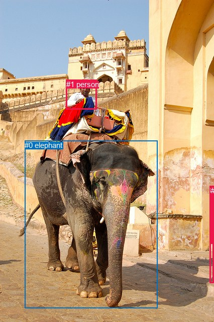
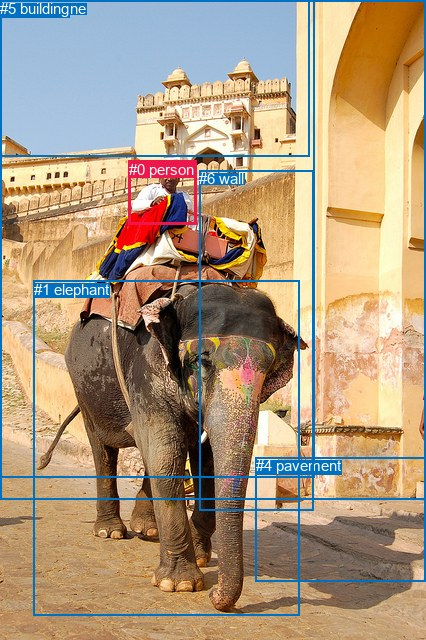

# 图片 1596：2390113.jpg

随机样本序号：64。图片 SHA256：`6774fb650081bd03fedb03b1c26b85de477afa0086cbbf157b2fde2dc03d6628`。

红色框表示人，蓝色框表示其他物体。两个模式分别保留自身框编号，可依据位置比较对应对象。

## 自动检测框与输出

人的框编号：`[1, 2, 3]`。状态：`ok`。

### 自动检测全部物体框

| 编号 | 类别 | 是否为人 | 检测分数 | 像素坐标 xyxy |
|---|---|---|---|---|
| 0 | elephant | False | 0.9997 | 49.4, 279.9, 313.1, 612.9 |
| 1 | person | True | 0.9689 | 131.6, 158.8, 192.2, 217.0 |
| 2 | person | True | 0.6808 | 417.7, 369.5, 425.9, 562.4 |
| 3 | person | True | 0.3655 | 420.1, 370.2, 425.8, 484.3 |

### 自动检测 Top50 人相关候选

评分物体对：12；人相关物体对：12；输出关系：24。

| 排名 | 主语编号与类别 | 关系 | 宾语编号与类别 | 类型 | 人与人 | 排序分数 | 原始融合 logit |
|---|---|---|---|---|---|---|---|
| 1 | #1 person | riding | #0 elephant | semantic | False | 0.97546 | 3.6826 |
| 2 | #3 person | on | #2 person | spatial | True | 0.97355 | 3.6058 |
| 3 | #2 person | wearing | #3 person | semantic | True | 0.96688 | 3.3738 |
| 4 | #1 person | on | #0 elephant | spatial | False | 0.94951 | 2.9342 |
| 5 | #2 person | walking on | #0 elephant | semantic | False | 0.91458 | 2.3708 |
| 6 | #2 person | in | #3 person | spatial | True | 0.91041 | 2.3187 |
| 7 | #3 person | walking on | #0 elephant | semantic | False | 0.90699 | 2.2774 |
| 8 | #3 person | standing on | #2 person | semantic | True | 0.84618 | 1.7050 |
| 9 | #0 elephant | carrying | #1 person | semantic | False | 0.72268 | 0.9578 |
| 10 | #3 person | on | #0 elephant | spatial | False | 0.70238 | 0.8587 |
| 11 | #2 person | beside | #0 elephant | spatial | False | 0.57717 | 0.3112 |
| 12 | #3 person | beside | #1 person | spatial | True | 0.30488 | -0.8242 |
| 13 | #3 person | walking on | #1 person | semantic | True | 0.29783 | -0.8577 |
| 14 | #2 person | wearing | #1 person | semantic | True | 0.29349 | -0.8785 |
| 15 | #2 person | on | #1 person | spatial | True | 0.22228 | -1.2525 |
| 16 | #0 elephant | in | #1 person | spatial | False | 0.14278 | -1.7924 |
| 17 | #0 elephant | walking on | #2 person | semantic | False | 0.08579 | -2.3662 |
| 18 | #0 elephant | in | #2 person | spatial | False | 0.05349 | -2.8733 |
| 19 | #0 elephant | walking on | #3 person | semantic | False | 0.03264 | -3.3890 |
| 20 | #1 person | wearing | #3 person | semantic | True | 0.02784 | -3.5529 |
| 21 | #1 person | on | #2 person | spatial | True | 0.02322 | -3.7394 |
| 22 | #1 person | wearing | #2 person | semantic | True | 0.02303 | -3.7475 |
| 23 | #1 person | over | #3 person | spatial | True | 0.02046 | -3.8684 |
| 24 | #0 elephant | in | #3 person | spatial | False | 0.01623 | -4.1048 |

### 自动检测逐条人相关 GT 核验

R@50：100.00%；命中 1/1。

| GT 主语编号 | GT 关系 | GT 宾语编号 | 结果阶段 | 匹配预测主语编号 | 匹配预测宾语编号 |
|---|---|---|---|---|---|
| 0 | riding | 1 | hit50 | [1] | [0] |

## 真实框与输出

人的框编号：`[0]`。

### 真实框全部物体框

| 编号 | 类别 | 是否为人 | 检测分数 | 像素坐标 xyxy |
|---|---|---|---|---|
| 0 | person | True | GT | 129.0, 161.0, 197.0, 225.0 |
| 1 | elephant | False | GT | 34.0, 281.0, 300.0, 616.0 |
| 2 | wall-stone | False | GT | 0.0, 0.0, 314.0, 478.0 |
| 3 | sky | False | GT | 0.0, 0.0, 310.0, 156.0 |
| 4 | pavement | False | GT | 256.0, 457.0, 426.0, 581.0 |
| 5 | building | False | GT | 0.0, 0.0, 426.0, 499.0 |
| 6 | wall | False | GT | 199.0, 170.0, 313.0, 510.0 |

### 真实框 Top50 人相关候选

评分物体对：42；人相关物体对：12；输出关系：24。

| 排名 | 主语编号与类别 | 关系 | 宾语编号与类别 | 类型 | 人与人 | 排序分数 | 原始融合 logit |
|---|---|---|---|---|---|---|---|
| 1 | #0 person | riding | #1 elephant | semantic | False | 0.98956 | 4.5512 |
| 2 | #0 person | on | #1 elephant | spatial | False | 0.95990 | 3.1754 |
| 3 | #0 person | riding | #6 wall | semantic | False | 0.88480 | 2.0387 |
| 4 | #0 person | on | #6 wall | spatial | False | 0.84919 | 1.7282 |
| 5 | #1 elephant | carrying | #0 person | semantic | False | 0.73008 | 0.9950 |
| 6 | #0 person | in | #2 wall-stone | spatial | False | 0.68032 | 0.7552 |
| 7 | #0 person | in | #5 building | spatial | False | 0.39669 | -0.4193 |
| 8 | #6 wall | wearing | #0 person | semantic | False | 0.34097 | -0.6590 |
| 9 | #3 sky | over | #0 person | spatial | False | 0.26540 | -1.0181 |
| 10 | #0 person | in | #3 sky | spatial | False | 0.23194 | -1.1974 |
| 11 | #1 elephant | in | #0 person | spatial | False | 0.18556 | -1.4791 |
| 12 | #0 person | wearing | #2 wall-stone | semantic | False | 0.08891 | -2.3270 |
| 13 | #6 wall | in | #0 person | spatial | False | 0.08305 | -2.4017 |
| 14 | #0 person | looking at | #3 sky | semantic | False | 0.08223 | -2.4124 |
| 15 | #0 person | sitting on | #5 building | semantic | False | 0.07519 | -2.5096 |
| 16 | #0 person | on | #4 pavement | spatial | False | 0.06733 | -2.6285 |
| 17 | #5 building | beside | #0 person | spatial | False | 0.02684 | -3.5908 |
| 18 | #2 wall-stone | on | #0 person | spatial | False | 0.01819 | -3.9885 |
| 19 | #2 wall-stone | wearing | #0 person | semantic | False | 0.01581 | -4.1311 |
| 20 | #3 sky | flying over | #0 person | semantic | False | 0.01418 | -4.2416 |
| 21 | #0 person | walking on | #4 pavement | semantic | False | 0.01085 | -4.5128 |
| 22 | #4 pavement | beside | #0 person | spatial | False | 0.00865 | -4.7420 |
| 23 | #5 building | holding | #0 person | semantic | False | 0.00548 | -5.2010 |
| 24 | #4 pavement | holding | #0 person | semantic | False | 0.00193 | -6.2466 |

### 真实框逐条人相关 GT 核验

R@50：100.00%；命中 1/1。

| GT 主语编号 | GT 关系 | GT 宾语编号 | 结果阶段 | 匹配预测主语编号 | 匹配预测宾语编号 |
|---|---|---|---|---|---|
| 0 | riding | 1 | hit50 | [0] | [1] |

## 全部人相关 GT

| 主语编号与类别 | 关系 | 宾语编号与类别 |
|---|---|---|
| #0 person | riding | #1 elephant |

原始记录、全部人相关物体对的两项预测与分项分数见 [逐图证据 JSON](../evidence/cases/1596.json)。全部56类 logits 保留于本机 HOR/output/random500/logits/。

<!-- HOR_COMPLETE_RESULTS -->

## 六组条件的完整输出对照

以下保留同一图片三种框与候选模式、两种谓词输出规则的全部 Top50。框编号各自在所属模式内解释。

### 自动检测框完整枚举：空间与语义各保留一个谓词

| 排名 | 主语编号与类别 | 谓词 | 宾语编号与类别 | 分组 | 排序分数 | predicate logit | pair logit |
|---|---|---|---|---|---|---|---|
| 1 | #1 person | riding | #0 elephant | semantic | 0.9754589 | 4.1972136 | -0.5146566 |
| 2 | #3 person | on | #2 person | spatial | 0.9735521 | 3.3433833 | 0.2623936 |
| 3 | #2 person | wearing | #3 person | semantic | 0.9668769 | 3.3104806 | 0.0633593 |
| 4 | #1 person | on | #0 elephant | spatial | 0.9495116 | 3.4488616 | -0.5146566 |
| 5 | #2 person | walking on | #0 elephant | semantic | 0.9145766 | 2.8858490 | -0.5150083 |
| 6 | #2 person | in | #3 person | spatial | 0.9104143 | 2.2553444 | 0.0633593 |
| 7 | #3 person | walking on | #0 elephant | semantic | 0.9069896 | 2.8136382 | -0.5362188 |
| 8 | #3 person | standing on | #2 person | semantic | 0.8461801 | 1.4425564 | 0.2623936 |
| 9 | #0 elephant | carrying | #1 person | semantic | 0.7226785 | 2.1155138 | -1.1577270 |
| 10 | #3 person | on | #0 elephant | spatial | 0.7023841 | 1.3948956 | -0.5362188 |
| 11 | #2 person | beside | #0 elephant | spatial | 0.5771685 | 0.8261685 | -0.5150083 |
| 12 | #3 person | beside | #1 person | spatial | 0.3048805 | 0.2472138 | -1.0713778 |
| 13 | #3 person | walking on | #1 person | semantic | 0.2978263 | 0.2137074 | -1.0713778 |
| 14 | #2 person | wearing | #1 person | semantic | 0.2934876 | 0.4221811 | -1.3006866 |
| 15 | #2 person | on | #1 person | spatial | 0.2222755 | 0.0482321 | -1.3006866 |
| 16 | #0 elephant | in | #1 person | spatial | 0.1427791 | -0.6346703 | -1.1577270 |
| 17 | #0 elephant | walking on | #2 person | semantic | 0.0857868 | -0.8499675 | -1.5162305 |
| 18 | #0 elephant | in | #2 person | spatial | 0.0534887 | -1.3570824 | -1.5162305 |
| 19 | #0 elephant | walking on | #3 person | semantic | 0.0326402 | -1.7045577 | -1.6844684 |
| 20 | #1 person | wearing | #3 person | semantic | 0.0278448 | -2.2354023 | -1.3174672 |
| 21 | #1 person | on | #2 person | spatial | 0.0232155 | -2.1772740 | -1.5621713 |
| 22 | #1 person | wearing | #2 person | semantic | 0.0230343 | -2.1852951 | -1.5621713 |
| 23 | #1 person | over | #3 person | spatial | 0.0204649 | -2.5509005 | -1.3174672 |
| 24 | #0 elephant | in | #3 person | spatial | 0.0162263 | -2.4202929 | -1.6844684 |

GT 命中：1/1，R@50=100.00%。

| GT主语 | GT谓词 | GT宾语 | 结果阶段 | 匹配主语框 | 匹配宾语框 |
|---|---|---|---|---|---|
| 0 | riding | 1 | hit50 | [1] | [0] |

### 自动检测框完整枚举：每对只保留一个谓词

| 排名 | 主语编号与类别 | 谓词 | 宾语编号与类别 | 分组 | 排序分数 | predicate logit | pair logit |
|---|---|---|---|---|---|---|---|
| 1 | #1 person | riding | #0 elephant | single | 0.9754589 | 4.1972136 | -0.5146566 |
| 2 | #3 person | on | #2 person | single | 0.9735521 | 3.3433833 | 0.2623936 |
| 3 | #2 person | wearing | #3 person | single | 0.9668769 | 3.3104806 | 0.0633593 |
| 4 | #2 person | walking on | #0 elephant | single | 0.9145766 | 2.8858490 | -0.5150083 |
| 5 | #3 person | walking on | #0 elephant | single | 0.9069896 | 2.8136382 | -0.5362188 |
| 6 | #0 elephant | carrying | #1 person | single | 0.7226785 | 2.1155138 | -1.1577270 |
| 7 | #3 person | beside | #1 person | single | 0.3048805 | 0.2472138 | -1.0713778 |
| 8 | #2 person | wearing | #1 person | single | 0.2934876 | 0.4221811 | -1.3006866 |
| 9 | #0 elephant | walking on | #2 person | single | 0.0857868 | -0.8499675 | -1.5162305 |
| 10 | #0 elephant | walking on | #3 person | single | 0.0326402 | -1.7045577 | -1.6844684 |
| 11 | #1 person | wearing | #3 person | single | 0.0278448 | -2.2354023 | -1.3174672 |
| 12 | #1 person | on | #2 person | single | 0.0232155 | -2.1772740 | -1.5621713 |

GT 命中：1/1，R@50=100.00%。

| GT主语 | GT谓词 | GT宾语 | 结果阶段 | 匹配主语框 | 匹配宾语框 |
|---|---|---|---|---|---|
| 0 | riding | 1 | hit50 | [1] | [0] |

### 真实框完整枚举：空间与语义各保留一个谓词

| 排名 | 主语编号与类别 | 谓词 | 宾语编号与类别 | 分组 | 排序分数 | predicate logit | pair logit |
|---|---|---|---|---|---|---|---|
| 1 | #0 person | riding | #1 elephant | semantic | 0.9895558 | 4.8567767 | -0.3055634 |
| 2 | #0 person | on | #1 elephant | spatial | 0.9598975 | 3.4809508 | -0.3055634 |
| 3 | #0 person | riding | #6 wall | semantic | 0.8848037 | 3.3644319 | -1.3257037 |
| 4 | #0 person | on | #6 wall | spatial | 0.8491865 | 3.0539393 | -1.3257037 |
| 5 | #1 elephant | carrying | #0 person | semantic | 0.7300837 | 2.1362844 | -1.1412371 |
| 6 | #0 person | in | #2 wall-stone | spatial | 0.6803161 | 2.0617647 | -1.3065400 |
| 7 | #0 person | in | #5 building | spatial | 0.3966874 | 0.9410834 | -1.3603705 |
| 8 | #6 wall | wearing | #0 person | semantic | 0.3409716 | 0.9111581 | -1.5701255 |
| 9 | #3 sky | over | #0 person | spatial | 0.2653996 | 0.3049664 | -1.3230566 |
| 10 | #0 person | in | #3 sky | spatial | 0.2319363 | 0.2507453 | -1.4481552 |
| 11 | #1 elephant | in | #0 person | spatial | 0.1855569 | -0.3379059 | -1.1412371 |
| 12 | #0 person | wearing | #2 wall-stone | semantic | 0.0889109 | -1.0204654 | -1.3065400 |
| 13 | #6 wall | in | #0 person | spatial | 0.0830452 | -0.8315480 | -1.5701255 |
| 14 | #0 person | looking at | #3 sky | semantic | 0.0822300 | -0.9642715 | -1.4481552 |
| 15 | #0 person | sitting on | #5 building | semantic | 0.0751912 | -1.1491828 | -1.3603705 |
| 16 | #0 person | on | #4 pavement | spatial | 0.0673261 | -1.2442148 | -1.3842933 |
| 17 | #5 building | beside | #0 person | spatial | 0.0268374 | -1.6530631 | -1.9376922 |
| 18 | #2 wall-stone | on | #0 person | spatial | 0.0181912 | -1.9628994 | -2.0255594 |
| 19 | #2 wall-stone | wearing | #0 person | semantic | 0.0158109 | -2.1055567 | -2.0255594 |
| 20 | #3 sky | flying over | #0 person | semantic | 0.0141806 | -2.9185424 | -1.3230566 |
| 21 | #0 person | walking on | #4 pavement | semantic | 0.0108489 | -3.1284945 | -1.3842933 |
| 22 | #4 pavement | beside | #0 person | spatial | 0.0086454 | -2.4838398 | -2.2582026 |
| 23 | #5 building | holding | #0 person | semantic | 0.0054807 | -3.2633338 | -1.9376922 |
| 24 | #4 pavement | holding | #0 person | semantic | 0.0019333 | -3.9883780 | -2.2582026 |

GT 命中：1/1，R@50=100.00%。

| GT主语 | GT谓词 | GT宾语 | 结果阶段 | 匹配主语框 | 匹配宾语框 |
|---|---|---|---|---|---|
| 0 | riding | 1 | hit50 | [0] | [1] |

### 真实框完整枚举：每对只保留一个谓词

| 排名 | 主语编号与类别 | 谓词 | 宾语编号与类别 | 分组 | 排序分数 | predicate logit | pair logit |
|---|---|---|---|---|---|---|---|
| 1 | #0 person | riding | #1 elephant | single | 0.9895558 | 4.8567767 | -0.3055634 |
| 2 | #0 person | riding | #6 wall | single | 0.8848037 | 3.3644319 | -1.3257037 |
| 3 | #1 elephant | carrying | #0 person | single | 0.7300837 | 2.1362844 | -1.1412371 |
| 4 | #0 person | in | #2 wall-stone | single | 0.6803161 | 2.0617647 | -1.3065400 |
| 5 | #0 person | in | #5 building | single | 0.3966874 | 0.9410834 | -1.3603705 |
| 6 | #6 wall | wearing | #0 person | single | 0.3409716 | 0.9111581 | -1.5701255 |
| 7 | #3 sky | over | #0 person | single | 0.2653996 | 0.3049664 | -1.3230566 |
| 8 | #0 person | in | #3 sky | single | 0.2319363 | 0.2507453 | -1.4481552 |
| 9 | #0 person | on | #4 pavement | single | 0.0673261 | -1.2442148 | -1.3842933 |
| 10 | #5 building | beside | #0 person | single | 0.0268374 | -1.6530631 | -1.9376922 |
| 11 | #2 wall-stone | on | #0 person | single | 0.0181912 | -1.9628994 | -2.0255594 |
| 12 | #4 pavement | beside | #0 person | single | 0.0086454 | -2.4838398 | -2.2582026 |

GT 命中：1/1，R@50=100.00%。

| GT主语 | GT谓词 | GT宾语 | 结果阶段 | 匹配主语框 | 匹配宾语框 |
|---|---|---|---|---|---|
| 0 | riding | 1 | hit50 | [0] | [1] |

### 真实框400候选：空间与语义各保留一个谓词

| 排名 | 主语编号与类别 | 谓词 | 宾语编号与类别 | 分组 | 排序分数 | predicate logit | pair logit |
|---|---|---|---|---|---|---|---|
| 1 | #0 person | riding | #1 elephant | semantic | 0.9895558 | 4.8567767 | -0.3055634 |
| 2 | #0 person | on | #1 elephant | spatial | 0.9598975 | 3.4809508 | -0.3055634 |
| 3 | #0 person | riding | #6 wall | semantic | 0.8848037 | 3.3644319 | -1.3257037 |
| 4 | #0 person | on | #6 wall | spatial | 0.8491865 | 3.0539393 | -1.3257037 |
| 5 | #1 elephant | carrying | #0 person | semantic | 0.7357458 | 2.1652102 | -1.1412371 |
| 6 | #0 person | in | #2 wall-stone | spatial | 0.6918473 | 2.1153097 | -1.3065400 |
| 7 | #0 person | in | #5 building | spatial | 0.3974819 | 0.9444022 | -1.3603705 |
| 8 | #6 wall | wearing | #0 person | semantic | 0.3409716 | 0.9111581 | -1.5701255 |
| 9 | #3 sky | over | #0 person | spatial | 0.2643699 | 0.2996783 | -1.3230566 |
| 10 | #0 person | in | #3 sky | spatial | 0.2272013 | 0.2239728 | -1.4481552 |
| 11 | #1 elephant | in | #0 person | spatial | 0.1861847 | -0.3337574 | -1.1412371 |
| 12 | #0 person | wearing | #2 wall-stone | semantic | 0.0921437 | -0.9811964 | -1.3065400 |
| 13 | #0 person | looking at | #3 sky | semantic | 0.0833460 | -0.9495747 | -1.4481552 |
| 14 | #6 wall | in | #0 person | spatial | 0.0830452 | -0.8315480 | -1.5701255 |
| 15 | #0 person | sitting on | #5 building | semantic | 0.0738422 | -1.1687431 | -1.3603705 |
| 16 | #0 person | on | #4 pavement | spatial | 0.0659624 | -1.2661390 | -1.3842933 |
| 17 | #5 building | beside | #0 person | spatial | 0.0280414 | -1.6079407 | -1.9376922 |
| 18 | #2 wall-stone | on | #0 person | spatial | 0.0195050 | -1.8918271 | -2.0255594 |
| 19 | #2 wall-stone | wearing | #0 person | semantic | 0.0181800 | -1.9635265 | -2.0255594 |
| 20 | #3 sky | flying over | #0 person | semantic | 0.0138692 | -2.9410648 | -1.3230566 |
| 21 | #0 person | walking on | #4 pavement | semantic | 0.0106886 | -3.1435401 | -1.3842933 |
| 22 | #4 pavement | beside | #0 person | spatial | 0.0089064 | -2.4538352 | -2.2582026 |
| 23 | #5 building | holding | #0 person | semantic | 0.0056005 | -3.2415962 | -1.9376922 |
| 24 | #4 pavement | holding | #0 person | semantic | 0.0019715 | -3.9687638 | -2.2582026 |

GT 命中：1/1，R@50=100.00%。

| GT主语 | GT谓词 | GT宾语 | 结果阶段 | 匹配主语框 | 匹配宾语框 |
|---|---|---|---|---|---|
| 0 | riding | 1 | hit50 | [0] | [1] |

### 真实框400候选：每对只保留一个谓词

| 排名 | 主语编号与类别 | 谓词 | 宾语编号与类别 | 分组 | 排序分数 | predicate logit | pair logit |
|---|---|---|---|---|---|---|---|
| 1 | #0 person | riding | #1 elephant | single | 0.9895558 | 4.8567767 | -0.3055634 |
| 2 | #0 person | riding | #6 wall | single | 0.8848037 | 3.3644319 | -1.3257037 |
| 3 | #1 elephant | carrying | #0 person | single | 0.7357458 | 2.1652102 | -1.1412371 |
| 4 | #0 person | in | #2 wall-stone | single | 0.6918473 | 2.1153097 | -1.3065400 |
| 5 | #0 person | in | #5 building | single | 0.3974819 | 0.9444022 | -1.3603705 |
| 6 | #6 wall | wearing | #0 person | single | 0.3409716 | 0.9111581 | -1.5701255 |
| 7 | #3 sky | over | #0 person | single | 0.2643699 | 0.2996783 | -1.3230566 |
| 8 | #0 person | in | #3 sky | single | 0.2272013 | 0.2239728 | -1.4481552 |
| 9 | #0 person | on | #4 pavement | single | 0.0659624 | -1.2661390 | -1.3842933 |
| 10 | #5 building | beside | #0 person | single | 0.0280414 | -1.6079407 | -1.9376922 |
| 11 | #2 wall-stone | on | #0 person | single | 0.0195050 | -1.8918271 | -2.0255594 |
| 12 | #4 pavement | beside | #0 person | single | 0.0089064 | -2.4538352 | -2.2582026 |

GT 命中：1/1，R@50=100.00%。

| GT主语 | GT谓词 | GT宾语 | 结果阶段 | 匹配主语框 | 匹配宾语框 |
|---|---|---|---|---|---|
| 0 | riding | 1 | hit50 | [0] | [1] |
