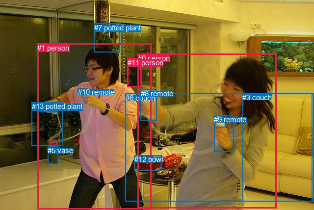
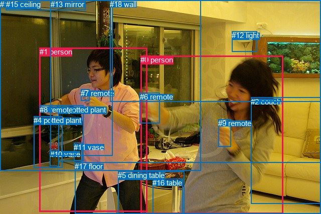

# 图片 1598：2390200.jpg

随机样本序号：68。图片 SHA256：`a34124e68622135a4b6c590cd2a6c43ed1be20dfbd05c392314841a0100551ce`。

红色框表示人，蓝色框表示其他物体。两个模式分别保留自身框编号，可依据位置比较对应对象。

## 自动检测框与输出

人的框编号：`[0, 1, 11]`。状态：`ok`。

### 自动检测全部物体框

| 编号 | 类别 | 是否为人 | 检测分数 | 像素坐标 xyxy |
|---|---|---|---|---|
| 0 | person | True | 0.9994 | 280.9, 109.9, 563.4, 424.2 |
| 1 | person | True | 0.9993 | 76.5, 88.9, 308.9, 426.4 |
| 2 | remote | False | 0.9860 | 437.0, 235.8, 460.1, 259.3 |
| 3 | couch | False | 0.9500 | 494.4, 189.5, 636.7, 410.1 |
| 4 | remote | False | 0.9491 | 78.5, 209.8, 115.9, 228.4 |
| 5 | vase | False | 0.9188 | 97.1, 298.5, 118.9, 334.7 |
| 6 | couch | False | 0.8561 | 256.0, 190.6, 640.0, 410.9 |
| 7 | potted plant | False | 0.7804 | 191.9, 47.8, 244.6, 106.8 |
| 8 | remote | False | 0.6192 | 286.8, 182.1, 319.1, 245.5 |
| 9 | remote | False | 0.5035 | 436.4, 235.5, 476.1, 309.7 |
| 10 | remote | False | 0.4759 | 159.0, 179.2, 178.4, 194.0 |
| 11 | person | True | 0.4546 | 259.9, 118.6, 288.1, 177.0 |
| 12 | bowl | False | 0.4416 | 273.8, 316.2, 330.1, 349.0 |
| 13 | potted plant | False | 0.3618 | 64.7, 208.4, 128.0, 298.0 |

### 自动检测 Top50 人相关候选

评分物体对：182；人相关物体对：72；输出关系：50。

| 排名 | 主语编号与类别 | 关系 | 宾语编号与类别 | 类型 | 人与人 | 排序分数 | 原始融合 logit |
|---|---|---|---|---|---|---|---|
| 1 | #0 person | holding | #2 remote | semantic | False | 0.99525 | 5.3444 |
| 2 | #1 person | holding | #4 remote | semantic | False | 0.99198 | 4.8172 |
| 3 | #0 person | holding | #9 remote | semantic | False | 0.99002 | 4.5969 |
| 4 | #1 person | holding | #10 remote | semantic | False | 0.98932 | 4.5287 |
| 5 | #1 person | holding | #13 potted plant | semantic | False | 0.98307 | 4.0615 |
| 6 | #1 person | playing | #8 remote | semantic | False | 0.98296 | 4.0549 |
| 7 | #0 person | holding | #8 remote | semantic | False | 0.97907 | 3.8456 |
| 8 | #1 person | playing with | #0 person | semantic | True | 0.96841 | 3.4227 |
| 9 | #0 person | playing with | #1 person | semantic | True | 0.96508 | 3.3190 |
| 10 | #7 potted plant | in | #11 person | spatial | False | 0.90097 | 2.2081 |
| 11 | #0 person | on | #9 remote | spatial | False | 0.87294 | 1.9272 |
| 12 | #1 person | on | #10 remote | spatial | False | 0.85002 | 1.7347 |
| 13 | #0 person | wearing | #6 couch | semantic | False | 0.84257 | 1.6774 |
| 14 | #1 person | holding | #11 person | semantic | True | 0.81904 | 1.5099 |
| 15 | #0 person | on | #2 remote | spatial | False | 0.81804 | 1.5031 |
| 16 | #0 person | beside | #6 couch | spatial | False | 0.81784 | 1.5018 |
| 17 | #0 person | in | #8 remote | spatial | False | 0.79463 | 1.3531 |
| 18 | #1 person | in | #8 remote | spatial | False | 0.74787 | 1.0873 |
| 19 | #1 person | on | #4 remote | spatial | False | 0.73920 | 1.0418 |
| 20 | #1 person | standing on | #6 couch | semantic | False | 0.64020 | 0.5763 |
| 21 | #0 person | standing on | #3 couch | semantic | False | 0.58562 | 0.3459 |
| 22 | #11 person | in | #7 potted plant | spatial | False | 0.58454 | 0.3414 |
| 23 | #0 person | leaning on | #3 couch | spatial | False | 0.53859 | 0.1547 |
| 24 | #1 person | in | #13 potted plant | spatial | False | 0.53501 | 0.1403 |
| 25 | #11 person | looking at | #1 person | semantic | True | 0.49200 | -0.0320 |
| 26 | #11 person | in | #8 remote | spatial | False | 0.47062 | -0.1177 |
| 27 | #0 person | beside | #1 person | spatial | True | 0.46053 | -0.1582 |
| 28 | #7 potted plant | on back of | #1 person | spatial | False | 0.45846 | -0.1665 |
| 29 | #1 person | on | #6 couch | spatial | False | 0.45477 | -0.1814 |
| 30 | #1 person | playing | #9 remote | semantic | False | 0.43717 | -0.2526 |
| 31 | #7 potted plant | holding | #11 person | semantic | False | 0.38969 | -0.4486 |
| 32 | #1 person | in | #11 person | spatial | True | 0.38315 | -0.4762 |
| 33 | #10 remote | on | #1 person | spatial | False | 0.33837 | -0.6706 |
| 34 | #1 person | in | #0 person | spatial | True | 0.33703 | -0.6766 |
| 35 | #0 person | playing | #10 remote | semantic | False | 0.33398 | -0.6902 |
| 36 | #11 person | on | #6 couch | spatial | False | 0.28610 | -0.9144 |
| 37 | #11 person | looking at | #0 person | semantic | True | 0.26361 | -1.0273 |
| 38 | #11 person | beside | #1 person | spatial | True | 0.24507 | -1.1251 |
| 39 | #11 person | playing | #8 remote | semantic | False | 0.22975 | -1.2097 |
| 40 | #1 person | playing | #2 remote | semantic | False | 0.22929 | -1.2123 |
| 41 | #11 person | holding | #7 potted plant | semantic | False | 0.21473 | -1.2966 |
| 42 | #1 person | standing on | #3 couch | semantic | False | 0.21295 | -1.3072 |
| 43 | #5 vase | beside | #1 person | spatial | False | 0.18348 | -1.4929 |
| 44 | #0 person | playing | #4 remote | semantic | False | 0.17681 | -1.5381 |
| 45 | #9 remote | holding | #0 person | semantic | False | 0.17323 | -1.5629 |
| 46 | #1 person | on | #3 couch | spatial | False | 0.14998 | -1.7348 |
| 47 | #9 remote | on | #0 person | spatial | False | 0.14523 | -1.7725 |
| 48 | #0 person | holding | #11 person | semantic | True | 0.14287 | -1.7916 |
| 49 | #3 couch | beside | #0 person | spatial | False | 0.14178 | -1.8005 |
| 50 | #2 remote | holding | #0 person | semantic | False | 0.13761 | -1.8353 |

### 自动检测逐条人相关 GT 核验

R@50：0.00%；命中 0/5。

| GT 主语编号 | GT 关系 | GT 宾语编号 | 结果阶段 | 匹配预测主语编号 | 匹配预测宾语编号 |
|---|---|---|---|---|---|
| 0 | swinging | 6 | wrong_predicate | [0] | [8] |
| 0 | holding | 9 | endpoint_missing_or_wrong_class | [0] | [] |
| 1 | holding | 3 | endpoint_missing_or_wrong_class | [1] | [] |
| 1 | swinging | 8 | wrong_predicate | [1] | [4] |
| 1 | in front of | 16 | endpoint_missing_or_wrong_class | [1] | [] |

## 真实框与输出

人的框编号：`[0, 1]`。

### 真实框全部物体框

| 编号 | 类别 | 是否为人 | 检测分数 | 像素坐标 xyxy |
|---|---|---|---|---|
| 0 | person | True | GT | 280.0, 111.0, 564.0, 427.0 |
| 1 | person | True | GT | 79.0, 95.0, 294.0, 423.0 |
| 2 | couch | False | GT | 500.0, 195.0, 640.0, 408.0 |
| 3 | potted plant | False | GT | 116.0, 211.0, 166.0, 323.0 |
| 4 | potted plant | False | GT | 67.0, 232.0, 124.0, 335.0 |
| 5 | dining table | False | GT | 235.0, 342.0, 367.0, 428.0 |
| 6 | remote | False | GT | 279.0, 185.0, 319.0, 246.0 |
| 7 | remote | False | GT | 161.0, 178.0, 179.0, 201.0 |
| 8 | remote | False | GT | 79.0, 211.0, 117.0, 225.0 |
| 9 | remote | False | GT | 435.0, 238.0, 460.0, 293.0 |
| 10 | vase | False | GT | 100.0, 300.0, 118.0, 333.0 |
| 11 | vase | False | GT | 147.0, 286.0, 164.0, 322.0 |
| 12 | light | False | GT | 462.0, 62.0, 513.0, 103.0 |
| 13 | mirror | False | GT | 101.0, 0.0, 225.0, 311.0 |
| 14 | window | False | GT | 0.0, 0.0, 400.0, 342.0 |
| 15 | ceiling | False | GT | 12.0, 0.0, 171.0, 20.0 |
| 16 | table | False | GT | 304.0, 357.0, 364.0, 428.0 |
| 17 | floor | False | GT | 149.0, 324.0, 640.0, 428.0 |
| 18 | wall | False | GT | 219.0, 0.0, 640.0, 203.0 |

### 真实框 Top50 人相关候选

评分物体对：342；人相关物体对：70；输出关系：50。

| 排名 | 主语编号与类别 | 关系 | 宾语编号与类别 | 类型 | 人与人 | 排序分数 | 原始融合 logit |
|---|---|---|---|---|---|---|---|
| 1 | #0 person | holding | #9 remote | semantic | False | 0.99487 | 5.2669 |
| 2 | #1 person | holding | #8 remote | semantic | False | 0.99378 | 5.0730 |
| 3 | #1 person | holding | #7 remote | semantic | False | 0.99133 | 4.7392 |
| 4 | #1 person | holding | #3 potted plant | semantic | False | 0.98789 | 4.4015 |
| 5 | #0 person | holding | #6 remote | semantic | False | 0.98022 | 3.9030 |
| 6 | #1 person | holding | #6 remote | semantic | False | 0.97748 | 3.7705 |
| 7 | #1 person | playing with | #0 person | semantic | True | 0.97455 | 3.6451 |
| 8 | #0 person | playing with | #1 person | semantic | True | 0.96909 | 3.4453 |
| 9 | #0 person | standing on | #17 floor | semantic | False | 0.93813 | 2.7188 |
| 10 | #1 person | standing on | #17 floor | semantic | False | 0.91272 | 2.3473 |
| 11 | #0 person | on | #9 remote | spatial | False | 0.89885 | 2.1845 |
| 12 | #1 person | on | #7 remote | spatial | False | 0.86397 | 1.8487 |
| 13 | #0 person | on | #17 floor | spatial | False | 0.84191 | 1.6725 |
| 14 | #0 person | on | #6 remote | spatial | False | 0.78042 | 1.2681 |
| 15 | #1 person | on | #17 floor | spatial | False | 0.76104 | 1.1584 |
| 16 | #1 person | on | #8 remote | spatial | False | 0.74200 | 1.0564 |
| 17 | #1 person | holding | #4 potted plant | semantic | False | 0.72766 | 0.9828 |
| 18 | #0 person | leaning on | #2 couch | spatial | False | 0.72677 | 0.9783 |
| 19 | #1 person | playing | #9 remote | semantic | False | 0.70524 | 0.8724 |
| 20 | #1 person | looking at | #13 mirror | semantic | False | 0.65870 | 0.6575 |
| 21 | #1 person | in | #3 potted plant | spatial | False | 0.65738 | 0.6516 |
| 22 | #1 person | in front of | #13 mirror | spatial | False | 0.64952 | 0.6169 |
| 23 | #1 person | in | #6 remote | spatial | False | 0.62840 | 0.5254 |
| 24 | #1 person | in front of | #14 window | spatial | False | 0.57662 | 0.3089 |
| 25 | #0 person | beside | #1 person | spatial | True | 0.57374 | 0.2971 |
| 26 | #0 person | standing on | #2 couch | semantic | False | 0.54612 | 0.1850 |
| 27 | #0 person | playing | #7 remote | semantic | False | 0.53680 | 0.1475 |
| 28 | #1 person | beside | #0 person | spatial | True | 0.49567 | -0.0173 |
| 29 | #1 person | looking at | #14 window | semantic | False | 0.47751 | -0.0900 |
| 30 | #9 remote | holding | #0 person | semantic | False | 0.44334 | -0.2276 |
| 31 | #2 couch | beside | #0 person | spatial | False | 0.44243 | -0.2313 |
| 32 | #1 person | wearing | #11 vase | semantic | False | 0.36158 | -0.5685 |
| 33 | #0 person | playing | #8 remote | semantic | False | 0.34864 | -0.6250 |
| 34 | #7 remote | on | #1 person | spatial | False | 0.33483 | -0.6864 |
| 35 | #1 person | standing on | #5 dining table | semantic | False | 0.32466 | -0.7324 |
| 36 | #13 mirror | beside | #1 person | spatial | False | 0.27378 | -0.9755 |
| 37 | #9 remote | on | #0 person | spatial | False | 0.24195 | -1.1420 |
| 38 | #8 remote | holding | #1 person | semantic | False | 0.23751 | -1.1664 |
| 39 | #14 window | beside | #1 person | spatial | False | 0.23626 | -1.1733 |
| 40 | #7 remote | holding | #1 person | semantic | False | 0.19031 | -1.4480 |
| 41 | #6 remote | holding | #0 person | semantic | False | 0.18057 | -1.5125 |
| 42 | #1 person | on | #5 dining table | spatial | False | 0.17141 | -1.5756 |
| 43 | #4 potted plant | beside | #1 person | spatial | False | 0.16943 | -1.5897 |
| 44 | #1 person | in | #4 potted plant | spatial | False | 0.16814 | -1.5988 |
| 45 | #3 potted plant | beside | #1 person | spatial | False | 0.15795 | -1.6736 |
| 46 | #0 person | playing | #3 potted plant | semantic | False | 0.14766 | -1.7531 |
| 47 | #0 person | playing | #16 table | semantic | False | 0.14516 | -1.7730 |
| 48 | #0 person | standing on | #5 dining table | semantic | False | 0.13735 | -1.8375 |
| 49 | #0 person | beside | #5 dining table | spatial | False | 0.12916 | -1.9084 |
| 50 | #6 remote | on | #0 person | spatial | False | 0.12684 | -1.9292 |

### 真实框逐条人相关 GT 核验

R@50：40.00%；命中 2/5。

| GT 主语编号 | GT 关系 | GT 宾语编号 | 结果阶段 | 匹配预测主语编号 | 匹配预测宾语编号 |
|---|---|---|---|---|---|
| 0 | swinging | 6 | wrong_predicate | [0] | [6] |
| 0 | holding | 9 | hit50 | [0] | [9] |
| 1 | holding | 3 | hit50 | [1] | [3] |
| 1 | swinging | 8 | wrong_predicate | [1] | [8] |
| 1 | in front of | 16 | wrong_predicate | [1] | [16] |

## 全部人相关 GT

| 主语编号与类别 | 关系 | 宾语编号与类别 |
|---|---|---|
| #0 person | swinging | #6 remote |
| #0 person | holding | #9 remote |
| #1 person | holding | #3 potted plant |
| #1 person | swinging | #8 remote |
| #1 person | in front of | #16 table |

原始记录、全部人相关物体对的两项预测与分项分数见 [逐图证据 JSON](../evidence/cases/1598.json)。全部56类 logits 保留于本机 HOR/output/random500/logits/。

<!-- HOR_COMPLETE_RESULTS -->

## 六组条件的完整输出对照

以下保留同一图片三种框与候选模式、两种谓词输出规则的全部 Top50。框编号各自在所属模式内解释。

### 自动检测框完整枚举：空间与语义各保留一个谓词

| 排名 | 主语编号与类别 | 谓词 | 宾语编号与类别 | 分组 | 排序分数 | predicate logit | pair logit |
|---|---|---|---|---|---|---|---|
| 1 | #0 person | holding | #2 remote | semantic | 0.9952478 | 4.7325797 | 0.6117862 |
| 2 | #1 person | holding | #4 remote | semantic | 0.9919754 | 4.5520320 | 0.2651450 |
| 3 | #0 person | holding | #9 remote | semantic | 0.9900181 | 4.0425477 | 0.5544010 |
| 4 | #1 person | holding | #10 remote | semantic | 0.9893202 | 4.0609517 | 0.4677122 |
| 5 | #1 person | holding | #13 potted plant | semantic | 0.9830689 | 4.2441144 | -0.1825809 |
| 6 | #1 person | playing | #8 remote | semantic | 0.9829575 | 3.9165931 | 0.1382688 |
| 7 | #0 person | holding | #8 remote | semantic | 0.9790738 | 3.8867307 | -0.0411299 |
| 8 | #1 person | playing with | #0 person | semantic | 0.9684067 | 4.3464437 | -0.9237381 |
| 9 | #0 person | playing with | #1 person | semantic | 0.9650751 | 4.0725942 | -0.7535908 |
| 10 | #7 potted plant | in | #11 person | spatial | 0.9009703 | 2.7726631 | -0.5646102 |
| 11 | #0 person | on | #9 remote | spatial | 0.8729358 | 1.3727694 | 0.5544010 |
| 12 | #1 person | on | #10 remote | spatial | 0.8500180 | 1.2670298 | 0.4677122 |
| 13 | #0 person | wearing | #6 couch | semantic | 0.8425665 | 2.1175232 | -0.4400740 |
| 14 | #1 person | holding | #11 person | semantic | 0.8190423 | 2.7421660 | -1.2322940 |
| 15 | #0 person | on | #2 remote | spatial | 0.8180357 | 0.8913097 | 0.6117862 |
| 16 | #0 person | beside | #6 couch | spatial | 0.8178404 | 1.9418583 | -0.4400740 |
| 17 | #0 person | in | #8 remote | spatial | 0.7946298 | 1.3941922 | -0.0411299 |
| 18 | #1 person | in | #8 remote | spatial | 0.7478702 | 0.9490166 | 0.1382688 |
| 19 | #1 person | on | #4 remote | spatial | 0.7392018 | 0.7766790 | 0.2651450 |
| 20 | #1 person | standing on | #6 couch | semantic | 0.6402043 | 1.3325930 | -0.7563422 |
| 21 | #0 person | standing on | #3 couch | semantic | 0.5856245 | 1.1036925 | -0.7577865 |
| 22 | #11 person | in | #7 potted plant | spatial | 0.5845383 | 1.2495036 | -0.9080716 |
| 23 | #0 person | leaning on | #3 couch | spatial | 0.5385932 | 0.9124670 | -0.7577865 |
| 24 | #1 person | in | #13 potted plant | spatial | 0.5350091 | 0.3228469 | -0.1825809 |
| 25 | #11 person | looking at | #1 person | semantic | 0.4920020 | 0.9867783 | -1.0187731 |
| 26 | #11 person | in | #8 remote | spatial | 0.4706166 | 1.3123374 | -1.4300063 |
| 27 | #0 person | beside | #1 person | spatial | 0.4605307 | 0.5953846 | -0.7535908 |
| 28 | #7 potted plant | on back of | #1 person | spatial | 0.4584613 | 0.5517521 | -0.7182908 |
| 29 | #1 person | on | #6 couch | spatial | 0.4547713 | 0.5749316 | -0.7563422 |
| 30 | #1 person | playing | #9 remote | semantic | 0.4371738 | 0.5450044 | -0.7976443 |
| 31 | #7 potted plant | holding | #11 person | semantic | 0.3896897 | 0.1159935 | -0.5646102 |
| 32 | #1 person | in | #11 person | spatial | 0.3831475 | 0.7560840 | -1.2322940 |
| 33 | #10 remote | on | #1 person | spatial | 0.3383696 | -0.1622615 | -0.5083069 |
| 34 | #1 person | in | #0 person | spatial | 0.3370308 | 0.2471838 | -0.9237381 |
| 35 | #0 person | playing | #10 remote | semantic | 0.3339779 | -0.0487256 | -0.6415222 |
| 36 | #11 person | on | #6 couch | spatial | 0.2860963 | 0.2018452 | -1.1162648 |
| 37 | #11 person | looking at | #0 person | semantic | 0.2636071 | 0.4252639 | -1.4525677 |
| 38 | #11 person | beside | #1 person | spatial | 0.2450691 | -0.1063128 | -1.0187731 |
| 39 | #11 person | playing | #8 remote | semantic | 0.2297471 | 0.2202663 | -1.4300063 |
| 40 | #1 person | playing | #2 remote | semantic | 0.2292907 | -0.4229445 | -0.7893763 |
| 41 | #11 person | holding | #7 potted plant | semantic | 0.2147339 | -0.3885517 | -0.9080716 |
| 42 | #1 person | standing on | #3 couch | semantic | 0.2129549 | -0.3458877 | -0.9613177 |
| 43 | #5 vase | beside | #1 person | spatial | 0.1834841 | -0.6758785 | -0.8170398 |
| 44 | #0 person | playing | #4 remote | semantic | 0.1768065 | -0.9749670 | -0.5631685 |
| 45 | #9 remote | holding | #0 person | semantic | 0.1732298 | -0.8335025 | -0.7294054 |
| 46 | #1 person | on | #3 couch | spatial | 0.1499799 | -0.7734408 | -0.9613177 |
| 47 | #9 remote | on | #0 person | spatial | 0.1452306 | -1.0431037 | -0.7294054 |
| 48 | #0 person | holding | #11 person | semantic | 0.1428718 | -0.1846194 | -1.6070200 |
| 49 | #3 couch | beside | #0 person | spatial | 0.1417842 | -0.9042296 | -0.8963197 |
| 50 | #2 remote | holding | #0 person | semantic | 0.1376134 | -0.9771223 | -0.8581328 |

GT 命中：0/5，R@50=0.00%。

| GT主语 | GT谓词 | GT宾语 | 结果阶段 | 匹配主语框 | 匹配宾语框 |
|---|---|---|---|---|---|
| 0 | swinging | 6 | wrong_predicate | [0] | [8] |
| 0 | holding | 9 | endpoint_missing_or_wrong_class | [0] | [] |
| 1 | holding | 3 | endpoint_missing_or_wrong_class | [1] | [] |
| 1 | swinging | 8 | wrong_predicate | [1] | [4] |
| 1 | in front of | 16 | endpoint_missing_or_wrong_class | [1] | [] |

### 自动检测框完整枚举：每对只保留一个谓词

| 排名 | 主语编号与类别 | 谓词 | 宾语编号与类别 | 分组 | 排序分数 | predicate logit | pair logit |
|---|---|---|---|---|---|---|---|
| 1 | #0 person | holding | #2 remote | single | 0.9952478 | 4.7325797 | 0.6117862 |
| 2 | #1 person | holding | #4 remote | single | 0.9919754 | 4.5520320 | 0.2651450 |
| 3 | #0 person | holding | #9 remote | single | 0.9900181 | 4.0425477 | 0.5544010 |
| 4 | #1 person | holding | #10 remote | single | 0.9893202 | 4.0609517 | 0.4677122 |
| 5 | #1 person | holding | #13 potted plant | single | 0.9830689 | 4.2441144 | -0.1825809 |
| 6 | #1 person | playing | #8 remote | single | 0.9829575 | 3.9165931 | 0.1382688 |
| 7 | #0 person | holding | #8 remote | single | 0.9790738 | 3.8867307 | -0.0411299 |
| 8 | #1 person | playing with | #0 person | single | 0.9684067 | 4.3464437 | -0.9237381 |
| 9 | #0 person | playing with | #1 person | single | 0.9650751 | 4.0725942 | -0.7535908 |
| 10 | #7 potted plant | in | #11 person | single | 0.9009703 | 2.7726631 | -0.5646102 |
| 11 | #0 person | wearing | #6 couch | single | 0.8425665 | 2.1175232 | -0.4400740 |
| 12 | #1 person | holding | #11 person | single | 0.8190423 | 2.7421660 | -1.2322940 |
| 13 | #1 person | standing on | #6 couch | single | 0.6402043 | 1.3325930 | -0.7563422 |
| 14 | #0 person | standing on | #3 couch | single | 0.5856245 | 1.1036925 | -0.7577865 |
| 15 | #11 person | in | #7 potted plant | single | 0.5845383 | 1.2495036 | -0.9080716 |
| 16 | #11 person | looking at | #1 person | single | 0.4920020 | 0.9867783 | -1.0187731 |
| 17 | #11 person | in | #8 remote | single | 0.4706166 | 1.3123374 | -1.4300063 |
| 18 | #7 potted plant | on back of | #1 person | single | 0.4584613 | 0.5517521 | -0.7182908 |
| 19 | #1 person | playing | #9 remote | single | 0.4371738 | 0.5450044 | -0.7976443 |
| 20 | #10 remote | on | #1 person | single | 0.3383696 | -0.1622615 | -0.5083069 |
| 21 | #0 person | playing | #10 remote | single | 0.3339779 | -0.0487256 | -0.6415222 |
| 22 | #11 person | on | #6 couch | single | 0.2860963 | 0.2018452 | -1.1162648 |
| 23 | #11 person | looking at | #0 person | single | 0.2636071 | 0.4252639 | -1.4525677 |
| 24 | #1 person | playing | #2 remote | single | 0.2292907 | -0.4229445 | -0.7893763 |
| 25 | #1 person | standing on | #3 couch | single | 0.2129549 | -0.3458877 | -0.9613177 |
| 26 | #5 vase | beside | #1 person | single | 0.1834841 | -0.6758785 | -0.8170398 |
| 27 | #0 person | playing | #4 remote | single | 0.1768065 | -0.9749670 | -0.5631685 |
| 28 | #9 remote | holding | #0 person | single | 0.1732298 | -0.8335025 | -0.7294054 |
| 29 | #0 person | holding | #11 person | single | 0.1428718 | -0.1846194 | -1.6070200 |
| 30 | #3 couch | beside | #0 person | single | 0.1417842 | -0.9042296 | -0.8963197 |
| 31 | #2 remote | holding | #0 person | single | 0.1376134 | -0.9771223 | -0.8581328 |
| 32 | #1 person | playing | #12 bowl | single | 0.1283526 | -1.0689917 | -0.8466118 |
| 33 | #0 person | playing | #13 potted plant | single | 0.1122846 | -0.7878814 | -1.2797332 |
| 34 | #13 potted plant | beside | #1 person | single | 0.0993699 | -1.5340245 | -0.6702210 |
| 35 | #0 person | playing | #12 bowl | single | 0.0976405 | -1.1656218 | -1.0580982 |
| 36 | #12 bowl | beside | #1 person | single | 0.0966432 | -1.2020993 | -1.0329928 |
| 37 | #8 remote | in | #1 person | single | 0.0963999 | -1.5511982 | -0.6866831 |
| 38 | #8 remote | on | #0 person | single | 0.0901876 | -1.2637630 | -1.0475838 |
| 39 | #11 person | on | #3 couch | single | 0.0883676 | -1.0808990 | -1.2528323 |
| 40 | #8 remote | in | #11 person | single | 0.0824461 | -1.3154969 | -1.0940702 |
| 41 | #1 person | wearing | #5 vase | single | 0.0818819 | -1.0783200 | -1.3387282 |
| 42 | #4 remote | holding | #1 person | single | 0.0740106 | -1.6180060 | -0.9086484 |
| 43 | #13 potted plant | in | #11 person | single | 0.0708743 | -1.2433145 | -1.3300217 |
| 44 | #6 couch | beside | #0 person | single | 0.0691703 | -1.6984892 | -0.9010152 |
| 45 | #1 person | in | #7 potted plant | single | 0.0632919 | -1.2487478 | -1.4458666 |
| 46 | #12 bowl | beside | #0 person | single | 0.0617043 | -1.4563425 | -1.2653687 |
| 47 | #6 couch | beside | #1 person | single | 0.0607473 | -1.6560626 | -1.0822985 |
| 48 | #11 person | holding | #4 remote | single | 0.0483568 | -1.3277674 | -1.6518168 |
| 49 | #3 couch | beside | #1 person | single | 0.0480936 | -1.8552485 | -1.1300695 |
| 50 | #12 bowl | on | #11 person | single | 0.0278181 | -2.3624558 | -1.1913985 |

GT 命中：0/5，R@50=0.00%。

| GT主语 | GT谓词 | GT宾语 | 结果阶段 | 匹配主语框 | 匹配宾语框 |
|---|---|---|---|---|---|
| 0 | swinging | 6 | wrong_predicate | [0] | [8] |
| 0 | holding | 9 | endpoint_missing_or_wrong_class | [0] | [] |
| 1 | holding | 3 | endpoint_missing_or_wrong_class | [1] | [] |
| 1 | swinging | 8 | wrong_predicate | [1] | [4] |
| 1 | in front of | 16 | endpoint_missing_or_wrong_class | [1] | [] |

### 真实框完整枚举：空间与语义各保留一个谓词

| 排名 | 主语编号与类别 | 谓词 | 宾语编号与类别 | 分组 | 排序分数 | predicate logit | pair logit |
|---|---|---|---|---|---|---|---|
| 1 | #0 person | holding | #9 remote | semantic | 0.9948667 | 4.6927381 | 0.5741307 |
| 2 | #1 person | holding | #8 remote | semantic | 0.9937756 | 4.7632203 | 0.3098230 |
| 3 | #1 person | holding | #7 remote | semantic | 0.9913303 | 4.1979442 | 0.5412657 |
| 4 | #1 person | holding | #3 potted plant | semantic | 0.9878901 | 4.5143867 | -0.1128395 |
| 5 | #0 person | holding | #6 remote | semantic | 0.9802187 | 3.9635415 | -0.0605025 |
| 6 | #1 person | holding | #6 remote | semantic | 0.9774773 | 3.6223674 | 0.1480837 |
| 7 | #1 person | playing with | #0 person | semantic | 0.9745463 | 4.5891786 | -0.9440663 |
| 8 | #0 person | playing with | #1 person | semantic | 0.9690914 | 4.1949639 | -0.7496406 |
| 9 | #0 person | standing on | #17 floor | semantic | 0.9381267 | 3.1670470 | -0.4482500 |
| 10 | #1 person | standing on | #17 floor | semantic | 0.9127198 | 3.0305648 | -0.6832596 |
| 11 | #0 person | on | #9 remote | spatial | 0.8988466 | 1.6103430 | 0.5741307 |
| 12 | #1 person | on | #7 remote | spatial | 0.8639741 | 1.3074317 | 0.5412657 |
| 13 | #0 person | on | #17 floor | spatial | 0.8419145 | 2.1207924 | -0.4482500 |
| 14 | #0 person | on | #6 remote | spatial | 0.7804224 | 1.3286319 | -0.0605025 |
| 15 | #1 person | on | #17 floor | spatial | 0.7610418 | 1.8416591 | -0.6832596 |
| 16 | #1 person | on | #8 remote | spatial | 0.7420040 | 0.7465873 | 0.3098230 |
| 17 | #1 person | holding | #4 potted plant | semantic | 0.7276563 | 1.9313493 | -0.9485852 |
| 18 | #0 person | leaning on | #2 couch | spatial | 0.7267692 | 1.7569323 | -0.7786400 |
| 19 | #1 person | playing | #9 remote | semantic | 0.7052352 | 1.6464429 | -0.7740891 |
| 20 | #1 person | looking at | #13 mirror | semantic | 0.6587006 | 1.5746579 | -0.9171486 |
| 21 | #1 person | in | #3 potted plant | spatial | 0.6573805 | 0.7644820 | -0.1128395 |
| 22 | #1 person | in front of | #13 mirror | spatial | 0.6495215 | 1.5340853 | -0.9171486 |
| 23 | #1 person | in | #6 remote | spatial | 0.6284016 | 0.3772821 | 0.1480837 |
| 24 | #1 person | in front of | #14 window | spatial | 0.5766165 | 1.1505575 | -0.8416585 |
| 25 | #0 person | beside | #1 person | spatial | 0.5737367 | 1.0467539 | -0.7496406 |
| 26 | #0 person | standing on | #2 couch | semantic | 0.5461181 | 0.9636383 | -0.7786400 |
| 27 | #0 person | playing | #7 remote | semantic | 0.5368012 | 0.7507954 | -0.6033241 |
| 28 | #1 person | beside | #0 person | spatial | 0.4956675 | 0.9267359 | -0.9440663 |
| 29 | #1 person | looking at | #14 window | semantic | 0.4775072 | 0.7516265 | -0.8416585 |
| 30 | #9 remote | holding | #0 person | semantic | 0.4433445 | 0.5510740 | -0.7786734 |
| 31 | #2 couch | beside | #0 person | spatial | 0.4424277 | 0.6448407 | -0.8761560 |
| 32 | #1 person | wearing | #11 vase | semantic | 0.3615803 | 0.5551796 | -1.1236913 |
| 33 | #0 person | playing | #8 remote | semantic | 0.3486429 | -0.0905232 | -0.5344868 |
| 34 | #7 remote | on | #1 person | spatial | 0.3348296 | -0.1503873 | -0.5360341 |
| 35 | #1 person | standing on | #5 dining table | semantic | 0.3246643 | -0.0735283 | -0.6588900 |
| 36 | #13 mirror | beside | #1 person | spatial | 0.2737823 | -0.0522313 | -0.9232851 |
| 37 | #9 remote | on | #0 person | spatial | 0.2419505 | -0.3633423 | -0.7786734 |
| 38 | #8 remote | holding | #1 person | semantic | 0.2375066 | -0.2708015 | -0.8955967 |
| 39 | #14 window | beside | #1 person | spatial | 0.2362645 | -0.2587929 | -0.9144770 |
| 40 | #7 remote | holding | #1 person | semantic | 0.1903106 | -0.9119594 | -0.5360341 |
| 41 | #6 remote | holding | #0 person | semantic | 0.1805683 | -0.4618979 | -1.0506041 |
| 42 | #1 person | on | #5 dining table | spatial | 0.1714148 | -0.9167430 | -0.6588900 |
| 43 | #4 potted plant | beside | #1 person | spatial | 0.1694312 | -0.9359982 | -0.6536653 |
| 44 | #1 person | in | #4 potted plant | spatial | 0.1681442 | -0.6502519 | -0.9485852 |
| 45 | #3 potted plant | beside | #1 person | spatial | 0.1579502 | -0.9363091 | -0.7372504 |
| 46 | #0 person | playing | #3 potted plant | semantic | 0.1476626 | -0.4835396 | -1.2695127 |
| 47 | #0 person | playing | #16 table | semantic | 0.1451647 | -1.0898907 | -0.6831493 |
| 48 | #0 person | standing on | #5 dining table | semantic | 0.1373457 | -1.1911917 | -0.6463215 |
| 49 | #0 person | beside | #5 dining table | spatial | 0.1291606 | -1.2620792 | -0.6463215 |
| 50 | #6 remote | on | #0 person | spatial | 0.1268386 | -0.8786008 | -1.0506041 |

GT 命中：2/5，R@50=40.00%。

| GT主语 | GT谓词 | GT宾语 | 结果阶段 | 匹配主语框 | 匹配宾语框 |
|---|---|---|---|---|---|
| 0 | swinging | 6 | wrong_predicate | [0] | [6] |
| 0 | holding | 9 | hit50 | [0] | [9] |
| 1 | holding | 3 | hit50 | [1] | [3] |
| 1 | swinging | 8 | wrong_predicate | [1] | [8] |
| 1 | in front of | 16 | wrong_predicate | [1] | [16] |

### 真实框完整枚举：每对只保留一个谓词

| 排名 | 主语编号与类别 | 谓词 | 宾语编号与类别 | 分组 | 排序分数 | predicate logit | pair logit |
|---|---|---|---|---|---|---|---|
| 1 | #0 person | holding | #9 remote | single | 0.9948667 | 4.6927381 | 0.5741307 |
| 2 | #1 person | holding | #8 remote | single | 0.9937756 | 4.7632203 | 0.3098230 |
| 3 | #1 person | holding | #7 remote | single | 0.9913303 | 4.1979442 | 0.5412657 |
| 4 | #1 person | holding | #3 potted plant | single | 0.9878901 | 4.5143867 | -0.1128395 |
| 5 | #0 person | holding | #6 remote | single | 0.9802187 | 3.9635415 | -0.0605025 |
| 6 | #1 person | holding | #6 remote | single | 0.9774773 | 3.6223674 | 0.1480837 |
| 7 | #1 person | playing with | #0 person | single | 0.9745463 | 4.5891786 | -0.9440663 |
| 8 | #0 person | playing with | #1 person | single | 0.9690914 | 4.1949639 | -0.7496406 |
| 9 | #0 person | standing on | #17 floor | single | 0.9381267 | 3.1670470 | -0.4482500 |
| 10 | #1 person | standing on | #17 floor | single | 0.9127198 | 3.0305648 | -0.6832596 |
| 11 | #1 person | holding | #4 potted plant | single | 0.7276563 | 1.9313493 | -0.9485852 |
| 12 | #0 person | leaning on | #2 couch | single | 0.7267692 | 1.7569323 | -0.7786400 |
| 13 | #1 person | playing | #9 remote | single | 0.7052352 | 1.6464429 | -0.7740891 |
| 14 | #1 person | looking at | #13 mirror | single | 0.6587006 | 1.5746579 | -0.9171486 |
| 15 | #1 person | in front of | #14 window | single | 0.5766165 | 1.1505575 | -0.8416585 |
| 16 | #0 person | playing | #7 remote | single | 0.5368012 | 0.7507954 | -0.6033241 |
| 17 | #9 remote | holding | #0 person | single | 0.4433445 | 0.5510740 | -0.7786734 |
| 18 | #2 couch | beside | #0 person | single | 0.4424277 | 0.6448407 | -0.8761560 |
| 19 | #1 person | wearing | #11 vase | single | 0.3615803 | 0.5551796 | -1.1236913 |
| 20 | #0 person | playing | #8 remote | single | 0.3486429 | -0.0905232 | -0.5344868 |
| 21 | #7 remote | on | #1 person | single | 0.3348296 | -0.1503873 | -0.5360341 |
| 22 | #1 person | standing on | #5 dining table | single | 0.3246643 | -0.0735283 | -0.6588900 |
| 23 | #13 mirror | beside | #1 person | single | 0.2737823 | -0.0522313 | -0.9232851 |
| 24 | #8 remote | holding | #1 person | single | 0.2375066 | -0.2708015 | -0.8955967 |
| 25 | #14 window | beside | #1 person | single | 0.2362645 | -0.2587929 | -0.9144770 |
| 26 | #6 remote | holding | #0 person | single | 0.1805683 | -0.4618979 | -1.0506041 |
| 27 | #4 potted plant | beside | #1 person | single | 0.1694312 | -0.9359982 | -0.6536653 |
| 28 | #3 potted plant | beside | #1 person | single | 0.1579502 | -0.9363091 | -0.7372504 |
| 29 | #0 person | playing | #3 potted plant | single | 0.1476626 | -0.4835396 | -1.2695127 |
| 30 | #0 person | playing | #16 table | single | 0.1451647 | -1.0898907 | -0.6831493 |
| 31 | #0 person | standing on | #5 dining table | single | 0.1373457 | -1.1911917 | -0.6463215 |
| 32 | #2 couch | beside | #1 person | single | 0.1203596 | -0.8644345 | -1.1245949 |
| 33 | #1 person | drinking | #10 vase | single | 0.0994675 | -0.8762894 | -1.3268657 |
| 34 | #17 floor | beside | #0 person | single | 0.0918454 | -1.4720962 | -0.8192120 |
| 35 | #0 person | in front of | #14 window | single | 0.0911349 | -0.9171667 | -1.3826889 |
| 36 | #1 person | in front of | #2 couch | single | 0.0843380 | -1.4058664 | -0.9789488 |
| 37 | #6 remote | on | #1 person | single | 0.0782830 | -1.7896504 | -0.6762575 |
| 38 | #5 dining table | beside | #0 person | single | 0.0534803 | -1.6836894 | -1.1897887 |
| 39 | #10 vase | beside | #1 person | single | 0.0526475 | -2.1067739 | -0.7832789 |
| 40 | #0 person | in | #18 wall | single | 0.0519078 | -1.8631194 | -1.0418643 |
| 41 | #12 light | over | #0 person | single | 0.0406271 | -2.5228601 | -0.6389844 |
| 42 | #5 dining table | beside | #1 person | single | 0.0383614 | -2.0888081 | -1.1327796 |
| 43 | #11 vase | beside | #1 person | single | 0.0377982 | -2.4841287 | -0.7528346 |
| 44 | #1 person | in | #18 wall | single | 0.0342016 | -2.1594987 | -1.1811837 |
| 45 | #0 person | playing | #4 potted plant | single | 0.0332490 | -1.4751327 | -1.8947845 |
| 46 | #16 table | beside | #0 person | single | 0.0321918 | -2.2841887 | -1.1191339 |
| 47 | #9 remote | holding | #1 person | single | 0.0305646 | -2.2210748 | -1.2357979 |
| 48 | #17 floor | beside | #1 person | single | 0.0304326 | -2.2705264 | -1.1908097 |
| 49 | #14 window | beside | #0 person | single | 0.0300388 | -2.0501766 | -1.4245881 |
| 50 | #15 ceiling | over | #1 person | single | 0.0215687 | -2.7982106 | -1.0164976 |

GT 命中：2/5，R@50=40.00%。

| GT主语 | GT谓词 | GT宾语 | 结果阶段 | 匹配主语框 | 匹配宾语框 |
|---|---|---|---|---|---|
| 0 | swinging | 6 | wrong_predicate | [0] | [6] |
| 0 | holding | 9 | hit50 | [0] | [9] |
| 1 | holding | 3 | hit50 | [1] | [3] |
| 1 | swinging | 8 | wrong_predicate | [1] | [8] |
| 1 | in front of | 16 | wrong_predicate | [1] | [16] |

### 真实框400候选：空间与语义各保留一个谓词

| 排名 | 主语编号与类别 | 谓词 | 宾语编号与类别 | 分组 | 排序分数 | predicate logit | pair logit |
|---|---|---|---|---|---|---|---|
| 1 | #0 person | holding | #9 remote | semantic | 0.9948364 | 4.6868300 | 0.5741307 |
| 2 | #1 person | holding | #8 remote | semantic | 0.9937756 | 4.7632203 | 0.3098230 |
| 3 | #1 person | holding | #7 remote | semantic | 0.9913809 | 4.2038522 | 0.5412657 |
| 4 | #1 person | holding | #3 potted plant | semantic | 0.9878901 | 4.5143867 | -0.1128395 |
| 5 | #0 person | holding | #6 remote | semantic | 0.9792588 | 3.9151769 | -0.0605025 |
| 6 | #1 person | holding | #6 remote | semantic | 0.9774773 | 3.6223674 | 0.1480837 |
| 7 | #1 person | playing with | #0 person | semantic | 0.9730363 | 4.5299973 | -0.9440663 |
| 8 | #0 person | playing with | #1 person | semantic | 0.9690614 | 4.1939616 | -0.7496406 |
| 9 | #0 person | standing on | #17 floor | semantic | 0.9381267 | 3.1670470 | -0.4482500 |
| 10 | #1 person | standing on | #17 floor | semantic | 0.9127198 | 3.0305648 | -0.6832596 |
| 11 | #0 person | on | #9 remote | spatial | 0.8978520 | 1.5994525 | 0.5741307 |
| 12 | #1 person | on | #7 remote | spatial | 0.8639741 | 1.3074317 | 0.5412657 |
| 13 | #0 person | on | #17 floor | spatial | 0.8419145 | 2.1207924 | -0.4482500 |
| 14 | #0 person | on | #6 remote | spatial | 0.7822828 | 1.3395219 | -0.0605025 |
| 15 | #1 person | on | #17 floor | spatial | 0.7610418 | 1.8416591 | -0.6832596 |
| 16 | #1 person | on | #8 remote | spatial | 0.7420040 | 0.7465873 | 0.3098230 |
| 17 | #0 person | leaning on | #2 couch | spatial | 0.7324131 | 1.7855401 | -0.7786400 |
| 18 | #1 person | holding | #4 potted plant | semantic | 0.7276563 | 1.9313493 | -0.9485852 |
| 19 | #1 person | playing | #9 remote | semantic | 0.7052352 | 1.6464429 | -0.7740891 |
| 20 | #1 person | looking at | #13 mirror | semantic | 0.6587006 | 1.5746579 | -0.9171486 |
| 21 | #1 person | in | #3 potted plant | spatial | 0.6573805 | 0.7644820 | -0.1128395 |
| 22 | #1 person | in front of | #13 mirror | spatial | 0.6494518 | 1.5337791 | -0.9171486 |
| 23 | #1 person | in | #6 remote | spatial | 0.6354008 | 0.4073734 | 0.1480837 |
| 24 | #1 person | in front of | #14 window | spatial | 0.5766165 | 1.1505575 | -0.8416585 |
| 25 | #0 person | beside | #1 person | spatial | 0.5737367 | 1.0467539 | -0.7496406 |
| 26 | #0 person | standing on | #2 couch | semantic | 0.5461181 | 0.9636383 | -0.7786400 |
| 27 | #0 person | playing | #7 remote | semantic | 0.5305190 | 0.7255521 | -0.6033241 |
| 28 | #1 person | beside | #0 person | spatial | 0.4956675 | 0.9267359 | -0.9440663 |
| 29 | #1 person | looking at | #14 window | semantic | 0.4775072 | 0.7516265 | -0.8416585 |
| 30 | #9 remote | holding | #0 person | semantic | 0.4433445 | 0.5510740 | -0.7786734 |
| 31 | #2 couch | beside | #0 person | spatial | 0.4424277 | 0.6448407 | -0.8761560 |
| 32 | #1 person | wearing | #11 vase | semantic | 0.3692382 | 0.5882049 | -1.1236913 |
| 33 | #0 person | playing | #8 remote | semantic | 0.3538429 | -0.0677028 | -0.5344868 |
| 34 | #7 remote | on | #1 person | spatial | 0.3336181 | -0.1558318 | -0.5360341 |
| 35 | #1 person | standing on | #5 dining table | semantic | 0.3258731 | -0.0680203 | -0.6588900 |
| 36 | #13 mirror | beside | #1 person | spatial | 0.2797942 | -0.0221977 | -0.9232851 |
| 37 | #9 remote | on | #0 person | spatial | 0.2419505 | -0.3633423 | -0.7786734 |
| 38 | #8 remote | holding | #1 person | semantic | 0.2375066 | -0.2708015 | -0.8955967 |
| 39 | #14 window | beside | #1 person | spatial | 0.2309009 | -0.2887545 | -0.9144770 |
| 40 | #7 remote | holding | #1 person | semantic | 0.1859403 | -0.9405737 | -0.5360341 |
| 41 | #6 remote | holding | #0 person | semantic | 0.1805683 | -0.4618979 | -1.0506041 |
| 42 | #1 person | on | #5 dining table | spatial | 0.1714148 | -0.9167430 | -0.6588900 |
| 43 | #1 person | in | #4 potted plant | spatial | 0.1681442 | -0.6502519 | -0.9485852 |
| 44 | #4 potted plant | beside | #1 person | spatial | 0.1673295 | -0.9510076 | -0.6536653 |
| 45 | #3 potted plant | beside | #1 person | spatial | 0.1559499 | -0.9514267 | -0.7372504 |
| 46 | #0 person | playing | #16 table | semantic | 0.1433076 | -1.1049364 | -0.6831493 |
| 47 | #0 person | playing | #3 potted plant | semantic | 0.1414208 | -0.5340266 | -1.2695127 |
| 48 | #0 person | standing on | #5 dining table | semantic | 0.1373457 | -1.1911917 | -0.6463215 |
| 49 | #0 person | beside | #16 table | spatial | 0.1284582 | -1.2315109 | -0.6831493 |
| 50 | #0 person | in | #5 dining table | spatial | 0.1277070 | -1.2750652 | -0.6463215 |

GT 命中：2/5，R@50=40.00%。

| GT主语 | GT谓词 | GT宾语 | 结果阶段 | 匹配主语框 | 匹配宾语框 |
|---|---|---|---|---|---|
| 0 | swinging | 6 | wrong_predicate | [0] | [6] |
| 0 | holding | 9 | hit50 | [0] | [9] |
| 1 | holding | 3 | hit50 | [1] | [3] |
| 1 | swinging | 8 | wrong_predicate | [1] | [8] |
| 1 | in front of | 16 | wrong_predicate | [1] | [16] |

### 真实框400候选：每对只保留一个谓词

| 排名 | 主语编号与类别 | 谓词 | 宾语编号与类别 | 分组 | 排序分数 | predicate logit | pair logit |
|---|---|---|---|---|---|---|---|
| 1 | #0 person | holding | #9 remote | single | 0.9948364 | 4.6868300 | 0.5741307 |
| 2 | #1 person | holding | #8 remote | single | 0.9937756 | 4.7632203 | 0.3098230 |
| 3 | #1 person | holding | #7 remote | single | 0.9913809 | 4.2038522 | 0.5412657 |
| 4 | #1 person | holding | #3 potted plant | single | 0.9878901 | 4.5143867 | -0.1128395 |
| 5 | #0 person | holding | #6 remote | single | 0.9792588 | 3.9151769 | -0.0605025 |
| 6 | #1 person | holding | #6 remote | single | 0.9774773 | 3.6223674 | 0.1480837 |
| 7 | #1 person | playing with | #0 person | single | 0.9730363 | 4.5299973 | -0.9440663 |
| 8 | #0 person | playing with | #1 person | single | 0.9690614 | 4.1939616 | -0.7496406 |
| 9 | #0 person | standing on | #17 floor | single | 0.9381267 | 3.1670470 | -0.4482500 |
| 10 | #1 person | standing on | #17 floor | single | 0.9127198 | 3.0305648 | -0.6832596 |
| 11 | #0 person | leaning on | #2 couch | single | 0.7324131 | 1.7855401 | -0.7786400 |
| 12 | #1 person | holding | #4 potted plant | single | 0.7276563 | 1.9313493 | -0.9485852 |
| 13 | #1 person | playing | #9 remote | single | 0.7052352 | 1.6464429 | -0.7740891 |
| 14 | #1 person | looking at | #13 mirror | single | 0.6587006 | 1.5746579 | -0.9171486 |
| 15 | #1 person | in front of | #14 window | single | 0.5766165 | 1.1505575 | -0.8416585 |
| 16 | #0 person | playing | #7 remote | single | 0.5305190 | 0.7255521 | -0.6033241 |
| 17 | #9 remote | holding | #0 person | single | 0.4433445 | 0.5510740 | -0.7786734 |
| 18 | #2 couch | beside | #0 person | single | 0.4424277 | 0.6448407 | -0.8761560 |
| 19 | #1 person | wearing | #11 vase | single | 0.3692382 | 0.5882049 | -1.1236913 |
| 20 | #0 person | playing | #8 remote | single | 0.3538429 | -0.0677028 | -0.5344868 |
| 21 | #7 remote | on | #1 person | single | 0.3336181 | -0.1558318 | -0.5360341 |
| 22 | #1 person | standing on | #5 dining table | single | 0.3258731 | -0.0680203 | -0.6588900 |
| 23 | #13 mirror | beside | #1 person | single | 0.2797942 | -0.0221977 | -0.9232851 |
| 24 | #8 remote | holding | #1 person | single | 0.2375066 | -0.2708015 | -0.8955967 |
| 25 | #14 window | beside | #1 person | single | 0.2309009 | -0.2887545 | -0.9144770 |
| 26 | #6 remote | holding | #0 person | single | 0.1805683 | -0.4618979 | -1.0506041 |
| 27 | #4 potted plant | beside | #1 person | single | 0.1673295 | -0.9510076 | -0.6536653 |
| 28 | #3 potted plant | beside | #1 person | single | 0.1559499 | -0.9514267 | -0.7372504 |
| 29 | #0 person | playing | #16 table | single | 0.1433076 | -1.1049364 | -0.6831493 |
| 30 | #0 person | playing | #3 potted plant | single | 0.1414208 | -0.5340266 | -1.2695127 |
| 31 | #0 person | standing on | #5 dining table | single | 0.1373457 | -1.1911917 | -0.6463215 |
| 32 | #2 couch | beside | #1 person | single | 0.1203596 | -0.8644345 | -1.1245949 |
| 33 | #17 floor | beside | #0 person | single | 0.0931080 | -1.4570508 | -0.8192120 |
| 34 | #1 person | drinking | #10 vase | single | 0.0921591 | -0.9606867 | -1.3268657 |
| 35 | #0 person | in front of | #14 window | single | 0.0898807 | -0.9324038 | -1.3826889 |
| 36 | #1 person | in front of | #2 couch | single | 0.0854952 | -1.3909740 | -0.9789488 |
| 37 | #6 remote | on | #1 person | single | 0.0782830 | -1.7896504 | -0.6762575 |
| 38 | #5 dining table | beside | #0 person | single | 0.0534789 | -1.6837182 | -1.1897887 |
| 39 | #10 vase | beside | #1 person | single | 0.0526432 | -2.1068604 | -0.7832789 |
| 40 | #0 person | in | #18 wall | single | 0.0519486 | -1.8622897 | -1.0418643 |
| 41 | #12 light | over | #0 person | single | 0.0411654 | -2.5091364 | -0.6389844 |
| 42 | #5 dining table | beside | #1 person | single | 0.0372714 | -2.1187654 | -1.1327796 |
| 43 | #11 vase | beside | #1 person | single | 0.0367219 | -2.5141332 | -0.7528346 |
| 44 | #1 person | in | #18 wall | single | 0.0337081 | -2.1745443 | -1.1811837 |
| 45 | #0 person | playing | #4 potted plant | single | 0.0329227 | -1.4853308 | -1.8947845 |
| 46 | #16 table | beside | #0 person | single | 0.0312695 | -2.3142078 | -1.1191339 |
| 47 | #17 floor | beside | #1 person | single | 0.0308784 | -2.2555242 | -1.1908097 |
| 48 | #9 remote | holding | #1 person | single | 0.0306043 | -2.2197361 | -1.2357979 |
| 49 | #14 window | beside | #0 person | single | 0.0300380 | -2.0502057 | -1.4245881 |
| 50 | #15 ceiling | over | #1 person | single | 0.0215130 | -2.8008547 | -1.0164976 |

GT 命中：2/5，R@50=40.00%。

| GT主语 | GT谓词 | GT宾语 | 结果阶段 | 匹配主语框 | 匹配宾语框 |
|---|---|---|---|---|---|
| 0 | swinging | 6 | wrong_predicate | [0] | [6] |
| 0 | holding | 9 | hit50 | [0] | [9] |
| 1 | holding | 3 | hit50 | [1] | [3] |
| 1 | swinging | 8 | wrong_predicate | [1] | [8] |
| 1 | in front of | 16 | wrong_predicate | [1] | [16] |
