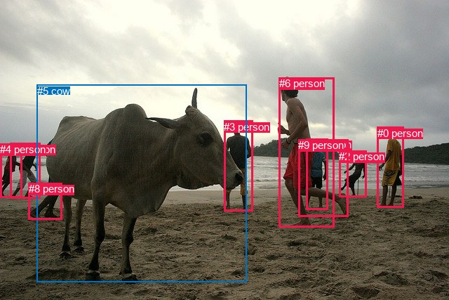
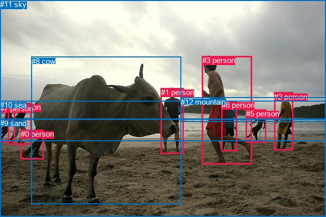

# 图片 1607：2390654.jpg

随机样本序号：227。图片 SHA256：`b50b07e5e896fcbca93bc91392a327bb7800ae9322b7331f577f41889fa01cf8`。

红色框表示人，蓝色框表示其他物体。两个模式分别保留自身框编号，可依据位置比较对应对象。

## 自动检测框与输出

人的框编号：`[0, 1, 2, 3, 4, 6, 7, 8, 9]`。状态：`ok`。

### 自动检测全部物体框

| 编号 | 类别 | 是否为人 | 检测分数 | 像素坐标 xyxy |
|---|---|---|---|---|
| 0 | person | True | 0.9995 | 537.7, 180.5, 575.6, 295.9 |
| 1 | person | True | 0.9989 | 14.0, 203.7, 57.0, 282.5 |
| 2 | person | True | 0.9985 | 483.3, 214.0, 522.4, 280.8 |
| 3 | person | True | 0.9981 | 319.4, 171.8, 360.4, 300.7 |
| 4 | person | True | 0.9965 | 0.3, 204.3, 31.4, 281.2 |
| 5 | cow | False | 0.9953 | 52.6, 120.5, 351.4, 401.9 |
| 6 | person | True | 0.9873 | 397.8, 110.5, 476.2, 323.5 |
| 7 | person | True | 0.9722 | 436.1, 197.1, 467.2, 298.8 |
| 8 | person | True | 0.7714 | 40.6, 260.4, 88.6, 312.7 |
| 9 | person | True | 0.5306 | 425.4, 198.1, 496.4, 308.7 |

### 自动检测 Top50 人相关候选

评分物体对：90；人相关物体对：90；输出关系：50。

| 排名 | 主语编号与类别 | 关系 | 宾语编号与类别 | 类型 | 人与人 | 排序分数 | 原始融合 logit |
|---|---|---|---|---|---|---|---|
| 1 | #6 person | wearing | #7 person | semantic | True | 0.97907 | 3.8454 |
| 2 | #6 person | beside | #5 cow | spatial | False | 0.97151 | 3.5292 |
| 3 | #1 person | walking on | #8 person | semantic | True | 0.96866 | 3.4310 |
| 4 | #6 person | walking on | #5 cow | semantic | False | 0.96362 | 3.2768 |
| 5 | #1 person | walking on | #5 cow | semantic | False | 0.94931 | 2.9300 |
| 6 | #3 person | looking at | #5 cow | semantic | False | 0.94569 | 2.8573 |
| 7 | #3 person | beside | #5 cow | spatial | False | 0.94407 | 2.8261 |
| 8 | #4 person | walking on | #5 cow | semantic | False | 0.94274 | 2.8012 |
| 9 | #5 cow | walking on | #8 person | semantic | False | 0.94274 | 2.8012 |
| 10 | #9 person | wearing | #7 person | semantic | True | 0.94148 | 2.7781 |
| 11 | #5 cow | beside | #3 person | spatial | False | 0.94067 | 2.7635 |
| 12 | #6 person | in | #7 person | spatial | True | 0.93857 | 2.7264 |
| 13 | #0 person | walking on | #5 cow | semantic | False | 0.93084 | 2.5996 |
| 14 | #6 person | walking on | #9 person | semantic | True | 0.91473 | 2.3728 |
| 15 | #1 person | walking on | #4 person | semantic | True | 0.91450 | 2.3699 |
| 16 | #9 person | walking on | #5 cow | semantic | False | 0.88151 | 2.0068 |
| 17 | #6 person | in | #9 person | spatial | True | 0.85542 | 1.7778 |
| 18 | #4 person | walking on | #1 person | semantic | True | 0.85390 | 1.7656 |
| 19 | #5 cow | beside | #6 person | spatial | False | 0.84843 | 1.7223 |
| 20 | #1 person | beside | #5 cow | spatial | False | 0.83312 | 1.6079 |
| 21 | #5 cow | looking at | #6 person | semantic | False | 0.81290 | 1.4689 |
| 22 | #9 person | in | #7 person | spatial | True | 0.79469 | 1.3534 |
| 23 | #4 person | beside | #5 cow | spatial | False | 0.78328 | 1.2849 |
| 24 | #9 person | walking on | #6 person | semantic | True | 0.77449 | 1.2338 |
| 25 | #4 person | walking on | #8 person | semantic | True | 0.75494 | 1.1252 |
| 26 | #9 person | holding | #2 person | semantic | True | 0.74978 | 1.0974 |
| 27 | #0 person | walking on | #2 person | semantic | True | 0.74601 | 1.0774 |
| 28 | #5 cow | looking at | #3 person | semantic | False | 0.71839 | 0.9365 |
| 29 | #8 person | on | #5 cow | spatial | False | 0.70885 | 0.8898 |
| 30 | #0 person | walking on | #9 person | semantic | True | 0.70354 | 0.8642 |
| 31 | #0 person | beside | #5 cow | spatial | False | 0.69739 | 0.8349 |
| 32 | #9 person | beside | #5 cow | spatial | False | 0.68501 | 0.7769 |
| 33 | #5 cow | beside | #1 person | spatial | False | 0.67117 | 0.7135 |
| 34 | #0 person | beside | #2 person | spatial | True | 0.65962 | 0.6616 |
| 35 | #2 person | walking on | #9 person | semantic | True | 0.65877 | 0.6578 |
| 36 | #1 person | on | #8 person | spatial | True | 0.65486 | 0.6405 |
| 37 | #2 person | looking at | #5 cow | semantic | False | 0.64079 | 0.5788 |
| 38 | #5 cow | beside | #8 person | spatial | False | 0.62961 | 0.5305 |
| 39 | #7 person | walking on | #6 person | semantic | True | 0.60157 | 0.4120 |
| 40 | #7 person | walking on | #5 cow | semantic | False | 0.56175 | 0.2483 |
| 41 | #1 person | in | #4 person | spatial | True | 0.55281 | 0.2120 |
| 42 | #7 person | on | #9 person | spatial | True | 0.53210 | 0.1286 |
| 43 | #5 cow | beside | #4 person | spatial | False | 0.52365 | 0.0947 |
| 44 | #0 person | walking on | #7 person | semantic | True | 0.50959 | 0.0384 |
| 45 | #2 person | walking on | #0 person | semantic | True | 0.49931 | -0.0028 |
| 46 | #0 person | walking on | #6 person | semantic | True | 0.41040 | -0.3623 |
| 47 | #4 person | in | #1 person | spatial | True | 0.40434 | -0.3874 |
| 48 | #6 person | walking on | #8 person | semantic | True | 0.40266 | -0.3944 |
| 49 | #6 person | beside | #3 person | spatial | True | 0.39476 | -0.4274 |
| 50 | #9 person | beside | #6 person | spatial | True | 0.38632 | -0.4628 |

### 自动检测逐条人相关 GT 核验

R@50：0.00%；命中 0/4。

| GT 主语编号 | GT 关系 | GT 宾语编号 | 结果阶段 | 匹配预测主语编号 | 匹配预测宾语编号 |
|---|---|---|---|---|---|
| 1 | standing on | 9 | endpoint_missing_or_wrong_class | [3] | [] |
| 1 | in front of | 10 | endpoint_missing_or_wrong_class | [3] | [] |
| 3 | running on | 9 | endpoint_missing_or_wrong_class | [6] | [] |
| 4 | playing with | 5 | wrong_predicate | [1] | [2] |

## 真实框与输出

人的框编号：`[0, 1, 2, 3, 4, 5, 6, 7]`。

### 真实框全部物体框

| 编号 | 类别 | 是否为人 | 检测分数 | 像素坐标 xyxy |
|---|---|---|---|---|
| 0 | person | True | GT | 41.0, 255.0, 86.0, 313.0 |
| 1 | person | True | GT | 316.0, 173.0, 361.0, 302.0 |
| 2 | person | True | GT | 538.0, 182.0, 575.0, 296.0 |
| 3 | person | True | GT | 397.0, 110.0, 495.0, 324.0 |
| 4 | person | True | GT | 15.0, 202.0, 62.0, 284.0 |
| 5 | person | True | GT | 483.0, 215.0, 522.0, 280.0 |
| 6 | person | True | GT | 435.0, 198.0, 466.0, 297.0 |
| 7 | person | True | GT | 0.0, 205.0, 29.0, 280.0 |
| 8 | cow | False | GT | 62.0, 112.0, 356.0, 402.0 |
| 9 | sand | False | GT | 0.0, 234.0, 640.0, 427.0 |
| 10 | sea | False | GT | 0.0, 198.0, 640.0, 277.0 |
| 11 | sky | False | GT | 0.0, 0.0, 640.0, 234.0 |
| 12 | mountain | False | GT | 355.0, 192.0, 640.0, 240.0 |

### 真实框 Top50 人相关候选

评分物体对：156；人相关物体对：136；输出关系：50。

| 排名 | 主语编号与类别 | 关系 | 宾语编号与类别 | 类型 | 人与人 | 排序分数 | 原始融合 logit |
|---|---|---|---|---|---|---|---|
| 1 | #4 person | walking on | #9 sand | semantic | False | 0.99376 | 5.0707 |
| 2 | #7 person | walking on | #9 sand | semantic | False | 0.99339 | 5.0123 |
| 3 | #5 person | walking on | #9 sand | semantic | False | 0.98914 | 4.5117 |
| 4 | #2 person | walking on | #9 sand | semantic | False | 0.98671 | 4.3071 |
| 5 | #3 person | running on | #9 sand | semantic | False | 0.98445 | 4.1482 |
| 6 | #3 person | wearing | #6 person | semantic | True | 0.98251 | 4.0284 |
| 7 | #3 person | chasing | #8 cow | semantic | False | 0.97735 | 3.7645 |
| 8 | #0 person | touching | #9 sand | semantic | False | 0.97727 | 3.7613 |
| 9 | #1 person | walking on | #9 sand | semantic | False | 0.97012 | 3.4802 |
| 10 | #3 person | on | #9 sand | spatial | False | 0.96949 | 3.4589 |
| 11 | #5 person | on | #9 sand | spatial | False | 0.96468 | 3.3073 |
| 12 | #2 person | on | #9 sand | spatial | False | 0.95045 | 2.9539 |
| 13 | #1 person | on | #9 sand | spatial | False | 0.94322 | 2.8102 |
| 14 | #4 person | on | #9 sand | spatial | False | 0.93970 | 2.7463 |
| 15 | #4 person | walking on | #10 sea | semantic | False | 0.93472 | 2.6616 |
| 16 | #3 person | beside | #8 cow | spatial | False | 0.93205 | 2.6185 |
| 17 | #7 person | on | #9 sand | spatial | False | 0.92217 | 2.4722 |
| 18 | #0 person | on | #9 sand | spatial | False | 0.91714 | 2.4041 |
| 19 | #7 person | walking on | #10 sea | semantic | False | 0.91000 | 2.3137 |
| 20 | #1 person | looking at | #8 cow | semantic | False | 0.90373 | 2.2394 |
| 21 | #1 person | beside | #8 cow | spatial | False | 0.89188 | 2.1101 |
| 22 | #3 person | in | #6 person | spatial | True | 0.88378 | 2.0287 |
| 23 | #5 person | walking on | #10 sea | semantic | False | 0.87065 | 1.9067 |
| 24 | #1 person | looking at | #10 sea | semantic | False | 0.84811 | 1.7198 |
| 25 | #4 person | running on | #8 cow | semantic | False | 0.83751 | 1.6398 |
| 26 | #1 person | beside | #10 sea | spatial | False | 0.79693 | 1.3672 |
| 27 | #7 person | walking on | #8 cow | semantic | False | 0.79205 | 1.3373 |
| 28 | #5 person | in | #10 sea | spatial | False | 0.79193 | 1.3366 |
| 29 | #4 person | in | #10 sea | spatial | False | 0.78763 | 1.3107 |
| 30 | #4 person | walking on | #0 person | semantic | True | 0.78172 | 1.2757 |
| 31 | #2 person | looking at | #8 cow | semantic | False | 0.76743 | 1.1939 |
| 32 | #6 person | walking on | #9 sand | semantic | False | 0.72902 | 0.9897 |
| 33 | #2 person | walking on | #10 sea | semantic | False | 0.71653 | 0.9273 |
| 34 | #7 person | in | #10 sea | spatial | False | 0.71373 | 0.9136 |
| 35 | #5 person | walking on | #12 mountain | semantic | False | 0.69064 | 0.8031 |
| 36 | #4 person | beside | #8 cow | spatial | False | 0.68905 | 0.7957 |
| 37 | #0 person | on | #8 cow | spatial | False | 0.68164 | 0.7613 |
| 38 | #11 sky | over | #3 person | spatial | False | 0.62740 | 0.5211 |
| 39 | #8 cow | looking at | #3 person | semantic | False | 0.59387 | 0.3800 |
| 40 | #6 person | on | #9 sand | spatial | False | 0.59344 | 0.3782 |
| 41 | #2 person | beside | #10 sea | spatial | False | 0.57282 | 0.2934 |
| 42 | #8 cow | beside | #3 person | spatial | False | 0.56457 | 0.2597 |
| 43 | #4 person | walking on | #7 person | semantic | True | 0.55261 | 0.2112 |
| 44 | #7 person | beside | #8 cow | spatial | False | 0.53840 | 0.1539 |
| 45 | #6 person | on | #3 person | spatial | True | 0.53540 | 0.1418 |
| 46 | #7 person | walking on | #4 person | semantic | True | 0.52170 | 0.0869 |
| 47 | #3 person | holding | #5 person | semantic | True | 0.50070 | 0.0028 |
| 48 | #3 person | walking on | #10 sea | semantic | False | 0.49257 | -0.0297 |
| 49 | #4 person | on | #0 person | spatial | True | 0.47423 | -0.1032 |
| 50 | #2 person | beside | #8 cow | spatial | False | 0.47086 | -0.1167 |

### 真实框逐条人相关 GT 核验

R@50：25.00%；命中 1/4。

| GT 主语编号 | GT 关系 | GT 宾语编号 | 结果阶段 | 匹配预测主语编号 | 匹配预测宾语编号 |
|---|---|---|---|---|---|
| 1 | standing on | 9 | wrong_predicate | [1] | [9] |
| 1 | in front of | 10 | wrong_predicate | [1] | [10] |
| 3 | running on | 9 | hit50 | [3] | [9] |
| 4 | playing with | 5 | wrong_predicate | [4] | [5] |

## 全部人相关 GT

| 主语编号与类别 | 关系 | 宾语编号与类别 |
|---|---|---|
| #1 person | standing on | #9 sand |
| #1 person | in front of | #10 sea |
| #3 person | running on | #9 sand |
| #4 person | playing with | #5 person |

原始记录、全部人相关物体对的两项预测与分项分数见 [逐图证据 JSON](../evidence/cases/1607.json)。全部56类 logits 保留于本机 HOR/output/random500/logits/。

<!-- HOR_COMPLETE_RESULTS -->

## 六组条件的完整输出对照

以下保留同一图片三种框与候选模式、两种谓词输出规则的全部 Top50。框编号各自在所属模式内解释。

### 自动检测框完整枚举：空间与语义各保留一个谓词

| 排名 | 主语编号与类别 | 谓词 | 宾语编号与类别 | 分组 | 排序分数 | predicate logit | pair logit |
|---|---|---|---|---|---|---|---|
| 1 | #6 person | wearing | #7 person | semantic | 0.9790692 | 3.6760859 | 0.1692952 |
| 2 | #6 person | beside | #5 cow | spatial | 0.9715073 | 3.5925975 | -0.0633962 |
| 3 | #1 person | walking on | #8 person | semantic | 0.9686607 | 3.1806574 | 0.2503829 |
| 4 | #6 person | walking on | #5 cow | semantic | 0.9636240 | 3.3401866 | -0.0633962 |
| 5 | #1 person | walking on | #5 cow | semantic | 0.9493105 | 3.2317801 | -0.3017631 |
| 6 | #3 person | looking at | #5 cow | semantic | 0.9456925 | 3.0834045 | -0.2261503 |
| 7 | #3 person | beside | #5 cow | spatial | 0.9440688 | 3.0522280 | -0.2261503 |
| 8 | #4 person | walking on | #5 cow | semantic | 0.9427428 | 3.2137165 | -0.4124781 |
| 9 | #5 cow | walking on | #8 person | semantic | 0.9427406 | 3.2107902 | -0.4095897 |
| 10 | #9 person | wearing | #7 person | semantic | 0.9414818 | 3.1255689 | -0.3474513 |
| 11 | #5 cow | beside | #3 person | spatial | 0.9406716 | 3.8803258 | -1.1168200 |
| 12 | #6 person | in | #7 person | spatial | 0.9385690 | 2.5571475 | 0.1692952 |
| 13 | #0 person | walking on | #5 cow | semantic | 0.9308384 | 3.3431697 | -0.7435291 |
| 14 | #6 person | walking on | #9 person | semantic | 0.9147311 | 2.4795547 | -0.1067332 |
| 15 | #1 person | walking on | #4 person | semantic | 0.9144991 | 2.5216184 | -0.1517682 |
| 16 | #9 person | walking on | #5 cow | semantic | 0.8815134 | 3.0482221 | -1.0413814 |
| 17 | #6 person | in | #9 person | spatial | 0.8554228 | 1.8845158 | -0.1067332 |
| 18 | #4 person | walking on | #1 person | semantic | 0.8539043 | 2.1514916 | -0.3859345 |
| 19 | #5 cow | beside | #6 person | spatial | 0.8484292 | 2.6530614 | -0.9307277 |
| 20 | #1 person | beside | #5 cow | spatial | 0.8331227 | 1.9096851 | -0.3017631 |
| 21 | #5 cow | looking at | #6 person | semantic | 0.8128970 | 2.3996725 | -0.9307277 |
| 22 | #9 person | in | #7 person | spatial | 0.7946883 | 1.7008724 | -0.3474513 |
| 23 | #4 person | beside | #5 cow | spatial | 0.7832813 | 1.6973696 | -0.4124781 |
| 24 | #9 person | walking on | #6 person | semantic | 0.7744913 | 1.9227757 | -0.6889280 |
| 25 | #4 person | walking on | #8 person | semantic | 0.7549436 | 0.9178205 | 0.2073341 |
| 26 | #9 person | holding | #2 person | semantic | 0.7497782 | 2.3397121 | -1.2422826 |
| 27 | #0 person | walking on | #2 person | semantic | 0.7460063 | 1.6610837 | -0.5836592 |
| 28 | #5 cow | looking at | #3 person | semantic | 0.7183940 | 2.0533290 | -1.1168200 |
| 29 | #8 person | on | #5 cow | spatial | 0.7088495 | 1.3057513 | -0.4159480 |
| 30 | #0 person | walking on | #9 person | semantic | 0.7035435 | 1.7122483 | -0.8480190 |
| 31 | #0 person | beside | #5 cow | spatial | 0.6973944 | 1.5784497 | -0.7435291 |
| 32 | #9 person | beside | #5 cow | spatial | 0.6850059 | 1.8182549 | -1.0413814 |
| 33 | #5 cow | beside | #1 person | spatial | 0.6711699 | 2.1654935 | -1.4520122 |
| 34 | #0 person | beside | #2 person | spatial | 0.6596174 | 1.2452488 | -0.5836592 |
| 35 | #2 person | walking on | #9 person | semantic | 0.6587680 | 1.5376244 | -0.8798155 |
| 36 | #1 person | on | #8 person | spatial | 0.6548620 | 0.3900971 | 0.2503829 |
| 37 | #2 person | looking at | #5 cow | semantic | 0.6407903 | 1.5173736 | -0.9385777 |
| 38 | #5 cow | beside | #8 person | spatial | 0.6296056 | 0.9401150 | -0.4095897 |
| 39 | #7 person | walking on | #6 person | semantic | 0.6015741 | 1.0953155 | -0.6832873 |
| 40 | #7 person | walking on | #5 cow | semantic | 0.5617477 | 1.6369438 | -1.3886859 |
| 41 | #1 person | in | #4 person | spatial | 0.5528114 | 0.3638048 | -0.1517682 |
| 42 | #7 person | on | #9 person | spatial | 0.5321026 | 0.8996782 | -0.7710907 |
| 43 | #5 cow | beside | #4 person | spatial | 0.5236462 | 1.6838961 | -1.5892406 |
| 44 | #0 person | walking on | #7 person | semantic | 0.5095908 | 0.7674198 | -0.7290517 |
| 45 | #2 person | walking on | #0 person | semantic | 0.4993088 | 0.9192839 | -0.9220485 |
| 46 | #0 person | walking on | #6 person | semantic | 0.4104016 | 0.6018410 | -0.9641464 |
| 47 | #4 person | in | #1 person | spatial | 0.4043353 | -0.0014992 | -0.3859345 |
| 48 | #6 person | walking on | #8 person | semantic | 0.4026574 | 0.7342901 | -1.1286950 |
| 49 | #6 person | beside | #3 person | spatial | 0.3947588 | 0.7263684 | -1.1537206 |
| 50 | #9 person | beside | #6 person | spatial | 0.3863238 | 0.2261362 | -0.6889280 |

GT 命中：0/4，R@50=0.00%。

| GT主语 | GT谓词 | GT宾语 | 结果阶段 | 匹配主语框 | 匹配宾语框 |
|---|---|---|---|---|---|
| 1 | standing on | 9 | endpoint_missing_or_wrong_class | [3] | [] |
| 1 | in front of | 10 | endpoint_missing_or_wrong_class | [3] | [] |
| 3 | running on | 9 | endpoint_missing_or_wrong_class | [6] | [] |
| 4 | playing with | 5 | wrong_predicate | [1] | [2] |

### 自动检测框完整枚举：每对只保留一个谓词

| 排名 | 主语编号与类别 | 谓词 | 宾语编号与类别 | 分组 | 排序分数 | predicate logit | pair logit |
|---|---|---|---|---|---|---|---|
| 1 | #6 person | wearing | #7 person | single | 0.9790692 | 3.6760859 | 0.1692952 |
| 2 | #6 person | beside | #5 cow | single | 0.9715073 | 3.5925975 | -0.0633962 |
| 3 | #1 person | walking on | #8 person | single | 0.9686607 | 3.1806574 | 0.2503829 |
| 4 | #1 person | walking on | #5 cow | single | 0.9493105 | 3.2317801 | -0.3017631 |
| 5 | #3 person | looking at | #5 cow | single | 0.9456925 | 3.0834045 | -0.2261503 |
| 6 | #4 person | walking on | #5 cow | single | 0.9427428 | 3.2137165 | -0.4124781 |
| 7 | #5 cow | walking on | #8 person | single | 0.9427406 | 3.2107902 | -0.4095897 |
| 8 | #9 person | wearing | #7 person | single | 0.9414818 | 3.1255689 | -0.3474513 |
| 9 | #5 cow | beside | #3 person | single | 0.9406716 | 3.8803258 | -1.1168200 |
| 10 | #0 person | walking on | #5 cow | single | 0.9308384 | 3.3431697 | -0.7435291 |
| 11 | #6 person | walking on | #9 person | single | 0.9147311 | 2.4795547 | -0.1067332 |
| 12 | #1 person | walking on | #4 person | single | 0.9144991 | 2.5216184 | -0.1517682 |
| 13 | #9 person | walking on | #5 cow | single | 0.8815134 | 3.0482221 | -1.0413814 |
| 14 | #4 person | walking on | #1 person | single | 0.8539043 | 2.1514916 | -0.3859345 |
| 15 | #5 cow | beside | #6 person | single | 0.8484292 | 2.6530614 | -0.9307277 |
| 16 | #9 person | walking on | #6 person | single | 0.7744913 | 1.9227757 | -0.6889280 |
| 17 | #4 person | walking on | #8 person | single | 0.7549436 | 0.9178205 | 0.2073341 |
| 18 | #9 person | holding | #2 person | single | 0.7497782 | 2.3397121 | -1.2422826 |
| 19 | #0 person | walking on | #2 person | single | 0.7460063 | 1.6610837 | -0.5836592 |
| 20 | #8 person | on | #5 cow | single | 0.7088495 | 1.3057513 | -0.4159480 |
| 21 | #0 person | walking on | #9 person | single | 0.7035435 | 1.7122483 | -0.8480190 |
| 22 | #5 cow | beside | #1 person | single | 0.6711699 | 2.1654935 | -1.4520122 |
| 23 | #2 person | walking on | #9 person | single | 0.6587680 | 1.5376244 | -0.8798155 |
| 24 | #2 person | looking at | #5 cow | single | 0.6407903 | 1.5173736 | -0.9385777 |
| 25 | #7 person | walking on | #6 person | single | 0.6015741 | 1.0953155 | -0.6832873 |
| 26 | #7 person | walking on | #5 cow | single | 0.5617477 | 1.6369438 | -1.3886859 |
| 27 | #7 person | on | #9 person | single | 0.5321026 | 0.8996782 | -0.7710907 |
| 28 | #5 cow | beside | #4 person | single | 0.5236462 | 1.6838961 | -1.5892406 |
| 29 | #0 person | walking on | #7 person | single | 0.5095908 | 0.7674198 | -0.7290517 |
| 30 | #2 person | walking on | #0 person | single | 0.4993088 | 0.9192839 | -0.9220485 |
| 31 | #0 person | walking on | #6 person | single | 0.4104016 | 0.6018410 | -0.9641464 |
| 32 | #6 person | walking on | #8 person | single | 0.4026574 | 0.7342901 | -1.1286950 |
| 33 | #6 person | beside | #3 person | single | 0.3947588 | 0.7263684 | -1.1537206 |
| 34 | #2 person | walking on | #7 person | single | 0.3843633 | 0.4649043 | -0.9359730 |
| 35 | #0 person | walking on | #8 person | single | 0.3796837 | 0.0181770 | -0.5090681 |
| 36 | #6 person | walking on | #2 person | single | 0.3788780 | 0.5311637 | -1.0254769 |
| 37 | #2 person | looking at | #6 person | single | 0.3475525 | 0.2881641 | -0.9179789 |
| 38 | #6 person | walking on | #0 person | single | 0.2763724 | 0.4153142 | -1.3778419 |
| 39 | #4 person | walking on | #2 person | single | 0.2443524 | -0.1865382 | -0.9424255 |
| 40 | #3 person | walking on | #8 person | single | 0.2420447 | 0.1580405 | -1.2995427 |
| 41 | #3 person | looking at | #6 person | single | 0.2416156 | -0.2294221 | -0.9144201 |
| 42 | #1 person | walking on | #2 person | single | 0.2043822 | -0.4761615 | -0.8829659 |
| 43 | #9 person | walking on | #0 person | single | 0.1986023 | -0.0887384 | -1.3063147 |
| 44 | #5 cow | beside | #9 person | single | 0.1933675 | 0.0382199 | -1.4664958 |
| 45 | #5 cow | beside | #0 person | single | 0.1836121 | 0.0061736 | -1.4982381 |
| 46 | #2 person | walking on | #8 person | single | 0.1737673 | -1.0395396 | -0.5196199 |
| 47 | #8 person | on | #1 person | single | 0.1596286 | -0.8441944 | -0.8167995 |
| 48 | #4 person | walking on | #6 person | single | 0.1411410 | -0.6462002 | -1.1596450 |
| 49 | #3 person | walking on | #9 person | single | 0.1339438 | -0.6333776 | -1.2331519 |
| 50 | #6 person | walking on | #1 person | single | 0.1311152 | -0.4761753 | -1.4149593 |

GT 命中：0/4，R@50=0.00%。

| GT主语 | GT谓词 | GT宾语 | 结果阶段 | 匹配主语框 | 匹配宾语框 |
|---|---|---|---|---|---|
| 1 | standing on | 9 | endpoint_missing_or_wrong_class | [3] | [] |
| 1 | in front of | 10 | endpoint_missing_or_wrong_class | [3] | [] |
| 3 | running on | 9 | endpoint_missing_or_wrong_class | [6] | [] |
| 4 | playing with | 5 | wrong_predicate | [1] | [2] |

### 真实框完整枚举：空间与语义各保留一个谓词

| 排名 | 主语编号与类别 | 谓词 | 宾语编号与类别 | 分组 | 排序分数 | predicate logit | pair logit |
|---|---|---|---|---|---|---|---|
| 1 | #4 person | walking on | #9 sand | semantic | 0.9937611 | 4.8086228 | 0.2620841 |
| 2 | #7 person | walking on | #9 sand | semantic | 0.9933883 | 4.8056121 | 0.2066643 |
| 3 | #5 person | walking on | #9 sand | semantic | 0.9891396 | 4.3512473 | 0.1604654 |
| 4 | #2 person | walking on | #9 sand | semantic | 0.9867063 | 3.9962001 | 0.3108810 |
| 5 | #3 person | running on | #9 sand | semantic | 0.9844531 | 3.9129577 | 0.2352680 |
| 6 | #3 person | wearing | #6 person | semantic | 0.9825081 | 3.8479047 | 0.1804665 |
| 7 | #3 person | chasing | #8 cow | semantic | 0.9773461 | 3.8740106 | -0.1095055 |
| 8 | #0 person | touching | #9 sand | semantic | 0.9772742 | 4.0780826 | -0.3168142 |
| 9 | #1 person | walking on | #9 sand | semantic | 0.9701201 | 3.4666286 | 0.0136042 |
| 10 | #3 person | on | #9 sand | spatial | 0.9694945 | 3.2235966 | 0.2352680 |
| 11 | #5 person | on | #9 sand | spatial | 0.9646770 | 3.1467910 | 0.1604654 |
| 12 | #2 person | on | #9 sand | spatial | 0.9504452 | 2.6429725 | 0.3108810 |
| 13 | #1 person | on | #9 sand | spatial | 0.9432240 | 2.7965851 | 0.0136042 |
| 14 | #4 person | on | #9 sand | spatial | 0.9397034 | 2.4842038 | 0.2620841 |
| 15 | #4 person | walking on | #10 sea | semantic | 0.9347237 | 2.7413859 | -0.0797635 |
| 16 | #3 person | beside | #8 cow | spatial | 0.9320454 | 2.7280469 | -0.1095055 |
| 17 | #7 person | on | #9 sand | spatial | 0.9221703 | 2.2655430 | 0.2066643 |
| 18 | #0 person | on | #9 sand | spatial | 0.9171412 | 2.7209368 | -0.3168142 |
| 19 | #7 person | walking on | #10 sea | semantic | 0.9100027 | 2.3562207 | -0.0425527 |
| 20 | #1 person | looking at | #8 cow | semantic | 0.9037319 | 2.4941301 | -0.2547337 |
| 21 | #1 person | beside | #8 cow | spatial | 0.8918845 | 2.3648701 | -0.2547337 |
| 22 | #3 person | in | #6 person | spatial | 0.8837776 | 1.8482327 | 0.1804665 |
| 23 | #5 person | walking on | #10 sea | semantic | 0.8706483 | 2.0191960 | -0.1124926 |
| 24 | #1 person | looking at | #10 sea | semantic | 0.8481095 | 2.2323737 | -0.5125239 |
| 25 | #4 person | running on | #8 cow | semantic | 0.8375063 | 1.9470959 | -0.3073065 |
| 26 | #1 person | beside | #10 sea | spatial | 0.7969251 | 1.8797097 | -0.5125239 |
| 27 | #7 person | walking on | #8 cow | semantic | 0.7920530 | 1.8340769 | -0.4967320 |
| 28 | #5 person | in | #10 sea | spatial | 0.7919271 | 1.4490733 | -0.1124926 |
| 29 | #4 person | in | #10 sea | spatial | 0.7876278 | 1.3904490 | -0.0797635 |
| 30 | #4 person | walking on | #0 person | semantic | 0.7817236 | 1.0321922 | 0.2435467 |
| 31 | #2 person | looking at | #8 cow | semantic | 0.7674295 | 1.9616604 | -0.7678074 |
| 32 | #6 person | walking on | #9 sand | semantic | 0.7290221 | 2.0072098 | -1.0175431 |
| 33 | #2 person | walking on | #10 sea | semantic | 0.7165260 | 1.2789989 | -0.3517046 |
| 34 | #7 person | in | #10 sea | spatial | 0.7137294 | 0.9561191 | -0.0425527 |
| 35 | #5 person | walking on | #12 mountain | semantic | 0.6906446 | 1.2157359 | -0.4126014 |
| 36 | #4 person | beside | #8 cow | spatial | 0.6890534 | 1.1030040 | -0.3073065 |
| 37 | #0 person | on | #8 cow | spatial | 0.6816376 | 1.2200537 | -0.4587455 |
| 38 | #11 sky | over | #3 person | spatial | 0.6273996 | 1.4572535 | -0.9361764 |
| 39 | #8 cow | looking at | #3 person | semantic | 0.5938691 | 1.3730836 | -0.9931000 |
| 40 | #6 person | on | #9 sand | spatial | 0.5934439 | 1.3957639 | -1.0175431 |
| 41 | #2 person | beside | #10 sea | spatial | 0.5728204 | 0.6450720 | -0.3517046 |
| 42 | #8 cow | beside | #3 person | spatial | 0.5645685 | 1.2528243 | -0.9931000 |
| 43 | #4 person | walking on | #7 person | semantic | 0.5526082 | 0.3009429 | -0.0897284 |
| 44 | #7 person | beside | #8 cow | spatial | 0.5384043 | 0.6506524 | -0.4967320 |
| 45 | #6 person | on | #3 person | spatial | 0.5353990 | 0.8374691 | -0.6956360 |
| 46 | #7 person | walking on | #4 person | semantic | 0.5217022 | 0.5356236 | -0.4487602 |
| 47 | #3 person | holding | #5 person | semantic | 0.5006981 | 0.9799066 | -0.9771140 |
| 48 | #3 person | walking on | #10 sea | semantic | 0.4925721 | 0.7072649 | -0.7369785 |
| 49 | #4 person | on | #0 person | spatial | 0.4742299 | -0.3467183 | 0.2435467 |
| 50 | #2 person | beside | #8 cow | spatial | 0.4708599 | 0.6511149 | -0.7678074 |

GT 命中：1/4，R@50=25.00%。

| GT主语 | GT谓词 | GT宾语 | 结果阶段 | 匹配主语框 | 匹配宾语框 |
|---|---|---|---|---|---|
| 1 | standing on | 9 | wrong_predicate | [1] | [9] |
| 1 | in front of | 10 | wrong_predicate | [1] | [10] |
| 3 | running on | 9 | hit50 | [3] | [9] |
| 4 | playing with | 5 | wrong_predicate | [4] | [5] |

### 真实框完整枚举：每对只保留一个谓词

| 排名 | 主语编号与类别 | 谓词 | 宾语编号与类别 | 分组 | 排序分数 | predicate logit | pair logit |
|---|---|---|---|---|---|---|---|
| 1 | #4 person | walking on | #9 sand | single | 0.9937611 | 4.8086228 | 0.2620841 |
| 2 | #7 person | walking on | #9 sand | single | 0.9933883 | 4.8056121 | 0.2066643 |
| 3 | #5 person | walking on | #9 sand | single | 0.9891396 | 4.3512473 | 0.1604654 |
| 4 | #2 person | walking on | #9 sand | single | 0.9867063 | 3.9962001 | 0.3108810 |
| 5 | #3 person | running on | #9 sand | single | 0.9844531 | 3.9129577 | 0.2352680 |
| 6 | #3 person | wearing | #6 person | single | 0.9825081 | 3.8479047 | 0.1804665 |
| 7 | #3 person | chasing | #8 cow | single | 0.9773461 | 3.8740106 | -0.1095055 |
| 8 | #0 person | touching | #9 sand | single | 0.9772742 | 4.0780826 | -0.3168142 |
| 9 | #1 person | walking on | #9 sand | single | 0.9701201 | 3.4666286 | 0.0136042 |
| 10 | #4 person | walking on | #10 sea | single | 0.9347237 | 2.7413859 | -0.0797635 |
| 11 | #7 person | walking on | #10 sea | single | 0.9100027 | 2.3562207 | -0.0425527 |
| 12 | #1 person | looking at | #8 cow | single | 0.9037319 | 2.4941301 | -0.2547337 |
| 13 | #5 person | walking on | #10 sea | single | 0.8706483 | 2.0191960 | -0.1124926 |
| 14 | #1 person | looking at | #10 sea | single | 0.8481095 | 2.2323737 | -0.5125239 |
| 15 | #4 person | running on | #8 cow | single | 0.8375063 | 1.9470959 | -0.3073065 |
| 16 | #7 person | walking on | #8 cow | single | 0.7920530 | 1.8340769 | -0.4967320 |
| 17 | #4 person | walking on | #0 person | single | 0.7817236 | 1.0321922 | 0.2435467 |
| 18 | #2 person | looking at | #8 cow | single | 0.7674295 | 1.9616604 | -0.7678074 |
| 19 | #6 person | walking on | #9 sand | single | 0.7290221 | 2.0072098 | -1.0175431 |
| 20 | #2 person | walking on | #10 sea | single | 0.7165260 | 1.2789989 | -0.3517046 |
| 21 | #5 person | walking on | #12 mountain | single | 0.6906446 | 1.2157359 | -0.4126014 |
| 22 | #0 person | on | #8 cow | single | 0.6816376 | 1.2200537 | -0.4587455 |
| 23 | #11 sky | over | #3 person | single | 0.6273996 | 1.4572535 | -0.9361764 |
| 24 | #8 cow | looking at | #3 person | single | 0.5938691 | 1.3730836 | -0.9931000 |
| 25 | #4 person | walking on | #7 person | single | 0.5526082 | 0.3009429 | -0.0897284 |
| 26 | #6 person | on | #3 person | single | 0.5353990 | 0.8374691 | -0.6956360 |
| 27 | #7 person | walking on | #4 person | single | 0.5217022 | 0.5356236 | -0.4487602 |
| 28 | #3 person | holding | #5 person | single | 0.5006981 | 0.9799066 | -0.9771140 |
| 29 | #3 person | walking on | #10 sea | single | 0.4925721 | 0.7072649 | -0.7369785 |
| 30 | #5 person | chasing | #8 cow | single | 0.4501263 | 0.8303347 | -1.0304949 |
| 31 | #8 cow | beside | #1 person | single | 0.4073283 | 0.7386703 | -1.1136916 |
| 32 | #2 person | walking on | #12 mountain | single | 0.3903470 | 0.4364300 | -0.8822840 |
| 33 | #8 cow | in | #0 person | single | 0.3836977 | -0.0048180 | -0.4690646 |
| 34 | #3 person | in | #11 sky | single | 0.3329681 | 0.8811035 | -1.5758948 |
| 35 | #4 person | walking on | #12 mountain | single | 0.3173410 | -0.0751214 | -0.6908972 |
| 36 | #2 person | looking at | #3 person | single | 0.2906019 | 0.0624256 | -0.9548882 |
| 37 | #7 person | walking on | #12 mountain | single | 0.2770624 | -0.2812443 | -0.6778357 |
| 38 | #10 sea | beside | #1 person | single | 0.2337121 | -0.0764241 | -1.1110437 |
| 39 | #2 person | beside | #5 person | single | 0.2326296 | -0.6760807 | -0.5174412 |
| 40 | #2 person | wearing | #6 person | single | 0.2079593 | -0.6139421 | -0.7233282 |
| 41 | #5 person | beside | #3 person | single | 0.2067246 | -0.4037848 | -0.9409985 |
| 42 | #2 person | looking at | #11 sky | single | 0.2013074 | 0.1491046 | -1.5272477 |
| 43 | #0 person | on | #4 person | single | 0.1742184 | -0.7636805 | -0.7923403 |
| 44 | #5 person | beside | #2 person | single | 0.1733254 | -0.6143079 | -0.9479322 |
| 45 | #1 person | looking at | #3 person | single | 0.1726989 | -0.6395435 | -0.9270756 |
| 46 | #3 person | walking on | #12 mountain | single | 0.1652826 | -0.1412969 | -1.4781394 |
| 47 | #10 sea | beside | #3 person | single | 0.1424961 | -1.0079806 | -0.7867305 |
| 48 | #11 sky | over | #2 person | single | 0.1379227 | -0.5944362 | -1.2382157 |
| 49 | #0 person | touching | #10 sea | single | 0.1325292 | -0.8246918 | -1.0540867 |
| 50 | #8 cow | beside | #4 person | single | 0.1165449 | -0.5887699 | -1.4367936 |

GT 命中：1/4，R@50=25.00%。

| GT主语 | GT谓词 | GT宾语 | 结果阶段 | 匹配主语框 | 匹配宾语框 |
|---|---|---|---|---|---|
| 1 | standing on | 9 | wrong_predicate | [1] | [9] |
| 1 | in front of | 10 | wrong_predicate | [1] | [10] |
| 3 | running on | 9 | hit50 | [3] | [9] |
| 4 | playing with | 5 | wrong_predicate | [4] | [5] |

### 真实框400候选：空间与语义各保留一个谓词

| 排名 | 主语编号与类别 | 谓词 | 宾语编号与类别 | 分组 | 排序分数 | predicate logit | pair logit |
|---|---|---|---|---|---|---|---|
| 1 | #4 person | walking on | #9 sand | semantic | 0.9937611 | 4.8086228 | 0.2620841 |
| 2 | #7 person | walking on | #9 sand | semantic | 0.9933883 | 4.8056121 | 0.2066643 |
| 3 | #5 person | walking on | #9 sand | semantic | 0.9891396 | 4.3512473 | 0.1604654 |
| 4 | #2 person | walking on | #9 sand | semantic | 0.9867063 | 3.9962001 | 0.3108810 |
| 5 | #3 person | running on | #9 sand | semantic | 0.9844531 | 3.9129577 | 0.2352680 |
| 6 | #3 person | wearing | #6 person | semantic | 0.9825081 | 3.8479047 | 0.1804665 |
| 7 | #3 person | chasing | #8 cow | semantic | 0.9773461 | 3.8740106 | -0.1095055 |
| 8 | #0 person | touching | #9 sand | semantic | 0.9772742 | 4.0780826 | -0.3168142 |
| 9 | #1 person | walking on | #9 sand | semantic | 0.9700327 | 3.4636178 | 0.0136042 |
| 10 | #3 person | on | #9 sand | spatial | 0.9694945 | 3.2235966 | 0.2352680 |
| 11 | #5 person | on | #9 sand | spatial | 0.9646770 | 3.1467910 | 0.1604654 |
| 12 | #2 person | on | #9 sand | spatial | 0.9522231 | 2.6813755 | 0.3108810 |
| 13 | #1 person | on | #9 sand | spatial | 0.9426380 | 2.7856960 | 0.0136042 |
| 14 | #4 person | on | #9 sand | spatial | 0.9390833 | 2.4733143 | 0.2620841 |
| 15 | #4 person | walking on | #10 sea | semantic | 0.9328635 | 2.7112947 | -0.0797635 |
| 16 | #3 person | beside | #8 cow | spatial | 0.9301221 | 2.6980715 | -0.1095055 |
| 17 | #7 person | on | #9 sand | spatial | 0.9221703 | 2.2655430 | 0.2066643 |
| 18 | #0 person | on | #9 sand | spatial | 0.9171412 | 2.7209368 | -0.3168142 |
| 19 | #7 person | walking on | #10 sea | semantic | 0.9124370 | 2.3863125 | -0.0425527 |
| 20 | #1 person | looking at | #8 cow | semantic | 0.9037319 | 2.4941301 | -0.2547337 |
| 21 | #1 person | beside | #8 cow | spatial | 0.8889599 | 2.3348942 | -0.2547337 |
| 22 | #3 person | in | #6 person | spatial | 0.8837776 | 1.8482327 | 0.1804665 |
| 23 | #5 person | walking on | #10 sea | semantic | 0.8706483 | 2.0191960 | -0.1124926 |
| 24 | #1 person | looking at | #10 sea | semantic | 0.8481095 | 2.2323737 | -0.5125239 |
| 25 | #4 person | running on | #8 cow | semantic | 0.8375063 | 1.9470959 | -0.3073065 |
| 26 | #1 person | beside | #10 sea | spatial | 0.7969251 | 1.8797097 | -0.5125239 |
| 27 | #7 person | walking on | #8 cow | semantic | 0.7967219 | 1.8626628 | -0.4967320 |
| 28 | #5 person | in | #10 sea | spatial | 0.7908313 | 1.4424357 | -0.1124926 |
| 29 | #4 person | in | #10 sea | spatial | 0.7865154 | 1.3838115 | -0.0797635 |
| 30 | #4 person | walking on | #0 person | semantic | 0.7817236 | 1.0321922 | 0.2435467 |
| 31 | #2 person | looking at | #8 cow | semantic | 0.7674295 | 1.9616604 | -0.7678074 |
| 32 | #6 person | walking on | #9 sand | semantic | 0.7236392 | 1.9801288 | -1.0175431 |
| 33 | #7 person | in | #10 sea | spatial | 0.7144070 | 0.9594378 | -0.0425527 |
| 34 | #2 person | walking on | #10 sea | semantic | 0.7109934 | 1.2519183 | -0.3517046 |
| 35 | #4 person | beside | #8 cow | spatial | 0.6890410 | 1.1029463 | -0.3073065 |
| 36 | #5 person | walking on | #12 mountain | semantic | 0.6848291 | 1.1886554 | -0.4126014 |
| 37 | #0 person | on | #8 cow | spatial | 0.6816376 | 1.2200537 | -0.4587455 |
| 38 | #11 sky | over | #3 person | spatial | 0.6344066 | 1.4873447 | -0.9361764 |
| 39 | #6 person | on | #9 sand | spatial | 0.5921295 | 1.3903189 | -1.0175431 |
| 40 | #8 cow | looking at | #3 person | semantic | 0.5867606 | 1.3436899 | -0.9931000 |
| 41 | #2 person | beside | #10 sea | spatial | 0.5654413 | 0.6149802 | -0.3517046 |
| 42 | #8 cow | beside | #3 person | spatial | 0.5645826 | 1.2528815 | -0.9931000 |
| 43 | #4 person | walking on | #7 person | semantic | 0.5459037 | 0.2738619 | -0.0897284 |
| 44 | #7 person | beside | #8 cow | spatial | 0.5384043 | 0.6506524 | -0.4967320 |
| 45 | #6 person | on | #3 person | spatial | 0.5367530 | 0.8429136 | -0.6956360 |
| 46 | #7 person | walking on | #4 person | semantic | 0.5145652 | 0.5070376 | -0.4487602 |
| 47 | #3 person | holding | #5 person | semantic | 0.5074819 | 1.0070438 | -0.9771140 |
| 48 | #3 person | walking on | #10 sea | semantic | 0.4865574 | 0.6831951 | -0.7369785 |
| 49 | #4 person | on | #0 person | spatial | 0.4742299 | -0.3467183 | 0.2435467 |
| 50 | #2 person | beside | #8 cow | spatial | 0.4708456 | 0.6510572 | -0.7678074 |

GT 命中：1/4，R@50=25.00%。

| GT主语 | GT谓词 | GT宾语 | 结果阶段 | 匹配主语框 | 匹配宾语框 |
|---|---|---|---|---|---|
| 1 | standing on | 9 | wrong_predicate | [1] | [9] |
| 1 | in front of | 10 | wrong_predicate | [1] | [10] |
| 3 | running on | 9 | hit50 | [3] | [9] |
| 4 | playing with | 5 | wrong_predicate | [4] | [5] |

### 真实框400候选：每对只保留一个谓词

| 排名 | 主语编号与类别 | 谓词 | 宾语编号与类别 | 分组 | 排序分数 | predicate logit | pair logit |
|---|---|---|---|---|---|---|---|
| 1 | #4 person | walking on | #9 sand | single | 0.9937611 | 4.8086228 | 0.2620841 |
| 2 | #7 person | walking on | #9 sand | single | 0.9933883 | 4.8056121 | 0.2066643 |
| 3 | #5 person | walking on | #9 sand | single | 0.9891396 | 4.3512473 | 0.1604654 |
| 4 | #2 person | walking on | #9 sand | single | 0.9867063 | 3.9962001 | 0.3108810 |
| 5 | #3 person | running on | #9 sand | single | 0.9844531 | 3.9129577 | 0.2352680 |
| 6 | #3 person | wearing | #6 person | single | 0.9825081 | 3.8479047 | 0.1804665 |
| 7 | #3 person | chasing | #8 cow | single | 0.9773461 | 3.8740106 | -0.1095055 |
| 8 | #0 person | touching | #9 sand | single | 0.9772742 | 4.0780826 | -0.3168142 |
| 9 | #1 person | walking on | #9 sand | single | 0.9700327 | 3.4636178 | 0.0136042 |
| 10 | #4 person | walking on | #10 sea | single | 0.9328635 | 2.7112947 | -0.0797635 |
| 11 | #7 person | walking on | #10 sea | single | 0.9124370 | 2.3863125 | -0.0425527 |
| 12 | #1 person | looking at | #8 cow | single | 0.9037319 | 2.4941301 | -0.2547337 |
| 13 | #5 person | walking on | #10 sea | single | 0.8706483 | 2.0191960 | -0.1124926 |
| 14 | #1 person | looking at | #10 sea | single | 0.8481095 | 2.2323737 | -0.5125239 |
| 15 | #4 person | running on | #8 cow | single | 0.8375063 | 1.9470959 | -0.3073065 |
| 16 | #7 person | walking on | #8 cow | single | 0.7967219 | 1.8626628 | -0.4967320 |
| 17 | #4 person | walking on | #0 person | single | 0.7817236 | 1.0321922 | 0.2435467 |
| 18 | #2 person | looking at | #8 cow | single | 0.7674295 | 1.9616604 | -0.7678074 |
| 19 | #6 person | walking on | #9 sand | single | 0.7236392 | 1.9801288 | -1.0175431 |
| 20 | #2 person | walking on | #10 sea | single | 0.7109934 | 1.2519183 | -0.3517046 |
| 21 | #5 person | walking on | #12 mountain | single | 0.6848291 | 1.1886554 | -0.4126014 |
| 22 | #0 person | on | #8 cow | single | 0.6816376 | 1.2200537 | -0.4587455 |
| 23 | #11 sky | over | #3 person | single | 0.6344066 | 1.4873447 | -0.9361764 |
| 24 | #8 cow | looking at | #3 person | single | 0.5867606 | 1.3436899 | -0.9931000 |
| 25 | #4 person | walking on | #7 person | single | 0.5459037 | 0.2738619 | -0.0897284 |
| 26 | #6 person | on | #3 person | single | 0.5367530 | 0.8429136 | -0.6956360 |
| 27 | #7 person | walking on | #4 person | single | 0.5145652 | 0.5070376 | -0.4487602 |
| 28 | #3 person | holding | #5 person | single | 0.5074819 | 1.0070438 | -0.9771140 |
| 29 | #3 person | walking on | #10 sea | single | 0.4865574 | 0.6831951 | -0.7369785 |
| 30 | #5 person | chasing | #8 cow | single | 0.4428118 | 0.8007364 | -1.0304949 |
| 31 | #8 cow | beside | #1 person | single | 0.4073283 | 0.7386703 | -1.1136916 |
| 32 | #2 person | walking on | #12 mountain | single | 0.3910636 | 0.4394403 | -0.8822840 |
| 33 | #8 cow | in | #0 person | single | 0.3836977 | -0.0048180 | -0.4690646 |
| 34 | #3 person | in | #11 sky | single | 0.3381974 | 0.9045572 | -1.5758948 |
| 35 | #4 person | walking on | #12 mountain | single | 0.3176672 | -0.0736160 | -0.6908972 |
| 36 | #2 person | looking at | #3 person | single | 0.2845089 | 0.0326834 | -0.9548882 |
| 37 | #7 person | walking on | #12 mountain | single | 0.2776658 | -0.2782340 | -0.6778357 |
| 38 | #2 person | beside | #5 person | single | 0.2435347 | -0.6159563 | -0.5174412 |
| 39 | #10 sea | beside | #1 person | single | 0.2337069 | -0.0764532 | -1.1110437 |
| 40 | #2 person | looking at | #11 sky | single | 0.2061319 | 0.1788468 | -1.5272477 |
| 41 | #2 person | wearing | #6 person | single | 0.2035216 | -0.6410995 | -0.7233282 |
| 42 | #5 person | beside | #3 person | single | 0.2018520 | -0.4337606 | -0.9409985 |
| 43 | #0 person | on | #4 person | single | 0.1734364 | -0.7691257 | -0.7923403 |
| 44 | #5 person | beside | #2 person | single | 0.1733296 | -0.6142788 | -0.9479322 |
| 45 | #1 person | looking at | #3 person | single | 0.1725993 | -0.6402411 | -0.9270756 |
| 46 | #3 person | walking on | #12 mountain | single | 0.1579451 | -0.1954584 | -1.4781394 |
| 47 | #10 sea | beside | #3 person | single | 0.1424873 | -1.0080528 | -0.7867305 |
| 48 | #11 sky | over | #2 person | single | 0.1385526 | -0.5891480 | -1.2382157 |
| 49 | #0 person | touching | #10 sea | single | 0.1325212 | -0.8247621 | -1.0540867 |
| 50 | #3 person | looking at | #1 person | single | 0.1153159 | -0.8775501 | -1.1600049 |

GT 命中：1/4，R@50=25.00%。

| GT主语 | GT谓词 | GT宾语 | 结果阶段 | 匹配主语框 | 匹配宾语框 |
|---|---|---|---|---|---|
| 1 | standing on | 9 | wrong_predicate | [1] | [9] |
| 1 | in front of | 10 | wrong_predicate | [1] | [10] |
| 3 | running on | 9 | hit50 | [3] | [9] |
| 4 | playing with | 5 | wrong_predicate | [4] | [5] |
