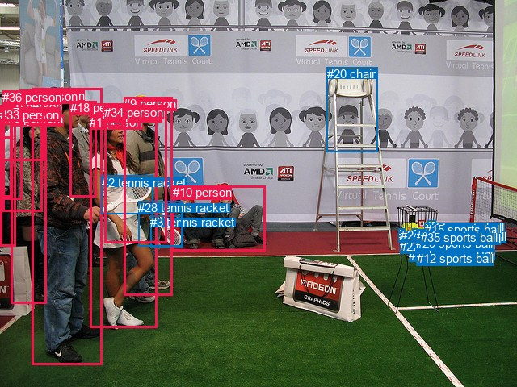
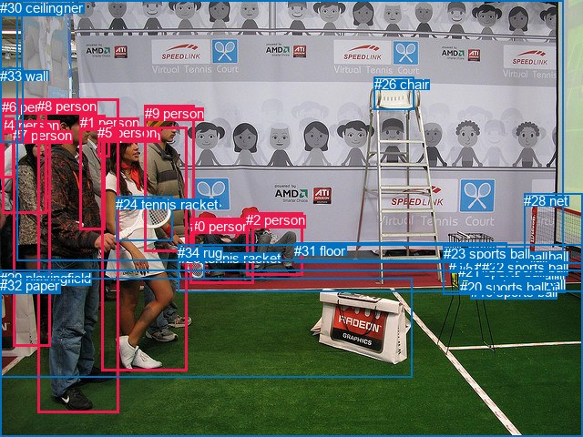

# 图片 1608：2390659.jpg

随机样本序号：172。图片 SHA256：`fbeacd39a37771ba923706efad0643dc2437659515445db3afbf134a1ecc2724`。

红色框表示人，蓝色框表示其他物体。两个模式分别保留自身框编号，可依据位置比较对应对象。

## 自动检测框与输出

人的框编号：`[0, 1, 5, 9, 10, 16, 18, 25, 26, 27, 30, 32, 33, 34, 36]`。状态：`ok`。

### 自动检测全部物体框

| 编号 | 类别 | 是否为人 | 检测分数 | 像素坐标 xyxy |
|---|---|---|---|---|
| 0 | person | True | 0.9975 | 39.8, 110.0, 126.1, 452.0 |
| 1 | person | True | 0.9946 | 111.2, 143.2, 194.4, 406.9 |
| 2 | tennis racket | False | 0.9894 | 125.7, 217.9, 189.5, 265.0 |
| 3 | tennis racket | False | 0.9768 | 186.4, 267.2, 226.3, 306.9 |
| 4 | sports ball | False | 0.9668 | 515.7, 302.5, 524.9, 312.8 |
| 5 | person | True | 0.9665 | 13.0, 139.3, 57.5, 376.4 |
| 6 | sports ball | False | 0.9639 | 525.9, 304.1, 533.9, 313.8 |
| 7 | sports ball | False | 0.9622 | 506.3, 307.5, 516.2, 318.2 |
| 8 | sports ball | False | 0.9501 | 525.7, 294.5, 534.4, 304.4 |
| 9 | person | True | 0.9410 | 153.5, 120.0, 213.0, 366.5 |
| 10 | person | True | 0.9123 | 214.0, 230.3, 328.1, 311.1 |
| 11 | sports ball | False | 0.9091 | 529.4, 273.9, 539.2, 284.4 |
| 12 | sports ball | False | 0.9028 | 515.6, 312.5, 523.7, 318.6 |
| 13 | sports ball | False | 0.8801 | 527.2, 284.5, 537.5, 293.8 |
| 14 | sports ball | False | 0.8316 | 532.0, 284.7, 538.7, 292.8 |
| 15 | sports ball | False | 0.8190 | 525.7, 276.0, 533.5, 284.3 |
| 16 | person | True | 0.8069 | 3.6, 123.2, 52.3, 262.0 |
| 17 | sports ball | False | 0.7848 | 500.9, 289.0, 510.6, 298.7 |
| 18 | person | True | 0.7633 | 86.8, 125.0, 120.0, 244.4 |
| 19 | sports ball | False | 0.7583 | 524.8, 286.9, 534.0, 296.4 |
| 20 | chair | False | 0.7412 | 404.5, 83.2, 467.2, 188.2 |
| 21 | sports ball | False | 0.7397 | 510.5, 283.7, 517.8, 293.5 |
| 22 | sports ball | False | 0.7314 | 495.4, 297.5, 502.3, 305.8 |
| 23 | sports ball | False | 0.7248 | 493.7, 283.9, 499.4, 291.9 |
| 24 | sports ball | False | 0.6476 | 496.2, 283.4, 501.6, 291.9 |
| 25 | person | True | 0.6328 | 0.2, 130.6, 19.1, 305.7 |
| 26 | person | True | 0.6034 | 127.1, 134.1, 151.0, 157.3 |
| 27 | person | True | 0.5969 | 0.0, 131.4, 15.0, 171.4 |
| 28 | tennis racket | False | 0.5808 | 171.3, 249.5, 225.9, 305.6 |
| 29 | sports ball | False | 0.5606 | 514.6, 293.3, 523.6, 303.4 |
| 30 | person | True | 0.5437 | 1.3, 137.8, 27.9, 247.4 |
| 31 | sports ball | False | 0.5132 | 515.7, 284.1, 524.4, 293.7 |
| 32 | person | True | 0.4821 | 23.3, 111.1, 54.5, 145.7 |
| 33 | person | True | 0.4468 | 0.2, 133.6, 14.8, 244.3 |
| 34 | person | True | 0.4312 | 129.4, 130.7, 206.1, 301.2 |
| 35 | sports ball | False | 0.3741 | 520.8, 286.5, 530.1, 295.7 |
| 36 | person | True | 0.3562 | 3.3, 112.1, 54.4, 199.1 |

### 自动检测 Top50 人相关候选

评分物体对：1332；人相关物体对：870；输出关系：50。

| 排名 | 主语编号与类别 | 关系 | 宾语编号与类别 | 类型 | 人与人 | 排序分数 | 原始融合 logit |
|---|---|---|---|---|---|---|---|
| 1 | #1 person | holding | #2 tennis racket | semantic | False | 0.99240 | 4.8717 |
| 2 | #9 person | holding | #28 tennis racket | semantic | False | 0.98250 | 4.0280 |
| 3 | #25 person | wearing | #27 person | semantic | True | 0.97973 | 3.8781 |
| 4 | #33 person | wearing | #27 person | semantic | True | 0.97614 | 3.7115 |
| 5 | #9 person | holding | #3 tennis racket | semantic | False | 0.97274 | 3.5748 |
| 6 | #34 person | holding | #2 tennis racket | semantic | False | 0.97118 | 3.5176 |
| 7 | #9 person | holding | #2 tennis racket | semantic | False | 0.96656 | 3.3640 |
| 8 | #25 person | wearing | #33 person | semantic | True | 0.96399 | 3.2872 |
| 9 | #34 person | holding | #28 tennis racket | semantic | False | 0.96385 | 3.2831 |
| 10 | #1 person | holding | #28 tennis racket | semantic | False | 0.95393 | 3.0303 |
| 11 | #1 person | holding | #3 tennis racket | semantic | False | 0.93581 | 2.6795 |
| 12 | #10 person | holding | #3 tennis racket | semantic | False | 0.93475 | 2.6621 |
| 13 | #33 person | in | #27 person | spatial | True | 0.92481 | 2.5096 |
| 14 | #34 person | holding | #3 tennis racket | semantic | False | 0.92375 | 2.4944 |
| 15 | #25 person | in | #27 person | spatial | True | 0.92205 | 2.4705 |
| 16 | #18 person | holding | #2 tennis racket | semantic | False | 0.91654 | 2.3962 |
| 17 | #25 person | wearing | #30 person | semantic | True | 0.91136 | 2.3303 |
| 18 | #0 person | holding | #2 tennis racket | semantic | False | 0.90652 | 2.2719 |
| 19 | #10 person | holding | #28 tennis racket | semantic | False | 0.90386 | 2.2409 |
| 20 | #25 person | in | #33 person | spatial | True | 0.90251 | 2.2254 |
| 21 | #30 person | wearing | #27 person | semantic | True | 0.89821 | 2.1774 |
| 22 | #36 person | in | #32 person | spatial | True | 0.86578 | 1.8641 |
| 23 | #36 person | wearing | #27 person | semantic | True | 0.86348 | 1.8445 |
| 24 | #16 person | wearing | #27 person | semantic | True | 0.84463 | 1.6931 |
| 25 | #34 person | wearing | #26 person | semantic | True | 0.84289 | 1.6799 |
| 26 | #16 person | wearing | #36 person | semantic | True | 0.83455 | 1.6182 |
| 27 | #16 person | in | #36 person | spatial | True | 0.81642 | 1.4923 |
| 28 | #1 person | wearing | #26 person | semantic | True | 0.81454 | 1.4798 |
| 29 | #34 person | in | #26 person | spatial | True | 0.80785 | 1.4361 |
| 30 | #1 person | in | #26 person | spatial | True | 0.80020 | 1.3875 |
| 31 | #16 person | wearing | #30 person | semantic | True | 0.79731 | 1.3695 |
| 32 | #25 person | in | #30 person | spatial | True | 0.78598 | 1.3009 |
| 33 | #1 person | in | #2 tennis racket | spatial | False | 0.76936 | 1.2047 |
| 34 | #30 person | in | #27 person | spatial | True | 0.76736 | 1.1935 |
| 35 | #33 person | wearing | #30 person | semantic | True | 0.75658 | 1.1340 |
| 36 | #18 person | holding | #28 tennis racket | semantic | False | 0.73566 | 1.0235 |
| 37 | #36 person | in | #27 person | spatial | True | 0.72443 | 0.9665 |
| 38 | #36 person | wearing | #32 person | semantic | True | 0.69617 | 0.8291 |
| 39 | #9 person | wearing | #34 person | semantic | True | 0.69495 | 0.8233 |
| 40 | #32 person | on | #36 person | spatial | True | 0.69270 | 0.8128 |
| 41 | #18 person | holding | #3 tennis racket | semantic | False | 0.68861 | 0.7936 |
| 42 | #16 person | in | #32 person | spatial | True | 0.68682 | 0.7853 |
| 43 | #16 person | in | #27 person | spatial | True | 0.68165 | 0.7614 |
| 44 | #16 person | in | #30 person | spatial | True | 0.63394 | 0.5492 |
| 45 | #33 person | in | #30 person | spatial | True | 0.63372 | 0.5482 |
| 46 | #16 person | wearing | #32 person | semantic | True | 0.62475 | 0.5098 |
| 47 | #9 person | in | #28 tennis racket | spatial | False | 0.58545 | 0.3452 |
| 48 | #9 person | wearing | #26 person | semantic | True | 0.56926 | 0.2788 |
| 49 | #18 person | wearing | #26 person | semantic | True | 0.54685 | 0.1880 |
| 50 | #5 person | wearing | #30 person | semantic | True | 0.54191 | 0.1680 |

### 自动检测逐条人相关 GT 核验

R@50：40.00%；命中 2/5。

| GT 主语编号 | GT 关系 | GT 宾语编号 | 结果阶段 | 匹配预测主语编号 | 匹配预测宾语编号 |
|---|---|---|---|---|---|
| 0 | lying on | 34 | endpoint_missing_or_wrong_class | [] | [] |
| 2 | lying on | 34 | endpoint_missing_or_wrong_class | [] | [] |
| 8 | holding | 24 | hit50 | [0] | [2] |
| 8 | standing on | 29 | endpoint_missing_or_wrong_class | [0] | [] |
| 9 | holding | 25 | hit50 | [9] | [3] |

## 真实框与输出

人的框编号：`[0, 1, 2, 3, 4, 5, 6, 7, 8, 9]`。

### 真实框全部物体框

| 编号 | 类别 | 是否为人 | 检测分数 | 像素坐标 xyxy |
|---|---|---|---|---|
| 0 | person | True | GT | 209.0, 240.0, 279.0, 312.0 |
| 1 | person | True | GT | 88.0, 126.0, 116.0, 252.0 |
| 2 | person | True | GT | 270.0, 233.0, 332.0, 302.0 |
| 3 | person | True | GT | 111.0, 140.0, 205.0, 408.0 |
| 4 | person | True | GT | 0.0, 129.0, 15.0, 195.0 |
| 5 | person | True | GT | 107.0, 137.0, 120.0, 172.0 |
| 6 | person | True | GT | 2.0, 109.0, 51.0, 235.0 |
| 7 | person | True | GT | 14.0, 140.0, 56.0, 380.0 |
| 8 | person | True | GT | 41.0, 108.0, 130.0, 453.0 |
| 9 | person | True | GT | 159.0, 116.0, 214.0, 276.0 |
| 10 | sports ball | False | GT | 525.0, 295.0, 535.0, 304.0 |
| 11 | sports ball | False | GT | 525.0, 275.0, 530.0, 286.0 |
| 12 | sports ball | False | GT | 515.0, 302.0, 525.0, 312.0 |
| 13 | sports ball | False | GT | 529.0, 273.0, 539.0, 285.0 |
| 14 | sports ball | False | GT | 526.0, 304.0, 535.0, 314.0 |
| 15 | sports ball | False | GT | 506.0, 274.0, 515.0, 283.0 |
| 16 | sports ball | False | GT | 517.0, 312.0, 524.0, 319.0 |
| 17 | sports ball | False | GT | 493.0, 282.0, 505.0, 295.0 |
| 18 | sports ball | False | GT | 521.0, 285.0, 529.0, 295.0 |
| 19 | sports ball | False | GT | 516.0, 293.0, 525.0, 303.0 |
| 20 | sports ball | False | GT | 505.0, 307.0, 516.0, 317.0 |
| 21 | sports ball | False | GT | 503.0, 290.0, 512.0, 298.0 |
| 22 | sports ball | False | GT | 529.0, 285.0, 538.0, 295.0 |
| 23 | sports ball | False | GT | 487.0, 270.0, 545.0, 324.0 |
| 24 | tennis racket | False | GT | 127.0, 216.0, 189.0, 265.0 |
| 25 | tennis racket | False | GT | 196.0, 275.0, 225.0, 307.0 |
| 26 | chair | False | GT | 411.0, 84.0, 455.0, 120.0 |
| 27 | banner | False | GT | 18.0, 0.0, 619.0, 287.0 |
| 28 | net | False | GT | 575.0, 212.0, 640.0, 289.0 |
| 29 | playingfield | False | GT | 0.0, 297.0, 640.0, 480.0 |
| 30 | ceiling | False | GT | 0.0, 0.0, 24.0, 80.0 |
| 31 | floor | False | GT | 323.0, 267.0, 557.0, 289.0 |
| 32 | paper | False | GT | 0.0, 305.0, 452.0, 414.0 |
| 33 | wall | False | GT | 0.0, 75.0, 25.0, 157.0 |
| 34 | rug | False | GT | 195.0, 269.0, 640.0, 321.0 |

### 真实框 Top50 人相关候选

评分物体对：1190；人相关物体对：590；输出关系：50。

| 排名 | 主语编号与类别 | 关系 | 宾语编号与类别 | 类型 | 人与人 | 排序分数 | 原始融合 logit |
|---|---|---|---|---|---|---|---|
| 1 | #3 person | holding | #24 tennis racket | semantic | False | 0.99326 | 4.9924 |
| 2 | #3 person | standing on | #29 playingfield | semantic | False | 0.98249 | 4.0273 |
| 3 | #2 person | sitting on | #34 rug | semantic | False | 0.97755 | 3.7735 |
| 4 | #8 person | standing on | #29 playingfield | semantic | False | 0.97649 | 3.7265 |
| 5 | #2 person | sitting on | #29 playingfield | semantic | False | 0.97582 | 3.6976 |
| 6 | #0 person | sitting on | #34 rug | semantic | False | 0.96071 | 3.1968 |
| 7 | #0 person | sitting on | #29 playingfield | semantic | False | 0.95990 | 3.1756 |
| 8 | #8 person | holding | #24 tennis racket | semantic | False | 0.95389 | 3.0295 |
| 9 | #6 person | wearing | #4 person | semantic | True | 0.95337 | 3.0177 |
| 10 | #9 person | holding | #24 tennis racket | semantic | False | 0.95279 | 3.0047 |
| 11 | #3 person | standing on | #32 paper | semantic | False | 0.94442 | 2.8327 |
| 12 | #7 person | standing on | #29 playingfield | semantic | False | 0.94342 | 2.8138 |
| 13 | #8 person | standing on | #32 paper | semantic | False | 0.93442 | 2.6566 |
| 14 | #2 person | sitting on | #31 floor | semantic | False | 0.93320 | 2.6369 |
| 15 | #1 person | holding | #24 tennis racket | semantic | False | 0.92898 | 2.5711 |
| 16 | #3 person | holding | #25 tennis racket | semantic | False | 0.92882 | 2.5686 |
| 17 | #0 person | sitting on | #32 paper | semantic | False | 0.92658 | 2.5353 |
| 18 | #0 person | holding | #25 tennis racket | semantic | False | 0.92568 | 2.5221 |
| 19 | #7 person | standing on | #32 paper | semantic | False | 0.91306 | 2.3516 |
| 20 | #2 person | sitting on | #32 paper | semantic | False | 0.87342 | 1.9315 |
| 21 | #2 person | on | #34 rug | spatial | False | 0.86481 | 1.8559 |
| 22 | #1 person | in | #5 person | spatial | True | 0.86272 | 1.8381 |
| 23 | #2 person | on | #29 playingfield | spatial | False | 0.84915 | 1.7279 |
| 24 | #1 person | wearing | #5 person | semantic | True | 0.84243 | 1.6764 |
| 25 | #6 person | standing on | #29 playingfield | semantic | False | 0.83820 | 1.6449 |
| 26 | #9 person | standing on | #29 playingfield | semantic | False | 0.83716 | 1.6373 |
| 27 | #33 wall | wearing | #4 person | semantic | False | 0.81536 | 1.4852 |
| 28 | #9 person | standing on | #34 rug | semantic | False | 0.81439 | 1.4788 |
| 29 | #0 person | on | #29 playingfield | spatial | False | 0.80930 | 1.4455 |
| 30 | #8 person | in | #5 person | spatial | True | 0.79918 | 1.3812 |
| 31 | #6 person | in | #4 person | spatial | True | 0.79838 | 1.3762 |
| 32 | #0 person | on | #34 rug | spatial | False | 0.79006 | 1.3253 |
| 33 | #1 person | standing on | #29 playingfield | semantic | False | 0.78803 | 1.3131 |
| 34 | #4 person | standing on | #33 wall | semantic | False | 0.76954 | 1.2057 |
| 35 | #9 person | looking at | #27 banner | semantic | False | 0.75709 | 1.1368 |
| 36 | #0 person | on | #32 paper | spatial | False | 0.75417 | 1.1210 |
| 37 | #8 person | wearing | #5 person | semantic | True | 0.74533 | 1.0738 |
| 38 | #3 person | in | #24 tennis racket | spatial | False | 0.73658 | 1.0283 |
| 39 | #8 person | holding | #1 person | semantic | True | 0.72654 | 0.9772 |
| 40 | #9 person | holding | #25 tennis racket | semantic | False | 0.72578 | 0.9733 |
| 41 | #3 person | on | #29 playingfield | spatial | False | 0.72086 | 0.9487 |
| 42 | #3 person | in | #5 person | spatial | True | 0.70252 | 0.8593 |
| 43 | #2 person | on | #31 floor | spatial | False | 0.67218 | 0.7181 |
| 44 | #3 person | wearing | #5 person | semantic | True | 0.66699 | 0.6946 |
| 45 | #2 person | beside | #0 person | spatial | True | 0.65298 | 0.6322 |
| 46 | #2 person | sitting on | #0 person | semantic | True | 0.64747 | 0.6079 |
| 47 | #6 person | looking at | #33 wall | semantic | False | 0.64581 | 0.6007 |
| 48 | #5 person | holding | #25 tennis racket | semantic | False | 0.62643 | 0.5169 |
| 49 | #6 person | standing on | #34 rug | semantic | False | 0.62540 | 0.5125 |
| 50 | #7 person | standing on | #34 rug | semantic | False | 0.61897 | 0.4852 |

### 真实框逐条人相关 GT 核验

R@50：60.00%；命中 3/5。

| GT 主语编号 | GT 关系 | GT 宾语编号 | 结果阶段 | 匹配预测主语编号 | 匹配预测宾语编号 |
|---|---|---|---|---|---|
| 0 | lying on | 34 | wrong_predicate | [0] | [34] |
| 2 | lying on | 34 | wrong_predicate | [2] | [34] |
| 8 | holding | 24 | hit50 | [8] | [24] |
| 8 | standing on | 29 | hit50 | [8] | [29] |
| 9 | holding | 25 | hit50 | [9] | [25] |

## 全部人相关 GT

| 主语编号与类别 | 关系 | 宾语编号与类别 |
|---|---|---|
| #0 person | lying on | #34 rug |
| #2 person | lying on | #34 rug |
| #8 person | holding | #24 tennis racket |
| #8 person | standing on | #29 playingfield |
| #9 person | holding | #25 tennis racket |

原始记录、全部人相关物体对的两项预测与分项分数见 [逐图证据 JSON](../evidence/cases/1608.json)。全部56类 logits 保留于本机 HOR/output/random500/logits/。

<!-- HOR_COMPLETE_RESULTS -->

## 六组条件的完整输出对照

以下保留同一图片三种框与候选模式、两种谓词输出规则的全部 Top50。框编号各自在所属模式内解释。

### 自动检测框完整枚举：空间与语义各保留一个谓词

| 排名 | 主语编号与类别 | 谓词 | 宾语编号与类别 | 分组 | 排序分数 | predicate logit | pair logit |
|---|---|---|---|---|---|---|---|
| 1 | #1 person | holding | #2 tennis racket | semantic | 0.9923978 | 4.5073791 | 0.3643193 |
| 2 | #9 person | holding | #28 tennis racket | semantic | 0.9825013 | 3.9184699 | 0.1095088 |
| 3 | #25 person | wearing | #27 person | semantic | 0.9797290 | 3.6908288 | 0.1872528 |
| 4 | #33 person | wearing | #27 person | semantic | 0.9761421 | 3.8537726 | -0.1422793 |
| 5 | #9 person | holding | #3 tennis racket | semantic | 0.9727418 | 3.5219245 | 0.0528399 |
| 6 | #34 person | holding | #2 tennis racket | semantic | 0.9711831 | 3.8169284 | -0.2993730 |
| 7 | #9 person | holding | #2 tennis racket | semantic | 0.9665596 | 3.4510226 | -0.0870434 |
| 8 | #25 person | wearing | #33 person | semantic | 0.9639865 | 3.3899169 | -0.1027343 |
| 9 | #34 person | holding | #28 tennis racket | semantic | 0.9638452 | 3.1124635 | 0.1706575 |
| 10 | #1 person | holding | #28 tennis racket | semantic | 0.9539261 | 2.7868190 | 0.2435205 |
| 11 | #1 person | holding | #3 tennis racket | semantic | 0.9358075 | 2.5530958 | 0.1264261 |
| 12 | #10 person | holding | #3 tennis racket | semantic | 0.9347544 | 2.7831063 | -0.1209801 |
| 13 | #33 person | in | #27 person | spatial | 0.9248103 | 2.6518531 | -0.1422793 |
| 14 | #34 person | holding | #3 tennis racket | semantic | 0.9237451 | 2.3825083 | 0.1118470 |
| 15 | #25 person | in | #27 person | spatial | 0.9220464 | 2.2832303 | 0.1872528 |
| 16 | #18 person | holding | #2 tennis racket | semantic | 0.9165403 | 2.8314719 | -0.4352303 |
| 17 | #25 person | wearing | #30 person | semantic | 0.9113560 | 2.3212280 | 0.0090773 |
| 18 | #0 person | holding | #2 tennis racket | semantic | 0.9065235 | 2.2536206 | 0.0182853 |
| 19 | #10 person | holding | #28 tennis racket | semantic | 0.9038589 | 2.4999194 | -0.2590630 |
| 20 | #25 person | in | #33 person | spatial | 0.9025092 | 2.3281550 | -0.1027343 |
| 21 | #30 person | wearing | #27 person | semantic | 0.8982061 | 2.5589509 | -0.3815015 |
| 22 | #36 person | in | #32 person | spatial | 0.8657759 | 1.9238958 | -0.0597804 |
| 23 | #36 person | wearing | #27 person | semantic | 0.8634813 | 1.7610841 | 0.0834267 |
| 24 | #16 person | wearing | #27 person | semantic | 0.8446323 | 1.6407194 | 0.0523869 |
| 25 | #34 person | wearing | #26 person | semantic | 0.8428881 | 1.8534679 | -0.1735923 |
| 26 | #16 person | wearing | #36 person | semantic | 0.8345460 | 1.8278871 | -0.2096922 |
| 27 | #16 person | in | #36 person | spatial | 0.8164222 | 1.7019854 | -0.2096922 |
| 28 | #1 person | wearing | #26 person | semantic | 0.8145396 | 1.2435193 | 0.2362622 |
| 29 | #34 person | in | #26 person | spatial | 0.8078524 | 1.6097083 | -0.1735923 |
| 30 | #1 person | in | #26 person | spatial | 0.8001958 | 1.1512566 | 0.2362622 |
| 31 | #16 person | wearing | #30 person | semantic | 0.7973074 | 1.4866509 | -0.1171010 |
| 32 | #25 person | in | #30 person | spatial | 0.7859787 | 1.2917771 | 0.0090773 |
| 33 | #1 person | in | #2 tennis racket | spatial | 0.7693611 | 0.8403878 | 0.3643193 |
| 34 | #30 person | in | #27 person | spatial | 0.7673632 | 1.5749831 | -0.3815015 |
| 35 | #33 person | wearing | #30 person | semantic | 0.7565789 | 1.4660401 | -0.3320264 |
| 36 | #18 person | holding | #28 tennis racket | semantic | 0.7356558 | 1.5765023 | -0.5529922 |
| 37 | #36 person | in | #27 person | spatial | 0.7244280 | 0.8831067 | 0.0834267 |
| 38 | #36 person | wearing | #32 person | semantic | 0.6961684 | 0.8888984 | -0.0597804 |
| 39 | #9 person | wearing | #34 person | semantic | 0.6949451 | 1.1916060 | -0.3682650 |
| 40 | #32 person | on | #36 person | spatial | 0.6926961 | 1.1389604 | -0.3262061 |
| 41 | #18 person | holding | #3 tennis racket | semantic | 0.6886058 | 1.4714575 | -0.6778480 |
| 42 | #16 person | in | #32 person | spatial | 0.6868190 | 0.9149590 | -0.1296697 |
| 43 | #16 person | in | #27 person | spatial | 0.6816492 | 0.7089744 | 0.0523869 |
| 44 | #16 person | in | #30 person | spatial | 0.6339442 | 0.6662760 | -0.1171010 |
| 45 | #33 person | in | #30 person | spatial | 0.6337194 | 0.8802333 | -0.3320264 |
| 46 | #16 person | wearing | #32 person | semantic | 0.6247525 | 0.6394396 | -0.1296697 |
| 47 | #9 person | in | #28 tennis racket | spatial | 0.5854527 | 0.2356896 | 0.1095088 |
| 48 | #9 person | wearing | #26 person | semantic | 0.5692577 | 0.1934056 | 0.0854175 |
| 49 | #18 person | wearing | #26 person | semantic | 0.5468507 | 0.2388453 | -0.0508913 |
| 50 | #5 person | wearing | #30 person | semantic | 0.5419108 | 0.2653241 | -0.0972866 |

GT 命中：2/5，R@50=40.00%。

| GT主语 | GT谓词 | GT宾语 | 结果阶段 | 匹配主语框 | 匹配宾语框 |
|---|---|---|---|---|---|
| 0 | lying on | 34 | endpoint_missing_or_wrong_class | [] | [] |
| 2 | lying on | 34 | endpoint_missing_or_wrong_class | [] | [] |
| 8 | holding | 24 | hit50 | [0] | [2] |
| 8 | standing on | 29 | endpoint_missing_or_wrong_class | [0] | [] |
| 9 | holding | 25 | hit50 | [9] | [3] |

### 自动检测框完整枚举：每对只保留一个谓词

| 排名 | 主语编号与类别 | 谓词 | 宾语编号与类别 | 分组 | 排序分数 | predicate logit | pair logit |
|---|---|---|---|---|---|---|---|
| 1 | #1 person | holding | #2 tennis racket | single | 0.9923978 | 4.5073791 | 0.3643193 |
| 2 | #9 person | holding | #28 tennis racket | single | 0.9825013 | 3.9184699 | 0.1095088 |
| 3 | #25 person | wearing | #27 person | single | 0.9797290 | 3.6908288 | 0.1872528 |
| 4 | #33 person | wearing | #27 person | single | 0.9761421 | 3.8537726 | -0.1422793 |
| 5 | #9 person | holding | #3 tennis racket | single | 0.9727418 | 3.5219245 | 0.0528399 |
| 6 | #34 person | holding | #2 tennis racket | single | 0.9711831 | 3.8169284 | -0.2993730 |
| 7 | #9 person | holding | #2 tennis racket | single | 0.9665596 | 3.4510226 | -0.0870434 |
| 8 | #25 person | wearing | #33 person | single | 0.9639865 | 3.3899169 | -0.1027343 |
| 9 | #34 person | holding | #28 tennis racket | single | 0.9638452 | 3.1124635 | 0.1706575 |
| 10 | #1 person | holding | #28 tennis racket | single | 0.9539261 | 2.7868190 | 0.2435205 |
| 11 | #1 person | holding | #3 tennis racket | single | 0.9358075 | 2.5530958 | 0.1264261 |
| 12 | #10 person | holding | #3 tennis racket | single | 0.9347544 | 2.7831063 | -0.1209801 |
| 13 | #34 person | holding | #3 tennis racket | single | 0.9237451 | 2.3825083 | 0.1118470 |
| 14 | #18 person | holding | #2 tennis racket | single | 0.9165403 | 2.8314719 | -0.4352303 |
| 15 | #25 person | wearing | #30 person | single | 0.9113560 | 2.3212280 | 0.0090773 |
| 16 | #0 person | holding | #2 tennis racket | single | 0.9065235 | 2.2536206 | 0.0182853 |
| 17 | #10 person | holding | #28 tennis racket | single | 0.9038589 | 2.4999194 | -0.2590630 |
| 18 | #30 person | wearing | #27 person | single | 0.8982061 | 2.5589509 | -0.3815015 |
| 19 | #36 person | in | #32 person | single | 0.8657759 | 1.9238958 | -0.0597804 |
| 20 | #36 person | wearing | #27 person | single | 0.8634813 | 1.7610841 | 0.0834267 |
| 21 | #16 person | wearing | #27 person | single | 0.8446323 | 1.6407194 | 0.0523869 |
| 22 | #34 person | wearing | #26 person | single | 0.8428881 | 1.8534679 | -0.1735923 |
| 23 | #16 person | wearing | #36 person | single | 0.8345460 | 1.8278871 | -0.2096922 |
| 24 | #1 person | wearing | #26 person | single | 0.8145396 | 1.2435193 | 0.2362622 |
| 25 | #16 person | wearing | #30 person | single | 0.7973074 | 1.4866509 | -0.1171010 |
| 26 | #33 person | wearing | #30 person | single | 0.7565789 | 1.4660401 | -0.3320264 |
| 27 | #18 person | holding | #28 tennis racket | single | 0.7356558 | 1.5765023 | -0.5529922 |
| 28 | #9 person | wearing | #34 person | single | 0.6949451 | 1.1916060 | -0.3682650 |
| 29 | #32 person | on | #36 person | single | 0.6926961 | 1.1389604 | -0.3262061 |
| 30 | #18 person | holding | #3 tennis racket | single | 0.6886058 | 1.4714575 | -0.6778480 |
| 31 | #16 person | in | #32 person | single | 0.6868190 | 0.9149590 | -0.1296697 |
| 32 | #9 person | wearing | #26 person | single | 0.5692577 | 0.1934056 | 0.0854175 |
| 33 | #18 person | wearing | #26 person | single | 0.5468507 | 0.2388453 | -0.0508913 |
| 34 | #5 person | wearing | #30 person | single | 0.5419108 | 0.2653241 | -0.0972866 |
| 35 | #16 person | holding | #2 tennis racket | single | 0.5360772 | 1.2480736 | -1.1035136 |
| 36 | #25 person | holding | #2 tennis racket | single | 0.5300582 | 1.3315105 | -1.2111325 |
| 37 | #5 person | wearing | #27 person | single | 0.5210266 | 0.0825939 | 0.0015621 |
| 38 | #25 person | wearing | #36 person | single | 0.4781197 | -0.0320492 | -0.0555282 |
| 39 | #5 person | holding | #2 tennis racket | single | 0.4759381 | 0.8223648 | -0.9186870 |
| 40 | #25 person | wearing | #32 person | single | 0.4728450 | -0.0782399 | -0.0304871 |
| 41 | #33 person | holding | #2 tennis racket | single | 0.4549823 | 1.2833152 | -1.4638749 |
| 42 | #25 person | holding | #3 tennis racket | single | 0.4506949 | 1.0928068 | -1.2906703 |
| 43 | #0 person | in | #18 person | single | 0.4505697 | 0.2297201 | -0.4280891 |
| 44 | #5 person | wearing | #36 person | single | 0.4453353 | -0.0070734 | -0.2124629 |
| 45 | #0 person | in | #32 person | single | 0.4247249 | -0.0818167 | -0.2215898 |
| 46 | #0 person | looking at | #1 person | single | 0.4229025 | 0.5146008 | -0.8254704 |
| 47 | #5 person | wearing | #32 person | single | 0.4174421 | -0.1721992 | -0.1610836 |
| 48 | #0 person | holding | #28 tennis racket | single | 0.4092975 | 0.3097157 | -0.6765859 |
| 49 | #33 person | holding | #3 tennis racket | single | 0.4014702 | 0.9942193 | -1.3935622 |
| 50 | #36 person | wearing | #30 person | single | 0.3946254 | -0.1868691 | -0.2410414 |

GT 命中：2/5，R@50=40.00%。

| GT主语 | GT谓词 | GT宾语 | 结果阶段 | 匹配主语框 | 匹配宾语框 |
|---|---|---|---|---|---|
| 0 | lying on | 34 | endpoint_missing_or_wrong_class | [] | [] |
| 2 | lying on | 34 | endpoint_missing_or_wrong_class | [] | [] |
| 8 | holding | 24 | hit50 | [0] | [2] |
| 8 | standing on | 29 | endpoint_missing_or_wrong_class | [0] | [] |
| 9 | holding | 25 | hit50 | [9] | [3] |

### 真实框完整枚举：空间与语义各保留一个谓词

| 排名 | 主语编号与类别 | 谓词 | 宾语编号与类别 | 分组 | 排序分数 | predicate logit | pair logit |
|---|---|---|---|---|---|---|---|
| 1 | #3 person | holding | #24 tennis racket | semantic | 0.9932562 | 4.6938357 | 0.2985294 |
| 2 | #3 person | standing on | #29 playingfield | semantic | 0.9824895 | 4.2286963 | -0.2014079 |
| 3 | #2 person | sitting on | #34 rug | semantic | 0.9775451 | 4.0295959 | -0.2560607 |
| 4 | #8 person | standing on | #29 playingfield | semantic | 0.9764898 | 4.0524364 | -0.3259073 |
| 5 | #2 person | sitting on | #29 playingfield | semantic | 0.9758167 | 3.9062266 | -0.2086143 |
| 6 | #0 person | sitting on | #34 rug | semantic | 0.9607141 | 3.7708077 | -0.5739962 |
| 7 | #0 person | sitting on | #29 playingfield | semantic | 0.9599041 | 3.5691981 | -0.3936365 |
| 8 | #8 person | holding | #24 tennis racket | semantic | 0.9538883 | 3.0219803 | 0.0074992 |
| 9 | #6 person | wearing | #4 person | semantic | 0.9533668 | 2.8980780 | 0.1196101 |
| 10 | #9 person | holding | #24 tennis racket | semantic | 0.9527871 | 3.5052962 | -0.5005729 |
| 11 | #3 person | standing on | #32 paper | semantic | 0.9444193 | 3.2525172 | -0.4197822 |
| 12 | #7 person | standing on | #29 playingfield | semantic | 0.9434160 | 3.3800282 | -0.5662463 |
| 13 | #8 person | standing on | #32 paper | semantic | 0.9344178 | 3.2743511 | -0.6177313 |
| 14 | #2 person | sitting on | #31 floor | semantic | 0.9331968 | 3.0365686 | -0.3997028 |
| 15 | #1 person | holding | #24 tennis racket | semantic | 0.9289788 | 2.9034719 | -0.3323644 |
| 16 | #3 person | holding | #25 tennis racket | semantic | 0.9288152 | 2.4988213 | 0.0698095 |
| 17 | #0 person | sitting on | #32 paper | semantic | 0.9265767 | 3.1659780 | -0.6307223 |
| 18 | #0 person | holding | #25 tennis racket | semantic | 0.9256783 | 2.7782960 | -0.2561715 |
| 19 | #7 person | standing on | #32 paper | semantic | 0.9130585 | 3.3492227 | -0.9976584 |
| 20 | #2 person | sitting on | #32 paper | semantic | 0.8734195 | 2.3715568 | -0.4400194 |
| 21 | #2 person | on | #34 rug | spatial | 0.8648148 | 2.1119299 | -0.2560607 |
| 22 | #1 person | in | #5 person | spatial | 0.8627194 | 1.8234434 | 0.0146189 |
| 23 | #2 person | on | #29 playingfield | spatial | 0.8491466 | 1.9365377 | -0.2086143 |
| 24 | #1 person | wearing | #5 person | semantic | 0.8424285 | 1.6617904 | 0.0146189 |
| 25 | #6 person | standing on | #29 playingfield | semantic | 0.8381968 | 2.3026586 | -0.6577863 |
| 26 | #9 person | standing on | #29 playingfield | semantic | 0.8371620 | 2.2021823 | -0.5649211 |
| 27 | #33 wall | wearing | #4 person | semantic | 0.8153639 | 1.6091247 | -0.1238770 |
| 28 | #9 person | standing on | #34 rug | semantic | 0.8143935 | 2.3746710 | -0.8958563 |
| 29 | #0 person | on | #29 playingfield | spatial | 0.8093008 | 1.8391099 | -0.3936365 |
| 30 | #8 person | in | #5 person | spatial | 0.7991805 | 1.3548131 | 0.0263674 |
| 31 | #6 person | in | #4 person | spatial | 0.7983794 | 1.2565861 | 0.1196101 |
| 32 | #0 person | on | #34 rug | spatial | 0.7900615 | 1.8992925 | -0.5739962 |
| 33 | #1 person | standing on | #29 playingfield | semantic | 0.7880254 | 2.0443811 | -0.7313168 |
| 34 | #4 person | standing on | #33 wall | semantic | 0.7695400 | 1.5600634 | -0.3543479 |
| 35 | #9 person | looking at | #27 banner | semantic | 0.7570896 | 2.0427613 | -0.9059726 |
| 36 | #0 person | on | #32 paper | spatial | 0.7541707 | 1.7517037 | -0.6307223 |
| 37 | #8 person | wearing | #5 person | semantic | 0.7453275 | 1.0474777 | 0.0263674 |
| 38 | #3 person | in | #24 tennis racket | spatial | 0.7365834 | 0.7297564 | 0.2985294 |
| 39 | #8 person | holding | #1 person | semantic | 0.7265449 | 1.4140992 | -0.4369361 |
| 40 | #9 person | holding | #25 tennis racket | semantic | 0.7257838 | 1.0833950 | -0.1100599 |
| 41 | #3 person | on | #29 playingfield | spatial | 0.7208600 | 1.1501393 | -0.2014079 |
| 42 | #3 person | in | #5 person | spatial | 0.7025180 | 0.7967992 | 0.0625182 |
| 43 | #2 person | on | #31 floor | spatial | 0.6721791 | 1.1177602 | -0.3997028 |
| 44 | #3 person | wearing | #5 person | semantic | 0.6669863 | 0.6320677 | 0.0625182 |
| 45 | #2 person | beside | #0 person | spatial | 0.6529768 | 0.5901227 | 0.0420276 |
| 46 | #2 person | sitting on | #0 person | semantic | 0.6474658 | 0.5658908 | 0.0420276 |
| 47 | #6 person | looking at | #33 wall | semantic | 0.6458142 | 0.8375850 | -0.2368945 |
| 48 | #5 person | holding | #25 tennis racket | semantic | 0.6264334 | 2.1904836 | -1.6735375 |
| 49 | #6 person | standing on | #34 rug | semantic | 0.6253999 | 1.5394597 | -1.0269272 |
| 50 | #7 person | standing on | #34 rug | semantic | 0.6189699 | 1.4506154 | -0.9654372 |

GT 命中：3/5，R@50=60.00%。

| GT主语 | GT谓词 | GT宾语 | 结果阶段 | 匹配主语框 | 匹配宾语框 |
|---|---|---|---|---|---|
| 0 | lying on | 34 | wrong_predicate | [0] | [34] |
| 2 | lying on | 34 | wrong_predicate | [2] | [34] |
| 8 | holding | 24 | hit50 | [8] | [24] |
| 8 | standing on | 29 | hit50 | [8] | [29] |
| 9 | holding | 25 | hit50 | [9] | [25] |

### 真实框完整枚举：每对只保留一个谓词

| 排名 | 主语编号与类别 | 谓词 | 宾语编号与类别 | 分组 | 排序分数 | predicate logit | pair logit |
|---|---|---|---|---|---|---|---|
| 1 | #3 person | holding | #24 tennis racket | single | 0.9932562 | 4.6938357 | 0.2985294 |
| 2 | #3 person | standing on | #29 playingfield | single | 0.9824895 | 4.2286963 | -0.2014079 |
| 3 | #2 person | sitting on | #34 rug | single | 0.9775451 | 4.0295959 | -0.2560607 |
| 4 | #8 person | standing on | #29 playingfield | single | 0.9764898 | 4.0524364 | -0.3259073 |
| 5 | #2 person | sitting on | #29 playingfield | single | 0.9758167 | 3.9062266 | -0.2086143 |
| 6 | #0 person | sitting on | #34 rug | single | 0.9607141 | 3.7708077 | -0.5739962 |
| 7 | #0 person | sitting on | #29 playingfield | single | 0.9599041 | 3.5691981 | -0.3936365 |
| 8 | #8 person | holding | #24 tennis racket | single | 0.9538883 | 3.0219803 | 0.0074992 |
| 9 | #6 person | wearing | #4 person | single | 0.9533668 | 2.8980780 | 0.1196101 |
| 10 | #9 person | holding | #24 tennis racket | single | 0.9527871 | 3.5052962 | -0.5005729 |
| 11 | #3 person | standing on | #32 paper | single | 0.9444193 | 3.2525172 | -0.4197822 |
| 12 | #7 person | standing on | #29 playingfield | single | 0.9434160 | 3.3800282 | -0.5662463 |
| 13 | #8 person | standing on | #32 paper | single | 0.9344178 | 3.2743511 | -0.6177313 |
| 14 | #2 person | sitting on | #31 floor | single | 0.9331968 | 3.0365686 | -0.3997028 |
| 15 | #1 person | holding | #24 tennis racket | single | 0.9289788 | 2.9034719 | -0.3323644 |
| 16 | #3 person | holding | #25 tennis racket | single | 0.9288152 | 2.4988213 | 0.0698095 |
| 17 | #0 person | sitting on | #32 paper | single | 0.9265767 | 3.1659780 | -0.6307223 |
| 18 | #0 person | holding | #25 tennis racket | single | 0.9256783 | 2.7782960 | -0.2561715 |
| 19 | #7 person | standing on | #32 paper | single | 0.9130585 | 3.3492227 | -0.9976584 |
| 20 | #2 person | sitting on | #32 paper | single | 0.8734195 | 2.3715568 | -0.4400194 |
| 21 | #1 person | in | #5 person | single | 0.8627194 | 1.8234434 | 0.0146189 |
| 22 | #6 person | standing on | #29 playingfield | single | 0.8381968 | 2.3026586 | -0.6577863 |
| 23 | #9 person | standing on | #29 playingfield | single | 0.8371620 | 2.2021823 | -0.5649211 |
| 24 | #33 wall | wearing | #4 person | single | 0.8153639 | 1.6091247 | -0.1238770 |
| 25 | #9 person | standing on | #34 rug | single | 0.8143935 | 2.3746710 | -0.8958563 |
| 26 | #8 person | in | #5 person | single | 0.7991805 | 1.3548131 | 0.0263674 |
| 27 | #1 person | standing on | #29 playingfield | single | 0.7880254 | 2.0443811 | -0.7313168 |
| 28 | #4 person | standing on | #33 wall | single | 0.7695400 | 1.5600634 | -0.3543479 |
| 29 | #9 person | looking at | #27 banner | single | 0.7570896 | 2.0427613 | -0.9059726 |
| 30 | #8 person | holding | #1 person | single | 0.7265449 | 1.4140992 | -0.4369361 |
| 31 | #9 person | holding | #25 tennis racket | single | 0.7257838 | 1.0833950 | -0.1100599 |
| 32 | #3 person | in | #5 person | single | 0.7025180 | 0.7967992 | 0.0625182 |
| 33 | #2 person | beside | #0 person | single | 0.6529768 | 0.5901227 | 0.0420276 |
| 34 | #6 person | looking at | #33 wall | single | 0.6458142 | 0.8375850 | -0.2368945 |
| 35 | #5 person | holding | #25 tennis racket | single | 0.6264334 | 2.1904836 | -1.6735375 |
| 36 | #6 person | standing on | #34 rug | single | 0.6253999 | 1.5394597 | -1.0269272 |
| 37 | #7 person | standing on | #34 rug | single | 0.6189699 | 1.4506154 | -0.9654372 |
| 38 | #7 person | wearing | #4 person | single | 0.6101767 | 0.5575080 | -0.1094528 |
| 39 | #9 person | wearing | #0 person | single | 0.5976520 | 0.8751993 | -0.4795079 |
| 40 | #2 person | leaning on | #27 banner | single | 0.5797002 | 1.3386884 | -1.0171454 |
| 41 | #6 person | looking at | #27 banner | single | 0.5788690 | 1.2930293 | -0.9748973 |
| 42 | #1 person | holding | #25 tennis racket | single | 0.5763528 | 0.9303641 | -0.6225451 |
| 43 | #0 person | sitting on | #31 floor | single | 0.5708112 | 1.0023494 | -0.7171879 |
| 44 | #8 person | standing on | #34 rug | single | 0.5583925 | 1.2091708 | -0.9745300 |
| 45 | #2 person | holding | #25 tennis racket | single | 0.5520606 | 0.4356098 | -0.2266101 |
| 46 | #1 person | talking to | #8 person | single | 0.5464233 | 1.1395659 | -0.9533366 |
| 47 | #6 person | standing on | #7 person | single | 0.5375482 | 0.7923794 | -0.6419034 |
| 48 | #6 person | standing on | #32 paper | single | 0.5342847 | 1.2751689 | -1.1378148 |
| 49 | #3 person | standing on | #34 rug | single | 0.5329893 | 0.9501801 | -0.8180307 |
| 50 | #0 person | beside | #2 person | single | 0.5328177 | 0.6232786 | -0.4918188 |

GT 命中：3/5，R@50=60.00%。

| GT主语 | GT谓词 | GT宾语 | 结果阶段 | 匹配主语框 | 匹配宾语框 |
|---|---|---|---|---|---|
| 0 | lying on | 34 | wrong_predicate | [0] | [34] |
| 2 | lying on | 34 | wrong_predicate | [2] | [34] |
| 8 | holding | 24 | hit50 | [8] | [24] |
| 8 | standing on | 29 | hit50 | [8] | [29] |
| 9 | holding | 25 | hit50 | [9] | [25] |

### 真实框400候选：空间与语义各保留一个谓词

| 排名 | 主语编号与类别 | 谓词 | 宾语编号与类别 | 分组 | 排序分数 | predicate logit | pair logit |
|---|---|---|---|---|---|---|---|
| 1 | #3 person | holding | #24 tennis racket | semantic | 0.9936406 | 4.7529197 | 0.2985294 |
| 2 | #3 person | standing on | #29 playingfield | semantic | 0.9889817 | 4.6985250 | -0.2014079 |
| 3 | #8 person | standing on | #29 playingfield | semantic | 0.9862277 | 4.5971360 | -0.3259073 |
| 4 | #2 person | sitting on | #34 rug | semantic | 0.9835768 | 4.3485656 | -0.2560607 |
| 5 | #2 person | sitting on | #29 playingfield | semantic | 0.9830220 | 4.2673221 | -0.2086143 |
| 6 | #0 person | sitting on | #29 playingfield | semantic | 0.9785954 | 4.2161517 | -0.3936365 |
| 7 | #7 person | standing on | #29 playingfield | semantic | 0.9783438 | 4.3768115 | -0.5662463 |
| 8 | #0 person | sitting on | #34 rug | semantic | 0.9743980 | 4.2131476 | -0.5739962 |
| 9 | #3 person | standing on | #32 paper | semantic | 0.9706658 | 3.9190106 | -0.4197822 |
| 10 | #0 person | sitting on | #32 paper | semantic | 0.9615181 | 3.8490481 | -0.6307223 |
| 11 | #8 person | standing on | #32 paper | semantic | 0.9609376 | 3.8204799 | -0.6177313 |
| 12 | #2 person | sitting on | #31 floor | semantic | 0.9601327 | 3.5812154 | -0.3997028 |
| 13 | #6 person | standing on | #29 playingfield | semantic | 0.9530919 | 3.6693082 | -0.6577863 |
| 14 | #9 person | holding | #24 tennis racket | semantic | 0.9524710 | 3.4982905 | -0.5005729 |
| 15 | #7 person | standing on | #32 paper | semantic | 0.9503560 | 3.9496179 | -0.9976584 |
| 16 | #1 person | standing on | #29 playingfield | semantic | 0.9484903 | 3.6444182 | -0.7313168 |
| 17 | #1 person | holding | #24 tennis racket | semantic | 0.9343138 | 2.9872875 | -0.3323644 |
| 18 | #8 person | holding | #24 tennis racket | semantic | 0.9326974 | 2.6213818 | 0.0074992 |
| 19 | #9 person | standing on | #29 playingfield | semantic | 0.9297823 | 3.1482701 | -0.5649211 |
| 20 | #0 person | holding | #25 tennis racket | semantic | 0.9143673 | 2.6243362 | -0.2561715 |
| 21 | #6 person | wearing | #4 person | semantic | 0.9066486 | 2.1537743 | 0.1196101 |
| 22 | #5 person | looking at | #27 banner | semantic | 0.8993604 | 4.0567832 | -1.8666452 |
| 23 | #6 person | standing on | #34 rug | semantic | 0.8870705 | 3.0880880 | -1.0269272 |
| 24 | #2 person | sitting on | #32 paper | semantic | 0.8843051 | 2.4738641 | -0.4400194 |
| 25 | #4 person | standing on | #33 wall | semantic | 0.8790646 | 2.3379498 | -0.3543479 |
| 26 | #9 person | looking at | #27 banner | semantic | 0.8759723 | 2.8608027 | -0.9059726 |
| 27 | #3 person | holding | #25 tennis racket | semantic | 0.8732779 | 1.8604479 | 0.0698095 |
| 28 | #9 person | standing on | #34 rug | semantic | 0.8687429 | 2.7857461 | -0.8958563 |
| 29 | #1 person | looking at | #27 banner | semantic | 0.8635275 | 3.0959549 | -1.2510529 |
| 30 | #1 person | in | #5 person | spatial | 0.8586873 | 1.7898107 | 0.0146189 |
| 31 | #7 person | standing on | #34 rug | semantic | 0.8554093 | 2.7431102 | -0.9654372 |
| 32 | #6 person | looking at | #27 banner | semantic | 0.8370051 | 2.6110086 | -0.9748973 |
| 33 | #0 person | sitting on | #31 floor | semantic | 0.8290772 | 2.2962890 | -0.7171879 |
| 34 | #1 person | wearing | #5 person | semantic | 0.8111725 | 1.4430285 | 0.0146189 |
| 35 | #2 person | leaning on | #34 rug | spatial | 0.7998290 | 1.6412868 | -0.2560607 |
| 36 | #6 person | standing on | #32 paper | semantic | 0.7993299 | 2.5199265 | -1.1378148 |
| 37 | #8 person | standing on | #34 rug | semantic | 0.7972727 | 2.3438649 | -0.9745300 |
| 38 | #2 person | leaning on | #29 playingfield | spatial | 0.7734624 | 1.4365807 | -0.2086143 |
| 39 | #8 person | in | #5 person | spatial | 0.7698156 | 1.1809030 | 0.0263674 |
| 40 | #3 person | leaning on | #29 playingfield | spatial | 0.7636648 | 1.3742857 | -0.2014079 |
| 41 | #0 person | on | #29 playingfield | spatial | 0.7612849 | 1.5533738 | -0.3936365 |
| 42 | #2 person | leaning on | #31 floor | spatial | 0.7442897 | 1.4680882 | -0.3997028 |
| 43 | #4 person | looking at | #27 banner | semantic | 0.7383165 | 2.2415466 | -1.2043097 |
| 44 | #2 person | sitting on | #27 banner | semantic | 0.7373510 | 2.0493908 | -1.0171454 |
| 45 | #1 person | standing on | #34 rug | semantic | 0.7285471 | 2.1860647 | -1.1988010 |
| 46 | #3 person | standing on | #34 rug | semantic | 0.7215086 | 1.7699876 | -0.8180307 |
| 47 | #0 person | on | #34 rug | spatial | 0.7193548 | 1.5152597 | -0.5739962 |
| 48 | #8 person | holding | #1 person | semantic | 0.7193346 | 1.3780994 | -0.4369361 |
| 49 | #8 person | wearing | #5 person | semantic | 0.7179615 | 0.9080052 | 0.0263674 |
| 50 | #2 person | leaning on | #27 banner | spatial | 0.7064112 | 1.8951631 | -1.0171454 |

GT 命中：2/5，R@50=40.00%。

| GT主语 | GT谓词 | GT宾语 | 结果阶段 | 匹配主语框 | 匹配宾语框 |
|---|---|---|---|---|---|
| 0 | lying on | 34 | wrong_predicate | [0] | [34] |
| 2 | lying on | 34 | wrong_predicate | [2] | [34] |
| 8 | holding | 24 | hit50 | [8] | [24] |
| 8 | standing on | 29 | hit50 | [8] | [29] |
| 9 | holding | 25 | rank_below50 | [9] | [25] |

### 真实框400候选：每对只保留一个谓词

| 排名 | 主语编号与类别 | 谓词 | 宾语编号与类别 | 分组 | 排序分数 | predicate logit | pair logit |
|---|---|---|---|---|---|---|---|
| 1 | #3 person | holding | #24 tennis racket | single | 0.9936406 | 4.7529197 | 0.2985294 |
| 2 | #3 person | standing on | #29 playingfield | single | 0.9889817 | 4.6985250 | -0.2014079 |
| 3 | #8 person | standing on | #29 playingfield | single | 0.9862277 | 4.5971360 | -0.3259073 |
| 4 | #2 person | sitting on | #34 rug | single | 0.9835768 | 4.3485656 | -0.2560607 |
| 5 | #2 person | sitting on | #29 playingfield | single | 0.9830220 | 4.2673221 | -0.2086143 |
| 6 | #0 person | sitting on | #29 playingfield | single | 0.9785954 | 4.2161517 | -0.3936365 |
| 7 | #7 person | standing on | #29 playingfield | single | 0.9783438 | 4.3768115 | -0.5662463 |
| 8 | #0 person | sitting on | #34 rug | single | 0.9743980 | 4.2131476 | -0.5739962 |
| 9 | #3 person | standing on | #32 paper | single | 0.9706658 | 3.9190106 | -0.4197822 |
| 10 | #0 person | sitting on | #32 paper | single | 0.9615181 | 3.8490481 | -0.6307223 |
| 11 | #8 person | standing on | #32 paper | single | 0.9609376 | 3.8204799 | -0.6177313 |
| 12 | #2 person | sitting on | #31 floor | single | 0.9601327 | 3.5812154 | -0.3997028 |
| 13 | #6 person | standing on | #29 playingfield | single | 0.9530919 | 3.6693082 | -0.6577863 |
| 14 | #9 person | holding | #24 tennis racket | single | 0.9524710 | 3.4982905 | -0.5005729 |
| 15 | #7 person | standing on | #32 paper | single | 0.9503560 | 3.9496179 | -0.9976584 |
| 16 | #1 person | standing on | #29 playingfield | single | 0.9484903 | 3.6444182 | -0.7313168 |
| 17 | #1 person | holding | #24 tennis racket | single | 0.9343138 | 2.9872875 | -0.3323644 |
| 18 | #8 person | holding | #24 tennis racket | single | 0.9326974 | 2.6213818 | 0.0074992 |
| 19 | #9 person | standing on | #29 playingfield | single | 0.9297823 | 3.1482701 | -0.5649211 |
| 20 | #0 person | holding | #25 tennis racket | single | 0.9143673 | 2.6243362 | -0.2561715 |
| 21 | #6 person | wearing | #4 person | single | 0.9066486 | 2.1537743 | 0.1196101 |
| 22 | #5 person | looking at | #27 banner | single | 0.8993604 | 4.0567832 | -1.8666452 |
| 23 | #6 person | standing on | #34 rug | single | 0.8870705 | 3.0880880 | -1.0269272 |
| 24 | #2 person | sitting on | #32 paper | single | 0.8843051 | 2.4738641 | -0.4400194 |
| 25 | #4 person | standing on | #33 wall | single | 0.8790646 | 2.3379498 | -0.3543479 |
| 26 | #9 person | looking at | #27 banner | single | 0.8759723 | 2.8608027 | -0.9059726 |
| 27 | #3 person | holding | #25 tennis racket | single | 0.8732779 | 1.8604479 | 0.0698095 |
| 28 | #9 person | standing on | #34 rug | single | 0.8687429 | 2.7857461 | -0.8958563 |
| 29 | #1 person | looking at | #27 banner | single | 0.8635275 | 3.0959549 | -1.2510529 |
| 30 | #1 person | in | #5 person | single | 0.8586873 | 1.7898107 | 0.0146189 |
| 31 | #7 person | standing on | #34 rug | single | 0.8554093 | 2.7431102 | -0.9654372 |
| 32 | #6 person | looking at | #27 banner | single | 0.8370051 | 2.6110086 | -0.9748973 |
| 33 | #0 person | sitting on | #31 floor | single | 0.8290772 | 2.2962890 | -0.7171879 |
| 34 | #6 person | standing on | #32 paper | single | 0.7993299 | 2.5199265 | -1.1378148 |
| 35 | #8 person | standing on | #34 rug | single | 0.7972727 | 2.3438649 | -0.9745300 |
| 36 | #8 person | in | #5 person | single | 0.7698156 | 1.1809030 | 0.0263674 |
| 37 | #4 person | looking at | #27 banner | single | 0.7383165 | 2.2415466 | -1.2043097 |
| 38 | #2 person | sitting on | #27 banner | single | 0.7373510 | 2.0493908 | -1.0171454 |
| 39 | #1 person | standing on | #34 rug | single | 0.7285471 | 2.1860647 | -1.1988010 |
| 40 | #3 person | standing on | #34 rug | single | 0.7215086 | 1.7699876 | -0.8180307 |
| 41 | #8 person | holding | #1 person | single | 0.7193346 | 1.3780994 | -0.4369361 |
| 42 | #7 person | looking at | #27 banner | single | 0.7015697 | 1.9973302 | -1.1425467 |
| 43 | #2 person | holding | #25 tennis racket | single | 0.6836881 | 0.9973831 | -0.2266101 |
| 44 | #6 person | standing on | #7 person | single | 0.6170378 | 1.1188974 | -0.6419034 |
| 45 | #3 person | in | #5 person | single | 0.6125813 | 0.3956571 | 0.0625182 |
| 46 | #33 wall | wearing | #4 person | single | 0.6000264 | 0.5294523 | -0.1238770 |
| 47 | #1 person | talking to | #8 person | single | 0.5908915 | 1.3209887 | -0.9533366 |
| 48 | #6 person | holding | #24 tennis racket | single | 0.5811726 | 1.4513268 | -1.1237378 |
| 49 | #6 person | looking at | #33 wall | single | 0.5767305 | 0.5462604 | -0.2368945 |
| 50 | #7 person | holding | #24 tennis racket | single | 0.5712789 | 1.2091193 | -0.9220482 |

GT 命中：2/5，R@50=40.00%。

| GT主语 | GT谓词 | GT宾语 | 结果阶段 | 匹配主语框 | 匹配宾语框 |
|---|---|---|---|---|---|
| 0 | lying on | 34 | wrong_predicate | [0] | [34] |
| 2 | lying on | 34 | wrong_predicate | [2] | [34] |
| 8 | holding | 24 | hit50 | [8] | [24] |
| 8 | standing on | 29 | hit50 | [8] | [29] |
| 9 | holding | 25 | rank_below50 | [9] | [25] |
