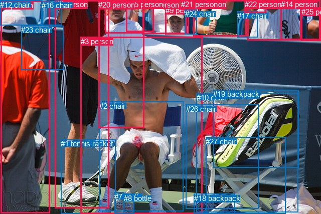
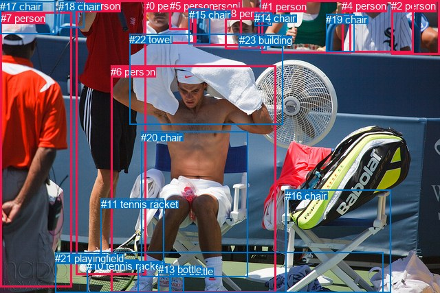

# 图片 1609：2390707.jpg

随机样本序号：389。图片 SHA256：`3ca6f60e050dce9f1cfcbb68052cfdc0ea877fb99529beafa6779c0fa719df17`。

红色框表示人，蓝色框表示其他物体。两个模式分别保留自身框编号，可依据位置比较对应对象。

## 自动检测框与输出

人的框编号：`[0, 3, 4, 5, 6, 9, 11, 13, 14, 15, 20, 21, 22, 25]`。状态：`ok`。

### 自动检测全部物体框

| 编号 | 类别 | 是否为人 | 检测分数 | 像素坐标 xyxy |
|---|---|---|---|---|
| 0 | person | True | 0.9982 | 1.4, 1.6, 99.5, 425.8 |
| 1 | tennis racket | False | 0.9937 | 121.2, 278.5, 230.3, 426.6 |
| 2 | chair | False | 0.9917 | 198.3, 203.0, 365.9, 421.6 |
| 3 | person | True | 0.9899 | 160.6, 73.7, 403.1, 427.0 |
| 4 | person | True | 0.9896 | 385.8, 0.2, 491.8, 72.6 |
| 5 | person | True | 0.9892 | 109.7, 0.0, 217.1, 415.3 |
| 6 | person | True | 0.9864 | 493.3, 0.8, 600.8, 80.9 |
| 7 | bottle | False | 0.9847 | 228.3, 383.8, 247.7, 426.4 |
| 8 | bottle | False | 0.9661 | 246.7, 387.1, 267.3, 427.0 |
| 9 | person | True | 0.9609 | 329.6, 11.5, 377.0, 68.8 |
| 10 | chair | False | 0.9602 | 392.0, 185.7, 594.7, 423.8 |
| 11 | person | True | 0.9478 | 284.1, 0.9, 372.7, 67.2 |
| 12 | chair | False | 0.9309 | 0.3, 0.5, 83.8, 50.1 |
| 13 | person | True | 0.9187 | 209.5, 0.4, 287.8, 66.2 |
| 14 | person | True | 0.9117 | 559.9, 0.1, 638.7, 79.6 |
| 15 | person | True | 0.8275 | 251.7, 0.3, 306.8, 64.0 |
| 16 | chair | False | 0.8130 | 83.1, 2.0, 122.4, 50.8 |
| 17 | chair | False | 0.8101 | 473.2, 22.6, 513.6, 74.2 |
| 18 | backpack | False | 0.7247 | 386.5, 386.5, 468.3, 426.8 |
| 19 | backpack | False | 0.7044 | 425.4, 179.4, 595.2, 334.9 |
| 20 | person | True | 0.5540 | 196.1, 1.4, 287.3, 255.4 |
| 21 | person | True | 0.4964 | 360.5, 0.2, 391.8, 20.5 |
| 22 | person | True | 0.4643 | 487.8, 0.3, 530.3, 25.2 |
| 23 | chair | False | 0.4523 | 42.4, 51.3, 126.1, 139.8 |
| 24 | chair | False | 0.4479 | 368.9, 19.4, 392.6, 68.1 |
| 25 | person | True | 0.4320 | 601.0, 14.6, 639.4, 81.1 |
| 26 | chair | False | 0.4021 | 370.7, 208.7, 515.7, 416.1 |
| 27 | chair | False | 0.3756 | 410.2, 274.0, 569.4, 426.3 |

### 自动检测 Top50 人相关候选

评分物体对：756；人相关物体对：574；输出关系：50。

| 排名 | 主语编号与类别 | 关系 | 宾语编号与类别 | 类型 | 人与人 | 排序分数 | 原始融合 logit |
|---|---|---|---|---|---|---|---|
| 1 | #3 person | sitting on | #2 chair | semantic | False | 0.98638 | 4.2823 |
| 2 | #3 person | wearing | #7 bottle | semantic | False | 0.97279 | 3.5765 |
| 3 | #0 person | looking at | #3 person | semantic | True | 0.96288 | 3.2557 |
| 4 | #3 person | wearing | #8 bottle | semantic | False | 0.96226 | 3.2385 |
| 5 | #3 person | on | #2 chair | spatial | False | 0.95896 | 3.1512 |
| 6 | #0 person | wearing | #12 chair | semantic | False | 0.94437 | 2.8318 |
| 7 | #5 person | looking at | #3 person | semantic | True | 0.93603 | 2.6832 |
| 8 | #20 person | looking at | #3 person | semantic | True | 0.93139 | 2.6082 |
| 9 | #20 person | sitting on | #2 chair | semantic | False | 0.93034 | 2.5919 |
| 10 | #6 person | holding | #22 person | semantic | True | 0.92242 | 2.4756 |
| 11 | #0 person | wearing | #23 chair | semantic | False | 0.91938 | 2.4339 |
| 12 | #25 person | in | #14 person | spatial | True | 0.91137 | 2.3305 |
| 13 | #22 person | in | #17 chair | spatial | False | 0.88997 | 2.0905 |
| 14 | #5 person | holding | #1 tennis racket | semantic | False | 0.88946 | 2.0853 |
| 15 | #11 person | wearing | #9 person | semantic | True | 0.86629 | 1.8685 |
| 16 | #3 person | holding | #1 tennis racket | semantic | False | 0.86458 | 1.8539 |
| 17 | #4 person | sitting on | #17 chair | semantic | False | 0.85907 | 1.8076 |
| 18 | #7 bottle | on | #3 person | spatial | False | 0.84652 | 1.7076 |
| 19 | #1 tennis racket | attached to | #3 person | spatial | False | 0.84401 | 1.6884 |
| 20 | #5 person | leaning on | #16 chair | spatial | False | 0.83540 | 1.6244 |
| 21 | #22 person | sitting on | #17 chair | semantic | False | 0.82961 | 1.5829 |
| 22 | #25 person | sitting on | #14 person | semantic | True | 0.82573 | 1.5557 |
| 23 | #6 person | wearing | #17 chair | semantic | False | 0.82519 | 1.5519 |
| 24 | #0 person | in | #12 chair | spatial | False | 0.82245 | 1.5330 |
| 25 | #13 person | looking at | #3 person | semantic | True | 0.81240 | 1.4657 |
| 26 | #5 person | holding | #16 chair | semantic | False | 0.81094 | 1.4561 |
| 27 | #14 person | in | #25 person | spatial | True | 0.80372 | 1.4097 |
| 28 | #8 bottle | on | #3 person | spatial | False | 0.80253 | 1.4022 |
| 29 | #11 person | looking at | #3 person | semantic | True | 0.79852 | 1.3771 |
| 30 | #20 person | on | #2 chair | spatial | False | 0.79660 | 1.3652 |
| 31 | #4 person | in | #17 chair | spatial | False | 0.77740 | 1.2506 |
| 32 | #3 person | wearing | #20 person | semantic | True | 0.77190 | 1.2191 |
| 33 | #22 person | holding | #6 person | semantic | True | 0.77166 | 1.2177 |
| 34 | #15 person | looking at | #3 person | semantic | True | 0.76725 | 1.1929 |
| 35 | #9 person | wearing | #21 person | semantic | True | 0.76288 | 1.1686 |
| 36 | #9 person | in | #21 person | spatial | True | 0.74828 | 1.0895 |
| 37 | #20 person | on | #3 person | spatial | True | 0.73883 | 1.0399 |
| 38 | #24 chair | in | #21 person | spatial | False | 0.73306 | 1.0102 |
| 39 | #4 person | holding | #22 person | semantic | True | 0.71060 | 0.8983 |
| 40 | #14 person | holding | #25 person | semantic | True | 0.71032 | 0.8969 |
| 41 | #25 person | looking at | #3 person | semantic | True | 0.70173 | 0.8556 |
| 42 | #24 chair | wearing | #21 person | semantic | False | 0.69778 | 0.8368 |
| 43 | #6 person | in | #22 person | spatial | True | 0.69672 | 0.8317 |
| 44 | #5 person | wearing | #23 chair | semantic | False | 0.67807 | 0.7449 |
| 45 | #0 person | in | #23 chair | spatial | False | 0.67465 | 0.7293 |
| 46 | #1 tennis racket | attached to | #5 person | spatial | False | 0.67409 | 0.7268 |
| 47 | #4 person | looking at | #3 person | semantic | True | 0.67371 | 0.7250 |
| 48 | #22 person | in | #6 person | spatial | True | 0.67346 | 0.7239 |
| 49 | #1 tennis racket | holding | #3 person | semantic | False | 0.67086 | 0.7121 |
| 50 | #3 person | in | #7 bottle | spatial | False | 0.64948 | 0.6167 |

### 自动检测逐条人相关 GT 核验

R@50：10.00%；命中 1/10。

| GT 主语编号 | GT 关系 | GT 宾语编号 | 结果阶段 | 匹配预测主语编号 | 匹配预测宾语编号 |
|---|---|---|---|---|---|
| 6 | in front of | 8 | wrong_predicate | [3] | [9] |
| 6 | beside | 16 | wrong_predicate | [3] | [27] |
| 6 | sitting on | 20 | hit50 | [3] | [2] |
| 6 | attached to | 21 | endpoint_missing_or_wrong_class | [3] | [] |
| 6 | attached to | 22 | endpoint_missing_or_wrong_class | [3] | [] |
| 6 | swinging | 22 | endpoint_missing_or_wrong_class | [3] | [] |
| 7 | standing on | 21 | endpoint_missing_or_wrong_class | [0] | [] |
| 8 | looking at | 6 | rank_below50 | [9] | [3] |
| 9 | standing on | 21 | endpoint_missing_or_wrong_class | [5] | [] |
| 16 | beside | 6 | wrong_predicate | [27] | [3] |

## 真实框与输出

人的框编号：`[0, 1, 2, 3, 4, 5, 6, 7, 8, 9]`。

### 真实框全部物体框

| 编号 | 类别 | 是否为人 | 检测分数 | 像素坐标 xyxy |
|---|---|---|---|---|
| 0 | person | True | GT | 209.0, 0.0, 285.0, 63.0 |
| 1 | person | True | GT | 381.0, 1.0, 511.0, 77.0 |
| 2 | person | True | GT | 569.0, 0.0, 640.0, 79.0 |
| 3 | person | True | GT | 281.0, 0.0, 351.0, 67.0 |
| 4 | person | True | GT | 497.0, 0.0, 601.0, 76.0 |
| 5 | person | True | GT | 247.0, 0.0, 279.0, 44.0 |
| 6 | person | True | GT | 161.0, 96.0, 401.0, 427.0 |
| 7 | person | True | GT | 1.0, 18.0, 104.0, 418.0 |
| 8 | person | True | GT | 328.0, 11.0, 378.0, 71.0 |
| 9 | person | True | GT | 110.0, 0.0, 212.0, 401.0 |
| 10 | tennis racket | False | GT | 126.0, 379.0, 201.0, 427.0 |
| 11 | tennis racket | False | GT | 147.0, 289.0, 239.0, 381.0 |
| 12 | bottle | False | GT | 247.0, 387.0, 268.0, 427.0 |
| 13 | bottle | False | GT | 230.0, 384.0, 247.0, 427.0 |
| 14 | chair | False | GT | 370.0, 18.0, 395.0, 37.0 |
| 15 | chair | False | GT | 275.0, 13.0, 306.0, 65.0 |
| 16 | chair | False | GT | 415.0, 277.0, 568.0, 427.0 |
| 17 | chair | False | GT | 0.0, 1.0, 80.0, 49.0 |
| 18 | chair | False | GT | 85.0, 1.0, 122.0, 40.0 |
| 19 | chair | False | GT | 474.0, 20.0, 515.0, 75.0 |
| 20 | chair | False | GT | 205.0, 192.0, 360.0, 404.0 |
| 21 | playingfield | False | GT | 80.0, 368.0, 558.0, 427.0 |
| 22 | towel | False | GT | 188.0, 49.0, 411.0, 182.0 |
| 23 | building | False | GT | 348.0, 50.0, 388.0, 73.0 |

### 真实框 Top50 人相关候选

评分物体对：552；人相关物体对：370；输出关系：50。

| 排名 | 主语编号与类别 | 关系 | 宾语编号与类别 | 类型 | 人与人 | 排序分数 | 原始融合 logit |
|---|---|---|---|---|---|---|---|
| 1 | #6 person | sitting on | #20 chair | semantic | False | 0.98902 | 4.5011 |
| 2 | #6 person | wearing | #22 towel | semantic | False | 0.98561 | 4.2266 |
| 3 | #6 person | wearing | #13 bottle | semantic | False | 0.97918 | 3.8509 |
| 4 | #6 person | wearing | #12 bottle | semantic | False | 0.97536 | 3.6785 |
| 5 | #7 person | looking at | #6 person | semantic | True | 0.97370 | 3.6116 |
| 6 | #9 person | looking at | #6 person | semantic | True | 0.95988 | 3.1749 |
| 7 | #6 person | on | #20 chair | spatial | False | 0.95874 | 3.1457 |
| 8 | #1 person | wearing | #19 chair | semantic | False | 0.95517 | 3.0590 |
| 9 | #7 person | wearing | #17 chair | semantic | False | 0.95423 | 3.0373 |
| 10 | #7 person | standing on | #21 playingfield | semantic | False | 0.95189 | 2.9849 |
| 11 | #8 person | wearing | #23 building | semantic | False | 0.93417 | 2.6526 |
| 12 | #9 person | standing on | #21 playingfield | semantic | False | 0.92889 | 2.5698 |
| 13 | #22 towel | on | #6 person | spatial | False | 0.91660 | 2.3971 |
| 14 | #6 person | sitting on | #21 playingfield | semantic | False | 0.91048 | 2.3195 |
| 15 | #9 person | holding | #18 chair | semantic | False | 0.90982 | 2.3115 |
| 16 | #9 person | leaning on | #18 chair | spatial | False | 0.90942 | 2.3066 |
| 17 | #1 person | in | #19 chair | spatial | False | 0.90156 | 2.2147 |
| 18 | #6 person | holding | #11 tennis racket | semantic | False | 0.89082 | 2.0992 |
| 19 | #1 person | looking at | #6 person | semantic | True | 0.88235 | 2.0148 |
| 20 | #3 person | looking at | #6 person | semantic | True | 0.88139 | 2.0056 |
| 21 | #6 person | on | #21 playingfield | spatial | False | 0.88136 | 2.0054 |
| 22 | #6 person | in | #22 towel | spatial | False | 0.87662 | 1.9608 |
| 23 | #4 person | wearing | #19 chair | semantic | False | 0.87480 | 1.9441 |
| 24 | #8 person | in | #23 building | spatial | False | 0.86325 | 1.8426 |
| 25 | #2 person | looking at | #6 person | semantic | True | 0.85795 | 1.7984 |
| 26 | #13 bottle | on | #6 person | spatial | False | 0.85136 | 1.7453 |
| 27 | #0 person | wearing | #5 person | semantic | True | 0.84839 | 1.7220 |
| 28 | #0 person | looking at | #6 person | semantic | True | 0.84714 | 1.7124 |
| 29 | #4 person | looking at | #6 person | semantic | True | 0.84591 | 1.7029 |
| 30 | #8 person | looking at | #6 person | semantic | True | 0.84413 | 1.6893 |
| 31 | #9 person | holding | #11 tennis racket | semantic | False | 0.83711 | 1.6369 |
| 32 | #0 person | in | #5 person | spatial | True | 0.81924 | 1.5112 |
| 33 | #8 person | wearing | #14 chair | semantic | False | 0.81643 | 1.4923 |
| 34 | #12 bottle | on | #6 person | spatial | False | 0.80130 | 1.3944 |
| 35 | #6 person | sitting on | #16 chair | semantic | False | 0.79038 | 1.3272 |
| 36 | #23 building | looking at | #6 person | semantic | False | 0.76249 | 1.1664 |
| 37 | #15 chair | looking at | #6 person | semantic | False | 0.75775 | 1.1404 |
| 38 | #7 person | in front of | #17 chair | spatial | False | 0.74066 | 1.0494 |
| 39 | #5 person | in | #0 person | spatial | True | 0.73925 | 1.0421 |
| 40 | #11 tennis racket | attached to | #6 person | spatial | False | 0.73579 | 1.0242 |
| 41 | #9 person | beside | #6 person | spatial | True | 0.72016 | 0.9453 |
| 42 | #4 person | in | #19 chair | spatial | False | 0.71835 | 0.9363 |
| 43 | #7 person | sitting on | #18 chair | semantic | False | 0.71711 | 0.9301 |
| 44 | #8 person | in | #14 chair | spatial | False | 0.71064 | 0.8985 |
| 45 | #5 person | looking at | #6 person | semantic | True | 0.69790 | 0.8373 |
| 46 | #6 person | wearing | #10 tennis racket | semantic | False | 0.69233 | 0.8110 |
| 47 | #9 person | wearing | #22 towel | semantic | False | 0.68603 | 0.7816 |
| 48 | #6 person | in | #13 bottle | spatial | False | 0.68428 | 0.7735 |
| 49 | #9 person | standing on | #20 chair | semantic | False | 0.67462 | 0.7291 |
| 50 | #3 person | wearing | #15 chair | semantic | False | 0.66018 | 0.6641 |

### 真实框逐条人相关 GT 核验

R@50：40.00%；命中 4/10。

| GT 主语编号 | GT 关系 | GT 宾语编号 | 结果阶段 | 匹配预测主语编号 | 匹配预测宾语编号 |
|---|---|---|---|---|---|
| 6 | in front of | 8 | wrong_predicate | [6] | [8] |
| 6 | beside | 16 | wrong_predicate | [6] | [16] |
| 6 | sitting on | 20 | hit50 | [6] | [20] |
| 6 | attached to | 21 | wrong_predicate | [6] | [21] |
| 6 | attached to | 22 | wrong_predicate | [6] | [22] |
| 6 | swinging | 22 | wrong_predicate | [6] | [22] |
| 7 | standing on | 21 | hit50 | [7] | [21] |
| 8 | looking at | 6 | hit50 | [8] | [6] |
| 9 | standing on | 21 | hit50 | [9] | [21] |
| 16 | beside | 6 | rank_below50 | [16] | [6] |

## 全部人相关 GT

| 主语编号与类别 | 关系 | 宾语编号与类别 |
|---|---|---|
| #6 person | in front of | #8 person |
| #6 person | beside | #16 chair |
| #6 person | sitting on | #20 chair |
| #6 person | attached to | #21 playingfield |
| #6 person | attached to | #22 towel |
| #6 person | swinging | #22 towel |
| #7 person | standing on | #21 playingfield |
| #8 person | looking at | #6 person |
| #9 person | standing on | #21 playingfield |
| #16 chair | beside | #6 person |

原始记录、全部人相关物体对的两项预测与分项分数见 [逐图证据 JSON](../evidence/cases/1609.json)。全部56类 logits 保留于本机 HOR/output/random500/logits/。

<!-- HOR_COMPLETE_RESULTS -->

## 六组条件的完整输出对照

以下保留同一图片三种框与候选模式、两种谓词输出规则的全部 Top50。框编号各自在所属模式内解释。

### 自动检测框完整枚举：空间与语义各保留一个谓词

| 排名 | 主语编号与类别 | 谓词 | 宾语编号与类别 | 分组 | 排序分数 | predicate logit | pair logit |
|---|---|---|---|---|---|---|---|
| 1 | #3 person | sitting on | #2 chair | semantic | 0.9863780 | 3.8159366 | 0.4664129 |
| 2 | #3 person | wearing | #7 bottle | semantic | 0.9727890 | 3.5059171 | 0.0706315 |
| 3 | #0 person | looking at | #3 person | semantic | 0.9628777 | 3.6852298 | -0.4295222 |
| 4 | #3 person | wearing | #8 bottle | semantic | 0.9622568 | 3.1491866 | 0.0892904 |
| 5 | #3 person | on | #2 chair | spatial | 0.9589562 | 2.6847930 | 0.4664129 |
| 6 | #0 person | wearing | #12 chair | semantic | 0.9443689 | 3.3118386 | -0.4800642 |
| 7 | #5 person | looking at | #3 person | semantic | 0.9360252 | 3.1198788 | -0.4367257 |
| 8 | #20 person | looking at | #3 person | semantic | 0.9313883 | 3.0190382 | -0.4108257 |
| 9 | #20 person | sitting on | #2 chair | semantic | 0.9303353 | 3.0305281 | -0.4386768 |
| 10 | #6 person | holding | #22 person | semantic | 0.9224152 | 2.9732752 | -0.4976510 |
| 11 | #0 person | wearing | #23 chair | semantic | 0.9193775 | 2.9007936 | -0.4668751 |
| 12 | #25 person | in | #14 person | spatial | 0.9113690 | 2.1622176 | 0.1682490 |
| 13 | #22 person | in | #17 chair | spatial | 0.8899716 | 2.0726118 | 0.0178393 |
| 14 | #5 person | holding | #1 tennis racket | semantic | 0.8894613 | 2.3776984 | -0.2924472 |
| 15 | #11 person | wearing | #9 person | semantic | 0.8662870 | 1.9402747 | -0.0717541 |
| 16 | #3 person | holding | #1 tennis racket | semantic | 0.8645807 | 2.1696739 | -0.3158050 |
| 17 | #4 person | sitting on | #17 chair | semantic | 0.8590664 | 1.8027477 | 0.0048094 |
| 18 | #7 bottle | on | #3 person | spatial | 0.8465239 | 2.1162167 | -0.4086235 |
| 19 | #1 tennis racket | attached to | #3 person | spatial | 0.8440122 | 2.1728463 | -0.4844570 |
| 20 | #5 person | leaning on | #16 chair | spatial | 0.8354013 | 2.4149842 | -0.7905822 |
| 21 | #22 person | sitting on | #17 chair | semantic | 0.8296093 | 1.5650220 | 0.0178393 |
| 22 | #25 person | sitting on | #14 person | semantic | 0.8257349 | 1.3874469 | 0.1682490 |
| 23 | #6 person | wearing | #17 chair | semantic | 0.8251926 | 1.5496941 | 0.0022385 |
| 24 | #0 person | in | #12 chair | spatial | 0.8224466 | 2.0130763 | -0.4800642 |
| 25 | #13 person | looking at | #3 person | semantic | 0.8124017 | 2.1996017 | -0.7339099 |
| 26 | #5 person | holding | #16 chair | semantic | 0.8109372 | 2.2466936 | -0.7905822 |
| 27 | #14 person | in | #25 person | spatial | 0.8037240 | 1.3869076 | 0.0228267 |
| 28 | #8 bottle | on | #3 person | spatial | 0.8025324 | 1.7917871 | -0.3895892 |
| 29 | #11 person | looking at | #3 person | semantic | 0.7985247 | 2.1982074 | -0.8211079 |
| 30 | #20 person | on | #2 chair | spatial | 0.7965967 | 1.8038349 | -0.4386768 |
| 31 | #4 person | in | #17 chair | spatial | 0.7773984 | 1.2457600 | 0.0048094 |
| 32 | #3 person | wearing | #20 person | semantic | 0.7719035 | 1.9614906 | -0.7424002 |
| 33 | #22 person | holding | #6 person | semantic | 0.7716649 | 1.5097327 | -0.2919970 |
| 34 | #15 person | looking at | #3 person | semantic | 0.7672535 | 2.0512376 | -0.8583703 |
| 35 | #9 person | wearing | #21 person | semantic | 0.7628837 | 1.4938760 | -0.3253211 |
| 36 | #9 person | in | #21 person | spatial | 0.7482823 | 1.4147930 | -0.3253211 |
| 37 | #20 person | on | #3 person | spatial | 0.7388324 | 1.4507341 | -0.4108257 |
| 38 | #24 chair | in | #21 person | spatial | 0.7330593 | 1.3105764 | -0.3003764 |
| 39 | #4 person | holding | #22 person | semantic | 0.7106040 | 1.4052367 | -0.5069171 |
| 40 | #14 person | holding | #25 person | semantic | 0.7103183 | 0.8741035 | 0.0228267 |
| 41 | #25 person | looking at | #3 person | semantic | 0.7017335 | 1.5250430 | -0.6694769 |
| 42 | #24 chair | wearing | #21 person | semantic | 0.6977843 | 1.1371455 | -0.3003764 |
| 43 | #6 person | in | #22 person | spatial | 0.6967196 | 1.3293762 | -0.4976510 |
| 44 | #5 person | wearing | #23 chair | semantic | 0.6780714 | 1.4989920 | -0.7540693 |
| 45 | #0 person | in | #23 chair | spatial | 0.6746530 | 1.1961813 | -0.4668751 |
| 46 | #1 tennis racket | attached to | #5 person | spatial | 0.6740940 | 1.3504429 | -0.6236825 |
| 47 | #4 person | looking at | #3 person | semantic | 0.6737134 | 1.9792008 | -1.2541723 |
| 48 | #22 person | in | #6 person | spatial | 0.6734564 | 1.0158567 | -0.2919970 |
| 49 | #1 tennis racket | holding | #3 person | semantic | 0.6708599 | 1.1965337 | -0.4844570 |
| 50 | #3 person | in | #7 bottle | spatial | 0.6494778 | 0.5461130 | 0.0706315 |

GT 命中：1/10，R@50=10.00%。

| GT主语 | GT谓词 | GT宾语 | 结果阶段 | 匹配主语框 | 匹配宾语框 |
|---|---|---|---|---|---|
| 6 | in front of | 8 | wrong_predicate | [3] | [9] |
| 6 | beside | 16 | wrong_predicate | [3] | [27] |
| 6 | sitting on | 20 | hit50 | [3] | [2] |
| 6 | attached to | 21 | endpoint_missing_or_wrong_class | [3] | [] |
| 6 | attached to | 22 | endpoint_missing_or_wrong_class | [3] | [] |
| 6 | swinging | 22 | endpoint_missing_or_wrong_class | [3] | [] |
| 7 | standing on | 21 | endpoint_missing_or_wrong_class | [0] | [] |
| 8 | looking at | 6 | rank_below50 | [9] | [3] |
| 9 | standing on | 21 | endpoint_missing_or_wrong_class | [5] | [] |
| 16 | beside | 6 | wrong_predicate | [27] | [3] |

### 自动检测框完整枚举：每对只保留一个谓词

| 排名 | 主语编号与类别 | 谓词 | 宾语编号与类别 | 分组 | 排序分数 | predicate logit | pair logit |
|---|---|---|---|---|---|---|---|
| 1 | #3 person | sitting on | #2 chair | single | 0.9863780 | 3.8159366 | 0.4664129 |
| 2 | #3 person | wearing | #7 bottle | single | 0.9727890 | 3.5059171 | 0.0706315 |
| 3 | #0 person | looking at | #3 person | single | 0.9628777 | 3.6852298 | -0.4295222 |
| 4 | #3 person | wearing | #8 bottle | single | 0.9622568 | 3.1491866 | 0.0892904 |
| 5 | #0 person | wearing | #12 chair | single | 0.9443689 | 3.3118386 | -0.4800642 |
| 6 | #5 person | looking at | #3 person | single | 0.9360252 | 3.1198788 | -0.4367257 |
| 7 | #20 person | looking at | #3 person | single | 0.9313883 | 3.0190382 | -0.4108257 |
| 8 | #20 person | sitting on | #2 chair | single | 0.9303353 | 3.0305281 | -0.4386768 |
| 9 | #6 person | holding | #22 person | single | 0.9224152 | 2.9732752 | -0.4976510 |
| 10 | #0 person | wearing | #23 chair | single | 0.9193775 | 2.9007936 | -0.4668751 |
| 11 | #25 person | in | #14 person | single | 0.9113690 | 2.1622176 | 0.1682490 |
| 12 | #22 person | in | #17 chair | single | 0.8899716 | 2.0726118 | 0.0178393 |
| 13 | #5 person | holding | #1 tennis racket | single | 0.8894613 | 2.3776984 | -0.2924472 |
| 14 | #11 person | wearing | #9 person | single | 0.8662870 | 1.9402747 | -0.0717541 |
| 15 | #3 person | holding | #1 tennis racket | single | 0.8645807 | 2.1696739 | -0.3158050 |
| 16 | #4 person | sitting on | #17 chair | single | 0.8590664 | 1.8027477 | 0.0048094 |
| 17 | #7 bottle | on | #3 person | single | 0.8465239 | 2.1162167 | -0.4086235 |
| 18 | #1 tennis racket | attached to | #3 person | single | 0.8440122 | 2.1728463 | -0.4844570 |
| 19 | #5 person | leaning on | #16 chair | single | 0.8354013 | 2.4149842 | -0.7905822 |
| 20 | #6 person | wearing | #17 chair | single | 0.8251926 | 1.5496941 | 0.0022385 |
| 21 | #13 person | looking at | #3 person | single | 0.8124017 | 2.1996017 | -0.7339099 |
| 22 | #14 person | in | #25 person | single | 0.8037240 | 1.3869076 | 0.0228267 |
| 23 | #8 bottle | on | #3 person | single | 0.8025324 | 1.7917871 | -0.3895892 |
| 24 | #11 person | looking at | #3 person | single | 0.7985247 | 2.1982074 | -0.8211079 |
| 25 | #3 person | wearing | #20 person | single | 0.7719035 | 1.9614906 | -0.7424002 |
| 26 | #22 person | holding | #6 person | single | 0.7716649 | 1.5097327 | -0.2919970 |
| 27 | #15 person | looking at | #3 person | single | 0.7672535 | 2.0512376 | -0.8583703 |
| 28 | #9 person | wearing | #21 person | single | 0.7628837 | 1.4938760 | -0.3253211 |
| 29 | #24 chair | in | #21 person | single | 0.7330593 | 1.3105764 | -0.3003764 |
| 30 | #4 person | holding | #22 person | single | 0.7106040 | 1.4052367 | -0.5069171 |
| 31 | #25 person | looking at | #3 person | single | 0.7017335 | 1.5250430 | -0.6694769 |
| 32 | #5 person | wearing | #23 chair | single | 0.6780714 | 1.4989920 | -0.7540693 |
| 33 | #1 tennis racket | attached to | #5 person | single | 0.6740940 | 1.3504429 | -0.6236825 |
| 34 | #4 person | looking at | #3 person | single | 0.6737134 | 1.9792008 | -1.2541723 |
| 35 | #14 person | looking at | #3 person | single | 0.6387768 | 1.3361282 | -0.7660690 |
| 36 | #11 person | in | #21 person | single | 0.5887960 | 0.5288720 | -0.1698817 |
| 37 | #9 person | looking at | #3 person | single | 0.5863950 | 1.3451929 | -0.9961107 |
| 38 | #20 person | holding | #1 tennis racket | single | 0.5844827 | 0.8149791 | -0.4737762 |
| 39 | #20 person | wearing | #13 person | single | 0.5740187 | 0.7459593 | -0.4476926 |
| 40 | #5 person | standing on | #2 chair | single | 0.5737590 | 0.8436890 | -0.5464846 |
| 41 | #14 person | wearing | #6 person | single | 0.5581760 | 0.3826818 | -0.1489192 |
| 42 | #13 person | in | #15 person | single | 0.5528894 | 0.4983354 | -0.2859833 |
| 43 | #9 person | in | #11 person | single | 0.5526736 | 0.7901826 | -0.5787032 |
| 44 | #24 chair | looking at | #3 person | single | 0.5512554 | 1.2279654 | -1.0222211 |
| 45 | #0 person | in | #16 chair | single | 0.5508988 | 0.8835521 | -0.6792493 |
| 46 | #0 person | looking at | #5 person | single | 0.5391397 | 1.0425372 | -0.8856576 |
| 47 | #3 person | sitting on | #27 chair | single | 0.5112868 | 0.7495217 | -0.7043668 |
| 48 | #6 person | looking at | #3 person | single | 0.5068764 | 1.3658714 | -1.3383641 |
| 49 | #5 person | holding | #20 person | single | 0.5006931 | 0.4683557 | -0.4655832 |
| 50 | #3 person | sitting on | #26 chair | single | 0.4858533 | 0.8367596 | -0.8933617 |

GT 命中：2/10，R@50=20.00%。

| GT主语 | GT谓词 | GT宾语 | 结果阶段 | 匹配主语框 | 匹配宾语框 |
|---|---|---|---|---|---|
| 6 | in front of | 8 | wrong_predicate | [3] | [9] |
| 6 | beside | 16 | wrong_predicate | [3] | [27] |
| 6 | sitting on | 20 | hit50 | [3] | [2] |
| 6 | attached to | 21 | endpoint_missing_or_wrong_class | [3] | [] |
| 6 | attached to | 22 | endpoint_missing_or_wrong_class | [3] | [] |
| 6 | swinging | 22 | endpoint_missing_or_wrong_class | [3] | [] |
| 7 | standing on | 21 | endpoint_missing_or_wrong_class | [0] | [] |
| 8 | looking at | 6 | hit50 | [9] | [3] |
| 9 | standing on | 21 | endpoint_missing_or_wrong_class | [5] | [] |
| 16 | beside | 6 | wrong_predicate | [27] | [3] |

### 真实框完整枚举：空间与语义各保留一个谓词

| 排名 | 主语编号与类别 | 谓词 | 宾语编号与类别 | 分组 | 排序分数 | predicate logit | pair logit |
|---|---|---|---|---|---|---|---|
| 1 | #6 person | sitting on | #20 chair | semantic | 0.9890246 | 4.0235553 | 0.4775097 |
| 2 | #6 person | wearing | #22 towel | semantic | 0.9856086 | 3.8786025 | 0.3480319 |
| 3 | #6 person | wearing | #13 bottle | semantic | 0.9791814 | 3.7540183 | 0.0968546 |
| 4 | #6 person | wearing | #12 bottle | semantic | 0.9753615 | 3.5602317 | 0.1182656 |
| 5 | #7 person | looking at | #6 person | semantic | 0.9737005 | 4.1701751 | -0.5586208 |
| 6 | #9 person | looking at | #6 person | semantic | 0.9598776 | 3.6020360 | -0.4271659 |
| 7 | #6 person | on | #20 chair | spatial | 0.9587381 | 2.6681695 | 0.4775097 |
| 8 | #1 person | wearing | #19 chair | semantic | 0.9551706 | 3.0080652 | 0.0509612 |
| 9 | #7 person | wearing | #17 chair | semantic | 0.9542310 | 3.3911281 | -0.3538306 |
| 10 | #7 person | standing on | #21 playingfield | semantic | 0.9518869 | 3.5662913 | -0.5814002 |
| 11 | #8 person | wearing | #23 building | semantic | 0.9341690 | 2.8157816 | -0.1632152 |
| 12 | #9 person | standing on | #21 playingfield | semantic | 0.9288935 | 3.2433467 | -0.6735313 |
| 13 | #22 towel | on | #6 person | spatial | 0.9166023 | 2.6716442 | -0.2745904 |
| 14 | #6 person | sitting on | #21 playingfield | semantic | 0.9104806 | 2.9220848 | -0.6025676 |
| 15 | #9 person | holding | #18 chair | semantic | 0.9098246 | 3.0478888 | -0.7363937 |
| 16 | #9 person | leaning on | #18 chair | spatial | 0.9094182 | 3.0429454 | -0.7363937 |
| 17 | #1 person | in | #19 chair | spatial | 0.9015633 | 2.1637554 | 0.0509612 |
| 18 | #6 person | holding | #11 tennis racket | semantic | 0.8908243 | 2.5379844 | -0.4387957 |
| 19 | #1 person | looking at | #6 person | semantic | 0.8823459 | 3.2451258 | -1.2302903 |
| 20 | #3 person | looking at | #6 person | semantic | 0.8813859 | 2.8986726 | -0.8930522 |
| 21 | #6 person | on | #21 playingfield | spatial | 0.8813648 | 2.6079865 | -0.6025676 |
| 22 | #6 person | in | #22 towel | spatial | 0.8766235 | 1.6128044 | 0.3480319 |
| 23 | #4 person | wearing | #19 chair | semantic | 0.8747972 | 1.8205152 | 0.1235422 |
| 24 | #8 person | in | #23 building | spatial | 0.8632507 | 2.0057716 | -0.1632152 |
| 25 | #2 person | looking at | #6 person | semantic | 0.8579499 | 2.6020527 | -0.8036867 |
| 26 | #13 bottle | on | #6 person | spatial | 0.8513634 | 2.2027540 | -0.4574196 |
| 27 | #0 person | wearing | #5 person | semantic | 0.8483917 | 1.9187665 | -0.1967239 |
| 28 | #0 person | looking at | #6 person | semantic | 0.8471438 | 2.5565128 | -0.8441400 |
| 29 | #4 person | looking at | #6 person | semantic | 0.8459114 | 2.9911470 | -1.2882596 |
| 30 | #8 person | looking at | #6 person | semantic | 0.8441302 | 2.6460896 | -0.9568037 |
| 31 | #9 person | holding | #11 tennis racket | semantic | 0.8371084 | 2.0426421 | -0.4057734 |
| 32 | #0 person | in | #5 person | spatial | 0.8192436 | 1.7079554 | -0.1967239 |
| 33 | #8 person | wearing | #14 chair | semantic | 0.8164266 | 1.5298352 | -0.0375128 |
| 34 | #12 bottle | on | #6 person | spatial | 0.8012955 | 1.8290324 | -0.4346213 |
| 35 | #6 person | sitting on | #16 chair | semantic | 0.7903825 | 2.0644755 | -0.7372430 |
| 36 | #23 building | looking at | #6 person | semantic | 0.7624933 | 2.0586672 | -0.8922695 |
| 37 | #15 chair | looking at | #6 person | semantic | 0.7577515 | 2.1429057 | -1.0025139 |
| 38 | #7 person | in front of | #17 chair | spatial | 0.7406583 | 1.4032235 | -0.3538306 |
| 39 | #5 person | in | #0 person | spatial | 0.7392534 | 1.1745086 | -0.1324168 |
| 40 | #11 tennis racket | attached to | #6 person | spatial | 0.7357856 | 1.5686030 | -0.5444251 |
| 41 | #9 person | beside | #6 person | spatial | 0.7201632 | 1.3724370 | -0.4271659 |
| 42 | #4 person | in | #19 chair | spatial | 0.7183492 | 0.8127456 | 0.1235422 |
| 43 | #7 person | sitting on | #18 chair | semantic | 0.7171055 | 1.5409551 | -0.6108060 |
| 44 | #8 person | in | #14 chair | spatial | 0.7106351 | 0.9359837 | -0.0375128 |
| 45 | #5 person | looking at | #6 person | semantic | 0.6979009 | 1.7790213 | -0.9416994 |
| 46 | #6 person | wearing | #10 tennis racket | semantic | 0.6923311 | 1.3500390 | -0.5389986 |
| 47 | #9 person | wearing | #22 towel | semantic | 0.6860346 | 1.5608239 | -0.7791784 |
| 48 | #6 person | in | #13 bottle | spatial | 0.6842800 | 0.6766567 | 0.0968546 |
| 49 | #9 person | standing on | #20 chair | semantic | 0.6746153 | 1.3207622 | -0.5916277 |
| 50 | #3 person | wearing | #15 chair | semantic | 0.6601792 | 0.7724380 | -0.1083452 |

GT 命中：4/10，R@50=40.00%。

| GT主语 | GT谓词 | GT宾语 | 结果阶段 | 匹配主语框 | 匹配宾语框 |
|---|---|---|---|---|---|
| 6 | in front of | 8 | wrong_predicate | [6] | [8] |
| 6 | beside | 16 | wrong_predicate | [6] | [16] |
| 6 | sitting on | 20 | hit50 | [6] | [20] |
| 6 | attached to | 21 | wrong_predicate | [6] | [21] |
| 6 | attached to | 22 | wrong_predicate | [6] | [22] |
| 6 | swinging | 22 | wrong_predicate | [6] | [22] |
| 7 | standing on | 21 | hit50 | [7] | [21] |
| 8 | looking at | 6 | hit50 | [8] | [6] |
| 9 | standing on | 21 | hit50 | [9] | [21] |
| 16 | beside | 6 | rank_below50 | [16] | [6] |

### 真实框完整枚举：每对只保留一个谓词

| 排名 | 主语编号与类别 | 谓词 | 宾语编号与类别 | 分组 | 排序分数 | predicate logit | pair logit |
|---|---|---|---|---|---|---|---|
| 1 | #6 person | sitting on | #20 chair | single | 0.9890246 | 4.0235553 | 0.4775097 |
| 2 | #6 person | wearing | #22 towel | single | 0.9856086 | 3.8786025 | 0.3480319 |
| 3 | #6 person | wearing | #13 bottle | single | 0.9791814 | 3.7540183 | 0.0968546 |
| 4 | #6 person | wearing | #12 bottle | single | 0.9753615 | 3.5602317 | 0.1182656 |
| 5 | #7 person | looking at | #6 person | single | 0.9737005 | 4.1701751 | -0.5586208 |
| 6 | #9 person | looking at | #6 person | single | 0.9598776 | 3.6020360 | -0.4271659 |
| 7 | #1 person | wearing | #19 chair | single | 0.9551706 | 3.0080652 | 0.0509612 |
| 8 | #7 person | wearing | #17 chair | single | 0.9542310 | 3.3911281 | -0.3538306 |
| 9 | #7 person | standing on | #21 playingfield | single | 0.9518869 | 3.5662913 | -0.5814002 |
| 10 | #8 person | wearing | #23 building | single | 0.9341690 | 2.8157816 | -0.1632152 |
| 11 | #9 person | standing on | #21 playingfield | single | 0.9288935 | 3.2433467 | -0.6735313 |
| 12 | #22 towel | on | #6 person | single | 0.9166023 | 2.6716442 | -0.2745904 |
| 13 | #6 person | sitting on | #21 playingfield | single | 0.9104806 | 2.9220848 | -0.6025676 |
| 14 | #9 person | holding | #18 chair | single | 0.9098246 | 3.0478888 | -0.7363937 |
| 15 | #6 person | holding | #11 tennis racket | single | 0.8908243 | 2.5379844 | -0.4387957 |
| 16 | #1 person | looking at | #6 person | single | 0.8823459 | 3.2451258 | -1.2302903 |
| 17 | #3 person | looking at | #6 person | single | 0.8813859 | 2.8986726 | -0.8930522 |
| 18 | #4 person | wearing | #19 chair | single | 0.8747972 | 1.8205152 | 0.1235422 |
| 19 | #2 person | looking at | #6 person | single | 0.8579499 | 2.6020527 | -0.8036867 |
| 20 | #13 bottle | on | #6 person | single | 0.8513634 | 2.2027540 | -0.4574196 |
| 21 | #0 person | wearing | #5 person | single | 0.8483917 | 1.9187665 | -0.1967239 |
| 22 | #0 person | looking at | #6 person | single | 0.8471438 | 2.5565128 | -0.8441400 |
| 23 | #4 person | looking at | #6 person | single | 0.8459114 | 2.9911470 | -1.2882596 |
| 24 | #8 person | looking at | #6 person | single | 0.8441302 | 2.6460896 | -0.9568037 |
| 25 | #9 person | holding | #11 tennis racket | single | 0.8371084 | 2.0426421 | -0.4057734 |
| 26 | #8 person | wearing | #14 chair | single | 0.8164266 | 1.5298352 | -0.0375128 |
| 27 | #12 bottle | on | #6 person | single | 0.8012955 | 1.8290324 | -0.4346213 |
| 28 | #6 person | sitting on | #16 chair | single | 0.7903825 | 2.0644755 | -0.7372430 |
| 29 | #23 building | looking at | #6 person | single | 0.7624933 | 2.0586672 | -0.8922695 |
| 30 | #15 chair | looking at | #6 person | single | 0.7577515 | 2.1429057 | -1.0025139 |
| 31 | #5 person | in | #0 person | single | 0.7392534 | 1.1745086 | -0.1324168 |
| 32 | #11 tennis racket | attached to | #6 person | single | 0.7357856 | 1.5686030 | -0.5444251 |
| 33 | #7 person | sitting on | #18 chair | single | 0.7171055 | 1.5409551 | -0.6108060 |
| 34 | #5 person | looking at | #6 person | single | 0.6979009 | 1.7790213 | -0.9416994 |
| 35 | #6 person | wearing | #10 tennis racket | single | 0.6923311 | 1.3500390 | -0.5389986 |
| 36 | #9 person | wearing | #22 towel | single | 0.6860346 | 1.5608239 | -0.7791784 |
| 37 | #9 person | standing on | #20 chair | single | 0.6746153 | 1.3207622 | -0.5916277 |
| 38 | #3 person | wearing | #15 chair | single | 0.6601792 | 0.7724380 | -0.1083452 |
| 39 | #8 person | sitting on | #20 chair | single | 0.6115429 | 1.7185307 | -1.2647282 |
| 40 | #1 person | wearing | #14 chair | single | 0.6037892 | 0.6000133 | -0.1787345 |
| 41 | #7 person | looking at | #9 person | single | 0.5783334 | 1.2843132 | -0.9683777 |
| 42 | #9 person | wearing | #10 tennis racket | single | 0.5707482 | 0.6556854 | -0.3707810 |
| 43 | #2 person | sitting on | #19 chair | single | 0.5647907 | 0.4004760 | -0.1398477 |
| 44 | #9 person | wearing | #0 person | single | 0.5615811 | 0.7577682 | -0.5101870 |
| 45 | #11 tennis racket | attached to | #9 person | single | 0.5308088 | 0.8324442 | -0.7090527 |
| 46 | #2 person | wearing | #4 person | single | 0.5278237 | 0.3085814 | -0.1971714 |
| 47 | #10 tennis racket | on | #6 person | single | 0.4823304 | 0.8423347 | -0.9130425 |
| 48 | #2 person | sitting on | #17 chair | single | 0.4714033 | 0.5991297 | -0.7136417 |
| 49 | #3 person | wearing | #14 chair | single | 0.4682133 | -0.0847139 | -0.0426046 |
| 50 | #5 person | holding | #15 chair | single | 0.4619863 | -0.0160584 | -0.1362906 |

GT 命中：4/10，R@50=40.00%。

| GT主语 | GT谓词 | GT宾语 | 结果阶段 | 匹配主语框 | 匹配宾语框 |
|---|---|---|---|---|---|
| 6 | in front of | 8 | wrong_predicate | [6] | [8] |
| 6 | beside | 16 | wrong_predicate | [6] | [16] |
| 6 | sitting on | 20 | hit50 | [6] | [20] |
| 6 | attached to | 21 | wrong_predicate | [6] | [21] |
| 6 | attached to | 22 | wrong_predicate | [6] | [22] |
| 6 | swinging | 22 | wrong_predicate | [6] | [22] |
| 7 | standing on | 21 | hit50 | [7] | [21] |
| 8 | looking at | 6 | hit50 | [8] | [6] |
| 9 | standing on | 21 | hit50 | [9] | [21] |
| 16 | beside | 6 | wrong_predicate | [16] | [6] |

### 真实框400候选：空间与语义各保留一个谓词

| 排名 | 主语编号与类别 | 谓词 | 宾语编号与类别 | 分组 | 排序分数 | predicate logit | pair logit |
|---|---|---|---|---|---|---|---|
| 1 | #6 person | sitting on | #20 chair | semantic | 0.9907662 | 4.1980939 | 0.4775097 |
| 2 | #6 person | wearing | #22 towel | semantic | 0.9840760 | 3.7758403 | 0.3480319 |
| 3 | #6 person | wearing | #13 bottle | semantic | 0.9777915 | 3.6879678 | 0.0968546 |
| 4 | #6 person | wearing | #12 bottle | semantic | 0.9738731 | 3.5000491 | 0.1182656 |
| 5 | #7 person | looking at | #6 person | semantic | 0.9722090 | 4.1134801 | -0.5586208 |
| 6 | #9 person | looking at | #6 person | semantic | 0.9642891 | 3.7230992 | -0.4271659 |
| 7 | #7 person | standing on | #21 playingfield | semantic | 0.9594572 | 3.7454104 | -0.5814002 |
| 8 | #7 person | wearing | #17 chair | semantic | 0.9507111 | 3.3133416 | -0.3538306 |
| 9 | #6 person | on | #20 chair | spatial | 0.9499208 | 2.4652634 | 0.4775097 |
| 10 | #1 person | wearing | #19 chair | semantic | 0.9382778 | 2.6704412 | 0.0509612 |
| 11 | #9 person | standing on | #21 playingfield | semantic | 0.9363596 | 3.3622832 | -0.6735313 |
| 12 | #9 person | leaning on | #18 chair | spatial | 0.9139057 | 3.0986786 | -0.7363937 |
| 13 | #8 person | wearing | #23 building | semantic | 0.9125987 | 2.5090013 | -0.1632152 |
| 14 | #6 person | sitting on | #21 playingfield | semantic | 0.9121825 | 2.9431472 | -0.6025676 |
| 15 | #22 towel | on | #6 person | spatial | 0.9050484 | 2.5292106 | -0.2745904 |
| 16 | #6 person | holding | #11 tennis racket | semantic | 0.8885045 | 2.5143509 | -0.4387957 |
| 17 | #9 person | holding | #18 chair | semantic | 0.8849460 | 2.7765193 | -0.7363937 |
| 18 | #1 person | looking at | #6 person | semantic | 0.8763313 | 3.1884289 | -1.2302903 |
| 19 | #1 person | in | #19 chair | spatial | 0.8695755 | 1.8462496 | 0.0509612 |
| 20 | #3 person | looking at | #6 person | semantic | 0.8684529 | 2.7804003 | -0.8930522 |
| 21 | #6 person | in | #22 towel | spatial | 0.8680513 | 1.5358052 | 0.3480319 |
| 22 | #6 person | on | #21 playingfield | spatial | 0.8630571 | 2.4434843 | -0.6025676 |
| 23 | #8 person | looking at | #6 person | semantic | 0.8486764 | 2.6810613 | -0.9568037 |
| 24 | #2 person | looking at | #6 person | semantic | 0.8469505 | 2.5145679 | -0.8036867 |
| 25 | #4 person | looking at | #6 person | semantic | 0.8463653 | 2.9946337 | -1.2882596 |
| 26 | #0 person | looking at | #6 person | semantic | 0.8319734 | 2.4438181 | -0.8441400 |
| 27 | #0 person | holding | #5 person | semantic | 0.8316690 | 1.7942266 | -0.1967239 |
| 28 | #13 bottle | on | #6 person | spatial | 0.8285091 | 2.0325170 | -0.4574196 |
| 29 | #4 person | wearing | #19 chair | semantic | 0.8138291 | 1.3515429 | 0.1235422 |
| 30 | #8 person | in | #23 building | spatial | 0.8117355 | 1.6245413 | -0.1632152 |
| 31 | #0 person | in | #5 person | spatial | 0.7980695 | 1.5709963 | -0.1967239 |
| 32 | #9 person | holding | #11 tennis racket | semantic | 0.7738820 | 1.6361356 | -0.4057734 |
| 33 | #6 person | sitting on | #16 chair | semantic | 0.7729293 | 1.9621687 | -0.7372430 |
| 34 | #8 person | wearing | #14 chair | semantic | 0.7650243 | 1.2179384 | -0.0375128 |
| 35 | #12 bottle | on | #6 person | spatial | 0.7575061 | 1.5736766 | -0.4346213 |
| 36 | #23 building | looking at | #6 person | semantic | 0.7527877 | 2.0058055 | -0.8922695 |
| 37 | #7 person | in front of | #17 chair | spatial | 0.7517356 | 1.4617209 | -0.3538306 |
| 38 | #7 person | sitting on | #18 chair | semantic | 0.7505755 | 1.7124901 | -0.6108060 |
| 39 | #15 chair | looking at | #6 person | semantic | 0.7294881 | 1.9945407 | -1.0025139 |
| 40 | #11 tennis racket | attached to | #6 person | spatial | 0.7233298 | 1.5054646 | -0.5444251 |
| 41 | #9 person | standing on | #20 chair | semantic | 0.7070336 | 1.4726477 | -0.5916277 |
| 42 | #9 person | beside | #6 person | spatial | 0.6824286 | 1.1921210 | -0.4271659 |
| 43 | #6 person | wearing | #10 tennis racket | semantic | 0.6793657 | 1.2898569 | -0.5389986 |
| 44 | #5 person | in | #0 person | spatial | 0.6758010 | 0.8669581 | -0.1324168 |
| 45 | #13 bottle | wearing | #6 person | semantic | 0.6751649 | 1.1890588 | -0.4574196 |
| 46 | #5 person | looking at | #6 person | semantic | 0.6597887 | 1.6040521 | -0.9416994 |
| 47 | #5 person | looking at | #0 person | semantic | 0.6242036 | 0.6398458 | -0.1324168 |
| 48 | #6 person | in | #13 bottle | spatial | 0.6158934 | 0.3752990 | 0.0968546 |
| 49 | #9 person | wearing | #22 towel | semantic | 0.6149684 | 1.2474236 | -0.7791784 |
| 50 | #8 person | sitting on | #20 chair | semantic | 0.6022100 | 1.6794100 | -1.2647282 |

GT 命中：4/10，R@50=40.00%。

| GT主语 | GT谓词 | GT宾语 | 结果阶段 | 匹配主语框 | 匹配宾语框 |
|---|---|---|---|---|---|
| 6 | in front of | 8 | wrong_predicate | [6] | [8] |
| 6 | beside | 16 | wrong_predicate | [6] | [16] |
| 6 | sitting on | 20 | hit50 | [6] | [20] |
| 6 | attached to | 21 | wrong_predicate | [6] | [21] |
| 6 | attached to | 22 | wrong_predicate | [6] | [22] |
| 6 | swinging | 22 | wrong_predicate | [6] | [22] |
| 7 | standing on | 21 | hit50 | [7] | [21] |
| 8 | looking at | 6 | hit50 | [8] | [6] |
| 9 | standing on | 21 | hit50 | [9] | [21] |
| 16 | beside | 6 | rank_below50 | [16] | [6] |

### 真实框400候选：每对只保留一个谓词

| 排名 | 主语编号与类别 | 谓词 | 宾语编号与类别 | 分组 | 排序分数 | predicate logit | pair logit |
|---|---|---|---|---|---|---|---|
| 1 | #6 person | sitting on | #20 chair | single | 0.9907662 | 4.1980939 | 0.4775097 |
| 2 | #6 person | wearing | #22 towel | single | 0.9840760 | 3.7758403 | 0.3480319 |
| 3 | #6 person | wearing | #13 bottle | single | 0.9777915 | 3.6879678 | 0.0968546 |
| 4 | #6 person | wearing | #12 bottle | single | 0.9738731 | 3.5000491 | 0.1182656 |
| 5 | #7 person | looking at | #6 person | single | 0.9722090 | 4.1134801 | -0.5586208 |
| 6 | #9 person | looking at | #6 person | single | 0.9642891 | 3.7230992 | -0.4271659 |
| 7 | #7 person | standing on | #21 playingfield | single | 0.9594572 | 3.7454104 | -0.5814002 |
| 8 | #7 person | wearing | #17 chair | single | 0.9507111 | 3.3133416 | -0.3538306 |
| 9 | #1 person | wearing | #19 chair | single | 0.9382778 | 2.6704412 | 0.0509612 |
| 10 | #9 person | standing on | #21 playingfield | single | 0.9363596 | 3.3622832 | -0.6735313 |
| 11 | #9 person | leaning on | #18 chair | single | 0.9139057 | 3.0986786 | -0.7363937 |
| 12 | #8 person | wearing | #23 building | single | 0.9125987 | 2.5090013 | -0.1632152 |
| 13 | #6 person | sitting on | #21 playingfield | single | 0.9121825 | 2.9431472 | -0.6025676 |
| 14 | #22 towel | on | #6 person | single | 0.9050484 | 2.5292106 | -0.2745904 |
| 15 | #6 person | holding | #11 tennis racket | single | 0.8885045 | 2.5143509 | -0.4387957 |
| 16 | #1 person | looking at | #6 person | single | 0.8763313 | 3.1884289 | -1.2302903 |
| 17 | #3 person | looking at | #6 person | single | 0.8684529 | 2.7804003 | -0.8930522 |
| 18 | #8 person | looking at | #6 person | single | 0.8486764 | 2.6810613 | -0.9568037 |
| 19 | #2 person | looking at | #6 person | single | 0.8469505 | 2.5145679 | -0.8036867 |
| 20 | #4 person | looking at | #6 person | single | 0.8463653 | 2.9946337 | -1.2882596 |
| 21 | #0 person | looking at | #6 person | single | 0.8319734 | 2.4438181 | -0.8441400 |
| 22 | #0 person | holding | #5 person | single | 0.8316690 | 1.7942266 | -0.1967239 |
| 23 | #13 bottle | on | #6 person | single | 0.8285091 | 2.0325170 | -0.4574196 |
| 24 | #4 person | wearing | #19 chair | single | 0.8138291 | 1.3515429 | 0.1235422 |
| 25 | #9 person | holding | #11 tennis racket | single | 0.7738820 | 1.6361356 | -0.4057734 |
| 26 | #6 person | sitting on | #16 chair | single | 0.7729293 | 1.9621687 | -0.7372430 |
| 27 | #8 person | wearing | #14 chair | single | 0.7650243 | 1.2179384 | -0.0375128 |
| 28 | #12 bottle | on | #6 person | single | 0.7575061 | 1.5736766 | -0.4346213 |
| 29 | #23 building | looking at | #6 person | single | 0.7527877 | 2.0058055 | -0.8922695 |
| 30 | #7 person | sitting on | #18 chair | single | 0.7505755 | 1.7124901 | -0.6108060 |
| 31 | #15 chair | looking at | #6 person | single | 0.7294881 | 1.9945407 | -1.0025139 |
| 32 | #11 tennis racket | attached to | #6 person | single | 0.7233298 | 1.5054646 | -0.5444251 |
| 33 | #9 person | standing on | #20 chair | single | 0.7070336 | 1.4726477 | -0.5916277 |
| 34 | #6 person | wearing | #10 tennis racket | single | 0.6793657 | 1.2898569 | -0.5389986 |
| 35 | #5 person | in | #0 person | single | 0.6758010 | 0.8669581 | -0.1324168 |
| 36 | #5 person | looking at | #6 person | single | 0.6597887 | 1.6040521 | -0.9416994 |
| 37 | #9 person | wearing | #22 towel | single | 0.6149684 | 1.2474236 | -0.7791784 |
| 38 | #8 person | sitting on | #20 chair | single | 0.6022100 | 1.6794100 | -1.2647282 |
| 39 | #2 person | sitting on | #17 chair | single | 0.5753616 | 1.0174026 | -0.7136417 |
| 40 | #7 person | looking at | #9 person | single | 0.5641921 | 1.2265711 | -0.9683777 |
| 41 | #3 person | wearing | #15 chair | single | 0.5208771 | 0.1919022 | -0.1083452 |
| 42 | #11 tennis racket | attached to | #9 person | single | 0.5104944 | 0.7510366 | -0.7090527 |
| 43 | #9 person | wearing | #10 tennis racket | single | 0.5025994 | 0.3811784 | -0.3707810 |
| 44 | #2 person | sitting on | #19 chair | single | 0.4959497 | 0.1236463 | -0.1398477 |
| 45 | #1 person | wearing | #14 chair | single | 0.4924782 | 0.1486449 | -0.1787345 |
| 46 | #9 person | wearing | #0 person | single | 0.4581411 | 0.3423586 | -0.5101870 |
| 47 | #10 tennis racket | attached to | #6 person | single | 0.4161680 | 0.5745182 | -0.9130425 |
| 48 | #3 person | sitting on | #17 chair | single | 0.3749116 | 0.2861838 | -0.7973868 |
| 49 | #9 person | wearing | #13 bottle | single | 0.3747374 | 0.0195508 | -0.5314971 |
| 50 | #2 person | sitting on | #18 chair | single | 0.3671177 | 0.3855028 | -0.9301047 |

GT 命中：4/10，R@50=40.00%。

| GT主语 | GT谓词 | GT宾语 | 结果阶段 | 匹配主语框 | 匹配宾语框 |
|---|---|---|---|---|---|
| 6 | in front of | 8 | wrong_predicate | [6] | [8] |
| 6 | beside | 16 | wrong_predicate | [6] | [16] |
| 6 | sitting on | 20 | hit50 | [6] | [20] |
| 6 | attached to | 21 | wrong_predicate | [6] | [21] |
| 6 | attached to | 22 | wrong_predicate | [6] | [22] |
| 6 | swinging | 22 | wrong_predicate | [6] | [22] |
| 7 | standing on | 21 | hit50 | [7] | [21] |
| 8 | looking at | 6 | hit50 | [8] | [6] |
| 9 | standing on | 21 | hit50 | [9] | [21] |
| 16 | beside | 6 | wrong_predicate | [16] | [6] |
