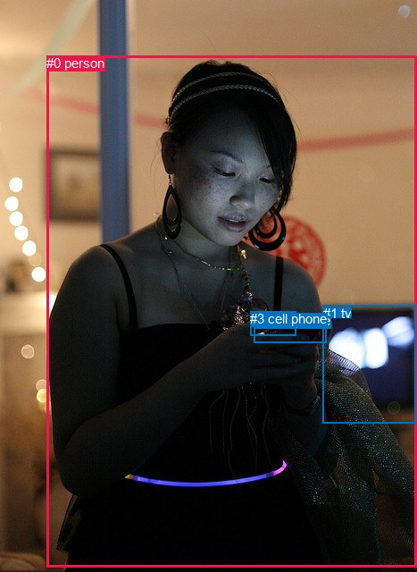
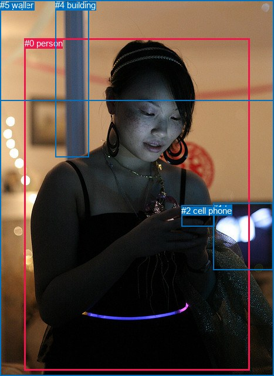

# 图片 1615：2390859.jpg

随机样本序号：450。图片 SHA256：`a5f1d3251846d66aee823f2c57f6538e0b64fd1b97e431114884db519209ca9f`。

红色框表示人，蓝色框表示其他物体。两个模式分别保留自身框编号，可依据位置比较对应对象。

## 自动检测框与输出

人的框编号：`[0]`。状态：`ok`。

### 自动检测全部物体框

| 编号 | 类别 | 是否为人 | 检测分数 | 像素坐标 xyxy |
|---|---|---|---|---|
| 0 | person | True | 0.9994 | 52.2, 62.2, 467.0, 634.1 |
| 1 | tv | False | 0.8959 | 361.6, 341.9, 465.3, 473.2 |
| 2 | cell phone | False | 0.8838 | 284.4, 350.2, 365.1, 383.5 |
| 3 | cell phone | False | 0.6750 | 280.4, 348.4, 331.1, 375.8 |

### 自动检测 Top50 人相关候选

评分物体对：12；人相关物体对：6；输出关系：12。

| 排名 | 主语编号与类别 | 关系 | 宾语编号与类别 | 类型 | 人与人 | 排序分数 | 原始融合 logit |
|---|---|---|---|---|---|---|---|
| 1 | #0 person | holding | #2 cell phone | semantic | False | 0.99415 | 5.1354 |
| 2 | #0 person | holding | #3 cell phone | semantic | False | 0.98348 | 4.0863 |
| 3 | #0 person | looking at | #1 tv | semantic | False | 0.97033 | 3.4874 |
| 4 | #0 person | on | #2 cell phone | spatial | False | 0.93898 | 2.7336 |
| 5 | #0 person | on | #3 cell phone | spatial | False | 0.93204 | 2.6184 |
| 6 | #0 person | in front of | #1 tv | spatial | False | 0.84380 | 1.6868 |
| 7 | #1 tv | beside | #0 person | spatial | False | 0.83373 | 1.6123 |
| 8 | #3 cell phone | on | #0 person | spatial | False | 0.47658 | -0.0937 |
| 9 | #2 cell phone | on | #0 person | spatial | False | 0.43353 | -0.2675 |
| 10 | #2 cell phone | holding | #0 person | semantic | False | 0.21929 | -1.2698 |
| 11 | #1 tv | playing | #0 person | semantic | False | 0.20333 | -1.3656 |
| 12 | #3 cell phone | holding | #0 person | semantic | False | 0.10919 | -2.0990 |

### 自动检测逐条人相关 GT 核验

R@50：40.00%；命中 2/5。

| GT 主语编号 | GT 关系 | GT 宾语编号 | 结果阶段 | 匹配预测主语编号 | 匹配预测宾语编号 |
|---|---|---|---|---|---|
| 0 | in front of | 1 | hit50 | [0] | [1] |
| 0 | holding | 2 | hit50 | [0] | [2] |
| 0 | looking at | 2 | wrong_predicate | [0] | [2] |
| 0 | in front of | 3 | endpoint_missing_or_wrong_class | [0] | [] |
| 0 | in front of | 4 | endpoint_missing_or_wrong_class | [0] | [] |

## 真实框与输出

人的框编号：`[0]`。

### 真实框全部物体框

| 编号 | 类别 | 是否为人 | 检测分数 | 像素坐标 xyxy |
|---|---|---|---|---|
| 0 | person | True | GT | 42.0, 65.0, 425.0, 630.0 |
| 1 | tv | False | GT | 363.0, 346.0, 465.0, 459.0 |
| 2 | cell phone | False | GT | 309.0, 350.0, 365.0, 386.0 |
| 3 | paper | False | GT | 0.0, 0.0, 467.0, 171.0 |
| 4 | building | False | GT | 94.0, 0.0, 152.0, 267.0 |
| 5 | wall | False | GT | 0.0, 0.0, 467.0, 640.0 |

### 真实框 Top50 人相关候选

评分物体对：30；人相关物体对：10；输出关系：20。

| 排名 | 主语编号与类别 | 关系 | 宾语编号与类别 | 类型 | 人与人 | 排序分数 | 原始融合 logit |
|---|---|---|---|---|---|---|---|
| 1 | #0 person | holding | #2 cell phone | semantic | False | 0.99450 | 5.1967 |
| 2 | #0 person | in | #5 wall | spatial | False | 0.96890 | 3.4389 |
| 3 | #0 person | looking at | #1 tv | semantic | False | 0.95457 | 3.0450 |
| 4 | #4 building | beside | #0 person | spatial | False | 0.91673 | 2.3988 |
| 5 | #0 person | on | #2 cell phone | spatial | False | 0.89814 | 2.1768 |
| 6 | #1 tv | beside | #0 person | spatial | False | 0.76204 | 1.1639 |
| 7 | #0 person | in front of | #1 tv | spatial | False | 0.75681 | 1.1353 |
| 8 | #0 person | looking at | #5 wall | semantic | False | 0.72374 | 0.9631 |
| 9 | #0 person | beside | #4 building | spatial | False | 0.62794 | 0.5234 |
| 10 | #2 cell phone | on | #0 person | spatial | False | 0.61042 | 0.4491 |
| 11 | #5 wall | in front of | #0 person | spatial | False | 0.59701 | 0.3930 |
| 12 | #3 paper | over | #0 person | spatial | False | 0.52172 | 0.0869 |
| 13 | #0 person | in | #3 paper | spatial | False | 0.46279 | -0.1491 |
| 14 | #2 cell phone | holding | #0 person | semantic | False | 0.45546 | -0.1786 |
| 15 | #4 building | looking at | #0 person | semantic | False | 0.38988 | -0.4478 |
| 16 | #0 person | standing on | #4 building | semantic | False | 0.36538 | -0.5521 |
| 17 | #5 wall | holding | #0 person | semantic | False | 0.35621 | -0.5918 |
| 18 | #1 tv | looking at | #0 person | semantic | False | 0.27023 | -0.9934 |
| 19 | #0 person | looking at | #3 paper | semantic | False | 0.15578 | -1.6900 |
| 20 | #3 paper | holding | #0 person | semantic | False | 0.15549 | -1.6922 |

### 真实框逐条人相关 GT 核验

R@50：40.00%；命中 2/5。

| GT 主语编号 | GT 关系 | GT 宾语编号 | 结果阶段 | 匹配预测主语编号 | 匹配预测宾语编号 |
|---|---|---|---|---|---|
| 0 | in front of | 1 | hit50 | [0] | [1] |
| 0 | holding | 2 | hit50 | [0] | [2] |
| 0 | looking at | 2 | wrong_predicate | [0] | [2] |
| 0 | in front of | 3 | wrong_predicate | [0] | [3] |
| 0 | in front of | 4 | wrong_predicate | [0] | [4] |

## 全部人相关 GT

| 主语编号与类别 | 关系 | 宾语编号与类别 |
|---|---|---|
| #0 person | in front of | #1 tv |
| #0 person | holding | #2 cell phone |
| #0 person | looking at | #2 cell phone |
| #0 person | in front of | #3 paper |
| #0 person | in front of | #4 building |

原始记录、全部人相关物体对的两项预测与分项分数见 [逐图证据 JSON](../evidence/cases/1615.json)。全部56类 logits 保留于本机 HOR/output/random500/logits/。

<!-- HOR_COMPLETE_RESULTS -->

## 六组条件的完整输出对照

以下保留同一图片三种框与候选模式、两种谓词输出规则的全部 Top50。框编号各自在所属模式内解释。

### 自动检测框完整枚举：空间与语义各保留一个谓词

| 排名 | 主语编号与类别 | 谓词 | 宾语编号与类别 | 分组 | 排序分数 | predicate logit | pair logit |
|---|---|---|---|---|---|---|---|
| 1 | #0 person | holding | #2 cell phone | semantic | 0.9941500 | 4.4807124 | 0.6547269 |
| 2 | #0 person | holding | #3 cell phone | semantic | 0.9834767 | 3.6536870 | 0.4326361 |
| 3 | #0 person | looking at | #1 tv | semantic | 0.9703279 | 3.8306966 | -0.3432713 |
| 4 | #0 person | on | #2 cell phone | spatial | 0.9389827 | 2.0789142 | 0.6547269 |
| 5 | #0 person | on | #3 cell phone | spatial | 0.9320395 | 2.1858125 | 0.4326361 |
| 6 | #0 person | in front of | #1 tv | spatial | 0.8438047 | 2.0300856 | -0.3432713 |
| 7 | #1 tv | beside | #0 person | spatial | 0.8337273 | 1.9656463 | -0.3533693 |
| 8 | #3 cell phone | on | #0 person | spatial | 0.4765849 | 0.5282445 | -0.6219732 |
| 9 | #2 cell phone | on | #0 person | spatial | 0.4335287 | 0.4620376 | -0.7295061 |
| 10 | #2 cell phone | holding | #0 person | semantic | 0.2192878 | -0.5403156 | -0.7295061 |
| 11 | #1 tv | playing | #0 person | semantic | 0.2033304 | -1.0122387 | -0.3533693 |
| 12 | #3 cell phone | holding | #0 person | semantic | 0.1091941 | -1.4770262 | -0.6219732 |

GT 命中：2/5，R@50=40.00%。

| GT主语 | GT谓词 | GT宾语 | 结果阶段 | 匹配主语框 | 匹配宾语框 |
|---|---|---|---|---|---|
| 0 | in front of | 1 | hit50 | [0] | [1] |
| 0 | holding | 2 | hit50 | [0] | [2] |
| 0 | looking at | 2 | wrong_predicate | [0] | [2] |
| 0 | in front of | 3 | endpoint_missing_or_wrong_class | [0] | [] |
| 0 | in front of | 4 | endpoint_missing_or_wrong_class | [0] | [] |

### 自动检测框完整枚举：每对只保留一个谓词

| 排名 | 主语编号与类别 | 谓词 | 宾语编号与类别 | 分组 | 排序分数 | predicate logit | pair logit |
|---|---|---|---|---|---|---|---|
| 1 | #0 person | holding | #2 cell phone | single | 0.9941500 | 4.4807124 | 0.6547269 |
| 2 | #0 person | holding | #3 cell phone | single | 0.9834767 | 3.6536870 | 0.4326361 |
| 3 | #0 person | looking at | #1 tv | single | 0.9703279 | 3.8306966 | -0.3432713 |
| 4 | #1 tv | beside | #0 person | single | 0.8337273 | 1.9656463 | -0.3533693 |
| 5 | #3 cell phone | on | #0 person | single | 0.4765849 | 0.5282445 | -0.6219732 |
| 6 | #2 cell phone | on | #0 person | single | 0.4335287 | 0.4620376 | -0.7295061 |

GT 命中：1/5，R@50=20.00%。

| GT主语 | GT谓词 | GT宾语 | 结果阶段 | 匹配主语框 | 匹配宾语框 |
|---|---|---|---|---|---|
| 0 | in front of | 1 | wrong_predicate | [0] | [1] |
| 0 | holding | 2 | hit50 | [0] | [2] |
| 0 | looking at | 2 | wrong_predicate | [0] | [2] |
| 0 | in front of | 3 | endpoint_missing_or_wrong_class | [0] | [] |
| 0 | in front of | 4 | endpoint_missing_or_wrong_class | [0] | [] |

### 真实框完整枚举：空间与语义各保留一个谓词

| 排名 | 主语编号与类别 | 谓词 | 宾语编号与类别 | 分组 | 排序分数 | predicate logit | pair logit |
|---|---|---|---|---|---|---|---|
| 1 | #0 person | holding | #2 cell phone | semantic | 0.9944956 | 4.5457053 | 0.6509740 |
| 2 | #0 person | in | #5 wall | spatial | 0.9688972 | 3.2580895 | 0.1807702 |
| 3 | #0 person | looking at | #1 tv | semantic | 0.9545658 | 3.4758763 | -0.4308850 |
| 4 | #4 building | beside | #0 person | spatial | 0.9167346 | 2.4791636 | -0.0803787 |
| 5 | #0 person | on | #2 cell phone | spatial | 0.8981447 | 1.5258031 | 0.6509740 |
| 6 | #1 tv | beside | #0 person | spatial | 0.7620409 | 1.5455832 | -0.3816817 |
| 7 | #0 person | in front of | #1 tv | spatial | 0.7568106 | 1.5661573 | -0.4308850 |
| 8 | #0 person | looking at | #5 wall | semantic | 0.7237374 | 0.7823067 | 0.1807702 |
| 9 | #0 person | beside | #4 building | spatial | 0.6279422 | 1.4600511 | -0.9366522 |
| 10 | #2 cell phone | on | #0 person | spatial | 0.6104205 | 1.2208943 | -0.7718145 |
| 11 | #5 wall | in front of | #0 person | spatial | 0.5970073 | 0.7284846 | -0.3354736 |
| 12 | #3 paper | over | #0 person | spatial | 0.5217212 | 0.5344896 | -0.4475502 |
| 13 | #0 person | in | #3 paper | spatial | 0.4627906 | 0.6640501 | -0.8131634 |
| 14 | #2 cell phone | holding | #0 person | semantic | 0.4554626 | 0.5931916 | -0.7718145 |
| 15 | #4 building | looking at | #0 person | semantic | 0.3898804 | -0.3674364 | -0.0803787 |
| 16 | #0 person | standing on | #4 building | semantic | 0.3653792 | 0.3845601 | -0.9366522 |
| 17 | #5 wall | holding | #0 person | semantic | 0.3562120 | -0.2563696 | -0.3354736 |
| 18 | #1 tv | looking at | #0 person | semantic | 0.2702326 | -0.6117611 | -0.3816817 |
| 19 | #0 person | looking at | #3 paper | semantic | 0.1557752 | -0.8768411 | -0.8131634 |
| 20 | #3 paper | holding | #0 person | semantic | 0.1554919 | -1.2446101 | -0.4475502 |

GT 命中：2/5，R@50=40.00%。

| GT主语 | GT谓词 | GT宾语 | 结果阶段 | 匹配主语框 | 匹配宾语框 |
|---|---|---|---|---|---|
| 0 | in front of | 1 | hit50 | [0] | [1] |
| 0 | holding | 2 | hit50 | [0] | [2] |
| 0 | looking at | 2 | wrong_predicate | [0] | [2] |
| 0 | in front of | 3 | wrong_predicate | [0] | [3] |
| 0 | in front of | 4 | wrong_predicate | [0] | [4] |

### 真实框完整枚举：每对只保留一个谓词

| 排名 | 主语编号与类别 | 谓词 | 宾语编号与类别 | 分组 | 排序分数 | predicate logit | pair logit |
|---|---|---|---|---|---|---|---|
| 1 | #0 person | holding | #2 cell phone | single | 0.9944956 | 4.5457053 | 0.6509740 |
| 2 | #0 person | in | #5 wall | single | 0.9688972 | 3.2580895 | 0.1807702 |
| 3 | #0 person | looking at | #1 tv | single | 0.9545658 | 3.4758763 | -0.4308850 |
| 4 | #4 building | beside | #0 person | single | 0.9167346 | 2.4791636 | -0.0803787 |
| 5 | #1 tv | beside | #0 person | single | 0.7620409 | 1.5455832 | -0.3816817 |
| 6 | #0 person | beside | #4 building | single | 0.6279422 | 1.4600511 | -0.9366522 |
| 7 | #2 cell phone | on | #0 person | single | 0.6104205 | 1.2208943 | -0.7718145 |
| 8 | #5 wall | in front of | #0 person | single | 0.5970073 | 0.7284846 | -0.3354736 |
| 9 | #3 paper | over | #0 person | single | 0.5217212 | 0.5344896 | -0.4475502 |
| 10 | #0 person | in | #3 paper | single | 0.4627906 | 0.6640501 | -0.8131634 |

GT 命中：1/5，R@50=20.00%。

| GT主语 | GT谓词 | GT宾语 | 结果阶段 | 匹配主语框 | 匹配宾语框 |
|---|---|---|---|---|---|
| 0 | in front of | 1 | wrong_predicate | [0] | [1] |
| 0 | holding | 2 | hit50 | [0] | [2] |
| 0 | looking at | 2 | wrong_predicate | [0] | [2] |
| 0 | in front of | 3 | wrong_predicate | [0] | [3] |
| 0 | in front of | 4 | wrong_predicate | [0] | [4] |

### 真实框400候选：空间与语义各保留一个谓词

| 排名 | 主语编号与类别 | 谓词 | 宾语编号与类别 | 分组 | 排序分数 | predicate logit | pair logit |
|---|---|---|---|---|---|---|---|
| 1 | #0 person | holding | #2 cell phone | semantic | 0.9944956 | 4.5457053 | 0.6509740 |
| 2 | #0 person | in | #5 wall | spatial | 0.9688972 | 3.2580895 | 0.1807702 |
| 3 | #0 person | looking at | #1 tv | semantic | 0.9545658 | 3.4758763 | -0.4308850 |
| 4 | #4 building | beside | #0 person | spatial | 0.9189944 | 2.5091391 | -0.0803787 |
| 5 | #0 person | on | #2 cell phone | spatial | 0.8981447 | 1.5258031 | 0.6509740 |
| 6 | #1 tv | beside | #0 person | spatial | 0.7620513 | 1.5456409 | -0.3816817 |
| 7 | #0 person | in front of | #1 tv | spatial | 0.7568387 | 1.5663104 | -0.4308850 |
| 8 | #0 person | looking at | #5 wall | semantic | 0.7237374 | 0.7823067 | 0.1807702 |
| 9 | #0 person | beside | #4 building | spatial | 0.6279693 | 1.4601669 | -0.9366522 |
| 10 | #2 cell phone | on | #0 person | spatial | 0.6104205 | 1.2208943 | -0.7718145 |
| 11 | #5 wall | in front of | #0 person | spatial | 0.5971432 | 0.7290492 | -0.3354736 |
| 12 | #3 paper | over | #0 person | spatial | 0.5210612 | 0.5318451 | -0.4475502 |
| 13 | #0 person | in | #3 paper | spatial | 0.4702796 | 0.6941414 | -0.8131634 |
| 14 | #2 cell phone | holding | #0 person | semantic | 0.4494717 | 0.5690088 | -0.7718145 |
| 15 | #4 building | looking at | #0 person | semantic | 0.3898804 | -0.3674364 | -0.0803787 |
| 16 | #0 person | standing on | #4 building | semantic | 0.3618150 | 0.3691568 | -0.9366522 |
| 17 | #5 wall | holding | #0 person | semantic | 0.3610951 | -0.2351408 | -0.3354736 |
| 18 | #1 tv | looking at | #0 person | semantic | 0.2760682 | -0.5823674 | -0.3816817 |
| 19 | #0 person | looking at | #3 paper | semantic | 0.1577641 | -0.8617957 | -0.8131634 |
| 20 | #3 paper | holding | #0 person | semantic | 0.1552981 | -1.2460871 | -0.4475502 |

GT 命中：2/5，R@50=40.00%。

| GT主语 | GT谓词 | GT宾语 | 结果阶段 | 匹配主语框 | 匹配宾语框 |
|---|---|---|---|---|---|
| 0 | in front of | 1 | hit50 | [0] | [1] |
| 0 | holding | 2 | hit50 | [0] | [2] |
| 0 | looking at | 2 | wrong_predicate | [0] | [2] |
| 0 | in front of | 3 | wrong_predicate | [0] | [3] |
| 0 | in front of | 4 | wrong_predicate | [0] | [4] |

### 真实框400候选：每对只保留一个谓词

| 排名 | 主语编号与类别 | 谓词 | 宾语编号与类别 | 分组 | 排序分数 | predicate logit | pair logit |
|---|---|---|---|---|---|---|---|
| 1 | #0 person | holding | #2 cell phone | single | 0.9944956 | 4.5457053 | 0.6509740 |
| 2 | #0 person | in | #5 wall | single | 0.9688972 | 3.2580895 | 0.1807702 |
| 3 | #0 person | looking at | #1 tv | single | 0.9545658 | 3.4758763 | -0.4308850 |
| 4 | #4 building | beside | #0 person | single | 0.9189944 | 2.5091391 | -0.0803787 |
| 5 | #1 tv | beside | #0 person | single | 0.7620513 | 1.5456409 | -0.3816817 |
| 6 | #0 person | beside | #4 building | single | 0.6279693 | 1.4601669 | -0.9366522 |
| 7 | #2 cell phone | on | #0 person | single | 0.6104205 | 1.2208943 | -0.7718145 |
| 8 | #5 wall | in front of | #0 person | single | 0.5971432 | 0.7290492 | -0.3354736 |
| 9 | #3 paper | over | #0 person | single | 0.5210612 | 0.5318451 | -0.4475502 |
| 10 | #0 person | in | #3 paper | single | 0.4702796 | 0.6941414 | -0.8131634 |

GT 命中：1/5，R@50=20.00%。

| GT主语 | GT谓词 | GT宾语 | 结果阶段 | 匹配主语框 | 匹配宾语框 |
|---|---|---|---|---|---|
| 0 | in front of | 1 | wrong_predicate | [0] | [1] |
| 0 | holding | 2 | hit50 | [0] | [2] |
| 0 | looking at | 2 | wrong_predicate | [0] | [2] |
| 0 | in front of | 3 | wrong_predicate | [0] | [3] |
| 0 | in front of | 4 | wrong_predicate | [0] | [4] |
