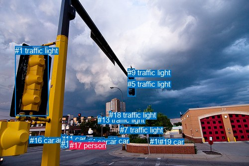
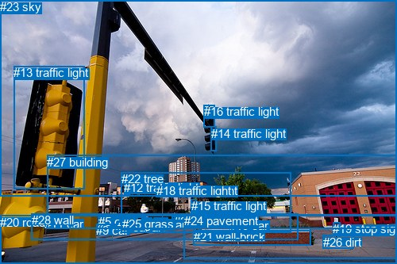

# 图片 1625：2391273.jpg

随机样本序号：142。图片 SHA256：`59fca33672badaf0c9f0006ba0d1bcff367ea3cc25d2ba97af8eaaed3261c282`。

红色框表示人，蓝色框表示其他物体。两个模式分别保留自身框编号，可依据位置比较对应对象。

## 自动检测框与输出

人的框编号：`[17]`。状态：`ok`。

### 自动检测全部物体框

| 编号 | 类别 | 是否为人 | 检测分数 | 像素坐标 xyxy |
|---|---|---|---|---|
| 0 | car | False | 0.9932 | 218.0, 273.9, 235.3, 283.1 |
| 1 | traffic light | False | 0.9892 | 30.2, 92.6, 97.5, 232.3 |
| 2 | car | False | 0.9875 | 192.7, 275.4, 210.9, 285.0 |
| 3 | car | False | 0.9799 | 161.5, 280.2, 184.9, 289.8 |
| 4 | car | False | 0.9734 | 175.7, 275.5, 193.0, 284.8 |
| 5 | traffic light | False | 0.9651 | 256.4, 159.6, 272.3, 193.5 |
| 6 | car | False | 0.9644 | 147.0, 278.4, 167.2, 289.0 |
| 7 | traffic light | False | 0.9583 | 240.7, 251.7, 247.1, 266.3 |
| 8 | car | False | 0.9541 | 121.0, 282.5, 143.6, 296.7 |
| 9 | traffic light | False | 0.9106 | 256.1, 137.1, 270.4, 162.0 |
| 10 | car | False | 0.8974 | 301.2, 275.3, 322.4, 287.1 |
| 11 | car | False | 0.7845 | 122.7, 269.7, 132.5, 277.9 |
| 12 | car | False | 0.7681 | 58.5, 273.7, 70.9, 282.6 |
| 13 | traffic light | False | 0.7511 | 196.3, 232.0, 202.0, 245.1 |
| 14 | car | False | 0.6426 | 75.5, 272.3, 88.8, 281.2 |
| 15 | car | False | 0.5957 | 122.8, 278.6, 143.2, 285.2 |
| 16 | car | False | 0.5218 | 59.9, 273.4, 79.2, 282.8 |
| 17 | person | True | 0.5128 | 140.0, 283.0, 145.8, 294.4 |
| 18 | traffic light | False | 0.4689 | 219.1, 222.1, 223.9, 232.4 |
| 19 | car | False | 0.3513 | 319.6, 275.8, 329.7, 282.9 |

### 自动检测 Top50 人相关候选

评分物体对：380；人相关物体对：38；输出关系：50。

| 排名 | 主语编号与类别 | 关系 | 宾语编号与类别 | 类型 | 人与人 | 排序分数 | 原始融合 logit |
|---|---|---|---|---|---|---|---|
| 1 | #17 person | on | #15 car | spatial | False | 0.80111 | 1.3933 |
| 2 | #17 person | on | #8 car | spatial | False | 0.79920 | 1.3813 |
| 3 | #17 person | on | #6 car | spatial | False | 0.59475 | 0.3836 |
| 4 | #11 car | on | #17 person | spatial | False | 0.55406 | 0.2171 |
| 5 | #17 person | driving on | #8 car | semantic | False | 0.50322 | 0.0129 |
| 6 | #15 car | parked on | #17 person | semantic | False | 0.48849 | -0.0461 |
| 7 | #15 car | on | #17 person | spatial | False | 0.48636 | -0.0546 |
| 8 | #17 person | driving on | #15 car | semantic | False | 0.31060 | -0.7973 |
| 9 | #17 person | on | #3 car | spatial | False | 0.28938 | -0.8984 |
| 10 | #17 person | on | #0 car | spatial | False | 0.28704 | -0.9098 |
| 11 | #11 car | parked on | #17 person | semantic | False | 0.28106 | -0.9392 |
| 12 | #17 person | parked on | #6 car | semantic | False | 0.27631 | -0.9628 |
| 13 | #17 person | on | #2 car | spatial | False | 0.25905 | -1.0509 |
| 14 | #6 car | on | #17 person | spatial | False | 0.24318 | -1.1353 |
| 15 | #8 car | on | #17 person | spatial | False | 0.24304 | -1.1361 |
| 16 | #17 person | parked on | #0 car | semantic | False | 0.20897 | -1.3311 |
| 17 | #17 person | parked on | #2 car | semantic | False | 0.19217 | -1.4360 |
| 18 | #8 car | parked on | #17 person | semantic | False | 0.17706 | -1.5364 |
| 19 | #17 person | parked on | #3 car | semantic | False | 0.16193 | -1.6439 |
| 20 | #6 car | parked on | #17 person | semantic | False | 0.16093 | -1.6514 |
| 21 | #17 person | on | #4 car | spatial | False | 0.15027 | -1.7325 |
| 22 | #17 person | on | #11 car | spatial | False | 0.14292 | -1.7912 |
| 23 | #3 car | on | #17 person | spatial | False | 0.12646 | -1.9326 |
| 24 | #3 car | parked on | #17 person | semantic | False | 0.09032 | -2.3097 |
| 25 | #17 person | parked on | #4 car | semantic | False | 0.08957 | -2.3189 |
| 26 | #17 person | driving | #7 traffic light | semantic | False | 0.08734 | -2.3466 |
| 27 | #17 person | in | #13 traffic light | spatial | False | 0.07970 | -2.4464 |
| 28 | #17 person | on | #7 traffic light | spatial | False | 0.07297 | -2.5419 |
| 29 | #4 car | on | #17 person | spatial | False | 0.06963 | -2.5924 |
| 30 | #17 person | on | #14 car | spatial | False | 0.06837 | -2.6119 |
| 31 | #10 car | parked on | #17 person | semantic | False | 0.06372 | -2.6874 |
| 32 | #19 car | parked on | #17 person | semantic | False | 0.06276 | -2.7036 |
| 33 | #4 car | parked on | #17 person | semantic | False | 0.06144 | -2.7262 |
| 34 | #2 car | on | #17 person | spatial | False | 0.05867 | -2.7753 |
| 35 | #2 car | parked on | #17 person | semantic | False | 0.05350 | -2.8731 |
| 36 | #17 person | in | #18 traffic light | spatial | False | 0.05159 | -2.9115 |
| 37 | #17 person | driving | #13 traffic light | semantic | False | 0.04686 | -3.0125 |
| 38 | #17 person | looking at | #9 traffic light | semantic | False | 0.04489 | -3.0576 |
| 39 | #19 car | on | #17 person | spatial | False | 0.04413 | -3.0755 |
| 40 | #14 car | on | #17 person | spatial | False | 0.04362 | -3.0876 |
| 41 | #1 traffic light | on | #17 person | spatial | False | 0.04316 | -3.0987 |
| 42 | #17 person | driving | #5 traffic light | semantic | False | 0.03719 | -3.2539 |
| 43 | #10 car | on | #17 person | spatial | False | 0.03618 | -3.2824 |
| 44 | #17 person | on | #9 traffic light | spatial | False | 0.03588 | -3.2911 |
| 45 | #9 traffic light | on | #17 person | spatial | False | 0.03431 | -3.3375 |
| 46 | #18 traffic light | on | #17 person | spatial | False | 0.03223 | -3.4020 |
| 47 | #0 car | on | #17 person | spatial | False | 0.03190 | -3.4126 |
| 48 | #17 person | on | #5 traffic light | spatial | False | 0.03105 | -3.4405 |
| 49 | #17 person | driving | #18 traffic light | semantic | False | 0.03086 | -3.4468 |
| 50 | #17 person | on | #10 car | spatial | False | 0.03003 | -3.4752 |

### 自动检测逐条人相关 GT 核验

本图没有人相关 GT，R@50 无分母；预测候选继续展示。

## 真实框与输出

人的框编号：`[]`。

### 真实框全部物体框

| 编号 | 类别 | 是否为人 | 检测分数 | 像素坐标 xyxy |
|---|---|---|---|---|
| 0 | car | False | GT | 217.0, 273.0, 235.0, 283.0 |
| 1 | car | False | GT | 179.0, 275.0, 192.0, 283.0 |
| 2 | car | False | GT | 219.0, 271.0, 229.0, 276.0 |
| 3 | car | False | GT | 163.0, 278.0, 186.0, 289.0 |
| 4 | car | False | GT | 132.0, 271.0, 139.0, 276.0 |
| 5 | car | False | GT | 124.0, 271.0, 131.0, 277.0 |
| 6 | car | False | GT | 243.0, 267.0, 249.0, 271.0 |
| 7 | car | False | GT | 193.0, 275.0, 211.0, 285.0 |
| 8 | car | False | GT | 147.0, 278.0, 165.0, 290.0 |
| 9 | car | False | GT | 121.0, 282.0, 147.0, 296.0 |
| 10 | car | False | GT | 289.0, 276.0, 320.0, 288.0 |
| 11 | car | False | GT | 56.0, 274.0, 75.0, 283.0 |
| 12 | traffic light | False | GT | 156.0, 228.0, 163.0, 247.0 |
| 13 | traffic light | False | GT | 17.0, 83.0, 106.0, 238.0 |
| 14 | traffic light | False | GT | 266.0, 160.0, 273.0, 191.0 |
| 15 | traffic light | False | GT | 241.0, 251.0, 248.0, 267.0 |
| 16 | traffic light | False | GT | 257.0, 132.0, 271.0, 160.0 |
| 17 | traffic light | False | GT | 205.0, 232.0, 208.0, 240.0 |
| 18 | traffic light | False | GT | 197.0, 232.0, 202.0, 245.0 |
| 19 | stop sign | False | GT | 419.0, 280.0, 428.0, 290.0 |
| 20 | road | False | GT | 0.0, 272.0, 500.0, 333.0 |
| 21 | wall-brick | False | GT | 244.0, 290.0, 392.0, 309.0 |
| 22 | tree | False | GT | 153.0, 217.0, 367.0, 293.0 |
| 23 | sky | False | GT | 0.0, 0.0, 500.0, 248.0 |
| 24 | pavement | False | GT | 232.0, 270.0, 500.0, 326.0 |
| 25 | grass | False | GT | 154.0, 274.0, 183.0, 290.0 |
| 26 | dirt | False | GT | 407.0, 297.0, 446.0, 314.0 |
| 27 | building | False | GT | 59.0, 196.0, 500.0, 289.0 |
| 28 | wall | False | GT | 40.0, 269.0, 375.0, 302.0 |

### 真实框 Top50 人相关候选

评分物体对：0；人相关物体对：0；输出关系：0。

| 排名 | 主语编号与类别 | 关系 | 宾语编号与类别 | 类型 | 人与人 | 排序分数 | 原始融合 logit |
|---|---|---|---|---|---|---|---|

### 真实框逐条人相关 GT 核验

本图没有人相关 GT，R@50 无分母；预测候选继续展示。

## 全部人相关 GT

| 主语编号与类别 | 关系 | 宾语编号与类别 |
|---|---|---|

原始记录、全部人相关物体对的两项预测与分项分数见 [逐图证据 JSON](../evidence/cases/1625.json)。全部56类 logits 保留于本机 HOR/output/random500/logits/。

<!-- HOR_COMPLETE_RESULTS -->

## 六组条件的完整输出对照

以下保留同一图片三种框与候选模式、两种谓词输出规则的全部 Top50。框编号各自在所属模式内解释。

### 自动检测框完整枚举：空间与语义各保留一个谓词

| 排名 | 主语编号与类别 | 谓词 | 宾语编号与类别 | 分组 | 排序分数 | predicate logit | pair logit |
|---|---|---|---|---|---|---|---|
| 1 | #17 person | on | #15 car | spatial | 0.8011128 | 2.3371944 | -0.9439305 |
| 2 | #17 person | on | #8 car | spatial | 0.7992049 | 2.2667007 | -0.8853683 |
| 3 | #17 person | on | #6 car | spatial | 0.5947498 | 1.2808437 | -0.8972077 |
| 4 | #11 car | on | #17 person | spatial | 0.5540642 | 1.0905647 | -0.8734590 |
| 5 | #17 person | driving on | #8 car | semantic | 0.5032243 | 0.8982654 | -0.8853683 |
| 6 | #15 car | parked on | #17 person | semantic | 0.4884860 | 0.8657961 | -0.9118602 |
| 7 | #15 car | on | #17 person | spatial | 0.4863578 | 0.8572779 | -0.9118602 |
| 8 | #17 person | driving on | #15 car | semantic | 0.3106003 | 0.1466165 | -0.9439305 |
| 9 | #17 person | on | #3 car | spatial | 0.2893812 | -0.0427365 | -0.8556546 |
| 10 | #17 person | on | #0 car | spatial | 0.2870391 | 0.3554587 | -1.2652668 |
| 11 | #11 car | parked on | #17 person | semantic | 0.2810629 | -0.0657363 | -0.8734590 |
| 12 | #17 person | parked on | #6 car | semantic | 0.2763104 | -0.0656300 | -0.8972077 |
| 13 | #17 person | on | #2 car | spatial | 0.2590499 | 0.1381006 | -1.1890132 |
| 14 | #6 car | on | #17 person | spatial | 0.2431809 | -0.2123947 | -0.9229238 |
| 15 | #8 car | on | #17 person | spatial | 0.2430389 | -0.2673059 | -0.8687844 |
| 16 | #17 person | parked on | #0 car | semantic | 0.2089746 | -0.0658507 | -1.2652668 |
| 17 | #17 person | parked on | #2 car | semantic | 0.1921657 | -0.2469854 | -1.1890132 |
| 18 | #8 car | parked on | #17 person | semantic | 0.1770571 | -0.6676302 | -0.8687844 |
| 19 | #17 person | parked on | #3 car | semantic | 0.1619308 | -0.7882771 | -0.8556546 |
| 20 | #6 car | parked on | #17 person | semantic | 0.1609265 | -0.7284265 | -0.9229238 |
| 21 | #17 person | on | #4 car | spatial | 0.1502713 | -0.6681366 | -1.0643380 |
| 22 | #17 person | on | #11 car | spatial | 0.1429241 | -0.8241243 | -0.9670883 |
| 23 | #3 car | on | #17 person | spatial | 0.1264597 | -0.9980686 | -0.9345624 |
| 24 | #3 car | parked on | #17 person | semantic | 0.0903198 | -1.3751738 | -0.9345624 |
| 25 | #17 person | parked on | #4 car | semantic | 0.0895734 | -1.2545164 | -1.0643380 |
| 26 | #17 person | driving | #7 traffic light | semantic | 0.0873364 | -0.9811780 | -1.3654226 |
| 27 | #17 person | in | #13 traffic light | spatial | 0.0797049 | -1.3175945 | -1.1287688 |
| 28 | #17 person | on | #7 traffic light | spatial | 0.0729709 | -1.1765015 | -1.3654226 |
| 29 | #4 car | on | #17 person | spatial | 0.0696282 | -1.6027176 | -0.9896972 |
| 30 | #17 person | on | #14 car | spatial | 0.0683739 | -1.4933288 | -1.1186121 |
| 31 | #10 car | parked on | #17 person | semantic | 0.0637192 | -1.1197317 | -1.5676985 |
| 32 | #19 car | parked on | #17 person | semantic | 0.0627622 | -1.1649561 | -1.5386281 |
| 33 | #4 car | parked on | #17 person | semantic | 0.0614421 | -1.7365518 | -0.9896972 |
| 34 | #2 car | on | #17 person | spatial | 0.0586748 | -1.7439351 | -1.0313436 |
| 35 | #2 car | parked on | #17 person | semantic | 0.0534987 | -1.8417721 | -1.0313436 |
| 36 | #17 person | in | #18 traffic light | spatial | 0.0515876 | -1.6944733 | -1.2170337 |
| 37 | #17 person | driving | #13 traffic light | semantic | 0.0468637 | -1.8837457 | -1.1287688 |
| 38 | #17 person | looking at | #9 traffic light | semantic | 0.0448903 | -1.6399961 | -1.4176085 |
| 39 | #19 car | on | #17 person | spatial | 0.0441283 | -1.5368950 | -1.5386281 |
| 40 | #14 car | on | #17 person | spatial | 0.0436231 | -1.8796568 | -1.2079096 |
| 41 | #1 traffic light | on | #17 person | spatial | 0.0431614 | -1.5603681 | -1.5383205 |
| 42 | #17 person | driving | #5 traffic light | semantic | 0.0371860 | -1.8689215 | -1.3850069 |
| 43 | #10 car | on | #17 person | spatial | 0.0361811 | -1.7146692 | -1.5676985 |
| 44 | #17 person | on | #9 traffic light | spatial | 0.0358782 | -1.8734801 | -1.4176085 |
| 45 | #9 traffic light | on | #17 person | spatial | 0.0343080 | -1.9454944 | -1.3919730 |
| 46 | #18 traffic light | on | #17 person | spatial | 0.0322320 | -1.9820800 | -1.4199535 |
| 47 | #0 car | on | #17 person | spatial | 0.0319033 | -2.2493606 | -1.1632606 |
| 48 | #17 person | on | #5 traffic light | spatial | 0.0310544 | -2.0554612 | -1.3850069 |
| 49 | #17 person | driving | #18 traffic light | semantic | 0.0308640 | -2.2297800 | -1.2170337 |
| 50 | #17 person | on | #10 car | spatial | 0.0300261 | -1.9992471 | -1.4759537 |

没有人相关 GT，本条件的召回率无分母。

### 自动检测框完整枚举：每对只保留一个谓词

| 排名 | 主语编号与类别 | 谓词 | 宾语编号与类别 | 分组 | 排序分数 | predicate logit | pair logit |
|---|---|---|---|---|---|---|---|
| 1 | #17 person | on | #15 car | single | 0.8011128 | 2.3371944 | -0.9439305 |
| 2 | #17 person | on | #8 car | single | 0.7992049 | 2.2667007 | -0.8853683 |
| 3 | #17 person | on | #6 car | single | 0.5947498 | 1.2808437 | -0.8972077 |
| 4 | #11 car | on | #17 person | single | 0.5540642 | 1.0905647 | -0.8734590 |
| 5 | #15 car | parked on | #17 person | single | 0.4884860 | 0.8657961 | -0.9118602 |
| 6 | #17 person | on | #3 car | single | 0.2893812 | -0.0427365 | -0.8556546 |
| 7 | #17 person | on | #0 car | single | 0.2870391 | 0.3554587 | -1.2652668 |
| 8 | #17 person | on | #2 car | single | 0.2590499 | 0.1381006 | -1.1890132 |
| 9 | #6 car | on | #17 person | single | 0.2431809 | -0.2123947 | -0.9229238 |
| 10 | #8 car | on | #17 person | single | 0.2430389 | -0.2673059 | -0.8687844 |
| 11 | #17 person | on | #4 car | single | 0.1502713 | -0.6681366 | -1.0643380 |
| 12 | #17 person | on | #11 car | single | 0.1429241 | -0.8241243 | -0.9670883 |
| 13 | #3 car | on | #17 person | single | 0.1264597 | -0.9980686 | -0.9345624 |
| 14 | #17 person | driving | #7 traffic light | single | 0.0873364 | -0.9811780 | -1.3654226 |
| 15 | #17 person | in | #13 traffic light | single | 0.0797049 | -1.3175945 | -1.1287688 |
| 16 | #4 car | on | #17 person | single | 0.0696282 | -1.6027176 | -0.9896972 |
| 17 | #17 person | on | #14 car | single | 0.0683739 | -1.4933288 | -1.1186121 |
| 18 | #10 car | parked on | #17 person | single | 0.0637192 | -1.1197317 | -1.5676985 |
| 19 | #19 car | parked on | #17 person | single | 0.0627622 | -1.1649561 | -1.5386281 |
| 20 | #2 car | on | #17 person | single | 0.0586748 | -1.7439351 | -1.0313436 |
| 21 | #17 person | in | #18 traffic light | single | 0.0515876 | -1.6944733 | -1.2170337 |
| 22 | #17 person | looking at | #9 traffic light | single | 0.0448903 | -1.6399961 | -1.4176085 |
| 23 | #14 car | on | #17 person | single | 0.0436231 | -1.8796568 | -1.2079096 |
| 24 | #1 traffic light | on | #17 person | single | 0.0431614 | -1.5603681 | -1.5383205 |
| 25 | #17 person | driving | #5 traffic light | single | 0.0371860 | -1.8689215 | -1.3850069 |
| 26 | #9 traffic light | on | #17 person | single | 0.0343080 | -1.9454944 | -1.3919730 |
| 27 | #18 traffic light | on | #17 person | single | 0.0322320 | -1.9820800 | -1.4199535 |
| 28 | #0 car | on | #17 person | single | 0.0319033 | -2.2493606 | -1.1632606 |
| 29 | #17 person | on | #10 car | single | 0.0300261 | -1.9992471 | -1.4759537 |
| 30 | #17 person | parked on | #19 car | single | 0.0288644 | -2.0670350 | -1.4488230 |
| 31 | #17 person | driving | #1 traffic light | single | 0.0277663 | -2.3351460 | -1.2206272 |
| 32 | #13 traffic light | on | #17 person | single | 0.0270790 | -2.3840616 | -1.1974835 |
| 33 | #5 traffic light | on | #17 person | single | 0.0201188 | -2.7717152 | -1.1140611 |
| 34 | #16 car | on | #17 person | single | 0.0198141 | -2.4674714 | -1.4338751 |
| 35 | #12 car | on | #17 person | single | 0.0174787 | -2.5545158 | -1.4746206 |
| 36 | #17 person | on | #16 car | single | 0.0157123 | -2.5509822 | -1.5864911 |
| 37 | #17 person | on | #12 car | single | 0.0136009 | -2.6312666 | -1.6526597 |
| 38 | #7 traffic light | on | #17 person | single | 0.0134048 | -2.9008265 | -1.3978221 |

没有人相关 GT，本条件的召回率无分母。

### 真实框完整枚举：空间与语义各保留一个谓词

| 排名 | 主语编号与类别 | 谓词 | 宾语编号与类别 | 分组 | 排序分数 | predicate logit | pair logit |
|---|---|---|---|---|---|---|---|

没有人相关 GT，本条件的召回率无分母。

### 真实框完整枚举：每对只保留一个谓词

| 排名 | 主语编号与类别 | 谓词 | 宾语编号与类别 | 分组 | 排序分数 | predicate logit | pair logit |
|---|---|---|---|---|---|---|---|

没有人相关 GT，本条件的召回率无分母。

### 真实框400候选：空间与语义各保留一个谓词

| 排名 | 主语编号与类别 | 谓词 | 宾语编号与类别 | 分组 | 排序分数 | predicate logit | pair logit |
|---|---|---|---|---|---|---|---|

没有人相关 GT，本条件的召回率无分母。

### 真实框400候选：每对只保留一个谓词

| 排名 | 主语编号与类别 | 谓词 | 宾语编号与类别 | 分组 | 排序分数 | predicate logit | pair logit |
|---|---|---|---|---|---|---|---|

没有人相关 GT，本条件的召回率无分母。
