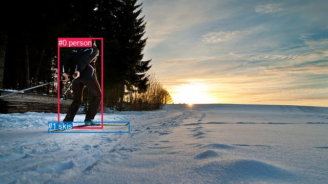
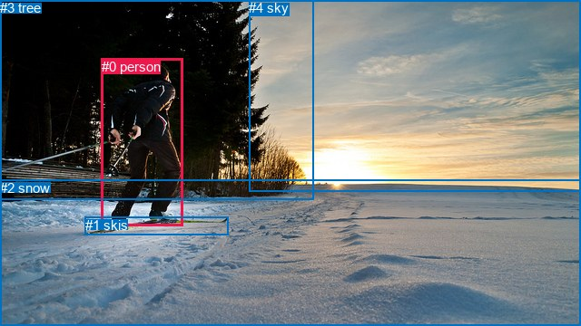

# 图片 1627：2391314.jpg

随机样本序号：53。图片 SHA256：`056e8129d96d26c72729b82719b36e208a5b7c2d8def853424be7a44ca215a33`。

红色框表示人，蓝色框表示其他物体。两个模式分别保留自身框编号，可依据位置比较对应对象。

## 自动检测框与输出

人的框编号：`[0]`。状态：`ok`。

### 自动检测全部物体框

| 编号 | 类别 | 是否为人 | 检测分数 | 像素坐标 xyxy |
|---|---|---|---|---|
| 0 | person | True | 0.9995 | 113.8, 74.9, 200.9, 251.5 |
| 1 | skis | False | 0.9338 | 94.2, 238.3, 252.1, 259.6 |

### 自动检测 Top50 人相关候选

评分物体对：2；人相关物体对：2；输出关系：4。

| 排名 | 主语编号与类别 | 关系 | 宾语编号与类别 | 类型 | 人与人 | 排序分数 | 原始融合 logit |
|---|---|---|---|---|---|---|---|
| 1 | #0 person | wearing | #1 skis | semantic | False | 0.97969 | 3.8763 |
| 2 | #0 person | on | #1 skis | spatial | False | 0.62764 | 0.5221 |
| 3 | #1 skis | in | #0 person | spatial | False | 0.00490 | -5.3131 |
| 4 | #1 skis | wearing | #0 person | semantic | False | 0.00109 | -6.8230 |

### 自动检测逐条人相关 GT 核验

R@50：33.33%；命中 1/3。

| GT 主语编号 | GT 关系 | GT 宾语编号 | 结果阶段 | 匹配预测主语编号 | 匹配预测宾语编号 |
|---|---|---|---|---|---|
| 0 | standing on | 1 | wrong_predicate | [0] | [1] |
| 0 | wearing | 1 | hit50 | [0] | [1] |
| 0 | beside | 3 | endpoint_missing_or_wrong_class | [0] | [] |

## 真实框与输出

人的框编号：`[0]`。

### 真实框全部物体框

| 编号 | 类别 | 是否为人 | 检测分数 | 像素坐标 xyxy |
|---|---|---|---|---|
| 0 | person | True | GT | 112.0, 65.0, 202.0, 249.0 |
| 1 | skis | False | GT | 94.0, 240.0, 252.0, 260.0 |
| 2 | snow | False | GT | 0.0, 199.0, 640.0, 360.0 |
| 3 | tree | False | GT | 0.0, 0.0, 346.0, 221.0 |
| 4 | sky | False | GT | 274.0, 0.0, 640.0, 212.0 |

### 真实框 Top50 人相关候选

评分物体对：20；人相关物体对：8；输出关系：16。

| 排名 | 主语编号与类别 | 关系 | 宾语编号与类别 | 类型 | 人与人 | 排序分数 | 原始融合 logit |
|---|---|---|---|---|---|---|---|
| 1 | #0 person | on | #1 skis | spatial | False | 0.98641 | 4.2849 |
| 2 | #0 person | wearing | #1 skis | semantic | False | 0.98248 | 4.0266 |
| 3 | #0 person | on | #2 snow | spatial | False | 0.96674 | 3.3694 |
| 4 | #3 tree | beside | #0 person | spatial | False | 0.96203 | 3.2323 |
| 5 | #0 person | looking at | #4 sky | semantic | False | 0.86809 | 1.8842 |
| 6 | #0 person | going down | #2 snow | semantic | False | 0.85650 | 1.7865 |
| 7 | #4 sky | over | #0 person | spatial | False | 0.82502 | 1.5507 |
| 8 | #3 tree | looking at | #0 person | semantic | False | 0.62400 | 0.5066 |
| 9 | #0 person | in | #4 sky | spatial | False | 0.61764 | 0.4795 |
| 10 | #0 person | beside | #3 tree | spatial | False | 0.57949 | 0.3207 |
| 11 | #2 snow | beside | #0 person | spatial | False | 0.51644 | 0.0658 |
| 12 | #1 skis | on | #0 person | spatial | False | 0.48597 | -0.0561 |
| 13 | #0 person | looking at | #3 tree | semantic | False | 0.40720 | -0.3755 |
| 14 | #1 skis | holding | #0 person | semantic | False | 0.14139 | -1.8038 |
| 15 | #2 snow | holding | #0 person | semantic | False | 0.12250 | -1.9690 |
| 16 | #4 sky | holding | #0 person | semantic | False | 0.11789 | -2.0125 |

### 真实框逐条人相关 GT 核验

R@50：66.67%；命中 2/3。

| GT 主语编号 | GT 关系 | GT 宾语编号 | 结果阶段 | 匹配预测主语编号 | 匹配预测宾语编号 |
|---|---|---|---|---|---|
| 0 | standing on | 1 | wrong_predicate | [0] | [1] |
| 0 | wearing | 1 | hit50 | [0] | [1] |
| 0 | beside | 3 | hit50 | [0] | [3] |

## 全部人相关 GT

| 主语编号与类别 | 关系 | 宾语编号与类别 |
|---|---|---|
| #0 person | standing on | #1 skis |
| #0 person | wearing | #1 skis |
| #0 person | beside | #3 tree |

原始记录、全部人相关物体对的两项预测与分项分数见 [逐图证据 JSON](../evidence/cases/1627.json)。全部56类 logits 保留于本机 HOR/output/random500/logits/。

<!-- HOR_COMPLETE_RESULTS -->

## 六组条件的完整输出对照

以下保留同一图片三种框与候选模式、两种谓词输出规则的全部 Top50。框编号各自在所属模式内解释。

### 自动检测框完整枚举：空间与语义各保留一个谓词

| 排名 | 主语编号与类别 | 谓词 | 宾语编号与类别 | 分组 | 排序分数 | predicate logit | pair logit |
|---|---|---|---|---|---|---|---|
| 1 | #0 person | wearing | #1 skis | semantic | 0.9796931 | 3.4734244 | 0.4028527 |
| 2 | #0 person | on | #1 skis | spatial | 0.6276387 | 0.1192474 | 0.4028527 |
| 3 | #1 skis | in | #0 person | spatial | 0.0049026 | -4.5656147 | -0.7474628 |
| 4 | #1 skis | wearing | #0 person | semantic | 0.0010872 | -6.0755539 | -0.7474628 |

GT 命中：1/3，R@50=33.33%。

| GT主语 | GT谓词 | GT宾语 | 结果阶段 | 匹配主语框 | 匹配宾语框 |
|---|---|---|---|---|---|
| 0 | standing on | 1 | wrong_predicate | [0] | [1] |
| 0 | wearing | 1 | hit50 | [0] | [1] |
| 0 | beside | 3 | endpoint_missing_or_wrong_class | [0] | [] |

### 自动检测框完整枚举：每对只保留一个谓词

| 排名 | 主语编号与类别 | 谓词 | 宾语编号与类别 | 分组 | 排序分数 | predicate logit | pair logit |
|---|---|---|---|---|---|---|---|
| 1 | #0 person | wearing | #1 skis | single | 0.9796931 | 3.4734244 | 0.4028527 |
| 2 | #1 skis | in | #0 person | single | 0.0049026 | -4.5656147 | -0.7474628 |

GT 命中：1/3，R@50=33.33%。

| GT主语 | GT谓词 | GT宾语 | 结果阶段 | 匹配主语框 | 匹配宾语框 |
|---|---|---|---|---|---|
| 0 | standing on | 1 | wrong_predicate | [0] | [1] |
| 0 | wearing | 1 | hit50 | [0] | [1] |
| 0 | beside | 3 | endpoint_missing_or_wrong_class | [0] | [] |

### 真实框完整枚举：空间与语义各保留一个谓词

| 排名 | 主语编号与类别 | 谓词 | 宾语编号与类别 | 分组 | 排序分数 | predicate logit | pair logit |
|---|---|---|---|---|---|---|---|
| 1 | #0 person | on | #1 skis | spatial | 0.9864123 | 3.8930192 | 0.3918923 |
| 2 | #0 person | wearing | #1 skis | semantic | 0.9824778 | 3.6347194 | 0.3918923 |
| 3 | #0 person | on | #2 snow | spatial | 0.9667359 | 3.3743148 | -0.0048688 |
| 4 | #3 tree | beside | #0 person | spatial | 0.9620322 | 3.7111125 | -0.4788022 |
| 5 | #0 person | looking at | #4 sky | semantic | 0.8680949 | 2.8453546 | -0.9611357 |
| 6 | #0 person | going down | #2 snow | semantic | 0.8564998 | 1.7913866 | -0.0048688 |
| 7 | #4 sky | over | #0 person | spatial | 0.8250170 | 2.7413511 | -1.1906356 |
| 8 | #3 tree | looking at | #0 person | semantic | 0.6240048 | 0.9853840 | -0.4788022 |
| 9 | #0 person | in | #4 sky | spatial | 0.6176391 | 1.4406753 | -0.9611357 |
| 10 | #0 person | beside | #3 tree | spatial | 0.5794883 | 1.1895771 | -0.8689039 |
| 11 | #2 snow | beside | #0 person | spatial | 0.5164447 | 0.8577633 | -0.7919608 |
| 12 | #1 skis | on | #0 person | spatial | 0.4859702 | 0.7305994 | -0.7867335 |
| 13 | #0 person | looking at | #3 tree | semantic | 0.4072012 | 0.4933562 | -0.8689039 |
| 14 | #1 skis | holding | #0 person | semantic | 0.1413906 | -1.0170541 | -0.7867335 |
| 15 | #2 snow | holding | #0 person | semantic | 0.1224960 | -1.1770422 | -0.7919608 |
| 16 | #4 sky | holding | #0 person | semantic | 0.1178935 | -0.8218951 | -1.1906356 |

GT 命中：2/3，R@50=66.67%。

| GT主语 | GT谓词 | GT宾语 | 结果阶段 | 匹配主语框 | 匹配宾语框 |
|---|---|---|---|---|---|
| 0 | standing on | 1 | wrong_predicate | [0] | [1] |
| 0 | wearing | 1 | hit50 | [0] | [1] |
| 0 | beside | 3 | hit50 | [0] | [3] |

### 真实框完整枚举：每对只保留一个谓词

| 排名 | 主语编号与类别 | 谓词 | 宾语编号与类别 | 分组 | 排序分数 | predicate logit | pair logit |
|---|---|---|---|---|---|---|---|
| 1 | #0 person | on | #1 skis | single | 0.9864123 | 3.8930192 | 0.3918923 |
| 2 | #0 person | on | #2 snow | single | 0.9667359 | 3.3743148 | -0.0048688 |
| 3 | #3 tree | beside | #0 person | single | 0.9620322 | 3.7111125 | -0.4788022 |
| 4 | #0 person | looking at | #4 sky | single | 0.8680949 | 2.8453546 | -0.9611357 |
| 5 | #4 sky | over | #0 person | single | 0.8250170 | 2.7413511 | -1.1906356 |
| 6 | #0 person | beside | #3 tree | single | 0.5794883 | 1.1895771 | -0.8689039 |
| 7 | #2 snow | beside | #0 person | single | 0.5164447 | 0.8577633 | -0.7919608 |
| 8 | #1 skis | on | #0 person | single | 0.4859702 | 0.7305994 | -0.7867335 |

GT 命中：1/3，R@50=33.33%。

| GT主语 | GT谓词 | GT宾语 | 结果阶段 | 匹配主语框 | 匹配宾语框 |
|---|---|---|---|---|---|
| 0 | standing on | 1 | wrong_predicate | [0] | [1] |
| 0 | wearing | 1 | wrong_predicate | [0] | [1] |
| 0 | beside | 3 | hit50 | [0] | [3] |

### 真实框400候选：空间与语义各保留一个谓词

| 排名 | 主语编号与类别 | 谓词 | 宾语编号与类别 | 分组 | 排序分数 | predicate logit | pair logit |
|---|---|---|---|---|---|---|---|
| 1 | #0 person | on | #1 skis | spatial | 0.9864123 | 3.8930192 | 0.3918923 |
| 2 | #0 person | wearing | #1 skis | semantic | 0.9824778 | 3.6347194 | 0.3918923 |
| 3 | #0 person | on | #2 snow | spatial | 0.9667359 | 3.3743148 | -0.0048688 |
| 4 | #3 tree | beside | #0 person | spatial | 0.9641623 | 3.7710633 | -0.4788022 |
| 5 | #0 person | looking at | #4 sky | semantic | 0.8680949 | 2.8453546 | -0.9611357 |
| 6 | #0 person | going down | #2 snow | semantic | 0.8564998 | 1.7913866 | -0.0048688 |
| 7 | #4 sky | over | #0 person | spatial | 0.8250170 | 2.7413511 | -1.1906356 |
| 8 | #3 tree | looking at | #0 person | semantic | 0.6241683 | 0.9860811 | -0.4788022 |
| 9 | #0 person | in | #4 sky | spatial | 0.6168550 | 1.4373565 | -0.9611357 |
| 10 | #0 person | beside | #3 tree | spatial | 0.5794742 | 1.1895189 | -0.8689039 |
| 11 | #2 snow | beside | #0 person | spatial | 0.5164737 | 0.8578792 | -0.7919608 |
| 12 | #1 skis | on | #0 person | spatial | 0.4846102 | 0.7251549 | -0.7867335 |
| 13 | #0 person | looking at | #3 tree | semantic | 0.4001257 | 0.4639626 | -0.8689039 |
| 14 | #1 skis | holding | #0 person | semantic | 0.1413234 | -1.0176079 | -0.7867335 |
| 15 | #2 snow | holding | #0 person | semantic | 0.1224960 | -1.1770422 | -0.7919608 |
| 16 | #4 sky | holding | #0 person | semantic | 0.1154018 | -0.8460779 | -1.1906356 |

GT 命中：2/3，R@50=66.67%。

| GT主语 | GT谓词 | GT宾语 | 结果阶段 | 匹配主语框 | 匹配宾语框 |
|---|---|---|---|---|---|
| 0 | standing on | 1 | wrong_predicate | [0] | [1] |
| 0 | wearing | 1 | hit50 | [0] | [1] |
| 0 | beside | 3 | hit50 | [0] | [3] |

### 真实框400候选：每对只保留一个谓词

| 排名 | 主语编号与类别 | 谓词 | 宾语编号与类别 | 分组 | 排序分数 | predicate logit | pair logit |
|---|---|---|---|---|---|---|---|
| 1 | #0 person | on | #1 skis | single | 0.9864123 | 3.8930192 | 0.3918923 |
| 2 | #0 person | on | #2 snow | single | 0.9667359 | 3.3743148 | -0.0048688 |
| 3 | #3 tree | beside | #0 person | single | 0.9641623 | 3.7710633 | -0.4788022 |
| 4 | #0 person | looking at | #4 sky | single | 0.8680949 | 2.8453546 | -0.9611357 |
| 5 | #4 sky | over | #0 person | single | 0.8250170 | 2.7413511 | -1.1906356 |
| 6 | #0 person | beside | #3 tree | single | 0.5794742 | 1.1895189 | -0.8689039 |
| 7 | #2 snow | beside | #0 person | single | 0.5164737 | 0.8578792 | -0.7919608 |
| 8 | #1 skis | on | #0 person | single | 0.4846102 | 0.7251549 | -0.7867335 |

GT 命中：1/3，R@50=33.33%。

| GT主语 | GT谓词 | GT宾语 | 结果阶段 | 匹配主语框 | 匹配宾语框 |
|---|---|---|---|---|---|
| 0 | standing on | 1 | wrong_predicate | [0] | [1] |
| 0 | wearing | 1 | wrong_predicate | [0] | [1] |
| 0 | beside | 3 | hit50 | [0] | [3] |
