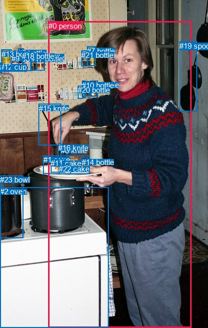
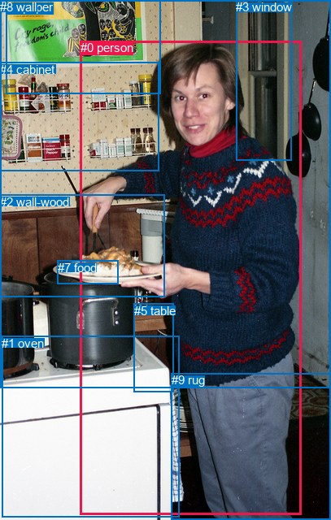

# 图片 1633：2391614.jpg

随机样本序号：301。图片 SHA256：`e3e0a05408aa5e2a0a6554a51a4aa8c6707b149e97865ecd11a46be9ca6df16b`。

红色框表示人，蓝色框表示其他物体。两个模式分别保留自身框编号，可依据位置比较对应对象。

## 自动检测框与输出

人的框编号：`[0]`。状态：`ok`。

### 自动检测全部物体框

| 编号 | 类别 | 是否为人 | 检测分数 | 像素坐标 xyxy |
|---|---|---|---|---|
| 0 | person | True | 0.9992 | 94.6, 41.8, 374.6, 640.0 |
| 1 | cake | False | 0.9703 | 85.0, 303.2, 175.2, 339.4 |
| 2 | oven | False | 0.9665 | 0.5, 365.3, 212.7, 640.0 |
| 3 | bottle | False | 0.9165 | 165.4, 158.1, 174.9, 188.4 |
| 4 | bottle | False | 0.9017 | 177.5, 157.2, 191.4, 188.2 |
| 5 | bottle | False | 0.9015 | 35.2, 95.0, 46.6, 129.3 |
| 6 | bottle | False | 0.7594 | 70.1, 102.9, 87.7, 137.8 |
| 7 | bottle | False | 0.7439 | 170.3, 90.7, 187.7, 128.8 |
| 8 | knife | False | 0.7222 | 118.8, 284.7, 131.1, 307.8 |
| 9 | bottle | False | 0.6068 | 22.4, 105.9, 36.7, 137.0 |
| 10 | bottle | False | 0.5993 | 160.3, 158.0, 167.5, 189.2 |
| 11 | cake | False | 0.5264 | 99.0, 310.3, 127.0, 336.0 |
| 12 | cup | False | 0.5168 | 0.1, 122.1, 4.4, 142.6 |
| 13 | bottle | False | 0.4750 | 2.7, 96.8, 22.5, 138.0 |
| 14 | bottle | False | 0.4744 | 159.5, 307.7, 171.5, 322.0 |
| 15 | knife | False | 0.4677 | 75.5, 202.6, 119.2, 283.4 |
| 16 | knife | False | 0.4535 | 113.6, 279.8, 119.4, 311.7 |
| 17 | bottle | False | 0.4513 | 59.9, 106.1, 71.2, 136.8 |
| 18 | bottle | False | 0.4174 | 43.2, 101.2, 61.5, 139.0 |
| 19 | spoon | False | 0.3781 | 351.5, 80.9, 385.2, 217.3 |
| 20 | bottle | False | 0.3722 | 152.2, 167.1, 162.4, 193.0 |
| 21 | bottle | False | 0.3665 | 159.3, 98.8, 172.7, 129.5 |
| 22 | cake | False | 0.3658 | 115.0, 321.2, 138.1, 339.5 |
| 23 | bowl | False | 0.3536 | 0.0, 342.3, 45.3, 464.6 |

### 自动检测 Top50 人相关候选

评分物体对：552；人相关物体对：46；输出关系：50。

| 排名 | 主语编号与类别 | 关系 | 宾语编号与类别 | 类型 | 人与人 | 排序分数 | 原始融合 logit |
|---|---|---|---|---|---|---|---|
| 1 | #19 spoon | hanging from | #0 person | spatial | False | 0.99406 | 5.1193 |
| 2 | #0 person | holding | #8 knife | semantic | False | 0.99280 | 4.9263 |
| 3 | #0 person | holding | #16 knife | semantic | False | 0.99236 | 4.8669 |
| 4 | #0 person | holding | #1 cake | semantic | False | 0.99200 | 4.8200 |
| 5 | #0 person | holding | #15 knife | semantic | False | 0.99068 | 4.6657 |
| 6 | #0 person | holding | #19 spoon | semantic | False | 0.98910 | 4.5081 |
| 7 | #0 person | holding | #11 cake | semantic | False | 0.98353 | 4.0899 |
| 8 | #0 person | holding | #22 cake | semantic | False | 0.97610 | 3.7096 |
| 9 | #0 person | standing on | #2 oven | semantic | False | 0.95883 | 3.1480 |
| 10 | #0 person | holding | #14 bottle | semantic | False | 0.95796 | 3.1261 |
| 11 | #0 person | beside | #2 oven | spatial | False | 0.90094 | 2.2077 |
| 12 | #0 person | beside | #19 spoon | spatial | False | 0.83851 | 1.6472 |
| 13 | #0 person | on | #15 knife | spatial | False | 0.72043 | 0.9466 |
| 14 | #0 person | on | #16 knife | spatial | False | 0.68008 | 0.7542 |
| 15 | #0 person | on | #8 knife | spatial | False | 0.67496 | 0.7307 |
| 16 | #0 person | on | #1 cake | spatial | False | 0.57883 | 0.3180 |
| 17 | #0 person | on | #11 cake | spatial | False | 0.42780 | -0.2908 |
| 18 | #0 person | on | #22 cake | spatial | False | 0.37698 | -0.5024 |
| 19 | #19 spoon | holding | #0 person | semantic | False | 0.34509 | -0.6407 |
| 20 | #2 oven | beside | #0 person | spatial | False | 0.34327 | -0.6488 |
| 21 | #15 knife | holding | #0 person | semantic | False | 0.33025 | -0.7070 |
| 22 | #0 person | holding | #4 bottle | semantic | False | 0.30988 | -0.8007 |
| 23 | #0 person | holding | #20 bottle | semantic | False | 0.24654 | -1.1172 |
| 24 | #0 person | holding | #23 bowl | semantic | False | 0.24291 | -1.1368 |
| 25 | #0 person | holding | #3 bottle | semantic | False | 0.21865 | -1.2735 |
| 26 | #4 bottle | on back of | #0 person | spatial | False | 0.21344 | -1.3043 |
| 27 | #7 bottle | on back of | #0 person | spatial | False | 0.19736 | -1.4029 |
| 28 | #3 bottle | on back of | #0 person | spatial | False | 0.19314 | -1.4297 |
| 29 | #0 person | on | #14 bottle | spatial | False | 0.19282 | -1.4318 |
| 30 | #0 person | holding | #10 bottle | semantic | False | 0.17702 | -1.5367 |
| 31 | #15 knife | on | #0 person | spatial | False | 0.16769 | -1.6021 |
| 32 | #10 bottle | on back of | #0 person | spatial | False | 0.15378 | -1.7053 |
| 33 | #4 bottle | sitting on | #0 person | semantic | False | 0.12289 | -1.9654 |
| 34 | #20 bottle | on back of | #0 person | spatial | False | 0.12165 | -1.9769 |
| 35 | #21 bottle | on back of | #0 person | spatial | False | 0.11796 | -2.0119 |
| 36 | #0 person | holding | #7 bottle | semantic | False | 0.11646 | -2.0264 |
| 37 | #3 bottle | sitting on | #0 person | semantic | False | 0.09089 | -2.3028 |
| 38 | #0 person | holding | #21 bottle | semantic | False | 0.07559 | -2.5038 |
| 39 | #0 person | beside | #23 bowl | spatial | False | 0.05665 | -2.8125 |
| 40 | #10 bottle | sitting on | #0 person | semantic | False | 0.05651 | -2.8152 |
| 41 | #8 knife | holding | #0 person | semantic | False | 0.04629 | -3.0255 |
| 42 | #2 oven | holding | #0 person | semantic | False | 0.04597 | -3.0326 |
| 43 | #16 knife | holding | #0 person | semantic | False | 0.04552 | -3.0429 |
| 44 | #23 bowl | beside | #0 person | spatial | False | 0.04306 | -3.1013 |
| 45 | #1 cake | on | #0 person | spatial | False | 0.04277 | -3.1082 |
| 46 | #12 cup | hanging from | #0 person | spatial | False | 0.03689 | -3.2624 |
| 47 | #7 bottle | sitting on | #0 person | semantic | False | 0.02973 | -3.4854 |
| 48 | #20 bottle | holding | #0 person | semantic | False | 0.02271 | -3.7618 |
| 49 | #0 person | on | #4 bottle | spatial | False | 0.02071 | -3.8561 |
| 50 | #14 bottle | on | #0 person | spatial | False | 0.01712 | -4.0503 |

### 自动检测逐条人相关 GT 核验

R@50：0.00%；命中 0/2。

| GT 主语编号 | GT 关系 | GT 宾语编号 | 结果阶段 | 匹配预测主语编号 | 匹配预测宾语编号 |
|---|---|---|---|---|---|
| 0 | holding | 7 | endpoint_missing_or_wrong_class | [0] | [] |
| 1 | in front of | 0 | wrong_predicate | [2] | [0] |

## 真实框与输出

人的框编号：`[0]`。

### 真实框全部物体框

| 编号 | 类别 | 是否为人 | 检测分数 | 像素坐标 xyxy |
|---|---|---|---|---|
| 0 | person | True | GT | 99.0, 50.0, 371.0, 633.0 |
| 1 | oven | False | GT | 2.0, 414.0, 220.0, 636.0 |
| 2 | wall-wood | False | GT | 0.0, 240.0, 203.0, 366.0 |
| 3 | window | False | GT | 290.0, 0.0, 359.0, 197.0 |
| 4 | cabinet | False | GT | 0.0, 77.0, 196.0, 211.0 |
| 5 | table | False | GT | 165.0, 374.0, 214.0, 483.0 |
| 6 | paper | False | GT | 8.0, 0.0, 198.0, 115.0 |
| 7 | food | False | GT | 71.0, 321.0, 146.0, 350.0 |
| 8 | wall | False | GT | 0.0, 0.0, 407.0, 478.0 |
| 9 | rug | False | GT | 211.0, 459.0, 407.0, 640.0 |

### 真实框 Top50 人相关候选

评分物体对：90；人相关物体对：18；输出关系：36。

| 排名 | 主语编号与类别 | 关系 | 宾语编号与类别 | 类型 | 人与人 | 排序分数 | 原始融合 logit |
|---|---|---|---|---|---|---|---|
| 1 | #0 person | holding | #7 food | semantic | False | 0.98378 | 4.1051 |
| 2 | #0 person | wearing | #9 rug | semantic | False | 0.98254 | 4.0300 |
| 3 | #0 person | holding | #2 wall-wood | semantic | False | 0.93253 | 2.6262 |
| 4 | #0 person | standing on | #1 oven | semantic | False | 0.83710 | 1.6368 |
| 5 | #0 person | beside | #1 oven | spatial | False | 0.81417 | 1.4773 |
| 6 | #0 person | in | #9 rug | spatial | False | 0.80335 | 1.4073 |
| 7 | #0 person | holding | #5 table | semantic | False | 0.74857 | 1.0910 |
| 8 | #0 person | on | #7 food | spatial | False | 0.60955 | 0.4454 |
| 9 | #0 person | standing on | #8 wall | semantic | False | 0.57208 | 0.2904 |
| 10 | #0 person | in | #8 wall | spatial | False | 0.56987 | 0.2813 |
| 11 | #1 oven | beside | #0 person | spatial | False | 0.48994 | -0.0402 |
| 12 | #9 rug | on | #0 person | spatial | False | 0.40129 | -0.4001 |
| 13 | #7 food | on | #0 person | spatial | False | 0.30632 | -0.8174 |
| 14 | #0 person | on | #5 table | spatial | False | 0.30161 | -0.8396 |
| 15 | #0 person | on | #2 wall-wood | spatial | False | 0.28097 | -0.9396 |
| 16 | #7 food | holding | #0 person | semantic | False | 0.22387 | -1.2432 |
| 17 | #8 wall | beside | #0 person | spatial | False | 0.20889 | -1.3316 |
| 18 | #3 window | beside | #0 person | spatial | False | 0.18907 | -1.4561 |
| 19 | #5 table | beside | #0 person | spatial | False | 0.18581 | -1.4775 |
| 20 | #0 person | holding | #4 cabinet | semantic | False | 0.15751 | -1.6769 |
| 21 | #2 wall-wood | beside | #0 person | spatial | False | 0.14693 | -1.7589 |
| 22 | #1 oven | holding | #0 person | semantic | False | 0.13087 | -1.8933 |
| 23 | #9 rug | wearing | #0 person | semantic | False | 0.10951 | -2.0957 |
| 24 | #0 person | beside | #3 window | spatial | False | 0.09289 | -2.2789 |
| 25 | #3 window | looking at | #0 person | semantic | False | 0.05680 | -2.8097 |
| 26 | #0 person | standing on | #3 window | semantic | False | 0.05250 | -2.8931 |
| 27 | #5 table | holding | #0 person | semantic | False | 0.03971 | -3.1857 |
| 28 | #0 person | on | #4 cabinet | spatial | False | 0.03667 | -3.2684 |
| 29 | #4 cabinet | beside | #0 person | spatial | False | 0.03644 | -3.2749 |
| 30 | #6 paper | beside | #0 person | spatial | False | 0.03640 | -3.2760 |
| 31 | #8 wall | holding | #0 person | semantic | False | 0.03524 | -3.3097 |
| 32 | #2 wall-wood | looking at | #0 person | semantic | False | 0.02394 | -3.7080 |
| 33 | #0 person | holding | #6 paper | semantic | False | 0.01849 | -3.9720 |
| 34 | #0 person | on | #6 paper | spatial | False | 0.01056 | -4.5399 |
| 35 | #6 paper | holding | #0 person | semantic | False | 0.00988 | -4.6075 |
| 36 | #4 cabinet | holding | #0 person | semantic | False | 0.00773 | -4.8544 |

### 真实框逐条人相关 GT 核验

R@50：50.00%；命中 1/2。

| GT 主语编号 | GT 关系 | GT 宾语编号 | 结果阶段 | 匹配预测主语编号 | 匹配预测宾语编号 |
|---|---|---|---|---|---|
| 0 | holding | 7 | hit50 | [0] | [7] |
| 1 | in front of | 0 | wrong_predicate | [1] | [0] |

## 全部人相关 GT

| 主语编号与类别 | 关系 | 宾语编号与类别 |
|---|---|---|
| #0 person | holding | #7 food |
| #1 oven | in front of | #0 person |

原始记录、全部人相关物体对的两项预测与分项分数见 [逐图证据 JSON](../evidence/cases/1633.json)。全部56类 logits 保留于本机 HOR/output/random500/logits/。

<!-- HOR_COMPLETE_RESULTS -->

## 六组条件的完整输出对照

以下保留同一图片三种框与候选模式、两种谓词输出规则的全部 Top50。框编号各自在所属模式内解释。

### 自动检测框完整枚举：空间与语义各保留一个谓词

| 排名 | 主语编号与类别 | 谓词 | 宾语编号与类别 | 分组 | 排序分数 | predicate logit | pair logit |
|---|---|---|---|---|---|---|---|
| 1 | #19 spoon | hanging from | #0 person | spatial | 0.9940555 | 5.7141623 | -0.5948332 |
| 2 | #0 person | holding | #8 knife | semantic | 0.9927988 | 4.5165811 | 0.4097018 |
| 3 | #0 person | holding | #16 knife | semantic | 0.9923612 | 4.4445825 | 0.4222703 |
| 4 | #0 person | holding | #1 cake | semantic | 0.9919978 | 4.3441396 | 0.4758687 |
| 5 | #0 person | holding | #15 knife | semantic | 0.9906750 | 4.5143867 | 0.1512961 |
| 6 | #0 person | holding | #19 spoon | semantic | 0.9891003 | 5.1523404 | -0.6442844 |
| 7 | #0 person | holding | #11 cake | semantic | 0.9835349 | 3.7600389 | 0.3298772 |
| 8 | #0 person | holding | #22 cake | semantic | 0.9760972 | 3.4462123 | 0.2633559 |
| 9 | #0 person | standing on | #2 oven | semantic | 0.9588284 | 3.1803064 | -0.0323428 |
| 10 | #0 person | holding | #14 bottle | semantic | 0.9579570 | 3.1135612 | 0.0125477 |
| 11 | #0 person | beside | #2 oven | spatial | 0.9009397 | 2.2400527 | -0.0323428 |
| 12 | #0 person | beside | #19 spoon | spatial | 0.8385110 | 2.2914748 | -0.6442844 |
| 13 | #0 person | on | #15 knife | spatial | 0.7204304 | 0.7953014 | 0.1512961 |
| 14 | #0 person | on | #16 knife | spatial | 0.6800833 | 0.3318844 | 0.4222703 |
| 15 | #0 person | on | #8 knife | spatial | 0.6749582 | 0.3209953 | 0.4097018 |
| 16 | #0 person | on | #1 cake | spatial | 0.5788323 | -0.1578870 | 0.4758687 |
| 17 | #0 person | on | #11 cake | spatial | 0.4277964 | -0.6207247 | 0.3298772 |
| 18 | #0 person | on | #22 cake | spatial | 0.3769815 | -0.7657361 | 0.2633559 |
| 19 | #19 spoon | holding | #0 person | semantic | 0.3450897 | -0.0458608 | -0.5948332 |
| 20 | #2 oven | beside | #0 person | spatial | 0.3432710 | 0.3143859 | -0.9631369 |
| 21 | #15 knife | holding | #0 person | semantic | 0.3302516 | 0.2098999 | -0.9169472 |
| 22 | #0 person | holding | #4 bottle | semantic | 0.3098781 | 0.1341882 | -0.9348776 |
| 23 | #0 person | holding | #20 bottle | semantic | 0.2465363 | 0.0882277 | -1.2053994 |
| 24 | #0 person | holding | #23 bowl | semantic | 0.2429076 | -0.3884616 | -0.7483425 |
| 25 | #0 person | holding | #3 bottle | semantic | 0.2186518 | -0.1613646 | -1.1121761 |
| 26 | #4 bottle | on back of | #0 person | spatial | 0.2134408 | -0.2143788 | -1.0899298 |
| 27 | #7 bottle | on back of | #0 person | spatial | 0.1973619 | -0.2643638 | -1.1385012 |
| 28 | #3 bottle | on back of | #0 person | spatial | 0.1931442 | -0.2912359 | -1.1384721 |
| 29 | #0 person | on | #14 bottle | spatial | 0.1928153 | -1.4443676 | 0.0125477 |
| 30 | #0 person | holding | #10 bottle | semantic | 0.1770159 | -0.3409839 | -1.1957132 |
| 31 | #15 knife | on | #0 person | spatial | 0.1676866 | -0.6851654 | -0.9169472 |
| 32 | #10 bottle | on back of | #0 person | spatial | 0.1537766 | -0.5479336 | -1.1573492 |
| 33 | #4 bottle | sitting on | #0 person | semantic | 0.1228856 | -0.8754535 | -1.0899298 |
| 34 | #20 bottle | on back of | #0 person | spatial | 0.1216518 | -0.8300533 | -1.1468265 |
| 35 | #21 bottle | on back of | #0 person | spatial | 0.1179642 | -0.8643348 | -1.1475171 |
| 36 | #0 person | holding | #7 bottle | semantic | 0.1164634 | -0.7253337 | -1.3010218 |
| 37 | #3 bottle | sitting on | #0 person | semantic | 0.0908923 | -1.1643167 | -1.1384721 |
| 38 | #0 person | holding | #21 bottle | semantic | 0.0755934 | -1.0544810 | -1.4493024 |
| 39 | #0 person | beside | #23 bowl | spatial | 0.0566527 | -2.0641525 | -0.7483425 |
| 40 | #10 bottle | sitting on | #0 person | semantic | 0.0565105 | -1.6578097 | -1.1573492 |
| 41 | #8 knife | holding | #0 person | semantic | 0.0462863 | -1.5340848 | -1.4914337 |
| 42 | #2 oven | holding | #0 person | semantic | 0.0459748 | -2.0694594 | -0.9631369 |
| 43 | #16 knife | holding | #0 person | semantic | 0.0455237 | -1.5838428 | -1.4590863 |
| 44 | #23 bowl | beside | #0 person | spatial | 0.0430550 | -1.8972192 | -1.2040477 |
| 45 | #1 cake | on | #0 person | spatial | 0.0427691 | -1.8393776 | -1.2688515 |
| 46 | #12 cup | hanging from | #0 person | spatial | 0.0368855 | -1.7934380 | -1.4689149 |
| 47 | #7 bottle | sitting on | #0 person | semantic | 0.0297294 | -2.3469362 | -1.1385012 |
| 48 | #20 bottle | holding | #0 person | semantic | 0.0227146 | -2.6149445 | -1.1468265 |
| 49 | #0 person | on | #4 bottle | spatial | 0.0207126 | -2.9212065 | -0.9348776 |
| 50 | #14 bottle | on | #0 person | spatial | 0.0171194 | -2.7731538 | -1.2771199 |

GT 命中：0/2，R@50=0.00%。

| GT主语 | GT谓词 | GT宾语 | 结果阶段 | 匹配主语框 | 匹配宾语框 |
|---|---|---|---|---|---|
| 0 | holding | 7 | endpoint_missing_or_wrong_class | [0] | [] |
| 1 | in front of | 0 | wrong_predicate | [2] | [0] |

### 自动检测框完整枚举：每对只保留一个谓词

| 排名 | 主语编号与类别 | 谓词 | 宾语编号与类别 | 分组 | 排序分数 | predicate logit | pair logit |
|---|---|---|---|---|---|---|---|
| 1 | #19 spoon | hanging from | #0 person | single | 0.9940555 | 5.7141623 | -0.5948332 |
| 2 | #0 person | holding | #8 knife | single | 0.9927988 | 4.5165811 | 0.4097018 |
| 3 | #0 person | holding | #16 knife | single | 0.9923612 | 4.4445825 | 0.4222703 |
| 4 | #0 person | holding | #1 cake | single | 0.9919978 | 4.3441396 | 0.4758687 |
| 5 | #0 person | holding | #15 knife | single | 0.9906750 | 4.5143867 | 0.1512961 |
| 6 | #0 person | holding | #19 spoon | single | 0.9891003 | 5.1523404 | -0.6442844 |
| 7 | #0 person | holding | #11 cake | single | 0.9835349 | 3.7600389 | 0.3298772 |
| 8 | #0 person | holding | #22 cake | single | 0.9760972 | 3.4462123 | 0.2633559 |
| 9 | #0 person | standing on | #2 oven | single | 0.9588284 | 3.1803064 | -0.0323428 |
| 10 | #0 person | holding | #14 bottle | single | 0.9579570 | 3.1135612 | 0.0125477 |
| 11 | #2 oven | beside | #0 person | single | 0.3432710 | 0.3143859 | -0.9631369 |
| 12 | #15 knife | holding | #0 person | single | 0.3302516 | 0.2098999 | -0.9169472 |
| 13 | #0 person | holding | #4 bottle | single | 0.3098781 | 0.1341882 | -0.9348776 |
| 14 | #0 person | holding | #20 bottle | single | 0.2465363 | 0.0882277 | -1.2053994 |
| 15 | #0 person | holding | #23 bowl | single | 0.2429076 | -0.3884616 | -0.7483425 |
| 16 | #0 person | holding | #3 bottle | single | 0.2186518 | -0.1613646 | -1.1121761 |
| 17 | #4 bottle | on back of | #0 person | single | 0.2134408 | -0.2143788 | -1.0899298 |
| 18 | #7 bottle | on back of | #0 person | single | 0.1973619 | -0.2643638 | -1.1385012 |
| 19 | #3 bottle | on back of | #0 person | single | 0.1931442 | -0.2912359 | -1.1384721 |
| 20 | #0 person | holding | #10 bottle | single | 0.1770159 | -0.3409839 | -1.1957132 |
| 21 | #10 bottle | on back of | #0 person | single | 0.1537766 | -0.5479336 | -1.1573492 |
| 22 | #20 bottle | on back of | #0 person | single | 0.1216518 | -0.8300533 | -1.1468265 |
| 23 | #21 bottle | on back of | #0 person | single | 0.1179642 | -0.8643348 | -1.1475171 |
| 24 | #0 person | holding | #7 bottle | single | 0.1164634 | -0.7253337 | -1.3010218 |
| 25 | #0 person | holding | #21 bottle | single | 0.0755934 | -1.0544810 | -1.4493024 |
| 26 | #8 knife | holding | #0 person | single | 0.0462863 | -1.5340848 | -1.4914337 |
| 27 | #16 knife | holding | #0 person | single | 0.0455237 | -1.5838428 | -1.4590863 |
| 28 | #23 bowl | beside | #0 person | single | 0.0430550 | -1.8972192 | -1.2040477 |
| 29 | #1 cake | on | #0 person | single | 0.0427691 | -1.8393776 | -1.2688515 |
| 30 | #12 cup | hanging from | #0 person | single | 0.0368855 | -1.7934380 | -1.4689149 |
| 31 | #14 bottle | on | #0 person | single | 0.0171194 | -2.7731538 | -1.2771199 |
| 32 | #6 bottle | beside | #0 person | single | 0.0165398 | -2.8991556 | -1.1861502 |
| 33 | #18 bottle | beside | #0 person | single | 0.0134955 | -3.0350289 | -1.2567819 |
| 34 | #17 bottle | beside | #0 person | single | 0.0115697 | -3.2452626 | -1.2024655 |
| 35 | #22 cake | on | #0 person | single | 0.0114298 | -3.1703000 | -1.2897345 |
| 36 | #11 cake | on | #0 person | single | 0.0107436 | -3.1698365 | -1.3528031 |
| 37 | #5 bottle | beside | #0 person | single | 0.0101971 | -3.3047514 | -1.2706501 |
| 38 | #13 bottle | beside | #0 person | single | 0.0100288 | -3.3868952 | -1.2053201 |
| 39 | #9 bottle | beside | #0 person | single | 0.0091381 | -3.4995351 | -1.1865931 |
| 40 | #0 person | eating | #18 bottle | single | 0.0029888 | -4.2723222 | -1.5375644 |
| 41 | #0 person | eating | #17 bottle | single | 0.0028268 | -4.4224567 | -1.4433355 |
| 42 | #0 person | eating | #5 bottle | single | 0.0025865 | -4.3701992 | -1.5846720 |
| 43 | #0 person | eating | #6 bottle | single | 0.0022485 | -4.6185021 | -1.4767179 |
| 44 | #0 person | eating | #9 bottle | single | 0.0021480 | -4.5195189 | -1.6215417 |
| 45 | #0 person | eating | #13 bottle | single | 0.0020323 | -4.5092306 | -1.6873415 |
| 46 | #0 person | eating | #12 cup | single | 0.0012765 | -4.5996399 | -2.0627365 |

GT 命中：0/2，R@50=0.00%。

| GT主语 | GT谓词 | GT宾语 | 结果阶段 | 匹配主语框 | 匹配宾语框 |
|---|---|---|---|---|---|
| 0 | holding | 7 | endpoint_missing_or_wrong_class | [0] | [] |
| 1 | in front of | 0 | wrong_predicate | [2] | [0] |

### 真实框完整枚举：空间与语义各保留一个谓词

| 排名 | 主语编号与类别 | 谓词 | 宾语编号与类别 | 分组 | 排序分数 | predicate logit | pair logit |
|---|---|---|---|---|---|---|---|
| 1 | #0 person | holding | #7 food | semantic | 0.9837791 | 4.0351224 | 0.0699791 |
| 2 | #0 person | wearing | #9 rug | semantic | 0.9825356 | 4.1956143 | -0.1656418 |
| 3 | #0 person | holding | #2 wall-wood | semantic | 0.9325302 | 3.5558572 | -0.9296353 |
| 4 | #0 person | standing on | #1 oven | semantic | 0.8371007 | 1.7975383 | -0.1607263 |
| 5 | #0 person | beside | #1 oven | spatial | 0.8141687 | 1.6380544 | -0.1607263 |
| 6 | #0 person | in | #9 rug | spatial | 0.8033457 | 1.5729795 | -0.1656418 |
| 7 | #0 person | holding | #5 table | semantic | 0.7485726 | 1.9154801 | -0.8244662 |
| 8 | #0 person | on | #7 food | spatial | 0.6095504 | 0.3754435 | 0.0699791 |
| 9 | #0 person | standing on | #8 wall | semantic | 0.5720838 | 0.7717762 | -0.4814180 |
| 10 | #0 person | in | #8 wall | spatial | 0.5698658 | 0.7627215 | -0.4814180 |
| 11 | #1 oven | beside | #0 person | spatial | 0.4899434 | 0.9191027 | -0.9593344 |
| 12 | #9 rug | on | #0 person | spatial | 0.4012901 | -0.0013499 | -0.3987424 |
| 13 | #7 food | on | #0 person | spatial | 0.3063178 | 0.4029851 | -1.2203758 |
| 14 | #0 person | on | #5 table | spatial | 0.3016127 | -0.0151639 | -0.8244662 |
| 15 | #0 person | on | #2 wall-wood | spatial | 0.2809723 | -0.0100083 | -0.9296353 |
| 16 | #7 food | holding | #0 person | semantic | 0.2238741 | -0.0228553 | -1.2203758 |
| 17 | #8 wall | beside | #0 person | spatial | 0.2088935 | -0.8855917 | -0.4460161 |
| 18 | #3 window | beside | #0 person | spatial | 0.1890692 | -0.7675829 | -0.6884865 |
| 19 | #5 table | beside | #0 person | spatial | 0.1858122 | -0.7036853 | -0.7737691 |
| 20 | #0 person | holding | #4 cabinet | semantic | 0.1575085 | -0.3782516 | -1.2986329 |
| 21 | #2 wall-wood | beside | #0 person | spatial | 0.1469329 | -1.0664716 | -0.6923906 |
| 22 | #1 oven | holding | #0 person | semantic | 0.1308708 | -0.9339464 | -0.9593344 |
| 23 | #9 rug | wearing | #0 person | semantic | 0.1095127 | -1.6969857 | -0.3987424 |
| 24 | #0 person | beside | #3 window | spatial | 0.0928866 | -0.8571773 | -1.4217112 |
| 25 | #3 window | looking at | #0 person | semantic | 0.0568021 | -2.1212161 | -0.6884865 |
| 26 | #0 person | standing on | #3 window | semantic | 0.0524951 | -1.4714017 | -1.4217112 |
| 27 | #5 table | holding | #0 person | semantic | 0.0397061 | -2.4119658 | -0.7737691 |
| 28 | #0 person | on | #4 cabinet | spatial | 0.0366704 | -1.9697921 | -1.2986329 |
| 29 | #4 cabinet | beside | #0 person | spatial | 0.0364426 | -2.3016443 | -0.9732496 |
| 30 | #6 paper | beside | #0 person | spatial | 0.0364031 | -2.3496723 | -0.9263458 |
| 31 | #8 wall | holding | #0 person | semantic | 0.0352392 | -2.8637040 | -0.4460161 |
| 32 | #2 wall-wood | looking at | #0 person | semantic | 0.0239387 | -3.0156403 | -0.6923906 |
| 33 | #0 person | holding | #6 paper | semantic | 0.0184869 | -2.4943900 | -1.4776409 |
| 34 | #0 person | on | #6 paper | spatial | 0.0105617 | -3.0622578 | -1.4776409 |
| 35 | #6 paper | holding | #0 person | semantic | 0.0098782 | -3.6811481 | -0.9263458 |
| 36 | #4 cabinet | holding | #0 person | semantic | 0.0077339 | -3.8811300 | -0.9732496 |

GT 命中：1/2，R@50=50.00%。

| GT主语 | GT谓词 | GT宾语 | 结果阶段 | 匹配主语框 | 匹配宾语框 |
|---|---|---|---|---|---|
| 0 | holding | 7 | hit50 | [0] | [7] |
| 1 | in front of | 0 | wrong_predicate | [1] | [0] |

### 真实框完整枚举：每对只保留一个谓词

| 排名 | 主语编号与类别 | 谓词 | 宾语编号与类别 | 分组 | 排序分数 | predicate logit | pair logit |
|---|---|---|---|---|---|---|---|
| 1 | #0 person | holding | #7 food | single | 0.9837791 | 4.0351224 | 0.0699791 |
| 2 | #0 person | wearing | #9 rug | single | 0.9825356 | 4.1956143 | -0.1656418 |
| 3 | #0 person | holding | #2 wall-wood | single | 0.9325302 | 3.5558572 | -0.9296353 |
| 4 | #0 person | standing on | #1 oven | single | 0.8371007 | 1.7975383 | -0.1607263 |
| 5 | #0 person | holding | #5 table | single | 0.7485726 | 1.9154801 | -0.8244662 |
| 6 | #0 person | standing on | #8 wall | single | 0.5720838 | 0.7717762 | -0.4814180 |
| 7 | #1 oven | beside | #0 person | single | 0.4899434 | 0.9191027 | -0.9593344 |
| 8 | #9 rug | on | #0 person | single | 0.4012901 | -0.0013499 | -0.3987424 |
| 9 | #7 food | on | #0 person | single | 0.3063178 | 0.4029851 | -1.2203758 |
| 10 | #8 wall | beside | #0 person | single | 0.2088935 | -0.8855917 | -0.4460161 |
| 11 | #3 window | beside | #0 person | single | 0.1890692 | -0.7675829 | -0.6884865 |
| 12 | #5 table | beside | #0 person | single | 0.1858122 | -0.7036853 | -0.7737691 |
| 13 | #0 person | holding | #4 cabinet | single | 0.1575085 | -0.3782516 | -1.2986329 |
| 14 | #2 wall-wood | beside | #0 person | single | 0.1469329 | -1.0664716 | -0.6923906 |
| 15 | #0 person | beside | #3 window | single | 0.0928866 | -0.8571773 | -1.4217112 |
| 16 | #4 cabinet | beside | #0 person | single | 0.0364426 | -2.3016443 | -0.9732496 |
| 17 | #6 paper | beside | #0 person | single | 0.0364031 | -2.3496723 | -0.9263458 |
| 18 | #0 person | holding | #6 paper | single | 0.0184869 | -2.4943900 | -1.4776409 |

GT 命中：1/2，R@50=50.00%。

| GT主语 | GT谓词 | GT宾语 | 结果阶段 | 匹配主语框 | 匹配宾语框 |
|---|---|---|---|---|---|
| 0 | holding | 7 | hit50 | [0] | [7] |
| 1 | in front of | 0 | wrong_predicate | [1] | [0] |

### 真实框400候选：空间与语义各保留一个谓词

| 排名 | 主语编号与类别 | 谓词 | 宾语编号与类别 | 分组 | 排序分数 | predicate logit | pair logit |
|---|---|---|---|---|---|---|---|
| 1 | #0 person | holding | #7 food | semantic | 0.9837791 | 4.0351224 | 0.0699791 |
| 2 | #0 person | wearing | #9 rug | semantic | 0.9825356 | 4.1956143 | -0.1656418 |
| 3 | #0 person | holding | #2 wall-wood | semantic | 0.9325302 | 3.5558572 | -0.9296353 |
| 4 | #0 person | standing on | #1 oven | semantic | 0.8360966 | 1.7901940 | -0.1607263 |
| 5 | #0 person | beside | #1 oven | spatial | 0.8095995 | 1.6081362 | -0.1607263 |
| 6 | #0 person | in | #9 rug | spatial | 0.8022949 | 1.5663419 | -0.1656418 |
| 7 | #0 person | holding | #5 table | semantic | 0.7541937 | 1.9455719 | -0.8244662 |
| 8 | #0 person | on | #7 food | spatial | 0.6069555 | 0.3645535 | 0.0699791 |
| 9 | #0 person | in | #8 wall | spatial | 0.5739828 | 0.7795377 | -0.4814180 |
| 10 | #0 person | standing on | #8 wall | semantic | 0.5711846 | 0.7681041 | -0.4814180 |
| 11 | #1 oven | beside | #0 person | spatial | 0.4824410 | 0.8890696 | -0.9593344 |
| 12 | #9 rug | on | #0 person | spatial | 0.4072257 | 0.0232964 | -0.3987424 |
| 13 | #7 food | on | #0 person | spatial | 0.3051620 | 0.3975401 | -1.2203758 |
| 14 | #0 person | on | #5 table | spatial | 0.3039114 | -0.0042744 | -0.8244662 |
| 15 | #0 person | on | #2 wall-wood | spatial | 0.2809723 | -0.0100083 | -0.9296353 |
| 16 | #7 food | holding | #0 person | semantic | 0.2286245 | 0.0042815 | -1.2203758 |
| 17 | #8 wall | beside | #0 person | spatial | 0.2089031 | -0.8855338 | -0.4460161 |
| 18 | #3 window | beside | #0 person | spatial | 0.1890825 | -0.7674961 | -0.6884865 |
| 19 | #5 table | beside | #0 person | spatial | 0.1858078 | -0.7037144 | -0.7737691 |
| 20 | #0 person | holding | #4 cabinet | semantic | 0.1611431 | -0.3511147 | -1.2986329 |
| 21 | #2 wall-wood | beside | #0 person | spatial | 0.1432064 | -1.0965195 | -0.6923906 |
| 22 | #1 oven | holding | #0 person | semantic | 0.1278150 | -0.9610834 | -0.9593344 |
| 23 | #9 rug | wearing | #0 person | semantic | 0.1112784 | -1.6790061 | -0.3987424 |
| 24 | #0 person | beside | #3 window | spatial | 0.0928768 | -0.8572931 | -1.4217112 |
| 25 | #3 window | looking at | #0 person | semantic | 0.0575947 | -2.1065187 | -0.6884865 |
| 26 | #0 person | standing on | #3 window | semantic | 0.0524038 | -1.4732375 | -1.4217112 |
| 27 | #5 table | holding | #0 person | semantic | 0.0391086 | -2.4277501 | -0.7737691 |
| 28 | #0 person | on | #4 cabinet | spatial | 0.0365239 | -1.9739478 | -1.2986329 |
| 29 | #4 cabinet | beside | #0 person | spatial | 0.0364421 | -2.3016586 | -0.9732496 |
| 30 | #6 paper | beside | #0 person | spatial | 0.0364052 | -2.3496144 | -0.9263458 |
| 31 | #8 wall | holding | #0 person | semantic | 0.0357798 | -2.8479197 | -0.4460161 |
| 32 | #2 wall-wood | looking at | #0 person | semantic | 0.0237595 | -3.0233376 | -0.6923906 |
| 33 | #0 person | holding | #6 paper | semantic | 0.0182423 | -2.5079584 | -1.4776409 |
| 34 | #0 person | on | #6 paper | spatial | 0.0104619 | -3.0718584 | -1.4776409 |
| 35 | #6 paper | holding | #0 person | semantic | 0.0099289 | -3.6759782 | -0.9263458 |
| 36 | #4 cabinet | holding | #0 person | semantic | 0.0076707 | -3.8893914 | -0.9732496 |

GT 命中：1/2，R@50=50.00%。

| GT主语 | GT谓词 | GT宾语 | 结果阶段 | 匹配主语框 | 匹配宾语框 |
|---|---|---|---|---|---|
| 0 | holding | 7 | hit50 | [0] | [7] |
| 1 | in front of | 0 | wrong_predicate | [1] | [0] |

### 真实框400候选：每对只保留一个谓词

| 排名 | 主语编号与类别 | 谓词 | 宾语编号与类别 | 分组 | 排序分数 | predicate logit | pair logit |
|---|---|---|---|---|---|---|---|
| 1 | #0 person | holding | #7 food | single | 0.9837791 | 4.0351224 | 0.0699791 |
| 2 | #0 person | wearing | #9 rug | single | 0.9825356 | 4.1956143 | -0.1656418 |
| 3 | #0 person | holding | #2 wall-wood | single | 0.9325302 | 3.5558572 | -0.9296353 |
| 4 | #0 person | standing on | #1 oven | single | 0.8360966 | 1.7901940 | -0.1607263 |
| 5 | #0 person | holding | #5 table | single | 0.7541937 | 1.9455719 | -0.8244662 |
| 6 | #0 person | in | #8 wall | single | 0.5739828 | 0.7795377 | -0.4814180 |
| 7 | #1 oven | beside | #0 person | single | 0.4824410 | 0.8890696 | -0.9593344 |
| 8 | #9 rug | on | #0 person | single | 0.4072257 | 0.0232964 | -0.3987424 |
| 9 | #7 food | on | #0 person | single | 0.3051620 | 0.3975401 | -1.2203758 |
| 10 | #8 wall | beside | #0 person | single | 0.2089031 | -0.8855338 | -0.4460161 |
| 11 | #3 window | beside | #0 person | single | 0.1890825 | -0.7674961 | -0.6884865 |
| 12 | #5 table | beside | #0 person | single | 0.1858078 | -0.7037144 | -0.7737691 |
| 13 | #0 person | holding | #4 cabinet | single | 0.1611431 | -0.3511147 | -1.2986329 |
| 14 | #2 wall-wood | beside | #0 person | single | 0.1432064 | -1.0965195 | -0.6923906 |
| 15 | #0 person | beside | #3 window | single | 0.0928768 | -0.8572931 | -1.4217112 |
| 16 | #4 cabinet | beside | #0 person | single | 0.0364421 | -2.3016586 | -0.9732496 |
| 17 | #6 paper | beside | #0 person | single | 0.0364052 | -2.3496144 | -0.9263458 |
| 18 | #0 person | holding | #6 paper | single | 0.0182423 | -2.5079584 | -1.4776409 |

GT 命中：1/2，R@50=50.00%。

| GT主语 | GT谓词 | GT宾语 | 结果阶段 | 匹配主语框 | 匹配宾语框 |
|---|---|---|---|---|---|
| 0 | holding | 7 | hit50 | [0] | [7] |
| 1 | in front of | 0 | wrong_predicate | [1] | [0] |
