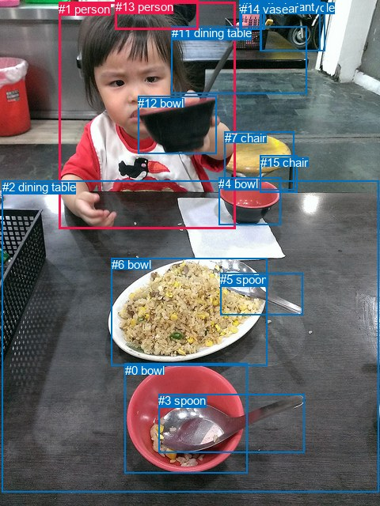
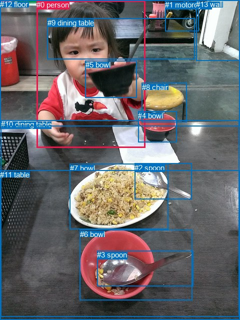

# 图片 1642：2392244.jpg

随机样本序号：453。图片 SHA256：`a565cac22fe2472459d238c036ca9a76c5c2a26fd6bd63d8a8ca2f56920b0577`。

红色框表示人，蓝色框表示其他物体。两个模式分别保留自身框编号，可依据位置比较对应对象。

## 自动检测框与输出

人的框编号：`[1, 13]`。状态：`ok`。

### 自动检测全部物体框

| 编号 | 类别 | 是否为人 | 检测分数 | 像素坐标 xyxy |
|---|---|---|---|---|
| 0 | bowl | False | 0.9985 | 158.0, 459.8, 312.0, 598.8 |
| 1 | person | True | 0.9984 | 74.2, 2.9, 297.7, 289.8 |
| 2 | dining table | False | 0.9960 | 2.7, 228.4, 478.4, 622.4 |
| 3 | spoon | False | 0.9956 | 200.4, 498.1, 384.5, 572.2 |
| 4 | bowl | False | 0.9892 | 276.1, 224.1, 354.4, 284.9 |
| 5 | spoon | False | 0.9747 | 278.1, 345.4, 382.3, 398.6 |
| 6 | bowl | False | 0.9317 | 140.9, 326.2, 337.3, 462.5 |
| 7 | chair | False | 0.9305 | 283.6, 166.1, 371.6, 240.7 |
| 8 | motorcycle | False | 0.8367 | 329.8, 0.7, 404.7, 64.3 |
| 9 | potted plant | False | 0.7700 | 302.4, 0.0, 334.9, 37.1 |
| 10 | car | False | 0.7126 | 328.2, 2.0, 410.7, 64.3 |
| 11 | dining table | False | 0.6851 | 216.8, 33.2, 387.9, 119.0 |
| 12 | bowl | False | 0.6175 | 174.1, 121.7, 273.3, 194.1 |
| 13 | person | True | 0.5573 | 145.8, 0.4, 250.5, 37.2 |
| 14 | vase | False | 0.3618 | 304.1, 2.7, 333.2, 37.6 |
| 15 | chair | False | 0.3556 | 328.6, 196.6, 375.2, 243.3 |

### 自动检测 Top50 人相关候选

评分物体对：240；人相关物体对：58；输出关系：50。

| 排名 | 主语编号与类别 | 关系 | 宾语编号与类别 | 类型 | 人与人 | 排序分数 | 原始融合 logit |
|---|---|---|---|---|---|---|---|
| 1 | #1 person | holding | #12 bowl | semantic | False | 0.99513 | 5.3203 |
| 2 | #1 person | sitting on | #2 dining table | semantic | False | 0.96491 | 3.3143 |
| 3 | #1 person | eating | #6 bowl | semantic | False | 0.91326 | 2.3541 |
| 4 | #13 person | sitting on | #2 dining table | semantic | False | 0.89205 | 2.1119 |
| 5 | #1 person | wearing | #13 person | semantic | True | 0.86286 | 1.8392 |
| 6 | #13 person | looking at | #1 person | semantic | True | 0.82764 | 1.5690 |
| 7 | #1 person | on | #2 dining table | spatial | False | 0.82271 | 1.5348 |
| 8 | #1 person | holding | #11 dining table | semantic | False | 0.80036 | 1.3885 |
| 9 | #1 person | on | #12 bowl | spatial | False | 0.76953 | 1.2057 |
| 10 | #13 person | sitting on | #11 dining table | semantic | False | 0.71148 | 0.9026 |
| 11 | #12 bowl | holding | #1 person | semantic | False | 0.60293 | 0.4177 |
| 12 | #1 person | in | #11 dining table | spatial | False | 0.58387 | 0.3387 |
| 13 | #1 person | in | #13 person | spatial | True | 0.54581 | 0.1838 |
| 14 | #12 bowl | in front of | #1 person | spatial | False | 0.48090 | -0.0764 |
| 15 | #1 person | eating | #4 bowl | semantic | False | 0.33372 | -0.6914 |
| 16 | #13 person | beside | #1 person | spatial | True | 0.27143 | -0.9874 |
| 17 | #1 person | in | #6 bowl | spatial | False | 0.27110 | -0.9891 |
| 18 | #7 chair | beside | #1 person | spatial | False | 0.26970 | -0.9961 |
| 19 | #1 person | holding | #5 spoon | semantic | False | 0.24959 | -1.1008 |
| 20 | #1 person | holding | #7 chair | semantic | False | 0.22960 | -1.2106 |
| 21 | #13 person | beside | #11 dining table | spatial | False | 0.20707 | -1.3427 |
| 22 | #13 person | leaning on | #2 dining table | spatial | False | 0.18842 | -1.4603 |
| 23 | #1 person | in front of | #7 chair | spatial | False | 0.18292 | -1.4967 |
| 24 | #6 bowl | in front of | #1 person | spatial | False | 0.15622 | -1.6866 |
| 25 | #1 person | eating | #0 bowl | semantic | False | 0.14047 | -1.8114 |
| 26 | #15 chair | beside | #1 person | spatial | False | 0.11550 | -2.0357 |
| 27 | #1 person | holding | #3 spoon | semantic | False | 0.11466 | -2.0440 |
| 28 | #13 person | sitting on | #10 car | semantic | False | 0.10389 | -2.1547 |
| 29 | #13 person | looking at | #12 bowl | semantic | False | 0.10163 | -2.1792 |
| 30 | #11 dining table | beside | #1 person | spatial | False | 0.08914 | -2.3242 |
| 31 | #13 person | eating | #6 bowl | semantic | False | 0.08903 | -2.3255 |
| 32 | #13 person | sitting on | #8 motorcycle | semantic | False | 0.08583 | -2.3657 |
| 33 | #1 person | in front of | #10 car | spatial | False | 0.08251 | -2.4087 |
| 34 | #4 bowl | beside | #1 person | spatial | False | 0.08217 | -2.4132 |
| 35 | #1 person | in front of | #8 motorcycle | spatial | False | 0.07742 | -2.4779 |
| 36 | #13 person | looking at | #9 potted plant | semantic | False | 0.07039 | -2.5808 |
| 37 | #13 person | in front of | #10 car | spatial | False | 0.06738 | -2.6277 |
| 38 | #13 person | looking at | #14 vase | semantic | False | 0.06249 | -2.7082 |
| 39 | #13 person | in front of | #8 motorcycle | spatial | False | 0.06073 | -2.7386 |
| 40 | #2 dining table | in front of | #1 person | spatial | False | 0.05851 | -2.7782 |
| 41 | #1 person | in | #5 spoon | spatial | False | 0.05777 | -2.7918 |
| 42 | #0 bowl | in front of | #1 person | spatial | False | 0.05688 | -2.8082 |
| 43 | #1 person | in | #3 spoon | spatial | False | 0.04595 | -3.0332 |
| 44 | #7 chair | looking at | #1 person | semantic | False | 0.04509 | -3.0529 |
| 45 | #13 person | beside | #9 potted plant | spatial | False | 0.03755 | -3.2439 |
| 46 | #1 person | in front of | #15 chair | spatial | False | 0.03703 | -3.2582 |
| 47 | #1 person | looking at | #15 chair | semantic | False | 0.03622 | -3.2812 |
| 48 | #10 car | beside | #1 person | spatial | False | 0.03482 | -3.3221 |
| 49 | #8 motorcycle | beside | #1 person | spatial | False | 0.03315 | -3.3730 |
| 50 | #10 car | parked on | #13 person | semantic | False | 0.03277 | -3.3848 |

### 自动检测逐条人相关 GT 核验

R@50：33.33%；命中 1/3。

| GT 主语编号 | GT 关系 | GT 宾语编号 | 结果阶段 | 匹配预测主语编号 | 匹配预测宾语编号 |
|---|---|---|---|---|---|
| 0 | holding | 5 | hit50 | [1] | [12] |
| 0 | looking at | 5 | wrong_predicate | [1] | [12] |
| 10 | attached to | 0 | wrong_predicate | [2] | [1] |

## 真实框与输出

人的框编号：`[0]`。

### 真实框全部物体框

| 编号 | 类别 | 是否为人 | 检测分数 | 像素坐标 xyxy |
|---|---|---|---|---|
| 0 | person | True | GT | 73.0, 1.0, 290.0, 295.0 |
| 1 | motorcycle | False | GT | 330.0, 1.0, 397.0, 63.0 |
| 2 | spoon | False | GT | 269.0, 327.0, 383.0, 399.0 |
| 3 | spoon | False | GT | 194.0, 501.0, 386.0, 572.0 |
| 4 | bowl | False | GT | 276.0, 223.0, 354.0, 285.0 |
| 5 | bowl | False | GT | 171.0, 121.0, 274.0, 195.0 |
| 6 | bowl | False | GT | 160.0, 460.0, 385.0, 601.0 |
| 7 | bowl | False | GT | 140.0, 328.0, 337.0, 459.0 |
| 8 | chair | False | GT | 284.0, 166.0, 374.0, 244.0 |
| 9 | dining table | False | GT | 95.0, 37.0, 390.0, 118.0 |
| 10 | dining table | False | GT | 2.0, 240.0, 478.0, 633.0 |
| 11 | table | False | GT | 0.0, 341.0, 480.0, 640.0 |
| 12 | floor | False | GT | 0.0, 0.0, 480.0, 252.0 |
| 13 | wall | False | GT | 392.0, 0.0, 480.0, 121.0 |

### 真实框 Top50 人相关候选

评分物体对：182；人相关物体对：26；输出关系：50。

| 排名 | 主语编号与类别 | 关系 | 宾语编号与类别 | 类型 | 人与人 | 排序分数 | 原始融合 logit |
|---|---|---|---|---|---|---|---|
| 1 | #0 person | holding | #5 bowl | semantic | False | 0.99471 | 5.2368 |
| 2 | #0 person | sitting on | #10 dining table | semantic | False | 0.94783 | 2.8997 |
| 3 | #0 person | eating | #7 bowl | semantic | False | 0.92954 | 2.5797 |
| 4 | #0 person | in | #10 dining table | spatial | False | 0.91884 | 2.4267 |
| 5 | #0 person | in | #9 dining table | spatial | False | 0.89499 | 2.1427 |
| 6 | #0 person | in | #11 table | spatial | False | 0.87253 | 1.9235 |
| 7 | #0 person | sitting on | #11 table | semantic | False | 0.86850 | 1.8878 |
| 8 | #0 person | in | #12 floor | spatial | False | 0.84236 | 1.6759 |
| 9 | #0 person | sitting on | #9 dining table | semantic | False | 0.81551 | 1.4862 |
| 10 | #0 person | on | #5 bowl | spatial | False | 0.79578 | 1.3601 |
| 11 | #5 bowl | holding | #0 person | semantic | False | 0.68339 | 0.7694 |
| 12 | #0 person | eating | #12 floor | semantic | False | 0.58218 | 0.3317 |
| 13 | #8 chair | beside | #0 person | spatial | False | 0.44665 | -0.2142 |
| 14 | #5 bowl | in front of | #0 person | spatial | False | 0.38840 | -0.4541 |
| 15 | #0 person | in | #7 bowl | spatial | False | 0.38633 | -0.4628 |
| 16 | #0 person | eating | #4 bowl | semantic | False | 0.31562 | -0.7740 |
| 17 | #4 bowl | beside | #0 person | spatial | False | 0.14564 | -1.7692 |
| 18 | #9 dining table | beside | #0 person | spatial | False | 0.13943 | -1.8200 |
| 19 | #0 person | holding | #8 chair | semantic | False | 0.12785 | -1.9201 |
| 20 | #7 bowl | in front of | #0 person | spatial | False | 0.11633 | -2.0276 |
| 21 | #12 floor | beside | #0 person | spatial | False | 0.11474 | -2.0432 |
| 22 | #13 wall | beside | #0 person | spatial | False | 0.11353 | -2.0552 |
| 23 | #0 person | holding | #2 spoon | semantic | False | 0.10258 | -2.1689 |
| 24 | #0 person | holding | #3 spoon | semantic | False | 0.10049 | -2.1918 |
| 25 | #0 person | looking at | #6 bowl | semantic | False | 0.09495 | -2.2546 |
| 26 | #0 person | in | #8 chair | spatial | False | 0.07475 | -2.5159 |
| 27 | #8 chair | looking at | #0 person | semantic | False | 0.07294 | -2.5424 |
| 28 | #9 dining table | holding | #0 person | semantic | False | 0.06271 | -2.7044 |
| 29 | #1 motorcycle | beside | #0 person | spatial | False | 0.05904 | -2.7687 |
| 30 | #0 person | in | #3 spoon | spatial | False | 0.05347 | -2.8736 |
| 31 | #0 person | in | #4 bowl | spatial | False | 0.05202 | -2.9027 |
| 32 | #0 person | in | #6 bowl | spatial | False | 0.04390 | -3.0809 |
| 33 | #0 person | in | #2 spoon | spatial | False | 0.04224 | -3.1213 |
| 34 | #6 bowl | in front of | #0 person | spatial | False | 0.03730 | -3.2508 |
| 35 | #10 dining table | holding | #0 person | semantic | False | 0.03628 | -3.2796 |
| 36 | #10 dining table | beside | #0 person | spatial | False | 0.03044 | -3.4609 |
| 37 | #2 spoon | beside | #0 person | spatial | False | 0.02564 | -3.6377 |
| 38 | #4 bowl | holding | #0 person | semantic | False | 0.01906 | -3.9412 |
| 39 | #0 person | beside | #1 motorcycle | spatial | False | 0.01744 | -4.0314 |
| 40 | #12 floor | holding | #0 person | semantic | False | 0.01689 | -4.0643 |
| 41 | #0 person | in | #13 wall | spatial | False | 0.01454 | -4.2162 |
| 42 | #7 bowl | holding | #0 person | semantic | False | 0.01441 | -4.2251 |
| 43 | #11 table | in | #0 person | spatial | False | 0.01430 | -4.2332 |
| 44 | #1 motorcycle | looking at | #0 person | semantic | False | 0.01409 | -4.2479 |
| 45 | #0 person | looking at | #1 motorcycle | semantic | False | 0.01358 | -4.2855 |
| 46 | #2 spoon | holding | #0 person | semantic | False | 0.01312 | -4.3201 |
| 47 | #0 person | looking at | #13 wall | semantic | False | 0.01231 | -4.3849 |
| 48 | #11 table | holding | #0 person | semantic | False | 0.01227 | -4.3882 |
| 49 | #13 wall | looking at | #0 person | semantic | False | 0.01043 | -4.5526 |
| 50 | #6 bowl | holding | #0 person | semantic | False | 0.00807 | -4.8118 |

### 真实框逐条人相关 GT 核验

R@50：33.33%；命中 1/3。

| GT 主语编号 | GT 关系 | GT 宾语编号 | 结果阶段 | 匹配预测主语编号 | 匹配预测宾语编号 |
|---|---|---|---|---|---|
| 0 | holding | 5 | hit50 | [0] | [5] |
| 0 | looking at | 5 | wrong_predicate | [0] | [5] |
| 10 | attached to | 0 | wrong_predicate | [10] | [0] |

## 全部人相关 GT

| 主语编号与类别 | 关系 | 宾语编号与类别 |
|---|---|---|
| #0 person | holding | #5 bowl |
| #0 person | looking at | #5 bowl |
| #10 dining table | attached to | #0 person |

原始记录、全部人相关物体对的两项预测与分项分数见 [逐图证据 JSON](../evidence/cases/1642.json)。全部56类 logits 保留于本机 HOR/output/random500/logits/。

<!-- HOR_COMPLETE_RESULTS -->

## 六组条件的完整输出对照

以下保留同一图片三种框与候选模式、两种谓词输出规则的全部 Top50。框编号各自在所属模式内解释。

### 自动检测框完整枚举：空间与语义各保留一个谓词

| 排名 | 主语编号与类别 | 谓词 | 宾语编号与类别 | 分组 | 排序分数 | predicate logit | pair logit |
|---|---|---|---|---|---|---|---|
| 1 | #1 person | holding | #12 bowl | semantic | 0.9951325 | 4.8337035 | 0.4865894 |
| 2 | #1 person | sitting on | #2 dining table | semantic | 0.9649146 | 3.3344769 | -0.0202260 |
| 3 | #1 person | eating | #6 bowl | semantic | 0.9132634 | 2.6380954 | -0.2839463 |
| 4 | #13 person | sitting on | #2 dining table | semantic | 0.8920532 | 2.5881562 | -0.4762691 |
| 5 | #1 person | wearing | #13 person | semantic | 0.8628569 | 2.7042913 | -0.8650677 |
| 6 | #13 person | looking at | #1 person | semantic | 0.8276409 | 2.1813636 | -0.6123644 |
| 7 | #1 person | on | #2 dining table | spatial | 0.8227116 | 1.5550542 | -0.0202260 |
| 8 | #1 person | holding | #11 dining table | semantic | 0.8003606 | 1.8951402 | -0.5065909 |
| 9 | #1 person | on | #12 bowl | spatial | 0.7695308 | 0.7190742 | 0.4865894 |
| 10 | #13 person | sitting on | #11 dining table | semantic | 0.7114789 | 0.9933681 | -0.0907904 |
| 11 | #12 bowl | holding | #1 person | semantic | 0.6029311 | 1.0122733 | -0.5945801 |
| 12 | #1 person | in | #11 dining table | spatial | 0.5838685 | 0.8452654 | -0.5065909 |
| 13 | #1 person | in | #13 person | spatial | 0.5458094 | 1.0488210 | -0.8650677 |
| 14 | #12 bowl | in front of | #1 person | spatial | 0.4808975 | 0.5181327 | -0.5945801 |
| 15 | #1 person | eating | #4 bowl | semantic | 0.3337206 | 0.0716500 | -0.7630553 |
| 16 | #13 person | beside | #1 person | spatial | 0.2714283 | -0.3750238 | -0.6123644 |
| 17 | #1 person | in | #6 bowl | spatial | 0.2710981 | -0.7051120 | -0.2839463 |
| 18 | #7 chair | beside | #1 person | spatial | 0.2697017 | -0.4398537 | -0.5562826 |
| 19 | #1 person | holding | #5 spoon | semantic | 0.2495948 | -0.3467779 | -0.7539967 |
| 20 | #1 person | holding | #7 chair | semantic | 0.2295976 | -0.0511699 | -1.1594150 |
| 21 | #13 person | beside | #11 dining table | spatial | 0.2070694 | -1.2518911 | -0.0907904 |
| 22 | #13 person | leaning on | #2 dining table | spatial | 0.1884158 | -0.9840679 | -0.4762691 |
| 23 | #1 person | in front of | #7 chair | spatial | 0.1829236 | -0.3372493 | -1.1594150 |
| 24 | #6 bowl | in front of | #1 person | spatial | 0.1562228 | -0.7790403 | -0.9075648 |
| 25 | #1 person | eating | #0 bowl | semantic | 0.1404653 | -0.9919233 | -0.8195074 |
| 26 | #15 chair | beside | #1 person | spatial | 0.1155040 | -1.3429599 | -0.6927534 |
| 27 | #1 person | holding | #3 spoon | semantic | 0.1146591 | -1.1921020 | -0.8519075 |
| 28 | #13 person | sitting on | #10 car | semantic | 0.1038906 | -1.3839362 | -0.7707883 |
| 29 | #13 person | looking at | #12 bowl | semantic | 0.1016320 | -1.2544425 | -0.9247795 |
| 30 | #11 dining table | beside | #1 person | spatial | 0.0891409 | -1.6131597 | -0.7110101 |
| 31 | #13 person | eating | #6 bowl | semantic | 0.0890321 | -0.3427086 | -1.9828019 |
| 32 | #13 person | sitting on | #8 motorcycle | semantic | 0.0858283 | -1.5750148 | -0.7906551 |
| 33 | #1 person | in front of | #10 car | spatial | 0.0825133 | -0.3300509 | -2.0786281 |
| 34 | #4 bowl | beside | #1 person | spatial | 0.0821737 | -1.5798335 | -0.8333392 |
| 35 | #1 person | in front of | #8 motorcycle | spatial | 0.0774227 | -0.3610616 | -2.1168299 |
| 36 | #13 person | looking at | #9 potted plant | semantic | 0.0703859 | -1.9285648 | -0.6522119 |
| 37 | #13 person | in front of | #10 car | spatial | 0.0673758 | -1.8569288 | -0.7707883 |
| 38 | #13 person | looking at | #14 vase | semantic | 0.0624899 | -2.0476661 | -0.6605573 |
| 39 | #13 person | in front of | #8 motorcycle | spatial | 0.0607324 | -1.9479682 | -0.7906551 |
| 40 | #2 dining table | in front of | #1 person | spatial | 0.0585131 | -1.6364160 | -1.1417942 |
| 41 | #1 person | in | #5 spoon | spatial | 0.0577714 | -2.0377579 | -0.7539967 |
| 42 | #0 bowl | in front of | #1 person | spatial | 0.0568809 | -1.8098009 | -0.9984323 |
| 43 | #1 person | in | #3 spoon | spatial | 0.0459505 | -2.1812427 | -0.8519075 |
| 44 | #7 chair | looking at | #1 person | semantic | 0.0450906 | -2.4966593 | -0.5562826 |
| 45 | #13 person | beside | #9 potted plant | spatial | 0.0375451 | -2.5917323 | -0.6522119 |
| 46 | #1 person | in front of | #15 chair | spatial | 0.0370323 | -2.1019115 | -1.1563182 |
| 47 | #1 person | looking at | #15 chair | semantic | 0.0362223 | -2.1248689 | -1.1563182 |
| 48 | #10 car | beside | #1 person | spatial | 0.0348205 | -2.3497591 | -0.9723495 |
| 49 | #8 motorcycle | beside | #1 person | spatial | 0.0331490 | -2.3797925 | -0.9932398 |
| 50 | #10 car | parked on | #13 person | semantic | 0.0327744 | -2.1578674 | -1.2269180 |

GT 命中：1/3，R@50=33.33%。

| GT主语 | GT谓词 | GT宾语 | 结果阶段 | 匹配主语框 | 匹配宾语框 |
|---|---|---|---|---|---|
| 0 | holding | 5 | hit50 | [1] | [12] |
| 0 | looking at | 5 | wrong_predicate | [1] | [12] |
| 10 | attached to | 0 | wrong_predicate | [2] | [1] |

### 自动检测框完整枚举：每对只保留一个谓词

| 排名 | 主语编号与类别 | 谓词 | 宾语编号与类别 | 分组 | 排序分数 | predicate logit | pair logit |
|---|---|---|---|---|---|---|---|
| 1 | #1 person | holding | #12 bowl | single | 0.9951325 | 4.8337035 | 0.4865894 |
| 2 | #1 person | sitting on | #2 dining table | single | 0.9649146 | 3.3344769 | -0.0202260 |
| 3 | #1 person | eating | #6 bowl | single | 0.9132634 | 2.6380954 | -0.2839463 |
| 4 | #13 person | sitting on | #2 dining table | single | 0.8920532 | 2.5881562 | -0.4762691 |
| 5 | #1 person | wearing | #13 person | single | 0.8628569 | 2.7042913 | -0.8650677 |
| 6 | #13 person | looking at | #1 person | single | 0.8276409 | 2.1813636 | -0.6123644 |
| 7 | #1 person | holding | #11 dining table | single | 0.8003606 | 1.8951402 | -0.5065909 |
| 8 | #13 person | sitting on | #11 dining table | single | 0.7114789 | 0.9933681 | -0.0907904 |
| 9 | #12 bowl | holding | #1 person | single | 0.6029311 | 1.0122733 | -0.5945801 |
| 10 | #1 person | eating | #4 bowl | single | 0.3337206 | 0.0716500 | -0.7630553 |
| 11 | #7 chair | beside | #1 person | single | 0.2697017 | -0.4398537 | -0.5562826 |
| 12 | #1 person | holding | #5 spoon | single | 0.2495948 | -0.3467779 | -0.7539967 |
| 13 | #1 person | holding | #7 chair | single | 0.2295976 | -0.0511699 | -1.1594150 |
| 14 | #6 bowl | in front of | #1 person | single | 0.1562228 | -0.7790403 | -0.9075648 |
| 15 | #1 person | eating | #0 bowl | single | 0.1404653 | -0.9919233 | -0.8195074 |
| 16 | #15 chair | beside | #1 person | single | 0.1155040 | -1.3429599 | -0.6927534 |
| 17 | #1 person | holding | #3 spoon | single | 0.1146591 | -1.1921020 | -0.8519075 |
| 18 | #13 person | sitting on | #10 car | single | 0.1038906 | -1.3839362 | -0.7707883 |
| 19 | #13 person | looking at | #12 bowl | single | 0.1016320 | -1.2544425 | -0.9247795 |
| 20 | #11 dining table | beside | #1 person | single | 0.0891409 | -1.6131597 | -0.7110101 |
| 21 | #13 person | eating | #6 bowl | single | 0.0890321 | -0.3427086 | -1.9828019 |
| 22 | #13 person | sitting on | #8 motorcycle | single | 0.0858283 | -1.5750148 | -0.7906551 |
| 23 | #1 person | in front of | #10 car | single | 0.0825133 | -0.3300509 | -2.0786281 |
| 24 | #4 bowl | beside | #1 person | single | 0.0821737 | -1.5798335 | -0.8333392 |
| 25 | #1 person | in front of | #8 motorcycle | single | 0.0774227 | -0.3610616 | -2.1168299 |
| 26 | #13 person | looking at | #9 potted plant | single | 0.0703859 | -1.9285648 | -0.6522119 |
| 27 | #13 person | looking at | #14 vase | single | 0.0624899 | -2.0476661 | -0.6605573 |
| 28 | #2 dining table | in front of | #1 person | single | 0.0585131 | -1.6364160 | -1.1417942 |
| 29 | #0 bowl | in front of | #1 person | single | 0.0568809 | -1.8098009 | -0.9984323 |
| 30 | #1 person | in front of | #15 chair | single | 0.0370323 | -2.1019115 | -1.1563182 |
| 31 | #10 car | beside | #1 person | single | 0.0348205 | -2.3497591 | -0.9723495 |
| 32 | #8 motorcycle | beside | #1 person | single | 0.0331490 | -2.3797925 | -0.9932398 |
| 33 | #10 car | parked on | #13 person | single | 0.0327744 | -2.1578674 | -1.2269180 |
| 34 | #1 person | looking at | #9 potted plant | single | 0.0325104 | -1.7955730 | -1.5975704 |
| 35 | #8 motorcycle | parked on | #13 person | single | 0.0304630 | -2.2480497 | -1.2122573 |
| 36 | #1 person | looking at | #14 vase | single | 0.0295682 | -1.8854983 | -1.6055425 |
| 37 | #13 person | looking at | #4 bowl | single | 0.0269189 | -1.8720100 | -1.7156277 |
| 38 | #9 potted plant | beside | #1 person | single | 0.0264507 | -2.6380258 | -0.9676386 |
| 39 | #12 bowl | in front of | #13 person | single | 0.0251610 | -2.2593775 | -1.3976014 |
| 40 | #14 vase | beside | #1 person | single | 0.0234431 | -2.7581592 | -0.9712963 |
| 41 | #5 spoon | beside | #1 person | single | 0.0184658 | -2.8507805 | -1.1224185 |
| 42 | #13 person | sitting on | #7 chair | single | 0.0175892 | -2.8072858 | -1.2154391 |
| 43 | #13 person | looking at | #0 bowl | single | 0.0166040 | -2.5397372 | -1.5416325 |
| 44 | #3 spoon | in front of | #1 person | single | 0.0140286 | -3.0795889 | -1.1729388 |
| 45 | #11 dining table | in front of | #13 person | single | 0.0118610 | -3.1151938 | -1.3073716 |
| 46 | #13 person | looking at | #15 chair | single | 0.0107708 | -3.1097369 | -1.4103539 |
| 47 | #9 potted plant | in | #13 person | single | 0.0095307 | -3.4650784 | -1.1785867 |
| 48 | #13 person | looking at | #3 spoon | single | 0.0089810 | -2.9647954 | -1.7388272 |
| 49 | #14 vase | in | #13 person | single | 0.0087273 | -3.5387585 | -1.1937706 |
| 50 | #2 dining table | in front of | #13 person | single | 0.0081560 | -2.5655689 | -2.2352376 |

GT 命中：1/3，R@50=33.33%。

| GT主语 | GT谓词 | GT宾语 | 结果阶段 | 匹配主语框 | 匹配宾语框 |
|---|---|---|---|---|---|
| 0 | holding | 5 | hit50 | [1] | [12] |
| 0 | looking at | 5 | wrong_predicate | [1] | [12] |
| 10 | attached to | 0 | wrong_predicate | [2] | [1] |

### 真实框完整枚举：空间与语义各保留一个谓词

| 排名 | 主语编号与类别 | 谓词 | 宾语编号与类别 | 分组 | 排序分数 | predicate logit | pair logit |
|---|---|---|---|---|---|---|---|
| 1 | #0 person | holding | #5 bowl | semantic | 0.9947109 | 4.7487893 | 0.4880177 |
| 2 | #0 person | sitting on | #10 dining table | semantic | 0.9478302 | 2.8650346 | 0.0346358 |
| 3 | #0 person | eating | #7 bowl | semantic | 0.9295434 | 2.8595152 | -0.2798179 |
| 4 | #0 person | in | #10 dining table | spatial | 0.9188436 | 2.3921008 | 0.0346358 |
| 5 | #0 person | in | #9 dining table | spatial | 0.8949865 | 2.5314884 | -0.3887686 |
| 6 | #0 person | in | #11 table | spatial | 0.8725298 | 1.9077678 | 0.0157461 |
| 7 | #0 person | sitting on | #11 table | semantic | 0.8684991 | 1.8720069 | 0.0157461 |
| 8 | #0 person | in | #12 floor | spatial | 0.8423610 | 2.4770522 | -0.8011516 |
| 9 | #0 person | sitting on | #9 dining table | semantic | 0.8155137 | 1.8750114 | -0.3887686 |
| 10 | #0 person | on | #5 bowl | spatial | 0.7957801 | 0.8721080 | 0.4880177 |
| 11 | #5 bowl | holding | #0 person | semantic | 0.6833917 | 1.3868322 | -0.6174290 |
| 12 | #0 person | eating | #12 floor | semantic | 0.5821820 | 1.1328888 | -0.8011516 |
| 13 | #8 chair | beside | #0 person | spatial | 0.4466457 | 0.3739905 | -0.5882232 |
| 14 | #5 bowl | in front of | #0 person | spatial | 0.3883973 | 0.1633749 | -0.6174290 |
| 15 | #0 person | in | #7 bowl | spatial | 0.3863326 | -0.1829367 | -0.2798179 |
| 16 | #0 person | eating | #4 bowl | semantic | 0.3156235 | 0.0127549 | -0.7867131 |
| 17 | #4 bowl | beside | #0 person | spatial | 0.1456364 | -0.9175766 | -0.8516672 |
| 18 | #9 dining table | beside | #0 person | spatial | 0.1394337 | -1.1300962 | -0.6899056 |
| 19 | #0 person | holding | #8 chair | semantic | 0.1278499 | -0.7212815 | -1.1988227 |
| 20 | #7 bowl | in front of | #0 person | spatial | 0.1163317 | -1.1052191 | -0.9224166 |
| 21 | #12 floor | beside | #0 person | spatial | 0.1147409 | -1.0257692 | -1.0174348 |
| 22 | #13 wall | beside | #0 person | spatial | 0.1135285 | -0.8033412 | -1.2518541 |
| 23 | #0 person | holding | #2 spoon | semantic | 0.1025762 | -1.2925062 | -0.8764161 |
| 24 | #0 person | holding | #3 spoon | semantic | 0.1004863 | -1.3368194 | -0.8550135 |
| 25 | #0 person | looking at | #6 bowl | semantic | 0.0949496 | -1.4265575 | -0.8280873 |
| 26 | #0 person | in | #8 chair | spatial | 0.0747483 | -1.3171160 | -1.1988227 |
| 27 | #8 chair | looking at | #0 person | semantic | 0.0729409 | -1.9541452 | -0.5882232 |
| 28 | #9 dining table | holding | #0 person | semantic | 0.0627120 | -2.0145319 | -0.6899056 |
| 29 | #1 motorcycle | beside | #0 person | spatial | 0.0590414 | -1.7922037 | -0.9764568 |
| 30 | #0 person | in | #3 spoon | spatial | 0.0534727 | -2.0186143 | -0.8550135 |
| 31 | #0 person | in | #4 bowl | spatial | 0.0520205 | -2.1159811 | -0.7867131 |
| 32 | #0 person | in | #6 bowl | spatial | 0.0439018 | -2.2528181 | -0.8280873 |
| 33 | #0 person | in | #2 spoon | spatial | 0.0422383 | -2.2448554 | -0.8764161 |
| 34 | #6 bowl | in front of | #0 person | spatial | 0.0372982 | -2.2653050 | -0.9854932 |
| 35 | #10 dining table | holding | #0 person | semantic | 0.0362771 | -2.1800733 | -1.0995425 |
| 36 | #10 dining table | beside | #0 person | spatial | 0.0304440 | -2.3614073 | -1.0995425 |
| 37 | #2 spoon | beside | #0 person | spatial | 0.0256391 | -2.5121961 | -1.1254679 |
| 38 | #4 bowl | holding | #0 person | semantic | 0.0190553 | -3.0895028 | -0.8516672 |
| 39 | #0 person | beside | #1 motorcycle | spatial | 0.0174406 | -1.9459269 | -2.0854309 |
| 40 | #12 floor | holding | #0 person | semantic | 0.0168852 | -3.0468512 | -1.0174348 |
| 41 | #0 person | in | #13 wall | spatial | 0.0145401 | -2.2903664 | -1.9258348 |
| 42 | #7 bowl | holding | #0 person | semantic | 0.0144126 | -3.3027167 | -0.9224166 |
| 43 | #11 table | in | #0 person | spatial | 0.0142992 | -3.0965772 | -1.1365755 |
| 44 | #1 motorcycle | looking at | #0 person | semantic | 0.0140932 | -3.2714162 | -0.9764568 |
| 45 | #0 person | looking at | #1 motorcycle | semantic | 0.0135800 | -2.2000504 | -2.0854309 |
| 46 | #2 spoon | holding | #0 person | semantic | 0.0131238 | -3.1946526 | -1.1254679 |
| 47 | #0 person | looking at | #13 wall | semantic | 0.0123102 | -2.4591055 | -1.9258348 |
| 48 | #11 table | holding | #0 person | semantic | 0.0122706 | -3.2516265 | -1.1365755 |
| 49 | #13 wall | looking at | #0 person | semantic | 0.0104295 | -3.3007829 | -1.2518541 |
| 50 | #6 bowl | holding | #0 person | semantic | 0.0080673 | -3.8263466 | -0.9854932 |

GT 命中：1/3，R@50=33.33%。

| GT主语 | GT谓词 | GT宾语 | 结果阶段 | 匹配主语框 | 匹配宾语框 |
|---|---|---|---|---|---|
| 0 | holding | 5 | hit50 | [0] | [5] |
| 0 | looking at | 5 | wrong_predicate | [0] | [5] |
| 10 | attached to | 0 | wrong_predicate | [10] | [0] |

### 真实框完整枚举：每对只保留一个谓词

| 排名 | 主语编号与类别 | 谓词 | 宾语编号与类别 | 分组 | 排序分数 | predicate logit | pair logit |
|---|---|---|---|---|---|---|---|
| 1 | #0 person | holding | #5 bowl | single | 0.9947109 | 4.7487893 | 0.4880177 |
| 2 | #0 person | sitting on | #10 dining table | single | 0.9478302 | 2.8650346 | 0.0346358 |
| 3 | #0 person | eating | #7 bowl | single | 0.9295434 | 2.8595152 | -0.2798179 |
| 4 | #0 person | in | #9 dining table | single | 0.8949865 | 2.5314884 | -0.3887686 |
| 5 | #0 person | in | #11 table | single | 0.8725298 | 1.9077678 | 0.0157461 |
| 6 | #0 person | in | #12 floor | single | 0.8423610 | 2.4770522 | -0.8011516 |
| 7 | #5 bowl | holding | #0 person | single | 0.6833917 | 1.3868322 | -0.6174290 |
| 8 | #8 chair | beside | #0 person | single | 0.4466457 | 0.3739905 | -0.5882232 |
| 9 | #0 person | eating | #4 bowl | single | 0.3156235 | 0.0127549 | -0.7867131 |
| 10 | #4 bowl | beside | #0 person | single | 0.1456364 | -0.9175766 | -0.8516672 |
| 11 | #9 dining table | beside | #0 person | single | 0.1394337 | -1.1300962 | -0.6899056 |
| 12 | #0 person | holding | #8 chair | single | 0.1278499 | -0.7212815 | -1.1988227 |
| 13 | #7 bowl | in front of | #0 person | single | 0.1163317 | -1.1052191 | -0.9224166 |
| 14 | #12 floor | beside | #0 person | single | 0.1147409 | -1.0257692 | -1.0174348 |
| 15 | #13 wall | beside | #0 person | single | 0.1135285 | -0.8033412 | -1.2518541 |
| 16 | #0 person | holding | #2 spoon | single | 0.1025762 | -1.2925062 | -0.8764161 |
| 17 | #0 person | holding | #3 spoon | single | 0.1004863 | -1.3368194 | -0.8550135 |
| 18 | #0 person | looking at | #6 bowl | single | 0.0949496 | -1.4265575 | -0.8280873 |
| 19 | #1 motorcycle | beside | #0 person | single | 0.0590414 | -1.7922037 | -0.9764568 |
| 20 | #6 bowl | in front of | #0 person | single | 0.0372982 | -2.2653050 | -0.9854932 |
| 21 | #10 dining table | holding | #0 person | single | 0.0362771 | -2.1800733 | -1.0995425 |
| 22 | #2 spoon | beside | #0 person | single | 0.0256391 | -2.5121961 | -1.1254679 |
| 23 | #0 person | beside | #1 motorcycle | single | 0.0174406 | -1.9459269 | -2.0854309 |
| 24 | #0 person | in | #13 wall | single | 0.0145401 | -2.2903664 | -1.9258348 |
| 25 | #11 table | in | #0 person | single | 0.0142992 | -3.0965772 | -1.1365755 |
| 26 | #3 spoon | in front of | #0 person | single | 0.0080364 | -3.6424570 | -1.1732515 |

GT 命中：1/3，R@50=33.33%。

| GT主语 | GT谓词 | GT宾语 | 结果阶段 | 匹配主语框 | 匹配宾语框 |
|---|---|---|---|---|---|
| 0 | holding | 5 | hit50 | [0] | [5] |
| 0 | looking at | 5 | wrong_predicate | [0] | [5] |
| 10 | attached to | 0 | wrong_predicate | [10] | [0] |

### 真实框400候选：空间与语义各保留一个谓词

| 排名 | 主语编号与类别 | 谓词 | 宾语编号与类别 | 分组 | 排序分数 | predicate logit | pair logit |
|---|---|---|---|---|---|---|---|
| 1 | #0 person | holding | #5 bowl | semantic | 0.9947109 | 4.7487893 | 0.4880177 |
| 2 | #0 person | sitting on | #10 dining table | semantic | 0.9478302 | 2.8650346 | 0.0346358 |
| 3 | #0 person | eating | #7 bowl | semantic | 0.9295434 | 2.8595152 | -0.2798179 |
| 4 | #0 person | in | #10 dining table | spatial | 0.9185957 | 2.3887825 | 0.0346358 |
| 5 | #0 person | in | #9 dining table | spatial | 0.8943610 | 2.5248508 | -0.3887686 |
| 6 | #0 person | in | #11 table | spatial | 0.8776564 | 1.9546752 | 0.0157461 |
| 7 | #0 person | sitting on | #11 table | semantic | 0.8684991 | 1.8720069 | 0.0157461 |
| 8 | #0 person | in | #12 floor | spatial | 0.8423610 | 2.4770522 | -0.8011516 |
| 9 | #0 person | sitting on | #9 dining table | semantic | 0.8186615 | 1.8960733 | -0.3887686 |
| 10 | #0 person | on | #5 bowl | spatial | 0.7957801 | 0.8721080 | 0.4880177 |
| 11 | #5 bowl | holding | #0 person | semantic | 0.6821120 | 1.3809237 | -0.6174290 |
| 12 | #0 person | eating | #12 floor | semantic | 0.5753166 | 1.1047282 | -0.8011516 |
| 13 | #8 chair | beside | #0 person | spatial | 0.4466529 | 0.3740196 | -0.5882232 |
| 14 | #5 bowl | in front of | #0 person | spatial | 0.3883518 | 0.1631832 | -0.6174290 |
| 15 | #0 person | in | #7 bowl | spatial | 0.3863326 | -0.1829367 | -0.2798179 |
| 16 | #0 person | eating | #4 bowl | semantic | 0.3220537 | 0.0423632 | -0.7867131 |
| 17 | #4 bowl | beside | #0 person | spatial | 0.1419391 | -0.9476101 | -0.8516672 |
| 18 | #9 dining table | beside | #0 person | spatial | 0.1376306 | -1.1452045 | -0.6899056 |
| 19 | #0 person | holding | #8 chair | semantic | 0.1275209 | -0.7242358 | -1.1988227 |
| 20 | #7 bowl | in front of | #0 person | spatial | 0.1178893 | -1.0901544 | -0.9224166 |
| 21 | #13 wall | beside | #0 person | spatial | 0.1165833 | -0.7733366 | -1.2518541 |
| 22 | #12 floor | beside | #0 person | spatial | 0.1162799 | -1.0107055 | -1.0174348 |
| 23 | #0 person | holding | #3 spoon | semantic | 0.1028296 | -1.3111596 | -0.8550135 |
| 24 | #0 person | holding | #2 spoon | semantic | 0.1002381 | -1.3181660 | -0.8764161 |
| 25 | #0 person | looking at | #6 bowl | semantic | 0.0949308 | -1.4267755 | -0.8280873 |
| 26 | #0 person | in | #8 chair | spatial | 0.0755634 | -1.3053892 | -1.1988227 |
| 27 | #8 chair | looking at | #0 person | semantic | 0.0739409 | -1.9394484 | -0.5882232 |
| 28 | #9 dining table | holding | #0 person | semantic | 0.0617050 | -2.0317931 | -0.6899056 |
| 29 | #1 motorcycle | beside | #0 person | spatial | 0.0598853 | -1.7771144 | -0.9764568 |
| 30 | #0 person | in | #3 spoon | spatial | 0.0541543 | -2.0052280 | -0.8550135 |
| 31 | #0 person | in | #4 bowl | spatial | 0.0526019 | -2.1042540 | -0.7867131 |
| 32 | #0 person | in | #6 bowl | spatial | 0.0438322 | -2.2544775 | -0.8280873 |
| 33 | #0 person | in | #2 spoon | spatial | 0.0421043 | -2.2481740 | -0.8764161 |
| 34 | #6 bowl | in front of | #0 person | spatial | 0.0378311 | -2.2505658 | -0.9854932 |
| 35 | #10 dining table | holding | #0 person | semantic | 0.0377543 | -2.1386292 | -1.0995425 |
| 36 | #10 dining table | beside | #0 person | spatial | 0.0304461 | -2.3613350 | -1.0995425 |
| 37 | #2 spoon | beside | #0 person | spatial | 0.0256398 | -2.5121670 | -1.1254679 |
| 38 | #4 bowl | holding | #0 person | semantic | 0.0187421 | -3.1063952 | -0.8516672 |
| 39 | #0 person | beside | #1 motorcycle | spatial | 0.0171852 | -1.9609437 | -2.0854309 |
| 40 | #12 floor | holding | #0 person | semantic | 0.0171306 | -3.0321751 | -1.0174348 |
| 41 | #7 bowl | holding | #0 person | semantic | 0.0146332 | -3.2873020 | -0.9224166 |
| 42 | #0 person | in | #13 wall | spatial | 0.0145743 | -2.2879813 | -1.9258348 |
| 43 | #11 table | in | #0 person | spatial | 0.0143226 | -3.0949178 | -1.1365755 |
| 44 | #1 motorcycle | looking at | #0 person | semantic | 0.0143037 | -3.2563705 | -0.9764568 |
| 45 | #0 person | looking at | #1 motorcycle | semantic | 0.0135812 | -2.1999633 | -2.0854309 |
| 46 | #2 spoon | holding | #0 person | semantic | 0.0131333 | -3.1939142 | -1.1254679 |
| 47 | #11 table | holding | #0 person | semantic | 0.0124362 | -3.2380579 | -1.1365755 |
| 48 | #0 person | looking at | #13 wall | semantic | 0.0123102 | -2.4591055 | -1.9258348 |
| 49 | #13 wall | looking at | #0 person | semantic | 0.0104304 | -3.3006957 | -1.2518541 |
| 50 | #6 bowl | holding | #0 person | semantic | 0.0081646 | -3.8142552 | -0.9854932 |

GT 命中：1/3，R@50=33.33%。

| GT主语 | GT谓词 | GT宾语 | 结果阶段 | 匹配主语框 | 匹配宾语框 |
|---|---|---|---|---|---|
| 0 | holding | 5 | hit50 | [0] | [5] |
| 0 | looking at | 5 | wrong_predicate | [0] | [5] |
| 10 | attached to | 0 | wrong_predicate | [10] | [0] |

### 真实框400候选：每对只保留一个谓词

| 排名 | 主语编号与类别 | 谓词 | 宾语编号与类别 | 分组 | 排序分数 | predicate logit | pair logit |
|---|---|---|---|---|---|---|---|
| 1 | #0 person | holding | #5 bowl | single | 0.9947109 | 4.7487893 | 0.4880177 |
| 2 | #0 person | sitting on | #10 dining table | single | 0.9478302 | 2.8650346 | 0.0346358 |
| 3 | #0 person | eating | #7 bowl | single | 0.9295434 | 2.8595152 | -0.2798179 |
| 4 | #0 person | in | #9 dining table | single | 0.8943610 | 2.5248508 | -0.3887686 |
| 5 | #0 person | in | #11 table | single | 0.8776564 | 1.9546752 | 0.0157461 |
| 6 | #0 person | in | #12 floor | single | 0.8423610 | 2.4770522 | -0.8011516 |
| 7 | #5 bowl | holding | #0 person | single | 0.6821120 | 1.3809237 | -0.6174290 |
| 8 | #8 chair | beside | #0 person | single | 0.4466529 | 0.3740196 | -0.5882232 |
| 9 | #0 person | eating | #4 bowl | single | 0.3220537 | 0.0423632 | -0.7867131 |
| 10 | #4 bowl | beside | #0 person | single | 0.1419391 | -0.9476101 | -0.8516672 |
| 11 | #9 dining table | beside | #0 person | single | 0.1376306 | -1.1452045 | -0.6899056 |
| 12 | #0 person | holding | #8 chair | single | 0.1275209 | -0.7242358 | -1.1988227 |
| 13 | #7 bowl | in front of | #0 person | single | 0.1178893 | -1.0901544 | -0.9224166 |
| 14 | #13 wall | beside | #0 person | single | 0.1165833 | -0.7733366 | -1.2518541 |
| 15 | #12 floor | beside | #0 person | single | 0.1162799 | -1.0107055 | -1.0174348 |
| 16 | #0 person | holding | #3 spoon | single | 0.1028296 | -1.3111596 | -0.8550135 |
| 17 | #0 person | holding | #2 spoon | single | 0.1002381 | -1.3181660 | -0.8764161 |
| 18 | #0 person | looking at | #6 bowl | single | 0.0949308 | -1.4267755 | -0.8280873 |
| 19 | #1 motorcycle | beside | #0 person | single | 0.0598853 | -1.7771144 | -0.9764568 |
| 20 | #6 bowl | in front of | #0 person | single | 0.0378311 | -2.2505658 | -0.9854932 |
| 21 | #10 dining table | holding | #0 person | single | 0.0377543 | -2.1386292 | -1.0995425 |
| 22 | #2 spoon | beside | #0 person | single | 0.0256398 | -2.5121670 | -1.1254679 |
| 23 | #0 person | beside | #1 motorcycle | single | 0.0171852 | -1.9609437 | -2.0854309 |
| 24 | #0 person | in | #13 wall | single | 0.0145743 | -2.2879813 | -1.9258348 |
| 25 | #11 table | in | #0 person | single | 0.0143226 | -3.0949178 | -1.1365755 |
| 26 | #3 spoon | in | #0 person | single | 0.0080977 | -3.6347947 | -1.1732515 |

GT 命中：1/3，R@50=33.33%。

| GT主语 | GT谓词 | GT宾语 | 结果阶段 | 匹配主语框 | 匹配宾语框 |
|---|---|---|---|---|---|
| 0 | holding | 5 | hit50 | [0] | [5] |
| 0 | looking at | 5 | wrong_predicate | [0] | [5] |
| 10 | attached to | 0 | wrong_predicate | [10] | [0] |
