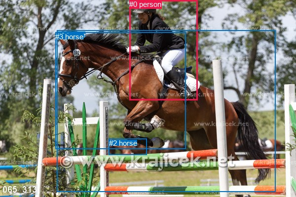
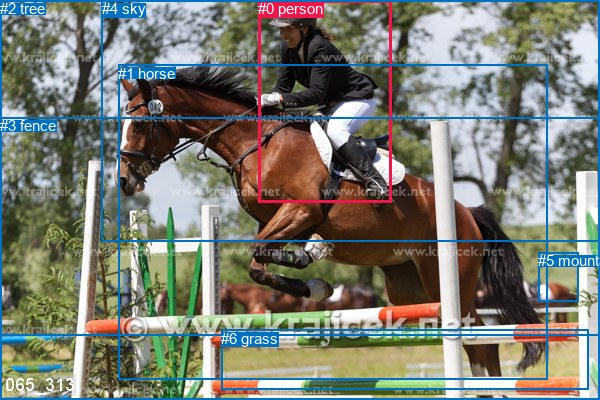

# 图片 1648：2392661.jpg

随机样本序号：273。图片 SHA256：`a5cc3e797d789950cd1cd8479d582a56ebfd37001afff0a146126792934f2b0a`。

红色框表示人，蓝色框表示其他物体。两个模式分别保留自身框编号，可依据位置比较对应对象。

## 自动检测框与输出

人的框编号：`[0]`。状态：`ok`。

### 自动检测全部物体框

| 编号 | 类别 | 是否为人 | 检测分数 | 像素坐标 xyxy |
|---|---|---|---|---|
| 0 | person | True | 0.9995 | 262.1, 0.3, 401.0, 204.0 |
| 1 | horse | False | 0.9988 | 115.6, 62.0, 558.8, 389.1 |
| 2 | horse | False | 0.9345 | 220.7, 281.8, 297.4, 314.1 |
| 3 | horse | False | 0.3550 | 112.4, 65.5, 376.2, 302.3 |

### 自动检测 Top50 人相关候选

评分物体对：12；人相关物体对：6；输出关系：12。

| 排名 | 主语编号与类别 | 关系 | 宾语编号与类别 | 类型 | 人与人 | 排序分数 | 原始融合 logit |
|---|---|---|---|---|---|---|---|
| 1 | #0 person | riding | #1 horse | semantic | False | 0.97197 | 3.5461 |
| 2 | #0 person | running on | #3 horse | semantic | False | 0.96109 | 3.2068 |
| 3 | #0 person | riding | #2 horse | semantic | False | 0.89123 | 2.1034 |
| 4 | #0 person | on | #3 horse | spatial | False | 0.47874 | -0.0851 |
| 5 | #0 person | in front of | #1 horse | spatial | False | 0.47397 | -0.1042 |
| 6 | #0 person | over | #2 horse | spatial | False | 0.24448 | -1.1283 |
| 7 | #3 horse | in front of | #0 person | spatial | False | 0.05294 | -2.8841 |
| 8 | #1 horse | in front of | #0 person | spatial | False | 0.01568 | -4.1394 |
| 9 | #1 horse | jumping over | #0 person | semantic | False | 0.00975 | -4.6208 |
| 10 | #2 horse | beside | #0 person | spatial | False | 0.00781 | -4.8440 |
| 11 | #3 horse | carrying | #0 person | semantic | False | 0.00514 | -5.2655 |
| 12 | #2 horse | wearing | #0 person | semantic | False | 0.00482 | -5.3302 |

### 自动检测逐条人相关 GT 核验

R@50：100.00%；命中 1/1。

| GT 主语编号 | GT 关系 | GT 宾语编号 | 结果阶段 | 匹配预测主语编号 | 匹配预测宾语编号 |
|---|---|---|---|---|---|
| 0 | riding | 1 | hit50 | [0] | [1] |

## 真实框与输出

人的框编号：`[0]`。

### 真实框全部物体框

| 编号 | 类别 | 是否为人 | 检测分数 | 像素坐标 xyxy |
|---|---|---|---|---|
| 0 | person | True | GT | 258.0, 0.0, 391.0, 203.0 |
| 1 | horse | False | GT | 118.0, 65.0, 548.0, 380.0 |
| 2 | tree | False | GT | 0.0, 0.0, 600.0, 336.0 |
| 3 | fence | False | GT | 0.0, 117.0, 600.0, 400.0 |
| 4 | sky | False | GT | 102.0, 0.0, 600.0, 241.0 |
| 5 | mountain | False | GT | 538.0, 252.0, 578.0, 301.0 |
| 6 | grass | False | GT | 221.0, 330.0, 588.0, 390.0 |

### 真实框 Top50 人相关候选

评分物体对：42；人相关物体对：12；输出关系：24。

| 排名 | 主语编号与类别 | 关系 | 宾语编号与类别 | 类型 | 人与人 | 排序分数 | 原始融合 logit |
|---|---|---|---|---|---|---|---|
| 1 | #0 person | riding | #1 horse | semantic | False | 0.99578 | 5.4631 |
| 2 | #0 person | on | #1 horse | spatial | False | 0.97512 | 3.6685 |
| 3 | #0 person | riding | #3 fence | semantic | False | 0.83672 | 1.6340 |
| 4 | #0 person | on | #3 fence | spatial | False | 0.74499 | 1.0721 |
| 5 | #5 mountain | looking at | #0 person | semantic | False | 0.44880 | -0.2055 |
| 6 | #1 horse | wearing | #0 person | semantic | False | 0.36351 | -0.5602 |
| 7 | #0 person | wearing | #2 tree | semantic | False | 0.31190 | -0.7913 |
| 8 | #0 person | on | #6 grass | spatial | False | 0.27034 | -0.9929 |
| 9 | #0 person | riding | #6 grass | semantic | False | 0.26720 | -1.0089 |
| 10 | #0 person | wearing | #4 sky | semantic | False | 0.21258 | -1.3095 |
| 11 | #0 person | in | #2 tree | spatial | False | 0.18333 | -1.4939 |
| 12 | #0 person | in | #4 sky | spatial | False | 0.08247 | -2.4093 |
| 13 | #1 horse | in | #0 person | spatial | False | 0.05970 | -2.7569 |
| 14 | #4 sky | beside | #0 person | spatial | False | 0.04717 | -3.0057 |
| 15 | #0 person | riding | #5 mountain | semantic | False | 0.04409 | -3.0765 |
| 16 | #2 tree | beside | #0 person | spatial | False | 0.02310 | -3.7445 |
| 17 | #5 mountain | beside | #0 person | spatial | False | 0.02212 | -3.7890 |
| 18 | #0 person | on | #5 mountain | spatial | False | 0.02067 | -3.8579 |
| 19 | #3 fence | holding | #0 person | semantic | False | 0.01175 | -4.4324 |
| 20 | #4 sky | holding | #0 person | semantic | False | 0.00739 | -4.9007 |
| 21 | #3 fence | in | #0 person | spatial | False | 0.00584 | -5.1370 |
| 22 | #2 tree | holding | #0 person | semantic | False | 0.00486 | -5.3213 |
| 23 | #6 grass | in | #0 person | spatial | False | 0.00296 | -5.8180 |
| 24 | #6 grass | wearing | #0 person | semantic | False | 0.00202 | -6.2045 |

### 真实框逐条人相关 GT 核验

R@50：100.00%；命中 1/1。

| GT 主语编号 | GT 关系 | GT 宾语编号 | 结果阶段 | 匹配预测主语编号 | 匹配预测宾语编号 |
|---|---|---|---|---|---|
| 0 | riding | 1 | hit50 | [0] | [1] |

## 全部人相关 GT

| 主语编号与类别 | 关系 | 宾语编号与类别 |
|---|---|---|
| #0 person | riding | #1 horse |

原始记录、全部人相关物体对的两项预测与分项分数见 [逐图证据 JSON](../evidence/cases/1648.json)。全部56类 logits 保留于本机 HOR/output/random500/logits/。

<!-- HOR_COMPLETE_RESULTS -->

## 六组条件的完整输出对照

以下保留同一图片三种框与候选模式、两种谓词输出规则的全部 Top50。框编号各自在所属模式内解释。

### 自动检测框完整枚举：空间与语义各保留一个谓词

| 排名 | 主语编号与类别 | 谓词 | 宾语编号与类别 | 分组 | 排序分数 | predicate logit | pair logit |
|---|---|---|---|---|---|---|---|
| 1 | #0 person | riding | #1 horse | semantic | 0.9719728 | 2.7626438 | 0.7835056 |
| 2 | #0 person | running on | #3 horse | semantic | 0.9610907 | 2.6107597 | 0.5960748 |
| 3 | #0 person | riding | #2 horse | semantic | 0.8912312 | 3.0001569 | -0.8967766 |
| 4 | #0 person | on | #3 horse | spatial | 0.4787394 | -0.6811686 | 0.5960748 |
| 5 | #0 person | in front of | #1 horse | spatial | 0.4739703 | -0.8877187 | 0.7835056 |
| 6 | #0 person | over | #2 horse | spatial | 0.2444780 | -0.2315073 | -0.8967766 |
| 7 | #3 horse | in front of | #0 person | spatial | 0.0529450 | -1.6207223 | -1.2633820 |
| 8 | #1 horse | in front of | #0 person | spatial | 0.0156823 | -2.9162488 | -1.2231684 |
| 9 | #1 horse | jumping over | #0 person | semantic | 0.0097488 | -3.3976512 | -1.2231684 |
| 10 | #2 horse | beside | #0 person | spatial | 0.0078137 | -3.8286881 | -1.0153413 |
| 11 | #3 horse | carrying | #0 person | semantic | 0.0051404 | -4.0020800 | -1.2633820 |
| 12 | #2 horse | wearing | #0 person | semantic | 0.0048196 | -4.3148842 | -1.0153413 |

GT 命中：1/1，R@50=100.00%。

| GT主语 | GT谓词 | GT宾语 | 结果阶段 | 匹配主语框 | 匹配宾语框 |
|---|---|---|---|---|---|
| 0 | riding | 1 | hit50 | [0] | [1] |

### 自动检测框完整枚举：每对只保留一个谓词

| 排名 | 主语编号与类别 | 谓词 | 宾语编号与类别 | 分组 | 排序分数 | predicate logit | pair logit |
|---|---|---|---|---|---|---|---|
| 1 | #0 person | riding | #1 horse | single | 0.9719728 | 2.7626438 | 0.7835056 |
| 2 | #0 person | running on | #3 horse | single | 0.9610907 | 2.6107597 | 0.5960748 |
| 3 | #0 person | riding | #2 horse | single | 0.8912312 | 3.0001569 | -0.8967766 |
| 4 | #3 horse | in front of | #0 person | single | 0.0529450 | -1.6207223 | -1.2633820 |
| 5 | #1 horse | in front of | #0 person | single | 0.0156823 | -2.9162488 | -1.2231684 |
| 6 | #2 horse | beside | #0 person | single | 0.0078137 | -3.8286881 | -1.0153413 |

GT 命中：1/1，R@50=100.00%。

| GT主语 | GT谓词 | GT宾语 | 结果阶段 | 匹配主语框 | 匹配宾语框 |
|---|---|---|---|---|---|
| 0 | riding | 1 | hit50 | [0] | [1] |

### 真实框完整枚举：空间与语义各保留一个谓词

| 排名 | 主语编号与类别 | 谓词 | 宾语编号与类别 | 分组 | 排序分数 | predicate logit | pair logit |
|---|---|---|---|---|---|---|---|
| 1 | #0 person | riding | #1 horse | semantic | 0.9957774 | 4.6679225 | 0.7951471 |
| 2 | #0 person | on | #1 horse | spatial | 0.9751210 | 2.8733916 | 0.7951471 |
| 3 | #0 person | riding | #3 fence | semantic | 0.8367175 | 2.0617123 | -0.4277073 |
| 4 | #0 person | on | #3 fence | spatial | 0.7449936 | 1.4997945 | -0.4277073 |
| 5 | #5 mountain | looking at | #0 person | semantic | 0.4487971 | 0.8347964 | -1.0403286 |
| 6 | #1 horse | wearing | #0 person | semantic | 0.3635085 | 0.6923962 | -1.2525645 |
| 7 | #0 person | wearing | #2 tree | semantic | 0.3118994 | 0.5404367 | -1.3316913 |
| 8 | #0 person | on | #6 grass | spatial | 0.2703438 | 0.2832284 | -1.2761075 |
| 9 | #0 person | riding | #6 grass | semantic | 0.2672001 | 0.2672329 | -1.2761075 |
| 10 | #0 person | wearing | #4 sky | semantic | 0.2125788 | -0.1217165 | -1.1877339 |
| 11 | #0 person | in | #2 tree | spatial | 0.1833331 | -0.1622353 | -1.3316913 |
| 12 | #0 person | in | #4 sky | spatial | 0.0824698 | -1.2215199 | -1.1877339 |
| 13 | #1 horse | in | #0 person | spatial | 0.0597006 | -1.5042908 | -1.2525645 |
| 14 | #4 sky | beside | #0 person | spatial | 0.0471703 | -2.3824813 | -0.6231913 |
| 15 | #0 person | riding | #5 mountain | semantic | 0.0440871 | -1.6960285 | -1.3804715 |
| 16 | #2 tree | beside | #0 person | spatial | 0.0231010 | -2.9887931 | -0.7557122 |
| 17 | #5 mountain | beside | #0 person | spatial | 0.0221190 | -2.7486243 | -1.0403286 |
| 18 | #0 person | on | #5 mountain | spatial | 0.0206748 | -2.4774766 | -1.3804715 |
| 19 | #3 fence | holding | #0 person | semantic | 0.0117459 | -3.5951655 | -0.8372717 |
| 20 | #4 sky | holding | #0 person | semantic | 0.0073867 | -4.2774734 | -0.6231913 |
| 21 | #3 fence | in | #0 person | spatial | 0.0058407 | -4.2997665 | -0.8372717 |
| 22 | #2 tree | holding | #0 person | semantic | 0.0048629 | -4.5655398 | -0.7557122 |
| 23 | #6 grass | in | #0 person | spatial | 0.0029648 | -4.6721053 | -1.1458551 |
| 24 | #6 grass | wearing | #0 person | semantic | 0.0020163 | -5.0586305 | -1.1458551 |

GT 命中：1/1，R@50=100.00%。

| GT主语 | GT谓词 | GT宾语 | 结果阶段 | 匹配主语框 | 匹配宾语框 |
|---|---|---|---|---|---|
| 0 | riding | 1 | hit50 | [0] | [1] |

### 真实框完整枚举：每对只保留一个谓词

| 排名 | 主语编号与类别 | 谓词 | 宾语编号与类别 | 分组 | 排序分数 | predicate logit | pair logit |
|---|---|---|---|---|---|---|---|
| 1 | #0 person | riding | #1 horse | single | 0.9957774 | 4.6679225 | 0.7951471 |
| 2 | #0 person | riding | #3 fence | single | 0.8367175 | 2.0617123 | -0.4277073 |
| 3 | #5 mountain | looking at | #0 person | single | 0.4487971 | 0.8347964 | -1.0403286 |
| 4 | #1 horse | wearing | #0 person | single | 0.3635085 | 0.6923962 | -1.2525645 |
| 5 | #0 person | wearing | #2 tree | single | 0.3118994 | 0.5404367 | -1.3316913 |
| 6 | #0 person | on | #6 grass | single | 0.2703438 | 0.2832284 | -1.2761075 |
| 7 | #0 person | wearing | #4 sky | single | 0.2125788 | -0.1217165 | -1.1877339 |
| 8 | #4 sky | beside | #0 person | single | 0.0471703 | -2.3824813 | -0.6231913 |
| 9 | #0 person | riding | #5 mountain | single | 0.0440871 | -1.6960285 | -1.3804715 |
| 10 | #2 tree | beside | #0 person | single | 0.0231010 | -2.9887931 | -0.7557122 |
| 11 | #3 fence | holding | #0 person | single | 0.0117459 | -3.5951655 | -0.8372717 |
| 12 | #6 grass | in | #0 person | single | 0.0029648 | -4.6721053 | -1.1458551 |

GT 命中：1/1，R@50=100.00%。

| GT主语 | GT谓词 | GT宾语 | 结果阶段 | 匹配主语框 | 匹配宾语框 |
|---|---|---|---|---|---|
| 0 | riding | 1 | hit50 | [0] | [1] |

### 真实框400候选：空间与语义各保留一个谓词

| 排名 | 主语编号与类别 | 谓词 | 宾语编号与类别 | 分组 | 排序分数 | predicate logit | pair logit |
|---|---|---|---|---|---|---|---|
| 1 | #0 person | riding | #1 horse | semantic | 0.9957784 | 4.6681666 | 0.7951471 |
| 2 | #0 person | on | #1 horse | spatial | 0.9741721 | 2.8349886 | 0.7951471 |
| 3 | #0 person | riding | #3 fence | semantic | 0.8447420 | 2.1216502 | -0.4277073 |
| 4 | #0 person | on | #3 fence | spatial | 0.7542445 | 1.5490870 | -0.4277073 |
| 5 | #5 mountain | looking at | #0 person | semantic | 0.4415371 | 0.8054023 | -1.0403286 |
| 6 | #1 horse | wearing | #0 person | semantic | 0.3648674 | 0.6982646 | -1.2525645 |
| 7 | #0 person | wearing | #2 tree | semantic | 0.3118994 | 0.5404367 | -1.3316913 |
| 8 | #0 person | on | #6 grass | spatial | 0.2714191 | 0.2886729 | -1.2761075 |
| 9 | #0 person | riding | #6 grass | semantic | 0.2672001 | 0.2672329 | -1.2761075 |
| 10 | #0 person | wearing | #4 sky | semantic | 0.2075854 | -0.1518078 | -1.1877339 |
| 11 | #0 person | in | #2 tree | spatial | 0.1866187 | -0.1404409 | -1.3316913 |
| 12 | #0 person | in | #4 sky | spatial | 0.0805893 | -1.2466333 | -1.1877339 |
| 13 | #1 horse | in | #0 person | spatial | 0.0596541 | -1.5051205 | -1.2525645 |
| 14 | #4 sky | beside | #0 person | spatial | 0.0464986 | -2.3975267 | -0.6231913 |
| 15 | #0 person | riding | #5 mountain | semantic | 0.0440922 | -1.6959062 | -1.3804715 |
| 16 | #2 tree | beside | #0 person | spatial | 0.0232681 | -2.9814150 | -0.7557122 |
| 17 | #5 mountain | beside | #0 person | spatial | 0.0217965 | -2.7636375 | -1.0403286 |
| 18 | #0 person | on | #5 mountain | spatial | 0.0209552 | -2.4637198 | -1.3804715 |
| 19 | #3 fence | holding | #0 person | semantic | 0.0120651 | -3.5680285 | -0.8372717 |
| 20 | #4 sky | holding | #0 person | semantic | 0.0073317 | -4.2849965 | -0.6231913 |
| 21 | #3 fence | in | #0 person | spatial | 0.0059484 | -4.2814021 | -0.8372717 |
| 22 | #2 tree | holding | #0 person | semantic | 0.0048925 | -4.5594254 | -0.7557122 |
| 23 | #6 grass | in | #0 person | spatial | 0.0029551 | -4.6754241 | -1.1458551 |
| 24 | #6 grass | wearing | #0 person | semantic | 0.0020423 | -5.0457854 | -1.1458551 |

GT 命中：1/1，R@50=100.00%。

| GT主语 | GT谓词 | GT宾语 | 结果阶段 | 匹配主语框 | 匹配宾语框 |
|---|---|---|---|---|---|
| 0 | riding | 1 | hit50 | [0] | [1] |

### 真实框400候选：每对只保留一个谓词

| 排名 | 主语编号与类别 | 谓词 | 宾语编号与类别 | 分组 | 排序分数 | predicate logit | pair logit |
|---|---|---|---|---|---|---|---|
| 1 | #0 person | riding | #1 horse | single | 0.9957784 | 4.6681666 | 0.7951471 |
| 2 | #0 person | riding | #3 fence | single | 0.8447420 | 2.1216502 | -0.4277073 |
| 3 | #5 mountain | looking at | #0 person | single | 0.4415371 | 0.8054023 | -1.0403286 |
| 4 | #1 horse | wearing | #0 person | single | 0.3648674 | 0.6982646 | -1.2525645 |
| 5 | #0 person | wearing | #2 tree | single | 0.3118994 | 0.5404367 | -1.3316913 |
| 6 | #0 person | on | #6 grass | single | 0.2714191 | 0.2886729 | -1.2761075 |
| 7 | #0 person | wearing | #4 sky | single | 0.2075854 | -0.1518078 | -1.1877339 |
| 8 | #4 sky | beside | #0 person | single | 0.0464986 | -2.3975267 | -0.6231913 |
| 9 | #0 person | riding | #5 mountain | single | 0.0440922 | -1.6959062 | -1.3804715 |
| 10 | #2 tree | beside | #0 person | single | 0.0232681 | -2.9814150 | -0.7557122 |
| 11 | #3 fence | holding | #0 person | single | 0.0120651 | -3.5680285 | -0.8372717 |
| 12 | #6 grass | in | #0 person | single | 0.0029551 | -4.6754241 | -1.1458551 |

GT 命中：1/1，R@50=100.00%。

| GT主语 | GT谓词 | GT宾语 | 结果阶段 | 匹配主语框 | 匹配宾语框 |
|---|---|---|---|---|---|
| 0 | riding | 1 | hit50 | [0] | [1] |
