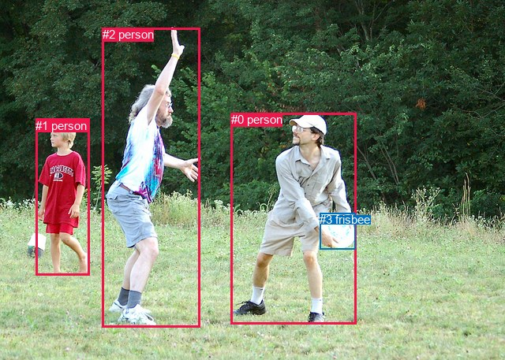
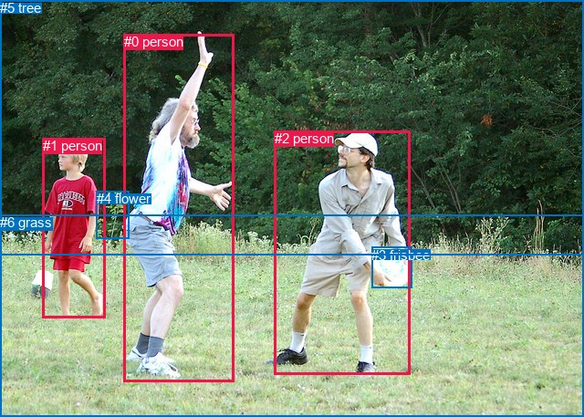

# 图片 1673：2393510.jpg

随机样本序号：125。图片 SHA256：`44b225eaff012bd016fcfe8a3dbeace93fd418164f40e4b5f5b9f0d76f39097b`。

红色框表示人，蓝色框表示其他物体。两个模式分别保留自身框编号，可依据位置比较对应对象。

## 自动检测框与输出

人的框编号：`[0, 1, 2]`。状态：`ok`。

### 自动检测全部物体框

| 编号 | 类别 | 是否为人 | 检测分数 | 像素坐标 xyxy |
|---|---|---|---|---|
| 0 | person | True | 0.9997 | 292.7, 143.4, 451.3, 411.7 |
| 1 | person | True | 0.9997 | 45.2, 150.9, 113.9, 349.6 |
| 2 | person | True | 0.9996 | 129.8, 35.4, 254.0, 416.0 |
| 3 | frisbee | False | 0.9988 | 405.0, 270.3, 450.2, 316.1 |

### 自动检测 Top50 人相关候选

评分物体对：12；人相关物体对：12；输出关系：24。

| 排名 | 主语编号与类别 | 关系 | 宾语编号与类别 | 类型 | 人与人 | 排序分数 | 原始融合 logit |
|---|---|---|---|---|---|---|---|
| 1 | #0 person | holding | #3 frisbee | semantic | False | 0.99363 | 5.0495 |
| 2 | #2 person | throwing | #3 frisbee | semantic | False | 0.92492 | 2.5112 |
| 3 | #2 person | chasing | #0 person | semantic | True | 0.89703 | 2.1646 |
| 4 | #0 person | looking at | #2 person | semantic | True | 0.89440 | 2.1365 |
| 5 | #1 person | looking at | #2 person | semantic | True | 0.85802 | 1.7990 |
| 6 | #2 person | playing with | #1 person | semantic | True | 0.83302 | 1.6072 |
| 7 | #0 person | in | #3 frisbee | spatial | False | 0.76547 | 1.1829 |
| 8 | #1 person | playing | #0 person | semantic | True | 0.73853 | 1.0383 |
| 9 | #1 person | catching | #3 frisbee | semantic | False | 0.72649 | 0.9769 |
| 10 | #2 person | beside | #1 person | spatial | True | 0.68532 | 0.7783 |
| 11 | #2 person | beside | #0 person | spatial | True | 0.63955 | 0.5734 |
| 12 | #0 person | beside | #2 person | spatial | True | 0.62490 | 0.5104 |
| 13 | #1 person | beside | #2 person | spatial | True | 0.59735 | 0.3944 |
| 14 | #1 person | beside | #0 person | spatial | True | 0.35768 | -0.5854 |
| 15 | #3 frisbee | beside | #0 person | spatial | False | 0.27332 | -0.9778 |
| 16 | #0 person | playing with | #1 person | semantic | True | 0.24535 | -1.1236 |
| 17 | #0 person | beside | #1 person | spatial | True | 0.16826 | -1.5980 |
| 18 | #2 person | beside | #3 frisbee | spatial | False | 0.09145 | -2.2960 |
| 19 | #3 frisbee | looking at | #0 person | semantic | False | 0.08655 | -2.3565 |
| 20 | #1 person | in | #3 frisbee | spatial | False | 0.04238 | -3.1178 |
| 21 | #3 frisbee | in | #2 person | spatial | False | 0.02373 | -3.7169 |
| 22 | #3 frisbee | holding | #2 person | semantic | False | 0.01402 | -4.2535 |
| 23 | #3 frisbee | in front of | #1 person | spatial | False | 0.00340 | -5.6792 |
| 24 | #3 frisbee | holding | #1 person | semantic | False | 0.00298 | -5.8142 |

### 自动检测逐条人相关 GT 核验

R@50：40.00%；命中 2/5。

| GT 主语编号 | GT 关系 | GT 宾语编号 | 结果阶段 | 匹配预测主语编号 | 匹配预测宾语编号 |
|---|---|---|---|---|---|
| 0 | playing with | 2 | wrong_predicate | [2] | [0] |
| 1 | walking on | 6 | endpoint_missing_or_wrong_class | [1] | [] |
| 2 | looking at | 0 | hit50 | [0] | [2] |
| 2 | holding | 3 | hit50 | [0] | [3] |
| 2 | throwing | 3 | wrong_predicate | [0] | [3] |

## 真实框与输出

人的框编号：`[0, 1, 2]`。

### 真实框全部物体框

| 编号 | 类别 | 是否为人 | 检测分数 | 像素坐标 xyxy |
|---|---|---|---|---|
| 0 | person | True | GT | 136.0, 37.0, 257.0, 418.0 |
| 1 | person | True | GT | 47.0, 151.0, 116.0, 349.0 |
| 2 | person | True | GT | 301.0, 143.0, 450.0, 411.0 |
| 3 | frisbee | False | GT | 407.0, 271.0, 451.0, 316.0 |
| 4 | flower | False | GT | 106.0, 209.0, 142.0, 261.0 |
| 5 | tree | False | GT | 0.0, 0.0, 640.0, 280.0 |
| 6 | grass | False | GT | 0.0, 235.0, 640.0, 457.0 |

### 真实框 Top50 人相关候选

评分物体对：42；人相关物体对：30；输出关系：50。

| 排名 | 主语编号与类别 | 关系 | 宾语编号与类别 | 类型 | 人与人 | 排序分数 | 原始融合 logit |
|---|---|---|---|---|---|---|---|
| 1 | #2 person | holding | #3 frisbee | semantic | False | 0.99228 | 4.8561 |
| 2 | #0 person | playing with | #2 person | semantic | True | 0.97151 | 3.5291 |
| 3 | #0 person | playing with | #6 grass | semantic | False | 0.97006 | 3.4782 |
| 4 | #0 person | throwing | #3 frisbee | semantic | False | 0.96718 | 3.3834 |
| 5 | #1 person | running on | #6 grass | semantic | False | 0.96643 | 3.3601 |
| 6 | #2 person | standing on | #6 grass | semantic | False | 0.96319 | 3.2644 |
| 7 | #2 person | playing | #0 person | semantic | True | 0.93636 | 2.6888 |
| 8 | #1 person | in | #6 grass | spatial | False | 0.92454 | 2.5056 |
| 9 | #1 person | playing | #3 frisbee | semantic | False | 0.91854 | 2.4227 |
| 10 | #2 person | on | #6 grass | spatial | False | 0.91497 | 2.3758 |
| 11 | #0 person | on | #6 grass | spatial | False | 0.89760 | 2.1708 |
| 12 | #1 person | playing | #0 person | semantic | True | 0.84447 | 1.6919 |
| 13 | #0 person | playing with | #1 person | semantic | True | 0.83851 | 1.6472 |
| 14 | #2 person | in | #3 frisbee | spatial | False | 0.77716 | 1.2492 |
| 15 | #4 flower | beside | #1 person | spatial | False | 0.73847 | 1.0380 |
| 16 | #1 person | playing | #2 person | semantic | True | 0.71124 | 0.9014 |
| 17 | #0 person | playing with | #5 tree | semantic | False | 0.69943 | 0.8446 |
| 18 | #2 person | playing | #1 person | semantic | True | 0.68960 | 0.7982 |
| 19 | #1 person | beside | #0 person | spatial | True | 0.50117 | 0.0047 |
| 20 | #0 person | beside | #2 person | spatial | True | 0.47027 | -0.1191 |
| 21 | #1 person | running on | #4 flower | semantic | False | 0.46386 | -0.1448 |
| 22 | #2 person | beside | #0 person | spatial | True | 0.43986 | -0.2417 |
| 23 | #1 person | playing | #5 tree | semantic | False | 0.40793 | -0.3725 |
| 24 | #4 flower | beside | #0 person | spatial | False | 0.39297 | -0.4349 |
| 25 | #2 person | playing | #5 tree | semantic | False | 0.37913 | -0.4933 |
| 26 | #3 frisbee | holding | #2 person | semantic | False | 0.35328 | -0.6046 |
| 27 | #1 person | in | #4 flower | spatial | False | 0.31785 | -0.7637 |
| 28 | #3 frisbee | in | #2 person | spatial | False | 0.31648 | -0.7700 |
| 29 | #0 person | playing | #4 flower | semantic | False | 0.27377 | -0.9756 |
| 30 | #2 person | in front of | #5 tree | spatial | False | 0.24858 | -1.1062 |
| 31 | #0 person | beside | #1 person | spatial | True | 0.23447 | -1.1833 |
| 32 | #0 person | in | #5 tree | spatial | False | 0.20318 | -1.3666 |
| 33 | #1 person | in | #5 tree | spatial | False | 0.19896 | -1.3928 |
| 34 | #5 tree | beside | #0 person | spatial | False | 0.19409 | -1.4236 |
| 35 | #4 flower | looking at | #1 person | semantic | False | 0.19143 | -1.4407 |
| 36 | #5 tree | looking at | #0 person | semantic | False | 0.17603 | -1.5435 |
| 37 | #4 flower | looking at | #0 person | semantic | False | 0.17172 | -1.5735 |
| 38 | #1 person | beside | #2 person | spatial | True | 0.17163 | -1.5741 |
| 39 | #5 tree | beside | #2 person | spatial | False | 0.14598 | -1.7664 |
| 40 | #6 grass | beside | #2 person | spatial | False | 0.14382 | -1.7839 |
| 41 | #5 tree | looking at | #2 person | semantic | False | 0.13781 | -1.8336 |
| 42 | #4 flower | beside | #2 person | spatial | False | 0.13024 | -1.8989 |
| 43 | #0 person | in | #3 frisbee | spatial | False | 0.11519 | -2.0388 |
| 44 | #6 grass | holding | #2 person | semantic | False | 0.07895 | -2.4567 |
| 45 | #5 tree | beside | #1 person | spatial | False | 0.07369 | -2.5313 |
| 46 | #3 frisbee | holding | #0 person | semantic | False | 0.07326 | -2.5377 |
| 47 | #6 grass | in | #0 person | spatial | False | 0.07285 | -2.5437 |
| 48 | #2 person | in | #1 person | spatial | True | 0.06444 | -2.6754 |
| 49 | #3 frisbee | in | #0 person | spatial | False | 0.05857 | -2.7772 |
| 50 | #0 person | in | #4 flower | spatial | False | 0.04539 | -3.0460 |

### 真实框逐条人相关 GT 核验

R@50：40.00%；命中 2/5。

| GT 主语编号 | GT 关系 | GT 宾语编号 | 结果阶段 | 匹配预测主语编号 | 匹配预测宾语编号 |
|---|---|---|---|---|---|
| 0 | playing with | 2 | hit50 | [0] | [2] |
| 1 | walking on | 6 | wrong_predicate | [1] | [6] |
| 2 | looking at | 0 | wrong_predicate | [2] | [0] |
| 2 | holding | 3 | hit50 | [2] | [3] |
| 2 | throwing | 3 | wrong_predicate | [2] | [3] |

## 全部人相关 GT

| 主语编号与类别 | 关系 | 宾语编号与类别 |
|---|---|---|
| #0 person | playing with | #2 person |
| #1 person | walking on | #6 grass |
| #2 person | looking at | #0 person |
| #2 person | holding | #3 frisbee |
| #2 person | throwing | #3 frisbee |

原始记录、全部人相关物体对的两项预测与分项分数见 [逐图证据 JSON](../evidence/cases/1673.json)。全部56类 logits 保留于本机 HOR/output/random500/logits/。

<!-- HOR_COMPLETE_RESULTS -->

## 六组条件的完整输出对照

以下保留同一图片三种框与候选模式、两种谓词输出规则的全部 Top50。框编号各自在所属模式内解释。

### 自动检测框完整枚举：空间与语义各保留一个谓词

| 排名 | 主语编号与类别 | 谓词 | 宾语编号与类别 | 分组 | 排序分数 | predicate logit | pair logit |
|---|---|---|---|---|---|---|---|
| 1 | #0 person | holding | #3 frisbee | semantic | 0.9936283 | 4.6063066 | 0.4432052 |
| 2 | #2 person | throwing | #3 frisbee | semantic | 0.9249218 | 3.1665897 | -0.6554102 |
| 3 | #2 person | chasing | #0 person | semantic | 0.8970260 | 3.1742945 | -1.0096858 |
| 4 | #0 person | looking at | #2 person | semantic | 0.8944036 | 2.9358454 | -0.7993119 |
| 5 | #1 person | looking at | #2 person | semantic | 0.8580230 | 2.6264577 | -0.8274912 |
| 6 | #2 person | playing with | #1 person | semantic | 0.8330187 | 3.0695400 | -1.4623656 |
| 7 | #0 person | in | #3 frisbee | spatial | 0.7654721 | 0.7397127 | 0.4432052 |
| 8 | #1 person | playing | #0 person | semantic | 0.7385313 | 1.7623725 | -0.7240234 |
| 9 | #1 person | catching | #3 frisbee | semantic | 0.7264917 | 1.5667391 | -0.5898440 |
| 10 | #2 person | beside | #1 person | spatial | 0.6853186 | 2.2406888 | -1.4623656 |
| 11 | #2 person | beside | #0 person | spatial | 0.6395451 | 1.5830760 | -1.0096858 |
| 12 | #0 person | beside | #2 person | spatial | 0.6248999 | 1.3097105 | -0.7993119 |
| 13 | #1 person | beside | #2 person | spatial | 0.5973492 | 1.2219234 | -0.8274912 |
| 14 | #1 person | beside | #0 person | spatial | 0.3576811 | 0.1385803 | -0.7240234 |
| 15 | #3 frisbee | beside | #0 person | spatial | 0.2733202 | -0.0461884 | -0.9316534 |
| 16 | #0 person | playing with | #1 person | semantic | 0.2453512 | -0.0840673 | -1.0394948 |
| 17 | #0 person | beside | #1 person | spatial | 0.1682552 | -0.5585489 | -1.0394948 |
| 18 | #2 person | beside | #3 frisbee | spatial | 0.0914523 | -1.6406198 | -0.6554102 |
| 19 | #3 frisbee | looking at | #0 person | semantic | 0.0865531 | -1.4248142 | -0.9316534 |
| 20 | #1 person | in | #3 frisbee | spatial | 0.0423788 | -2.5279598 | -0.5898440 |
| 21 | #3 frisbee | in | #2 person | spatial | 0.0237330 | -2.1022203 | -1.6146480 |
| 22 | #3 frisbee | holding | #2 person | semantic | 0.0140152 | -2.6388476 | -1.6146480 |
| 23 | #3 frisbee | in front of | #1 person | spatial | 0.0034048 | -3.7778497 | -1.9013097 |
| 24 | #3 frisbee | holding | #1 person | semantic | 0.0029760 | -3.9128826 | -1.9013097 |

GT 命中：2/5，R@50=40.00%。

| GT主语 | GT谓词 | GT宾语 | 结果阶段 | 匹配主语框 | 匹配宾语框 |
|---|---|---|---|---|---|
| 0 | playing with | 2 | wrong_predicate | [2] | [0] |
| 1 | walking on | 6 | endpoint_missing_or_wrong_class | [1] | [] |
| 2 | looking at | 0 | hit50 | [0] | [2] |
| 2 | holding | 3 | hit50 | [0] | [3] |
| 2 | throwing | 3 | wrong_predicate | [0] | [3] |

### 自动检测框完整枚举：每对只保留一个谓词

| 排名 | 主语编号与类别 | 谓词 | 宾语编号与类别 | 分组 | 排序分数 | predicate logit | pair logit |
|---|---|---|---|---|---|---|---|
| 1 | #0 person | holding | #3 frisbee | single | 0.9936283 | 4.6063066 | 0.4432052 |
| 2 | #2 person | throwing | #3 frisbee | single | 0.9249218 | 3.1665897 | -0.6554102 |
| 3 | #2 person | chasing | #0 person | single | 0.8970260 | 3.1742945 | -1.0096858 |
| 4 | #0 person | looking at | #2 person | single | 0.8944036 | 2.9358454 | -0.7993119 |
| 5 | #1 person | looking at | #2 person | single | 0.8580230 | 2.6264577 | -0.8274912 |
| 6 | #2 person | playing with | #1 person | single | 0.8330187 | 3.0695400 | -1.4623656 |
| 7 | #1 person | playing | #0 person | single | 0.7385313 | 1.7623725 | -0.7240234 |
| 8 | #1 person | catching | #3 frisbee | single | 0.7264917 | 1.5667391 | -0.5898440 |
| 9 | #3 frisbee | beside | #0 person | single | 0.2733202 | -0.0461884 | -0.9316534 |
| 10 | #0 person | playing with | #1 person | single | 0.2453512 | -0.0840673 | -1.0394948 |
| 11 | #3 frisbee | in | #2 person | single | 0.0237330 | -2.1022203 | -1.6146480 |
| 12 | #3 frisbee | in front of | #1 person | single | 0.0034048 | -3.7778497 | -1.9013097 |

GT 命中：2/5，R@50=40.00%。

| GT主语 | GT谓词 | GT宾语 | 结果阶段 | 匹配主语框 | 匹配宾语框 |
|---|---|---|---|---|---|
| 0 | playing with | 2 | wrong_predicate | [2] | [0] |
| 1 | walking on | 6 | endpoint_missing_or_wrong_class | [1] | [] |
| 2 | looking at | 0 | hit50 | [0] | [2] |
| 2 | holding | 3 | hit50 | [0] | [3] |
| 2 | throwing | 3 | wrong_predicate | [0] | [3] |

### 真实框完整枚举：空间与语义各保留一个谓词

| 排名 | 主语编号与类别 | 谓词 | 宾语编号与类别 | 分组 | 排序分数 | predicate logit | pair logit |
|---|---|---|---|---|---|---|---|
| 1 | #2 person | holding | #3 frisbee | semantic | 0.9922794 | 4.4165578 | 0.4395500 |
| 2 | #0 person | playing with | #2 person | semantic | 0.9715055 | 4.5731006 | -1.0439657 |
| 3 | #0 person | playing with | #6 grass | semantic | 0.9700617 | 3.7667108 | -0.2884890 |
| 4 | #0 person | throwing | #3 frisbee | semantic | 0.9671804 | 4.0691571 | -0.6857967 |
| 5 | #1 person | running on | #6 grass | semantic | 0.9664326 | 3.2522793 | 0.1077763 |
| 6 | #2 person | standing on | #6 grass | semantic | 0.9631866 | 3.3137317 | -0.0493471 |
| 7 | #2 person | playing | #0 person | semantic | 0.9363611 | 3.4933038 | -0.8045284 |
| 8 | #1 person | in | #6 grass | spatial | 0.9245352 | 2.3978481 | 0.1077763 |
| 9 | #1 person | playing | #3 frisbee | semantic | 0.9185406 | 3.0021491 | -0.5794671 |
| 10 | #2 person | on | #6 grass | spatial | 0.9149657 | 2.4251800 | -0.0493471 |
| 11 | #0 person | on | #6 grass | spatial | 0.8975973 | 2.4592967 | -0.2884890 |
| 12 | #1 person | playing | #0 person | semantic | 0.8444741 | 2.5206890 | -0.8287871 |
| 13 | #0 person | playing with | #1 person | semantic | 0.8385090 | 3.1196980 | -1.4725215 |
| 14 | #2 person | in | #3 frisbee | spatial | 0.7771577 | 0.8096294 | 0.4395500 |
| 15 | #4 flower | beside | #1 person | spatial | 0.7384658 | 1.7300048 | -0.6919953 |
| 16 | #1 person | playing | #2 person | semantic | 0.7112421 | 1.6238050 | -0.7223811 |
| 17 | #0 person | playing with | #5 tree | semantic | 0.6994321 | 1.9461398 | -1.1015447 |
| 18 | #2 person | playing | #1 person | semantic | 0.6895961 | 1.8528280 | -1.0545964 |
| 19 | #1 person | beside | #0 person | spatial | 0.5011669 | 0.8334546 | -0.8287871 |
| 20 | #0 person | beside | #2 person | spatial | 0.4702650 | 0.9248853 | -1.0439657 |
| 21 | #1 person | running on | #4 flower | semantic | 0.4638628 | 1.3132229 | -1.4580240 |
| 22 | #2 person | beside | #0 person | spatial | 0.4398622 | 0.5628071 | -0.8045284 |
| 23 | #1 person | playing | #5 tree | semantic | 0.4079282 | 0.5698357 | -0.9423723 |
| 24 | #4 flower | beside | #0 person | spatial | 0.3929654 | 0.5897174 | -1.0245818 |
| 25 | #2 person | playing | #5 tree | semantic | 0.3791254 | 0.4163623 | -0.9096242 |
| 26 | #3 frisbee | holding | #2 person | semantic | 0.3532848 | 0.3328800 | -0.9375116 |
| 27 | #1 person | in | #4 flower | spatial | 0.3178521 | 0.6943636 | -1.4580240 |
| 28 | #3 frisbee | in | #2 person | spatial | 0.3164840 | 0.1675344 | -0.9375116 |
| 29 | #0 person | playing | #4 flower | semantic | 0.2737685 | 1.0759459 | -2.0515318 |
| 30 | #2 person | in front of | #5 tree | spatial | 0.2485783 | -0.1965852 | -0.9096242 |
| 31 | #0 person | beside | #1 person | spatial | 0.2344677 | 0.2892680 | -1.4725215 |
| 32 | #0 person | in | #5 tree | spatial | 0.2031763 | -0.2650146 | -1.1015447 |
| 33 | #1 person | in | #5 tree | spatial | 0.1989592 | -0.4504395 | -0.9423723 |
| 34 | #5 tree | beside | #0 person | spatial | 0.1940908 | -1.1117821 | -0.3118629 |
| 35 | #4 flower | looking at | #1 person | semantic | 0.1914296 | -0.7487521 | -0.6919953 |
| 36 | #5 tree | looking at | #0 person | semantic | 0.1760315 | -1.2316067 | -0.3118629 |
| 37 | #4 flower | looking at | #0 person | semantic | 0.1717175 | -0.5489216 | -1.0245818 |
| 38 | #1 person | beside | #2 person | spatial | 0.1716335 | -0.8517129 | -0.7223811 |
| 39 | #5 tree | beside | #2 person | spatial | 0.1459849 | -1.4268730 | -0.3395728 |
| 40 | #6 grass | beside | #2 person | spatial | 0.1438168 | -0.8235586 | -0.9603856 |
| 41 | #5 tree | looking at | #2 person | semantic | 0.1378060 | -1.4940605 | -0.3395728 |
| 42 | #4 flower | beside | #2 person | spatial | 0.1302364 | -0.5564380 | -1.3424326 |
| 43 | #0 person | in | #3 frisbee | spatial | 0.1151929 | -1.3529644 | -0.6857967 |
| 44 | #6 grass | holding | #2 person | semantic | 0.0789471 | -1.4963536 | -0.9603856 |
| 45 | #5 tree | beside | #1 person | spatial | 0.0736914 | -1.8953254 | -0.6359957 |
| 46 | #3 frisbee | holding | #0 person | semantic | 0.0732590 | -0.9079075 | -1.6297649 |
| 47 | #6 grass | in | #0 person | spatial | 0.0728499 | -1.4462128 | -1.0975013 |
| 48 | #2 person | in | #1 person | spatial | 0.0644414 | -1.6207905 | -1.0545964 |
| 49 | #3 frisbee | in | #0 person | spatial | 0.0585710 | -1.1473949 | -1.6297649 |
| 50 | #0 person | in | #4 flower | spatial | 0.0453887 | -0.9945102 | -2.0515318 |

GT 命中：2/5，R@50=40.00%。

| GT主语 | GT谓词 | GT宾语 | 结果阶段 | 匹配主语框 | 匹配宾语框 |
|---|---|---|---|---|---|
| 0 | playing with | 2 | hit50 | [0] | [2] |
| 1 | walking on | 6 | wrong_predicate | [1] | [6] |
| 2 | looking at | 0 | wrong_predicate | [2] | [0] |
| 2 | holding | 3 | hit50 | [2] | [3] |
| 2 | throwing | 3 | wrong_predicate | [2] | [3] |

### 真实框完整枚举：每对只保留一个谓词

| 排名 | 主语编号与类别 | 谓词 | 宾语编号与类别 | 分组 | 排序分数 | predicate logit | pair logit |
|---|---|---|---|---|---|---|---|
| 1 | #2 person | holding | #3 frisbee | single | 0.9922794 | 4.4165578 | 0.4395500 |
| 2 | #0 person | playing with | #2 person | single | 0.9715055 | 4.5731006 | -1.0439657 |
| 3 | #0 person | playing with | #6 grass | single | 0.9700617 | 3.7667108 | -0.2884890 |
| 4 | #0 person | throwing | #3 frisbee | single | 0.9671804 | 4.0691571 | -0.6857967 |
| 5 | #1 person | running on | #6 grass | single | 0.9664326 | 3.2522793 | 0.1077763 |
| 6 | #2 person | standing on | #6 grass | single | 0.9631866 | 3.3137317 | -0.0493471 |
| 7 | #2 person | playing | #0 person | single | 0.9363611 | 3.4933038 | -0.8045284 |
| 8 | #1 person | playing | #3 frisbee | single | 0.9185406 | 3.0021491 | -0.5794671 |
| 9 | #1 person | playing | #0 person | single | 0.8444741 | 2.5206890 | -0.8287871 |
| 10 | #0 person | playing with | #1 person | single | 0.8385090 | 3.1196980 | -1.4725215 |
| 11 | #4 flower | beside | #1 person | single | 0.7384658 | 1.7300048 | -0.6919953 |
| 12 | #1 person | playing | #2 person | single | 0.7112421 | 1.6238050 | -0.7223811 |
| 13 | #0 person | playing with | #5 tree | single | 0.6994321 | 1.9461398 | -1.1015447 |
| 14 | #2 person | playing | #1 person | single | 0.6895961 | 1.8528280 | -1.0545964 |
| 15 | #1 person | running on | #4 flower | single | 0.4638628 | 1.3132229 | -1.4580240 |
| 16 | #1 person | playing | #5 tree | single | 0.4079282 | 0.5698357 | -0.9423723 |
| 17 | #4 flower | beside | #0 person | single | 0.3929654 | 0.5897174 | -1.0245818 |
| 18 | #2 person | playing | #5 tree | single | 0.3791254 | 0.4163623 | -0.9096242 |
| 19 | #3 frisbee | holding | #2 person | single | 0.3532848 | 0.3328800 | -0.9375116 |
| 20 | #0 person | playing | #4 flower | single | 0.2737685 | 1.0759459 | -2.0515318 |
| 21 | #5 tree | beside | #0 person | single | 0.1940908 | -1.1117821 | -0.3118629 |
| 22 | #5 tree | beside | #2 person | single | 0.1459849 | -1.4268730 | -0.3395728 |
| 23 | #6 grass | beside | #2 person | single | 0.1438168 | -0.8235586 | -0.9603856 |
| 24 | #4 flower | beside | #2 person | single | 0.1302364 | -0.5564380 | -1.3424326 |
| 25 | #5 tree | beside | #1 person | single | 0.0736914 | -1.8953254 | -0.6359957 |
| 26 | #3 frisbee | holding | #0 person | single | 0.0732590 | -0.9079075 | -1.6297649 |
| 27 | #6 grass | in | #0 person | single | 0.0728499 | -1.4462128 | -1.0975013 |
| 28 | #6 grass | in | #1 person | single | 0.0450444 | -1.9570961 | -1.0969212 |
| 29 | #2 person | playing | #4 flower | single | 0.0295464 | -1.2416739 | -2.2501273 |
| 30 | #3 frisbee | holding | #1 person | single | 0.0186173 | -2.0593290 | -1.9055438 |

GT 命中：2/5，R@50=40.00%。

| GT主语 | GT谓词 | GT宾语 | 结果阶段 | 匹配主语框 | 匹配宾语框 |
|---|---|---|---|---|---|
| 0 | playing with | 2 | hit50 | [0] | [2] |
| 1 | walking on | 6 | wrong_predicate | [1] | [6] |
| 2 | looking at | 0 | wrong_predicate | [2] | [0] |
| 2 | holding | 3 | hit50 | [2] | [3] |
| 2 | throwing | 3 | wrong_predicate | [2] | [3] |

### 真实框400候选：空间与语义各保留一个谓词

| 排名 | 主语编号与类别 | 谓词 | 宾语编号与类别 | 分组 | 排序分数 | predicate logit | pair logit |
|---|---|---|---|---|---|---|---|
| 1 | #2 person | holding | #3 frisbee | semantic | 0.9922794 | 4.4165578 | 0.4395500 |
| 2 | #0 person | playing with | #2 person | semantic | 0.9730725 | 4.6312785 | -1.0439657 |
| 3 | #0 person | playing with | #6 grass | semantic | 0.9700617 | 3.7667108 | -0.2884890 |
| 4 | #0 person | throwing | #3 frisbee | semantic | 0.9671804 | 4.0691571 | -0.6857967 |
| 5 | #1 person | running on | #6 grass | semantic | 0.9664326 | 3.2522793 | 0.1077763 |
| 6 | #2 person | standing on | #6 grass | semantic | 0.9612665 | 3.2608938 | -0.0493471 |
| 7 | #2 person | playing | #0 person | semantic | 0.9363611 | 3.4933038 | -0.8045284 |
| 8 | #1 person | in | #6 grass | spatial | 0.9245352 | 2.3978481 | 0.1077763 |
| 9 | #1 person | playing | #3 frisbee | semantic | 0.9185406 | 3.0021491 | -0.5794671 |
| 10 | #2 person | on | #6 grass | spatial | 0.9145412 | 2.4197350 | -0.0493471 |
| 11 | #0 person | on | #6 grass | spatial | 0.8975973 | 2.4592967 | -0.2884890 |
| 12 | #1 person | playing | #0 person | semantic | 0.8444741 | 2.5206890 | -0.8287871 |
| 13 | #0 person | playing with | #1 person | semantic | 0.8383734 | 3.1186962 | -1.4725215 |
| 14 | #2 person | in | #3 frisbee | spatial | 0.7811931 | 0.8330832 | 0.4395500 |
| 15 | #4 flower | beside | #1 person | spatial | 0.7442246 | 1.7600384 | -0.6919953 |
| 16 | #1 person | playing | #2 person | semantic | 0.7112421 | 1.6238050 | -0.7223811 |
| 17 | #2 person | playing | #1 person | semantic | 0.6954871 | 1.8804955 | -1.0545964 |
| 18 | #0 person | playing with | #5 tree | semantic | 0.6931750 | 1.9165497 | -1.1015447 |
| 19 | #1 person | beside | #0 person | spatial | 0.5011669 | 0.8334546 | -0.8287871 |
| 20 | #0 person | beside | #2 person | spatial | 0.4702650 | 0.9248853 | -1.0439657 |
| 21 | #1 person | running on | #4 flower | semantic | 0.4638628 | 1.3132229 | -1.4580240 |
| 22 | #2 person | beside | #0 person | spatial | 0.4325048 | 0.5328894 | -0.8045284 |
| 23 | #1 person | playing | #5 tree | semantic | 0.4079282 | 0.5698357 | -0.9423723 |
| 24 | #4 flower | beside | #0 person | spatial | 0.3929654 | 0.5897174 | -1.0245818 |
| 25 | #2 person | playing | #5 tree | semantic | 0.3862338 | 0.4464531 | -0.9096242 |
| 26 | #3 frisbee | holding | #2 person | semantic | 0.3484498 | 0.3116512 | -0.9375116 |
| 27 | #1 person | in | #4 flower | spatial | 0.3178521 | 0.6943636 | -1.4580240 |
| 28 | #3 frisbee | in | #2 person | spatial | 0.3157665 | 0.1642156 | -0.9375116 |
| 29 | #0 person | playing | #4 flower | semantic | 0.2788160 | 1.1011896 | -2.0515318 |
| 30 | #2 person | in front of | #5 tree | spatial | 0.2599889 | -0.1364021 | -0.9096242 |
| 31 | #0 person | beside | #1 person | spatial | 0.2291302 | 0.2592926 | -1.4725215 |
| 32 | #1 person | in | #5 tree | spatial | 0.1984309 | -0.4537582 | -0.9423723 |
| 33 | #0 person | in | #5 tree | spatial | 0.1975578 | -0.3000841 | -1.1015447 |
| 34 | #4 flower | looking at | #1 person | semantic | 0.1960756 | -0.7190096 | -0.6919953 |
| 35 | #5 tree | beside | #0 person | spatial | 0.1940840 | -1.1118255 | -0.3118629 |
| 36 | #5 tree | looking at | #0 person | semantic | 0.1739099 | -1.2463036 | -0.3118629 |
| 37 | #4 flower | looking at | #0 person | semantic | 0.1717175 | -0.5489216 | -1.0245818 |
| 38 | #1 person | beside | #2 person | spatial | 0.1694968 | -0.8668165 | -0.7223811 |
| 39 | #5 tree | beside | #2 person | spatial | 0.1478689 | -1.4118414 | -0.3395728 |
| 40 | #6 grass | beside | #2 person | spatial | 0.1438168 | -0.8235586 | -0.9603856 |
| 41 | #5 tree | looking at | #2 person | semantic | 0.1396034 | -1.4790151 | -0.3395728 |
| 42 | #4 flower | beside | #2 person | spatial | 0.1268655 | -0.5865293 | -1.3424326 |
| 43 | #0 person | in | #3 frisbee | spatial | 0.1151929 | -1.3529644 | -0.6857967 |
| 44 | #6 grass | holding | #2 person | semantic | 0.0791084 | -1.4941378 | -0.9603856 |
| 45 | #3 frisbee | holding | #0 person | semantic | 0.0732590 | -0.9079075 | -1.6297649 |
| 46 | #6 grass | in | #0 person | spatial | 0.0728499 | -1.4462128 | -1.0975013 |
| 47 | #5 tree | beside | #1 person | spatial | 0.0726680 | -1.9104145 | -0.6359957 |
| 48 | #2 person | in | #1 person | spatial | 0.0645415 | -1.6191311 | -1.0545964 |
| 49 | #3 frisbee | in | #0 person | spatial | 0.0586625 | -1.1457355 | -1.6297649 |
| 50 | #0 person | in | #4 flower | spatial | 0.0455327 | -0.9911914 | -2.0515318 |

GT 命中：2/5，R@50=40.00%。

| GT主语 | GT谓词 | GT宾语 | 结果阶段 | 匹配主语框 | 匹配宾语框 |
|---|---|---|---|---|---|
| 0 | playing with | 2 | hit50 | [0] | [2] |
| 1 | walking on | 6 | wrong_predicate | [1] | [6] |
| 2 | looking at | 0 | wrong_predicate | [2] | [0] |
| 2 | holding | 3 | hit50 | [2] | [3] |
| 2 | throwing | 3 | wrong_predicate | [2] | [3] |

### 真实框400候选：每对只保留一个谓词

| 排名 | 主语编号与类别 | 谓词 | 宾语编号与类别 | 分组 | 排序分数 | predicate logit | pair logit |
|---|---|---|---|---|---|---|---|
| 1 | #2 person | holding | #3 frisbee | single | 0.9922794 | 4.4165578 | 0.4395500 |
| 2 | #0 person | playing with | #2 person | single | 0.9730725 | 4.6312785 | -1.0439657 |
| 3 | #0 person | playing with | #6 grass | single | 0.9700617 | 3.7667108 | -0.2884890 |
| 4 | #0 person | throwing | #3 frisbee | single | 0.9671804 | 4.0691571 | -0.6857967 |
| 5 | #1 person | running on | #6 grass | single | 0.9664326 | 3.2522793 | 0.1077763 |
| 6 | #2 person | standing on | #6 grass | single | 0.9612665 | 3.2608938 | -0.0493471 |
| 7 | #2 person | playing | #0 person | single | 0.9363611 | 3.4933038 | -0.8045284 |
| 8 | #1 person | playing | #3 frisbee | single | 0.9185406 | 3.0021491 | -0.5794671 |
| 9 | #1 person | playing | #0 person | single | 0.8444741 | 2.5206890 | -0.8287871 |
| 10 | #0 person | playing with | #1 person | single | 0.8383734 | 3.1186962 | -1.4725215 |
| 11 | #4 flower | beside | #1 person | single | 0.7442246 | 1.7600384 | -0.6919953 |
| 12 | #1 person | playing | #2 person | single | 0.7112421 | 1.6238050 | -0.7223811 |
| 13 | #2 person | playing | #1 person | single | 0.6954871 | 1.8804955 | -1.0545964 |
| 14 | #0 person | playing with | #5 tree | single | 0.6931750 | 1.9165497 | -1.1015447 |
| 15 | #1 person | running on | #4 flower | single | 0.4638628 | 1.3132229 | -1.4580240 |
| 16 | #1 person | playing | #5 tree | single | 0.4079282 | 0.5698357 | -0.9423723 |
| 17 | #4 flower | beside | #0 person | single | 0.3929654 | 0.5897174 | -1.0245818 |
| 18 | #2 person | playing | #5 tree | single | 0.3862338 | 0.4464531 | -0.9096242 |
| 19 | #3 frisbee | holding | #2 person | single | 0.3484498 | 0.3116512 | -0.9375116 |
| 20 | #0 person | playing | #4 flower | single | 0.2788160 | 1.1011896 | -2.0515318 |
| 21 | #5 tree | beside | #0 person | single | 0.1940840 | -1.1118255 | -0.3118629 |
| 22 | #5 tree | beside | #2 person | single | 0.1478689 | -1.4118414 | -0.3395728 |
| 23 | #6 grass | beside | #2 person | single | 0.1438168 | -0.8235586 | -0.9603856 |
| 24 | #4 flower | beside | #2 person | single | 0.1268655 | -0.5865293 | -1.3424326 |
| 25 | #3 frisbee | holding | #0 person | single | 0.0732590 | -0.9079075 | -1.6297649 |
| 26 | #6 grass | in | #0 person | single | 0.0728499 | -1.4462128 | -1.0975013 |
| 27 | #5 tree | beside | #1 person | single | 0.0726680 | -1.9104145 | -0.6359957 |
| 28 | #6 grass | in | #1 person | single | 0.0451158 | -1.9554367 | -1.0969212 |
| 29 | #2 person | playing | #4 flower | single | 0.0291866 | -1.2542961 | -2.2501273 |
| 30 | #3 frisbee | holding | #1 person | single | 0.0188634 | -2.0459454 | -1.9055438 |

GT 命中：2/5，R@50=40.00%。

| GT主语 | GT谓词 | GT宾语 | 结果阶段 | 匹配主语框 | 匹配宾语框 |
|---|---|---|---|---|---|
| 0 | playing with | 2 | hit50 | [0] | [2] |
| 1 | walking on | 6 | wrong_predicate | [1] | [6] |
| 2 | looking at | 0 | wrong_predicate | [2] | [0] |
| 2 | holding | 3 | hit50 | [2] | [3] |
| 2 | throwing | 3 | wrong_predicate | [2] | [3] |
