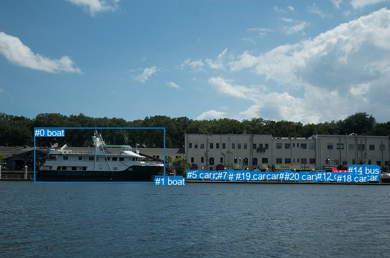
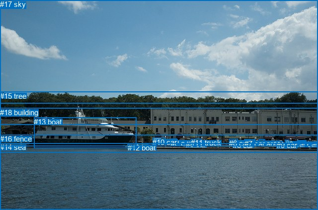

# 图片 1686：2394393.jpg

随机样本序号：339。图片 SHA256：`f78d6dd61aedf3cd4ef022055682f00ae764c1cbd31ff89dce10f68fe23385e7`。

红色框表示人，蓝色框表示其他物体。两个模式分别保留自身框编号，可依据位置比较对应对象。

## 自动检测框与输出

人的框编号：`[11]`。状态：`ok`。

### 自动检测全部物体框

| 编号 | 类别 | 是否为人 | 检测分数 | 像素坐标 xyxy |
|---|---|---|---|---|
| 0 | boat | False | 0.9909 | 56.7, 209.5, 270.0, 299.5 |
| 1 | boat | False | 0.9459 | 254.6, 288.8, 299.1, 299.6 |
| 2 | car | False | 0.9377 | 345.3, 280.4, 355.8, 288.0 |
| 3 | car | False | 0.8809 | 493.2, 281.2, 509.8, 289.3 |
| 4 | car | False | 0.8696 | 514.0, 282.2, 524.9, 289.8 |
| 5 | car | False | 0.8625 | 306.6, 278.5, 331.4, 288.8 |
| 6 | car | False | 0.8197 | 458.4, 280.0, 477.8, 287.9 |
| 7 | car | False | 0.7894 | 357.3, 279.2, 369.0, 287.0 |
| 8 | car | False | 0.7335 | 416.7, 279.9, 428.0, 286.8 |
| 9 | car | False | 0.7185 | 533.4, 282.1, 546.5, 289.0 |
| 10 | car | False | 0.7178 | 372.9, 278.9, 384.4, 286.7 |
| 11 | person | True | 0.6678 | 545.8, 276.6, 552.7, 288.5 |
| 12 | car | False | 0.6453 | 520.4, 279.9, 533.4, 289.0 |
| 13 | car | False | 0.6410 | 381.0, 280.2, 404.9, 289.9 |
| 14 | bus | False | 0.4224 | 571.4, 270.9, 619.9, 284.6 |
| 15 | car | False | 0.4183 | 381.5, 281.0, 391.5, 286.5 |
| 16 | car | False | 0.4098 | 374.7, 280.8, 390.6, 286.8 |
| 17 | car | False | 0.4019 | 571.4, 282.2, 583.2, 287.9 |
| 18 | car | False | 0.3660 | 552.7, 283.6, 565.5, 289.5 |
| 19 | car | False | 0.3626 | 386.6, 279.9, 405.2, 286.6 |
| 20 | car | False | 0.3596 | 466.6, 281.2, 481.8, 287.9 |

### 自动检测 Top50 人相关候选

评分物体对：420；人相关物体对：40；输出关系：50。

| 排名 | 主语编号与类别 | 关系 | 宾语编号与类别 | 类型 | 人与人 | 排序分数 | 原始融合 logit |
|---|---|---|---|---|---|---|---|
| 1 | #11 person | on | #18 car | spatial | False | 0.88733 | 2.0637 |
| 2 | #11 person | on | #9 car | spatial | False | 0.84078 | 1.6640 |
| 3 | #11 person | walking on | #18 car | semantic | False | 0.67781 | 0.7437 |
| 4 | #9 car | parked on | #11 person | semantic | False | 0.57412 | 0.2987 |
| 5 | #9 car | on | #11 person | spatial | False | 0.54108 | 0.1647 |
| 6 | #11 person | walking on | #9 car | semantic | False | 0.47513 | -0.0996 |
| 7 | #18 car | on | #11 person | spatial | False | 0.30921 | -0.8038 |
| 8 | #11 person | on | #17 car | spatial | False | 0.15362 | -1.7065 |
| 9 | #18 car | parked on | #11 person | semantic | False | 0.10913 | -2.0996 |
| 10 | #11 person | on | #14 bus | spatial | False | 0.10544 | -2.1382 |
| 11 | #11 person | on | #12 car | spatial | False | 0.09769 | -2.2231 |
| 12 | #12 car | on | #11 person | spatial | False | 0.09501 | -2.2539 |
| 13 | #12 car | parked on | #11 person | semantic | False | 0.07591 | -2.4992 |
| 14 | #11 person | on | #3 car | spatial | False | 0.06376 | -2.6868 |
| 15 | #11 person | on | #4 car | spatial | False | 0.05013 | -2.9417 |
| 16 | #17 car | on | #11 person | spatial | False | 0.04945 | -2.9561 |
| 17 | #4 car | on | #11 person | spatial | False | 0.04485 | -3.0586 |
| 18 | #11 person | on | #20 car | spatial | False | 0.04386 | -3.0820 |
| 19 | #11 person | on | #0 boat | spatial | False | 0.04106 | -3.1508 |
| 20 | #11 person | walking on | #14 bus | semantic | False | 0.04092 | -3.1543 |
| 21 | #4 car | parked on | #11 person | semantic | False | 0.04054 | -3.1641 |
| 22 | #14 bus | on | #11 person | spatial | False | 0.03967 | -3.1867 |
| 23 | #3 car | on | #11 person | spatial | False | 0.03862 | -3.2147 |
| 24 | #11 person | on | #6 car | spatial | False | 0.03802 | -3.2308 |
| 25 | #20 car | on | #11 person | spatial | False | 0.03635 | -3.2776 |
| 26 | #6 car | on | #11 person | spatial | False | 0.03618 | -3.2824 |
| 27 | #11 person | walking on | #17 car | semantic | False | 0.03600 | -3.2875 |
| 28 | #8 car | on | #11 person | spatial | False | 0.03352 | -3.3614 |
| 29 | #16 car | on | #11 person | spatial | False | 0.02754 | -3.5640 |
| 30 | #19 car | on | #11 person | spatial | False | 0.02690 | -3.5882 |
| 31 | #10 car | on | #11 person | spatial | False | 0.02584 | -3.6295 |
| 32 | #15 car | on | #11 person | spatial | False | 0.02583 | -3.6300 |
| 33 | #13 car | on | #11 person | spatial | False | 0.02419 | -3.6975 |
| 34 | #7 car | on | #11 person | spatial | False | 0.02327 | -3.7370 |
| 35 | #11 person | on | #13 car | spatial | False | 0.02123 | -3.8310 |
| 36 | #2 car | on | #11 person | spatial | False | 0.01962 | -3.9115 |
| 37 | #5 car | on | #11 person | spatial | False | 0.01954 | -3.9157 |
| 38 | #14 bus | parked on | #11 person | semantic | False | 0.01947 | -3.9191 |
| 39 | #11 person | on | #8 car | spatial | False | 0.01932 | -3.9269 |
| 40 | #11 person | looking at | #0 boat | semantic | False | 0.01928 | -3.9292 |
| 41 | #11 person | on | #15 car | spatial | False | 0.01811 | -3.9928 |
| 42 | #11 person | on | #16 car | spatial | False | 0.01805 | -3.9961 |
| 43 | #3 car | parked on | #11 person | semantic | False | 0.01754 | -4.0253 |
| 44 | #11 person | on | #19 car | spatial | False | 0.01754 | -4.0258 |
| 45 | #11 person | on | #1 boat | spatial | False | 0.01734 | -4.0371 |
| 46 | #11 person | standing on | #12 car | semantic | False | 0.01577 | -4.1338 |
| 47 | #11 person | on | #10 car | spatial | False | 0.01493 | -4.1896 |
| 48 | #17 car | parked on | #11 person | semantic | False | 0.01480 | -4.1979 |
| 49 | #11 person | on | #5 car | spatial | False | 0.01428 | -4.2344 |
| 50 | #11 person | on | #2 car | spatial | False | 0.01387 | -4.2640 |

### 自动检测逐条人相关 GT 核验

本图没有人相关 GT，R@50 无分母；预测候选继续展示。

## 真实框与输出

人的框编号：`[]`。

### 真实框全部物体框

| 编号 | 类别 | 是否为人 | 检测分数 | 像素坐标 xyxy |
|---|---|---|---|---|
| 0 | car | False | GT | 598.0, 282.0, 617.0, 292.0 |
| 1 | car | False | GT | 522.0, 280.0, 534.0, 288.0 |
| 2 | car | False | GT | 344.0, 280.0, 356.0, 287.0 |
| 3 | car | False | GT | 574.0, 282.0, 582.0, 288.0 |
| 4 | car | False | GT | 508.0, 281.0, 514.0, 289.0 |
| 5 | car | False | GT | 469.0, 284.0, 481.0, 288.0 |
| 6 | car | False | GT | 461.0, 280.0, 479.0, 287.0 |
| 7 | car | False | GT | 492.0, 281.0, 510.0, 291.0 |
| 8 | car | False | GT | 374.0, 282.0, 387.0, 287.0 |
| 9 | car | False | GT | 557.0, 284.0, 570.0, 290.0 |
| 10 | car | False | GT | 307.0, 278.0, 332.0, 288.0 |
| 11 | truck | False | GT | 384.0, 279.0, 405.0, 290.0 |
| 12 | boat | False | GT | 257.0, 289.0, 297.0, 299.0 |
| 13 | boat | False | GT | 68.0, 237.0, 274.0, 299.0 |
| 14 | sea | False | GT | 0.0, 288.0, 640.0, 423.0 |
| 15 | tree | False | GT | 0.0, 185.0, 640.0, 252.0 |
| 16 | fence | False | GT | 0.0, 271.0, 640.0, 307.0 |
| 17 | sky | False | GT | 0.0, 0.0, 640.0, 208.0 |
| 18 | building | False | GT | 0.0, 218.0, 640.0, 294.0 |

### 真实框 Top50 人相关候选

评分物体对：0；人相关物体对：0；输出关系：0。

| 排名 | 主语编号与类别 | 关系 | 宾语编号与类别 | 类型 | 人与人 | 排序分数 | 原始融合 logit |
|---|---|---|---|---|---|---|---|

### 真实框逐条人相关 GT 核验

本图没有人相关 GT，R@50 无分母；预测候选继续展示。

## 全部人相关 GT

| 主语编号与类别 | 关系 | 宾语编号与类别 |
|---|---|---|

原始记录、全部人相关物体对的两项预测与分项分数见 [逐图证据 JSON](../evidence/cases/1686.json)。全部56类 logits 保留于本机 HOR/output/random500/logits/。

<!-- HOR_COMPLETE_RESULTS -->

## 六组条件的完整输出对照

以下保留同一图片三种框与候选模式、两种谓词输出规则的全部 Top50。框编号各自在所属模式内解释。

### 自动检测框完整枚举：空间与语义各保留一个谓词

| 排名 | 主语编号与类别 | 谓词 | 宾语编号与类别 | 分组 | 排序分数 | predicate logit | pair logit |
|---|---|---|---|---|---|---|---|
| 1 | #11 person | on | #18 car | spatial | 0.8873283 | 2.4394875 | -0.3757507 |
| 2 | #11 person | on | #9 car | spatial | 0.8407801 | 2.2812982 | -0.6172540 |
| 3 | #11 person | walking on | #18 car | semantic | 0.6778114 | 1.1194830 | -0.3757507 |
| 4 | #9 car | parked on | #11 person | semantic | 0.5741212 | 0.9267559 | -0.6280701 |
| 5 | #9 car | on | #11 person | spatial | 0.5410848 | 0.7927809 | -0.6280701 |
| 6 | #11 person | walking on | #9 car | semantic | 0.4751285 | 0.5176859 | -0.6172540 |
| 7 | #18 car | on | #11 person | spatial | 0.3092078 | -0.0478921 | -0.7559333 |
| 8 | #11 person | on | #17 car | spatial | 0.1536219 | -1.2315586 | -0.4749136 |
| 9 | #18 car | parked on | #11 person | semantic | 0.1091310 | -1.3437150 | -0.7559333 |
| 10 | #11 person | on | #14 bus | spatial | 0.1054420 | -1.4887595 | -0.6494092 |
| 11 | #11 person | on | #12 car | spatial | 0.0976936 | -1.4917362 | -0.7313824 |
| 12 | #12 car | on | #11 person | spatial | 0.0950125 | -1.6555073 | -0.5984051 |
| 13 | #12 car | parked on | #11 person | semantic | 0.0759132 | -1.9008107 | -0.5984051 |
| 14 | #11 person | on | #3 car | spatial | 0.0637575 | -2.0682921 | -0.6184953 |
| 15 | #11 person | on | #4 car | spatial | 0.0501307 | -2.1514122 | -0.7902780 |
| 16 | #17 car | on | #11 person | spatial | 0.0494480 | -2.2379501 | -0.7181719 |
| 17 | #4 car | on | #11 person | spatial | 0.0448485 | -2.4421592 | -0.6164213 |
| 18 | #11 person | on | #20 car | spatial | 0.0438565 | -2.5193715 | -0.5626135 |
| 19 | #11 person | on | #0 boat | spatial | 0.0410600 | -2.2938461 | -0.8569477 |
| 20 | #11 person | walking on | #14 bus | semantic | 0.0409206 | -2.5049305 | -0.6494092 |
| 21 | #4 car | parked on | #11 person | semantic | 0.0405383 | -2.5477042 | -0.6164213 |
| 22 | #14 bus | on | #11 person | spatial | 0.0396680 | -2.5069177 | -0.6798158 |
| 23 | #3 car | on | #11 person | spatial | 0.0386169 | -2.4584935 | -0.7561907 |
| 24 | #11 person | on | #6 car | spatial | 0.0380228 | -2.6069229 | -0.6238832 |
| 25 | #20 car | on | #11 person | spatial | 0.0363462 | -2.2987118 | -0.9789319 |
| 26 | #6 car | on | #11 person | spatial | 0.0361805 | -2.2958448 | -0.9865379 |
| 27 | #11 person | walking on | #17 car | semantic | 0.0360023 | -2.8125920 | -0.4749136 |
| 28 | #8 car | on | #11 person | spatial | 0.0335236 | -2.3285136 | -1.0328931 |
| 29 | #16 car | on | #11 person | spatial | 0.0275443 | -2.3749394 | -1.1890892 |
| 30 | #19 car | on | #11 person | spatial | 0.0269048 | -2.4680800 | -1.1200972 |
| 31 | #10 car | on | #11 person | spatial | 0.0258441 | -2.4567564 | -1.1727328 |
| 32 | #15 car | on | #11 person | spatial | 0.0258302 | -2.4622011 | -1.1678398 |
| 33 | #13 car | on | #11 person | spatial | 0.0241863 | -2.5832899 | -1.1141968 |
| 34 | #7 car | on | #11 person | spatial | 0.0232721 | -2.5087714 | -1.2281828 |
| 35 | #11 person | on | #13 car | spatial | 0.0212285 | -2.9107027 | -0.9202531 |
| 36 | #2 car | on | #11 person | spatial | 0.0196187 | -2.6784294 | -1.2330272 |
| 37 | #5 car | on | #11 person | spatial | 0.0195381 | -2.7063775 | -1.2092820 |
| 38 | #14 bus | parked on | #11 person | semantic | 0.0194730 | -3.2392464 | -0.6798158 |
| 39 | #11 person | on | #8 car | spatial | 0.0193242 | -2.9307728 | -0.9961089 |
| 40 | #11 person | looking at | #0 boat | semantic | 0.0192807 | -3.0722337 | -0.8569477 |
| 41 | #11 person | on | #15 car | spatial | 0.0181135 | -3.0531363 | -0.9396845 |
| 42 | #11 person | on | #16 car | spatial | 0.0180547 | -3.0666037 | -0.9295279 |
| 43 | #3 car | parked on | #11 person | semantic | 0.0175444 | -3.2691283 | -0.7561907 |
| 44 | #11 person | on | #19 car | spatial | 0.0175360 | -3.0476913 | -0.9781138 |
| 45 | #11 person | on | #1 boat | spatial | 0.0173428 | -2.6377382 | -1.3993475 |
| 46 | #11 person | standing on | #12 car | semantic | 0.0157692 | -3.4024220 | -0.7313824 |
| 47 | #11 person | on | #10 car | spatial | 0.0149263 | -3.2064598 | -0.9831333 |
| 48 | #17 car | parked on | #11 person | semantic | 0.0148042 | -3.4797606 | -0.7181719 |
| 49 | #11 person | on | #5 car | spatial | 0.0142812 | -2.9353490 | -1.2990775 |
| 50 | #11 person | on | #2 car | spatial | 0.0138715 | -3.2611971 | -1.0027542 |

没有人相关 GT，本条件的召回率无分母。

### 自动检测框完整枚举：每对只保留一个谓词

| 排名 | 主语编号与类别 | 谓词 | 宾语编号与类别 | 分组 | 排序分数 | predicate logit | pair logit |
|---|---|---|---|---|---|---|---|
| 1 | #11 person | on | #18 car | single | 0.8873283 | 2.4394875 | -0.3757507 |
| 2 | #11 person | on | #9 car | single | 0.8407801 | 2.2812982 | -0.6172540 |
| 3 | #9 car | parked on | #11 person | single | 0.5741212 | 0.9267559 | -0.6280701 |
| 4 | #18 car | on | #11 person | single | 0.3092078 | -0.0478921 | -0.7559333 |
| 5 | #11 person | on | #17 car | single | 0.1536219 | -1.2315586 | -0.4749136 |
| 6 | #11 person | on | #14 bus | single | 0.1054420 | -1.4887595 | -0.6494092 |
| 7 | #11 person | on | #12 car | single | 0.0976936 | -1.4917362 | -0.7313824 |
| 8 | #12 car | on | #11 person | single | 0.0950125 | -1.6555073 | -0.5984051 |
| 9 | #11 person | on | #3 car | single | 0.0637575 | -2.0682921 | -0.6184953 |
| 10 | #11 person | on | #4 car | single | 0.0501307 | -2.1514122 | -0.7902780 |
| 11 | #17 car | on | #11 person | single | 0.0494480 | -2.2379501 | -0.7181719 |
| 12 | #4 car | on | #11 person | single | 0.0448485 | -2.4421592 | -0.6164213 |
| 13 | #11 person | on | #20 car | single | 0.0438565 | -2.5193715 | -0.5626135 |
| 14 | #11 person | on | #0 boat | single | 0.0410600 | -2.2938461 | -0.8569477 |
| 15 | #14 bus | on | #11 person | single | 0.0396680 | -2.5069177 | -0.6798158 |
| 16 | #3 car | on | #11 person | single | 0.0386169 | -2.4584935 | -0.7561907 |
| 17 | #11 person | on | #6 car | single | 0.0380228 | -2.6069229 | -0.6238832 |
| 18 | #20 car | on | #11 person | single | 0.0363462 | -2.2987118 | -0.9789319 |
| 19 | #6 car | on | #11 person | single | 0.0361805 | -2.2958448 | -0.9865379 |
| 20 | #8 car | on | #11 person | single | 0.0335236 | -2.3285136 | -1.0328931 |
| 21 | #16 car | on | #11 person | single | 0.0275443 | -2.3749394 | -1.1890892 |
| 22 | #19 car | on | #11 person | single | 0.0269048 | -2.4680800 | -1.1200972 |
| 23 | #10 car | on | #11 person | single | 0.0258441 | -2.4567564 | -1.1727328 |
| 24 | #15 car | on | #11 person | single | 0.0258302 | -2.4622011 | -1.1678398 |
| 25 | #13 car | on | #11 person | single | 0.0241863 | -2.5832899 | -1.1141968 |
| 26 | #7 car | on | #11 person | single | 0.0232721 | -2.5087714 | -1.2281828 |
| 27 | #11 person | on | #13 car | single | 0.0212285 | -2.9107027 | -0.9202531 |
| 28 | #2 car | on | #11 person | single | 0.0196187 | -2.6784294 | -1.2330272 |
| 29 | #5 car | on | #11 person | single | 0.0195381 | -2.7063775 | -1.2092820 |
| 30 | #11 person | on | #8 car | single | 0.0193242 | -2.9307728 | -0.9961089 |
| 31 | #11 person | on | #15 car | single | 0.0181135 | -3.0531363 | -0.9396845 |
| 32 | #11 person | on | #16 car | single | 0.0180547 | -3.0666037 | -0.9295279 |
| 33 | #11 person | on | #19 car | single | 0.0175360 | -3.0476913 | -0.9781138 |
| 34 | #11 person | on | #1 boat | single | 0.0173428 | -2.6377382 | -1.3993475 |
| 35 | #11 person | on | #10 car | single | 0.0149263 | -3.2064598 | -0.9831333 |
| 36 | #11 person | on | #5 car | single | 0.0142812 | -2.9353490 | -1.2990775 |
| 37 | #11 person | on | #2 car | single | 0.0138715 | -3.2611971 | -1.0027542 |
| 38 | #0 boat | in | #11 person | single | 0.0135340 | -3.0247688 | -1.2641535 |
| 39 | #11 person | on | #7 car | single | 0.0134138 | -3.2954447 | -1.0025218 |
| 40 | #1 boat | in | #11 person | single | 0.0093311 | -3.2878499 | -1.3771806 |

没有人相关 GT，本条件的召回率无分母。

### 真实框完整枚举：空间与语义各保留一个谓词

| 排名 | 主语编号与类别 | 谓词 | 宾语编号与类别 | 分组 | 排序分数 | predicate logit | pair logit |
|---|---|---|---|---|---|---|---|

没有人相关 GT，本条件的召回率无分母。

### 真实框完整枚举：每对只保留一个谓词

| 排名 | 主语编号与类别 | 谓词 | 宾语编号与类别 | 分组 | 排序分数 | predicate logit | pair logit |
|---|---|---|---|---|---|---|---|

没有人相关 GT，本条件的召回率无分母。

### 真实框400候选：空间与语义各保留一个谓词

| 排名 | 主语编号与类别 | 谓词 | 宾语编号与类别 | 分组 | 排序分数 | predicate logit | pair logit |
|---|---|---|---|---|---|---|---|

没有人相关 GT，本条件的召回率无分母。

### 真实框400候选：每对只保留一个谓词

| 排名 | 主语编号与类别 | 谓词 | 宾语编号与类别 | 分组 | 排序分数 | predicate logit | pair logit |
|---|---|---|---|---|---|---|---|

没有人相关 GT，本条件的召回率无分母。
