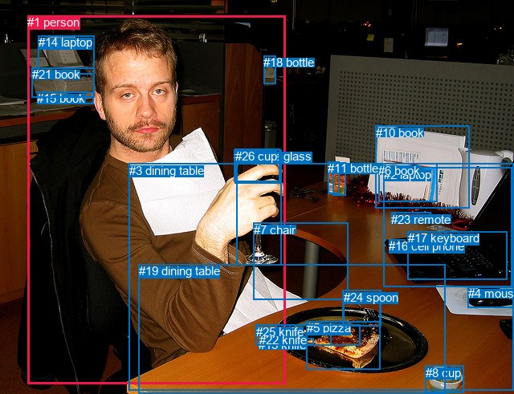
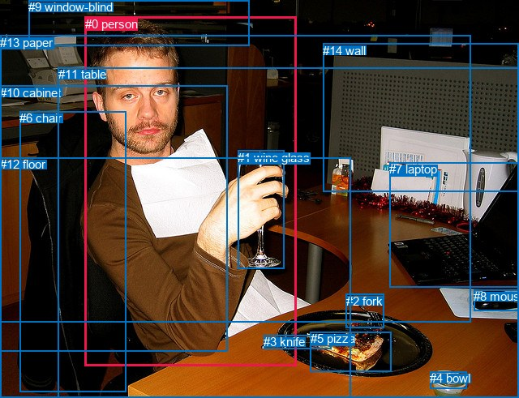

# 图片 1688：2394464.jpg

随机样本序号：272。图片 SHA256：`0015373b99aaa5ec2fede8f51ad0598df27e913924009d4b69bbfca37789ac11`。

红色框表示人，蓝色框表示其他物体。两个模式分别保留自身框编号，可依据位置比较对应对象。

## 自动检测框与输出

人的框编号：`[1]`。状态：`ok`。

### 自动检测全部物体框

| 编号 | 类别 | 是否为人 | 检测分数 | 像素坐标 xyxy |
|---|---|---|---|---|
| 0 | wine glass | False | 0.9992 | 294.5, 186.1, 350.9, 330.5 |
| 1 | person | True | 0.9982 | 34.0, 19.5, 355.7, 478.3 |
| 2 | laptop | False | 0.9975 | 477.8, 208.8, 637.9, 357.4 |
| 3 | dining table | False | 0.9949 | 160.9, 203.7, 640.0, 486.9 |
| 4 | mouse | False | 0.9463 | 582.5, 357.3, 640.0, 383.7 |
| 5 | pizza | False | 0.9276 | 381.6, 400.3, 473.7, 460.1 |
| 6 | book | False | 0.8675 | 471.5, 203.5, 544.1, 251.0 |
| 7 | chair | False | 0.8234 | 315.7, 277.8, 433.8, 373.8 |
| 8 | cup | False | 0.8225 | 530.0, 455.8, 577.8, 489.6 |
| 9 | bottle | False | 0.7186 | 414.2, 202.5, 430.8, 243.7 |
| 10 | book | False | 0.6468 | 467.8, 156.8, 584.4, 259.4 |
| 11 | bottle | False | 0.6341 | 408.1, 201.3, 422.2, 241.0 |
| 12 | wine glass | False | 0.6325 | 291.3, 186.0, 350.1, 226.2 |
| 13 | knife | False | 0.6129 | 322.2, 421.0, 390.6, 430.0 |
| 14 | laptop | False | 0.6102 | 48.0, 44.1, 117.6, 92.0 |
| 15 | book | False | 0.5732 | 46.3, 114.0, 117.0, 129.1 |
| 16 | cell phone | False | 0.5397 | 484.3, 298.3, 504.1, 306.4 |
| 17 | keyboard | False | 0.5346 | 507.6, 288.5, 632.0, 348.6 |
| 18 | bottle | False | 0.5319 | 328.5, 69.1, 343.3, 104.9 |
| 19 | dining table | False | 0.5147 | 172.9, 329.1, 554.2, 490.6 |
| 20 | fork | False | 0.5001 | 426.9, 361.8, 473.7, 406.7 |
| 21 | book | False | 0.4928 | 39.5, 84.3, 117.7, 121.5 |
| 22 | knife | False | 0.4616 | 323.1, 415.4, 412.1, 430.3 |
| 23 | remote | False | 0.4283 | 487.0, 264.7, 537.0, 278.2 |
| 24 | spoon | False | 0.4176 | 427.7, 361.8, 474.0, 406.4 |
| 25 | knife | False | 0.4014 | 318.6, 404.5, 448.3, 430.5 |
| 26 | cup | False | 0.3609 | 292.9, 185.6, 348.0, 228.3 |

### 自动检测 Top50 人相关候选

评分物体对：702；人相关物体对：52；输出关系：50。

| 排名 | 主语编号与类别 | 关系 | 宾语编号与类别 | 类型 | 人与人 | 排序分数 | 原始融合 logit |
|---|---|---|---|---|---|---|---|
| 1 | #1 person | holding | #0 wine glass | semantic | False | 0.99229 | 4.8569 |
| 2 | #1 person | holding | #26 cup | semantic | False | 0.97739 | 3.7666 |
| 3 | #1 person | holding | #12 wine glass | semantic | False | 0.97622 | 3.7148 |
| 4 | #1 person | sitting on | #3 dining table | semantic | False | 0.94654 | 2.8740 |
| 5 | #1 person | in | #3 dining table | spatial | False | 0.92734 | 2.5465 |
| 6 | #1 person | in | #19 dining table | spatial | False | 0.88690 | 2.0594 |
| 7 | #1 person | sitting on | #19 dining table | semantic | False | 0.87398 | 1.9367 |
| 8 | #1 person | in | #0 wine glass | spatial | False | 0.78896 | 1.3187 |
| 9 | #1 person | eating | #5 pizza | semantic | False | 0.75824 | 1.1431 |
| 10 | #1 person | in | #26 cup | spatial | False | 0.67394 | 0.7261 |
| 11 | #1 person | in | #12 wine glass | spatial | False | 0.66668 | 0.6932 |
| 12 | #1 person | in | #7 chair | spatial | False | 0.59945 | 0.4032 |
| 13 | #1 person | sitting on | #7 chair | semantic | False | 0.41378 | -0.3484 |
| 14 | #1 person | holding | #22 knife | semantic | False | 0.39447 | -0.4286 |
| 15 | #1 person | holding | #13 knife | semantic | False | 0.37956 | -0.4914 |
| 16 | #1 person | holding | #25 knife | semantic | False | 0.23251 | -1.1942 |
| 17 | #1 person | looking at | #2 laptop | semantic | False | 0.22198 | -1.2542 |
| 18 | #1 person | holding | #24 spoon | semantic | False | 0.21931 | -1.2697 |
| 19 | #7 chair | beside | #1 person | spatial | False | 0.21807 | -1.2769 |
| 20 | #1 person | holding | #20 fork | semantic | False | 0.21360 | -1.3033 |
| 21 | #0 wine glass | holding | #1 person | semantic | False | 0.17997 | -1.5166 |
| 22 | #1 person | wearing | #14 laptop | semantic | False | 0.17786 | -1.5309 |
| 23 | #18 bottle | beside | #1 person | spatial | False | 0.16037 | -1.6555 |
| 24 | #1 person | in | #5 pizza | spatial | False | 0.13518 | -1.8559 |
| 25 | #1 person | on | #2 laptop | spatial | False | 0.12217 | -1.9721 |
| 26 | #1 person | wearing | #15 book | semantic | False | 0.11854 | -2.0063 |
| 27 | #14 laptop | on back of | #1 person | spatial | False | 0.11771 | -2.0143 |
| 28 | #0 wine glass | in | #1 person | spatial | False | 0.11672 | -2.0239 |
| 29 | #2 laptop | beside | #1 person | spatial | False | 0.08992 | -2.3146 |
| 30 | #10 book | beside | #1 person | spatial | False | 0.08170 | -2.4195 |
| 31 | #1 person | in | #17 keyboard | spatial | False | 0.07807 | -2.4688 |
| 32 | #1 person | on | #13 knife | spatial | False | 0.07424 | -2.5233 |
| 33 | #15 book | on back of | #1 person | spatial | False | 0.07292 | -2.5427 |
| 34 | #1 person | wearing | #21 book | semantic | False | 0.06709 | -2.6323 |
| 35 | #1 person | on | #15 book | spatial | False | 0.06627 | -2.6455 |
| 36 | #26 cup | on | #1 person | spatial | False | 0.06540 | -2.6595 |
| 37 | #21 book | on back of | #1 person | spatial | False | 0.06288 | -2.7015 |
| 38 | #26 cup | holding | #1 person | semantic | False | 0.06148 | -2.7257 |
| 39 | #1 person | on | #22 knife | spatial | False | 0.05989 | -2.7534 |
| 40 | #12 wine glass | holding | #1 person | semantic | False | 0.05939 | -2.7624 |
| 41 | #12 wine glass | on | #1 person | spatial | False | 0.05866 | -2.7755 |
| 42 | #18 bottle | looking at | #1 person | semantic | False | 0.05535 | -2.8371 |
| 43 | #19 dining table | in front of | #1 person | spatial | False | 0.05322 | -2.8786 |
| 44 | #1 person | wearing | #17 keyboard | semantic | False | 0.04901 | -2.9654 |
| 45 | #1 person | on | #14 laptop | spatial | False | 0.04677 | -3.0146 |
| 46 | #1 person | on | #21 book | spatial | False | 0.04256 | -3.1135 |
| 47 | #1 person | on | #25 knife | spatial | False | 0.04047 | -3.1659 |
| 48 | #5 pizza | on | #1 person | spatial | False | 0.03825 | -3.2247 |
| 49 | #3 dining table | in | #1 person | spatial | False | 0.03804 | -3.2302 |
| 50 | #7 chair | holding | #1 person | semantic | False | 0.03676 | -3.2660 |

### 自动检测逐条人相关 GT 核验

R@50：50.00%；命中 1/2。

| GT 主语编号 | GT 关系 | GT 宾语编号 | 结果阶段 | 匹配预测主语编号 | 匹配预测宾语编号 |
|---|---|---|---|---|---|
| 0 | holding | 1 | hit50 | [1] | [0] |
| 0 | sitting on | 6 | endpoint_missing_or_wrong_class | [1] | [] |

## 真实框与输出

人的框编号：`[0]`。

### 真实框全部物体框

| 编号 | 类别 | 是否为人 | 检测分数 | 像素坐标 xyxy |
|---|---|---|---|---|
| 0 | person | True | GT | 105.0, 21.0, 366.0, 451.0 |
| 1 | wine glass | False | GT | 293.0, 186.0, 350.0, 332.0 |
| 2 | fork | False | GT | 427.0, 363.0, 474.0, 405.0 |
| 3 | knife | False | GT | 325.0, 413.0, 408.0, 430.0 |
| 4 | bowl | False | GT | 530.0, 458.0, 575.0, 479.0 |
| 5 | pizza | False | GT | 383.0, 409.0, 483.0, 458.0 |
| 6 | chair | False | GT | 24.0, 137.0, 156.0, 483.0 |
| 7 | laptop | False | GT | 480.0, 200.0, 640.0, 354.0 |
| 8 | mouse | False | GT | 584.0, 357.0, 640.0, 383.0 |
| 9 | window-blind | False | GT | 35.0, 0.0, 307.0, 57.0 |
| 10 | cabinet | False | GT | 0.0, 106.0, 280.0, 434.0 |
| 11 | table | False | GT | 72.0, 83.0, 640.0, 491.0 |
| 12 | floor | False | GT | 0.0, 194.0, 433.0, 491.0 |
| 13 | paper | False | GT | 0.0, 44.0, 580.0, 398.0 |
| 14 | wall | False | GT | 398.0, 54.0, 640.0, 237.0 |

### 真实框 Top50 人相关候选

评分物体对：210；人相关物体对：28；输出关系：50。

| 排名 | 主语编号与类别 | 关系 | 宾语编号与类别 | 类型 | 人与人 | 排序分数 | 原始融合 logit |
|---|---|---|---|---|---|---|---|
| 1 | #0 person | holding | #1 wine glass | semantic | False | 0.99324 | 4.9898 |
| 2 | #0 person | wearing | #10 cabinet | semantic | False | 0.99015 | 4.6108 |
| 3 | #0 person | wearing | #6 chair | semantic | False | 0.98731 | 4.3538 |
| 4 | #0 person | sitting on | #12 floor | semantic | False | 0.97899 | 3.8418 |
| 5 | #0 person | in | #10 cabinet | spatial | False | 0.96851 | 3.4262 |
| 6 | #0 person | sitting on | #11 table | semantic | False | 0.95173 | 2.9814 |
| 7 | #0 person | in | #11 table | spatial | False | 0.95146 | 2.9755 |
| 8 | #0 person | in | #12 floor | spatial | False | 0.94790 | 2.9011 |
| 9 | #0 person | in | #6 chair | spatial | False | 0.92395 | 2.4973 |
| 10 | #0 person | in | #13 paper | spatial | False | 0.91242 | 2.3436 |
| 11 | #0 person | sitting on | #13 paper | semantic | False | 0.84913 | 1.7278 |
| 12 | #0 person | eating | #5 pizza | semantic | False | 0.82733 | 1.5668 |
| 13 | #0 person | in | #1 wine glass | spatial | False | 0.81647 | 1.4926 |
| 14 | #6 chair | on | #0 person | spatial | False | 0.77529 | 1.2384 |
| 15 | #10 cabinet | on | #0 person | spatial | False | 0.60665 | 0.4333 |
| 16 | #0 person | holding | #3 knife | semantic | False | 0.58054 | 0.3250 |
| 17 | #13 paper | beside | #0 person | spatial | False | 0.46591 | -0.1366 |
| 18 | #1 wine glass | holding | #0 person | semantic | False | 0.46579 | -0.1370 |
| 19 | #0 person | looking at | #7 laptop | semantic | False | 0.42292 | -0.3108 |
| 20 | #12 floor | holding | #0 person | semantic | False | 0.33047 | -0.7061 |
| 21 | #1 wine glass | on | #0 person | spatial | False | 0.32556 | -0.7283 |
| 22 | #0 person | on | #5 pizza | spatial | False | 0.32258 | -0.7419 |
| 23 | #0 person | holding | #2 fork | semantic | False | 0.27204 | -0.9843 |
| 24 | #6 chair | holding | #0 person | semantic | False | 0.25444 | -1.0751 |
| 25 | #10 cabinet | holding | #0 person | semantic | False | 0.23291 | -1.1919 |
| 26 | #0 person | on | #7 laptop | spatial | False | 0.22508 | -1.2363 |
| 27 | #12 floor | in | #0 person | spatial | False | 0.21541 | -1.2926 |
| 28 | #9 window-blind | over | #0 person | spatial | False | 0.20544 | -1.3526 |
| 29 | #14 wall | beside | #0 person | spatial | False | 0.18908 | -1.4560 |
| 30 | #7 laptop | beside | #0 person | spatial | False | 0.18499 | -1.4829 |
| 31 | #11 table | holding | #0 person | semantic | False | 0.15493 | -1.6965 |
| 32 | #0 person | on | #3 knife | spatial | False | 0.13373 | -1.8684 |
| 33 | #11 table | in | #0 person | spatial | False | 0.10634 | -2.1286 |
| 34 | #5 pizza | on | #0 person | spatial | False | 0.10447 | -2.1485 |
| 35 | #13 paper | looking at | #0 person | semantic | False | 0.09670 | -2.2345 |
| 36 | #0 person | in | #9 window-blind | spatial | False | 0.06824 | -2.6141 |
| 37 | #0 person | on | #2 fork | spatial | False | 0.05053 | -2.9333 |
| 38 | #3 knife | on | #0 person | spatial | False | 0.04475 | -3.0608 |
| 39 | #0 person | in | #14 wall | spatial | False | 0.04455 | -3.0656 |
| 40 | #0 person | looking at | #14 wall | semantic | False | 0.04161 | -3.1368 |
| 41 | #9 window-blind | looking at | #0 person | semantic | False | 0.03766 | -3.2409 |
| 42 | #0 person | looking at | #9 window-blind | semantic | False | 0.03319 | -3.3719 |
| 43 | #7 laptop | looking at | #0 person | semantic | False | 0.02770 | -3.5582 |
| 44 | #14 wall | looking at | #0 person | semantic | False | 0.02389 | -3.7100 |
| 45 | #4 bowl | beside | #0 person | spatial | False | 0.02312 | -3.7436 |
| 46 | #5 pizza | holding | #0 person | semantic | False | 0.01795 | -4.0020 |
| 47 | #8 mouse | beside | #0 person | spatial | False | 0.01678 | -4.0704 |
| 48 | #2 fork | on | #0 person | spatial | False | 0.01597 | -4.1208 |
| 49 | #3 knife | holding | #0 person | semantic | False | 0.01508 | -4.1795 |
| 50 | #2 fork | holding | #0 person | semantic | False | 0.01168 | -4.4377 |

### 真实框逐条人相关 GT 核验

R@50：50.00%；命中 1/2。

| GT 主语编号 | GT 关系 | GT 宾语编号 | 结果阶段 | 匹配预测主语编号 | 匹配预测宾语编号 |
|---|---|---|---|---|---|
| 0 | holding | 1 | hit50 | [0] | [1] |
| 0 | sitting on | 6 | wrong_predicate | [0] | [6] |

## 全部人相关 GT

| 主语编号与类别 | 关系 | 宾语编号与类别 |
|---|---|---|
| #0 person | holding | #1 wine glass |
| #0 person | sitting on | #6 chair |

原始记录、全部人相关物体对的两项预测与分项分数见 [逐图证据 JSON](../evidence/cases/1688.json)。全部56类 logits 保留于本机 HOR/output/random500/logits/。

<!-- HOR_COMPLETE_RESULTS -->

## 六组条件的完整输出对照

以下保留同一图片三种框与候选模式、两种谓词输出规则的全部 Top50。框编号各自在所属模式内解释。

### 自动检测框完整枚举：空间与语义各保留一个谓词

| 排名 | 主语编号与类别 | 谓词 | 宾语编号与类别 | 分组 | 排序分数 | predicate logit | pair logit |
|---|---|---|---|---|---|---|---|
| 1 | #1 person | holding | #0 wine glass | semantic | 0.9922854 | 4.6487641 | 0.2081330 |
| 2 | #1 person | holding | #26 cup | semantic | 0.9773927 | 3.8110194 | -0.0444044 |
| 3 | #1 person | holding | #12 wine glass | semantic | 0.9762180 | 3.7685628 | -0.0538061 |
| 4 | #1 person | sitting on | #3 dining table | semantic | 0.9465439 | 2.8830600 | -0.0091026 |
| 5 | #1 person | in | #3 dining table | spatial | 0.9273385 | 2.5556097 | -0.0091026 |
| 6 | #1 person | in | #19 dining table | spatial | 0.8868977 | 2.3347921 | -0.2753550 |
| 7 | #1 person | sitting on | #19 dining table | semantic | 0.8739839 | 2.2120075 | -0.2753550 |
| 8 | #1 person | in | #0 wine glass | spatial | 0.7889611 | 1.1105413 | 0.2081330 |
| 9 | #1 person | eating | #5 pizza | semantic | 0.7582401 | 1.7422776 | -0.5992226 |
| 10 | #1 person | in | #26 cup | spatial | 0.6739417 | 0.7704720 | -0.0444044 |
| 11 | #1 person | in | #12 wine glass | spatial | 0.6666811 | 0.7470183 | -0.0538061 |
| 12 | #1 person | in | #7 chair | spatial | 0.5994529 | 1.5612626 | -1.1580769 |
| 13 | #1 person | sitting on | #7 chair | semantic | 0.4137771 | 0.8097043 | -1.1580769 |
| 14 | #1 person | holding | #22 knife | semantic | 0.3944684 | 0.5361938 | -0.9647615 |
| 15 | #1 person | holding | #13 knife | semantic | 0.3795569 | 0.4276457 | -0.9190751 |
| 16 | #1 person | holding | #25 knife | semantic | 0.2325073 | -0.1527514 | -1.0414561 |
| 17 | #1 person | looking at | #2 laptop | semantic | 0.2219824 | -0.6095181 | -0.6446332 |
| 18 | #1 person | holding | #24 spoon | semantic | 0.2193059 | -0.1842322 | -1.0854838 |
| 19 | #7 chair | beside | #1 person | spatial | 0.2180706 | -0.2557573 | -1.0211884 |
| 20 | #1 person | holding | #20 fork | semantic | 0.2136042 | -0.2108617 | -1.0924740 |
| 21 | #0 wine glass | holding | #1 person | semantic | 0.1799675 | -0.6202888 | -0.8962788 |
| 22 | #1 person | wearing | #14 laptop | semantic | 0.1778556 | -0.2889519 | -1.2419922 |
| 23 | #18 bottle | beside | #1 person | spatial | 0.1603682 | -0.3478236 | -1.3076671 |
| 24 | #1 person | in | #5 pizza | spatial | 0.1351777 | -1.2567108 | -0.5992226 |
| 25 | #1 person | on | #2 laptop | spatial | 0.1221685 | -1.3274207 | -0.6446332 |
| 26 | #1 person | wearing | #15 book | semantic | 0.1185400 | -1.1800265 | -0.8263031 |
| 27 | #14 laptop | on back of | #1 person | spatial | 0.1177060 | -1.0347230 | -0.9796127 |
| 28 | #0 wine glass | in | #1 person | spatial | 0.1167181 | -1.1276038 | -0.8962788 |
| 29 | #2 laptop | beside | #1 person | spatial | 0.0899233 | -1.2658596 | -1.0487123 |
| 30 | #10 book | beside | #1 person | spatial | 0.0816993 | -1.2386091 | -1.1808699 |
| 31 | #1 person | in | #17 keyboard | spatial | 0.0780739 | -1.3639021 | -1.1049070 |
| 32 | #1 person | on | #13 knife | spatial | 0.0742380 | -1.6042657 | -0.9190751 |
| 33 | #15 book | on back of | #1 person | spatial | 0.0729155 | -1.8098409 | -0.7329023 |
| 34 | #1 person | wearing | #21 book | semantic | 0.0670870 | -1.4068382 | -1.2254837 |
| 35 | #1 person | on | #15 book | spatial | 0.0662673 | -1.8191910 | -0.8263031 |
| 36 | #26 cup | on | #1 person | spatial | 0.0654044 | -1.8415208 | -0.8180039 |
| 37 | #21 book | on back of | #1 person | spatial | 0.0628830 | -1.8476198 | -0.8539115 |
| 38 | #26 cup | holding | #1 person | semantic | 0.0614764 | -1.9076502 | -0.8180039 |
| 39 | #1 person | on | #22 knife | spatial | 0.0598926 | -1.7886796 | -0.9647615 |
| 40 | #12 wine glass | holding | #1 person | semantic | 0.0593897 | -1.9336796 | -0.8287280 |
| 41 | #12 wine glass | on | #1 person | spatial | 0.0586628 | -1.9467678 | -0.8287280 |
| 42 | #18 bottle | looking at | #1 person | semantic | 0.0553518 | -1.5294356 | -1.3076671 |
| 43 | #19 dining table | in front of | #1 person | spatial | 0.0532202 | -1.6203341 | -1.2582951 |
| 44 | #1 person | wearing | #17 keyboard | semantic | 0.0490117 | -1.8605349 | -1.1049070 |
| 45 | #1 person | on | #14 laptop | spatial | 0.0467694 | -1.7726347 | -1.2419922 |
| 46 | #1 person | on | #21 book | spatial | 0.0425555 | -1.8879750 | -1.2254837 |
| 47 | #1 person | on | #25 knife | spatial | 0.0404709 | -2.1244042 | -1.0414561 |
| 48 | #5 pizza | on | #1 person | spatial | 0.0382460 | -2.0144804 | -1.2102394 |
| 49 | #3 dining table | in | #1 person | spatial | 0.0380439 | -2.0850019 | -1.1452262 |
| 50 | #7 chair | holding | #1 person | semantic | 0.0367567 | -2.2447972 | -1.0211884 |

GT 命中：1/2，R@50=50.00%。

| GT主语 | GT谓词 | GT宾语 | 结果阶段 | 匹配主语框 | 匹配宾语框 |
|---|---|---|---|---|---|
| 0 | holding | 1 | hit50 | [1] | [0] |
| 0 | sitting on | 6 | endpoint_missing_or_wrong_class | [1] | [] |

### 自动检测框完整枚举：每对只保留一个谓词

| 排名 | 主语编号与类别 | 谓词 | 宾语编号与类别 | 分组 | 排序分数 | predicate logit | pair logit |
|---|---|---|---|---|---|---|---|
| 1 | #1 person | holding | #0 wine glass | single | 0.9922854 | 4.6487641 | 0.2081330 |
| 2 | #1 person | holding | #26 cup | single | 0.9773927 | 3.8110194 | -0.0444044 |
| 3 | #1 person | holding | #12 wine glass | single | 0.9762180 | 3.7685628 | -0.0538061 |
| 4 | #1 person | sitting on | #3 dining table | single | 0.9465439 | 2.8830600 | -0.0091026 |
| 5 | #1 person | in | #19 dining table | single | 0.8868977 | 2.3347921 | -0.2753550 |
| 6 | #1 person | eating | #5 pizza | single | 0.7582401 | 1.7422776 | -0.5992226 |
| 7 | #1 person | in | #7 chair | single | 0.5994529 | 1.5612626 | -1.1580769 |
| 8 | #1 person | holding | #22 knife | single | 0.3944684 | 0.5361938 | -0.9647615 |
| 9 | #1 person | holding | #13 knife | single | 0.3795569 | 0.4276457 | -0.9190751 |
| 10 | #1 person | holding | #25 knife | single | 0.2325073 | -0.1527514 | -1.0414561 |
| 11 | #1 person | looking at | #2 laptop | single | 0.2219824 | -0.6095181 | -0.6446332 |
| 12 | #1 person | holding | #24 spoon | single | 0.2193059 | -0.1842322 | -1.0854838 |
| 13 | #7 chair | beside | #1 person | single | 0.2180706 | -0.2557573 | -1.0211884 |
| 14 | #1 person | holding | #20 fork | single | 0.2136042 | -0.2108617 | -1.0924740 |
| 15 | #0 wine glass | holding | #1 person | single | 0.1799675 | -0.6202888 | -0.8962788 |
| 16 | #1 person | wearing | #14 laptop | single | 0.1778556 | -0.2889519 | -1.2419922 |
| 17 | #18 bottle | beside | #1 person | single | 0.1603682 | -0.3478236 | -1.3076671 |
| 18 | #1 person | wearing | #15 book | single | 0.1185400 | -1.1800265 | -0.8263031 |
| 19 | #14 laptop | on back of | #1 person | single | 0.1177060 | -1.0347230 | -0.9796127 |
| 20 | #2 laptop | beside | #1 person | single | 0.0899233 | -1.2658596 | -1.0487123 |
| 21 | #10 book | beside | #1 person | single | 0.0816993 | -1.2386091 | -1.1808699 |
| 22 | #1 person | in | #17 keyboard | single | 0.0780739 | -1.3639021 | -1.1049070 |
| 23 | #15 book | on back of | #1 person | single | 0.0729155 | -1.8098409 | -0.7329023 |
| 24 | #1 person | wearing | #21 book | single | 0.0670870 | -1.4068382 | -1.2254837 |
| 25 | #26 cup | on | #1 person | single | 0.0654044 | -1.8415208 | -0.8180039 |
| 26 | #21 book | on back of | #1 person | single | 0.0628830 | -1.8476198 | -0.8539115 |
| 27 | #12 wine glass | holding | #1 person | single | 0.0593897 | -1.9336796 | -0.8287280 |
| 28 | #19 dining table | in front of | #1 person | single | 0.0532202 | -1.6203341 | -1.2582951 |
| 29 | #5 pizza | on | #1 person | single | 0.0382460 | -2.0144804 | -1.2102394 |
| 30 | #3 dining table | in | #1 person | single | 0.0380439 | -2.0850019 | -1.1452262 |
| 31 | #11 bottle | beside | #1 person | single | 0.0358368 | -1.8834891 | -1.4087961 |
| 32 | #9 bottle | beside | #1 person | single | 0.0352617 | -1.8983035 | -1.4107560 |
| 33 | #1 person | looking at | #16 cell phone | single | 0.0329359 | -2.0459120 | -1.3337905 |
| 34 | #1 person | wearing | #18 bottle | single | 0.0280357 | -1.5410488 | -2.0047917 |
| 35 | #17 keyboard | beside | #1 person | single | 0.0209641 | -2.5420561 | -1.3016994 |
| 36 | #13 knife | on | #1 person | single | 0.0205096 | -2.5178792 | -1.3482584 |
| 37 | #25 knife | on | #1 person | single | 0.0202722 | -2.4972582 | -1.3807640 |
| 38 | #22 knife | on | #1 person | single | 0.0181585 | -2.5870543 | -1.4032384 |
| 39 | #6 book | beside | #1 person | single | 0.0180452 | -2.2900391 | -1.7066293 |
| 40 | #23 remote | beside | #1 person | single | 0.0172868 | -2.5756459 | -1.4647267 |
| 41 | #16 cell phone | beside | #1 person | single | 0.0164221 | -2.7826414 | -1.3099254 |
| 42 | #1 person | wearing | #4 mouse | single | 0.0142563 | -2.5302169 | -1.7059809 |
| 43 | #8 cup | in front of | #1 person | single | 0.0134881 | -3.0750473 | -1.2173166 |
| 44 | #1 person | looking at | #10 book | single | 0.0122041 | -2.9632101 | -1.4304924 |
| 45 | #1 person | wearing | #23 remote | single | 0.0105245 | -2.5026109 | -2.0408566 |
| 46 | #24 spoon | on | #1 person | single | 0.0102824 | -2.9927068 | -1.5742809 |
| 47 | #20 fork | on | #1 person | single | 0.0098485 | -3.0255206 | -1.5850184 |
| 48 | #4 mouse | beside | #1 person | single | 0.0097667 | -3.2061162 | -1.4128499 |
| 49 | #1 person | drinking | #8 cup | single | 0.0090047 | -3.0544062 | -1.6465611 |
| 50 | #1 person | wearing | #6 book | single | 0.0067056 | -2.9200511 | -2.0780301 |

GT 命中：1/2，R@50=50.00%。

| GT主语 | GT谓词 | GT宾语 | 结果阶段 | 匹配主语框 | 匹配宾语框 |
|---|---|---|---|---|---|
| 0 | holding | 1 | hit50 | [1] | [0] |
| 0 | sitting on | 6 | endpoint_missing_or_wrong_class | [1] | [] |

### 真实框完整枚举：空间与语义各保留一个谓词

| 排名 | 主语编号与类别 | 谓词 | 宾语编号与类别 | 分组 | 排序分数 | predicate logit | pair logit |
|---|---|---|---|---|---|---|---|
| 1 | #0 person | holding | #1 wine glass | semantic | 0.9932387 | 4.7846580 | 0.2050936 |
| 2 | #0 person | wearing | #10 cabinet | semantic | 0.9901544 | 4.3250003 | 0.2858415 |
| 3 | #0 person | wearing | #6 chair | semantic | 0.9873055 | 4.2941575 | 0.0596613 |
| 4 | #0 person | sitting on | #12 floor | semantic | 0.9789949 | 3.5511079 | 0.2906561 |
| 5 | #0 person | in | #10 cabinet | spatial | 0.9685145 | 3.1403956 | 0.2858415 |
| 6 | #0 person | sitting on | #11 table | semantic | 0.9517254 | 2.9462471 | 0.0351247 |
| 7 | #0 person | in | #11 table | spatial | 0.9514552 | 2.9403811 | 0.0351247 |
| 8 | #0 person | in | #12 floor | spatial | 0.9479031 | 2.6104903 | 0.2906561 |
| 9 | #0 person | in | #6 chair | spatial | 0.9239547 | 2.4376731 | 0.0596613 |
| 10 | #0 person | in | #13 paper | spatial | 0.9124203 | 2.6713204 | -0.3277687 |
| 11 | #0 person | sitting on | #13 paper | semantic | 0.8491254 | 2.0555267 | -0.3277687 |
| 12 | #0 person | eating | #5 pizza | semantic | 0.8273324 | 2.4208593 | -0.8540211 |
| 13 | #0 person | in | #1 wine glass | spatial | 0.8164744 | 1.2875476 | 0.2050936 |
| 14 | #6 chair | on | #0 person | spatial | 0.7752861 | 1.7493868 | -0.5109828 |
| 15 | #10 cabinet | on | #0 person | spatial | 0.6066501 | 1.0902467 | -0.6569942 |
| 16 | #0 person | holding | #3 knife | semantic | 0.5805435 | 1.3961244 | -1.0711197 |
| 17 | #13 paper | beside | #0 person | spatial | 0.4659079 | 0.6797605 | -0.8163409 |
| 18 | #1 wine glass | holding | #0 person | semantic | 0.4657917 | 0.6400404 | -0.7770879 |
| 19 | #0 person | looking at | #7 laptop | semantic | 0.4229219 | 0.4893899 | -0.8001800 |
| 20 | #12 floor | holding | #0 person | semantic | 0.3304686 | 0.0911822 | -0.7972485 |
| 21 | #1 wine glass | on | #0 person | spatial | 0.3255605 | 0.0487542 | -0.7770879 |
| 22 | #0 person | on | #5 pizza | spatial | 0.3225829 | 0.1120939 | -0.8540211 |
| 23 | #0 person | holding | #2 fork | semantic | 0.2720375 | 0.2471280 | -1.2314377 |
| 24 | #6 chair | holding | #0 person | semantic | 0.2544417 | -0.5640788 | -0.5109828 |
| 25 | #10 cabinet | holding | #0 person | semantic | 0.2329104 | -0.5349555 | -0.6569942 |
| 26 | #0 person | on | #7 laptop | spatial | 0.2250752 | -0.4361515 | -0.8001800 |
| 27 | #12 floor | in | #0 person | spatial | 0.2154145 | -0.4953432 | -0.7972485 |
| 28 | #9 window-blind | over | #0 person | spatial | 0.2054423 | -0.3123178 | -1.0403028 |
| 29 | #14 wall | beside | #0 person | spatial | 0.1890805 | -0.4999132 | -0.9560825 |
| 30 | #7 laptop | beside | #0 person | spatial | 0.1849917 | -0.4063001 | -1.0765872 |
| 31 | #11 table | holding | #0 person | semantic | 0.1549264 | -0.6175442 | -1.0789291 |
| 32 | #0 person | on | #3 knife | spatial | 0.1337309 | -0.7972467 | -1.0711197 |
| 33 | #11 table | in | #0 person | spatial | 0.1063438 | -1.0497146 | -1.0789291 |
| 34 | #5 pizza | on | #0 person | spatial | 0.1044694 | -0.9433880 | -1.2051346 |
| 35 | #13 paper | looking at | #0 person | semantic | 0.0966970 | -1.4181352 | -0.8163409 |
| 36 | #0 person | in | #9 window-blind | spatial | 0.0682386 | -0.9445066 | -1.6695601 |
| 37 | #0 person | on | #2 fork | spatial | 0.0505322 | -1.7018523 | -1.2314377 |
| 38 | #3 knife | on | #0 person | spatial | 0.0447515 | -1.6617556 | -1.3990917 |
| 39 | #0 person | in | #14 wall | spatial | 0.0445468 | -1.6266010 | -1.4390454 |
| 40 | #0 person | looking at | #14 wall | semantic | 0.0416131 | -1.6977923 | -1.4390454 |
| 41 | #9 window-blind | looking at | #0 person | semantic | 0.0376565 | -2.2005620 | -1.0403028 |
| 42 | #0 person | looking at | #9 window-blind | semantic | 0.0331858 | -1.7023246 | -1.6695601 |
| 43 | #7 laptop | looking at | #0 person | semantic | 0.0277008 | -2.4816134 | -1.0765872 |
| 44 | #14 wall | looking at | #0 person | semantic | 0.0238935 | -2.7538836 | -0.9560825 |
| 45 | #4 bowl | beside | #0 person | spatial | 0.0231221 | -2.4051707 | -1.3384006 |
| 46 | #5 pizza | holding | #0 person | semantic | 0.0179509 | -2.7968645 | -1.2051346 |
| 47 | #8 mouse | beside | #0 person | spatial | 0.0167840 | -2.6199152 | -1.4504880 |
| 48 | #2 fork | on | #0 person | spatial | 0.0159715 | -2.5132887 | -1.6075573 |
| 49 | #3 knife | holding | #0 person | semantic | 0.0150760 | -2.7803717 | -1.3990917 |
| 50 | #2 fork | holding | #0 person | semantic | 0.0116848 | -2.8301592 | -1.6075573 |

GT 命中：1/2，R@50=50.00%。

| GT主语 | GT谓词 | GT宾语 | 结果阶段 | 匹配主语框 | 匹配宾语框 |
|---|---|---|---|---|---|
| 0 | holding | 1 | hit50 | [0] | [1] |
| 0 | sitting on | 6 | wrong_predicate | [0] | [6] |

### 真实框完整枚举：每对只保留一个谓词

| 排名 | 主语编号与类别 | 谓词 | 宾语编号与类别 | 分组 | 排序分数 | predicate logit | pair logit |
|---|---|---|---|---|---|---|---|
| 1 | #0 person | holding | #1 wine glass | single | 0.9932387 | 4.7846580 | 0.2050936 |
| 2 | #0 person | wearing | #10 cabinet | single | 0.9901544 | 4.3250003 | 0.2858415 |
| 3 | #0 person | wearing | #6 chair | single | 0.9873055 | 4.2941575 | 0.0596613 |
| 4 | #0 person | sitting on | #12 floor | single | 0.9789949 | 3.5511079 | 0.2906561 |
| 5 | #0 person | sitting on | #11 table | single | 0.9517254 | 2.9462471 | 0.0351247 |
| 6 | #0 person | in | #13 paper | single | 0.9124203 | 2.6713204 | -0.3277687 |
| 7 | #0 person | eating | #5 pizza | single | 0.8273324 | 2.4208593 | -0.8540211 |
| 8 | #6 chair | on | #0 person | single | 0.7752861 | 1.7493868 | -0.5109828 |
| 9 | #10 cabinet | on | #0 person | single | 0.6066501 | 1.0902467 | -0.6569942 |
| 10 | #0 person | holding | #3 knife | single | 0.5805435 | 1.3961244 | -1.0711197 |
| 11 | #13 paper | beside | #0 person | single | 0.4659079 | 0.6797605 | -0.8163409 |
| 12 | #1 wine glass | holding | #0 person | single | 0.4657917 | 0.6400404 | -0.7770879 |
| 13 | #0 person | looking at | #7 laptop | single | 0.4229219 | 0.4893899 | -0.8001800 |
| 14 | #12 floor | holding | #0 person | single | 0.3304686 | 0.0911822 | -0.7972485 |
| 15 | #0 person | holding | #2 fork | single | 0.2720375 | 0.2471280 | -1.2314377 |
| 16 | #9 window-blind | over | #0 person | single | 0.2054423 | -0.3123178 | -1.0403028 |
| 17 | #14 wall | beside | #0 person | single | 0.1890805 | -0.4999132 | -0.9560825 |
| 18 | #7 laptop | beside | #0 person | single | 0.1849917 | -0.4063001 | -1.0765872 |
| 19 | #11 table | holding | #0 person | single | 0.1549264 | -0.6175442 | -1.0789291 |
| 20 | #5 pizza | on | #0 person | single | 0.1044694 | -0.9433880 | -1.2051346 |
| 21 | #0 person | in | #9 window-blind | single | 0.0682386 | -0.9445066 | -1.6695601 |
| 22 | #3 knife | on | #0 person | single | 0.0447515 | -1.6617556 | -1.3990917 |
| 23 | #0 person | in | #14 wall | single | 0.0445468 | -1.6266010 | -1.4390454 |
| 24 | #4 bowl | beside | #0 person | single | 0.0231221 | -2.4051707 | -1.3384006 |
| 25 | #8 mouse | beside | #0 person | single | 0.0167840 | -2.6199152 | -1.4504880 |
| 26 | #2 fork | on | #0 person | single | 0.0159715 | -2.5132887 | -1.6075573 |
| 27 | #0 person | on | #8 mouse | single | 0.0089063 | -2.8795526 | -1.8324929 |
| 28 | #0 person | drinking | #4 bowl | single | 0.0069460 | -3.0081811 | -1.9544392 |

GT 命中：1/2，R@50=50.00%。

| GT主语 | GT谓词 | GT宾语 | 结果阶段 | 匹配主语框 | 匹配宾语框 |
|---|---|---|---|---|---|
| 0 | holding | 1 | hit50 | [0] | [1] |
| 0 | sitting on | 6 | wrong_predicate | [0] | [6] |

### 真实框400候选：空间与语义各保留一个谓词

| 排名 | 主语编号与类别 | 谓词 | 宾语编号与类别 | 分组 | 排序分数 | predicate logit | pair logit |
|---|---|---|---|---|---|---|---|
| 1 | #0 person | holding | #1 wine glass | semantic | 0.9932782 | 4.7905669 | 0.2050936 |
| 2 | #0 person | wearing | #10 cabinet | semantic | 0.9902114 | 4.3308682 | 0.2858415 |
| 3 | #0 person | wearing | #6 chair | semantic | 0.9873055 | 4.2941575 | 0.0596613 |
| 4 | #0 person | sitting on | #12 floor | semantic | 0.9789949 | 3.5511079 | 0.2906561 |
| 5 | #0 person | in | #10 cabinet | spatial | 0.9687163 | 3.1470323 | 0.2858415 |
| 6 | #0 person | in | #11 table | spatial | 0.9514552 | 2.9403811 | 0.0351247 |
| 7 | #0 person | sitting on | #11 table | semantic | 0.9507485 | 2.9251847 | 0.0351247 |
| 8 | #0 person | in | #12 floor | spatial | 0.9479031 | 2.6104903 | 0.2906561 |
| 9 | #0 person | in | #6 chair | spatial | 0.9244198 | 2.4443107 | 0.0596613 |
| 10 | #0 person | in | #13 paper | spatial | 0.9124203 | 2.6713204 | -0.3277687 |
| 11 | #0 person | sitting on | #13 paper | semantic | 0.8491254 | 2.0555267 | -0.3277687 |
| 12 | #0 person | eating | #5 pizza | semantic | 0.8276080 | 2.4227901 | -0.8540211 |
| 13 | #0 person | in | #1 wine glass | spatial | 0.8164744 | 1.2875476 | 0.2050936 |
| 14 | #6 chair | on | #0 person | spatial | 0.7752861 | 1.7493868 | -0.5109828 |
| 15 | #10 cabinet | on | #0 person | spatial | 0.6066501 | 1.0902467 | -0.6569942 |
| 16 | #0 person | holding | #3 knife | semantic | 0.5805435 | 1.3961244 | -1.0711197 |
| 17 | #13 paper | beside | #0 person | spatial | 0.4658935 | 0.6797028 | -0.8163409 |
| 18 | #1 wine glass | holding | #0 person | semantic | 0.4657917 | 0.6400404 | -0.7770879 |
| 19 | #0 person | looking at | #7 laptop | semantic | 0.4230070 | 0.4897385 | -0.8001800 |
| 20 | #12 floor | holding | #0 person | semantic | 0.3311225 | 0.0941362 | -0.7972485 |
| 21 | #0 person | on | #5 pizza | spatial | 0.3267930 | 0.1312952 | -0.8540211 |
| 22 | #1 wine glass | on | #0 person | spatial | 0.3255605 | 0.0487542 | -0.7770879 |
| 23 | #0 person | holding | #2 fork | semantic | 0.2664081 | 0.2185140 | -1.2314377 |
| 24 | #6 chair | holding | #0 person | semantic | 0.2544417 | -0.5640788 | -0.5109828 |
| 25 | #10 cabinet | holding | #0 person | semantic | 0.2286178 | -0.5591383 | -0.6569942 |
| 26 | #0 person | on | #7 laptop | spatial | 0.2260262 | -0.4307070 | -0.8001800 |
| 27 | #12 floor | in | #0 person | spatial | 0.2156950 | -0.4936838 | -0.7972485 |
| 28 | #9 window-blind | over | #0 person | spatial | 0.2095206 | -0.2875147 | -1.0403028 |
| 29 | #14 wall | beside | #0 person | spatial | 0.1890921 | -0.4998374 | -0.9560825 |
| 30 | #7 laptop | beside | #0 person | spatial | 0.1849960 | -0.4062715 | -1.0765872 |
| 31 | #11 table | holding | #0 person | semantic | 0.1521675 | -0.6387725 | -1.0789291 |
| 32 | #0 person | on | #3 knife | spatial | 0.1337309 | -0.7972467 | -1.0711197 |
| 33 | #5 pizza | on | #0 person | spatial | 0.1067978 | -0.9187415 | -1.2051346 |
| 34 | #11 table | in | #0 person | spatial | 0.1063438 | -1.0497146 | -1.0789291 |
| 35 | #13 paper | looking at | #0 person | semantic | 0.0941300 | -1.4478779 | -0.8163409 |
| 36 | #0 person | in | #9 window-blind | spatial | 0.0665559 | -0.9712789 | -1.6695601 |
| 37 | #0 person | on | #2 fork | spatial | 0.0498152 | -1.7168977 | -1.2314377 |
| 38 | #0 person | in | #14 wall | spatial | 0.0445909 | -1.6255639 | -1.4390454 |
| 39 | #3 knife | on | #0 person | spatial | 0.0437096 | -1.6864018 | -1.3990917 |
| 40 | #0 person | looking at | #14 wall | semantic | 0.0416131 | -1.6977923 | -1.4390454 |
| 41 | #9 window-blind | looking at | #0 person | semantic | 0.0360667 | -2.2453501 | -1.0403028 |
| 42 | #0 person | looking at | #9 window-blind | semantic | 0.0322501 | -1.7318931 | -1.6695601 |
| 43 | #7 laptop | looking at | #0 person | semantic | 0.0277055 | -2.4814391 | -1.0765872 |
| 44 | #14 wall | looking at | #0 person | semantic | 0.0238975 | -2.7537093 | -0.9560825 |
| 45 | #4 bowl | beside | #0 person | spatial | 0.0231223 | -2.4051635 | -1.3384006 |
| 46 | #5 pizza | holding | #0 person | semantic | 0.0179770 | -2.7953873 | -1.2051346 |
| 47 | #8 mouse | beside | #0 person | spatial | 0.0162950 | -2.6499774 | -1.4504880 |
| 48 | #2 fork | on | #0 person | spatial | 0.0157368 | -2.5283344 | -1.6075573 |
| 49 | #3 knife | holding | #0 person | semantic | 0.0148290 | -2.7971368 | -1.3990917 |
| 50 | #2 fork | holding | #0 person | semantic | 0.0115039 | -2.8459432 | -1.6075573 |

GT 命中：1/2，R@50=50.00%。

| GT主语 | GT谓词 | GT宾语 | 结果阶段 | 匹配主语框 | 匹配宾语框 |
|---|---|---|---|---|---|
| 0 | holding | 1 | hit50 | [0] | [1] |
| 0 | sitting on | 6 | wrong_predicate | [0] | [6] |

### 真实框400候选：每对只保留一个谓词

| 排名 | 主语编号与类别 | 谓词 | 宾语编号与类别 | 分组 | 排序分数 | predicate logit | pair logit |
|---|---|---|---|---|---|---|---|
| 1 | #0 person | holding | #1 wine glass | single | 0.9932782 | 4.7905669 | 0.2050936 |
| 2 | #0 person | wearing | #10 cabinet | single | 0.9902114 | 4.3308682 | 0.2858415 |
| 3 | #0 person | wearing | #6 chair | single | 0.9873055 | 4.2941575 | 0.0596613 |
| 4 | #0 person | sitting on | #12 floor | single | 0.9789949 | 3.5511079 | 0.2906561 |
| 5 | #0 person | in | #11 table | single | 0.9514552 | 2.9403811 | 0.0351247 |
| 6 | #0 person | in | #13 paper | single | 0.9124203 | 2.6713204 | -0.3277687 |
| 7 | #0 person | eating | #5 pizza | single | 0.8276080 | 2.4227901 | -0.8540211 |
| 8 | #6 chair | on | #0 person | single | 0.7752861 | 1.7493868 | -0.5109828 |
| 9 | #10 cabinet | on | #0 person | single | 0.6066501 | 1.0902467 | -0.6569942 |
| 10 | #0 person | holding | #3 knife | single | 0.5805435 | 1.3961244 | -1.0711197 |
| 11 | #13 paper | beside | #0 person | single | 0.4658935 | 0.6797028 | -0.8163409 |
| 12 | #1 wine glass | holding | #0 person | single | 0.4657917 | 0.6400404 | -0.7770879 |
| 13 | #0 person | looking at | #7 laptop | single | 0.4230070 | 0.4897385 | -0.8001800 |
| 14 | #12 floor | holding | #0 person | single | 0.3311225 | 0.0941362 | -0.7972485 |
| 15 | #0 person | holding | #2 fork | single | 0.2664081 | 0.2185140 | -1.2314377 |
| 16 | #9 window-blind | over | #0 person | single | 0.2095206 | -0.2875147 | -1.0403028 |
| 17 | #14 wall | beside | #0 person | single | 0.1890921 | -0.4998374 | -0.9560825 |
| 18 | #7 laptop | beside | #0 person | single | 0.1849960 | -0.4062715 | -1.0765872 |
| 19 | #11 table | holding | #0 person | single | 0.1521675 | -0.6387725 | -1.0789291 |
| 20 | #5 pizza | on | #0 person | single | 0.1067978 | -0.9187415 | -1.2051346 |
| 21 | #0 person | in | #9 window-blind | single | 0.0665559 | -0.9712789 | -1.6695601 |
| 22 | #0 person | in | #14 wall | single | 0.0445909 | -1.6255639 | -1.4390454 |
| 23 | #3 knife | on | #0 person | single | 0.0437096 | -1.6864018 | -1.3990917 |
| 24 | #4 bowl | beside | #0 person | single | 0.0231223 | -2.4051635 | -1.3384006 |
| 25 | #8 mouse | beside | #0 person | single | 0.0162950 | -2.6499774 | -1.4504880 |
| 26 | #2 fork | on | #0 person | single | 0.0157368 | -2.5283344 | -1.6075573 |
| 27 | #0 person | on | #8 mouse | single | 0.0090646 | -2.8617845 | -1.8324929 |
| 28 | #0 person | drinking | #4 bowl | single | 0.0067906 | -3.0309672 | -1.9544392 |

GT 命中：1/2，R@50=50.00%。

| GT主语 | GT谓词 | GT宾语 | 结果阶段 | 匹配主语框 | 匹配宾语框 |
|---|---|---|---|---|---|
| 0 | holding | 1 | hit50 | [0] | [1] |
| 0 | sitting on | 6 | wrong_predicate | [0] | [6] |
