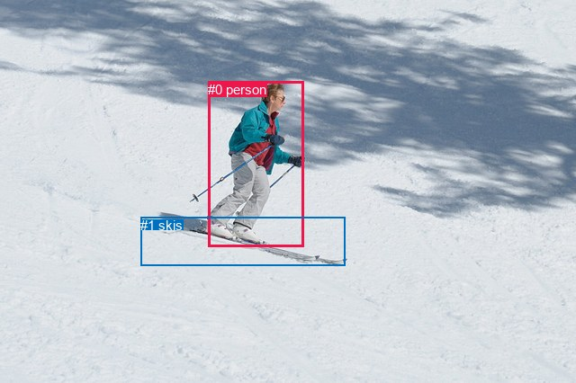
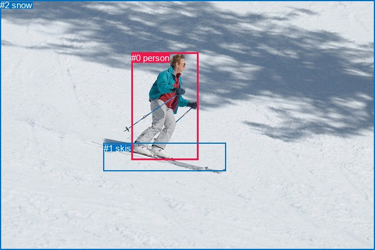

# 图片 1693：2394673.jpg

随机样本序号：276。图片 SHA256：`487977ae8e06409c8ce630bf56340f5816de6b0da878714b7f8d49f91f69d742`。

红色框表示人，蓝色框表示其他物体。两个模式分别保留自身框编号，可依据位置比较对应对象。

## 自动检测框与输出

人的框编号：`[0]`。状态：`ok`。

### 自动检测全部物体框

| 编号 | 类别 | 是否为人 | 检测分数 | 像素坐标 xyxy |
|---|---|---|---|---|
| 0 | person | True | 0.9995 | 231.4, 90.8, 337.8, 274.5 |
| 1 | skis | False | 0.9843 | 156.0, 241.7, 383.7, 295.0 |

### 自动检测 Top50 人相关候选

评分物体对：2；人相关物体对：2；输出关系：4。

| 排名 | 主语编号与类别 | 关系 | 宾语编号与类别 | 类型 | 人与人 | 排序分数 | 原始融合 logit |
|---|---|---|---|---|---|---|---|
| 1 | #0 person | wearing | #1 skis | semantic | False | 0.98196 | 3.9968 |
| 2 | #0 person | on | #1 skis | spatial | False | 0.61655 | 0.4749 |
| 3 | #1 skis | on | #0 person | spatial | False | 0.00793 | -4.8293 |
| 4 | #1 skis | wearing | #0 person | semantic | False | 0.00191 | -6.2574 |

### 自动检测逐条人相关 GT 核验

R@50：0.00%；命中 0/2。

| GT 主语编号 | GT 关系 | GT 宾语编号 | 结果阶段 | 匹配预测主语编号 | 匹配预测宾语编号 |
|---|---|---|---|---|---|
| 0 | playing | 1 | wrong_predicate | [0] | [1] |
| 1 | attached to | 0 | wrong_predicate | [1] | [0] |

## 真实框与输出

人的框编号：`[0]`。

### 真实框全部物体框

| 编号 | 类别 | 是否为人 | 检测分数 | 像素坐标 xyxy |
|---|---|---|---|---|
| 0 | person | True | GT | 224.0, 90.0, 338.0, 273.0 |
| 1 | skis | False | GT | 177.0, 244.0, 386.0, 292.0 |
| 2 | snow | False | GT | 0.0, 0.0, 640.0, 426.0 |

### 真实框 Top50 人相关候选

评分物体对：6；人相关物体对：4；输出关系：8。

| 排名 | 主语编号与类别 | 关系 | 宾语编号与类别 | 类型 | 人与人 | 排序分数 | 原始融合 logit |
|---|---|---|---|---|---|---|---|
| 1 | #0 person | on | #1 skis | spatial | False | 0.98605 | 4.2579 |
| 2 | #0 person | wearing | #1 skis | semantic | False | 0.98255 | 4.0310 |
| 3 | #0 person | on | #2 snow | spatial | False | 0.97574 | 3.6944 |
| 4 | #0 person | going down | #2 snow | semantic | False | 0.84972 | 1.7324 |
| 5 | #1 skis | on | #0 person | spatial | False | 0.66899 | 0.7036 |
| 6 | #2 snow | beside | #0 person | spatial | False | 0.41748 | -0.3331 |
| 7 | #1 skis | holding | #0 person | semantic | False | 0.17966 | -1.5186 |
| 8 | #2 snow | holding | #0 person | semantic | False | 0.06235 | -2.7107 |

### 真实框逐条人相关 GT 核验

R@50：0.00%；命中 0/2。

| GT 主语编号 | GT 关系 | GT 宾语编号 | 结果阶段 | 匹配预测主语编号 | 匹配预测宾语编号 |
|---|---|---|---|---|---|
| 0 | playing | 1 | wrong_predicate | [0] | [1] |
| 1 | attached to | 0 | wrong_predicate | [1] | [0] |

## 全部人相关 GT

| 主语编号与类别 | 关系 | 宾语编号与类别 |
|---|---|---|
| #0 person | playing | #1 skis |
| #1 skis | attached to | #0 person |

原始记录、全部人相关物体对的两项预测与分项分数见 [逐图证据 JSON](../evidence/cases/1693.json)。全部56类 logits 保留于本机 HOR/output/random500/logits/。

<!-- HOR_COMPLETE_RESULTS -->

## 六组条件的完整输出对照

以下保留同一图片三种框与候选模式、两种谓词输出规则的全部 Top50。框编号各自在所属模式内解释。

### 自动检测框完整枚举：空间与语义各保留一个谓词

| 排名 | 主语编号与类别 | 谓词 | 宾语编号与类别 | 分组 | 排序分数 | predicate logit | pair logit |
|---|---|---|---|---|---|---|---|
| 1 | #0 person | wearing | #1 skis | semantic | 0.9819572 | 3.6789470 | 0.3178511 |
| 2 | #0 person | on | #1 skis | spatial | 0.6165484 | 0.1570721 | 0.3178511 |
| 3 | #1 skis | on | #0 person | spatial | 0.0079291 | -3.9194975 | -0.9097599 |
| 4 | #1 skis | wearing | #0 person | semantic | 0.0019126 | -5.3476110 | -0.9097599 |

GT 命中：0/2，R@50=0.00%。

| GT主语 | GT谓词 | GT宾语 | 结果阶段 | 匹配主语框 | 匹配宾语框 |
|---|---|---|---|---|---|
| 0 | playing | 1 | wrong_predicate | [0] | [1] |
| 1 | attached to | 0 | wrong_predicate | [1] | [0] |

### 自动检测框完整枚举：每对只保留一个谓词

| 排名 | 主语编号与类别 | 谓词 | 宾语编号与类别 | 分组 | 排序分数 | predicate logit | pair logit |
|---|---|---|---|---|---|---|---|
| 1 | #0 person | wearing | #1 skis | single | 0.9819572 | 3.6789470 | 0.3178511 |
| 2 | #1 skis | on | #0 person | single | 0.0079291 | -3.9194975 | -0.9097599 |

GT 命中：0/2，R@50=0.00%。

| GT主语 | GT谓词 | GT宾语 | 结果阶段 | 匹配主语框 | 匹配宾语框 |
|---|---|---|---|---|---|
| 0 | playing | 1 | wrong_predicate | [0] | [1] |
| 1 | attached to | 0 | wrong_predicate | [1] | [0] |

### 真实框完整枚举：空间与语义各保留一个谓词

| 排名 | 主语编号与类别 | 谓词 | 宾语编号与类别 | 分组 | 排序分数 | predicate logit | pair logit |
|---|---|---|---|---|---|---|---|
| 1 | #0 person | on | #1 skis | spatial | 0.9860455 | 3.9320016 | 0.3258984 |
| 2 | #0 person | wearing | #1 skis | semantic | 0.9825538 | 3.7051339 | 0.3258984 |
| 3 | #0 person | on | #2 snow | spatial | 0.9757413 | 3.5611758 | 0.1332478 |
| 4 | #0 person | going down | #2 snow | semantic | 0.8497179 | 1.5991426 | 0.1332478 |
| 5 | #1 skis | on | #0 person | spatial | 0.6689867 | 1.5860424 | -0.8824367 |
| 6 | #2 snow | beside | #0 person | spatial | 0.4174830 | 0.4960322 | -0.8291466 |
| 7 | #1 skis | holding | #0 person | semantic | 0.1796627 | -0.6361976 | -0.8824367 |
| 8 | #2 snow | holding | #0 person | semantic | 0.0623459 | -1.8815365 | -0.8291466 |

GT 命中：0/2，R@50=0.00%。

| GT主语 | GT谓词 | GT宾语 | 结果阶段 | 匹配主语框 | 匹配宾语框 |
|---|---|---|---|---|---|
| 0 | playing | 1 | wrong_predicate | [0] | [1] |
| 1 | attached to | 0 | wrong_predicate | [1] | [0] |

### 真实框完整枚举：每对只保留一个谓词

| 排名 | 主语编号与类别 | 谓词 | 宾语编号与类别 | 分组 | 排序分数 | predicate logit | pair logit |
|---|---|---|---|---|---|---|---|
| 1 | #0 person | on | #1 skis | single | 0.9860455 | 3.9320016 | 0.3258984 |
| 2 | #0 person | on | #2 snow | single | 0.9757413 | 3.5611758 | 0.1332478 |
| 3 | #1 skis | on | #0 person | single | 0.6689867 | 1.5860424 | -0.8824367 |
| 4 | #2 snow | beside | #0 person | single | 0.4174830 | 0.4960322 | -0.8291466 |

GT 命中：0/2，R@50=0.00%。

| GT主语 | GT谓词 | GT宾语 | 结果阶段 | 匹配主语框 | 匹配宾语框 |
|---|---|---|---|---|---|
| 0 | playing | 1 | wrong_predicate | [0] | [1] |
| 1 | attached to | 0 | wrong_predicate | [1] | [0] |

### 真实框400候选：空间与语义各保留一个谓词

| 排名 | 主语编号与类别 | 谓词 | 宾语编号与类别 | 分组 | 排序分数 | predicate logit | pair logit |
|---|---|---|---|---|---|---|---|
| 1 | #0 person | on | #1 skis | spatial | 0.9860455 | 3.9320016 | 0.3258984 |
| 2 | #0 person | wearing | #1 skis | semantic | 0.9825538 | 3.7051339 | 0.3258984 |
| 3 | #0 person | on | #2 snow | spatial | 0.9757413 | 3.5611758 | 0.1332478 |
| 4 | #0 person | going down | #2 snow | semantic | 0.8497179 | 1.5991426 | 0.1332478 |
| 5 | #1 skis | on | #0 person | spatial | 0.6689867 | 1.5860424 | -0.8824367 |
| 6 | #2 snow | beside | #0 person | spatial | 0.4174830 | 0.4960322 | -0.8291466 |
| 7 | #1 skis | holding | #0 person | semantic | 0.1793364 | -0.6384130 | -0.8824367 |
| 8 | #2 snow | holding | #0 person | semantic | 0.0623675 | -1.8811672 | -0.8291466 |

GT 命中：0/2，R@50=0.00%。

| GT主语 | GT谓词 | GT宾语 | 结果阶段 | 匹配主语框 | 匹配宾语框 |
|---|---|---|---|---|---|
| 0 | playing | 1 | wrong_predicate | [0] | [1] |
| 1 | attached to | 0 | wrong_predicate | [1] | [0] |

### 真实框400候选：每对只保留一个谓词

| 排名 | 主语编号与类别 | 谓词 | 宾语编号与类别 | 分组 | 排序分数 | predicate logit | pair logit |
|---|---|---|---|---|---|---|---|
| 1 | #0 person | on | #1 skis | single | 0.9860455 | 3.9320016 | 0.3258984 |
| 2 | #0 person | on | #2 snow | single | 0.9757413 | 3.5611758 | 0.1332478 |
| 3 | #1 skis | on | #0 person | single | 0.6689867 | 1.5860424 | -0.8824367 |
| 4 | #2 snow | beside | #0 person | single | 0.4174830 | 0.4960322 | -0.8291466 |

GT 命中：0/2，R@50=0.00%。

| GT主语 | GT谓词 | GT宾语 | 结果阶段 | 匹配主语框 | 匹配宾语框 |
|---|---|---|---|---|---|
| 0 | playing | 1 | wrong_predicate | [0] | [1] |
| 1 | attached to | 0 | wrong_predicate | [1] | [0] |
