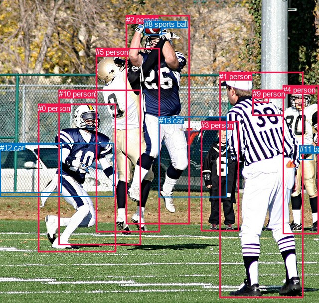
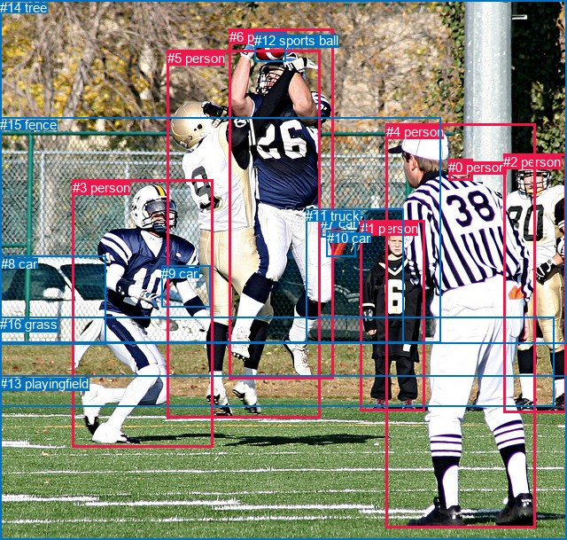

# 图片 1695：2394762.jpg

随机样本序号：153。图片 SHA256：`fcb23cbab168a4ce784173658a630910ed1110b418ef492dfaf2f61febfcb351`。

红色框表示人，蓝色框表示其他物体。两个模式分别保留自身框编号，可依据位置比较对应对象。

## 自动检测框与输出

人的框编号：`[0, 1, 2, 3, 4, 5, 7, 9, 10]`。状态：`ok`。

### 自动检测全部物体框

| 编号 | 类别 | 是否为人 | 检测分数 | 像素坐标 xyxy |
|---|---|---|---|---|
| 0 | person | True | 0.9997 | 76.1, 208.6, 232.8, 506.8 |
| 1 | person | True | 0.9993 | 440.4, 144.8, 608.8, 598.5 |
| 2 | person | True | 0.9984 | 252.8, 30.9, 380.2, 450.9 |
| 3 | person | True | 0.9984 | 403.4, 243.4, 479.2, 465.0 |
| 4 | person | True | 0.9975 | 567.7, 171.6, 639.3, 470.4 |
| 5 | person | True | 0.9772 | 192.3, 96.0, 320.1, 466.9 |
| 6 | car | False | 0.9248 | 0.1, 289.7, 123.6, 387.7 |
| 7 | person | True | 0.9228 | 507.2, 180.3, 539.6, 206.8 |
| 8 | sports ball | False | 0.7508 | 289.7, 39.6, 324.0, 70.9 |
| 9 | person | True | 0.6696 | 506.7, 180.4, 569.1, 232.7 |
| 10 | person | True | 0.5796 | 118.0, 180.1, 282.6, 492.7 |
| 11 | baseball glove | False | 0.4370 | 600.5, 291.2, 628.5, 321.5 |
| 12 | car | False | 0.3898 | 0.0, 287.9, 228.9, 395.3 |
| 13 | car | False | 0.3726 | 318.9, 234.2, 455.5, 396.8 |

### 自动检测 Top50 人相关候选

评分物体对：182；人相关物体对：162；输出关系：50。

| 排名 | 主语编号与类别 | 关系 | 宾语编号与类别 | 类型 | 人与人 | 排序分数 | 原始融合 logit |
|---|---|---|---|---|---|---|---|
| 1 | #4 person | wearing | #11 baseball glove | semantic | False | 0.97674 | 3.7376 |
| 2 | #2 person | catching | #8 sports ball | semantic | False | 0.97126 | 3.5203 |
| 3 | #3 person | looking at | #2 person | semantic | True | 0.93980 | 2.7480 |
| 4 | #5 person | catching | #8 sports ball | semantic | False | 0.92432 | 2.5026 |
| 5 | #1 person | looking at | #2 person | semantic | True | 0.91087 | 2.3243 |
| 6 | #7 person | on | #9 person | spatial | True | 0.88837 | 2.0742 |
| 7 | #4 person | in | #11 baseball glove | spatial | False | 0.87570 | 1.9523 |
| 8 | #2 person | in | #8 sports ball | spatial | False | 0.87191 | 1.9180 |
| 9 | #1 person | wearing | #11 baseball glove | semantic | False | 0.81218 | 1.4642 |
| 10 | #4 person | wearing | #9 person | semantic | True | 0.80312 | 1.4059 |
| 11 | #3 person | looking at | #5 person | semantic | True | 0.77464 | 1.2347 |
| 12 | #4 person | looking at | #2 person | semantic | True | 0.76163 | 1.1616 |
| 13 | #8 sports ball | on | #2 person | spatial | False | 0.74967 | 1.0969 |
| 14 | #4 person | in | #9 person | spatial | True | 0.74899 | 1.0932 |
| 15 | #10 person | catching | #8 sports ball | semantic | False | 0.70207 | 0.8572 |
| 16 | #1 person | looking at | #5 person | semantic | True | 0.65416 | 0.6374 |
| 17 | #2 person | playing with | #5 person | semantic | True | 0.64314 | 0.5890 |
| 18 | #11 baseball glove | on | #4 person | spatial | False | 0.63102 | 0.5366 |
| 19 | #5 person | playing with | #2 person | semantic | True | 0.62457 | 0.5090 |
| 20 | #0 person | catching | #8 sports ball | semantic | False | 0.60558 | 0.4288 |
| 21 | #4 person | wearing | #7 person | semantic | True | 0.58657 | 0.3498 |
| 22 | #4 person | catching | #8 sports ball | semantic | False | 0.57018 | 0.2826 |
| 23 | #4 person | in | #7 person | spatial | True | 0.56724 | 0.2706 |
| 24 | #1 person | in | #7 person | spatial | True | 0.56707 | 0.2699 |
| 25 | #9 person | in | #7 person | spatial | True | 0.54998 | 0.2006 |
| 26 | #1 person | playing | #8 sports ball | semantic | False | 0.54383 | 0.1758 |
| 27 | #1 person | wearing | #7 person | semantic | True | 0.54175 | 0.1674 |
| 28 | #0 person | wearing | #12 car | semantic | False | 0.50126 | 0.0050 |
| 29 | #0 person | running on | #5 person | semantic | True | 0.50088 | 0.0035 |
| 30 | #10 person | running on | #2 person | semantic | True | 0.49180 | -0.0328 |
| 31 | #3 person | looking at | #1 person | semantic | True | 0.47829 | -0.0869 |
| 32 | #2 person | in | #5 person | spatial | True | 0.44684 | -0.2135 |
| 33 | #3 person | looking at | #10 person | semantic | True | 0.44270 | -0.2302 |
| 34 | #3 person | wearing | #13 car | semantic | False | 0.43783 | -0.2500 |
| 35 | #10 person | running on | #5 person | semantic | True | 0.43771 | -0.2504 |
| 36 | #3 person | beside | #1 person | spatial | True | 0.41620 | -0.3384 |
| 37 | #3 person | in | #13 car | spatial | False | 0.41586 | -0.3398 |
| 38 | #7 person | on | #1 person | spatial | True | 0.41012 | -0.3635 |
| 39 | #2 person | wearing | #13 car | semantic | False | 0.40213 | -0.3966 |
| 40 | #10 person | running on | #12 car | semantic | False | 0.40164 | -0.3986 |
| 41 | #0 person | running on | #6 car | semantic | False | 0.39152 | -0.4409 |
| 42 | #3 person | looking at | #0 person | semantic | True | 0.38988 | -0.4478 |
| 43 | #0 person | running on | #2 person | semantic | True | 0.37023 | -0.5312 |
| 44 | #1 person | in | #9 person | spatial | True | 0.36858 | -0.5383 |
| 45 | #10 person | running on | #6 car | semantic | False | 0.36688 | -0.5456 |
| 46 | #1 person | beside | #4 person | spatial | True | 0.36369 | -0.5594 |
| 47 | #1 person | beside | #2 person | spatial | True | 0.36248 | -0.5646 |
| 48 | #0 person | wearing | #10 person | semantic | True | 0.36118 | -0.5703 |
| 49 | #6 car | parked on | #10 person | semantic | False | 0.35584 | -0.5935 |
| 50 | #4 person | looking at | #5 person | semantic | True | 0.35205 | -0.6101 |

### 自动检测逐条人相关 GT 核验

R@50：28.57%；命中 2/7。

| GT 主语编号 | GT 关系 | GT 宾语编号 | 结果阶段 | 匹配预测主语编号 | 匹配预测宾语编号 |
|---|---|---|---|---|---|
| 1 | attached to | 16 | endpoint_missing_or_wrong_class | [3] | [] |
| 3 | looking at | 12 | wrong_predicate | [0, 10] | [8] |
| 3 | running on | 13 | endpoint_missing_or_wrong_class | [0, 10] | [] |
| 4 | looking at | 5 | hit50 | [1] | [2, 5] |
| 5 | pulling | 6 | wrong_predicate | [2, 5] | [2] |
| 5 | jumping from | 13 | endpoint_missing_or_wrong_class | [2, 5] | [] |
| 6 | catching | 12 | hit50 | [2] | [8] |

## 真实框与输出

人的框编号：`[0, 1, 2, 3, 4, 5, 6]`。

### 真实框全部物体框

| 编号 | 类别 | 是否为人 | 检测分数 | 像素坐标 xyxy |
|---|---|---|---|---|
| 0 | person | True | GT | 506.0, 180.0, 533.0, 204.0 |
| 1 | person | True | GT | 407.0, 249.0, 480.0, 464.0 |
| 2 | person | True | GT | 568.0, 174.0, 640.0, 465.0 |
| 3 | person | True | GT | 82.0, 203.0, 241.0, 505.0 |
| 4 | person | True | GT | 436.0, 140.0, 605.0, 595.0 |
| 5 | person | True | GT | 189.0, 57.0, 362.0, 472.0 |
| 6 | person | True | GT | 259.0, 33.0, 377.0, 428.0 |
| 7 | car | False | GT | 362.0, 243.0, 412.0, 268.0 |
| 8 | car | False | GT | 1.0, 289.0, 119.0, 388.0 |
| 9 | car | False | GT | 182.0, 300.0, 237.0, 347.0 |
| 10 | car | False | GT | 369.0, 260.0, 401.0, 290.0 |
| 11 | truck | False | GT | 345.0, 235.0, 455.0, 386.0 |
| 12 | sports ball | False | GT | 287.0, 37.0, 323.0, 70.0 |
| 13 | playingfield | False | GT | 0.0, 424.0, 640.0, 609.0 |
| 14 | tree | False | GT | 0.0, 0.0, 640.0, 387.0 |
| 15 | fence | False | GT | 0.0, 132.0, 497.0, 386.0 |
| 16 | grass | False | GT | 0.0, 357.0, 626.0, 458.0 |

### 真实框 Top50 人相关候选

评分物体对：272；人相关物体对：182；输出关系：50。

| 排名 | 主语编号与类别 | 关系 | 宾语编号与类别 | 类型 | 人与人 | 排序分数 | 原始融合 logit |
|---|---|---|---|---|---|---|---|
| 1 | #3 person | running on | #13 playingfield | semantic | False | 0.98848 | 4.4518 |
| 2 | #5 person | catching | #12 sports ball | semantic | False | 0.98366 | 4.0974 |
| 3 | #6 person | wearing | #12 sports ball | semantic | False | 0.96802 | 3.4103 |
| 4 | #3 person | running on | #16 grass | semantic | False | 0.95514 | 3.0583 |
| 5 | #3 person | wearing | #9 car | semantic | False | 0.94788 | 2.9008 |
| 6 | #3 person | on | #13 playingfield | spatial | False | 0.94647 | 2.8725 |
| 7 | #1 person | looking at | #5 person | semantic | True | 0.92356 | 2.4918 |
| 8 | #1 person | standing on | #16 grass | semantic | False | 0.91615 | 2.3912 |
| 9 | #4 person | standing on | #13 playingfield | semantic | False | 0.91583 | 2.3870 |
| 10 | #4 person | on | #13 playingfield | spatial | False | 0.90381 | 2.2403 |
| 11 | #1 person | looking at | #6 person | semantic | True | 0.90125 | 2.2111 |
| 12 | #3 person | on | #16 grass | spatial | False | 0.88221 | 2.0135 |
| 13 | #1 person | standing on | #13 playingfield | semantic | False | 0.87269 | 1.9249 |
| 14 | #4 person | looking at | #5 person | semantic | True | 0.86542 | 1.8611 |
| 15 | #4 person | looking at | #6 person | semantic | True | 0.86156 | 1.8283 |
| 16 | #6 person | in | #12 sports ball | spatial | False | 0.83933 | 1.6532 |
| 17 | #2 person | standing on | #13 playingfield | semantic | False | 0.83869 | 1.6485 |
| 18 | #5 person | running on | #13 playingfield | semantic | False | 0.83194 | 1.5994 |
| 19 | #3 person | catching | #12 sports ball | semantic | False | 0.79947 | 1.3830 |
| 20 | #1 person | on | #16 grass | spatial | False | 0.79254 | 1.3403 |
| 21 | #2 person | on | #13 playingfield | spatial | False | 0.79209 | 1.3376 |
| 22 | #2 person | standing on | #16 grass | semantic | False | 0.78797 | 1.3127 |
| 23 | #2 person | catching | #12 sports ball | semantic | False | 0.77186 | 1.2189 |
| 24 | #3 person | chasing | #5 person | semantic | True | 0.76538 | 1.1824 |
| 25 | #1 person | on | #13 playingfield | spatial | False | 0.75866 | 1.1454 |
| 26 | #5 person | playing with | #6 person | semantic | True | 0.75154 | 1.1068 |
| 27 | #3 person | in | #9 car | spatial | False | 0.74843 | 1.0903 |
| 28 | #12 sports ball | on | #6 person | spatial | False | 0.74618 | 1.0783 |
| 29 | #2 person | looking at | #5 person | semantic | True | 0.70443 | 0.8685 |
| 30 | #5 person | on | #13 playingfield | spatial | False | 0.70319 | 0.8625 |
| 31 | #2 person | looking at | #6 person | semantic | True | 0.69697 | 0.8329 |
| 32 | #4 person | wearing | #0 person | semantic | True | 0.69649 | 0.8306 |
| 33 | #2 person | on | #16 grass | spatial | False | 0.68516 | 0.7776 |
| 34 | #4 person | in | #0 person | spatial | True | 0.68249 | 0.7653 |
| 35 | #6 person | playing with | #5 person | semantic | True | 0.67304 | 0.7220 |
| 36 | #4 person | playing | #12 sports ball | semantic | False | 0.66531 | 0.6870 |
| 37 | #5 person | on | #12 sports ball | spatial | False | 0.62852 | 0.5259 |
| 38 | #4 person | standing on | #16 grass | semantic | False | 0.62743 | 0.5212 |
| 39 | #5 person | running on | #16 grass | semantic | False | 0.56864 | 0.2763 |
| 40 | #4 person | on | #16 grass | spatial | False | 0.56313 | 0.2539 |
| 41 | #9 car | on | #3 person | spatial | False | 0.52581 | 0.1033 |
| 42 | #6 person | running on | #13 playingfield | semantic | False | 0.52526 | 0.1011 |
| 43 | #6 person | on | #13 playingfield | spatial | False | 0.51629 | 0.0652 |
| 44 | #5 person | on | #16 grass | spatial | False | 0.51349 | 0.0540 |
| 45 | #2 person | wearing | #0 person | semantic | True | 0.51200 | 0.0480 |
| 46 | #12 sports ball | on | #5 person | spatial | False | 0.50742 | 0.0297 |
| 47 | #0 person | on | #4 person | spatial | True | 0.50270 | 0.0108 |
| 48 | #5 person | in | #6 person | spatial | True | 0.49422 | -0.0231 |
| 49 | #1 person | looking at | #4 person | semantic | True | 0.49369 | -0.0252 |
| 50 | #1 person | looking at | #3 person | semantic | True | 0.47564 | -0.0975 |

### 真实框逐条人相关 GT 核验

R@50：28.57%；命中 2/7。

| GT 主语编号 | GT 关系 | GT 宾语编号 | 结果阶段 | 匹配预测主语编号 | 匹配预测宾语编号 |
|---|---|---|---|---|---|
| 1 | attached to | 16 | wrong_predicate | [1] | [16] |
| 3 | looking at | 12 | wrong_predicate | [3] | [12] |
| 3 | running on | 13 | hit50 | [3] | [13] |
| 4 | looking at | 5 | hit50 | [4] | [5] |
| 5 | pulling | 6 | wrong_predicate | [5] | [6] |
| 5 | jumping from | 13 | wrong_predicate | [5] | [13] |
| 6 | catching | 12 | wrong_predicate | [6] | [12] |

## 全部人相关 GT

| 主语编号与类别 | 关系 | 宾语编号与类别 |
|---|---|---|
| #1 person | attached to | #16 grass |
| #3 person | looking at | #12 sports ball |
| #3 person | running on | #13 playingfield |
| #4 person | looking at | #5 person |
| #5 person | pulling | #6 person |
| #5 person | jumping from | #13 playingfield |
| #6 person | catching | #12 sports ball |

原始记录、全部人相关物体对的两项预测与分项分数见 [逐图证据 JSON](../evidence/cases/1695.json)。全部56类 logits 保留于本机 HOR/output/random500/logits/。

<!-- HOR_COMPLETE_RESULTS -->

## 六组条件的完整输出对照

以下保留同一图片三种框与候选模式、两种谓词输出规则的全部 Top50。框编号各自在所属模式内解释。

### 自动检测框完整枚举：空间与语义各保留一个谓词

| 排名 | 主语编号与类别 | 谓词 | 宾语编号与类别 | 分组 | 排序分数 | predicate logit | pair logit |
|---|---|---|---|---|---|---|---|
| 1 | #4 person | wearing | #11 baseball glove | semantic | 0.9767426 | 3.2724123 | 0.4651863 |
| 2 | #2 person | catching | #8 sports ball | semantic | 0.9712592 | 3.0150728 | 0.5051997 |
| 3 | #3 person | looking at | #2 person | semantic | 0.9397996 | 3.1779704 | -0.4299832 |
| 4 | #5 person | catching | #8 sports ball | semantic | 0.9243228 | 2.3587847 | 0.1438001 |
| 5 | #1 person | looking at | #2 person | semantic | 0.9108674 | 2.6006584 | -0.2763865 |
| 6 | #7 person | on | #9 person | spatial | 0.8883709 | 2.3082328 | -0.2340254 |
| 7 | #4 person | in | #11 baseball glove | spatial | 0.8756998 | 1.4871378 | 0.4651863 |
| 8 | #2 person | in | #8 sports ball | spatial | 0.8719141 | 1.4127898 | 0.5051997 |
| 9 | #1 person | wearing | #11 baseball glove | semantic | 0.8121775 | 1.8235950 | -0.3593731 |
| 10 | #4 person | wearing | #9 person | semantic | 0.8031231 | 1.8498549 | -0.4439254 |
| 11 | #3 person | looking at | #5 person | semantic | 0.7746417 | 1.9798985 | -0.7451894 |
| 12 | #4 person | looking at | #2 person | semantic | 0.7616299 | 1.6104360 | -0.4487996 |
| 13 | #8 sports ball | on | #2 person | spatial | 0.7496741 | 1.6958079 | -0.5989331 |
| 14 | #4 person | in | #9 person | spatial | 0.7489868 | 1.5371413 | -0.4439254 |
| 15 | #10 person | catching | #8 sports ball | semantic | 0.7020727 | 1.1968684 | -0.3396810 |
| 16 | #1 person | looking at | #5 person | semantic | 0.6541622 | 1.2216902 | -0.5843049 |
| 17 | #2 person | playing with | #5 person | semantic | 0.6431437 | 0.9335423 | -0.3445072 |
| 18 | #11 baseball glove | on | #4 person | spatial | 0.6310154 | 1.1487203 | -0.6121449 |
| 19 | #5 person | playing with | #2 person | semantic | 0.6245663 | 1.1988502 | -0.6898748 |
| 20 | #0 person | catching | #8 sports ball | semantic | 0.6055809 | 0.9431782 | -0.5144041 |
| 21 | #4 person | wearing | #7 person | semantic | 0.5865713 | 0.7804151 | -0.4306059 |
| 22 | #4 person | catching | #8 sports ball | semantic | 0.5701821 | 1.1549039 | -0.8723097 |
| 23 | #4 person | in | #7 person | spatial | 0.5672446 | 0.7012239 | -0.4306059 |
| 24 | #1 person | in | #7 person | spatial | 0.5670660 | 0.6399283 | -0.3700382 |
| 25 | #9 person | in | #7 person | spatial | 0.5499772 | 0.9136229 | -0.7130442 |
| 26 | #1 person | playing | #8 sports ball | semantic | 0.5438263 | 0.6573224 | -0.4815660 |
| 27 | #1 person | wearing | #7 person | semantic | 0.5417504 | 0.5374298 | -0.3700382 |
| 28 | #0 person | wearing | #12 car | semantic | 0.5012605 | 1.1437650 | -1.1387229 |
| 29 | #0 person | running on | #5 person | semantic | 0.5008806 | 0.2924142 | -0.2888919 |
| 30 | #10 person | running on | #2 person | semantic | 0.4917972 | 0.5901818 | -0.6229961 |
| 31 | #3 person | looking at | #1 person | semantic | 0.4782926 | 0.4126043 | -0.4994884 |
| 32 | #2 person | in | #5 person | spatial | 0.4468370 | 0.1310482 | -0.3445072 |
| 33 | #3 person | looking at | #10 person | semantic | 0.4427007 | 0.5666556 | -0.7968640 |
| 34 | #3 person | wearing | #13 car | semantic | 0.4378319 | -0.2875214 | 0.0375556 |
| 35 | #10 person | running on | #5 person | semantic | 0.4377134 | -0.0511503 | -0.1992968 |
| 36 | #3 person | beside | #1 person | spatial | 0.4161967 | 0.1610823 | -0.4994884 |
| 37 | #3 person | in | #13 car | spatial | 0.4158604 | -0.3773460 | 0.0375556 |
| 38 | #7 person | on | #1 person | spatial | 0.4101152 | -0.0222607 | -0.3412286 |
| 39 | #2 person | wearing | #13 car | semantic | 0.4021269 | 0.2798486 | -0.6764596 |
| 40 | #10 person | running on | #12 car | semantic | 0.4016441 | 0.8228245 | -1.2214435 |
| 41 | #0 person | running on | #6 car | semantic | 0.3915229 | 0.9253316 | -1.3662468 |
| 42 | #3 person | looking at | #0 person | semantic | 0.3898771 | 0.3031554 | -0.7509843 |
| 43 | #0 person | running on | #2 person | semantic | 0.3702267 | 0.0358100 | -0.5670542 |
| 44 | #1 person | in | #9 person | spatial | 0.3685755 | 0.1697598 | -0.7080923 |
| 45 | #10 person | running on | #6 car | semantic | 0.3668789 | 0.9435177 | -1.4891478 |
| 46 | #1 person | beside | #4 person | spatial | 0.3636855 | 0.1599832 | -0.7193867 |
| 47 | #1 person | beside | #2 person | spatial | 0.3624824 | -0.2882195 | -0.2763865 |
| 48 | #0 person | wearing | #10 person | semantic | 0.3611754 | 0.0185804 | -0.5888465 |
| 49 | #6 car | parked on | #10 person | semantic | 0.3558425 | 0.3233171 | -0.9167721 |
| 50 | #4 person | looking at | #5 person | semantic | 0.3520465 | 0.0243163 | -0.6343722 |

GT 命中：2/7，R@50=28.57%。

| GT主语 | GT谓词 | GT宾语 | 结果阶段 | 匹配主语框 | 匹配宾语框 |
|---|---|---|---|---|---|
| 1 | attached to | 16 | endpoint_missing_or_wrong_class | [3] | [] |
| 3 | looking at | 12 | wrong_predicate | [0, 10] | [8] |
| 3 | running on | 13 | endpoint_missing_or_wrong_class | [0, 10] | [] |
| 4 | looking at | 5 | hit50 | [1] | [2, 5] |
| 5 | pulling | 6 | wrong_predicate | [2, 5] | [2] |
| 5 | jumping from | 13 | endpoint_missing_or_wrong_class | [2, 5] | [] |
| 6 | catching | 12 | hit50 | [2] | [8] |

### 自动检测框完整枚举：每对只保留一个谓词

| 排名 | 主语编号与类别 | 谓词 | 宾语编号与类别 | 分组 | 排序分数 | predicate logit | pair logit |
|---|---|---|---|---|---|---|---|
| 1 | #4 person | wearing | #11 baseball glove | single | 0.9767426 | 3.2724123 | 0.4651863 |
| 2 | #2 person | catching | #8 sports ball | single | 0.9712592 | 3.0150728 | 0.5051997 |
| 3 | #3 person | looking at | #2 person | single | 0.9397996 | 3.1779704 | -0.4299832 |
| 4 | #5 person | catching | #8 sports ball | single | 0.9243228 | 2.3587847 | 0.1438001 |
| 5 | #1 person | looking at | #2 person | single | 0.9108674 | 2.6006584 | -0.2763865 |
| 6 | #7 person | on | #9 person | single | 0.8883709 | 2.3082328 | -0.2340254 |
| 7 | #1 person | wearing | #11 baseball glove | single | 0.8121775 | 1.8235950 | -0.3593731 |
| 8 | #4 person | wearing | #9 person | single | 0.8031231 | 1.8498549 | -0.4439254 |
| 9 | #3 person | looking at | #5 person | single | 0.7746417 | 1.9798985 | -0.7451894 |
| 10 | #4 person | looking at | #2 person | single | 0.7616299 | 1.6104360 | -0.4487996 |
| 11 | #8 sports ball | on | #2 person | single | 0.7496741 | 1.6958079 | -0.5989331 |
| 12 | #10 person | catching | #8 sports ball | single | 0.7020727 | 1.1968684 | -0.3396810 |
| 13 | #1 person | looking at | #5 person | single | 0.6541622 | 1.2216902 | -0.5843049 |
| 14 | #2 person | playing with | #5 person | single | 0.6431437 | 0.9335423 | -0.3445072 |
| 15 | #11 baseball glove | on | #4 person | single | 0.6310154 | 1.1487203 | -0.6121449 |
| 16 | #5 person | playing with | #2 person | single | 0.6245663 | 1.1988502 | -0.6898748 |
| 17 | #0 person | catching | #8 sports ball | single | 0.6055809 | 0.9431782 | -0.5144041 |
| 18 | #4 person | wearing | #7 person | single | 0.5865713 | 0.7804151 | -0.4306059 |
| 19 | #4 person | catching | #8 sports ball | single | 0.5701821 | 1.1549039 | -0.8723097 |
| 20 | #1 person | in | #7 person | single | 0.5670660 | 0.6399283 | -0.3700382 |
| 21 | #9 person | in | #7 person | single | 0.5499772 | 0.9136229 | -0.7130442 |
| 22 | #1 person | playing | #8 sports ball | single | 0.5438263 | 0.6573224 | -0.4815660 |
| 23 | #0 person | wearing | #12 car | single | 0.5012605 | 1.1437650 | -1.1387229 |
| 24 | #0 person | running on | #5 person | single | 0.5008806 | 0.2924142 | -0.2888919 |
| 25 | #10 person | running on | #2 person | single | 0.4917972 | 0.5901818 | -0.6229961 |
| 26 | #3 person | looking at | #1 person | single | 0.4782926 | 0.4126043 | -0.4994884 |
| 27 | #3 person | looking at | #10 person | single | 0.4427007 | 0.5666556 | -0.7968640 |
| 28 | #3 person | wearing | #13 car | single | 0.4378319 | -0.2875214 | 0.0375556 |
| 29 | #10 person | running on | #5 person | single | 0.4377134 | -0.0511503 | -0.1992968 |
| 30 | #7 person | on | #1 person | single | 0.4101152 | -0.0222607 | -0.3412286 |
| 31 | #2 person | wearing | #13 car | single | 0.4021269 | 0.2798486 | -0.6764596 |
| 32 | #10 person | running on | #12 car | single | 0.4016441 | 0.8228245 | -1.2214435 |
| 33 | #0 person | running on | #6 car | single | 0.3915229 | 0.9253316 | -1.3662468 |
| 34 | #3 person | looking at | #0 person | single | 0.3898771 | 0.3031554 | -0.7509843 |
| 35 | #0 person | running on | #2 person | single | 0.3702267 | 0.0358100 | -0.5670542 |
| 36 | #1 person | in | #9 person | single | 0.3685755 | 0.1697598 | -0.7080923 |
| 37 | #10 person | running on | #6 car | single | 0.3668789 | 0.9435177 | -1.4891478 |
| 38 | #1 person | beside | #4 person | single | 0.3636855 | 0.1599832 | -0.7193867 |
| 39 | #0 person | wearing | #10 person | single | 0.3611754 | 0.0185804 | -0.5888465 |
| 40 | #6 car | parked on | #10 person | single | 0.3558425 | 0.3233171 | -0.9167721 |
| 41 | #4 person | looking at | #5 person | single | 0.3520465 | 0.0243163 | -0.6343722 |
| 42 | #1 person | beside | #3 person | single | 0.3431337 | 0.0964904 | -0.7458505 |
| 43 | #7 person | holding | #11 baseball glove | single | 0.3382478 | 0.1335998 | -0.8047121 |
| 44 | #12 car | parked on | #0 person | single | 0.3332525 | 0.0519557 | -0.7454665 |
| 45 | #10 person | playing | #11 baseball glove | single | 0.3234423 | -0.2425790 | -0.4954181 |
| 46 | #6 car | parked on | #0 person | single | 0.3076549 | -0.0375862 | -0.7735195 |
| 47 | #1 person | looking at | #10 person | single | 0.2964976 | -0.1864972 | -0.6775349 |
| 48 | #7 person | looking at | #2 person | single | 0.2461990 | -0.2774677 | -0.8415207 |
| 49 | #4 person | beside | #1 person | single | 0.2419952 | -0.4704304 | -0.6713415 |
| 50 | #9 person | on | #1 person | single | 0.2388325 | -0.6695266 | -0.4895644 |

GT 命中：2/7，R@50=28.57%。

| GT主语 | GT谓词 | GT宾语 | 结果阶段 | 匹配主语框 | 匹配宾语框 |
|---|---|---|---|---|---|
| 1 | attached to | 16 | endpoint_missing_or_wrong_class | [3] | [] |
| 3 | looking at | 12 | wrong_predicate | [0, 10] | [8] |
| 3 | running on | 13 | endpoint_missing_or_wrong_class | [0, 10] | [] |
| 4 | looking at | 5 | hit50 | [1] | [2, 5] |
| 5 | pulling | 6 | wrong_predicate | [2, 5] | [2] |
| 5 | jumping from | 13 | endpoint_missing_or_wrong_class | [2, 5] | [] |
| 6 | catching | 12 | hit50 | [2] | [8] |

### 真实框完整枚举：空间与语义各保留一个谓词

| 排名 | 主语编号与类别 | 谓词 | 宾语编号与类别 | 分组 | 排序分数 | predicate logit | pair logit |
|---|---|---|---|---|---|---|---|
| 1 | #3 person | running on | #13 playingfield | semantic | 0.9884770 | 4.8143668 | -0.3625472 |
| 2 | #5 person | catching | #12 sports ball | semantic | 0.9836556 | 3.6190982 | 0.4782946 |
| 3 | #6 person | wearing | #12 sports ball | semantic | 0.9680241 | 2.8848386 | 0.5254359 |
| 4 | #3 person | running on | #16 grass | semantic | 0.9551376 | 3.7324100 | -0.6741575 |
| 5 | #3 person | wearing | #9 car | semantic | 0.9478844 | 3.2239661 | -0.3231988 |
| 6 | #3 person | on | #13 playingfield | spatial | 0.9464712 | 3.2350664 | -0.3625472 |
| 7 | #1 person | looking at | #5 person | semantic | 0.9235622 | 3.0617890 | -0.5700281 |
| 8 | #1 person | standing on | #16 grass | semantic | 0.9161527 | 2.5125823 | -0.1213970 |
| 9 | #4 person | standing on | #13 playingfield | semantic | 0.9158308 | 2.9764953 | -0.5894933 |
| 10 | #4 person | on | #13 playingfield | spatial | 0.9038140 | 2.8298330 | -0.5894933 |
| 11 | #1 person | looking at | #6 person | semantic | 0.9012451 | 2.7286930 | -0.5175573 |
| 12 | #3 person | on | #16 grass | spatial | 0.8822105 | 2.6876893 | -0.6741575 |
| 13 | #1 person | standing on | #13 playingfield | semantic | 0.8726880 | 2.3452940 | -0.4203562 |
| 14 | #4 person | looking at | #5 person | semantic | 0.8654205 | 2.1835642 | -0.3225038 |
| 15 | #4 person | looking at | #6 person | semantic | 0.8615558 | 2.1517296 | -0.3234571 |
| 16 | #6 person | in | #12 sports ball | spatial | 0.8393283 | 1.1278028 | 0.5254359 |
| 17 | #2 person | standing on | #13 playingfield | semantic | 0.8386930 | 2.2102408 | -0.5617058 |
| 18 | #5 person | running on | #13 playingfield | semantic | 0.8319403 | 2.2814221 | -0.6819808 |
| 19 | #3 person | catching | #12 sports ball | semantic | 0.7994675 | 1.8700700 | -0.4871001 |
| 20 | #1 person | on | #16 grass | spatial | 0.7925366 | 1.4616809 | -0.1213970 |
| 21 | #2 person | on | #13 playingfield | spatial | 0.7920928 | 1.8992925 | -0.5617058 |
| 22 | #2 person | standing on | #16 grass | semantic | 0.7879724 | 1.9306464 | -0.6179001 |
| 23 | #2 person | catching | #12 sports ball | semantic | 0.7718635 | 2.0653300 | -0.8464663 |
| 24 | #3 person | chasing | #5 person | semantic | 0.7653828 | 1.7133551 | -0.5309346 |
| 25 | #1 person | on | #13 playingfield | spatial | 0.7586615 | 1.5657110 | -0.4203562 |
| 26 | #5 person | playing with | #6 person | semantic | 0.7515388 | 1.8157110 | -0.7088751 |
| 27 | #3 person | in | #9 car | spatial | 0.7484305 | 1.4134579 | -0.3231988 |
| 28 | #12 sports ball | on | #6 person | spatial | 0.7461803 | 1.6840496 | -0.6057065 |
| 29 | #2 person | looking at | #5 person | semantic | 0.7044298 | 1.3178906 | -0.4494082 |
| 30 | #5 person | on | #13 playingfield | spatial | 0.7031891 | 1.5445113 | -0.6819808 |
| 31 | #2 person | looking at | #6 person | semantic | 0.6969698 | 1.3444958 | -0.5115861 |
| 32 | #4 person | wearing | #0 person | semantic | 0.6964900 | 1.1892052 | -0.3585660 |
| 33 | #2 person | on | #16 grass | spatial | 0.6851571 | 1.3954744 | -0.6179001 |
| 34 | #4 person | in | #0 person | spatial | 0.6824926 | 1.1238165 | -0.3585660 |
| 35 | #6 person | playing with | #5 person | semantic | 0.6730448 | 1.3563433 | -0.6343546 |
| 36 | #4 person | playing | #12 sports ball | semantic | 0.6653052 | 1.1292691 | -0.4422423 |
| 37 | #5 person | on | #12 sports ball | spatial | 0.6285242 | 0.0475965 | 0.4782946 |
| 38 | #4 person | standing on | #16 grass | semantic | 0.6274284 | 1.5048828 | -0.9836826 |
| 39 | #5 person | running on | #16 grass | semantic | 0.5686420 | 1.3237996 | -1.0474868 |
| 40 | #4 person | on | #16 grass | spatial | 0.5631343 | 1.2375746 | -0.9836826 |
| 41 | #9 car | on | #3 person | spatial | 0.5258072 | 0.7727103 | -0.6693897 |
| 42 | #6 person | running on | #13 playingfield | semantic | 0.5252561 | 0.8605251 | -0.7594146 |
| 43 | #6 person | on | #13 playingfield | spatial | 0.5162929 | 0.8246093 | -0.7594146 |
| 44 | #5 person | on | #16 grass | spatial | 0.5134886 | 1.1014543 | -1.0474868 |
| 45 | #2 person | wearing | #0 person | semantic | 0.5119988 | 0.4927421 | -0.4447376 |
| 46 | #12 sports ball | on | #5 person | spatial | 0.5074221 | 0.7317295 | -0.7020389 |
| 47 | #0 person | on | #4 person | spatial | 0.5026981 | 0.3402534 | -0.3294609 |
| 48 | #5 person | in | #6 person | spatial | 0.4942172 | 0.6857429 | -0.7088751 |
| 49 | #1 person | looking at | #4 person | semantic | 0.4936946 | 0.4773188 | -0.5025417 |
| 50 | #1 person | looking at | #3 person | semantic | 0.4756412 | 0.6971312 | -0.7946436 |

GT 命中：2/7，R@50=28.57%。

| GT主语 | GT谓词 | GT宾语 | 结果阶段 | 匹配主语框 | 匹配宾语框 |
|---|---|---|---|---|---|
| 1 | attached to | 16 | wrong_predicate | [1] | [16] |
| 3 | looking at | 12 | wrong_predicate | [3] | [12] |
| 3 | running on | 13 | hit50 | [3] | [13] |
| 4 | looking at | 5 | hit50 | [4] | [5] |
| 5 | pulling | 6 | wrong_predicate | [5] | [6] |
| 5 | jumping from | 13 | wrong_predicate | [5] | [13] |
| 6 | catching | 12 | wrong_predicate | [6] | [12] |

### 真实框完整枚举：每对只保留一个谓词

| 排名 | 主语编号与类别 | 谓词 | 宾语编号与类别 | 分组 | 排序分数 | predicate logit | pair logit |
|---|---|---|---|---|---|---|---|
| 1 | #3 person | running on | #13 playingfield | single | 0.9884770 | 4.8143668 | -0.3625472 |
| 2 | #5 person | catching | #12 sports ball | single | 0.9836556 | 3.6190982 | 0.4782946 |
| 3 | #6 person | wearing | #12 sports ball | single | 0.9680241 | 2.8848386 | 0.5254359 |
| 4 | #3 person | running on | #16 grass | single | 0.9551376 | 3.7324100 | -0.6741575 |
| 5 | #3 person | wearing | #9 car | single | 0.9478844 | 3.2239661 | -0.3231988 |
| 6 | #1 person | looking at | #5 person | single | 0.9235622 | 3.0617890 | -0.5700281 |
| 7 | #1 person | standing on | #16 grass | single | 0.9161527 | 2.5125823 | -0.1213970 |
| 8 | #4 person | standing on | #13 playingfield | single | 0.9158308 | 2.9764953 | -0.5894933 |
| 9 | #1 person | looking at | #6 person | single | 0.9012451 | 2.7286930 | -0.5175573 |
| 10 | #1 person | standing on | #13 playingfield | single | 0.8726880 | 2.3452940 | -0.4203562 |
| 11 | #4 person | looking at | #5 person | single | 0.8654205 | 2.1835642 | -0.3225038 |
| 12 | #4 person | looking at | #6 person | single | 0.8615558 | 2.1517296 | -0.3234571 |
| 13 | #2 person | standing on | #13 playingfield | single | 0.8386930 | 2.2102408 | -0.5617058 |
| 14 | #5 person | running on | #13 playingfield | single | 0.8319403 | 2.2814221 | -0.6819808 |
| 15 | #3 person | catching | #12 sports ball | single | 0.7994675 | 1.8700700 | -0.4871001 |
| 16 | #2 person | standing on | #16 grass | single | 0.7879724 | 1.9306464 | -0.6179001 |
| 17 | #2 person | catching | #12 sports ball | single | 0.7718635 | 2.0653300 | -0.8464663 |
| 18 | #3 person | chasing | #5 person | single | 0.7653828 | 1.7133551 | -0.5309346 |
| 19 | #5 person | playing with | #6 person | single | 0.7515388 | 1.8157110 | -0.7088751 |
| 20 | #12 sports ball | on | #6 person | single | 0.7461803 | 1.6840496 | -0.6057065 |
| 21 | #2 person | looking at | #5 person | single | 0.7044298 | 1.3178906 | -0.4494082 |
| 22 | #2 person | looking at | #6 person | single | 0.6969698 | 1.3444958 | -0.5115861 |
| 23 | #4 person | wearing | #0 person | single | 0.6964900 | 1.1892052 | -0.3585660 |
| 24 | #6 person | playing with | #5 person | single | 0.6730448 | 1.3563433 | -0.6343546 |
| 25 | #4 person | playing | #12 sports ball | single | 0.6653052 | 1.1292691 | -0.4422423 |
| 26 | #4 person | standing on | #16 grass | single | 0.6274284 | 1.5048828 | -0.9836826 |
| 27 | #5 person | running on | #16 grass | single | 0.5686420 | 1.3237996 | -1.0474868 |
| 28 | #9 car | on | #3 person | single | 0.5258072 | 0.7727103 | -0.6693897 |
| 29 | #6 person | running on | #13 playingfield | single | 0.5252561 | 0.8605251 | -0.7594146 |
| 30 | #2 person | wearing | #0 person | single | 0.5119988 | 0.4927421 | -0.4447376 |
| 31 | #12 sports ball | on | #5 person | single | 0.5074221 | 0.7317295 | -0.7020389 |
| 32 | #0 person | on | #4 person | single | 0.5026981 | 0.3402534 | -0.3294609 |
| 33 | #1 person | looking at | #4 person | single | 0.4936946 | 0.4773188 | -0.5025417 |
| 34 | #1 person | looking at | #3 person | single | 0.4756412 | 0.6971312 | -0.7946436 |
| 35 | #3 person | chasing | #6 person | single | 0.4554555 | 0.4292898 | -0.6079414 |
| 36 | #5 person | wearing | #9 car | single | 0.4449419 | 0.6044512 | -0.8255801 |
| 37 | #6 person | on | #16 grass | single | 0.3986404 | 0.5808673 | -0.9920007 |
| 38 | #0 person | looking at | #6 person | single | 0.2929730 | -0.0372615 | -0.8437269 |
| 39 | #4 person | looking at | #3 person | single | 0.2880085 | -0.2073498 | -0.6977260 |
| 40 | #0 person | looking at | #5 person | single | 0.2828787 | -0.0673528 | -0.8628740 |
| 41 | #8 car | parked on | #3 person | single | 0.2556403 | -0.3070993 | -0.7616538 |
| 42 | #4 person | looking at | #2 person | single | 0.2531862 | -0.3675680 | -0.7141227 |
| 43 | #2 person | looking at | #3 person | single | 0.2515295 | -0.2332573 | -0.8572143 |
| 44 | #1 person | beside | #11 truck | single | 0.2447967 | -0.9638486 | -0.1627105 |
| 45 | #1 person | wearing | #7 car | single | 0.2317063 | -0.6595273 | -0.5391743 |
| 46 | #5 person | in | #14 tree | single | 0.2117885 | -0.1912131 | -1.1229653 |
| 47 | #6 person | wearing | #7 car | single | 0.2049444 | -0.4892120 | -0.8664614 |
| 48 | #6 person | in | #14 tree | single | 0.1787940 | -0.5878229 | -0.9367168 |
| 49 | #2 person | looking at | #4 person | single | 0.1786678 | -0.8620358 | -0.6633636 |
| 50 | #6 person | chasing | #3 person | single | 0.1737278 | -0.5484405 | -1.0109942 |

GT 命中：2/7，R@50=28.57%。

| GT主语 | GT谓词 | GT宾语 | 结果阶段 | 匹配主语框 | 匹配宾语框 |
|---|---|---|---|---|---|
| 1 | attached to | 16 | wrong_predicate | [1] | [16] |
| 3 | looking at | 12 | wrong_predicate | [3] | [12] |
| 3 | running on | 13 | hit50 | [3] | [13] |
| 4 | looking at | 5 | hit50 | [4] | [5] |
| 5 | pulling | 6 | wrong_predicate | [5] | [6] |
| 5 | jumping from | 13 | wrong_predicate | [5] | [13] |
| 6 | catching | 12 | wrong_predicate | [6] | [12] |

### 真实框400候选：空间与语义各保留一个谓词

| 排名 | 主语编号与类别 | 谓词 | 宾语编号与类别 | 分组 | 排序分数 | predicate logit | pair logit |
|---|---|---|---|---|---|---|---|
| 1 | #3 person | running on | #13 playingfield | semantic | 0.9884770 | 4.8143668 | -0.3625472 |
| 2 | #5 person | catching | #12 sports ball | semantic | 0.9827042 | 3.5615516 | 0.4782946 |
| 3 | #6 person | wearing | #12 sports ball | semantic | 0.9680241 | 2.8848386 | 0.5254359 |
| 4 | #3 person | running on | #16 grass | semantic | 0.9551376 | 3.7324100 | -0.6741575 |
| 5 | #3 person | wearing | #9 car | semantic | 0.9478844 | 3.2239661 | -0.3231988 |
| 6 | #3 person | on | #13 playingfield | spatial | 0.9464712 | 3.2350664 | -0.3625472 |
| 7 | #1 person | looking at | #5 person | semantic | 0.9192556 | 3.0023036 | -0.5700281 |
| 8 | #1 person | standing on | #16 grass | semantic | 0.9161527 | 2.5125823 | -0.1213970 |
| 9 | #4 person | standing on | #13 playingfield | semantic | 0.9158308 | 2.9764953 | -0.5894933 |
| 10 | #4 person | on | #13 playingfield | spatial | 0.9038140 | 2.8298330 | -0.5894933 |
| 11 | #1 person | looking at | #6 person | semantic | 0.9012451 | 2.7286930 | -0.5175573 |
| 12 | #3 person | on | #16 grass | spatial | 0.8822105 | 2.6876893 | -0.6741575 |
| 13 | #1 person | standing on | #13 playingfield | semantic | 0.8726880 | 2.3452940 | -0.4203562 |
| 14 | #4 person | looking at | #5 person | semantic | 0.8654205 | 2.1835642 | -0.3225038 |
| 15 | #4 person | looking at | #6 person | semantic | 0.8615558 | 2.1517296 | -0.3234571 |
| 16 | #6 person | in | #12 sports ball | spatial | 0.8433449 | 1.1578941 | 0.5254359 |
| 17 | #2 person | standing on | #13 playingfield | semantic | 0.8386930 | 2.2102408 | -0.5617058 |
| 18 | #5 person | running on | #13 playingfield | semantic | 0.8322175 | 2.2834063 | -0.6819808 |
| 19 | #3 person | catching | #12 sports ball | semantic | 0.7952443 | 1.8439322 | -0.4871001 |
| 20 | #1 person | on | #16 grass | spatial | 0.7925366 | 1.4616809 | -0.1213970 |
| 21 | #2 person | on | #13 playingfield | spatial | 0.7920928 | 1.8992925 | -0.5617058 |
| 22 | #2 person | standing on | #16 grass | semantic | 0.7867426 | 1.9233017 | -0.6179001 |
| 23 | #2 person | catching | #12 sports ball | semantic | 0.7674635 | 2.0405102 | -0.8464663 |
| 24 | #3 person | chasing | #5 person | semantic | 0.7600260 | 1.6837568 | -0.5309346 |
| 25 | #1 person | on | #13 playingfield | spatial | 0.7586615 | 1.5657110 | -0.4203562 |
| 26 | #5 person | playing with | #6 person | semantic | 0.7517259 | 1.8167133 | -0.7088751 |
| 27 | #3 person | in | #9 car | spatial | 0.7484305 | 1.4134579 | -0.3231988 |
| 28 | #12 sports ball | on | #6 person | spatial | 0.7482371 | 1.6949387 | -0.6057065 |
| 29 | #5 person | on | #13 playingfield | spatial | 0.7122586 | 1.5883594 | -0.6819808 |
| 30 | #2 person | looking at | #5 person | semantic | 0.7045024 | 1.3182392 | -0.4494082 |
| 31 | #2 person | looking at | #6 person | semantic | 0.6970434 | 1.3448443 | -0.5115861 |
| 32 | #4 person | wearing | #0 person | semantic | 0.6964900 | 1.1892052 | -0.3585660 |
| 33 | #2 person | on | #16 grass | spatial | 0.6839813 | 1.3900294 | -0.6179001 |
| 34 | #4 person | in | #0 person | spatial | 0.6810525 | 1.1171789 | -0.3585660 |
| 35 | #6 person | playing with | #5 person | semantic | 0.6795226 | 1.3859334 | -0.6343546 |
| 36 | #4 person | playing | #12 sports ball | semantic | 0.6653052 | 1.1292691 | -0.4422423 |
| 37 | #5 person | on | #12 sports ball | spatial | 0.6214717 | 0.0175052 | 0.4782946 |
| 38 | #4 person | standing on | #16 grass | semantic | 0.6195024 | 1.4711194 | -0.9836826 |
| 39 | #5 person | running on | #16 grass | semantic | 0.5686420 | 1.3237996 | -1.0474868 |
| 40 | #4 person | on | #16 grass | spatial | 0.5509722 | 1.1882820 | -0.9836826 |
| 41 | #6 person | running on | #13 playingfield | semantic | 0.5252561 | 0.8605251 | -0.7594146 |
| 42 | #9 car | on | #3 person | spatial | 0.5244494 | 0.7672653 | -0.6693897 |
| 43 | #6 person | on | #13 playingfield | spatial | 0.5162929 | 0.8246093 | -0.7594146 |
| 44 | #5 person | on | #16 grass | spatial | 0.5134886 | 1.1014543 | -1.0474868 |
| 45 | #2 person | wearing | #0 person | semantic | 0.5134647 | 0.4986095 | -0.4447376 |
| 46 | #12 sports ball | on | #5 person | spatial | 0.5060612 | 0.7262850 | -0.7020389 |
| 47 | #0 person | on | #4 person | spatial | 0.5013370 | 0.3348088 | -0.3294609 |
| 48 | #5 person | in | #6 person | spatial | 0.4942172 | 0.6857429 | -0.7088751 |
| 49 | #1 person | looking at | #4 person | semantic | 0.4936946 | 0.4773188 | -0.5025417 |
| 50 | #1 person | looking at | #3 person | semantic | 0.4755543 | 0.6967826 | -0.7946436 |

GT 命中：2/7，R@50=28.57%。

| GT主语 | GT谓词 | GT宾语 | 结果阶段 | 匹配主语框 | 匹配宾语框 |
|---|---|---|---|---|---|
| 1 | attached to | 16 | wrong_predicate | [1] | [16] |
| 3 | looking at | 12 | wrong_predicate | [3] | [12] |
| 3 | running on | 13 | hit50 | [3] | [13] |
| 4 | looking at | 5 | hit50 | [4] | [5] |
| 5 | pulling | 6 | wrong_predicate | [5] | [6] |
| 5 | jumping from | 13 | wrong_predicate | [5] | [13] |
| 6 | catching | 12 | wrong_predicate | [6] | [12] |

### 真实框400候选：每对只保留一个谓词

| 排名 | 主语编号与类别 | 谓词 | 宾语编号与类别 | 分组 | 排序分数 | predicate logit | pair logit |
|---|---|---|---|---|---|---|---|
| 1 | #3 person | running on | #13 playingfield | single | 0.9884770 | 4.8143668 | -0.3625472 |
| 2 | #5 person | catching | #12 sports ball | single | 0.9827042 | 3.5615516 | 0.4782946 |
| 3 | #6 person | wearing | #12 sports ball | single | 0.9680241 | 2.8848386 | 0.5254359 |
| 4 | #3 person | running on | #16 grass | single | 0.9551376 | 3.7324100 | -0.6741575 |
| 5 | #3 person | wearing | #9 car | single | 0.9478844 | 3.2239661 | -0.3231988 |
| 6 | #1 person | looking at | #5 person | single | 0.9192556 | 3.0023036 | -0.5700281 |
| 7 | #1 person | standing on | #16 grass | single | 0.9161527 | 2.5125823 | -0.1213970 |
| 8 | #4 person | standing on | #13 playingfield | single | 0.9158308 | 2.9764953 | -0.5894933 |
| 9 | #1 person | looking at | #6 person | single | 0.9012451 | 2.7286930 | -0.5175573 |
| 10 | #1 person | standing on | #13 playingfield | single | 0.8726880 | 2.3452940 | -0.4203562 |
| 11 | #4 person | looking at | #5 person | single | 0.8654205 | 2.1835642 | -0.3225038 |
| 12 | #4 person | looking at | #6 person | single | 0.8615558 | 2.1517296 | -0.3234571 |
| 13 | #2 person | standing on | #13 playingfield | single | 0.8386930 | 2.2102408 | -0.5617058 |
| 14 | #5 person | running on | #13 playingfield | single | 0.8322175 | 2.2834063 | -0.6819808 |
| 15 | #3 person | catching | #12 sports ball | single | 0.7952443 | 1.8439322 | -0.4871001 |
| 16 | #2 person | standing on | #16 grass | single | 0.7867426 | 1.9233017 | -0.6179001 |
| 17 | #2 person | catching | #12 sports ball | single | 0.7674635 | 2.0405102 | -0.8464663 |
| 18 | #3 person | chasing | #5 person | single | 0.7600260 | 1.6837568 | -0.5309346 |
| 19 | #5 person | playing with | #6 person | single | 0.7517259 | 1.8167133 | -0.7088751 |
| 20 | #12 sports ball | on | #6 person | single | 0.7482371 | 1.6949387 | -0.6057065 |
| 21 | #2 person | looking at | #5 person | single | 0.7045024 | 1.3182392 | -0.4494082 |
| 22 | #2 person | looking at | #6 person | single | 0.6970434 | 1.3448443 | -0.5115861 |
| 23 | #4 person | wearing | #0 person | single | 0.6964900 | 1.1892052 | -0.3585660 |
| 24 | #6 person | playing with | #5 person | single | 0.6795226 | 1.3859334 | -0.6343546 |
| 25 | #4 person | playing | #12 sports ball | single | 0.6653052 | 1.1292691 | -0.4422423 |
| 26 | #4 person | standing on | #16 grass | single | 0.6195024 | 1.4711194 | -0.9836826 |
| 27 | #5 person | running on | #16 grass | single | 0.5686420 | 1.3237996 | -1.0474868 |
| 28 | #6 person | running on | #13 playingfield | single | 0.5252561 | 0.8605251 | -0.7594146 |
| 29 | #9 car | on | #3 person | single | 0.5244494 | 0.7672653 | -0.6693897 |
| 30 | #2 person | wearing | #0 person | single | 0.5134647 | 0.4986095 | -0.4447376 |
| 31 | #12 sports ball | on | #5 person | single | 0.5060612 | 0.7262850 | -0.7020389 |
| 32 | #0 person | on | #4 person | single | 0.5013370 | 0.3348088 | -0.3294609 |
| 33 | #1 person | looking at | #4 person | single | 0.4936946 | 0.4773188 | -0.5025417 |
| 34 | #1 person | looking at | #3 person | single | 0.4755543 | 0.6967826 | -0.7946436 |
| 35 | #3 person | chasing | #6 person | single | 0.4554555 | 0.4292898 | -0.6079414 |
| 36 | #5 person | wearing | #9 car | single | 0.4449419 | 0.6044512 | -0.8255801 |
| 37 | #6 person | on | #16 grass | single | 0.3979878 | 0.5781446 | -0.9920007 |
| 38 | #0 person | looking at | #5 person | single | 0.2828434 | -0.0675268 | -0.8628740 |
| 39 | #4 person | looking at | #3 person | single | 0.2819481 | -0.2370925 | -0.6977260 |
| 40 | #0 person | looking at | #6 person | single | 0.2806991 | -0.0972695 | -0.8437269 |
| 41 | #8 car | parked on | #3 person | single | 0.2556417 | -0.3070917 | -0.7616538 |
| 42 | #4 person | looking at | #2 person | single | 0.2531862 | -0.3675680 | -0.7141227 |
| 43 | #2 person | looking at | #3 person | single | 0.2515295 | -0.2332573 | -0.8572143 |
| 44 | #1 person | beside | #11 truck | single | 0.2503941 | -0.9338007 | -0.1627105 |
| 45 | #1 person | wearing | #7 car | single | 0.2274221 | -0.6837506 | -0.5391743 |
| 46 | #5 person | in | #14 tree | single | 0.2115116 | -0.1928725 | -1.1229653 |
| 47 | #6 person | wearing | #7 car | single | 0.2089195 | -0.4649892 | -0.8664614 |
| 48 | #6 person | in | #14 tree | single | 0.1785505 | -0.5894823 | -0.9367168 |
| 49 | #2 person | looking at | #4 person | single | 0.1743699 | -0.8916042 | -0.6633636 |
| 50 | #6 person | chasing | #3 person | single | 0.1695199 | -0.5780392 | -1.0109942 |

GT 命中：2/7，R@50=28.57%。

| GT主语 | GT谓词 | GT宾语 | 结果阶段 | 匹配主语框 | 匹配宾语框 |
|---|---|---|---|---|---|
| 1 | attached to | 16 | wrong_predicate | [1] | [16] |
| 3 | looking at | 12 | wrong_predicate | [3] | [12] |
| 3 | running on | 13 | hit50 | [3] | [13] |
| 4 | looking at | 5 | hit50 | [4] | [5] |
| 5 | pulling | 6 | wrong_predicate | [5] | [6] |
| 5 | jumping from | 13 | wrong_predicate | [5] | [13] |
| 6 | catching | 12 | wrong_predicate | [6] | [12] |
