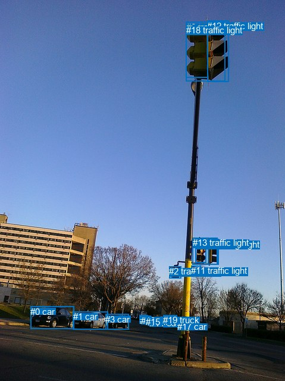
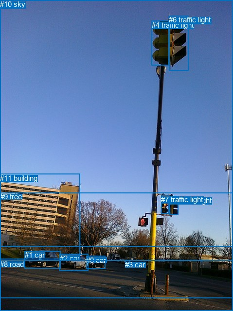

# 图片 1696：2394799.jpg

随机样本序号：214。图片 SHA256：`a5193e5cc5a14ee137092638d926fe3de0132243aede2e40d54aaa2a7d3d344b`。

红色框表示人，蓝色框表示其他物体。两个模式分别保留自身框编号，可依据位置比较对应对象。

## 自动检测框与输出

人的框编号：`[]`。状态：`no_person`。

### 自动检测全部物体框

| 编号 | 类别 | 是否为人 | 检测分数 | 像素坐标 xyxy |
|---|---|---|---|---|
| 0 | car | False | 0.9971 | 51.2, 515.0, 124.0, 552.5 |
| 1 | car | False | 0.9942 | 122.7, 523.0, 181.5, 553.7 |
| 2 | traffic light | False | 0.9880 | 284.5, 447.3, 304.5, 467.0 |
| 3 | car | False | 0.9863 | 177.1, 527.8, 216.7, 553.8 |
| 4 | traffic light | False | 0.9772 | 349.6, 401.6, 367.5, 444.7 |
| 5 | traffic light | False | 0.9662 | 328.6, 401.8, 346.5, 441.8 |
| 6 | traffic light | False | 0.9627 | 312.6, 36.5, 378.6, 136.5 |
| 7 | car | False | 0.9350 | 254.1, 534.6, 270.9, 544.8 |
| 8 | car | False | 0.9130 | 248.7, 533.0, 259.1, 542.4 |
| 9 | car | False | 0.8944 | 234.8, 529.7, 248.1, 539.7 |
| 10 | car | False | 0.8185 | 237.4, 530.2, 253.1, 541.5 |
| 11 | traffic light | False | 0.7772 | 321.3, 446.4, 337.4, 463.9 |
| 12 | traffic light | False | 0.7121 | 348.0, 34.9, 384.2, 137.1 |
| 13 | traffic light | False | 0.6656 | 323.9, 399.4, 365.1, 444.6 |
| 14 | car | False | 0.6326 | 251.7, 534.3, 263.1, 543.6 |
| 15 | car | False | 0.5950 | 244.8, 531.8, 254.1, 540.9 |
| 16 | car | False | 0.5309 | 275.0, 531.5, 296.3, 549.2 |
| 17 | car | False | 0.5015 | 298.2, 540.5, 304.9, 551.7 |
| 18 | traffic light | False | 0.5007 | 313.0, 41.6, 349.8, 130.6 |
| 19 | truck | False | 0.3540 | 274.0, 529.1, 297.1, 549.3 |

### 自动检测 Top50 人相关候选

评分物体对：0；人相关物体对：0；输出关系：0。

| 排名 | 主语编号与类别 | 关系 | 宾语编号与类别 | 类型 | 人与人 | 排序分数 | 原始融合 logit |
|---|---|---|---|---|---|---|---|

### 自动检测逐条人相关 GT 核验

本图没有人相关 GT，R@50 无分母；预测候选继续展示。

## 真实框与输出

人的框编号：`[]`。

### 真实框全部物体框

| 编号 | 类别 | 是否为人 | 检测分数 | 像素坐标 xyxy |
|---|---|---|---|---|
| 0 | car | False | GT | 177.0, 527.0, 216.0, 554.0 |
| 1 | car | False | GT | 51.0, 516.0, 125.0, 552.0 |
| 2 | car | False | GT | 123.0, 523.0, 182.0, 557.0 |
| 3 | car | False | GT | 257.0, 536.0, 267.0, 543.0 |
| 4 | traffic light | False | GT | 312.0, 43.0, 348.0, 135.0 |
| 5 | traffic light | False | GT | 349.0, 404.0, 367.0, 441.0 |
| 6 | traffic light | False | GT | 347.0, 32.0, 387.0, 145.0 |
| 7 | traffic light | False | GT | 331.0, 402.0, 346.0, 440.0 |
| 8 | road | False | GT | 0.0, 535.0, 479.0, 640.0 |
| 9 | tree | False | GT | 0.0, 396.0, 479.0, 613.0 |
| 10 | sky | False | GT | 0.0, 0.0, 479.0, 508.0 |
| 11 | building | False | GT | 0.0, 358.0, 165.0, 534.0 |

### 真实框 Top50 人相关候选

评分物体对：0；人相关物体对：0；输出关系：0。

| 排名 | 主语编号与类别 | 关系 | 宾语编号与类别 | 类型 | 人与人 | 排序分数 | 原始融合 logit |
|---|---|---|---|---|---|---|---|

### 真实框逐条人相关 GT 核验

本图没有人相关 GT，R@50 无分母；预测候选继续展示。

## 全部人相关 GT

| 主语编号与类别 | 关系 | 宾语编号与类别 |
|---|---|---|

原始记录、全部人相关物体对的两项预测与分项分数见 [逐图证据 JSON](../evidence/cases/1696.json)。全部56类 logits 保留于本机 HOR/output/random500/logits/。

<!-- HOR_COMPLETE_RESULTS -->

## 六组条件的完整输出对照

以下保留同一图片三种框与候选模式、两种谓词输出规则的全部 Top50。框编号各自在所属模式内解释。

### 自动检测框完整枚举：空间与语义各保留一个谓词

| 排名 | 主语编号与类别 | 谓词 | 宾语编号与类别 | 分组 | 排序分数 | predicate logit | pair logit |
|---|---|---|---|---|---|---|---|

没有人相关 GT，本条件的召回率无分母。

### 自动检测框完整枚举：每对只保留一个谓词

| 排名 | 主语编号与类别 | 谓词 | 宾语编号与类别 | 分组 | 排序分数 | predicate logit | pair logit |
|---|---|---|---|---|---|---|---|

没有人相关 GT，本条件的召回率无分母。

### 真实框完整枚举：空间与语义各保留一个谓词

| 排名 | 主语编号与类别 | 谓词 | 宾语编号与类别 | 分组 | 排序分数 | predicate logit | pair logit |
|---|---|---|---|---|---|---|---|

没有人相关 GT，本条件的召回率无分母。

### 真实框完整枚举：每对只保留一个谓词

| 排名 | 主语编号与类别 | 谓词 | 宾语编号与类别 | 分组 | 排序分数 | predicate logit | pair logit |
|---|---|---|---|---|---|---|---|

没有人相关 GT，本条件的召回率无分母。

### 真实框400候选：空间与语义各保留一个谓词

| 排名 | 主语编号与类别 | 谓词 | 宾语编号与类别 | 分组 | 排序分数 | predicate logit | pair logit |
|---|---|---|---|---|---|---|---|

没有人相关 GT，本条件的召回率无分母。

### 真实框400候选：每对只保留一个谓词

| 排名 | 主语编号与类别 | 谓词 | 宾语编号与类别 | 分组 | 排序分数 | predicate logit | pair logit |
|---|---|---|---|---|---|---|---|

没有人相关 GT，本条件的召回率无分母。
