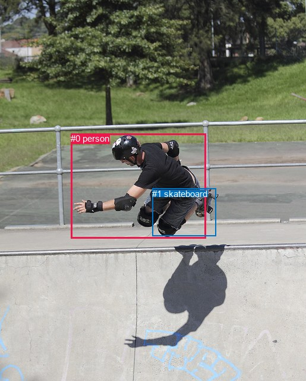
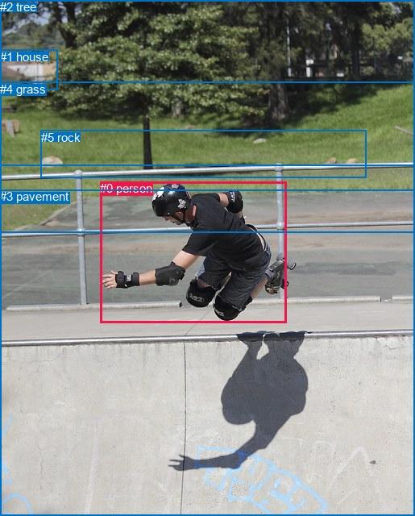

# 图片 1697：2394828.jpg

随机样本序号：141。图片 SHA256：`87b0a064b596b4e821ebb371077c053e836c0ea667ca491075804bb3c9ce95ea`。

红色框表示人，蓝色框表示其他物体。两个模式分别保留自身框编号，可依据位置比较对应对象。

## 自动检测框与输出

人的框编号：`[0]`。状态：`ok`。

### 自动检测全部物体框

| 编号 | 类别 | 是否为人 | 检测分数 | 像素坐标 xyxy |
|---|---|---|---|---|
| 0 | person | True | 0.9994 | 119.3, 224.2, 346.5, 400.3 |
| 1 | skateboard | False | 0.5911 | 256.5, 316.7, 363.5, 396.5 |

### 自动检测 Top50 人相关候选

评分物体对：2；人相关物体对：2；输出关系：4。

| 排名 | 主语编号与类别 | 关系 | 宾语编号与类别 | 类型 | 人与人 | 排序分数 | 原始融合 logit |
|---|---|---|---|---|---|---|---|
| 1 | #0 person | riding | #1 skateboard | semantic | False | 0.97902 | 3.8431 |
| 2 | #1 skateboard | on | #0 person | spatial | False | 0.65945 | 0.6608 |
| 3 | #0 person | on | #1 skateboard | spatial | False | 0.42431 | -0.3051 |
| 4 | #1 skateboard | riding | #0 person | semantic | False | 0.17525 | -1.5489 |

### 自动检测逐条人相关 GT 核验

R@50：0.00%；命中 0/4。

| GT 主语编号 | GT 关系 | GT 宾语编号 | 结果阶段 | 匹配预测主语编号 | 匹配预测宾语编号 |
|---|---|---|---|---|---|
| 0 | over | 3 | endpoint_missing_or_wrong_class | [0] | [] |
| 0 | jumping from | 3 | endpoint_missing_or_wrong_class | [0] | [] |
| 0 | in front of | 4 | endpoint_missing_or_wrong_class | [0] | [] |
| 0 | in front of | 5 | endpoint_missing_or_wrong_class | [0] | [] |

## 真实框与输出

人的框编号：`[0]`。

### 真实框全部物体框

| 编号 | 类别 | 是否为人 | 检测分数 | 像素坐标 xyxy |
|---|---|---|---|---|
| 0 | person | True | GT | 124.0, 225.0, 355.0, 400.0 |
| 1 | house | False | GT | 0.0, 62.0, 72.0, 112.0 |
| 2 | tree | False | GT | 0.0, 0.0, 515.0, 205.0 |
| 3 | pavement | False | GT | 0.0, 235.0, 515.0, 640.0 |
| 4 | grass | False | GT | 0.0, 102.0, 515.0, 289.0 |
| 5 | rock | False | GT | 51.0, 162.0, 454.0, 221.0 |

### 真实框 Top50 人相关候选

评分物体对：30；人相关物体对：10；输出关系：20。

| 排名 | 主语编号与类别 | 关系 | 宾语编号与类别 | 类型 | 人与人 | 排序分数 | 原始融合 logit |
|---|---|---|---|---|---|---|---|
| 1 | #0 person | jumping over | #3 pavement | semantic | False | 0.96029 | 3.1855 |
| 2 | #0 person | on | #3 pavement | spatial | False | 0.90997 | 2.3133 |
| 3 | #0 person | in | #5 rock | spatial | False | 0.80927 | 1.4453 |
| 4 | #0 person | in | #4 grass | spatial | False | 0.80365 | 1.4092 |
| 5 | #0 person | in | #2 tree | spatial | False | 0.76688 | 1.1908 |
| 6 | #0 person | jumping over | #5 rock | semantic | False | 0.75532 | 1.1272 |
| 7 | #0 person | jumping over | #4 grass | semantic | False | 0.69929 | 0.8439 |
| 8 | #0 person | jumping over | #2 tree | semantic | False | 0.61990 | 0.4891 |
| 9 | #4 grass | beside | #0 person | spatial | False | 0.45361 | -0.1861 |
| 10 | #3 pavement | beside | #0 person | spatial | False | 0.35817 | -0.5833 |
| 11 | #3 pavement | holding | #0 person | semantic | False | 0.33322 | -0.6936 |
| 12 | #2 tree | beside | #0 person | spatial | False | 0.31997 | -0.7539 |
| 13 | #5 rock | beside | #0 person | spatial | False | 0.27369 | -0.9760 |
| 14 | #5 rock | looking at | #0 person | semantic | False | 0.22442 | -1.2401 |
| 15 | #4 grass | looking at | #0 person | semantic | False | 0.22357 | -1.2450 |
| 16 | #0 person | jumping over | #1 house | semantic | False | 0.17855 | -1.5262 |
| 17 | #1 house | looking at | #0 person | semantic | False | 0.14895 | -1.7428 |
| 18 | #0 person | in front of | #1 house | spatial | False | 0.14868 | -1.7450 |
| 19 | #2 tree | looking at | #0 person | semantic | False | 0.12553 | -1.9411 |
| 20 | #1 house | beside | #0 person | spatial | False | 0.07006 | -2.5857 |

### 真实框逐条人相关 GT 核验

R@50：0.00%；命中 0/4。

| GT 主语编号 | GT 关系 | GT 宾语编号 | 结果阶段 | 匹配预测主语编号 | 匹配预测宾语编号 |
|---|---|---|---|---|---|
| 0 | over | 3 | wrong_predicate | [0] | [3] |
| 0 | jumping from | 3 | wrong_predicate | [0] | [3] |
| 0 | in front of | 4 | wrong_predicate | [0] | [4] |
| 0 | in front of | 5 | wrong_predicate | [0] | [5] |

## 全部人相关 GT

| 主语编号与类别 | 关系 | 宾语编号与类别 |
|---|---|---|
| #0 person | over | #3 pavement |
| #0 person | jumping from | #3 pavement |
| #0 person | in front of | #4 grass |
| #0 person | in front of | #5 rock |

原始记录、全部人相关物体对的两项预测与分项分数见 [逐图证据 JSON](../evidence/cases/1697.json)。全部56类 logits 保留于本机 HOR/output/random500/logits/。

<!-- HOR_COMPLETE_RESULTS -->

## 六组条件的完整输出对照

以下保留同一图片三种框与候选模式、两种谓词输出规则的全部 Top50。框编号各自在所属模式内解释。

### 自动检测框完整枚举：空间与语义各保留一个谓词

| 排名 | 主语编号与类别 | 谓词 | 宾语编号与类别 | 分组 | 排序分数 | predicate logit | pair logit |
|---|---|---|---|---|---|---|---|
| 1 | #0 person | riding | #1 skateboard | semantic | 0.9790219 | 3.6893640 | 0.1537080 |
| 2 | #1 skateboard | on | #0 person | spatial | 0.6594509 | 1.2608018 | -0.5999539 |
| 3 | #0 person | on | #1 skateboard | spatial | 0.4243133 | -0.4587994 | 0.1537080 |
| 4 | #1 skateboard | riding | #0 person | semantic | 0.1752497 | -0.9489148 | -0.5999539 |

GT 命中：0/4，R@50=0.00%。

| GT主语 | GT谓词 | GT宾语 | 结果阶段 | 匹配主语框 | 匹配宾语框 |
|---|---|---|---|---|---|
| 0 | over | 3 | endpoint_missing_or_wrong_class | [0] | [] |
| 0 | jumping from | 3 | endpoint_missing_or_wrong_class | [0] | [] |
| 0 | in front of | 4 | endpoint_missing_or_wrong_class | [0] | [] |
| 0 | in front of | 5 | endpoint_missing_or_wrong_class | [0] | [] |

### 自动检测框完整枚举：每对只保留一个谓词

| 排名 | 主语编号与类别 | 谓词 | 宾语编号与类别 | 分组 | 排序分数 | predicate logit | pair logit |
|---|---|---|---|---|---|---|---|
| 1 | #0 person | riding | #1 skateboard | single | 0.9790219 | 3.6893640 | 0.1537080 |
| 2 | #1 skateboard | on | #0 person | single | 0.6594509 | 1.2608018 | -0.5999539 |

GT 命中：0/4，R@50=0.00%。

| GT主语 | GT谓词 | GT宾语 | 结果阶段 | 匹配主语框 | 匹配宾语框 |
|---|---|---|---|---|---|
| 0 | over | 3 | endpoint_missing_or_wrong_class | [0] | [] |
| 0 | jumping from | 3 | endpoint_missing_or_wrong_class | [0] | [] |
| 0 | in front of | 4 | endpoint_missing_or_wrong_class | [0] | [] |
| 0 | in front of | 5 | endpoint_missing_or_wrong_class | [0] | [] |

### 真实框完整枚举：空间与语义各保留一个谓词

| 排名 | 主语编号与类别 | 谓词 | 宾语编号与类别 | 分组 | 排序分数 | predicate logit | pair logit |
|---|---|---|---|---|---|---|---|
| 1 | #0 person | jumping over | #3 pavement | semantic | 0.9602852 | 3.2429724 | -0.0574656 |
| 2 | #0 person | on | #3 pavement | spatial | 0.9099699 | 2.3707318 | -0.0574656 |
| 3 | #0 person | in | #5 rock | spatial | 0.8092693 | 2.4777408 | -1.0324715 |
| 4 | #0 person | in | #4 grass | spatial | 0.8036472 | 2.5450053 | -1.1357584 |
| 5 | #0 person | in | #2 tree | spatial | 0.7668809 | 2.1398768 | -0.9490950 |
| 6 | #0 person | jumping over | #5 rock | semantic | 0.7553155 | 2.1596379 | -1.0324715 |
| 7 | #0 person | jumping over | #4 grass | semantic | 0.6992921 | 1.9796872 | -1.1357584 |
| 8 | #0 person | jumping over | #2 tree | semantic | 0.6198990 | 1.4382143 | -0.9490950 |
| 9 | #4 grass | beside | #0 person | spatial | 0.4536137 | 0.6155877 | -0.8016680 |
| 10 | #3 pavement | beside | #0 person | spatial | 0.3581726 | -0.1047511 | -0.4785534 |
| 11 | #3 pavement | holding | #0 person | semantic | 0.3332230 | -0.2150903 | -0.4785534 |
| 12 | #2 tree | beside | #0 person | spatial | 0.3199674 | -0.0186124 | -0.7353092 |
| 13 | #5 rock | beside | #0 person | spatial | 0.2736928 | -0.1945343 | -0.7814325 |
| 14 | #5 rock | looking at | #0 person | semantic | 0.2244221 | -0.4586473 | -0.7814325 |
| 15 | #4 grass | looking at | #0 person | semantic | 0.2235711 | -0.4433074 | -0.8016680 |
| 16 | #0 person | jumping over | #1 house | semantic | 0.1785492 | 0.2347898 | -1.7609980 |
| 17 | #1 house | looking at | #0 person | semantic | 0.1489537 | -0.6728811 | -1.0699496 |
| 18 | #0 person | in front of | #1 house | spatial | 0.1486794 | 0.0160012 | -1.7609980 |
| 19 | #2 tree | looking at | #0 person | semantic | 0.1255312 | -1.2057533 | -0.7353092 |
| 20 | #1 house | beside | #0 person | spatial | 0.0700648 | -1.5157442 | -1.0699496 |

GT 命中：0/4，R@50=0.00%。

| GT主语 | GT谓词 | GT宾语 | 结果阶段 | 匹配主语框 | 匹配宾语框 |
|---|---|---|---|---|---|
| 0 | over | 3 | wrong_predicate | [0] | [3] |
| 0 | jumping from | 3 | wrong_predicate | [0] | [3] |
| 0 | in front of | 4 | wrong_predicate | [0] | [4] |
| 0 | in front of | 5 | wrong_predicate | [0] | [5] |

### 真实框完整枚举：每对只保留一个谓词

| 排名 | 主语编号与类别 | 谓词 | 宾语编号与类别 | 分组 | 排序分数 | predicate logit | pair logit |
|---|---|---|---|---|---|---|---|
| 1 | #0 person | jumping over | #3 pavement | single | 0.9602852 | 3.2429724 | -0.0574656 |
| 2 | #0 person | in | #5 rock | single | 0.8092693 | 2.4777408 | -1.0324715 |
| 3 | #0 person | in | #4 grass | single | 0.8036472 | 2.5450053 | -1.1357584 |
| 4 | #0 person | in | #2 tree | single | 0.7668809 | 2.1398768 | -0.9490950 |
| 5 | #4 grass | beside | #0 person | single | 0.4536137 | 0.6155877 | -0.8016680 |
| 6 | #3 pavement | beside | #0 person | single | 0.3581726 | -0.1047511 | -0.4785534 |
| 7 | #2 tree | beside | #0 person | single | 0.3199674 | -0.0186124 | -0.7353092 |
| 8 | #5 rock | beside | #0 person | single | 0.2736928 | -0.1945343 | -0.7814325 |
| 9 | #0 person | jumping over | #1 house | single | 0.1785492 | 0.2347898 | -1.7609980 |
| 10 | #1 house | looking at | #0 person | single | 0.1489537 | -0.6728811 | -1.0699496 |

GT 命中：0/4，R@50=0.00%。

| GT主语 | GT谓词 | GT宾语 | 结果阶段 | 匹配主语框 | 匹配宾语框 |
|---|---|---|---|---|---|
| 0 | over | 3 | wrong_predicate | [0] | [3] |
| 0 | jumping from | 3 | wrong_predicate | [0] | [3] |
| 0 | in front of | 4 | wrong_predicate | [0] | [4] |
| 0 | in front of | 5 | wrong_predicate | [0] | [5] |

### 真实框400候选：空间与语义各保留一个谓词

| 排名 | 主语编号与类别 | 谓词 | 宾语编号与类别 | 分组 | 排序分数 | predicate logit | pair logit |
|---|---|---|---|---|---|---|---|
| 1 | #0 person | jumping over | #3 pavement | semantic | 0.9579273 | 3.1828384 | -0.0574656 |
| 2 | #0 person | on | #3 pavement | spatial | 0.9099699 | 2.3707318 | -0.0574656 |
| 3 | #0 person | in | #5 rock | spatial | 0.8102917 | 2.4843783 | -1.0324715 |
| 4 | #0 person | in | #4 grass | spatial | 0.8041703 | 2.5483241 | -1.1357584 |
| 5 | #0 person | in | #2 tree | spatial | 0.7680654 | 2.1465144 | -0.9490950 |
| 6 | #0 person | jumping over | #5 rock | semantic | 0.7553167 | 2.1596441 | -1.0324715 |
| 7 | #0 person | jumping over | #4 grass | semantic | 0.6929318 | 1.9496202 | -1.1357584 |
| 8 | #0 person | jumping over | #2 tree | semantic | 0.6198990 | 1.4382143 | -0.9490950 |
| 9 | #4 grass | beside | #0 person | spatial | 0.4610602 | 0.6455927 | -0.8016680 |
| 10 | #3 pavement | beside | #0 person | spatial | 0.3650924 | -0.0747757 | -0.4785534 |
| 11 | #3 pavement | holding | #0 person | semantic | 0.3281974 | -0.2377958 | -0.4785534 |
| 12 | #2 tree | beside | #0 person | spatial | 0.3199580 | -0.0186558 | -0.7353092 |
| 13 | #5 rock | beside | #0 person | spatial | 0.2796918 | -0.1645584 | -0.7814325 |
| 14 | #5 rock | looking at | #0 person | semantic | 0.2244828 | -0.4582987 | -0.7814325 |
| 15 | #4 grass | looking at | #0 person | semantic | 0.2236316 | -0.4429588 | -0.8016680 |
| 16 | #0 person | jumping over | #1 house | semantic | 0.1785492 | 0.2347898 | -1.7609980 |
| 17 | #0 person | in front of | #1 house | spatial | 0.1524692 | 0.0456333 | -1.7609980 |
| 18 | #1 house | looking at | #0 person | semantic | 0.1452659 | -0.7022748 | -1.0699496 |
| 19 | #2 tree | looking at | #0 person | semantic | 0.1223399 | -1.2351472 | -0.7353092 |
| 20 | #1 house | beside | #0 person | spatial | 0.0700648 | -1.5157442 | -1.0699496 |

GT 命中：0/4，R@50=0.00%。

| GT主语 | GT谓词 | GT宾语 | 结果阶段 | 匹配主语框 | 匹配宾语框 |
|---|---|---|---|---|---|
| 0 | over | 3 | wrong_predicate | [0] | [3] |
| 0 | jumping from | 3 | wrong_predicate | [0] | [3] |
| 0 | in front of | 4 | wrong_predicate | [0] | [4] |
| 0 | in front of | 5 | wrong_predicate | [0] | [5] |

### 真实框400候选：每对只保留一个谓词

| 排名 | 主语编号与类别 | 谓词 | 宾语编号与类别 | 分组 | 排序分数 | predicate logit | pair logit |
|---|---|---|---|---|---|---|---|
| 1 | #0 person | jumping over | #3 pavement | single | 0.9579273 | 3.1828384 | -0.0574656 |
| 2 | #0 person | in | #5 rock | single | 0.8102917 | 2.4843783 | -1.0324715 |
| 3 | #0 person | in | #4 grass | single | 0.8041703 | 2.5483241 | -1.1357584 |
| 4 | #0 person | in | #2 tree | single | 0.7680654 | 2.1465144 | -0.9490950 |
| 5 | #4 grass | beside | #0 person | single | 0.4610602 | 0.6455927 | -0.8016680 |
| 6 | #3 pavement | beside | #0 person | single | 0.3650924 | -0.0747757 | -0.4785534 |
| 7 | #2 tree | beside | #0 person | single | 0.3199580 | -0.0186558 | -0.7353092 |
| 8 | #5 rock | beside | #0 person | single | 0.2796918 | -0.1645584 | -0.7814325 |
| 9 | #0 person | jumping over | #1 house | single | 0.1785492 | 0.2347898 | -1.7609980 |
| 10 | #1 house | looking at | #0 person | single | 0.1452659 | -0.7022748 | -1.0699496 |

GT 命中：0/4，R@50=0.00%。

| GT主语 | GT谓词 | GT宾语 | 结果阶段 | 匹配主语框 | 匹配宾语框 |
|---|---|---|---|---|---|
| 0 | over | 3 | wrong_predicate | [0] | [3] |
| 0 | jumping from | 3 | wrong_predicate | [0] | [3] |
| 0 | in front of | 4 | wrong_predicate | [0] | [4] |
| 0 | in front of | 5 | wrong_predicate | [0] | [5] |
