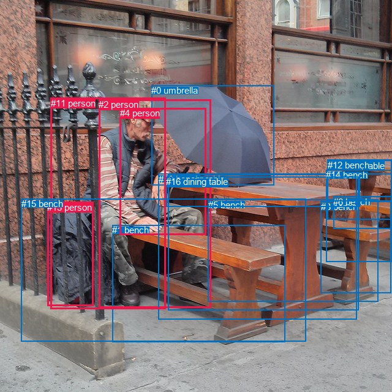
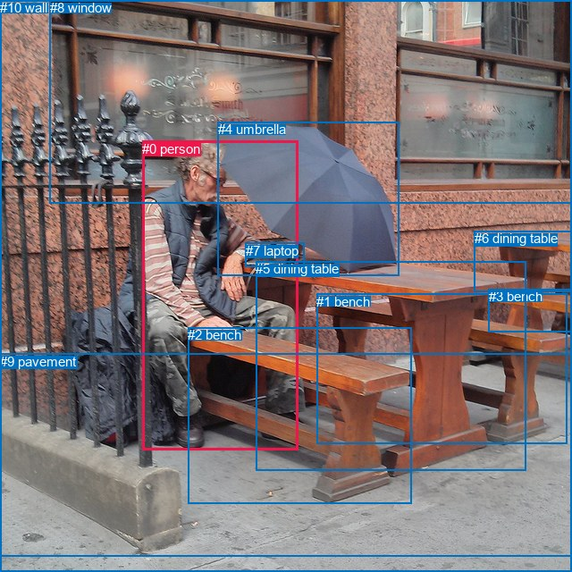

# 图片 1699：2394864.jpg

随机样本序号：484。图片 SHA256：`bf4ca4bfd993f2c296c03f0ec05b42504d38d3252db9b4fbfd75cb3eef3ecb0d`。

红色框表示人，蓝色框表示其他物体。两个模式分别保留自身框编号，可依据位置比较对应对象。

## 自动检测框与输出

人的框编号：`[2, 4, 11, 13]`。状态：`ok`。

### 自动检测全部物体框

| 编号 | 类别 | 是否为人 | 检测分数 | 像素坐标 xyxy |
|---|---|---|---|---|
| 0 | umbrella | False | 0.9993 | 247.0, 139.0, 447.1, 302.9 |
| 1 | bench | False | 0.9860 | 183.3, 367.4, 465.6, 558.6 |
| 2 | person | True | 0.9821 | 161.3, 162.4, 344.3, 502.3 |
| 3 | bench | False | 0.9292 | 523.6, 328.6, 638.7, 478.1 |
| 4 | person | True | 0.8605 | 195.8, 176.1, 336.8, 383.3 |
| 5 | bench | False | 0.8394 | 339.6, 325.5, 617.7, 492.3 |
| 6 | bench | False | 0.7565 | 544.2, 321.0, 639.5, 373.4 |
| 7 | dining table | False | 0.6772 | 274.3, 284.3, 585.1, 506.2 |
| 8 | dining table | False | 0.5788 | 534.4, 260.6, 639.5, 284.1 |
| 9 | dining table | False | 0.5326 | 534.6, 261.9, 639.1, 328.1 |
| 10 | bench | False | 0.4956 | 258.6, 283.5, 582.5, 521.9 |
| 11 | person | True | 0.4875 | 82.6, 159.7, 270.4, 504.1 |
| 12 | bench | False | 0.4449 | 534.7, 261.2, 639.5, 358.7 |
| 13 | person | True | 0.3939 | 77.5, 329.7, 153.0, 499.9 |
| 14 | bench | False | 0.3881 | 532.1, 277.5, 640.0, 427.3 |
| 15 | bench | False | 0.3692 | 34.8, 324.0, 499.9, 557.2 |
| 16 | dining table | False | 0.3544 | 271.2, 288.4, 587.1, 338.0 |

### 自动检测 Top50 人相关候选

评分物体对：272；人相关物体对：116；输出关系：50。

| 排名 | 主语编号与类别 | 关系 | 宾语编号与类别 | 类型 | 人与人 | 排序分数 | 原始融合 logit |
|---|---|---|---|---|---|---|---|
| 1 | #2 person | wearing | #4 person | semantic | True | 0.98577 | 4.2381 |
| 2 | #13 person | leaning on | #15 bench | spatial | False | 0.98427 | 4.1362 |
| 3 | #2 person | holding | #0 umbrella | semantic | False | 0.97530 | 3.6758 |
| 4 | #2 person | sitting on | #15 bench | semantic | False | 0.97352 | 3.6045 |
| 5 | #13 person | leaning on | #11 person | spatial | True | 0.94871 | 2.9177 |
| 6 | #2 person | sitting on | #10 bench | semantic | False | 0.94145 | 2.7775 |
| 7 | #4 person | holding | #0 umbrella | semantic | False | 0.93176 | 2.6141 |
| 8 | #11 person | sitting on | #15 bench | semantic | False | 0.91738 | 2.4072 |
| 9 | #2 person | leaning on | #16 dining table | spatial | False | 0.91687 | 2.4006 |
| 10 | #2 person | sitting on | #7 dining table | semantic | False | 0.91448 | 2.3697 |
| 11 | #2 person | sitting on | #1 bench | semantic | False | 0.89935 | 2.1900 |
| 12 | #2 person | on | #15 bench | spatial | False | 0.89059 | 2.0968 |
| 13 | #2 person | in | #4 person | spatial | True | 0.87828 | 1.9763 |
| 14 | #2 person | leaning on | #10 bench | spatial | False | 0.87566 | 1.9519 |
| 15 | #2 person | sitting on | #16 dining table | semantic | False | 0.87277 | 1.9256 |
| 16 | #11 person | on | #15 bench | spatial | False | 0.84870 | 1.7245 |
| 17 | #13 person | sitting on | #15 bench | semantic | False | 0.83193 | 1.5994 |
| 18 | #2 person | leaning on | #7 dining table | spatial | False | 0.82980 | 1.5842 |
| 19 | #2 person | wearing | #11 person | semantic | True | 0.79177 | 1.3356 |
| 20 | #2 person | leaning on | #11 person | spatial | True | 0.77354 | 1.2284 |
| 21 | #4 person | on | #2 person | spatial | True | 0.77275 | 1.2239 |
| 22 | #4 person | leaning on | #10 bench | spatial | False | 0.75935 | 1.1491 |
| 23 | #4 person | sitting on | #15 bench | semantic | False | 0.75612 | 1.1315 |
| 24 | #11 person | leaning on | #10 bench | spatial | False | 0.72557 | 0.9723 |
| 25 | #11 person | holding | #0 umbrella | semantic | False | 0.72319 | 0.9604 |
| 26 | #2 person | on | #1 bench | spatial | False | 0.72215 | 0.9551 |
| 27 | #4 person | sitting on | #10 bench | semantic | False | 0.71569 | 0.9232 |
| 28 | #4 person | leaning on | #11 person | spatial | True | 0.71389 | 0.9144 |
| 29 | #11 person | leaning on | #16 dining table | spatial | False | 0.67158 | 0.7154 |
| 30 | #4 person | leaning on | #16 dining table | spatial | False | 0.66318 | 0.6775 |
| 31 | #11 person | sitting on | #10 bench | semantic | False | 0.64900 | 0.6146 |
| 32 | #4 person | leaning on | #7 dining table | spatial | False | 0.64352 | 0.5907 |
| 33 | #11 person | beside | #2 person | spatial | True | 0.62786 | 0.5230 |
| 34 | #11 person | holding | #4 person | semantic | True | 0.62627 | 0.5163 |
| 35 | #4 person | sitting on | #7 dining table | semantic | False | 0.62392 | 0.5062 |
| 36 | #11 person | holding | #13 person | semantic | True | 0.59605 | 0.3890 |
| 37 | #4 person | sitting on | #1 bench | semantic | False | 0.57961 | 0.3212 |
| 38 | #2 person | sitting on | #5 bench | semantic | False | 0.57633 | 0.3077 |
| 39 | #11 person | sitting on | #1 bench | semantic | False | 0.55020 | 0.2015 |
| 40 | #11 person | holding | #2 person | semantic | True | 0.53455 | 0.1384 |
| 41 | #2 person | in | #0 umbrella | spatial | False | 0.53375 | 0.1352 |
| 42 | #4 person | on | #15 bench | spatial | False | 0.51603 | 0.0641 |
| 43 | #13 person | sitting on | #11 person | semantic | True | 0.51385 | 0.0554 |
| 44 | #4 person | holding | #2 person | semantic | True | 0.51251 | 0.0501 |
| 45 | #0 umbrella | over | #2 person | spatial | False | 0.49845 | -0.0062 |
| 46 | #0 umbrella | over | #4 person | spatial | False | 0.45399 | -0.1846 |
| 47 | #11 person | leaning on | #7 dining table | spatial | False | 0.42368 | -0.3077 |
| 48 | #4 person | sitting on | #11 person | semantic | True | 0.42120 | -0.3178 |
| 49 | #11 person | on | #1 bench | spatial | False | 0.41829 | -0.3298 |
| 50 | #11 person | sitting on | #7 dining table | semantic | False | 0.41652 | -0.3371 |

### 自动检测逐条人相关 GT 核验

R@50：100.00%；命中 3/3。

| GT 主语编号 | GT 关系 | GT 宾语编号 | 结果阶段 | 匹配预测主语编号 | 匹配预测宾语编号 |
|---|---|---|---|---|---|
| 0 | sitting on | 2 | hit50 | [2] | [1] |
| 0 | leaning on | 5 | hit50 | [2] | [7] |
| 4 | over | 0 | hit50 | [0] | [2] |

## 真实框与输出

人的框编号：`[0]`。

### 真实框全部物体框

| 编号 | 类别 | 是否为人 | 检测分数 | 像素坐标 xyxy |
|---|---|---|---|---|
| 0 | person | True | GT | 159.0, 158.0, 333.0, 504.0 |
| 1 | bench | False | GT | 354.0, 329.0, 634.0, 496.0 |
| 2 | bench | False | GT | 210.0, 366.0, 460.0, 564.0 |
| 3 | bench | False | GT | 547.0, 323.0, 640.0, 371.0 |
| 4 | umbrella | False | GT | 244.0, 136.0, 446.0, 308.0 |
| 5 | dining table | False | GT | 286.0, 292.0, 588.0, 526.0 |
| 6 | dining table | False | GT | 531.0, 258.0, 640.0, 326.0 |
| 7 | laptop | False | GT | 275.0, 272.0, 341.0, 299.0 |
| 8 | window | False | GT | 56.0, 0.0, 640.0, 227.0 |
| 9 | pavement | False | GT | 0.0, 396.0, 640.0, 640.0 |
| 10 | wall | False | GT | 0.0, 0.0, 640.0, 623.0 |

### 真实框 Top50 人相关候选

评分物体对：110；人相关物体对：20；输出关系：40。

| 排名 | 主语编号与类别 | 关系 | 宾语编号与类别 | 类型 | 人与人 | 排序分数 | 原始融合 logit |
|---|---|---|---|---|---|---|---|
| 1 | #0 person | holding | #4 umbrella | semantic | False | 0.97743 | 3.7681 |
| 2 | #0 person | wearing | #7 laptop | semantic | False | 0.97728 | 3.7617 |
| 3 | #0 person | sitting on | #2 bench | semantic | False | 0.96544 | 3.3300 |
| 4 | #0 person | sitting on | #5 dining table | semantic | False | 0.96147 | 3.2169 |
| 5 | #0 person | on | #2 bench | spatial | False | 0.88267 | 2.0180 |
| 6 | #0 person | on | #5 dining table | spatial | False | 0.85649 | 1.7865 |
| 7 | #0 person | on | #7 laptop | spatial | False | 0.81951 | 1.5130 |
| 8 | #0 person | in | #10 wall | spatial | False | 0.80378 | 1.4101 |
| 9 | #0 person | sitting on | #9 pavement | semantic | False | 0.78718 | 1.3080 |
| 10 | #0 person | sitting on | #10 wall | semantic | False | 0.77293 | 1.2249 |
| 11 | #0 person | sitting on | #1 bench | semantic | False | 0.76910 | 1.2033 |
| 12 | #7 laptop | on | #0 person | spatial | False | 0.70853 | 0.8883 |
| 13 | #0 person | beside | #4 umbrella | spatial | False | 0.69482 | 0.8227 |
| 14 | #4 umbrella | over | #0 person | spatial | False | 0.64781 | 0.6094 |
| 15 | #0 person | on | #9 pavement | spatial | False | 0.61605 | 0.4728 |
| 16 | #0 person | on | #1 bench | spatial | False | 0.49211 | -0.0316 |
| 17 | #0 person | in front of | #8 window | spatial | False | 0.39855 | -0.4115 |
| 18 | #0 person | looking at | #8 window | semantic | False | 0.38566 | -0.4656 |
| 19 | #4 umbrella | holding | #0 person | semantic | False | 0.34252 | -0.6521 |
| 20 | #0 person | sitting on | #6 dining table | semantic | False | 0.27532 | -0.9678 |
| 21 | #0 person | sitting on | #3 bench | semantic | False | 0.21524 | -1.2936 |
| 22 | #7 laptop | holding | #0 person | semantic | False | 0.19552 | -1.4145 |
| 23 | #5 dining table | beside | #0 person | spatial | False | 0.18411 | -1.4887 |
| 24 | #9 pavement | beside | #0 person | spatial | False | 0.16627 | -1.6123 |
| 25 | #2 bench | beside | #0 person | spatial | False | 0.14328 | -1.7883 |
| 26 | #0 person | leaning on | #6 dining table | spatial | False | 0.13450 | -1.8617 |
| 27 | #5 dining table | holding | #0 person | semantic | False | 0.10076 | -2.1888 |
| 28 | #8 window | beside | #0 person | spatial | False | 0.08735 | -2.3464 |
| 29 | #0 person | on | #3 bench | spatial | False | 0.07575 | -2.5015 |
| 30 | #10 wall | beside | #0 person | spatial | False | 0.05581 | -2.8284 |
| 31 | #1 bench | beside | #0 person | spatial | False | 0.05521 | -2.8398 |
| 32 | #9 pavement | holding | #0 person | semantic | False | 0.05009 | -2.9426 |
| 33 | #2 bench | holding | #0 person | semantic | False | 0.03844 | -3.2195 |
| 34 | #8 window | looking at | #0 person | semantic | False | 0.02175 | -3.8060 |
| 35 | #6 dining table | beside | #0 person | spatial | False | 0.02119 | -3.8327 |
| 36 | #3 bench | beside | #0 person | spatial | False | 0.01772 | -4.0153 |
| 37 | #1 bench | holding | #0 person | semantic | False | 0.01668 | -4.0767 |
| 38 | #10 wall | holding | #0 person | semantic | False | 0.00637 | -5.0500 |
| 39 | #3 bench | holding | #0 person | semantic | False | 0.00386 | -5.5538 |
| 40 | #6 dining table | holding | #0 person | semantic | False | 0.00353 | -5.6422 |

### 真实框逐条人相关 GT 核验

R@50：66.67%；命中 2/3。

| GT 主语编号 | GT 关系 | GT 宾语编号 | 结果阶段 | 匹配预测主语编号 | 匹配预测宾语编号 |
|---|---|---|---|---|---|
| 0 | sitting on | 2 | hit50 | [0] | [2] |
| 0 | leaning on | 5 | wrong_predicate | [0] | [5] |
| 4 | over | 0 | hit50 | [4] | [0] |

## 全部人相关 GT

| 主语编号与类别 | 关系 | 宾语编号与类别 |
|---|---|---|
| #0 person | sitting on | #2 bench |
| #0 person | leaning on | #5 dining table |
| #4 umbrella | over | #0 person |

原始记录、全部人相关物体对的两项预测与分项分数见 [逐图证据 JSON](../evidence/cases/1699.json)。全部56类 logits 保留于本机 HOR/output/random500/logits/。

<!-- HOR_COMPLETE_RESULTS -->

## 六组条件的完整输出对照

以下保留同一图片三种框与候选模式、两种谓词输出规则的全部 Top50。框编号各自在所属模式内解释。

### 自动检测框完整枚举：空间与语义各保留一个谓词

| 排名 | 主语编号与类别 | 谓词 | 宾语编号与类别 | 分组 | 排序分数 | predicate logit | pair logit |
|---|---|---|---|---|---|---|---|
| 1 | #2 person | wearing | #4 person | semantic | 0.9857703 | 4.3910508 | -0.1529549 |
| 2 | #13 person | leaning on | #15 bench | spatial | 0.9842685 | 3.7616744 | 0.3745614 |
| 3 | #2 person | holding | #0 umbrella | semantic | 0.9752961 | 3.8324580 | -0.1566748 |
| 4 | #2 person | sitting on | #15 bench | semantic | 0.9735194 | 3.4548736 | 0.1496347 |
| 5 | #13 person | leaning on | #11 person | spatial | 0.9487131 | 3.0744529 | -0.1567836 |
| 6 | #2 person | sitting on | #10 bench | semantic | 0.9414485 | 3.0305600 | -0.2530482 |
| 7 | #4 person | holding | #0 umbrella | semantic | 0.9317619 | 2.8883605 | -0.2742856 |
| 8 | #11 person | sitting on | #15 bench | semantic | 0.9173759 | 2.4828773 | -0.0756621 |
| 9 | #2 person | leaning on | #16 dining table | spatial | 0.9168732 | 2.8856349 | -0.4850339 |
| 10 | #2 person | sitting on | #7 dining table | semantic | 0.9144840 | 2.7175984 | -0.3479423 |
| 11 | #2 person | sitting on | #1 bench | semantic | 0.8993505 | 2.2873077 | -0.0972796 |
| 12 | #2 person | on | #15 bench | spatial | 0.8905891 | 1.9471374 | 0.1496347 |
| 13 | #2 person | in | #4 person | spatial | 0.8782838 | 2.1292324 | -0.1529549 |
| 14 | #2 person | leaning on | #10 bench | spatial | 0.8756566 | 2.2049751 | -0.2530482 |
| 15 | #2 person | sitting on | #16 dining table | semantic | 0.8727664 | 2.4106770 | -0.4850339 |
| 16 | #11 person | on | #15 bench | spatial | 0.8487031 | 1.8001275 | -0.0756621 |
| 17 | #13 person | sitting on | #15 bench | semantic | 0.8319333 | 1.2248297 | 0.3745614 |
| 18 | #2 person | leaning on | #7 dining table | spatial | 0.8298033 | 1.9321766 | -0.3479423 |
| 19 | #2 person | wearing | #11 person | semantic | 0.7917657 | 1.8483515 | -0.5127496 |
| 20 | #2 person | leaning on | #11 person | spatial | 0.7735435 | 1.7411790 | -0.5127496 |
| 21 | #4 person | on | #2 person | spatial | 0.7727531 | 1.8852181 | -0.6612958 |
| 22 | #4 person | leaning on | #10 bench | spatial | 0.7593525 | 1.3697691 | -0.2206360 |
| 23 | #4 person | sitting on | #15 bench | semantic | 0.7561162 | 1.1107287 | 0.0207743 |
| 24 | #11 person | leaning on | #10 bench | spatial | 0.7255738 | 1.7150426 | -0.7427622 |
| 25 | #11 person | holding | #0 umbrella | semantic | 0.7231947 | 1.5877700 | -0.6274059 |
| 26 | #2 person | on | #1 bench | spatial | 0.7221484 | 1.0524230 | -0.0972796 |
| 27 | #4 person | sitting on | #10 bench | semantic | 0.7156880 | 1.1438084 | -0.2206360 |
| 28 | #4 person | leaning on | #11 person | spatial | 0.7138926 | 1.5694628 | -0.6550975 |
| 29 | #11 person | leaning on | #16 dining table | spatial | 0.6715829 | 1.5608106 | -0.8454574 |
| 30 | #4 person | leaning on | #16 dining table | spatial | 0.6631845 | 0.9997745 | -0.3222562 |
| 31 | #11 person | sitting on | #10 bench | semantic | 0.6489988 | 1.3574033 | -0.7427622 |
| 32 | #4 person | leaning on | #7 dining table | spatial | 0.6435218 | 0.8942413 | -0.3035586 |
| 33 | #11 person | beside | #2 person | spatial | 0.6278551 | 1.3732467 | -0.8502203 |
| 34 | #11 person | holding | #4 person | semantic | 0.6262711 | 1.0290308 | -0.5127780 |
| 35 | #4 person | sitting on | #7 dining table | semantic | 0.6239213 | 0.8097844 | -0.3035586 |
| 36 | #11 person | holding | #13 person | semantic | 0.5960454 | 0.7574515 | -0.3684372 |
| 37 | #4 person | sitting on | #1 bench | semantic | 0.5796130 | 0.7797093 | -0.4585244 |
| 38 | #2 person | sitting on | #5 bench | semantic | 0.5763308 | 0.8759751 | -0.5682463 |
| 39 | #11 person | sitting on | #1 bench | semantic | 0.5501954 | 0.6863832 | -0.4849231 |
| 40 | #11 person | holding | #2 person | semantic | 0.5345496 | 0.9886394 | -0.8502203 |
| 41 | #2 person | in | #0 umbrella | spatial | 0.5337512 | 0.2918854 | -0.1566748 |
| 42 | #4 person | on | #15 bench | spatial | 0.5160297 | 0.0433664 | 0.0207743 |
| 43 | #13 person | sitting on | #11 person | semantic | 0.5138510 | 0.2122021 | -0.1567836 |
| 44 | #4 person | holding | #2 person | semantic | 0.5125137 | 0.7113609 | -0.6612958 |
| 45 | #0 umbrella | over | #2 person | spatial | 0.4984472 | 0.5353761 | -0.5415873 |
| 46 | #0 umbrella | over | #4 person | spatial | 0.4539923 | 0.4845076 | -0.6690604 |
| 47 | #11 person | leaning on | #7 dining table | spatial | 0.4236806 | 0.5291910 | -0.8368732 |
| 48 | #4 person | sitting on | #11 person | semantic | 0.4212022 | 0.3372574 | -0.6550975 |
| 49 | #11 person | on | #1 bench | spatial | 0.4182909 | 0.1551299 | -0.4849231 |
| 50 | #11 person | sitting on | #7 dining table | semantic | 0.4165155 | 0.4997787 | -0.8368732 |

GT 命中：3/3，R@50=100.00%。

| GT主语 | GT谓词 | GT宾语 | 结果阶段 | 匹配主语框 | 匹配宾语框 |
|---|---|---|---|---|---|
| 0 | sitting on | 2 | hit50 | [2] | [1] |
| 0 | leaning on | 5 | hit50 | [2] | [7] |
| 4 | over | 0 | hit50 | [0] | [2] |

### 自动检测框完整枚举：每对只保留一个谓词

| 排名 | 主语编号与类别 | 谓词 | 宾语编号与类别 | 分组 | 排序分数 | predicate logit | pair logit |
|---|---|---|---|---|---|---|---|
| 1 | #2 person | wearing | #4 person | single | 0.9857703 | 4.3910508 | -0.1529549 |
| 2 | #13 person | leaning on | #15 bench | single | 0.9842685 | 3.7616744 | 0.3745614 |
| 3 | #2 person | holding | #0 umbrella | single | 0.9752961 | 3.8324580 | -0.1566748 |
| 4 | #2 person | sitting on | #15 bench | single | 0.9735194 | 3.4548736 | 0.1496347 |
| 5 | #13 person | leaning on | #11 person | single | 0.9487131 | 3.0744529 | -0.1567836 |
| 6 | #2 person | sitting on | #10 bench | single | 0.9414485 | 3.0305600 | -0.2530482 |
| 7 | #4 person | holding | #0 umbrella | single | 0.9317619 | 2.8883605 | -0.2742856 |
| 8 | #11 person | sitting on | #15 bench | single | 0.9173759 | 2.4828773 | -0.0756621 |
| 9 | #2 person | leaning on | #16 dining table | single | 0.9168732 | 2.8856349 | -0.4850339 |
| 10 | #2 person | sitting on | #7 dining table | single | 0.9144840 | 2.7175984 | -0.3479423 |
| 11 | #2 person | sitting on | #1 bench | single | 0.8993505 | 2.2873077 | -0.0972796 |
| 12 | #2 person | wearing | #11 person | single | 0.7917657 | 1.8483515 | -0.5127496 |
| 13 | #4 person | on | #2 person | single | 0.7727531 | 1.8852181 | -0.6612958 |
| 14 | #4 person | leaning on | #10 bench | single | 0.7593525 | 1.3697691 | -0.2206360 |
| 15 | #4 person | sitting on | #15 bench | single | 0.7561162 | 1.1107287 | 0.0207743 |
| 16 | #11 person | leaning on | #10 bench | single | 0.7255738 | 1.7150426 | -0.7427622 |
| 17 | #11 person | holding | #0 umbrella | single | 0.7231947 | 1.5877700 | -0.6274059 |
| 18 | #4 person | leaning on | #11 person | single | 0.7138926 | 1.5694628 | -0.6550975 |
| 19 | #11 person | leaning on | #16 dining table | single | 0.6715829 | 1.5608106 | -0.8454574 |
| 20 | #4 person | leaning on | #16 dining table | single | 0.6631845 | 0.9997745 | -0.3222562 |
| 21 | #4 person | leaning on | #7 dining table | single | 0.6435218 | 0.8942413 | -0.3035586 |
| 22 | #11 person | beside | #2 person | single | 0.6278551 | 1.3732467 | -0.8502203 |
| 23 | #11 person | holding | #4 person | single | 0.6262711 | 1.0290308 | -0.5127780 |
| 24 | #11 person | holding | #13 person | single | 0.5960454 | 0.7574515 | -0.3684372 |
| 25 | #4 person | sitting on | #1 bench | single | 0.5796130 | 0.7797093 | -0.4585244 |
| 26 | #2 person | sitting on | #5 bench | single | 0.5763308 | 0.8759751 | -0.5682463 |
| 27 | #11 person | sitting on | #1 bench | single | 0.5501954 | 0.6863832 | -0.4849231 |
| 28 | #0 umbrella | over | #2 person | single | 0.4984472 | 0.5353761 | -0.5415873 |
| 29 | #0 umbrella | over | #4 person | single | 0.4539923 | 0.4845076 | -0.6690604 |
| 30 | #11 person | leaning on | #7 dining table | single | 0.4236806 | 0.5291910 | -0.8368732 |
| 31 | #13 person | beside | #2 person | single | 0.4162755 | 0.0141387 | -0.3522205 |
| 32 | #4 person | sitting on | #5 bench | single | 0.1932064 | -0.7730184 | -0.6562904 |
| 33 | #13 person | beside | #10 bench | single | 0.1675996 | -1.1127796 | -0.4899562 |
| 34 | #13 person | beside | #1 bench | single | 0.1485935 | -1.2915781 | -0.4540971 |
| 35 | #13 person | beside | #7 dining table | single | 0.1321906 | -1.2933924 | -0.5883353 |
| 36 | #13 person | beside | #4 person | single | 0.1197968 | -1.1157901 | -0.8785654 |
| 37 | #0 umbrella | on | #11 person | single | 0.0929635 | -1.2904081 | -0.9875675 |
| 38 | #11 person | sitting on | #5 bench | single | 0.0826752 | -1.4350896 | -0.9714522 |
| 39 | #4 person | sitting on | #14 bench | single | 0.0771817 | -1.5072575 | -0.9740124 |
| 40 | #4 person | sitting on | #6 bench | single | 0.0723798 | -1.5930088 | -0.9576861 |
| 41 | #11 person | sitting on | #14 bench | single | 0.0688781 | -1.3387592 | -1.2652935 |
| 42 | #2 person | wearing | #13 person | single | 0.0667440 | -2.1051078 | -0.5327069 |
| 43 | #2 person | sitting on | #14 bench | single | 0.0634442 | -1.6532233 | -1.0388246 |
| 44 | #13 person | beside | #5 bench | single | 0.0572822 | -1.9107034 | -0.8900729 |
| 45 | #4 person | sitting on | #12 bench | single | 0.0472620 | -1.9902678 | -1.0133649 |
| 46 | #2 person | sitting on | #6 bench | single | 0.0447789 | -1.9767003 | -1.0835063 |
| 47 | #4 person | sitting on | #3 bench | single | 0.0439312 | -2.0842569 | -0.9959471 |
| 48 | #15 bench | beside | #2 person | single | 0.0426479 | -2.0313866 | -1.0798059 |
| 49 | #2 person | sitting on | #12 bench | single | 0.0398872 | -1.9556701 | -1.2253261 |
| 50 | #2 person | sitting on | #9 dining table | single | 0.0377665 | -1.9902837 | -1.2475514 |

GT 命中：2/3，R@50=66.67%。

| GT主语 | GT谓词 | GT宾语 | 结果阶段 | 匹配主语框 | 匹配宾语框 |
|---|---|---|---|---|---|
| 0 | sitting on | 2 | hit50 | [2] | [1] |
| 0 | leaning on | 5 | wrong_predicate | [2] | [7] |
| 4 | over | 0 | hit50 | [0] | [2] |

### 真实框完整枚举：空间与语义各保留一个谓词

| 排名 | 主语编号与类别 | 谓词 | 宾语编号与类别 | 分组 | 排序分数 | predicate logit | pair logit |
|---|---|---|---|---|---|---|---|
| 1 | #0 person | holding | #4 umbrella | semantic | 0.9774262 | 3.9291883 | -0.1610529 |
| 2 | #0 person | wearing | #7 laptop | semantic | 0.9772839 | 3.6202683 | 0.1414343 |
| 3 | #0 person | sitting on | #2 bench | semantic | 0.9654424 | 3.5210338 | -0.1910765 |
| 4 | #0 person | sitting on | #5 dining table | semantic | 0.9614662 | 3.6263127 | -0.4093900 |
| 5 | #0 person | on | #2 bench | spatial | 0.8826731 | 2.2090683 | -0.1910765 |
| 6 | #0 person | on | #5 dining table | spatial | 0.8564941 | 2.1958613 | -0.4093900 |
| 7 | #0 person | on | #7 laptop | spatial | 0.8195121 | 1.3716111 | 0.1414343 |
| 8 | #0 person | in | #10 wall | spatial | 0.8037835 | 1.7953553 | -0.3852438 |
| 9 | #0 person | sitting on | #9 pavement | semantic | 0.7871758 | 2.2842398 | -0.9762544 |
| 10 | #0 person | sitting on | #10 wall | semantic | 0.7729260 | 1.6101508 | -0.3852438 |
| 11 | #0 person | sitting on | #1 bench | semantic | 0.7691027 | 1.7455692 | -0.5423176 |
| 12 | #7 laptop | on | #0 person | spatial | 0.7085336 | 1.3126435 | -0.4243710 |
| 13 | #0 person | beside | #4 umbrella | spatial | 0.6948183 | 0.9837956 | -0.1610529 |
| 14 | #4 umbrella | over | #0 person | spatial | 0.6478143 | 1.1868072 | -0.5773618 |
| 15 | #0 person | on | #9 pavement | spatial | 0.6160461 | 1.4490538 | -0.9762544 |
| 16 | #0 person | on | #1 bench | spatial | 0.4921092 | 0.5107517 | -0.5423176 |
| 17 | #0 person | in front of | #8 window | spatial | 0.3985523 | 0.6266713 | -1.0381720 |
| 18 | #0 person | looking at | #8 window | semantic | 0.3856606 | 0.5725822 | -1.0381720 |
| 19 | #4 umbrella | holding | #0 person | semantic | 0.3425196 | -0.0747242 | -0.5773618 |
| 20 | #0 person | sitting on | #6 dining table | semantic | 0.2753243 | 0.2439795 | -1.2117540 |
| 21 | #0 person | sitting on | #3 bench | semantic | 0.2152423 | -0.2073569 | -1.0862535 |
| 22 | #7 laptop | holding | #0 person | semantic | 0.1955193 | -0.9901671 | -0.4243710 |
| 23 | #5 dining table | beside | #0 person | spatial | 0.1841132 | -0.3444118 | -1.1443129 |
| 24 | #9 pavement | beside | #0 person | spatial | 0.1662710 | -0.3161421 | -1.2961470 |
| 25 | #2 bench | beside | #0 person | spatial | 0.1432842 | -0.6446018 | -1.1436741 |
| 26 | #0 person | leaning on | #6 dining table | spatial | 0.1345004 | -0.6499853 | -1.2117540 |
| 27 | #5 dining table | holding | #0 person | semantic | 0.1007577 | -1.0445206 | -1.1443129 |
| 28 | #8 window | beside | #0 person | spatial | 0.0873531 | -1.2863770 | -1.0600135 |
| 29 | #0 person | on | #3 bench | spatial | 0.0757540 | -1.4152331 | -1.0862535 |
| 30 | #10 wall | beside | #0 person | spatial | 0.0558096 | -1.7784879 | -1.0498943 |
| 31 | #1 bench | beside | #0 person | spatial | 0.0552130 | -1.5955839 | -1.2441771 |
| 32 | #9 pavement | holding | #0 person | semantic | 0.0500880 | -1.6464403 | -1.2961470 |
| 33 | #2 bench | holding | #0 person | semantic | 0.0384390 | -2.0758123 | -1.1436741 |
| 34 | #8 window | looking at | #0 person | semantic | 0.0217533 | -2.7459850 | -1.0600135 |
| 35 | #6 dining table | beside | #0 person | spatial | 0.0211922 | -2.5150874 | -1.3176138 |
| 36 | #3 bench | beside | #0 person | spatial | 0.0177181 | -2.7389503 | -1.2763436 |
| 37 | #1 bench | holding | #0 person | semantic | 0.0166800 | -2.8325446 | -1.2441771 |
| 38 | #10 wall | holding | #0 person | semantic | 0.0063686 | -4.0000930 | -1.0498943 |
| 39 | #3 bench | holding | #0 person | semantic | 0.0038578 | -4.2774372 | -1.2763436 |
| 40 | #6 dining table | holding | #0 person | semantic | 0.0035326 | -4.3245678 | -1.3176138 |

GT 命中：2/3，R@50=66.67%。

| GT主语 | GT谓词 | GT宾语 | 结果阶段 | 匹配主语框 | 匹配宾语框 |
|---|---|---|---|---|---|
| 0 | sitting on | 2 | hit50 | [0] | [2] |
| 0 | leaning on | 5 | wrong_predicate | [0] | [5] |
| 4 | over | 0 | hit50 | [4] | [0] |

### 真实框完整枚举：每对只保留一个谓词

| 排名 | 主语编号与类别 | 谓词 | 宾语编号与类别 | 分组 | 排序分数 | predicate logit | pair logit |
|---|---|---|---|---|---|---|---|
| 1 | #0 person | holding | #4 umbrella | single | 0.9774262 | 3.9291883 | -0.1610529 |
| 2 | #0 person | wearing | #7 laptop | single | 0.9772839 | 3.6202683 | 0.1414343 |
| 3 | #0 person | sitting on | #2 bench | single | 0.9654424 | 3.5210338 | -0.1910765 |
| 4 | #0 person | sitting on | #5 dining table | single | 0.9614662 | 3.6263127 | -0.4093900 |
| 5 | #0 person | in | #10 wall | single | 0.8037835 | 1.7953553 | -0.3852438 |
| 6 | #0 person | sitting on | #9 pavement | single | 0.7871758 | 2.2842398 | -0.9762544 |
| 7 | #0 person | sitting on | #1 bench | single | 0.7691027 | 1.7455692 | -0.5423176 |
| 8 | #7 laptop | on | #0 person | single | 0.7085336 | 1.3126435 | -0.4243710 |
| 9 | #4 umbrella | over | #0 person | single | 0.6478143 | 1.1868072 | -0.5773618 |
| 10 | #0 person | in front of | #8 window | single | 0.3985523 | 0.6266713 | -1.0381720 |
| 11 | #0 person | sitting on | #6 dining table | single | 0.2753243 | 0.2439795 | -1.2117540 |
| 12 | #0 person | sitting on | #3 bench | single | 0.2152423 | -0.2073569 | -1.0862535 |
| 13 | #5 dining table | beside | #0 person | single | 0.1841132 | -0.3444118 | -1.1443129 |
| 14 | #9 pavement | beside | #0 person | single | 0.1662710 | -0.3161421 | -1.2961470 |
| 15 | #2 bench | beside | #0 person | single | 0.1432842 | -0.6446018 | -1.1436741 |
| 16 | #8 window | beside | #0 person | single | 0.0873531 | -1.2863770 | -1.0600135 |
| 17 | #10 wall | beside | #0 person | single | 0.0558096 | -1.7784879 | -1.0498943 |
| 18 | #1 bench | beside | #0 person | single | 0.0552130 | -1.5955839 | -1.2441771 |
| 19 | #6 dining table | beside | #0 person | single | 0.0211922 | -2.5150874 | -1.3176138 |
| 20 | #3 bench | beside | #0 person | single | 0.0177181 | -2.7389503 | -1.2763436 |

GT 命中：2/3，R@50=66.67%。

| GT主语 | GT谓词 | GT宾语 | 结果阶段 | 匹配主语框 | 匹配宾语框 |
|---|---|---|---|---|---|
| 0 | sitting on | 2 | hit50 | [0] | [2] |
| 0 | leaning on | 5 | wrong_predicate | [0] | [5] |
| 4 | over | 0 | hit50 | [4] | [0] |

### 真实框400候选：空间与语义各保留一个谓词

| 排名 | 主语编号与类别 | 谓词 | 宾语编号与类别 | 分组 | 排序分数 | predicate logit | pair logit |
|---|---|---|---|---|---|---|---|
| 1 | #0 person | holding | #4 umbrella | semantic | 0.9774262 | 3.9291883 | -0.1610529 |
| 2 | #0 person | wearing | #7 laptop | semantic | 0.9772839 | 3.6202683 | 0.1414343 |
| 3 | #0 person | sitting on | #2 bench | semantic | 0.9654424 | 3.5210338 | -0.1910765 |
| 4 | #0 person | sitting on | #5 dining table | semantic | 0.9607916 | 3.6082549 | -0.4093900 |
| 5 | #0 person | on | #2 bench | spatial | 0.8826731 | 2.2090683 | -0.1910765 |
| 6 | #0 person | on | #5 dining table | spatial | 0.8564941 | 2.1958613 | -0.4093900 |
| 7 | #0 person | on | #7 laptop | spatial | 0.8195121 | 1.3716111 | 0.1414343 |
| 8 | #0 person | in | #10 wall | spatial | 0.8079717 | 1.8221278 | -0.3852438 |
| 9 | #0 person | sitting on | #9 pavement | semantic | 0.7871758 | 2.2842398 | -0.9762544 |
| 10 | #0 person | sitting on | #10 wall | semantic | 0.7766014 | 1.6312132 | -0.3852438 |
| 11 | #0 person | sitting on | #1 bench | semantic | 0.7658803 | 1.7275114 | -0.5423176 |
| 12 | #7 laptop | on | #0 person | spatial | 0.7096567 | 1.3180885 | -0.4243710 |
| 13 | #0 person | beside | #4 umbrella | spatial | 0.6948183 | 0.9837956 | -0.1610529 |
| 14 | #4 umbrella | over | #0 person | spatial | 0.6534521 | 1.2116098 | -0.5773618 |
| 15 | #0 person | on | #9 pavement | spatial | 0.6147574 | 1.4436088 | -0.9762544 |
| 16 | #0 person | on | #1 bench | spatial | 0.4921092 | 0.5107517 | -0.5423176 |
| 17 | #0 person | in front of | #8 window | spatial | 0.3985891 | 0.6268249 | -1.0381720 |
| 18 | #0 person | looking at | #8 window | semantic | 0.3856606 | 0.5725822 | -1.0381720 |
| 19 | #4 umbrella | holding | #0 person | semantic | 0.3431852 | -0.0717702 | -0.5773618 |
| 20 | #0 person | sitting on | #6 dining table | semantic | 0.2735265 | 0.2349505 | -1.2117540 |
| 21 | #0 person | sitting on | #3 bench | semantic | 0.2152423 | -0.2073569 | -1.0862535 |
| 22 | #7 laptop | holding | #0 person | semantic | 0.1998230 | -0.9630301 | -0.4243710 |
| 23 | #5 dining table | beside | #0 person | spatial | 0.1796572 | -0.3743591 | -1.1443129 |
| 24 | #9 pavement | beside | #0 person | spatial | 0.1621375 | -0.3462625 | -1.2961470 |
| 25 | #2 bench | beside | #0 person | spatial | 0.1469997 | -0.6146550 | -1.1436741 |
| 26 | #0 person | leaning on | #6 dining table | spatial | 0.1311203 | -0.6793356 | -1.2117540 |
| 27 | #5 dining table | holding | #0 person | semantic | 0.1008917 | -1.0430434 | -1.1443129 |
| 28 | #8 window | beside | #0 person | spatial | 0.0873531 | -1.2863770 | -1.0600135 |
| 29 | #0 person | on | #3 bench | spatial | 0.0759449 | -1.4125106 | -1.0862535 |
| 30 | #10 wall | beside | #0 person | spatial | 0.0558142 | -1.7784011 | -1.0498943 |
| 31 | #1 bench | beside | #0 person | spatial | 0.0552111 | -1.5956202 | -1.2441771 |
| 32 | #9 pavement | holding | #0 person | semantic | 0.0486413 | -1.6772702 | -1.2961470 |
| 33 | #2 bench | holding | #0 person | semantic | 0.0388884 | -2.0637209 | -1.1436741 |
| 34 | #8 window | looking at | #0 person | semantic | 0.0220720 | -2.7311139 | -1.0600135 |
| 35 | #6 dining table | beside | #0 person | spatial | 0.0211910 | -2.5151451 | -1.3176138 |
| 36 | #3 bench | beside | #0 person | spatial | 0.0174591 | -2.7539380 | -1.2763436 |
| 37 | #1 bench | holding | #0 person | semantic | 0.0164231 | -2.8483286 | -1.2441771 |
| 38 | #10 wall | holding | #0 person | semantic | 0.0063444 | -4.0039229 | -1.0498943 |
| 39 | #3 bench | holding | #0 person | semantic | 0.0038175 | -4.2879829 | -1.2763436 |
| 40 | #6 dining table | holding | #0 person | semantic | 0.0035274 | -4.3260450 | -1.3176138 |

GT 命中：2/3，R@50=66.67%。

| GT主语 | GT谓词 | GT宾语 | 结果阶段 | 匹配主语框 | 匹配宾语框 |
|---|---|---|---|---|---|
| 0 | sitting on | 2 | hit50 | [0] | [2] |
| 0 | leaning on | 5 | wrong_predicate | [0] | [5] |
| 4 | over | 0 | hit50 | [4] | [0] |

### 真实框400候选：每对只保留一个谓词

| 排名 | 主语编号与类别 | 谓词 | 宾语编号与类别 | 分组 | 排序分数 | predicate logit | pair logit |
|---|---|---|---|---|---|---|---|
| 1 | #0 person | holding | #4 umbrella | single | 0.9774262 | 3.9291883 | -0.1610529 |
| 2 | #0 person | wearing | #7 laptop | single | 0.9772839 | 3.6202683 | 0.1414343 |
| 3 | #0 person | sitting on | #2 bench | single | 0.9654424 | 3.5210338 | -0.1910765 |
| 4 | #0 person | sitting on | #5 dining table | single | 0.9607916 | 3.6082549 | -0.4093900 |
| 5 | #0 person | in | #10 wall | single | 0.8079717 | 1.8221278 | -0.3852438 |
| 6 | #0 person | sitting on | #9 pavement | single | 0.7871758 | 2.2842398 | -0.9762544 |
| 7 | #0 person | sitting on | #1 bench | single | 0.7658803 | 1.7275114 | -0.5423176 |
| 8 | #7 laptop | on | #0 person | single | 0.7096567 | 1.3180885 | -0.4243710 |
| 9 | #4 umbrella | over | #0 person | single | 0.6534521 | 1.2116098 | -0.5773618 |
| 10 | #0 person | in front of | #8 window | single | 0.3985891 | 0.6268249 | -1.0381720 |
| 11 | #0 person | sitting on | #6 dining table | single | 0.2735265 | 0.2349505 | -1.2117540 |
| 12 | #0 person | sitting on | #3 bench | single | 0.2152423 | -0.2073569 | -1.0862535 |
| 13 | #5 dining table | beside | #0 person | single | 0.1796572 | -0.3743591 | -1.1443129 |
| 14 | #9 pavement | beside | #0 person | single | 0.1621375 | -0.3462625 | -1.2961470 |
| 15 | #2 bench | beside | #0 person | single | 0.1469997 | -0.6146550 | -1.1436741 |
| 16 | #8 window | beside | #0 person | single | 0.0873531 | -1.2863770 | -1.0600135 |
| 17 | #10 wall | beside | #0 person | single | 0.0558142 | -1.7784011 | -1.0498943 |
| 18 | #1 bench | beside | #0 person | single | 0.0552111 | -1.5956202 | -1.2441771 |
| 19 | #6 dining table | beside | #0 person | single | 0.0211910 | -2.5151451 | -1.3176138 |
| 20 | #3 bench | beside | #0 person | single | 0.0174591 | -2.7539380 | -1.2763436 |

GT 命中：2/3，R@50=66.67%。

| GT主语 | GT谓词 | GT宾语 | 结果阶段 | 匹配主语框 | 匹配宾语框 |
|---|---|---|---|---|---|
| 0 | sitting on | 2 | hit50 | [0] | [2] |
| 0 | leaning on | 5 | wrong_predicate | [0] | [5] |
| 4 | over | 0 | hit50 | [4] | [0] |
