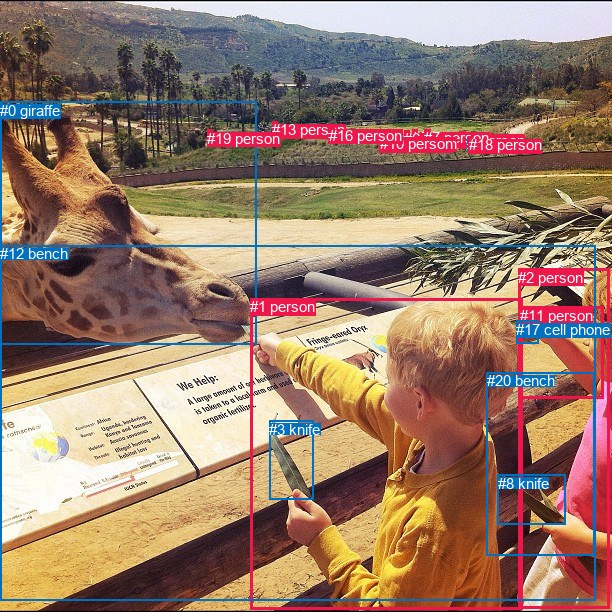
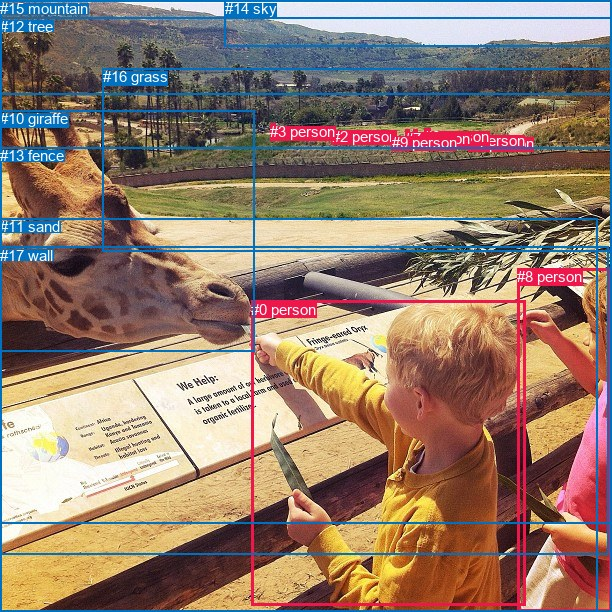

# 图片 1700：2394982.jpg

随机样本序号：471。图片 SHA256：`896ef52a4e1763e74a0880291c59014314074b858e22893b383576157ba2cffb`。

红色框表示人，蓝色框表示其他物体。两个模式分别保留自身框编号，可依据位置比较对应对象。

## 自动检测框与输出

人的框编号：`[1, 2, 4, 5, 6, 7, 9, 10, 11, 13, 15, 16, 18, 19]`。状态：`ok`。

### 自动检测全部物体框

| 编号 | 类别 | 是否为人 | 检测分数 | 像素坐标 xyxy |
|---|---|---|---|---|
| 0 | giraffe | False | 0.9989 | 0.2, 101.8, 256.7, 344.2 |
| 1 | person | True | 0.9974 | 250.2, 298.3, 522.8, 609.1 |
| 2 | person | True | 0.9779 | 518.3, 268.9, 609.9, 608.5 |
| 3 | knife | False | 0.9600 | 269.4, 420.7, 313.2, 500.0 |
| 4 | person | True | 0.9547 | 459.6, 131.5, 465.3, 144.9 |
| 5 | person | True | 0.9498 | 412.0, 129.2, 417.3, 142.8 |
| 6 | person | True | 0.9418 | 404.1, 130.0, 409.9, 142.5 |
| 7 | person | True | 0.9054 | 424.1, 129.0, 430.3, 143.9 |
| 8 | knife | False | 0.7981 | 497.6, 474.9, 565.0, 524.8 |
| 9 | person | True | 0.7667 | 391.9, 134.6, 395.9, 142.7 |
| 10 | person | True | 0.6274 | 379.8, 135.3, 383.4, 143.2 |
| 11 | person | True | 0.6022 | 519.8, 306.8, 603.7, 398.5 |
| 12 | bench | False | 0.6018 | 0.0, 245.4, 595.1, 600.9 |
| 13 | person | True | 0.5214 | 272.5, 121.4, 278.0, 133.8 |
| 14 | horse | False | 0.4769 | 467.3, 137.7, 472.6, 145.3 |
| 15 | person | True | 0.4599 | 328.0, 126.8, 332.7, 138.7 |
| 16 | person | True | 0.4298 | 329.5, 126.7, 334.4, 139.1 |
| 17 | cell phone | False | 0.4025 | 516.3, 320.5, 539.0, 343.7 |
| 18 | person | True | 0.3902 | 468.9, 136.3, 472.7, 145.6 |
| 19 | person | True | 0.3688 | 207.1, 129.8, 212.2, 144.3 |
| 20 | bench | False | 0.3586 | 486.7, 372.1, 594.1, 555.4 |

### 自动检测 Top50 人相关候选

评分物体对：420；人相关物体对：378；输出关系：50。

| 排名 | 主语编号与类别 | 关系 | 宾语编号与类别 | 类型 | 人与人 | 排序分数 | 原始融合 logit |
|---|---|---|---|---|---|---|---|
| 1 | #1 person | feeding | #0 giraffe | semantic | False | 0.99821 | 6.3256 |
| 2 | #1 person | holding | #3 knife | semantic | False | 0.99641 | 5.6273 |
| 3 | #2 person | holding | #8 knife | semantic | False | 0.99271 | 4.9145 |
| 4 | #1 person | holding | #8 knife | semantic | False | 0.99203 | 4.8246 |
| 5 | #2 person | wearing | #20 bench | semantic | False | 0.98515 | 4.1949 |
| 6 | #18 person | wearing | #14 horse | semantic | False | 0.97127 | 3.5206 |
| 7 | #2 person | feeding | #0 giraffe | semantic | False | 0.97036 | 3.4884 |
| 8 | #19 person | looking at | #0 giraffe | semantic | False | 0.96780 | 3.4032 |
| 9 | #2 person | wearing | #17 cell phone | semantic | False | 0.96520 | 3.3228 |
| 10 | #2 person | standing on | #12 bench | semantic | False | 0.95830 | 3.1346 |
| 11 | #1 person | standing on | #12 bench | semantic | False | 0.95570 | 3.0714 |
| 12 | #17 cell phone | on | #11 person | spatial | False | 0.95432 | 3.0393 |
| 13 | #1 person | wearing | #20 bench | semantic | False | 0.94613 | 2.8657 |
| 14 | #16 person | wearing | #15 person | semantic | True | 0.94298 | 2.8056 |
| 15 | #14 horse | wearing | #18 person | semantic | False | 0.93766 | 2.7108 |
| 16 | #1 person | on | #12 bench | spatial | False | 0.93695 | 2.6987 |
| 17 | #19 person | standing on | #12 bench | semantic | False | 0.93108 | 2.6033 |
| 18 | #2 person | in | #20 bench | spatial | False | 0.91962 | 2.4372 |
| 19 | #2 person | leaning on | #12 bench | spatial | False | 0.91125 | 2.3290 |
| 20 | #15 person | wearing | #16 person | semantic | True | 0.90258 | 2.2263 |
| 21 | #11 person | feeding | #0 giraffe | semantic | False | 0.89814 | 2.1767 |
| 22 | #2 person | holding | #11 person | semantic | True | 0.87022 | 1.9029 |
| 23 | #11 person | holding | #17 cell phone | semantic | False | 0.86993 | 1.9003 |
| 24 | #18 person | in | #14 horse | spatial | False | 0.86450 | 1.8532 |
| 25 | #4 person | standing on | #14 horse | semantic | False | 0.85483 | 1.7730 |
| 26 | #14 horse | on | #18 person | spatial | False | 0.85179 | 1.7487 |
| 27 | #16 person | looking at | #0 giraffe | semantic | False | 0.84844 | 1.7224 |
| 28 | #2 person | in | #11 person | spatial | True | 0.84754 | 1.7154 |
| 29 | #15 person | looking at | #0 giraffe | semantic | False | 0.84431 | 1.6907 |
| 30 | #1 person | on | #3 knife | spatial | False | 0.83699 | 1.6360 |
| 31 | #11 person | in | #17 cell phone | spatial | False | 0.83416 | 1.6154 |
| 32 | #6 person | standing on | #5 person | semantic | True | 0.80104 | 1.3928 |
| 33 | #6 person | looking at | #0 giraffe | semantic | False | 0.79734 | 1.3698 |
| 34 | #5 person | looking at | #0 giraffe | semantic | False | 0.79516 | 1.3563 |
| 35 | #16 person | in | #15 person | spatial | True | 0.79389 | 1.3486 |
| 36 | #9 person | looking at | #0 giraffe | semantic | False | 0.78315 | 1.2841 |
| 37 | #7 person | looking at | #0 giraffe | semantic | False | 0.78030 | 1.2674 |
| 38 | #13 person | standing on | #12 bench | semantic | False | 0.77821 | 1.2553 |
| 39 | #6 person | standing on | #12 bench | semantic | False | 0.77633 | 1.2444 |
| 40 | #15 person | in | #16 person | spatial | True | 0.76412 | 1.1754 |
| 41 | #9 person | standing on | #12 bench | semantic | False | 0.75932 | 1.1489 |
| 42 | #17 cell phone | on | #2 person | spatial | False | 0.75855 | 1.1447 |
| 43 | #4 person | standing on | #18 person | semantic | True | 0.75834 | 1.1436 |
| 44 | #5 person | standing on | #12 bench | semantic | False | 0.75473 | 1.1240 |
| 45 | #11 person | on | #12 bench | spatial | False | 0.75452 | 1.1228 |
| 46 | #13 person | looking at | #0 giraffe | semantic | False | 0.74879 | 1.0922 |
| 47 | #4 person | on | #14 horse | spatial | False | 0.74644 | 1.0797 |
| 48 | #2 person | on | #17 cell phone | spatial | False | 0.73731 | 1.0321 |
| 49 | #18 person | looking at | #0 giraffe | semantic | False | 0.73115 | 1.0005 |
| 50 | #7 person | standing on | #12 bench | semantic | False | 0.72464 | 0.9676 |

### 自动检测逐条人相关 GT 核验

R@50：25.00%；命中 1/4。

| GT 主语编号 | GT 关系 | GT 宾语编号 | 结果阶段 | 匹配预测主语编号 | 匹配预测宾语编号 |
|---|---|---|---|---|---|
| 0 | in front of | 8 | wrong_predicate | [1] | [2] |
| 0 | feeding | 10 | hit50 | [1] | [0] |
| 0 | attached to | 13 | endpoint_missing_or_wrong_class | [1] | [] |
| 8 | attached to | 13 | endpoint_missing_or_wrong_class | [2] | [] |

## 真实框与输出

人的框编号：`[0, 1, 2, 3, 4, 5, 6, 7, 8, 9]`。

### 真实框全部物体框

| 编号 | 类别 | 是否为人 | 检测分数 | 像素坐标 xyxy |
|---|---|---|---|---|
| 0 | person | True | GT | 251.0, 301.0, 525.0, 606.0 |
| 1 | person | True | GT | 413.0, 130.0, 417.0, 137.0 |
| 2 | person | True | GT | 332.0, 128.0, 335.0, 139.0 |
| 3 | person | True | GT | 270.0, 123.0, 275.0, 135.0 |
| 4 | person | True | GT | 469.0, 135.0, 473.0, 148.0 |
| 5 | person | True | GT | 460.0, 132.0, 465.0, 146.0 |
| 6 | person | True | GT | 424.0, 128.0, 430.0, 144.0 |
| 7 | person | True | GT | 405.0, 130.0, 409.0, 141.0 |
| 8 | person | True | GT | 517.0, 268.0, 612.0, 611.0 |
| 9 | person | True | GT | 392.0, 134.0, 397.0, 141.0 |
| 10 | giraffe | False | GT | 0.0, 110.0, 254.0, 351.0 |
| 11 | sand | False | GT | 0.0, 218.0, 598.0, 612.0 |
| 12 | tree | False | GT | 0.0, 18.0, 612.0, 523.0 |
| 13 | fence | False | GT | 0.0, 147.0, 612.0, 612.0 |
| 14 | sky | False | GT | 225.0, 0.0, 612.0, 46.0 |
| 15 | mountain | False | GT | 0.0, 0.0, 612.0, 94.0 |
| 16 | grass | False | GT | 103.0, 68.0, 612.0, 251.0 |
| 17 | wall | False | GT | 0.0, 247.0, 608.0, 555.0 |

### 真实框 Top50 人相关候选

评分物体对：306；人相关物体对：250；输出关系：50。

| 排名 | 主语编号与类别 | 关系 | 宾语编号与类别 | 类型 | 人与人 | 排序分数 | 原始融合 logit |
|---|---|---|---|---|---|---|---|
| 1 | #0 person | feeding | #10 giraffe | semantic | False | 0.99860 | 6.5666 |
| 2 | #8 person | feeding | #10 giraffe | semantic | False | 0.99113 | 4.7164 |
| 3 | #3 person | in | #12 tree | spatial | False | 0.97714 | 3.7554 |
| 4 | #3 person | in | #16 grass | spatial | False | 0.97404 | 3.6249 |
| 5 | #2 person | in | #12 tree | spatial | False | 0.96564 | 3.3359 |
| 6 | #2 person | standing on | #16 grass | semantic | False | 0.96393 | 3.2856 |
| 7 | #9 person | in | #12 tree | spatial | False | 0.96144 | 3.2163 |
| 8 | #8 person | leaning on | #17 wall | spatial | False | 0.96066 | 3.1953 |
| 9 | #7 person | in | #12 tree | spatial | False | 0.95960 | 3.1677 |
| 10 | #2 person | in | #16 grass | spatial | False | 0.95826 | 3.1336 |
| 11 | #8 person | standing on | #13 fence | semantic | False | 0.95781 | 3.1224 |
| 12 | #8 person | standing on | #11 sand | semantic | False | 0.95747 | 3.1141 |
| 13 | #8 person | leaning on | #11 sand | spatial | False | 0.95743 | 3.1131 |
| 14 | #1 person | in | #12 tree | spatial | False | 0.95502 | 3.0555 |
| 15 | #9 person | in | #16 grass | spatial | False | 0.95390 | 3.0298 |
| 16 | #6 person | in | #12 tree | spatial | False | 0.95345 | 3.0197 |
| 17 | #5 person | in | #12 tree | spatial | False | 0.94459 | 2.8361 |
| 18 | #9 person | standing on | #16 grass | semantic | False | 0.94435 | 2.8315 |
| 19 | #4 person | in | #12 tree | spatial | False | 0.94354 | 2.8161 |
| 20 | #7 person | standing on | #16 grass | semantic | False | 0.93649 | 2.6910 |
| 21 | #1 person | in | #16 grass | spatial | False | 0.93347 | 2.6412 |
| 22 | #1 person | standing on | #16 grass | semantic | False | 0.93039 | 2.5927 |
| 23 | #0 person | standing on | #11 sand | semantic | False | 0.92825 | 2.5601 |
| 24 | #7 person | in | #16 grass | spatial | False | 0.92792 | 2.5552 |
| 25 | #0 person | on | #11 sand | spatial | False | 0.92684 | 2.5392 |
| 26 | #3 person | standing on | #16 grass | semantic | False | 0.92630 | 2.5312 |
| 27 | #0 person | holding | #17 wall | semantic | False | 0.92302 | 2.4841 |
| 28 | #8 person | leaning on | #13 fence | spatial | False | 0.92200 | 2.4698 |
| 29 | #6 person | in | #16 grass | spatial | False | 0.91424 | 2.3665 |
| 30 | #6 person | standing on | #16 grass | semantic | False | 0.91317 | 2.3530 |
| 31 | #2 person | standing on | #12 tree | semantic | False | 0.90958 | 2.3086 |
| 32 | #8 person | standing on | #17 wall | semantic | False | 0.90874 | 2.2984 |
| 33 | #5 person | in | #16 grass | spatial | False | 0.89805 | 2.1757 |
| 34 | #4 person | in | #16 grass | spatial | False | 0.89626 | 2.1563 |
| 35 | #0 person | on | #13 fence | spatial | False | 0.89618 | 2.1555 |
| 36 | #10 giraffe | eating | #0 person | semantic | False | 0.89487 | 2.1415 |
| 37 | #7 person | standing on | #12 tree | semantic | False | 0.88691 | 2.0595 |
| 38 | #9 person | standing on | #12 tree | semantic | False | 0.88378 | 2.0287 |
| 39 | #4 person | standing on | #16 grass | semantic | False | 0.88028 | 1.9951 |
| 40 | #5 person | standing on | #16 grass | semantic | False | 0.87165 | 1.9156 |
| 41 | #6 person | standing on | #12 tree | semantic | False | 0.87004 | 1.9013 |
| 42 | #3 person | standing on | #12 tree | semantic | False | 0.86896 | 1.8918 |
| 43 | #1 person | standing on | #12 tree | semantic | False | 0.86614 | 1.8672 |
| 44 | #0 person | standing on | #13 fence | semantic | False | 0.85347 | 1.7621 |
| 45 | #4 person | standing on | #12 tree | semantic | False | 0.85319 | 1.7598 |
| 46 | #0 person | leaning on | #17 wall | spatial | False | 0.84515 | 1.6971 |
| 47 | #5 person | standing on | #12 tree | semantic | False | 0.83847 | 1.6469 |
| 48 | #0 person | eating | #12 tree | semantic | False | 0.81569 | 1.4874 |
| 49 | #2 person | looking at | #10 giraffe | semantic | False | 0.79917 | 1.3811 |
| 50 | #7 person | looking at | #10 giraffe | semantic | False | 0.78242 | 1.2798 |

### 真实框逐条人相关 GT 核验

R@50：25.00%；命中 1/4。

| GT 主语编号 | GT 关系 | GT 宾语编号 | 结果阶段 | 匹配预测主语编号 | 匹配预测宾语编号 |
|---|---|---|---|---|---|
| 0 | in front of | 8 | wrong_predicate | [0] | [8] |
| 0 | feeding | 10 | hit50 | [0] | [10] |
| 0 | attached to | 13 | wrong_predicate | [0] | [13] |
| 8 | attached to | 13 | wrong_predicate | [8] | [13] |

## 全部人相关 GT

| 主语编号与类别 | 关系 | 宾语编号与类别 |
|---|---|---|
| #0 person | in front of | #8 person |
| #0 person | feeding | #10 giraffe |
| #0 person | attached to | #13 fence |
| #8 person | attached to | #13 fence |

原始记录、全部人相关物体对的两项预测与分项分数见 [逐图证据 JSON](../evidence/cases/1700.json)。全部56类 logits 保留于本机 HOR/output/random500/logits/。

<!-- HOR_COMPLETE_RESULTS -->

## 六组条件的完整输出对照

以下保留同一图片三种框与候选模式、两种谓词输出规则的全部 Top50。框编号各自在所属模式内解释。

### 自动检测框完整枚举：空间与语义各保留一个谓词

| 排名 | 主语编号与类别 | 谓词 | 宾语编号与类别 | 分组 | 排序分数 | predicate logit | pair logit |
|---|---|---|---|---|---|---|---|
| 1 | #1 person | feeding | #0 giraffe | semantic | 0.9982133 | 5.8330302 | 0.4925542 |
| 2 | #1 person | holding | #3 knife | semantic | 0.9964145 | 4.7406840 | 0.8866000 |
| 3 | #2 person | holding | #8 knife | semantic | 0.9927142 | 4.5841899 | 0.3303223 |
| 4 | #1 person | holding | #8 knife | semantic | 0.9920340 | 4.0775790 | 0.7469924 |
| 5 | #2 person | wearing | #20 bench | semantic | 0.9851511 | 3.7773442 | 0.4175253 |
| 6 | #18 person | wearing | #14 horse | semantic | 0.9712690 | 3.8227830 | -0.3021598 |
| 7 | #2 person | feeding | #0 giraffe | semantic | 0.9703568 | 3.3659377 | 0.1224915 |
| 8 | #19 person | looking at | #0 giraffe | semantic | 0.9678029 | 3.5130496 | -0.1098962 |
| 9 | #2 person | wearing | #17 cell phone | semantic | 0.9652031 | 3.2341976 | 0.0886138 |
| 10 | #2 person | standing on | #12 bench | semantic | 0.9582982 | 3.6340175 | -0.4994029 |
| 11 | #1 person | standing on | #12 bench | semantic | 0.9556991 | 3.3859429 | -0.3145045 |
| 12 | #17 cell phone | on | #11 person | spatial | 0.9543204 | 3.1909280 | -0.1515795 |
| 13 | #1 person | wearing | #20 bench | semantic | 0.9461256 | 3.3076196 | -0.4418991 |
| 14 | #16 person | wearing | #15 person | semantic | 0.9429802 | 3.1592736 | -0.3536288 |
| 15 | #14 horse | wearing | #18 person | semantic | 0.9376625 | 3.0387616 | -0.3279343 |
| 16 | #1 person | on | #12 bench | spatial | 0.9369507 | 3.0132198 | -0.3145045 |
| 17 | #19 person | standing on | #12 bench | semantic | 0.9310750 | 3.1703024 | -0.5669812 |
| 18 | #2 person | in | #20 bench | spatial | 0.9196232 | 2.0197139 | 0.4175253 |
| 19 | #2 person | leaning on | #12 bench | spatial | 0.9112517 | 2.8284187 | -0.4994029 |
| 20 | #15 person | wearing | #16 person | semantic | 0.9025834 | 2.5888972 | -0.3626332 |
| 21 | #11 person | feeding | #0 giraffe | semantic | 0.8981369 | 2.7638712 | -0.5871779 |
| 22 | #2 person | holding | #11 person | semantic | 0.8702205 | 1.7839270 | 0.1189827 |
| 23 | #11 person | holding | #17 cell phone | semantic | 0.8699296 | 2.0999498 | -0.1996136 |
| 24 | #18 person | in | #14 horse | spatial | 0.8644998 | 2.1553373 | -0.3021598 |
| 25 | #4 person | standing on | #14 horse | semantic | 0.8548315 | 2.0832467 | -0.3102381 |
| 26 | #14 horse | on | #18 person | spatial | 0.8517913 | 2.0766549 | -0.3279343 |
| 27 | #16 person | looking at | #0 giraffe | semantic | 0.8484413 | 2.0105782 | -0.2881504 |
| 28 | #2 person | in | #11 person | spatial | 0.8475374 | 1.5964332 | 0.1189827 |
| 29 | #15 person | looking at | #0 giraffe | semantic | 0.8443142 | 1.9811845 | -0.2905000 |
| 30 | #1 person | on | #3 knife | spatial | 0.8369936 | 0.7494264 | 0.8866000 |
| 31 | #11 person | in | #17 cell phone | spatial | 0.8341641 | 1.8150449 | -0.1996136 |
| 32 | #6 person | standing on | #5 person | semantic | 0.8010399 | 1.6560535 | -0.2632472 |
| 33 | #6 person | looking at | #0 giraffe | semantic | 0.7973434 | 1.7635727 | -0.3938001 |
| 34 | #5 person | looking at | #0 giraffe | semantic | 0.7951571 | 1.7614808 | -0.4051848 |
| 35 | #16 person | in | #15 person | spatial | 0.7938940 | 1.7021880 | -0.3536288 |
| 36 | #9 person | looking at | #0 giraffe | semantic | 0.7831464 | 1.6446023 | -0.3605056 |
| 37 | #7 person | looking at | #0 giraffe | semantic | 0.7803006 | 1.6992064 | -0.4317874 |
| 38 | #13 person | standing on | #12 bench | semantic | 0.7782106 | 1.8156800 | -0.5604111 |
| 39 | #6 person | standing on | #12 bench | semantic | 0.7763309 | 1.8726072 | -0.6281960 |
| 40 | #15 person | in | #16 person | spatial | 0.7641158 | 1.5380116 | -0.3626332 |
| 41 | #9 person | standing on | #12 bench | semantic | 0.7593185 | 1.7669306 | -0.6179838 |
| 42 | #17 cell phone | on | #2 person | spatial | 0.7585461 | 1.5633945 | -0.4186697 |
| 43 | #4 person | standing on | #18 person | semantic | 0.7583407 | 1.4719329 | -0.3283294 |
| 44 | #5 person | standing on | #12 bench | semantic | 0.7547309 | 1.7522421 | -0.6282368 |
| 45 | #11 person | on | #12 bench | spatial | 0.7545152 | 2.1483064 | -1.0254657 |
| 46 | #13 person | looking at | #0 giraffe | semantic | 0.7487912 | 1.5529342 | -0.4607583 |
| 47 | #4 person | on | #14 horse | spatial | 0.7464437 | 1.3899727 | -0.3102381 |
| 48 | #2 person | on | #17 cell phone | spatial | 0.7373140 | 0.9434409 | 0.0886138 |
| 49 | #18 person | looking at | #0 giraffe | semantic | 0.7311501 | 1.5186591 | -0.5181935 |
| 50 | #7 person | standing on | #12 bench | semantic | 0.7246372 | 1.6010718 | -0.6334903 |

GT 命中：1/4，R@50=25.00%。

| GT主语 | GT谓词 | GT宾语 | 结果阶段 | 匹配主语框 | 匹配宾语框 |
|---|---|---|---|---|---|
| 0 | in front of | 8 | wrong_predicate | [1] | [2] |
| 0 | feeding | 10 | hit50 | [1] | [0] |
| 0 | attached to | 13 | endpoint_missing_or_wrong_class | [1] | [] |
| 8 | attached to | 13 | endpoint_missing_or_wrong_class | [2] | [] |

### 自动检测框完整枚举：每对只保留一个谓词

| 排名 | 主语编号与类别 | 谓词 | 宾语编号与类别 | 分组 | 排序分数 | predicate logit | pair logit |
|---|---|---|---|---|---|---|---|
| 1 | #1 person | feeding | #0 giraffe | single | 0.9982133 | 5.8330302 | 0.4925542 |
| 2 | #1 person | holding | #3 knife | single | 0.9964145 | 4.7406840 | 0.8866000 |
| 3 | #2 person | holding | #8 knife | single | 0.9927142 | 4.5841899 | 0.3303223 |
| 4 | #1 person | holding | #8 knife | single | 0.9920340 | 4.0775790 | 0.7469924 |
| 5 | #2 person | wearing | #20 bench | single | 0.9851511 | 3.7773442 | 0.4175253 |
| 6 | #18 person | wearing | #14 horse | single | 0.9712690 | 3.8227830 | -0.3021598 |
| 7 | #2 person | feeding | #0 giraffe | single | 0.9703568 | 3.3659377 | 0.1224915 |
| 8 | #19 person | looking at | #0 giraffe | single | 0.9678029 | 3.5130496 | -0.1098962 |
| 9 | #2 person | wearing | #17 cell phone | single | 0.9652031 | 3.2341976 | 0.0886138 |
| 10 | #2 person | standing on | #12 bench | single | 0.9582982 | 3.6340175 | -0.4994029 |
| 11 | #1 person | standing on | #12 bench | single | 0.9556991 | 3.3859429 | -0.3145045 |
| 12 | #17 cell phone | on | #11 person | single | 0.9543204 | 3.1909280 | -0.1515795 |
| 13 | #1 person | wearing | #20 bench | single | 0.9461256 | 3.3076196 | -0.4418991 |
| 14 | #16 person | wearing | #15 person | single | 0.9429802 | 3.1592736 | -0.3536288 |
| 15 | #14 horse | wearing | #18 person | single | 0.9376625 | 3.0387616 | -0.3279343 |
| 16 | #19 person | standing on | #12 bench | single | 0.9310750 | 3.1703024 | -0.5669812 |
| 17 | #15 person | wearing | #16 person | single | 0.9025834 | 2.5888972 | -0.3626332 |
| 18 | #11 person | feeding | #0 giraffe | single | 0.8981369 | 2.7638712 | -0.5871779 |
| 19 | #2 person | holding | #11 person | single | 0.8702205 | 1.7839270 | 0.1189827 |
| 20 | #11 person | holding | #17 cell phone | single | 0.8699296 | 2.0999498 | -0.1996136 |
| 21 | #4 person | standing on | #14 horse | single | 0.8548315 | 2.0832467 | -0.3102381 |
| 22 | #16 person | looking at | #0 giraffe | single | 0.8484413 | 2.0105782 | -0.2881504 |
| 23 | #15 person | looking at | #0 giraffe | single | 0.8443142 | 1.9811845 | -0.2905000 |
| 24 | #6 person | standing on | #5 person | single | 0.8010399 | 1.6560535 | -0.2632472 |
| 25 | #6 person | looking at | #0 giraffe | single | 0.7973434 | 1.7635727 | -0.3938001 |
| 26 | #5 person | looking at | #0 giraffe | single | 0.7951571 | 1.7614808 | -0.4051848 |
| 27 | #9 person | looking at | #0 giraffe | single | 0.7831464 | 1.6446023 | -0.3605056 |
| 28 | #7 person | looking at | #0 giraffe | single | 0.7803006 | 1.6992064 | -0.4317874 |
| 29 | #13 person | standing on | #12 bench | single | 0.7782106 | 1.8156800 | -0.5604111 |
| 30 | #6 person | standing on | #12 bench | single | 0.7763309 | 1.8726072 | -0.6281960 |
| 31 | #9 person | standing on | #12 bench | single | 0.7593185 | 1.7669306 | -0.6179838 |
| 32 | #17 cell phone | on | #2 person | single | 0.7585461 | 1.5633945 | -0.4186697 |
| 33 | #4 person | standing on | #18 person | single | 0.7583407 | 1.4719329 | -0.3283294 |
| 34 | #5 person | standing on | #12 bench | single | 0.7547309 | 1.7522421 | -0.6282368 |
| 35 | #11 person | on | #12 bench | single | 0.7545152 | 2.1483064 | -1.0254657 |
| 36 | #13 person | looking at | #0 giraffe | single | 0.7487912 | 1.5529342 | -0.4607583 |
| 37 | #18 person | looking at | #0 giraffe | single | 0.7311501 | 1.5186591 | -0.5181935 |
| 38 | #7 person | standing on | #12 bench | single | 0.7246372 | 1.6010718 | -0.6334903 |
| 39 | #4 person | looking at | #0 giraffe | single | 0.7172825 | 1.4528990 | -0.5218775 |
| 40 | #10 person | looking at | #0 giraffe | single | 0.7158836 | 1.3087177 | -0.3845844 |
| 41 | #16 person | standing on | #12 bench | single | 0.7093935 | 1.4837637 | -0.5913235 |
| 42 | #10 person | standing on | #12 bench | single | 0.6995028 | 1.4176660 | -0.5727345 |
| 43 | #15 person | standing on | #12 bench | single | 0.6979158 | 1.4309254 | -0.5935327 |
| 44 | #14 horse | on | #4 person | single | 0.6945338 | 1.1355143 | -0.3141125 |
| 45 | #5 person | standing on | #6 person | single | 0.6939790 | 1.0827913 | -0.2640037 |
| 46 | #11 person | holding | #20 bench | single | 0.6806575 | 1.3972621 | -0.6404670 |
| 47 | #5 person | standing on | #7 person | single | 0.6415387 | 0.8289013 | -0.2468523 |
| 48 | #4 person | standing on | #12 bench | single | 0.6127023 | 1.0698299 | -0.6111444 |
| 49 | #18 person | standing on | #12 bench | single | 0.6063445 | 1.0323949 | -0.6004230 |
| 50 | #18 person | standing on | #4 person | single | 0.6045535 | 0.7299538 | -0.3054792 |

GT 命中：1/4，R@50=25.00%。

| GT主语 | GT谓词 | GT宾语 | 结果阶段 | 匹配主语框 | 匹配宾语框 |
|---|---|---|---|---|---|
| 0 | in front of | 8 | wrong_predicate | [1] | [2] |
| 0 | feeding | 10 | hit50 | [1] | [0] |
| 0 | attached to | 13 | endpoint_missing_or_wrong_class | [1] | [] |
| 8 | attached to | 13 | endpoint_missing_or_wrong_class | [2] | [] |

### 真实框完整枚举：空间与语义各保留一个谓词

| 排名 | 主语编号与类别 | 谓词 | 宾语编号与类别 | 分组 | 排序分数 | predicate logit | pair logit |
|---|---|---|---|---|---|---|---|
| 1 | #0 person | feeding | #10 giraffe | semantic | 0.9985953 | 6.0737500 | 0.4928083 |
| 2 | #8 person | feeding | #10 giraffe | semantic | 0.9911318 | 4.5694909 | 0.1468916 |
| 3 | #3 person | in | #12 tree | spatial | 0.9771428 | 3.7678800 | -0.0125096 |
| 4 | #3 person | in | #16 grass | spatial | 0.9740408 | 3.6811471 | -0.0562210 |
| 5 | #2 person | in | #12 tree | spatial | 0.9656410 | 3.4072309 | -0.0713039 |
| 6 | #2 person | standing on | #16 grass | semantic | 0.9639302 | 3.2582345 | 0.0273265 |
| 7 | #9 person | in | #12 tree | spatial | 0.9614413 | 3.3802352 | -0.1639835 |
| 8 | #8 person | leaning on | #17 wall | spatial | 0.9606589 | 3.9791675 | -0.7838188 |
| 9 | #7 person | in | #12 tree | spatial | 0.9595993 | 3.3536859 | -0.1860165 |
| 10 | #2 person | in | #16 grass | spatial | 0.9582595 | 3.1063180 | 0.0273265 |
| 11 | #8 person | standing on | #13 fence | semantic | 0.9578074 | 3.3286185 | -0.2062169 |
| 12 | #8 person | standing on | #11 sand | semantic | 0.9574687 | 3.5297694 | -0.4157150 |
| 13 | #8 person | leaning on | #11 sand | spatial | 0.9574315 | 3.5288558 | -0.4157150 |
| 14 | #1 person | in | #12 tree | spatial | 0.9550180 | 3.2598701 | -0.2044030 |
| 15 | #9 person | in | #16 grass | spatial | 0.9539027 | 2.9589581 | 0.0708495 |
| 16 | #6 person | in | #12 tree | spatial | 0.9534549 | 3.2200456 | -0.2003748 |
| 17 | #5 person | in | #12 tree | spatial | 0.9445941 | 3.0465813 | -0.2105121 |
| 18 | #9 person | standing on | #16 grass | semantic | 0.9443548 | 2.7606564 | 0.0708495 |
| 19 | #4 person | in | #12 tree | spatial | 0.9435370 | 3.0266685 | -0.2106185 |
| 20 | #7 person | standing on | #16 grass | semantic | 0.9364918 | 2.6270323 | 0.0639410 |
| 21 | #1 person | in | #16 grass | spatial | 0.9334679 | 2.5845881 | 0.0566341 |
| 22 | #1 person | standing on | #16 grass | semantic | 0.9303888 | 2.5360441 | 0.0566341 |
| 23 | #0 person | standing on | #11 sand | semantic | 0.9282508 | 2.7384248 | -0.1782988 |
| 24 | #7 person | in | #16 grass | spatial | 0.9279193 | 2.4912181 | 0.0639410 |
| 25 | #0 person | on | #11 sand | spatial | 0.9268421 | 2.7174621 | -0.1782988 |
| 26 | #3 person | standing on | #16 grass | semantic | 0.9263026 | 2.5874534 | -0.0562210 |
| 27 | #0 person | holding | #17 wall | semantic | 0.9230186 | 3.0264516 | -0.5423666 |
| 28 | #8 person | leaning on | #13 fence | spatial | 0.9219950 | 2.6759853 | -0.2062169 |
| 29 | #6 person | in | #16 grass | spatial | 0.9142352 | 2.2940769 | 0.0724025 |
| 30 | #6 person | standing on | #16 grass | semantic | 0.9131746 | 2.2806258 | 0.0724025 |
| 31 | #2 person | standing on | #12 tree | semantic | 0.9095842 | 2.3798714 | -0.0713039 |
| 32 | #8 person | standing on | #17 wall | semantic | 0.9087406 | 3.0821719 | -0.7838188 |
| 33 | #5 person | in | #16 grass | spatial | 0.8980464 | 2.0504732 | 0.1252299 |
| 34 | #4 person | in | #16 grass | spatial | 0.8962584 | 2.0272417 | 0.1290829 |
| 35 | #0 person | on | #13 fence | spatial | 0.8961784 | 2.2136436 | -0.0581783 |
| 36 | #10 giraffe | eating | #0 person | semantic | 0.8948736 | 3.4896626 | -1.3481432 |
| 37 | #7 person | standing on | #12 tree | semantic | 0.8869057 | 2.2455330 | -0.1860165 |
| 38 | #9 person | standing on | #12 tree | semantic | 0.8837788 | 2.1926947 | -0.1639835 |
| 39 | #4 person | standing on | #16 grass | semantic | 0.8802775 | 1.8659778 | 0.1290829 |
| 40 | #5 person | standing on | #16 grass | semantic | 0.8716494 | 1.7903924 | 0.1252299 |
| 41 | #6 person | standing on | #12 tree | semantic | 0.8700421 | 2.1017060 | -0.2003748 |
| 42 | #3 person | standing on | #12 tree | semantic | 0.8689626 | 1.9043269 | -0.0125096 |
| 43 | #1 person | standing on | #12 tree | semantic | 0.8661353 | 2.0716147 | -0.2044030 |
| 44 | #0 person | standing on | #13 fence | semantic | 0.8534734 | 1.8202853 | -0.0581783 |
| 45 | #4 person | standing on | #12 tree | semantic | 0.8531854 | 1.9704242 | -0.2106185 |
| 46 | #0 person | leaning on | #17 wall | spatial | 0.8451532 | 2.2394485 | -0.5423666 |
| 47 | #5 person | standing on | #12 tree | semantic | 0.8384704 | 1.8574033 | -0.2105121 |
| 48 | #0 person | eating | #12 tree | semantic | 0.8156861 | 1.7565989 | -0.2692096 |
| 49 | #2 person | looking at | #10 giraffe | semantic | 0.7991742 | 1.6606398 | -0.2794987 |
| 50 | #7 person | looking at | #10 giraffe | semantic | 0.7824163 | 1.6550617 | -0.3752579 |

GT 命中：1/4，R@50=25.00%。

| GT主语 | GT谓词 | GT宾语 | 结果阶段 | 匹配主语框 | 匹配宾语框 |
|---|---|---|---|---|---|
| 0 | in front of | 8 | wrong_predicate | [0] | [8] |
| 0 | feeding | 10 | hit50 | [0] | [10] |
| 0 | attached to | 13 | wrong_predicate | [0] | [13] |
| 8 | attached to | 13 | wrong_predicate | [8] | [13] |

### 真实框完整枚举：每对只保留一个谓词

| 排名 | 主语编号与类别 | 谓词 | 宾语编号与类别 | 分组 | 排序分数 | predicate logit | pair logit |
|---|---|---|---|---|---|---|---|
| 1 | #0 person | feeding | #10 giraffe | single | 0.9985953 | 6.0737500 | 0.4928083 |
| 2 | #8 person | feeding | #10 giraffe | single | 0.9911318 | 4.5694909 | 0.1468916 |
| 3 | #3 person | in | #12 tree | single | 0.9771428 | 3.7678800 | -0.0125096 |
| 4 | #3 person | in | #16 grass | single | 0.9740408 | 3.6811471 | -0.0562210 |
| 5 | #2 person | in | #12 tree | single | 0.9656410 | 3.4072309 | -0.0713039 |
| 6 | #2 person | standing on | #16 grass | single | 0.9639302 | 3.2582345 | 0.0273265 |
| 7 | #9 person | in | #12 tree | single | 0.9614413 | 3.3802352 | -0.1639835 |
| 8 | #8 person | leaning on | #17 wall | single | 0.9606589 | 3.9791675 | -0.7838188 |
| 9 | #7 person | in | #12 tree | single | 0.9595993 | 3.3536859 | -0.1860165 |
| 10 | #8 person | standing on | #13 fence | single | 0.9578074 | 3.3286185 | -0.2062169 |
| 11 | #8 person | standing on | #11 sand | single | 0.9574687 | 3.5297694 | -0.4157150 |
| 12 | #1 person | in | #12 tree | single | 0.9550180 | 3.2598701 | -0.2044030 |
| 13 | #9 person | in | #16 grass | single | 0.9539027 | 2.9589581 | 0.0708495 |
| 14 | #6 person | in | #12 tree | single | 0.9534549 | 3.2200456 | -0.2003748 |
| 15 | #5 person | in | #12 tree | single | 0.9445941 | 3.0465813 | -0.2105121 |
| 16 | #4 person | in | #12 tree | single | 0.9435370 | 3.0266685 | -0.2106185 |
| 17 | #7 person | standing on | #16 grass | single | 0.9364918 | 2.6270323 | 0.0639410 |
| 18 | #1 person | in | #16 grass | single | 0.9334679 | 2.5845881 | 0.0566341 |
| 19 | #0 person | standing on | #11 sand | single | 0.9282508 | 2.7384248 | -0.1782988 |
| 20 | #0 person | holding | #17 wall | single | 0.9230186 | 3.0264516 | -0.5423666 |
| 21 | #6 person | in | #16 grass | single | 0.9142352 | 2.2940769 | 0.0724025 |
| 22 | #5 person | in | #16 grass | single | 0.8980464 | 2.0504732 | 0.1252299 |
| 23 | #4 person | in | #16 grass | single | 0.8962584 | 2.0272417 | 0.1290829 |
| 24 | #0 person | on | #13 fence | single | 0.8961784 | 2.2136436 | -0.0581783 |
| 25 | #10 giraffe | eating | #0 person | single | 0.8948736 | 3.4896626 | -1.3481432 |
| 26 | #0 person | eating | #12 tree | single | 0.8156861 | 1.7565989 | -0.2692096 |
| 27 | #2 person | looking at | #10 giraffe | single | 0.7991742 | 1.6606398 | -0.2794987 |
| 28 | #7 person | looking at | #10 giraffe | single | 0.7824163 | 1.6550617 | -0.3752579 |
| 29 | #3 person | in | #13 fence | single | 0.7450033 | 1.2059145 | -0.1337767 |
| 30 | #7 person | standing on | #13 fence | single | 0.7290301 | 1.1239986 | -0.1342916 |
| 31 | #6 person | looking at | #10 giraffe | single | 0.7288708 | 1.4094505 | -0.4205495 |
| 32 | #8 person | in | #12 tree | single | 0.7252638 | 1.5716643 | -0.6009402 |
| 33 | #9 person | standing on | #13 fence | single | 0.7213314 | 1.0748320 | -0.1237566 |
| 34 | #1 person | looking at | #10 giraffe | single | 0.7098315 | 1.2939663 | -0.3994002 |
| 35 | #8 person | beside | #0 person | single | 0.7071281 | 1.6399627 | -0.7584859 |
| 36 | #6 person | standing on | #13 fence | single | 0.7056339 | 1.0176072 | -0.1433349 |
| 37 | #4 person | looking at | #10 giraffe | single | 0.6992976 | 1.3485708 | -0.5046154 |
| 38 | #1 person | standing on | #13 fence | single | 0.6817690 | 0.9163170 | -0.1544038 |
| 39 | #4 person | standing on | #13 fence | single | 0.6746951 | 0.8584766 | -0.1289789 |
| 40 | #9 person | looking at | #10 giraffe | single | 0.6667678 | 1.0532365 | -0.3596340 |
| 41 | #5 person | looking at | #10 giraffe | single | 0.6642755 | 1.1960225 | -0.5136164 |
| 42 | #2 person | standing on | #13 fence | single | 0.6265521 | 0.6190767 | -0.1016231 |
| 43 | #5 person | on | #13 fence | single | 0.5793951 | 0.4583306 | -0.1380401 |
| 44 | #3 person | in | #15 mountain | single | 0.5738036 | 0.5071783 | -0.2097915 |
| 45 | #3 person | looking at | #10 giraffe | single | 0.5180787 | 0.5623631 | -0.4900166 |
| 46 | #3 person | walking on | #17 wall | single | 0.4847461 | 0.6982193 | -0.7592538 |
| 47 | #9 person | standing on | #11 sand | single | 0.3901776 | 0.1302729 | -0.5768387 |
| 48 | #0 person | holding | #8 person | single | 0.3878528 | 0.7864442 | -1.2427912 |
| 49 | #2 person | standing on | #11 sand | single | 0.3660727 | -0.0062094 | -0.5428929 |
| 50 | #3 person | beside | #11 sand | single | 0.3554867 | -0.0756140 | -0.5193937 |

GT 命中：1/4，R@50=25.00%。

| GT主语 | GT谓词 | GT宾语 | 结果阶段 | 匹配主语框 | 匹配宾语框 |
|---|---|---|---|---|---|
| 0 | in front of | 8 | wrong_predicate | [0] | [8] |
| 0 | feeding | 10 | hit50 | [0] | [10] |
| 0 | attached to | 13 | wrong_predicate | [0] | [13] |
| 8 | attached to | 13 | wrong_predicate | [8] | [13] |

### 真实框400候选：空间与语义各保留一个谓词

| 排名 | 主语编号与类别 | 谓词 | 宾语编号与类别 | 分组 | 排序分数 | predicate logit | pair logit |
|---|---|---|---|---|---|---|---|
| 1 | #0 person | feeding | #10 giraffe | semantic | 0.9985953 | 6.0737500 | 0.4928083 |
| 2 | #8 person | feeding | #10 giraffe | semantic | 0.9911318 | 4.5694909 | 0.1468916 |
| 3 | #3 person | in | #12 tree | spatial | 0.9771428 | 3.7678800 | -0.0125096 |
| 4 | #3 person | in | #16 grass | spatial | 0.9740408 | 3.6811471 | -0.0562210 |
| 5 | #2 person | in | #12 tree | spatial | 0.9658605 | 3.4138684 | -0.0713039 |
| 6 | #8 person | leaning on | #17 wall | spatial | 0.9628006 | 4.0373731 | -0.7838188 |
| 7 | #2 person | standing on | #16 grass | semantic | 0.9623145 | 3.2127395 | 0.0273265 |
| 8 | #9 person | in | #12 tree | spatial | 0.9614413 | 3.3802352 | -0.1639835 |
| 9 | #7 person | in | #12 tree | spatial | 0.9598558 | 3.3603225 | -0.1860165 |
| 10 | #2 person | in | #16 grass | spatial | 0.9582595 | 3.1063180 | 0.0273265 |
| 11 | #8 person | standing on | #13 fence | semantic | 0.9578074 | 3.3286185 | -0.2062169 |
| 12 | #8 person | standing on | #11 sand | semantic | 0.9574687 | 3.5297694 | -0.4157150 |
| 13 | #8 person | leaning on | #11 sand | spatial | 0.9574315 | 3.5288558 | -0.4157150 |
| 14 | #1 person | in | #12 tree | spatial | 0.9550180 | 3.2598701 | -0.2044030 |
| 15 | #6 person | in | #12 tree | spatial | 0.9537486 | 3.2266831 | -0.2003748 |
| 16 | #9 person | in | #16 grass | spatial | 0.9536099 | 2.9523206 | 0.0708495 |
| 17 | #5 person | in | #12 tree | spatial | 0.9445941 | 3.0465813 | -0.2105121 |
| 18 | #4 person | in | #12 tree | spatial | 0.9438896 | 3.0333061 | -0.2106185 |
| 19 | #9 person | standing on | #16 grass | semantic | 0.9419152 | 2.7151623 | 0.0708495 |
| 20 | #7 person | standing on | #16 grass | semantic | 0.9364918 | 2.6270323 | 0.0639410 |
| 21 | #1 person | in | #16 grass | spatial | 0.9330545 | 2.5779510 | 0.0566341 |
| 22 | #1 person | standing on | #16 grass | semantic | 0.9303888 | 2.5360441 | 0.0566341 |
| 23 | #0 person | standing on | #11 sand | semantic | 0.9282508 | 2.7384248 | -0.1782988 |
| 24 | #7 person | in | #16 grass | spatial | 0.9274741 | 2.4845805 | 0.0639410 |
| 25 | #0 person | on | #11 sand | spatial | 0.9268421 | 2.7174621 | -0.1782988 |
| 26 | #3 person | standing on | #16 grass | semantic | 0.9268023 | 2.5947976 | -0.0562210 |
| 27 | #0 person | holding | #17 wall | semantic | 0.9230186 | 3.0264516 | -0.5423666 |
| 28 | #8 person | leaning on | #13 fence | spatial | 0.9219950 | 2.6759853 | -0.2062169 |
| 29 | #6 person | standing on | #16 grass | semantic | 0.9172736 | 2.3334641 | 0.0724025 |
| 30 | #6 person | in | #16 grass | spatial | 0.9142352 | 2.2940769 | 0.0724025 |
| 31 | #2 person | standing on | #12 tree | semantic | 0.9095842 | 2.3798714 | -0.0713039 |
| 32 | #8 person | standing on | #17 wall | semantic | 0.9087406 | 3.0821719 | -0.7838188 |
| 33 | #5 person | in | #16 grass | spatial | 0.9025539 | 2.1006994 | 0.1252299 |
| 34 | #0 person | on | #13 fence | spatial | 0.8961784 | 2.2136436 | -0.0581783 |
| 35 | #10 giraffe | feeding | #0 person | semantic | 0.8945548 | 3.4862781 | -1.3481432 |
| 36 | #4 person | in | #16 grass | spatial | 0.8934270 | 1.9971509 | 0.1290829 |
| 37 | #7 person | standing on | #12 tree | semantic | 0.8869057 | 2.2455330 | -0.1860165 |
| 38 | #9 person | standing on | #12 tree | semantic | 0.8845310 | 2.2000389 | -0.1639835 |
| 39 | #4 person | standing on | #16 grass | semantic | 0.8795013 | 1.8586335 | 0.1290829 |
| 40 | #6 person | standing on | #12 tree | semantic | 0.8725925 | 2.1244531 | -0.2003748 |
| 41 | #5 person | standing on | #16 grass | semantic | 0.8724688 | 1.7977366 | 0.1252299 |
| 42 | #3 person | standing on | #12 tree | semantic | 0.8697965 | 1.9116707 | -0.0125096 |
| 43 | #1 person | standing on | #12 tree | semantic | 0.8669845 | 2.0789590 | -0.2044030 |
| 44 | #4 person | standing on | #12 tree | semantic | 0.8569146 | 2.0005155 | -0.2106185 |
| 45 | #0 person | standing on | #13 fence | semantic | 0.8534734 | 1.8202853 | -0.0581783 |
| 46 | #0 person | leaning on | #17 wall | spatial | 0.8451532 | 2.2394485 | -0.5423666 |
| 47 | #5 person | standing on | #12 tree | semantic | 0.8415276 | 1.8801503 | -0.2105121 |
| 48 | #0 person | eating | #12 tree | semantic | 0.8156861 | 1.7565989 | -0.2692096 |
| 49 | #2 person | looking at | #10 giraffe | semantic | 0.7991742 | 1.6606398 | -0.2794987 |
| 50 | #7 person | looking at | #10 giraffe | semantic | 0.7772501 | 1.6249704 | -0.3752579 |

GT 命中：1/4，R@50=25.00%。

| GT主语 | GT谓词 | GT宾语 | 结果阶段 | 匹配主语框 | 匹配宾语框 |
|---|---|---|---|---|---|
| 0 | in front of | 8 | wrong_predicate | [0] | [8] |
| 0 | feeding | 10 | hit50 | [0] | [10] |
| 0 | attached to | 13 | wrong_predicate | [0] | [13] |
| 8 | attached to | 13 | wrong_predicate | [8] | [13] |

### 真实框400候选：每对只保留一个谓词

| 排名 | 主语编号与类别 | 谓词 | 宾语编号与类别 | 分组 | 排序分数 | predicate logit | pair logit |
|---|---|---|---|---|---|---|---|
| 1 | #0 person | feeding | #10 giraffe | single | 0.9985953 | 6.0737500 | 0.4928083 |
| 2 | #8 person | feeding | #10 giraffe | single | 0.9911318 | 4.5694909 | 0.1468916 |
| 3 | #3 person | in | #12 tree | single | 0.9771428 | 3.7678800 | -0.0125096 |
| 4 | #3 person | in | #16 grass | single | 0.9740408 | 3.6811471 | -0.0562210 |
| 5 | #2 person | in | #12 tree | single | 0.9658605 | 3.4138684 | -0.0713039 |
| 6 | #8 person | leaning on | #17 wall | single | 0.9628006 | 4.0373731 | -0.7838188 |
| 7 | #2 person | standing on | #16 grass | single | 0.9623145 | 3.2127395 | 0.0273265 |
| 8 | #9 person | in | #12 tree | single | 0.9614413 | 3.3802352 | -0.1639835 |
| 9 | #7 person | in | #12 tree | single | 0.9598558 | 3.3603225 | -0.1860165 |
| 10 | #8 person | standing on | #13 fence | single | 0.9578074 | 3.3286185 | -0.2062169 |
| 11 | #8 person | standing on | #11 sand | single | 0.9574687 | 3.5297694 | -0.4157150 |
| 12 | #1 person | in | #12 tree | single | 0.9550180 | 3.2598701 | -0.2044030 |
| 13 | #6 person | in | #12 tree | single | 0.9537486 | 3.2266831 | -0.2003748 |
| 14 | #9 person | in | #16 grass | single | 0.9536099 | 2.9523206 | 0.0708495 |
| 15 | #5 person | in | #12 tree | single | 0.9445941 | 3.0465813 | -0.2105121 |
| 16 | #4 person | in | #12 tree | single | 0.9438896 | 3.0333061 | -0.2106185 |
| 17 | #7 person | standing on | #16 grass | single | 0.9364918 | 2.6270323 | 0.0639410 |
| 18 | #1 person | in | #16 grass | single | 0.9330545 | 2.5779510 | 0.0566341 |
| 19 | #0 person | standing on | #11 sand | single | 0.9282508 | 2.7384248 | -0.1782988 |
| 20 | #0 person | holding | #17 wall | single | 0.9230186 | 3.0264516 | -0.5423666 |
| 21 | #6 person | standing on | #16 grass | single | 0.9172736 | 2.3334641 | 0.0724025 |
| 22 | #5 person | in | #16 grass | single | 0.9025539 | 2.1006994 | 0.1252299 |
| 23 | #0 person | on | #13 fence | single | 0.8961784 | 2.2136436 | -0.0581783 |
| 24 | #10 giraffe | feeding | #0 person | single | 0.8945548 | 3.4862781 | -1.3481432 |
| 25 | #4 person | in | #16 grass | single | 0.8934270 | 1.9971509 | 0.1290829 |
| 26 | #0 person | eating | #12 tree | single | 0.8156861 | 1.7565989 | -0.2692096 |
| 27 | #2 person | looking at | #10 giraffe | single | 0.7991742 | 1.6606398 | -0.2794987 |
| 28 | #7 person | looking at | #10 giraffe | single | 0.7772501 | 1.6249704 | -0.3752579 |
| 29 | #3 person | in | #13 fence | single | 0.7456332 | 1.2092333 | -0.1337767 |
| 30 | #7 person | standing on | #13 fence | single | 0.7297548 | 1.1276703 | -0.1342916 |
| 31 | #6 person | looking at | #10 giraffe | single | 0.7287331 | 1.4087534 | -0.4205495 |
| 32 | #9 person | standing on | #13 fence | single | 0.7280673 | 1.1085954 | -0.1237566 |
| 33 | #8 person | in | #12 tree | single | 0.7252638 | 1.5716643 | -0.6009402 |
| 34 | #6 person | standing on | #13 fence | single | 0.7063960 | 1.0212793 | -0.1433349 |
| 35 | #4 person | looking at | #10 giraffe | single | 0.7054421 | 1.3779645 | -0.5046154 |
| 36 | #1 person | looking at | #10 giraffe | single | 0.7037402 | 1.2645726 | -0.3994002 |
| 37 | #8 person | beside | #0 person | single | 0.7008697 | 1.6099286 | -0.7584859 |
| 38 | #1 person | standing on | #13 fence | single | 0.6817690 | 0.9163170 | -0.1544038 |
| 39 | #4 person | standing on | #13 fence | single | 0.6746951 | 0.8584766 | -0.1289789 |
| 40 | #5 person | looking at | #10 giraffe | single | 0.6642755 | 1.1960225 | -0.5136164 |
| 41 | #9 person | looking at | #10 giraffe | single | 0.6600487 | 1.0231452 | -0.3596340 |
| 42 | #2 person | standing on | #13 fence | single | 0.6212146 | 0.5963297 | -0.1016231 |
| 43 | #5 person | on | #13 fence | single | 0.5793951 | 0.4583306 | -0.1380401 |
| 44 | #3 person | in | #15 mountain | single | 0.5746150 | 0.5104971 | -0.2097915 |
| 45 | #3 person | looking at | #10 giraffe | single | 0.5255002 | 0.5921063 | -0.4900166 |
| 46 | #3 person | walking on | #17 wall | single | 0.4915125 | 0.7253003 | -0.7592538 |
| 47 | #9 person | standing on | #11 sand | single | 0.3973607 | 0.1603642 | -0.5768387 |
| 48 | #0 person | holding | #8 person | single | 0.3878528 | 0.7864442 | -1.2427912 |
| 49 | #2 person | standing on | #11 sand | single | 0.3722250 | 0.0202093 | -0.5428929 |
| 50 | #3 person | looking at | #11 sand | single | 0.3608070 | -0.0524697 | -0.5193937 |

GT 命中：1/4，R@50=25.00%。

| GT主语 | GT谓词 | GT宾语 | 结果阶段 | 匹配主语框 | 匹配宾语框 |
|---|---|---|---|---|---|
| 0 | in front of | 8 | wrong_predicate | [0] | [8] |
| 0 | feeding | 10 | hit50 | [0] | [10] |
| 0 | attached to | 13 | wrong_predicate | [0] | [13] |
| 8 | attached to | 13 | wrong_predicate | [8] | [13] |
