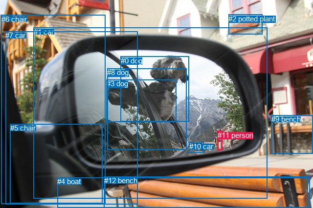
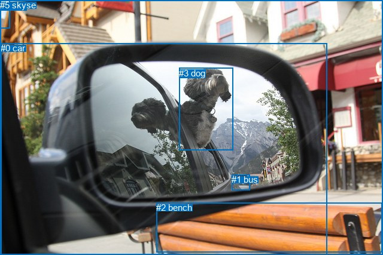

# 图片 1707：2395402.jpg

随机样本序号：74。图片 SHA256：`0f712edce4e14d4b04548a148a36cbb69954c7c001da7406b704d299c91e6eaa`。

红色框表示人，蓝色框表示其他物体。两个模式分别保留自身框编号，可依据位置比较对应对象。

## 自动检测框与输出

人的框编号：`[11]`。状态：`ok`。

### 自动检测全部物体框

| 编号 | 类别 | 是否为人 | 检测分数 | 像素坐标 xyxy |
|---|---|---|---|---|
| 0 | dog | False | 0.9968 | 246.6, 115.7, 386.1, 249.4 |
| 1 | car | False | 0.9214 | 68.9, 56.8, 546.6, 407.2 |
| 2 | potted plant | False | 0.8692 | 467.3, 29.9, 536.6, 70.7 |
| 3 | dog | False | 0.8533 | 217.8, 163.3, 360.7, 250.9 |
| 4 | boat | False | 0.7573 | 117.2, 364.3, 633.1, 427.0 |
| 5 | chair | False | 0.6791 | 20.7, 254.0, 209.3, 417.4 |
| 6 | chair | False | 0.6342 | 2.9, 30.8, 215.4, 418.4 |
| 7 | car | False | 0.6070 | 11.0, 64.3, 281.3, 419.9 |
| 8 | dog | False | 0.5626 | 219.0, 140.1, 381.9, 307.5 |
| 9 | bench | False | 0.5425 | 554.9, 236.4, 640.0, 315.9 |
| 10 | car | False | 0.3884 | 386.7, 292.0, 416.6, 313.3 |
| 11 | person | True | 0.3661 | 444.9, 268.7, 454.9, 308.1 |
| 12 | bench | False | 0.3538 | 213.0, 362.3, 629.5, 427.0 |

### 自动检测 Top50 人相关候选

评分物体对：156；人相关物体对：24；输出关系：48。

| 排名 | 主语编号与类别 | 关系 | 宾语编号与类别 | 类型 | 人与人 | 排序分数 | 原始融合 logit |
|---|---|---|---|---|---|---|---|
| 1 | #11 person | on | #9 bench | spatial | False | 0.87140 | 1.9134 |
| 2 | #11 person | on | #10 car | spatial | False | 0.86824 | 1.8855 |
| 3 | #11 person | standing on | #10 car | semantic | False | 0.38885 | -0.4522 |
| 4 | #11 person | standing on | #9 bench | semantic | False | 0.36073 | -0.5722 |
| 5 | #10 car | crossing | #11 person | semantic | False | 0.35635 | -0.5912 |
| 6 | #11 person | in | #1 car | spatial | False | 0.35257 | -0.6078 |
| 7 | #11 person | on | #4 boat | spatial | False | 0.30733 | -0.8126 |
| 8 | #11 person | on | #12 bench | spatial | False | 0.21077 | -1.3203 |
| 9 | #11 person | on | #6 chair | spatial | False | 0.19737 | -1.4028 |
| 10 | #2 potted plant | over | #11 person | spatial | False | 0.17173 | -1.5734 |
| 11 | #10 car | on | #11 person | spatial | False | 0.17056 | -1.5817 |
| 12 | #11 person | looking at | #1 car | semantic | False | 0.09007 | -2.3128 |
| 13 | #11 person | on | #8 dog | spatial | False | 0.08524 | -2.3732 |
| 14 | #9 bench | beside | #11 person | spatial | False | 0.08142 | -2.4232 |
| 15 | #11 person | on | #5 chair | spatial | False | 0.05487 | -2.8463 |
| 16 | #11 person | standing on | #4 boat | semantic | False | 0.05253 | -2.8923 |
| 17 | #1 car | on | #11 person | spatial | False | 0.03899 | -3.2047 |
| 18 | #9 bench | holding | #11 person | semantic | False | 0.03638 | -3.2767 |
| 19 | #11 person | hanging from | #2 potted plant | spatial | False | 0.03635 | -3.2774 |
| 20 | #11 person | holding | #12 bench | semantic | False | 0.03494 | -3.3184 |
| 21 | #11 person | on | #7 car | spatial | False | 0.03339 | -3.3657 |
| 22 | #11 person | looking at | #0 dog | semantic | False | 0.03004 | -3.4747 |
| 23 | #1 car | looking at | #11 person | semantic | False | 0.02236 | -3.7779 |
| 24 | #11 person | standing on | #6 chair | semantic | False | 0.01762 | -4.0207 |
| 25 | #11 person | on | #0 dog | spatial | False | 0.01718 | -4.0469 |
| 26 | #2 potted plant | holding | #11 person | semantic | False | 0.01365 | -4.2805 |
| 27 | #0 dog | looking at | #11 person | semantic | False | 0.01179 | -4.4283 |
| 28 | #11 person | on | #3 dog | spatial | False | 0.01012 | -4.5835 |
| 29 | #4 boat | in | #11 person | spatial | False | 0.01009 | -4.5857 |
| 30 | #11 person | climbing | #8 dog | semantic | False | 0.00989 | -4.6067 |
| 31 | #11 person | holding | #5 chair | semantic | False | 0.00829 | -4.7848 |
| 32 | #12 bench | in | #11 person | spatial | False | 0.00810 | -4.8072 |
| 33 | #6 chair | on | #11 person | spatial | False | 0.00779 | -4.8467 |
| 34 | #11 person | holding | #2 potted plant | semantic | False | 0.00760 | -4.8715 |
| 35 | #7 car | on | #11 person | spatial | False | 0.00753 | -4.8814 |
| 36 | #11 person | looking at | #3 dog | semantic | False | 0.00743 | -4.8941 |
| 37 | #8 dog | on | #11 person | spatial | False | 0.00724 | -4.9213 |
| 38 | #4 boat | holding | #11 person | semantic | False | 0.00678 | -4.9874 |
| 39 | #5 chair | on | #11 person | spatial | False | 0.00552 | -5.1933 |
| 40 | #11 person | holding | #7 car | semantic | False | 0.00509 | -5.2762 |
| 41 | #8 dog | looking at | #11 person | semantic | False | 0.00458 | -5.3811 |
| 42 | #12 bench | holding | #11 person | semantic | False | 0.00385 | -5.5549 |
| 43 | #3 dog | looking at | #11 person | semantic | False | 0.00358 | -5.6282 |
| 44 | #0 dog | on | #11 person | spatial | False | 0.00346 | -5.6625 |
| 45 | #6 chair | holding | #11 person | semantic | False | 0.00328 | -5.7173 |
| 46 | #3 dog | on | #11 person | spatial | False | 0.00296 | -5.8208 |
| 47 | #7 car | looking at | #11 person | semantic | False | 0.00289 | -5.8433 |
| 48 | #5 chair | holding | #11 person | semantic | False | 0.00177 | -6.3372 |

### 自动检测逐条人相关 GT 核验

本图没有人相关 GT，R@50 无分母；预测候选继续展示。

## 真实框与输出

人的框编号：`[]`。

### 真实框全部物体框

| 编号 | 类别 | 是否为人 | 检测分数 | 像素坐标 xyxy |
|---|---|---|---|---|
| 0 | car | False | GT | 1.0, 72.0, 546.0, 427.0 |
| 1 | bus | False | GT | 387.0, 292.0, 417.0, 318.0 |
| 2 | bench | False | GT | 261.0, 339.0, 639.0, 422.0 |
| 3 | dog | False | GT | 299.0, 114.0, 389.0, 251.0 |
| 4 | house | False | GT | 0.0, 0.0, 640.0, 427.0 |
| 5 | sky | False | GT | 0.0, 0.0, 16.0, 47.0 |

### 真实框 Top50 人相关候选

评分物体对：0；人相关物体对：0；输出关系：0。

| 排名 | 主语编号与类别 | 关系 | 宾语编号与类别 | 类型 | 人与人 | 排序分数 | 原始融合 logit |
|---|---|---|---|---|---|---|---|

### 真实框逐条人相关 GT 核验

本图没有人相关 GT，R@50 无分母；预测候选继续展示。

## 全部人相关 GT

| 主语编号与类别 | 关系 | 宾语编号与类别 |
|---|---|---|

原始记录、全部人相关物体对的两项预测与分项分数见 [逐图证据 JSON](../evidence/cases/1707.json)。全部56类 logits 保留于本机 HOR/output/random500/logits/。

<!-- HOR_COMPLETE_RESULTS -->

## 六组条件的完整输出对照

以下保留同一图片三种框与候选模式、两种谓词输出规则的全部 Top50。框编号各自在所属模式内解释。

### 自动检测框完整枚举：空间与语义各保留一个谓词

| 排名 | 主语编号与类别 | 谓词 | 宾语编号与类别 | 分组 | 排序分数 | predicate logit | pair logit |
|---|---|---|---|---|---|---|---|
| 1 | #11 person | on | #9 bench | spatial | 0.8713962 | 2.2537847 | -0.3404246 |
| 2 | #11 person | on | #10 car | spatial | 0.8682376 | 1.9677587 | -0.0822935 |
| 3 | #11 person | standing on | #10 car | semantic | 0.3888477 | -0.3698649 | -0.0822935 |
| 4 | #11 person | standing on | #9 bench | semantic | 0.3607341 | -0.2317548 | -0.3404246 |
| 5 | #10 car | crossing | #11 person | semantic | 0.3563529 | 0.2835217 | -0.8747505 |
| 6 | #11 person | in | #1 car | spatial | 0.3525651 | 0.4842916 | -1.0920743 |
| 7 | #11 person | on | #4 boat | spatial | 0.3073277 | -0.0930433 | -0.7195990 |
| 8 | #11 person | on | #12 bench | spatial | 0.2107715 | -0.4276381 | -0.8926433 |
| 9 | #11 person | on | #6 chair | spatial | 0.1973709 | -0.4151559 | -0.9876523 |
| 10 | #2 potted plant | over | #11 person | spatial | 0.1717336 | 0.1402831 | -1.7136737 |
| 11 | #10 car | on | #11 person | spatial | 0.1705556 | -0.7069445 | -0.8747505 |
| 12 | #11 person | looking at | #1 car | semantic | 0.0900669 | -1.2207446 | -1.0920743 |
| 13 | #11 person | on | #8 dog | spatial | 0.0852364 | -1.0135629 | -1.3596737 |
| 14 | #9 bench | beside | #11 person | spatial | 0.0814222 | -1.0323758 | -1.3908033 |
| 15 | #11 person | on | #5 chair | spatial | 0.0548704 | -1.5039873 | -1.3423605 |
| 16 | #11 person | standing on | #4 boat | semantic | 0.0525336 | -2.1727397 | -0.7195990 |
| 17 | #1 car | on | #11 person | spatial | 0.0389896 | -1.8793449 | -1.3253465 |
| 18 | #9 bench | holding | #11 person | semantic | 0.0363778 | -1.8859379 | -1.3908033 |
| 19 | #11 person | hanging from | #2 potted plant | spatial | 0.0363547 | -1.5827014 | -1.6946992 |
| 20 | #11 person | holding | #12 bench | semantic | 0.0349442 | -2.4257891 | -0.8926433 |
| 21 | #11 person | on | #7 car | spatial | 0.0333858 | -1.9343781 | -1.4312906 |
| 22 | #11 person | looking at | #0 dog | semantic | 0.0300403 | -1.9651601 | -1.5095563 |
| 23 | #1 car | looking at | #11 person | semantic | 0.0223587 | -2.4525797 | -1.3253465 |
| 24 | #11 person | standing on | #6 chair | semantic | 0.0176238 | -3.0330696 | -0.9876523 |
| 25 | #11 person | on | #0 dog | spatial | 0.0171756 | -2.5373845 | -1.5095563 |
| 26 | #2 potted plant | holding | #11 person | semantic | 0.0136464 | -2.5668635 | -1.7136737 |
| 27 | #0 dog | looking at | #11 person | semantic | 0.0117940 | -1.9858711 | -2.4424329 |
| 28 | #11 person | on | #3 dog | spatial | 0.0101152 | -2.6698413 | -1.9137069 |
| 29 | #4 boat | in | #11 person | spatial | 0.0100936 | -3.1747899 | -1.4109182 |
| 30 | #11 person | climbing | #8 dog | semantic | 0.0098864 | -3.2469842 | -1.3596737 |
| 31 | #11 person | holding | #5 chair | semantic | 0.0082862 | -3.4424863 | -1.3423605 |
| 32 | #12 bench | in | #11 person | spatial | 0.0081047 | -3.3328855 | -1.4742895 |
| 33 | #6 chair | on | #11 person | spatial | 0.0077928 | -2.9477291 | -1.8990035 |
| 34 | #11 person | holding | #2 potted plant | semantic | 0.0076036 | -3.1767955 | -1.6946992 |
| 35 | #7 car | on | #11 person | spatial | 0.0075295 | -3.1304197 | -1.7509444 |
| 36 | #11 person | looking at | #3 dog | semantic | 0.0074346 | -2.9804347 | -1.9137069 |
| 37 | #8 dog | on | #11 person | spatial | 0.0072367 | -2.8356471 | -2.0856867 |
| 38 | #4 boat | holding | #11 person | semantic | 0.0067774 | -3.5764470 | -1.4109182 |
| 39 | #5 chair | on | #11 person | spatial | 0.0055231 | -3.0539031 | -2.1393785 |
| 40 | #11 person | holding | #7 car | semantic | 0.0050857 | -3.8449244 | -1.4312906 |
| 41 | #8 dog | looking at | #11 person | semantic | 0.0045819 | -3.2953634 | -2.0856867 |
| 42 | #12 bench | holding | #11 person | semantic | 0.0038534 | -4.0806451 | -1.4742895 |
| 43 | #3 dog | looking at | #11 person | semantic | 0.0035823 | -3.3892050 | -2.2389517 |
| 44 | #0 dog | on | #11 person | spatial | 0.0034619 | -3.2200415 | -2.4424329 |
| 45 | #6 chair | holding | #11 person | semantic | 0.0032777 | -3.8183401 | -1.8990035 |
| 46 | #3 dog | on | #11 person | spatial | 0.0029566 | -3.5818028 | -2.2389517 |
| 47 | #7 car | looking at | #11 person | semantic | 0.0028908 | -4.0923920 | -1.7509444 |
| 48 | #5 chair | holding | #11 person | semantic | 0.0017661 | -4.1978464 | -2.1393785 |

没有人相关 GT，本条件的召回率无分母。

### 自动检测框完整枚举：每对只保留一个谓词

| 排名 | 主语编号与类别 | 谓词 | 宾语编号与类别 | 分组 | 排序分数 | predicate logit | pair logit |
|---|---|---|---|---|---|---|---|
| 1 | #11 person | on | #9 bench | single | 0.8713962 | 2.2537847 | -0.3404246 |
| 2 | #11 person | on | #10 car | single | 0.8682376 | 1.9677587 | -0.0822935 |
| 3 | #10 car | crossing | #11 person | single | 0.3563529 | 0.2835217 | -0.8747505 |
| 4 | #11 person | in | #1 car | single | 0.3525651 | 0.4842916 | -1.0920743 |
| 5 | #11 person | on | #4 boat | single | 0.3073277 | -0.0930433 | -0.7195990 |
| 6 | #11 person | on | #12 bench | single | 0.2107715 | -0.4276381 | -0.8926433 |
| 7 | #11 person | on | #6 chair | single | 0.1973709 | -0.4151559 | -0.9876523 |
| 8 | #2 potted plant | over | #11 person | single | 0.1717336 | 0.1402831 | -1.7136737 |
| 9 | #11 person | on | #8 dog | single | 0.0852364 | -1.0135629 | -1.3596737 |
| 10 | #9 bench | beside | #11 person | single | 0.0814222 | -1.0323758 | -1.3908033 |
| 11 | #11 person | on | #5 chair | single | 0.0548704 | -1.5039873 | -1.3423605 |
| 12 | #1 car | on | #11 person | single | 0.0389896 | -1.8793449 | -1.3253465 |
| 13 | #11 person | hanging from | #2 potted plant | single | 0.0363547 | -1.5827014 | -1.6946992 |
| 14 | #11 person | on | #7 car | single | 0.0333858 | -1.9343781 | -1.4312906 |
| 15 | #11 person | looking at | #0 dog | single | 0.0300403 | -1.9651601 | -1.5095563 |
| 16 | #0 dog | looking at | #11 person | single | 0.0117940 | -1.9858711 | -2.4424329 |
| 17 | #11 person | on | #3 dog | single | 0.0101152 | -2.6698413 | -1.9137069 |
| 18 | #4 boat | in | #11 person | single | 0.0100936 | -3.1747899 | -1.4109182 |
| 19 | #12 bench | in | #11 person | single | 0.0081047 | -3.3328855 | -1.4742895 |
| 20 | #6 chair | on | #11 person | single | 0.0077928 | -2.9477291 | -1.8990035 |
| 21 | #7 car | on | #11 person | single | 0.0075295 | -3.1304197 | -1.7509444 |
| 22 | #8 dog | on | #11 person | single | 0.0072367 | -2.8356471 | -2.0856867 |
| 23 | #5 chair | on | #11 person | single | 0.0055231 | -3.0539031 | -2.1393785 |
| 24 | #3 dog | looking at | #11 person | single | 0.0035823 | -3.3892050 | -2.2389517 |

没有人相关 GT，本条件的召回率无分母。

### 真实框完整枚举：空间与语义各保留一个谓词

| 排名 | 主语编号与类别 | 谓词 | 宾语编号与类别 | 分组 | 排序分数 | predicate logit | pair logit |
|---|---|---|---|---|---|---|---|

没有人相关 GT，本条件的召回率无分母。

### 真实框完整枚举：每对只保留一个谓词

| 排名 | 主语编号与类别 | 谓词 | 宾语编号与类别 | 分组 | 排序分数 | predicate logit | pair logit |
|---|---|---|---|---|---|---|---|

没有人相关 GT，本条件的召回率无分母。

### 真实框400候选：空间与语义各保留一个谓词

| 排名 | 主语编号与类别 | 谓词 | 宾语编号与类别 | 分组 | 排序分数 | predicate logit | pair logit |
|---|---|---|---|---|---|---|---|

没有人相关 GT，本条件的召回率无分母。

### 真实框400候选：每对只保留一个谓词

| 排名 | 主语编号与类别 | 谓词 | 宾语编号与类别 | 分组 | 排序分数 | predicate logit | pair logit |
|---|---|---|---|---|---|---|---|

没有人相关 GT，本条件的召回率无分母。
