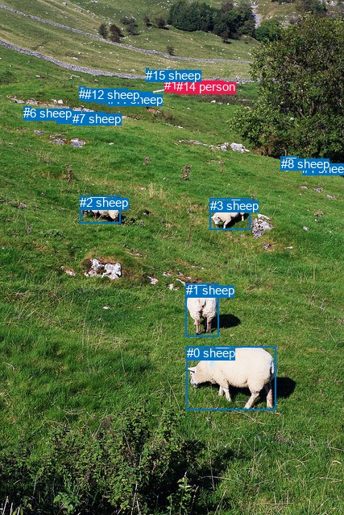
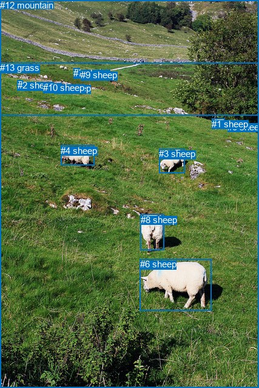

# 图片 1710：2395671.jpg

随机样本序号：284。图片 SHA256：`24d70ca8f5760938bb45611d54d2d9fbdfc3f9d291b54b81fa3b732284cabb2f`。

红色框表示人，蓝色框表示其他物体。两个模式分别保留自身框编号，可依据位置比较对应对象。

## 自动检测框与输出

人的框编号：`[13, 14]`。状态：`ok`。

### 自动检测全部物体框

| 编号 | 类别 | 是否为人 | 检测分数 | 像素坐标 xyxy |
|---|---|---|---|---|
| 0 | sheep | False | 0.9976 | 232.0, 430.1, 342.5, 509.9 |
| 1 | sheep | False | 0.9961 | 230.8, 352.2, 271.0, 419.0 |
| 2 | sheep | False | 0.9850 | 99.3, 243.3, 149.2, 277.1 |
| 3 | sheep | False | 0.9682 | 260.9, 246.7, 310.0, 285.5 |
| 4 | sheep | False | 0.9603 | 375.4, 200.5, 397.5, 215.8 |
| 5 | sheep | False | 0.9414 | 70.9, 136.1, 81.5, 149.9 |
| 6 | sheep | False | 0.9373 | 29.2, 132.3, 38.6, 145.3 |
| 7 | sheep | False | 0.9352 | 90.3, 138.7, 100.0, 152.6 |
| 8 | sheep | False | 0.8658 | 348.7, 195.0, 369.9, 210.4 |
| 9 | sheep | False | 0.8036 | 98.1, 107.8, 105.7, 114.5 |
| 10 | sheep | False | 0.7959 | 121.4, 111.6, 129.5, 119.1 |
| 11 | sheep | False | 0.7696 | 133.6, 114.8, 138.4, 121.6 |
| 12 | sheep | False | 0.7578 | 105.2, 109.3, 110.7, 116.4 |
| 13 | person | True | 0.6802 | 204.2, 97.2, 207.8, 104.6 |
| 14 | person | True | 0.6226 | 219.4, 99.4, 222.9, 107.0 |
| 15 | sheep | False | 0.3999 | 181.1, 84.8, 184.4, 87.2 |

### 自动检测 Top50 人相关候选

评分物体对：240；人相关物体对：58；输出关系：50。

| 排名 | 主语编号与类别 | 关系 | 宾语编号与类别 | 类型 | 人与人 | 排序分数 | 原始融合 logit |
|---|---|---|---|---|---|---|---|
| 1 | #14 person | in | #15 sheep | spatial | False | 0.87673 | 1.9618 |
| 2 | #13 person | in | #15 sheep | spatial | False | 0.83295 | 1.6067 |
| 3 | #14 person | in | #13 person | spatial | True | 0.80386 | 1.4106 |
| 4 | #13 person | on | #14 person | spatial | True | 0.64003 | 0.5755 |
| 5 | #14 person | eating | #15 sheep | semantic | False | 0.63625 | 0.5591 |
| 6 | #14 person | holding | #13 person | semantic | True | 0.62042 | 0.4913 |
| 7 | #13 person | eating | #14 person | semantic | True | 0.58355 | 0.3373 |
| 8 | #13 person | holding | #15 sheep | semantic | False | 0.43727 | -0.2523 |
| 9 | #15 sheep | in | #13 person | spatial | False | 0.28623 | -0.9138 |
| 10 | #11 sheep | eating | #13 person | semantic | False | 0.23057 | -1.2051 |
| 11 | #15 sheep | in | #14 person | spatial | False | 0.20183 | -1.3749 |
| 12 | #10 sheep | eating | #13 person | semantic | False | 0.18215 | -1.5019 |
| 13 | #14 person | looking at | #3 sheep | semantic | False | 0.17129 | -1.5765 |
| 14 | #9 sheep | eating | #13 person | semantic | False | 0.16765 | -1.6023 |
| 15 | #15 sheep | holding | #13 person | semantic | False | 0.16114 | -1.6498 |
| 16 | #12 sheep | eating | #13 person | semantic | False | 0.13485 | -1.8587 |
| 17 | #15 sheep | eating | #14 person | semantic | False | 0.12657 | -1.9317 |
| 18 | #10 sheep | eating | #14 person | semantic | False | 0.08378 | -2.3921 |
| 19 | #11 sheep | eating | #14 person | semantic | False | 0.08269 | -2.4063 |
| 20 | #11 sheep | in | #13 person | spatial | False | 0.08098 | -2.4291 |
| 21 | #7 sheep | eating | #13 person | semantic | False | 0.07822 | -2.4667 |
| 22 | #9 sheep | eating | #14 person | semantic | False | 0.05936 | -2.7629 |
| 23 | #5 sheep | eating | #13 person | semantic | False | 0.05612 | -2.8225 |
| 24 | #8 sheep | eating | #13 person | semantic | False | 0.05477 | -2.8482 |
| 25 | #14 person | looking at | #11 sheep | semantic | False | 0.05359 | -2.8714 |
| 26 | #14 person | looking at | #0 sheep | semantic | False | 0.05271 | -2.8888 |
| 27 | #14 person | looking at | #8 sheep | semantic | False | 0.05073 | -2.9292 |
| 28 | #12 sheep | eating | #14 person | semantic | False | 0.05040 | -2.9360 |
| 29 | #14 person | looking at | #10 sheep | semantic | False | 0.05007 | -2.9429 |
| 30 | #4 sheep | eating | #13 person | semantic | False | 0.04667 | -3.0170 |
| 31 | #13 person | looking at | #11 sheep | semantic | False | 0.04297 | -3.1033 |
| 32 | #13 person | looking at | #3 sheep | semantic | False | 0.04194 | -3.1286 |
| 33 | #10 sheep | in | #13 person | spatial | False | 0.03978 | -3.1837 |
| 34 | #6 sheep | eating | #13 person | semantic | False | 0.03877 | -3.2107 |
| 35 | #14 person | looking at | #4 sheep | semantic | False | 0.03626 | -3.2802 |
| 36 | #7 sheep | eating | #14 person | semantic | False | 0.03494 | -3.3186 |
| 37 | #14 person | looking at | #9 sheep | semantic | False | 0.03341 | -3.3648 |
| 38 | #13 person | looking at | #10 sheep | semantic | False | 0.03179 | -3.4164 |
| 39 | #14 person | looking at | #1 sheep | semantic | False | 0.03106 | -3.4404 |
| 40 | #8 sheep | eating | #14 person | semantic | False | 0.02880 | -3.5182 |
| 41 | #14 person | looking at | #12 sheep | semantic | False | 0.02799 | -3.5476 |
| 42 | #11 sheep | in | #14 person | spatial | False | 0.02701 | -3.5843 |
| 43 | #5 sheep | eating | #14 person | semantic | False | 0.02481 | -3.6714 |
| 44 | #4 sheep | eating | #14 person | semantic | False | 0.02361 | -3.7220 |
| 45 | #10 sheep | in | #14 person | spatial | False | 0.02305 | -3.7466 |
| 46 | #9 sheep | in | #13 person | spatial | False | 0.01874 | -3.9581 |
| 47 | #14 person | looking at | #2 sheep | semantic | False | 0.01799 | -3.9999 |
| 48 | #6 sheep | eating | #14 person | semantic | False | 0.01790 | -4.0048 |
| 49 | #3 sheep | eating | #13 person | semantic | False | 0.01771 | -4.0156 |
| 50 | #13 person | looking at | #9 sheep | semantic | False | 0.01761 | -4.0218 |

### 自动检测逐条人相关 GT 核验

本图没有人相关 GT，R@50 无分母；预测候选继续展示。

## 真实框与输出

人的框编号：`[]`。

### 真实框全部物体框

| 编号 | 类别 | 是否为人 | 检测分数 | 像素坐标 xyxy |
|---|---|---|---|---|
| 0 | sheep | False | GT | 375.0, 201.0, 397.0, 215.0 |
| 1 | sheep | False | GT | 349.0, 196.0, 370.0, 210.0 |
| 2 | sheep | False | GT | 29.0, 132.0, 38.0, 145.0 |
| 3 | sheep | False | GT | 262.0, 245.0, 304.0, 285.0 |
| 4 | sheep | False | GT | 100.0, 240.0, 155.0, 273.0 |
| 5 | sheep | False | GT | 90.0, 137.0, 102.0, 154.0 |
| 6 | sheep | False | GT | 231.0, 427.0, 349.0, 512.0 |
| 7 | sheep | False | GT | 121.0, 112.0, 131.0, 120.0 |
| 8 | sheep | False | GT | 232.0, 354.0, 271.0, 413.0 |
| 9 | sheep | False | GT | 133.0, 115.0, 138.0, 121.0 |
| 10 | sheep | False | GT | 71.0, 136.0, 82.0, 150.0 |
| 11 | tree | False | GT | 0.0, 0.0, 427.0, 640.0 |
| 12 | mountain | False | GT | 0.0, 0.0, 427.0, 190.0 |
| 13 | grass | False | GT | 0.0, 103.0, 427.0, 640.0 |

### 真实框 Top50 人相关候选

评分物体对：0；人相关物体对：0；输出关系：0。

| 排名 | 主语编号与类别 | 关系 | 宾语编号与类别 | 类型 | 人与人 | 排序分数 | 原始融合 logit |
|---|---|---|---|---|---|---|---|

### 真实框逐条人相关 GT 核验

本图没有人相关 GT，R@50 无分母；预测候选继续展示。

## 全部人相关 GT

| 主语编号与类别 | 关系 | 宾语编号与类别 |
|---|---|---|

原始记录、全部人相关物体对的两项预测与分项分数见 [逐图证据 JSON](../evidence/cases/1710.json)。全部56类 logits 保留于本机 HOR/output/random500/logits/。

<!-- HOR_COMPLETE_RESULTS -->

## 六组条件的完整输出对照

以下保留同一图片三种框与候选模式、两种谓词输出规则的全部 Top50。框编号各自在所属模式内解释。

### 自动检测框完整枚举：空间与语义各保留一个谓词

| 排名 | 主语编号与类别 | 谓词 | 宾语编号与类别 | 分组 | 排序分数 | predicate logit | pair logit |
|---|---|---|---|---|---|---|---|
| 1 | #14 person | in | #15 sheep | spatial | 0.8767328 | 2.1903052 | -0.2284566 |
| 2 | #13 person | in | #15 sheep | spatial | 0.8329548 | 1.8727999 | -0.2660849 |
| 3 | #14 person | in | #13 person | spatial | 0.8038579 | 1.7183566 | -0.3077732 |
| 4 | #13 person | on | #14 person | spatial | 0.6400321 | 1.0300641 | -0.4545611 |
| 5 | #14 person | eating | #15 sheep | semantic | 0.6362459 | 0.7875638 | -0.2284566 |
| 6 | #14 person | holding | #13 person | semantic | 0.6204214 | 0.7991104 | -0.3077732 |
| 7 | #13 person | eating | #14 person | semantic | 0.5835461 | 0.7919087 | -0.4545611 |
| 8 | #13 person | holding | #15 sheep | semantic | 0.4372669 | 0.0138230 | -0.2660849 |
| 9 | #15 sheep | in | #13 person | spatial | 0.2862262 | -0.4964561 | -0.4173276 |
| 10 | #11 sheep | eating | #13 person | semantic | 0.2305707 | -0.5428877 | -0.6622041 |
| 11 | #15 sheep | in | #14 person | spatial | 0.2018259 | -0.8617606 | -0.5131608 |
| 12 | #10 sheep | eating | #13 person | semantic | 0.1821485 | -0.8426738 | -0.6591844 |
| 13 | #14 person | looking at | #3 sheep | semantic | 0.1712870 | -0.5066714 | -1.0698618 |
| 14 | #9 sheep | eating | #13 person | semantic | 0.1676535 | -0.8668108 | -0.7355384 |
| 15 | #15 sheep | holding | #13 person | semantic | 0.1611358 | -1.2324736 | -0.4173276 |
| 16 | #12 sheep | eating | #13 person | semantic | 0.1348528 | -1.1372297 | -0.7214859 |
| 17 | #15 sheep | eating | #14 person | semantic | 0.1265656 | -1.4185112 | -0.5131608 |
| 18 | #10 sheep | eating | #14 person | semantic | 0.0837788 | -1.5980122 | -0.7940658 |
| 19 | #11 sheep | eating | #14 person | semantic | 0.0826911 | -1.6014721 | -0.8048604 |
| 20 | #11 sheep | in | #13 person | spatial | 0.0809812 | -1.7668860 | -0.6622041 |
| 21 | #7 sheep | eating | #13 person | semantic | 0.0782244 | -1.5552282 | -0.9114920 |
| 22 | #9 sheep | eating | #14 person | semantic | 0.0593607 | -1.9005339 | -0.8623928 |
| 23 | #5 sheep | eating | #13 person | semantic | 0.0561181 | -1.8355238 | -0.9870183 |
| 24 | #8 sheep | eating | #13 person | semantic | 0.0547724 | -1.6084313 | -1.2398087 |
| 25 | #14 person | looking at | #11 sheep | semantic | 0.0535854 | -1.9429574 | -0.9284467 |
| 26 | #14 person | looking at | #0 sheep | semantic | 0.0527115 | -1.2656312 | -1.6231396 |
| 27 | #14 person | looking at | #8 sheep | semantic | 0.0507280 | -1.6242645 | -1.3049519 |
| 28 | #12 sheep | eating | #14 person | semantic | 0.0504002 | -2.0830929 | -0.8529519 |
| 29 | #14 person | looking at | #10 sheep | semantic | 0.0500714 | -1.9552140 | -0.9877219 |
| 30 | #4 sheep | eating | #13 person | semantic | 0.0466653 | -1.6553383 | -1.3616277 |
| 31 | #13 person | looking at | #11 sheep | semantic | 0.0429722 | -2.1795039 | -0.9237747 |
| 32 | #13 person | looking at | #3 sheep | semantic | 0.0419436 | -2.0080094 | -1.1205702 |
| 33 | #10 sheep | in | #13 person | spatial | 0.0397840 | -2.5245094 | -0.6591844 |
| 34 | #6 sheep | eating | #13 person | semantic | 0.0387652 | -2.1266205 | -1.0840740 |
| 35 | #14 person | looking at | #4 sheep | semantic | 0.0362564 | -1.9941297 | -1.2860805 |
| 36 | #7 sheep | eating | #14 person | semantic | 0.0349392 | -2.2755883 | -1.0429929 |
| 37 | #14 person | looking at | #9 sheep | semantic | 0.0334131 | -2.2694290 | -1.0953946 |
| 38 | #13 person | looking at | #10 sheep | semantic | 0.0317853 | -2.4195366 | -0.9969134 |
| 39 | #14 person | looking at | #1 sheep | semantic | 0.0310561 | -1.8375723 | -1.6028397 |
| 40 | #8 sheep | eating | #14 person | semantic | 0.0288000 | -2.2269917 | -1.2911661 |
| 41 | #14 person | looking at | #12 sheep | semantic | 0.0279867 | -2.4625816 | -1.0850577 |
| 42 | #11 sheep | in | #14 person | spatial | 0.0270061 | -2.7794552 | -0.8048604 |
| 43 | #5 sheep | eating | #14 person | semantic | 0.0248107 | -2.5659206 | -1.1054379 |
| 44 | #4 sheep | eating | #14 person | semantic | 0.0236136 | -2.3005502 | -1.4214871 |
| 45 | #10 sheep | in | #14 person | spatial | 0.0230538 | -2.9525359 | -0.7940658 |
| 46 | #9 sheep | in | #13 person | spatial | 0.0187409 | -3.2225881 | -0.7355384 |
| 47 | #14 person | looking at | #2 sheep | semantic | 0.0179871 | -2.6667593 | -1.3331901 |
| 48 | #6 sheep | eating | #14 person | semantic | 0.0179013 | -2.8098288 | -1.1949883 |
| 49 | #3 sheep | eating | #13 person | semantic | 0.0177122 | -2.6370757 | -1.3785530 |
| 50 | #13 person | looking at | #9 sheep | semantic | 0.0176055 | -2.9125557 | -1.1092234 |

没有人相关 GT，本条件的召回率无分母。

### 自动检测框完整枚举：每对只保留一个谓词

| 排名 | 主语编号与类别 | 谓词 | 宾语编号与类别 | 分组 | 排序分数 | predicate logit | pair logit |
|---|---|---|---|---|---|---|---|
| 1 | #14 person | in | #15 sheep | single | 0.8767328 | 2.1903052 | -0.2284566 |
| 2 | #13 person | in | #15 sheep | single | 0.8329548 | 1.8727999 | -0.2660849 |
| 3 | #14 person | in | #13 person | single | 0.8038579 | 1.7183566 | -0.3077732 |
| 4 | #13 person | on | #14 person | single | 0.6400321 | 1.0300641 | -0.4545611 |
| 5 | #15 sheep | in | #13 person | single | 0.2862262 | -0.4964561 | -0.4173276 |
| 6 | #11 sheep | eating | #13 person | single | 0.2305707 | -0.5428877 | -0.6622041 |
| 7 | #15 sheep | in | #14 person | single | 0.2018259 | -0.8617606 | -0.5131608 |
| 8 | #10 sheep | eating | #13 person | single | 0.1821485 | -0.8426738 | -0.6591844 |
| 9 | #14 person | looking at | #3 sheep | single | 0.1712870 | -0.5066714 | -1.0698618 |
| 10 | #9 sheep | eating | #13 person | single | 0.1676535 | -0.8668108 | -0.7355384 |
| 11 | #12 sheep | eating | #13 person | single | 0.1348528 | -1.1372297 | -0.7214859 |
| 12 | #10 sheep | eating | #14 person | single | 0.0837788 | -1.5980122 | -0.7940658 |
| 13 | #11 sheep | eating | #14 person | single | 0.0826911 | -1.6014721 | -0.8048604 |
| 14 | #7 sheep | eating | #13 person | single | 0.0782244 | -1.5552282 | -0.9114920 |
| 15 | #9 sheep | eating | #14 person | single | 0.0593607 | -1.9005339 | -0.8623928 |
| 16 | #5 sheep | eating | #13 person | single | 0.0561181 | -1.8355238 | -0.9870183 |
| 17 | #8 sheep | eating | #13 person | single | 0.0547724 | -1.6084313 | -1.2398087 |
| 18 | #14 person | looking at | #11 sheep | single | 0.0535854 | -1.9429574 | -0.9284467 |
| 19 | #14 person | looking at | #0 sheep | single | 0.0527115 | -1.2656312 | -1.6231396 |
| 20 | #14 person | looking at | #8 sheep | single | 0.0507280 | -1.6242645 | -1.3049519 |
| 21 | #12 sheep | eating | #14 person | single | 0.0504002 | -2.0830929 | -0.8529519 |
| 22 | #14 person | looking at | #10 sheep | single | 0.0500714 | -1.9552140 | -0.9877219 |
| 23 | #4 sheep | eating | #13 person | single | 0.0466653 | -1.6553383 | -1.3616277 |
| 24 | #13 person | looking at | #11 sheep | single | 0.0429722 | -2.1795039 | -0.9237747 |
| 25 | #13 person | looking at | #3 sheep | single | 0.0419436 | -2.0080094 | -1.1205702 |
| 26 | #6 sheep | eating | #13 person | single | 0.0387652 | -2.1266205 | -1.0840740 |
| 27 | #14 person | looking at | #4 sheep | single | 0.0362564 | -1.9941297 | -1.2860805 |
| 28 | #7 sheep | eating | #14 person | single | 0.0349392 | -2.2755883 | -1.0429929 |
| 29 | #14 person | looking at | #9 sheep | single | 0.0334131 | -2.2694290 | -1.0953946 |
| 30 | #13 person | looking at | #10 sheep | single | 0.0317853 | -2.4195366 | -0.9969134 |
| 31 | #14 person | looking at | #1 sheep | single | 0.0310561 | -1.8375723 | -1.6028397 |
| 32 | #8 sheep | eating | #14 person | single | 0.0288000 | -2.2269917 | -1.2911661 |
| 33 | #14 person | looking at | #12 sheep | single | 0.0279867 | -2.4625816 | -1.0850577 |
| 34 | #5 sheep | eating | #14 person | single | 0.0248107 | -2.5659206 | -1.1054379 |
| 35 | #4 sheep | eating | #14 person | single | 0.0236136 | -2.3005502 | -1.4214871 |
| 36 | #14 person | looking at | #2 sheep | single | 0.0179871 | -2.6667593 | -1.3331901 |
| 37 | #6 sheep | eating | #14 person | single | 0.0179013 | -2.8098288 | -1.1949883 |
| 38 | #3 sheep | eating | #13 person | single | 0.0177122 | -2.6370757 | -1.3785530 |
| 39 | #13 person | looking at | #9 sheep | single | 0.0176055 | -2.9125557 | -1.1092234 |
| 40 | #13 person | looking at | #12 sheep | single | 0.0164982 | -2.9951324 | -1.0927333 |
| 41 | #13 person | looking at | #8 sheep | single | 0.0162151 | -2.7397871 | -1.3656802 |
| 42 | #14 person | looking at | #7 sheep | single | 0.0123323 | -3.1362028 | -1.2469183 |
| 43 | #13 person | looking at | #4 sheep | single | 0.0118039 | -3.0769460 | -1.3505090 |
| 44 | #13 person | looking at | #0 sheep | single | 0.0114030 | -2.8554397 | -1.6069669 |
| 45 | #2 sheep | eating | #13 person | single | 0.0104466 | -3.0370421 | -1.5139400 |
| 46 | #3 sheep | eating | #14 person | single | 0.0101861 | -3.1076035 | -1.4688911 |
| 47 | #14 person | looking at | #5 sheep | single | 0.0093119 | -3.2922642 | -1.3748434 |
| 48 | #13 person | looking at | #2 sheep | single | 0.0083280 | -3.5642672 | -1.2154992 |
| 49 | #14 person | looking at | #6 sheep | single | 0.0080874 | -3.2744293 | -1.5348935 |
| 50 | #13 person | looking at | #1 sheep | single | 0.0068691 | -3.3710601 | -1.6027710 |

没有人相关 GT，本条件的召回率无分母。

### 真实框完整枚举：空间与语义各保留一个谓词

| 排名 | 主语编号与类别 | 谓词 | 宾语编号与类别 | 分组 | 排序分数 | predicate logit | pair logit |
|---|---|---|---|---|---|---|---|

没有人相关 GT，本条件的召回率无分母。

### 真实框完整枚举：每对只保留一个谓词

| 排名 | 主语编号与类别 | 谓词 | 宾语编号与类别 | 分组 | 排序分数 | predicate logit | pair logit |
|---|---|---|---|---|---|---|---|

没有人相关 GT，本条件的召回率无分母。

### 真实框400候选：空间与语义各保留一个谓词

| 排名 | 主语编号与类别 | 谓词 | 宾语编号与类别 | 分组 | 排序分数 | predicate logit | pair logit |
|---|---|---|---|---|---|---|---|

没有人相关 GT，本条件的召回率无分母。

### 真实框400候选：每对只保留一个谓词

| 排名 | 主语编号与类别 | 谓词 | 宾语编号与类别 | 分组 | 排序分数 | predicate logit | pair logit |
|---|---|---|---|---|---|---|---|

没有人相关 GT，本条件的召回率无分母。
