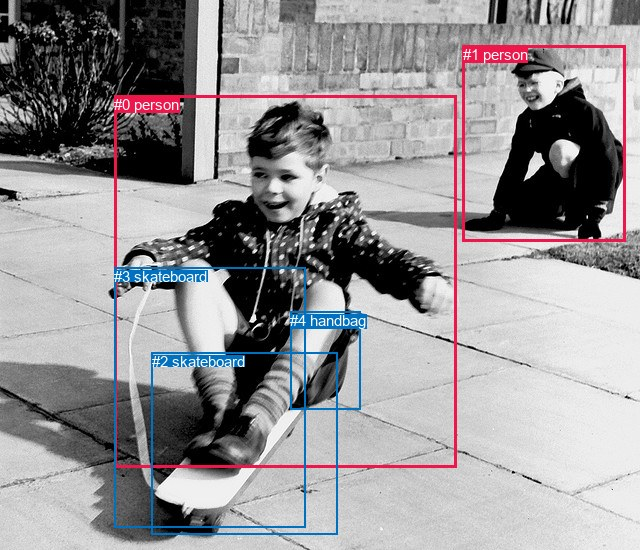
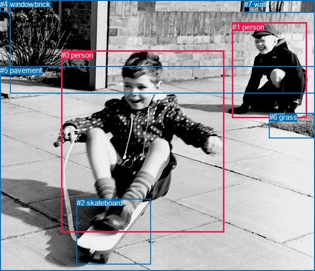

# 图片 1712：2395918.jpg

随机样本序号：24。图片 SHA256：`c18c488df27e274c3a9e157ababd07ffe05ee28ecbc570c3306c716964dcbac5`。

红色框表示人，蓝色框表示其他物体。两个模式分别保留自身框编号，可依据位置比较对应对象。

## 自动检测框与输出

人的框编号：`[0, 1]`。状态：`ok`。

### 自动检测全部物体框

| 编号 | 类别 | 是否为人 | 检测分数 | 像素坐标 xyxy |
|---|---|---|---|---|
| 0 | person | True | 0.9998 | 114.2, 95.9, 456.4, 467.2 |
| 1 | person | True | 0.9993 | 462.7, 46.0, 625.7, 241.2 |
| 2 | skateboard | False | 0.8876 | 151.7, 352.6, 337.3, 534.6 |
| 3 | skateboard | False | 0.4163 | 114.3, 267.6, 305.8, 527.6 |
| 4 | handbag | False | 0.3909 | 290.2, 311.7, 360.2, 409.0 |

### 自动检测 Top50 人相关候选

评分物体对：20；人相关物体对：14；输出关系：28。

| 排名 | 主语编号与类别 | 关系 | 宾语编号与类别 | 类型 | 人与人 | 排序分数 | 原始融合 logit |
|---|---|---|---|---|---|---|---|
| 1 | #0 person | riding | #2 skateboard | semantic | False | 0.99930 | 7.2593 |
| 2 | #0 person | riding | #3 skateboard | semantic | False | 0.99929 | 7.2532 |
| 3 | #0 person | wearing | #4 handbag | semantic | False | 0.99478 | 5.2492 |
| 4 | #1 person | looking at | #0 person | semantic | True | 0.99079 | 4.6785 |
| 5 | #0 person | on | #2 skateboard | spatial | False | 0.98347 | 4.0857 |
| 6 | #0 person | on | #3 skateboard | spatial | False | 0.96702 | 3.3783 |
| 7 | #1 person | beside | #0 person | spatial | True | 0.93447 | 2.6574 |
| 8 | #4 handbag | attached to | #0 person | spatial | False | 0.93162 | 2.6118 |
| 9 | #0 person | beside | #1 person | spatial | True | 0.92717 | 2.5439 |
| 10 | #1 person | beside | #3 skateboard | spatial | False | 0.77011 | 1.2089 |
| 11 | #0 person | looking at | #1 person | semantic | True | 0.74250 | 1.0590 |
| 12 | #0 person | on | #4 handbag | spatial | False | 0.71354 | 0.9127 |
| 13 | #1 person | over | #2 skateboard | spatial | False | 0.71197 | 0.9050 |
| 14 | #1 person | sitting on | #2 skateboard | semantic | False | 0.66634 | 0.6917 |
| 15 | #1 person | riding | #3 skateboard | semantic | False | 0.63959 | 0.5736 |
| 16 | #4 handbag | wearing | #0 person | semantic | False | 0.62731 | 0.5207 |
| 17 | #1 person | over | #4 handbag | spatial | False | 0.17886 | -1.5241 |
| 18 | #2 skateboard | carrying | #0 person | semantic | False | 0.13765 | -1.8350 |
| 19 | #1 person | pulling | #4 handbag | semantic | False | 0.12895 | -1.9103 |
| 20 | #4 handbag | beside | #1 person | spatial | False | 0.12559 | -1.9405 |
| 21 | #3 skateboard | carrying | #0 person | semantic | False | 0.07240 | -2.5503 |
| 22 | #4 handbag | carrying | #1 person | semantic | False | 0.06762 | -2.6239 |
| 23 | #3 skateboard | in front of | #1 person | spatial | False | 0.04190 | -3.1296 |
| 24 | #2 skateboard | in front of | #1 person | spatial | False | 0.03555 | -3.3006 |
| 25 | #3 skateboard | on | #0 person | spatial | False | 0.02865 | -3.5234 |
| 26 | #2 skateboard | in front of | #0 person | spatial | False | 0.02858 | -3.5262 |
| 27 | #3 skateboard | holding | #1 person | semantic | False | 0.00377 | -5.5758 |
| 28 | #2 skateboard | lying on | #1 person | semantic | False | 0.00195 | -6.2385 |

### 自动检测逐条人相关 GT 核验

R@50：20.00%；命中 1/5。

| GT 主语编号 | GT 关系 | GT 宾语编号 | 结果阶段 | 匹配预测主语编号 | 匹配预测宾语编号 |
|---|---|---|---|---|---|
| 0 | on | 2 | hit50 | [0] | [2] |
| 0 | crossing | 5 | endpoint_missing_or_wrong_class | [0] | [] |
| 1 | sitting on | 5 | endpoint_missing_or_wrong_class | [1] | [] |
| 1 | beside | 6 | endpoint_missing_or_wrong_class | [1] | [] |
| 2 | attached to | 0 | wrong_predicate | [2] | [0] |

## 真实框与输出

人的框编号：`[0, 1]`。

### 真实框全部物体框

| 编号 | 类别 | 是否为人 | 检测分数 | 像素坐标 xyxy |
|---|---|---|---|---|
| 0 | person | True | GT | 124.0, 103.0, 455.0, 472.0 |
| 1 | person | True | GT | 472.0, 46.0, 623.0, 240.0 |
| 2 | skateboard | False | GT | 156.0, 403.0, 307.0, 536.0 |
| 3 | wall-brick | False | GT | 20.0, 0.0, 640.0, 189.0 |
| 4 | window | False | GT | 0.0, 0.0, 21.0, 23.0 |
| 5 | pavement | False | GT | 0.0, 134.0, 640.0, 550.0 |
| 6 | grass | False | GT | 547.0, 229.0, 640.0, 280.0 |
| 7 | wall | False | GT | 496.0, 0.0, 640.0, 25.0 |

### 真实框 Top50 人相关候选

评分物体对：56；人相关物体对：26；输出关系：50。

| 排名 | 主语编号与类别 | 关系 | 宾语编号与类别 | 类型 | 人与人 | 排序分数 | 原始融合 logit |
|---|---|---|---|---|---|---|---|
| 1 | #0 person | riding | #2 skateboard | semantic | False | 0.99843 | 6.4577 |
| 2 | #0 person | on | #2 skateboard | spatial | False | 0.99774 | 6.0916 |
| 3 | #1 person | looking at | #0 person | semantic | True | 0.99154 | 4.7636 |
| 4 | #1 person | sitting on | #5 pavement | semantic | False | 0.98552 | 4.2204 |
| 5 | #1 person | sitting on | #6 grass | semantic | False | 0.97460 | 3.6474 |
| 6 | #1 person | on | #5 pavement | spatial | False | 0.96159 | 3.2204 |
| 7 | #0 person | on | #5 pavement | spatial | False | 0.94881 | 2.9196 |
| 8 | #0 person | wearing | #5 pavement | semantic | False | 0.92320 | 2.4867 |
| 9 | #1 person | beside | #3 wall-brick | spatial | False | 0.92190 | 2.4685 |
| 10 | #1 person | on | #6 grass | spatial | False | 0.88775 | 2.0679 |
| 11 | #1 person | sitting on | #3 wall-brick | semantic | False | 0.88321 | 2.0232 |
| 12 | #1 person | beside | #0 person | spatial | True | 0.87528 | 1.9485 |
| 13 | #0 person | beside | #1 person | spatial | True | 0.82550 | 1.5540 |
| 14 | #6 grass | beside | #1 person | spatial | False | 0.73759 | 1.0335 |
| 15 | #0 person | in front of | #3 wall-brick | spatial | False | 0.71974 | 0.9432 |
| 16 | #0 person | looking at | #1 person | semantic | True | 0.60999 | 0.4473 |
| 17 | #1 person | beside | #7 wall | spatial | False | 0.60877 | 0.4421 |
| 18 | #1 person | on | #2 skateboard | spatial | False | 0.51752 | 0.0701 |
| 19 | #1 person | sitting on | #7 wall | semantic | False | 0.49575 | -0.0170 |
| 20 | #3 wall-brick | beside | #1 person | spatial | False | 0.45757 | -0.1701 |
| 21 | #3 wall-brick | beside | #0 person | spatial | False | 0.38999 | -0.4474 |
| 22 | #6 grass | beside | #0 person | spatial | False | 0.36270 | -0.5637 |
| 23 | #0 person | wearing | #3 wall-brick | semantic | False | 0.28064 | -0.9413 |
| 24 | #7 wall | over | #1 person | spatial | False | 0.27476 | -0.9706 |
| 25 | #2 skateboard | on | #0 person | spatial | False | 0.27449 | -0.9720 |
| 26 | #1 person | sitting on | #2 skateboard | semantic | False | 0.26731 | -1.0083 |
| 27 | #0 person | in front of | #4 window | spatial | False | 0.19945 | -1.3897 |
| 28 | #4 window | looking at | #0 person | semantic | False | 0.17690 | -1.5375 |
| 29 | #3 wall-brick | looking at | #0 person | semantic | False | 0.16457 | -1.6246 |
| 30 | #3 wall-brick | looking at | #1 person | semantic | False | 0.10383 | -2.1554 |
| 31 | #4 window | beside | #0 person | spatial | False | 0.09839 | -2.2152 |
| 32 | #0 person | sitting on | #6 grass | semantic | False | 0.09296 | -2.2780 |
| 33 | #6 grass | looking at | #1 person | semantic | False | 0.09180 | -2.2918 |
| 34 | #4 window | beside | #1 person | spatial | False | 0.07674 | -2.4875 |
| 35 | #2 skateboard | holding | #0 person | semantic | False | 0.07417 | -2.5243 |
| 36 | #5 pavement | in | #0 person | spatial | False | 0.07367 | -2.5316 |
| 37 | #0 person | on | #6 grass | spatial | False | 0.06835 | -2.6124 |
| 38 | #0 person | in front of | #7 wall | spatial | False | 0.06158 | -2.7239 |
| 39 | #1 person | looking at | #4 window | semantic | False | 0.05948 | -2.7608 |
| 40 | #7 wall | holding | #1 person | semantic | False | 0.05471 | -2.8495 |
| 41 | #5 pavement | holding | #0 person | semantic | False | 0.05013 | -2.9417 |
| 42 | #4 window | looking at | #1 person | semantic | False | 0.04401 | -3.0783 |
| 43 | #7 wall | looking at | #0 person | semantic | False | 0.03769 | -3.2399 |
| 44 | #0 person | looking at | #4 window | semantic | False | 0.03263 | -3.3893 |
| 45 | #5 pavement | in | #1 person | spatial | False | 0.02335 | -3.7337 |
| 46 | #6 grass | looking at | #0 person | semantic | False | 0.02136 | -3.8248 |
| 47 | #0 person | looking at | #7 wall | semantic | False | 0.01429 | -4.2339 |
| 48 | #7 wall | beside | #0 person | spatial | False | 0.01179 | -4.4286 |
| 49 | #5 pavement | holding | #1 person | semantic | False | 0.01106 | -4.4937 |
| 50 | #1 person | beside | #4 window | spatial | False | 0.01095 | -4.5030 |

### 真实框逐条人相关 GT 核验

R@50：40.00%；命中 2/5。

| GT 主语编号 | GT 关系 | GT 宾语编号 | 结果阶段 | 匹配预测主语编号 | 匹配预测宾语编号 |
|---|---|---|---|---|---|
| 0 | on | 2 | hit50 | [0] | [2] |
| 0 | crossing | 5 | wrong_predicate | [0] | [5] |
| 1 | sitting on | 5 | hit50 | [1] | [5] |
| 1 | beside | 6 | wrong_predicate | [1] | [6] |
| 2 | attached to | 0 | wrong_predicate | [2] | [0] |

## 全部人相关 GT

| 主语编号与类别 | 关系 | 宾语编号与类别 |
|---|---|---|
| #0 person | on | #2 skateboard |
| #0 person | crossing | #5 pavement |
| #1 person | sitting on | #5 pavement |
| #1 person | beside | #6 grass |
| #2 skateboard | attached to | #0 person |

原始记录、全部人相关物体对的两项预测与分项分数见 [逐图证据 JSON](../evidence/cases/1712.json)。全部56类 logits 保留于本机 HOR/output/random500/logits/。

<!-- HOR_COMPLETE_RESULTS -->

## 六组条件的完整输出对照

以下保留同一图片三种框与候选模式、两种谓词输出规则的全部 Top50。框编号各自在所属模式内解释。

### 自动检测框完整枚举：空间与语义各保留一个谓词

| 排名 | 主语编号与类别 | 谓词 | 宾语编号与类别 | 分组 | 排序分数 | predicate logit | pair logit |
|---|---|---|---|---|---|---|---|
| 1 | #0 person | riding | #2 skateboard | semantic | 0.9992969 | 4.8540893 | 2.4051723 |
| 2 | #0 person | riding | #3 skateboard | semantic | 0.9992926 | 4.7234607 | 2.5297327 |
| 3 | #0 person | wearing | #4 handbag | semantic | 0.9947755 | 4.2998796 | 0.9492785 |
| 4 | #1 person | looking at | #0 person | semantic | 0.9907926 | 4.4055438 | 0.2729558 |
| 5 | #0 person | on | #2 skateboard | spatial | 0.9834674 | 1.6805744 | 2.4051723 |
| 6 | #0 person | on | #3 skateboard | spatial | 0.9670202 | 0.8485913 | 2.5297327 |
| 7 | #1 person | beside | #0 person | spatial | 0.9344652 | 2.3844371 | 0.2729558 |
| 8 | #4 handbag | attached to | #0 person | spatial | 0.9316173 | 2.7985802 | -0.1867781 |
| 9 | #0 person | beside | #1 person | spatial | 0.9271653 | 2.9802194 | -0.4362792 |
| 10 | #1 person | beside | #3 skateboard | spatial | 0.7701055 | 1.0039983 | 0.2049083 |
| 11 | #0 person | looking at | #1 person | semantic | 0.7425035 | 1.4953003 | -0.4362792 |
| 12 | #0 person | on | #4 handbag | spatial | 0.7135428 | -0.0366249 | 0.9492785 |
| 13 | #1 person | over | #2 skateboard | spatial | 0.7119716 | 0.6887751 | 0.2162038 |
| 14 | #1 person | sitting on | #2 skateboard | semantic | 0.6663398 | 0.4754729 | 0.2162038 |
| 15 | #1 person | riding | #3 skateboard | semantic | 0.6395863 | 0.3686609 | 0.2049083 |
| 16 | #4 handbag | wearing | #0 person | semantic | 0.6273055 | 0.7074528 | -0.1867781 |
| 17 | #1 person | over | #4 handbag | spatial | 0.1788561 | -0.8667755 | -0.6573416 |
| 18 | #2 skateboard | carrying | #0 person | semantic | 0.1376495 | 0.2200389 | -2.0549898 |
| 19 | #1 person | pulling | #4 handbag | semantic | 0.1289497 | -1.2529361 | -0.6573416 |
| 20 | #4 handbag | beside | #1 person | spatial | 0.1255921 | -0.8683088 | -1.0721989 |
| 21 | #3 skateboard | carrying | #0 person | semantic | 0.0724036 | -0.3572659 | -2.1930740 |
| 22 | #4 handbag | carrying | #1 person | semantic | 0.0676158 | -1.5517049 | -1.0721989 |
| 23 | #3 skateboard | in front of | #1 person | spatial | 0.0419040 | -1.4273093 | -1.7022582 |
| 24 | #2 skateboard | in front of | #1 person | spatial | 0.0355490 | -1.5710263 | -1.7296216 |
| 25 | #3 skateboard | on | #0 person | spatial | 0.0286547 | -1.3302889 | -2.1930740 |
| 26 | #2 skateboard | in front of | #0 person | spatial | 0.0285766 | -1.4711852 | -2.0549898 |
| 27 | #3 skateboard | holding | #1 person | semantic | 0.0037743 | -3.8735096 | -1.7022582 |
| 28 | #2 skateboard | lying on | #1 person | semantic | 0.0019490 | -4.5088830 | -1.7296216 |

GT 命中：1/5，R@50=20.00%。

| GT主语 | GT谓词 | GT宾语 | 结果阶段 | 匹配主语框 | 匹配宾语框 |
|---|---|---|---|---|---|
| 0 | on | 2 | hit50 | [0] | [2] |
| 0 | crossing | 5 | endpoint_missing_or_wrong_class | [0] | [] |
| 1 | sitting on | 5 | endpoint_missing_or_wrong_class | [1] | [] |
| 1 | beside | 6 | endpoint_missing_or_wrong_class | [1] | [] |
| 2 | attached to | 0 | wrong_predicate | [2] | [0] |

### 自动检测框完整枚举：每对只保留一个谓词

| 排名 | 主语编号与类别 | 谓词 | 宾语编号与类别 | 分组 | 排序分数 | predicate logit | pair logit |
|---|---|---|---|---|---|---|---|
| 1 | #0 person | riding | #2 skateboard | single | 0.9992969 | 4.8540893 | 2.4051723 |
| 2 | #0 person | riding | #3 skateboard | single | 0.9992926 | 4.7234607 | 2.5297327 |
| 3 | #0 person | wearing | #4 handbag | single | 0.9947755 | 4.2998796 | 0.9492785 |
| 4 | #1 person | looking at | #0 person | single | 0.9907926 | 4.4055438 | 0.2729558 |
| 5 | #4 handbag | attached to | #0 person | single | 0.9316173 | 2.7985802 | -0.1867781 |
| 6 | #0 person | beside | #1 person | single | 0.9271653 | 2.9802194 | -0.4362792 |
| 7 | #1 person | beside | #3 skateboard | single | 0.7701055 | 1.0039983 | 0.2049083 |
| 8 | #1 person | over | #2 skateboard | single | 0.7119716 | 0.6887751 | 0.2162038 |
| 9 | #1 person | over | #4 handbag | single | 0.1788561 | -0.8667755 | -0.6573416 |
| 10 | #2 skateboard | carrying | #0 person | single | 0.1376495 | 0.2200389 | -2.0549898 |
| 11 | #4 handbag | beside | #1 person | single | 0.1255921 | -0.8683088 | -1.0721989 |
| 12 | #3 skateboard | carrying | #0 person | single | 0.0724036 | -0.3572659 | -2.1930740 |
| 13 | #3 skateboard | in front of | #1 person | single | 0.0419040 | -1.4273093 | -1.7022582 |
| 14 | #2 skateboard | in front of | #1 person | single | 0.0355490 | -1.5710263 | -1.7296216 |

GT 命中：0/5，R@50=0.00%。

| GT主语 | GT谓词 | GT宾语 | 结果阶段 | 匹配主语框 | 匹配宾语框 |
|---|---|---|---|---|---|
| 0 | on | 2 | wrong_predicate | [0] | [2] |
| 0 | crossing | 5 | endpoint_missing_or_wrong_class | [0] | [] |
| 1 | sitting on | 5 | endpoint_missing_or_wrong_class | [1] | [] |
| 1 | beside | 6 | endpoint_missing_or_wrong_class | [1] | [] |
| 2 | attached to | 0 | wrong_predicate | [2] | [0] |

### 真实框完整枚举：空间与语义各保留一个谓词

| 排名 | 主语编号与类别 | 谓词 | 宾语编号与类别 | 分组 | 排序分数 | predicate logit | pair logit |
|---|---|---|---|---|---|---|---|
| 1 | #0 person | riding | #2 skateboard | semantic | 0.9984340 | 4.1942811 | 2.2633808 |
| 2 | #0 person | on | #2 skateboard | spatial | 0.9977435 | 3.8282609 | 2.2633808 |
| 3 | #1 person | looking at | #0 person | semantic | 0.9915372 | 4.4817643 | 0.2818108 |
| 4 | #1 person | sitting on | #5 pavement | semantic | 0.9855199 | 3.9994884 | 0.2209085 |
| 5 | #1 person | sitting on | #6 grass | semantic | 0.9746020 | 3.6503472 | -0.0029900 |
| 6 | #1 person | on | #5 pavement | spatial | 0.9615948 | 2.9994912 | 0.2209085 |
| 7 | #0 person | on | #5 pavement | spatial | 0.9488063 | 2.9857063 | -0.0661190 |
| 8 | #0 person | wearing | #5 pavement | semantic | 0.9232023 | 2.5527921 | -0.0661190 |
| 9 | #1 person | beside | #3 wall-brick | spatial | 0.9219033 | 2.5398088 | -0.0713167 |
| 10 | #1 person | on | #6 grass | spatial | 0.8877469 | 2.0709205 | -0.0029900 |
| 11 | #1 person | sitting on | #3 wall-brick | semantic | 0.8832134 | 2.0945354 | -0.0713167 |
| 12 | #1 person | beside | #0 person | spatial | 0.8752842 | 1.6667004 | 0.2818108 |
| 13 | #0 person | beside | #1 person | spatial | 0.8254958 | 1.9624949 | -0.4084588 |
| 14 | #6 grass | beside | #1 person | spatial | 0.7375873 | 1.7011862 | -0.6677201 |
| 15 | #0 person | in front of | #3 wall-brick | spatial | 0.7197412 | 1.5324721 | -0.5892941 |
| 16 | #0 person | looking at | #1 person | semantic | 0.6099865 | 0.8557143 | -0.4084588 |
| 17 | #1 person | beside | #7 wall | spatial | 0.6087690 | 0.6127253 | -0.1705844 |
| 18 | #1 person | on | #2 skateboard | spatial | 0.5175206 | -0.0905223 | 0.1606334 |
| 19 | #1 person | sitting on | #7 wall | semantic | 0.4957525 | 0.1535940 | -0.1705844 |
| 20 | #3 wall-brick | beside | #1 person | spatial | 0.4575680 | 0.0727887 | -0.2429257 |
| 21 | #3 wall-brick | beside | #0 person | spatial | 0.3899909 | -0.4355531 | -0.0117974 |
| 22 | #6 grass | beside | #0 person | spatial | 0.3626960 | 0.1311207 | -0.6948022 |
| 23 | #0 person | wearing | #3 wall-brick | semantic | 0.2806399 | -0.3519955 | -0.5892941 |
| 24 | #7 wall | over | #1 person | spatial | 0.2747635 | -0.7766213 | -0.1939657 |
| 25 | #2 skateboard | on | #0 person | spatial | 0.2744906 | 1.0721750 | -2.0441322 |
| 26 | #1 person | sitting on | #2 skateboard | semantic | 0.2673140 | -1.1689267 | 0.1606334 |
| 27 | #0 person | in front of | #4 window | spatial | 0.1994516 | -0.6630459 | -0.7266797 |
| 28 | #4 window | looking at | #0 person | semantic | 0.1768977 | -1.0535653 | -0.4839437 |
| 29 | #3 wall-brick | looking at | #0 person | semantic | 0.1645715 | -1.6128023 | -0.0117974 |
| 30 | #3 wall-brick | looking at | #1 person | semantic | 0.1038258 | -1.9124947 | -0.2429257 |
| 31 | #4 window | beside | #0 person | spatial | 0.0983901 | -1.7312982 | -0.4839437 |
| 32 | #0 person | sitting on | #6 grass | semantic | 0.0929578 | -1.5631094 | -0.7149336 |
| 33 | #6 grass | looking at | #1 person | semantic | 0.0918044 | -1.6240790 | -0.6677201 |
| 34 | #4 window | beside | #1 person | spatial | 0.0767398 | -1.7495821 | -0.7379092 |
| 35 | #2 skateboard | holding | #0 person | semantic | 0.0741745 | -0.4801331 | -2.0441322 |
| 36 | #5 pavement | in | #0 person | spatial | 0.0736732 | -1.3221953 | -1.2093923 |
| 37 | #0 person | on | #6 grass | spatial | 0.0683460 | -1.8974454 | -0.7149336 |
| 38 | #0 person | in front of | #7 wall | spatial | 0.0615773 | -1.8848045 | -0.8391035 |
| 39 | #1 person | looking at | #4 window | semantic | 0.0594770 | -1.9059150 | -0.8549318 |
| 40 | #7 wall | holding | #1 person | semantic | 0.0547097 | -2.6554854 | -0.1939657 |
| 41 | #5 pavement | holding | #0 person | semantic | 0.0501319 | -1.7322726 | -1.2093923 |
| 42 | #4 window | looking at | #1 person | semantic | 0.0440119 | -2.3403749 | -0.7379092 |
| 43 | #7 wall | looking at | #0 person | semantic | 0.0376905 | -2.6449151 | -0.5950122 |
| 44 | #0 person | looking at | #4 window | semantic | 0.0326330 | -2.6625755 | -0.7266797 |
| 45 | #5 pavement | in | #1 person | spatial | 0.0233470 | -2.5189342 | -1.2147293 |
| 46 | #6 grass | looking at | #0 person | semantic | 0.0213562 | -3.1300249 | -0.6948022 |
| 47 | #0 person | looking at | #7 wall | semantic | 0.0142888 | -3.3947830 | -0.8391035 |
| 48 | #7 wall | beside | #0 person | spatial | 0.0117905 | -3.8335917 | -0.5950122 |
| 49 | #5 pavement | holding | #1 person | semantic | 0.0110551 | -3.2790179 | -1.2147293 |
| 50 | #1 person | beside | #4 window | spatial | 0.0109542 | -3.6480827 | -0.8549318 |

GT 命中：2/5，R@50=40.00%。

| GT主语 | GT谓词 | GT宾语 | 结果阶段 | 匹配主语框 | 匹配宾语框 |
|---|---|---|---|---|---|
| 0 | on | 2 | hit50 | [0] | [2] |
| 0 | crossing | 5 | wrong_predicate | [0] | [5] |
| 1 | sitting on | 5 | hit50 | [1] | [5] |
| 1 | beside | 6 | wrong_predicate | [1] | [6] |
| 2 | attached to | 0 | wrong_predicate | [2] | [0] |

### 真实框完整枚举：每对只保留一个谓词

| 排名 | 主语编号与类别 | 谓词 | 宾语编号与类别 | 分组 | 排序分数 | predicate logit | pair logit |
|---|---|---|---|---|---|---|---|
| 1 | #0 person | riding | #2 skateboard | single | 0.9984340 | 4.1942811 | 2.2633808 |
| 2 | #1 person | looking at | #0 person | single | 0.9915372 | 4.4817643 | 0.2818108 |
| 3 | #1 person | sitting on | #5 pavement | single | 0.9855199 | 3.9994884 | 0.2209085 |
| 4 | #1 person | sitting on | #6 grass | single | 0.9746020 | 3.6503472 | -0.0029900 |
| 5 | #0 person | on | #5 pavement | single | 0.9488063 | 2.9857063 | -0.0661190 |
| 6 | #1 person | beside | #3 wall-brick | single | 0.9219033 | 2.5398088 | -0.0713167 |
| 7 | #0 person | beside | #1 person | single | 0.8254958 | 1.9624949 | -0.4084588 |
| 8 | #6 grass | beside | #1 person | single | 0.7375873 | 1.7011862 | -0.6677201 |
| 9 | #0 person | in front of | #3 wall-brick | single | 0.7197412 | 1.5324721 | -0.5892941 |
| 10 | #1 person | beside | #7 wall | single | 0.6087690 | 0.6127253 | -0.1705844 |
| 11 | #1 person | on | #2 skateboard | single | 0.5175206 | -0.0905223 | 0.1606334 |
| 12 | #3 wall-brick | beside | #1 person | single | 0.4575680 | 0.0727887 | -0.2429257 |
| 13 | #3 wall-brick | beside | #0 person | single | 0.3899909 | -0.4355531 | -0.0117974 |
| 14 | #6 grass | beside | #0 person | single | 0.3626960 | 0.1311207 | -0.6948022 |
| 15 | #7 wall | over | #1 person | single | 0.2747635 | -0.7766213 | -0.1939657 |
| 16 | #2 skateboard | on | #0 person | single | 0.2744906 | 1.0721750 | -2.0441322 |
| 17 | #0 person | in front of | #4 window | single | 0.1994516 | -0.6630459 | -0.7266797 |
| 18 | #4 window | looking at | #0 person | single | 0.1768977 | -1.0535653 | -0.4839437 |
| 19 | #0 person | sitting on | #6 grass | single | 0.0929578 | -1.5631094 | -0.7149336 |
| 20 | #4 window | beside | #1 person | single | 0.0767398 | -1.7495821 | -0.7379092 |
| 21 | #5 pavement | in | #0 person | single | 0.0736732 | -1.3221953 | -1.2093923 |
| 22 | #0 person | in front of | #7 wall | single | 0.0615773 | -1.8848045 | -0.8391035 |
| 23 | #1 person | looking at | #4 window | single | 0.0594770 | -1.9059150 | -0.8549318 |
| 24 | #7 wall | looking at | #0 person | single | 0.0376905 | -2.6449151 | -0.5950122 |
| 25 | #5 pavement | in | #1 person | single | 0.0233470 | -2.5189342 | -1.2147293 |
| 26 | #2 skateboard | in | #1 person | single | 0.0057819 | -3.3670645 | -1.7801573 |

GT 命中：1/5，R@50=20.00%。

| GT主语 | GT谓词 | GT宾语 | 结果阶段 | 匹配主语框 | 匹配宾语框 |
|---|---|---|---|---|---|
| 0 | on | 2 | wrong_predicate | [0] | [2] |
| 0 | crossing | 5 | wrong_predicate | [0] | [5] |
| 1 | sitting on | 5 | hit50 | [1] | [5] |
| 1 | beside | 6 | wrong_predicate | [1] | [6] |
| 2 | attached to | 0 | wrong_predicate | [2] | [0] |

### 真实框400候选：空间与语义各保留一个谓词

| 排名 | 主语编号与类别 | 谓词 | 宾语编号与类别 | 分组 | 排序分数 | predicate logit | pair logit |
|---|---|---|---|---|---|---|---|
| 1 | #0 person | riding | #2 skateboard | semantic | 0.9984340 | 4.1942811 | 2.2633808 |
| 2 | #0 person | on | #2 skateboard | spatial | 0.9977435 | 3.8282609 | 2.2633808 |
| 3 | #1 person | looking at | #0 person | semantic | 0.9915372 | 4.4817643 | 0.2818108 |
| 4 | #1 person | sitting on | #5 pavement | semantic | 0.9855199 | 3.9994884 | 0.2209085 |
| 5 | #1 person | sitting on | #6 grass | semantic | 0.9746020 | 3.6503472 | -0.0029900 |
| 6 | #1 person | on | #5 pavement | spatial | 0.9615948 | 2.9994912 | 0.2209085 |
| 7 | #0 person | on | #5 pavement | spatial | 0.9488063 | 2.9857063 | -0.0661190 |
| 8 | #0 person | wearing | #5 pavement | semantic | 0.9249021 | 2.5770149 | -0.0661190 |
| 9 | #1 person | beside | #3 wall-brick | spatial | 0.9218991 | 2.5397511 | -0.0713167 |
| 10 | #1 person | on | #6 grass | spatial | 0.8877469 | 2.0709205 | -0.0029900 |
| 11 | #1 person | sitting on | #3 wall-brick | semantic | 0.8832134 | 2.0945354 | -0.0713167 |
| 12 | #1 person | beside | #0 person | spatial | 0.8719816 | 1.6367826 | 0.2818108 |
| 13 | #0 person | beside | #1 person | spatial | 0.8254958 | 1.9624949 | -0.4084588 |
| 14 | #6 grass | beside | #1 person | spatial | 0.7375873 | 1.7011862 | -0.6677201 |
| 15 | #0 person | in front of | #3 wall-brick | spatial | 0.7256792 | 1.5621037 | -0.5892941 |
| 16 | #1 person | beside | #7 wall | spatial | 0.6158710 | 0.6426435 | -0.1705844 |
| 17 | #0 person | looking at | #1 person | semantic | 0.6101524 | 0.8564115 | -0.4084588 |
| 18 | #1 person | on | #2 skateboard | spatial | 0.5161609 | -0.0959673 | 0.1606334 |
| 19 | #1 person | sitting on | #7 wall | semantic | 0.4957525 | 0.1535940 | -0.1705844 |
| 20 | #3 wall-brick | beside | #1 person | spatial | 0.4575680 | 0.0727887 | -0.2429257 |
| 21 | #3 wall-brick | beside | #0 person | spatial | 0.3899772 | -0.4356108 | -0.0117974 |
| 22 | #6 grass | beside | #0 person | spatial | 0.3557465 | 0.1009283 | -0.6948022 |
| 23 | #0 person | wearing | #3 wall-brick | semantic | 0.2861550 | -0.3248382 | -0.5892941 |
| 24 | #2 skateboard | on | #0 person | spatial | 0.2755761 | 1.0776196 | -2.0441322 |
| 25 | #7 wall | over | #1 person | spatial | 0.2755545 | -0.7726552 | -0.1939657 |
| 26 | #1 person | sitting on | #2 skateboard | semantic | 0.2711623 | -1.1493669 | 0.1606334 |
| 27 | #0 person | in front of | #4 window | spatial | 0.1901101 | -0.7226155 | -0.7266797 |
| 28 | #4 window | looking at | #0 person | semantic | 0.1747428 | -1.0684364 | -0.4839437 |
| 29 | #3 wall-brick | looking at | #0 person | semantic | 0.1625371 | -1.6276736 | -0.0117974 |
| 30 | #3 wall-brick | looking at | #1 person | semantic | 0.1038258 | -1.9124947 | -0.2429257 |
| 31 | #4 window | beside | #0 person | spatial | 0.0983933 | -1.7312622 | -0.4839437 |
| 32 | #6 grass | looking at | #1 person | semantic | 0.0918117 | -1.6239917 | -0.6677201 |
| 33 | #0 person | sitting on | #6 grass | semantic | 0.0916970 | -1.5781550 | -0.7149336 |
| 34 | #4 window | beside | #1 person | spatial | 0.0767418 | -1.7495530 | -0.7379092 |
| 35 | #5 pavement | in | #0 person | spatial | 0.0756373 | -1.2937634 | -1.2093923 |
| 36 | #2 skateboard | holding | #0 person | semantic | 0.0739719 | -0.4830871 | -2.0441322 |
| 37 | #0 person | on | #6 grass | spatial | 0.0683460 | -1.8974454 | -0.7149336 |
| 38 | #0 person | in front of | #7 wall | spatial | 0.0615773 | -1.8848045 | -0.8391035 |
| 39 | #1 person | looking at | #4 window | semantic | 0.0602946 | -1.8913922 | -0.8549318 |
| 40 | #7 wall | holding | #1 person | semantic | 0.0547622 | -2.6544700 | -0.1939657 |
| 41 | #5 pavement | holding | #0 person | semantic | 0.0508176 | -1.7179656 | -1.2093923 |
| 42 | #4 window | looking at | #1 person | semantic | 0.0439991 | -2.3406799 | -0.7379092 |
| 43 | #7 wall | looking at | #0 person | semantic | 0.0376866 | -2.6450241 | -0.5950122 |
| 44 | #0 person | looking at | #4 window | semantic | 0.0326219 | -2.6629243 | -0.7266797 |
| 45 | #5 pavement | in | #1 person | spatial | 0.0233092 | -2.5205936 | -1.2147293 |
| 46 | #6 grass | looking at | #0 person | semantic | 0.0205853 | -3.1675735 | -0.6948022 |
| 47 | #0 person | looking at | #7 wall | semantic | 0.0142900 | -3.3946958 | -0.8391035 |
| 48 | #7 wall | beside | #0 person | spatial | 0.0121000 | -3.8073630 | -0.5950122 |
| 49 | #5 pavement | holding | #1 person | semantic | 0.0110309 | -3.2812338 | -1.2147293 |
| 50 | #1 person | beside | #4 window | spatial | 0.0109549 | -3.6480250 | -0.8549318 |

GT 命中：2/5，R@50=40.00%。

| GT主语 | GT谓词 | GT宾语 | 结果阶段 | 匹配主语框 | 匹配宾语框 |
|---|---|---|---|---|---|
| 0 | on | 2 | hit50 | [0] | [2] |
| 0 | crossing | 5 | wrong_predicate | [0] | [5] |
| 1 | sitting on | 5 | hit50 | [1] | [5] |
| 1 | beside | 6 | wrong_predicate | [1] | [6] |
| 2 | attached to | 0 | wrong_predicate | [2] | [0] |

### 真实框400候选：每对只保留一个谓词

| 排名 | 主语编号与类别 | 谓词 | 宾语编号与类别 | 分组 | 排序分数 | predicate logit | pair logit |
|---|---|---|---|---|---|---|---|
| 1 | #0 person | riding | #2 skateboard | single | 0.9984340 | 4.1942811 | 2.2633808 |
| 2 | #1 person | looking at | #0 person | single | 0.9915372 | 4.4817643 | 0.2818108 |
| 3 | #1 person | sitting on | #5 pavement | single | 0.9855199 | 3.9994884 | 0.2209085 |
| 4 | #1 person | sitting on | #6 grass | single | 0.9746020 | 3.6503472 | -0.0029900 |
| 5 | #0 person | on | #5 pavement | single | 0.9488063 | 2.9857063 | -0.0661190 |
| 6 | #1 person | beside | #3 wall-brick | single | 0.9218991 | 2.5397511 | -0.0713167 |
| 7 | #0 person | beside | #1 person | single | 0.8254958 | 1.9624949 | -0.4084588 |
| 8 | #6 grass | beside | #1 person | single | 0.7375873 | 1.7011862 | -0.6677201 |
| 9 | #0 person | in front of | #3 wall-brick | single | 0.7256792 | 1.5621037 | -0.5892941 |
| 10 | #1 person | beside | #7 wall | single | 0.6158710 | 0.6426435 | -0.1705844 |
| 11 | #1 person | on | #2 skateboard | single | 0.5161609 | -0.0959673 | 0.1606334 |
| 12 | #3 wall-brick | beside | #1 person | single | 0.4575680 | 0.0727887 | -0.2429257 |
| 13 | #3 wall-brick | beside | #0 person | single | 0.3899772 | -0.4356108 | -0.0117974 |
| 14 | #6 grass | beside | #0 person | single | 0.3557465 | 0.1009283 | -0.6948022 |
| 15 | #2 skateboard | on | #0 person | single | 0.2755761 | 1.0776196 | -2.0441322 |
| 16 | #7 wall | over | #1 person | single | 0.2755545 | -0.7726552 | -0.1939657 |
| 17 | #0 person | in front of | #4 window | single | 0.1901101 | -0.7226155 | -0.7266797 |
| 18 | #4 window | looking at | #0 person | single | 0.1747428 | -1.0684364 | -0.4839437 |
| 19 | #0 person | sitting on | #6 grass | single | 0.0916970 | -1.5781550 | -0.7149336 |
| 20 | #4 window | beside | #1 person | single | 0.0767418 | -1.7495530 | -0.7379092 |
| 21 | #5 pavement | in | #0 person | single | 0.0756373 | -1.2937634 | -1.2093923 |
| 22 | #0 person | in front of | #7 wall | single | 0.0615773 | -1.8848045 | -0.8391035 |
| 23 | #1 person | looking at | #4 window | single | 0.0602946 | -1.8913922 | -0.8549318 |
| 24 | #7 wall | looking at | #0 person | single | 0.0376866 | -2.6450241 | -0.5950122 |
| 25 | #5 pavement | in | #1 person | single | 0.0233092 | -2.5205936 | -1.2147293 |
| 26 | #2 skateboard | in | #1 person | single | 0.0058594 | -3.3536782 | -1.7801573 |

GT 命中：1/5，R@50=20.00%。

| GT主语 | GT谓词 | GT宾语 | 结果阶段 | 匹配主语框 | 匹配宾语框 |
|---|---|---|---|---|---|
| 0 | on | 2 | wrong_predicate | [0] | [2] |
| 0 | crossing | 5 | wrong_predicate | [0] | [5] |
| 1 | sitting on | 5 | hit50 | [1] | [5] |
| 1 | beside | 6 | wrong_predicate | [1] | [6] |
| 2 | attached to | 0 | wrong_predicate | [2] | [0] |
