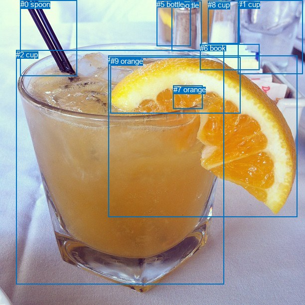
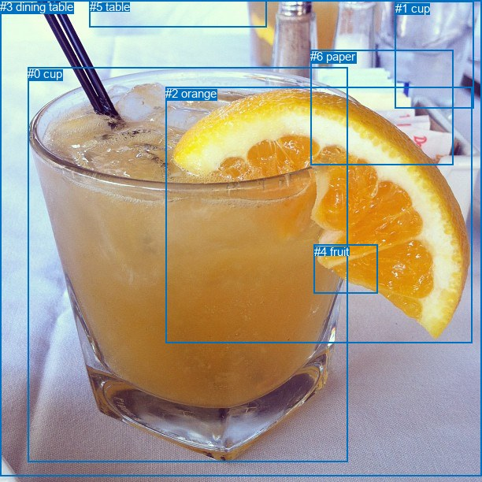

# 图片 1725：2396419.jpg

随机样本序号：407。图片 SHA256：`d41679495827ec7427fe452bc3706fc35e902a5061758cc2febda5f91d001691`。

红色框表示人，蓝色框表示其他物体。两个模式分别保留自身框编号，可依据位置比较对应对象。

## 自动检测框与输出

人的框编号：`[]`。状态：`no_person`。

### 自动检测全部物体框

| 编号 | 类别 | 是否为人 | 检测分数 | 像素坐标 xyxy |
|---|---|---|---|---|
| 0 | spoon | False | 0.9852 | 40.9, 0.2, 154.8, 153.0 |
| 1 | cup | False | 0.9728 | 477.7, 0.5, 607.1, 148.3 |
| 2 | cup | False | 0.9629 | 32.3, 100.5, 450.0, 570.1 |
| 3 | orange | False | 0.9497 | 217.3, 111.1, 596.1, 435.9 |
| 4 | bottle | False | 0.8059 | 344.5, 1.8, 404.8, 103.0 |
| 5 | bottle | False | 0.4623 | 314.3, 0.0, 382.8, 92.7 |
| 6 | book | False | 0.4543 | 401.0, 88.4, 520.9, 141.0 |
| 7 | orange | False | 0.4475 | 347.8, 171.2, 406.1, 218.9 |
| 8 | cup | False | 0.4005 | 417.4, 1.4, 480.2, 87.2 |
| 9 | orange | False | 0.3724 | 221.5, 114.1, 483.0, 228.0 |

### 自动检测 Top50 人相关候选

评分物体对：0；人相关物体对：0；输出关系：0。

| 排名 | 主语编号与类别 | 关系 | 宾语编号与类别 | 类型 | 人与人 | 排序分数 | 原始融合 logit |
|---|---|---|---|---|---|---|---|

### 自动检测逐条人相关 GT 核验

本图没有人相关 GT，R@50 无分母；预测候选继续展示。

## 真实框与输出

人的框编号：`[]`。

### 真实框全部物体框

| 编号 | 类别 | 是否为人 | 检测分数 | 像素坐标 xyxy |
|---|---|---|---|---|
| 0 | cup | False | GT | 35.0, 85.0, 441.0, 586.0 |
| 1 | cup | False | GT | 502.0, 2.0, 601.0, 137.0 |
| 2 | orange | False | GT | 210.0, 110.0, 599.0, 435.0 |
| 3 | dining table | False | GT | 0.0, 0.0, 612.0, 604.0 |
| 4 | fruit | False | GT | 399.0, 311.0, 479.0, 373.0 |
| 5 | table | False | GT | 114.0, 0.0, 339.0, 34.0 |
| 6 | paper | False | GT | 394.0, 63.0, 575.0, 209.0 |

### 真实框 Top50 人相关候选

评分物体对：0；人相关物体对：0；输出关系：0。

| 排名 | 主语编号与类别 | 关系 | 宾语编号与类别 | 类型 | 人与人 | 排序分数 | 原始融合 logit |
|---|---|---|---|---|---|---|---|

### 真实框逐条人相关 GT 核验

本图没有人相关 GT，R@50 无分母；预测候选继续展示。

## 全部人相关 GT

| 主语编号与类别 | 关系 | 宾语编号与类别 |
|---|---|---|

原始记录、全部人相关物体对的两项预测与分项分数见 [逐图证据 JSON](../evidence/cases/1725.json)。全部56类 logits 保留于本机 HOR/output/random500/logits/。

<!-- HOR_COMPLETE_RESULTS -->

## 六组条件的完整输出对照

以下保留同一图片三种框与候选模式、两种谓词输出规则的全部 Top50。框编号各自在所属模式内解释。

### 自动检测框完整枚举：空间与语义各保留一个谓词

| 排名 | 主语编号与类别 | 谓词 | 宾语编号与类别 | 分组 | 排序分数 | predicate logit | pair logit |
|---|---|---|---|---|---|---|---|

没有人相关 GT，本条件的召回率无分母。

### 自动检测框完整枚举：每对只保留一个谓词

| 排名 | 主语编号与类别 | 谓词 | 宾语编号与类别 | 分组 | 排序分数 | predicate logit | pair logit |
|---|---|---|---|---|---|---|---|

没有人相关 GT，本条件的召回率无分母。

### 真实框完整枚举：空间与语义各保留一个谓词

| 排名 | 主语编号与类别 | 谓词 | 宾语编号与类别 | 分组 | 排序分数 | predicate logit | pair logit |
|---|---|---|---|---|---|---|---|

没有人相关 GT，本条件的召回率无分母。

### 真实框完整枚举：每对只保留一个谓词

| 排名 | 主语编号与类别 | 谓词 | 宾语编号与类别 | 分组 | 排序分数 | predicate logit | pair logit |
|---|---|---|---|---|---|---|---|

没有人相关 GT，本条件的召回率无分母。

### 真实框400候选：空间与语义各保留一个谓词

| 排名 | 主语编号与类别 | 谓词 | 宾语编号与类别 | 分组 | 排序分数 | predicate logit | pair logit |
|---|---|---|---|---|---|---|---|

没有人相关 GT，本条件的召回率无分母。

### 真实框400候选：每对只保留一个谓词

| 排名 | 主语编号与类别 | 谓词 | 宾语编号与类别 | 分组 | 排序分数 | predicate logit | pair logit |
|---|---|---|---|---|---|---|---|

没有人相关 GT，本条件的召回率无分母。
