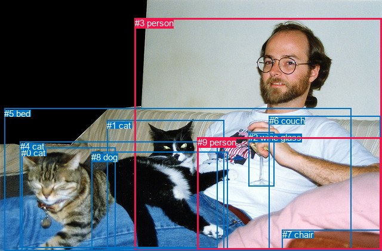
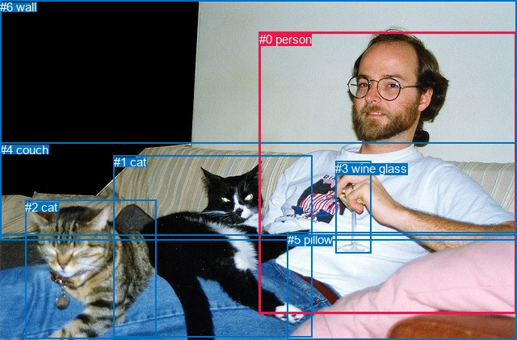

# 图片 1729：2396723.jpg

随机样本序号：122。图片 SHA256：`e101bdf508bf0a74adb38301dc97cb0612fa95a84e2a660eb97749b31edec18a`。

红色框表示人，蓝色框表示其他物体。两个模式分别保留自身框编号，可依据位置比较对应对象。

## 自动检测框与输出

人的框编号：`[3, 9]`。状态：`ok`。

### 自动检测全部物体框

| 编号 | 类别 | 是否为人 | 检测分数 | 像素坐标 xyxy |
|---|---|---|---|---|
| 0 | cat | False | 0.9890 | 36.4, 248.0, 193.1, 420.7 |
| 1 | cat | False | 0.9833 | 179.4, 201.6, 375.7, 417.2 |
| 2 | wine glass | False | 0.9649 | 416.3, 221.5, 459.8, 312.6 |
| 3 | person | True | 0.9372 | 225.7, 30.1, 640.0, 420.8 |
| 4 | cat | False | 0.9189 | 33.6, 237.2, 364.2, 415.8 |
| 5 | bed | False | 0.8700 | 7.4, 181.6, 588.9, 421.0 |
| 6 | couch | False | 0.5982 | 451.0, 194.1, 638.0, 420.0 |
| 7 | chair | False | 0.5906 | 472.8, 385.2, 637.6, 421.0 |
| 8 | dog | False | 0.4848 | 153.2, 254.7, 381.3, 421.0 |
| 9 | person | True | 0.4023 | 330.5, 230.4, 638.2, 418.9 |

### 自动检测 Top50 人相关候选

评分物体对：90；人相关物体对：34；输出关系：50。

| 排名 | 主语编号与类别 | 关系 | 宾语编号与类别 | 类型 | 人与人 | 排序分数 | 原始融合 logit |
|---|---|---|---|---|---|---|---|
| 1 | #3 person | holding | #2 wine glass | semantic | False | 0.99461 | 5.2181 |
| 2 | #3 person | sitting on | #5 bed | semantic | False | 0.98236 | 4.0197 |
| 3 | #3 person | wearing | #6 couch | semantic | False | 0.96909 | 3.4454 |
| 4 | #3 person | on | #5 bed | spatial | False | 0.96727 | 3.3862 |
| 5 | #7 chair | on | #9 person | spatial | False | 0.95828 | 3.1342 |
| 6 | #3 person | wearing | #9 person | semantic | True | 0.94184 | 2.7847 |
| 7 | #6 couch | on | #9 person | spatial | False | 0.90873 | 2.2983 |
| 8 | #3 person | playing with | #4 cat | semantic | False | 0.89534 | 2.1464 |
| 9 | #9 person | on | #5 bed | spatial | False | 0.89371 | 2.1292 |
| 10 | #9 person | wearing | #6 couch | semantic | False | 0.88133 | 2.0051 |
| 11 | #3 person | in | #9 person | spatial | True | 0.86674 | 1.8724 |
| 12 | #3 person | holding | #1 cat | semantic | False | 0.86600 | 1.8660 |
| 13 | #3 person | in | #6 couch | spatial | False | 0.85835 | 1.8016 |
| 14 | #1 cat | sitting on | #3 person | semantic | False | 0.84505 | 1.6963 |
| 15 | #9 person | on | #6 couch | spatial | False | 0.84228 | 1.6753 |
| 16 | #9 person | sitting on | #5 bed | semantic | False | 0.83640 | 1.6317 |
| 17 | #3 person | holding | #8 dog | semantic | False | 0.83156 | 1.5967 |
| 18 | #4 cat | lying on | #9 person | semantic | False | 0.82449 | 1.5471 |
| 19 | #9 person | on | #7 chair | spatial | False | 0.78850 | 1.3159 |
| 20 | #1 cat | lying on | #9 person | semantic | False | 0.77774 | 1.2526 |
| 21 | #1 cat | on | #9 person | spatial | False | 0.76123 | 1.1594 |
| 22 | #3 person | on | #2 wine glass | spatial | False | 0.75956 | 1.1503 |
| 23 | #1 cat | beside | #3 person | spatial | False | 0.73085 | 0.9989 |
| 24 | #3 person | beside | #1 cat | spatial | False | 0.69369 | 0.8174 |
| 25 | #3 person | beside | #4 cat | spatial | False | 0.68780 | 0.7899 |
| 26 | #3 person | wearing | #7 chair | semantic | False | 0.68504 | 0.7770 |
| 27 | #9 person | wearing | #7 chair | semantic | False | 0.67723 | 0.7411 |
| 28 | #4 cat | on | #9 person | spatial | False | 0.66516 | 0.6864 |
| 29 | #3 person | playing with | #0 cat | semantic | False | 0.66222 | 0.6732 |
| 30 | #0 cat | looking at | #3 person | semantic | False | 0.65638 | 0.6472 |
| 31 | #4 cat | lying on | #3 person | semantic | False | 0.61799 | 0.4810 |
| 32 | #6 couch | on | #3 person | spatial | False | 0.60697 | 0.4346 |
| 33 | #4 cat | beside | #3 person | spatial | False | 0.56635 | 0.2670 |
| 34 | #8 dog | lying on | #3 person | semantic | False | 0.55350 | 0.2148 |
| 35 | #3 person | in | #8 dog | spatial | False | 0.52968 | 0.1189 |
| 36 | #2 wine glass | holding | #3 person | semantic | False | 0.52555 | 0.1023 |
| 37 | #0 cat | lying on | #9 person | semantic | False | 0.51096 | 0.0438 |
| 38 | #8 dog | on | #9 person | spatial | False | 0.50894 | 0.0358 |
| 39 | #8 dog | lying on | #9 person | semantic | False | 0.50468 | 0.0187 |
| 40 | #8 dog | on | #3 person | spatial | False | 0.49387 | -0.0245 |
| 41 | #9 person | beside | #3 person | spatial | True | 0.46917 | -0.1235 |
| 42 | #3 person | on | #7 chair | spatial | False | 0.46884 | -0.1248 |
| 43 | #9 person | holding | #2 wine glass | semantic | False | 0.44829 | -0.2076 |
| 44 | #7 chair | wearing | #9 person | semantic | False | 0.41318 | -0.3508 |
| 45 | #2 wine glass | in | #3 person | spatial | False | 0.39987 | -0.4060 |
| 46 | #0 cat | on | #9 person | spatial | False | 0.34166 | -0.6559 |
| 47 | #3 person | on | #0 cat | spatial | False | 0.33667 | -0.6782 |
| 48 | #7 chair | beside | #3 person | spatial | False | 0.33657 | -0.6786 |
| 49 | #6 couch | sitting on | #9 person | semantic | False | 0.32458 | -0.7328 |
| 50 | #9 person | sitting on | #3 person | semantic | True | 0.26015 | -1.0452 |

### 自动检测逐条人相关 GT 核验

R@50：40.00%；命中 2/5。

| GT 主语编号 | GT 关系 | GT 宾语编号 | 结果阶段 | 匹配预测主语编号 | 匹配预测宾语编号 |
|---|---|---|---|---|---|
| 0 | holding | 3 | hit50 | [3] | [2] |
| 0 | sitting on | 4 | endpoint_missing_or_wrong_class | [3] | [] |
| 1 | lying on | 0 | hit50 | [1, 4] | [3] |
| 2 | lying on | 0 | wrong_predicate | [0] | [3] |
| 5 | in front of | 0 | endpoint_missing_or_wrong_class | [] | [3] |

## 真实框与输出

人的框编号：`[0]`。

### 真实框全部物体框

| 编号 | 类别 | 是否为人 | 检测分数 | 像素坐标 xyxy |
|---|---|---|---|---|
| 0 | person | True | GT | 321.0, 40.0, 640.0, 389.0 |
| 1 | cat | False | GT | 141.0, 192.0, 387.0, 417.0 |
| 2 | cat | False | GT | 31.0, 248.0, 194.0, 420.0 |
| 3 | wine glass | False | GT | 415.0, 200.0, 459.0, 314.0 |
| 4 | couch | False | GT | 0.0, 177.0, 640.0, 297.0 |
| 5 | pillow | False | GT | 356.0, 288.0, 640.0, 421.0 |
| 6 | wall | False | GT | 0.0, 0.0, 640.0, 291.0 |

### 真实框 Top50 人相关候选

评分物体对：42；人相关物体对：12；输出关系：24。

| 排名 | 主语编号与类别 | 关系 | 宾语编号与类别 | 类型 | 人与人 | 排序分数 | 原始融合 logit |
|---|---|---|---|---|---|---|---|
| 1 | #0 person | holding | #3 wine glass | semantic | False | 0.99527 | 5.3483 |
| 2 | #0 person | sitting on | #4 couch | semantic | False | 0.98757 | 4.3751 |
| 3 | #0 person | beside | #1 cat | spatial | False | 0.97381 | 3.6159 |
| 4 | #0 person | wearing | #5 pillow | semantic | False | 0.96788 | 3.4057 |
| 5 | #1 cat | beside | #0 person | spatial | False | 0.96600 | 3.3467 |
| 6 | #5 pillow | beside | #0 person | spatial | False | 0.94931 | 2.9301 |
| 7 | #0 person | looking at | #2 cat | semantic | False | 0.94876 | 2.9185 |
| 8 | #0 person | wearing | #1 cat | semantic | False | 0.94354 | 2.8161 |
| 9 | #0 person | beside | #2 cat | spatial | False | 0.92581 | 2.5241 |
| 10 | #0 person | on | #4 couch | spatial | False | 0.92549 | 2.5195 |
| 11 | #1 cat | looking at | #0 person | semantic | False | 0.89135 | 2.1047 |
| 12 | #0 person | leaning on | #5 pillow | spatial | False | 0.87881 | 1.9812 |
| 13 | #2 cat | looking at | #0 person | semantic | False | 0.87394 | 1.9363 |
| 14 | #0 person | in front of | #6 wall | spatial | False | 0.81449 | 1.4794 |
| 15 | #0 person | wearing | #6 wall | semantic | False | 0.77924 | 1.2612 |
| 16 | #0 person | on | #3 wine glass | spatial | False | 0.74373 | 1.0655 |
| 17 | #2 cat | beside | #0 person | spatial | False | 0.71407 | 0.9152 |
| 18 | #6 wall | beside | #0 person | spatial | False | 0.62431 | 0.5079 |
| 19 | #3 wine glass | beside | #0 person | spatial | False | 0.58633 | 0.3488 |
| 20 | #3 wine glass | holding | #0 person | semantic | False | 0.57624 | 0.3074 |
| 21 | #5 pillow | sitting on | #0 person | semantic | False | 0.44002 | -0.2411 |
| 22 | #6 wall | looking at | #0 person | semantic | False | 0.16615 | -1.6132 |
| 23 | #4 couch | beside | #0 person | spatial | False | 0.14804 | -1.7500 |
| 24 | #4 couch | crossing | #0 person | semantic | False | 0.03545 | -3.3036 |

### 真实框逐条人相关 GT 核验

R@50：40.00%；命中 2/5。

| GT 主语编号 | GT 关系 | GT 宾语编号 | 结果阶段 | 匹配预测主语编号 | 匹配预测宾语编号 |
|---|---|---|---|---|---|
| 0 | holding | 3 | hit50 | [0] | [3] |
| 0 | sitting on | 4 | hit50 | [0] | [4] |
| 1 | lying on | 0 | wrong_predicate | [1] | [0] |
| 2 | lying on | 0 | wrong_predicate | [2] | [0] |
| 5 | in front of | 0 | wrong_predicate | [5] | [0] |

## 全部人相关 GT

| 主语编号与类别 | 关系 | 宾语编号与类别 |
|---|---|---|
| #0 person | holding | #3 wine glass |
| #0 person | sitting on | #4 couch |
| #1 cat | lying on | #0 person |
| #2 cat | lying on | #0 person |
| #5 pillow | in front of | #0 person |

原始记录、全部人相关物体对的两项预测与分项分数见 [逐图证据 JSON](../evidence/cases/1729.json)。全部56类 logits 保留于本机 HOR/output/random500/logits/。

<!-- HOR_COMPLETE_RESULTS -->

## 六组条件的完整输出对照

以下保留同一图片三种框与候选模式、两种谓词输出规则的全部 Top50。框编号各自在所属模式内解释。

### 自动检测框完整枚举：空间与语义各保留一个谓词

| 排名 | 主语编号与类别 | 谓词 | 宾语编号与类别 | 分组 | 排序分数 | predicate logit | pair logit |
|---|---|---|---|---|---|---|---|
| 1 | #3 person | holding | #2 wine glass | semantic | 0.9946114 | 4.9404740 | 0.2775913 |
| 2 | #3 person | sitting on | #5 bed | semantic | 0.9823576 | 3.4999709 | 0.5196826 |
| 3 | #3 person | wearing | #6 couch | semantic | 0.9690945 | 3.3046126 | 0.1408140 |
| 4 | #3 person | on | #5 bed | spatial | 0.9672698 | 2.8664989 | 0.5196826 |
| 5 | #7 chair | on | #9 person | spatial | 0.9582811 | 2.8017406 | 0.3324476 |
| 6 | #3 person | wearing | #9 person | semantic | 0.9418439 | 2.6651793 | 0.1195294 |
| 7 | #6 couch | on | #9 person | spatial | 0.9087321 | 2.6206136 | -0.3223616 |
| 8 | #3 person | playing with | #4 cat | semantic | 0.8953361 | 2.1577010 | -0.0112561 |
| 9 | #9 person | on | #5 bed | spatial | 0.8937130 | 2.4778905 | -0.3486490 |
| 10 | #9 person | wearing | #6 couch | semantic | 0.8813270 | 2.1057878 | -0.1007306 |
| 11 | #3 person | in | #9 person | spatial | 0.8667368 | 1.7528796 | 0.1195294 |
| 12 | #3 person | holding | #1 cat | semantic | 0.8660002 | 1.9694147 | -0.1033674 |
| 13 | #3 person | in | #6 couch | spatial | 0.8583483 | 1.6608248 | 0.1408140 |
| 14 | #1 cat | sitting on | #3 person | semantic | 0.8450531 | 2.0705004 | -0.3741833 |
| 15 | #9 person | on | #6 couch | spatial | 0.8422776 | 1.7760038 | -0.1007306 |
| 16 | #9 person | sitting on | #5 bed | semantic | 0.8363988 | 1.9803224 | -0.3486490 |
| 17 | #3 person | holding | #8 dog | semantic | 0.8315629 | 1.6454172 | -0.0486727 |
| 18 | #4 cat | lying on | #9 person | semantic | 0.8244920 | 2.0375338 | -0.4904507 |
| 19 | #9 person | on | #7 chair | spatial | 0.7885036 | 1.1627097 | 0.1532190 |
| 20 | #1 cat | lying on | #9 person | semantic | 0.7777410 | 1.7679996 | -0.5154492 |
| 21 | #1 cat | on | #9 person | spatial | 0.7612324 | 1.6748972 | -0.5154492 |
| 22 | #3 person | on | #2 wine glass | spatial | 0.7595617 | 0.8726869 | 0.2775913 |
| 23 | #1 cat | beside | #3 person | spatial | 0.7308516 | 1.3731308 | -0.3741833 |
| 24 | #3 person | beside | #1 cat | spatial | 0.6936867 | 0.9207797 | -0.1033674 |
| 25 | #3 person | beside | #4 cat | spatial | 0.6877996 | 0.8011084 | -0.0112561 |
| 26 | #3 person | wearing | #7 chair | semantic | 0.6850417 | 1.3756204 | -0.5985807 |
| 27 | #9 person | wearing | #7 chair | semantic | 0.6772274 | 0.5878401 | 0.1532190 |
| 28 | #4 cat | on | #9 person | spatial | 0.6651573 | 1.1768131 | -0.4904507 |
| 29 | #3 person | playing with | #0 cat | semantic | 0.6622205 | 0.9590626 | -0.2858573 |
| 30 | #0 cat | looking at | #3 person | semantic | 0.6563795 | 0.9277506 | -0.2805495 |
| 31 | #4 cat | lying on | #3 person | semantic | 0.6179892 | 0.7447777 | -0.2637556 |
| 32 | #6 couch | on | #3 person | spatial | 0.6069747 | 1.0077062 | -0.5730929 |
| 33 | #4 cat | beside | #3 person | spatial | 0.5663549 | 0.5307498 | -0.2637556 |
| 34 | #8 dog | lying on | #3 person | semantic | 0.5535039 | 0.5950608 | -0.3802229 |
| 35 | #3 person | in | #8 dog | spatial | 0.5296805 | 0.1675344 | -0.0486727 |
| 36 | #2 wine glass | holding | #3 person | semantic | 0.5255482 | 1.0271745 | -0.9248925 |
| 37 | #0 cat | lying on | #9 person | semantic | 0.5109562 | 0.8030062 | -0.7591742 |
| 38 | #8 dog | on | #9 person | spatial | 0.5089418 | 1.0624719 | -1.0267007 |
| 39 | #8 dog | lying on | #9 person | semantic | 0.5046818 | 1.0454283 | -1.0267007 |
| 40 | #8 dog | on | #3 person | spatial | 0.4938743 | 0.3557191 | -0.3802229 |
| 41 | #9 person | beside | #3 person | spatial | 0.4691677 | 0.3786745 | -0.5021604 |
| 42 | #3 person | on | #7 chair | spatial | 0.4688372 | 0.4737678 | -0.5985807 |
| 43 | #9 person | holding | #2 wine glass | semantic | 0.4482904 | 1.3867130 | -1.5942936 |
| 44 | #7 chair | wearing | #9 person | semantic | 0.4131807 | -0.6832795 | 0.3324476 |
| 45 | #2 wine glass | in | #3 person | spatial | 0.3998724 | 0.5188956 | -0.9248925 |
| 46 | #0 cat | on | #9 person | spatial | 0.3416579 | 0.1032596 | -0.7591742 |
| 47 | #3 person | on | #0 cat | spatial | 0.3366719 | -0.3923035 | -0.2858573 |
| 48 | #7 chair | beside | #3 person | spatial | 0.3365738 | -0.0760479 | -0.6025521 |
| 49 | #6 couch | sitting on | #9 person | semantic | 0.3245773 | -0.4104533 | -0.3223616 |
| 50 | #9 person | sitting on | #3 person | semantic | 0.2601457 | -0.5430512 | -0.5021604 |

GT 命中：2/5，R@50=40.00%。

| GT主语 | GT谓词 | GT宾语 | 结果阶段 | 匹配主语框 | 匹配宾语框 |
|---|---|---|---|---|---|
| 0 | holding | 3 | hit50 | [3] | [2] |
| 0 | sitting on | 4 | endpoint_missing_or_wrong_class | [3] | [] |
| 1 | lying on | 0 | hit50 | [1, 4] | [3] |
| 2 | lying on | 0 | wrong_predicate | [0] | [3] |
| 5 | in front of | 0 | endpoint_missing_or_wrong_class | [] | [3] |

### 自动检测框完整枚举：每对只保留一个谓词

| 排名 | 主语编号与类别 | 谓词 | 宾语编号与类别 | 分组 | 排序分数 | predicate logit | pair logit |
|---|---|---|---|---|---|---|---|
| 1 | #3 person | holding | #2 wine glass | single | 0.9946114 | 4.9404740 | 0.2775913 |
| 2 | #3 person | sitting on | #5 bed | single | 0.9823576 | 3.4999709 | 0.5196826 |
| 3 | #3 person | wearing | #6 couch | single | 0.9690945 | 3.3046126 | 0.1408140 |
| 4 | #7 chair | on | #9 person | single | 0.9582811 | 2.8017406 | 0.3324476 |
| 5 | #3 person | wearing | #9 person | single | 0.9418439 | 2.6651793 | 0.1195294 |
| 6 | #6 couch | on | #9 person | single | 0.9087321 | 2.6206136 | -0.3223616 |
| 7 | #3 person | playing with | #4 cat | single | 0.8953361 | 2.1577010 | -0.0112561 |
| 8 | #9 person | on | #5 bed | single | 0.8937130 | 2.4778905 | -0.3486490 |
| 9 | #9 person | wearing | #6 couch | single | 0.8813270 | 2.1057878 | -0.1007306 |
| 10 | #3 person | holding | #1 cat | single | 0.8660002 | 1.9694147 | -0.1033674 |
| 11 | #1 cat | sitting on | #3 person | single | 0.8450531 | 2.0705004 | -0.3741833 |
| 12 | #3 person | holding | #8 dog | single | 0.8315629 | 1.6454172 | -0.0486727 |
| 13 | #4 cat | lying on | #9 person | single | 0.8244920 | 2.0375338 | -0.4904507 |
| 14 | #9 person | on | #7 chair | single | 0.7885036 | 1.1627097 | 0.1532190 |
| 15 | #1 cat | lying on | #9 person | single | 0.7777410 | 1.7679996 | -0.5154492 |
| 16 | #3 person | wearing | #7 chair | single | 0.6850417 | 1.3756204 | -0.5985807 |
| 17 | #3 person | playing with | #0 cat | single | 0.6622205 | 0.9590626 | -0.2858573 |
| 18 | #0 cat | looking at | #3 person | single | 0.6563795 | 0.9277506 | -0.2805495 |
| 19 | #4 cat | lying on | #3 person | single | 0.6179892 | 0.7447777 | -0.2637556 |
| 20 | #6 couch | on | #3 person | single | 0.6069747 | 1.0077062 | -0.5730929 |
| 21 | #8 dog | lying on | #3 person | single | 0.5535039 | 0.5950608 | -0.3802229 |
| 22 | #2 wine glass | holding | #3 person | single | 0.5255482 | 1.0271745 | -0.9248925 |
| 23 | #0 cat | lying on | #9 person | single | 0.5109562 | 0.8030062 | -0.7591742 |
| 24 | #8 dog | on | #9 person | single | 0.5089418 | 1.0624719 | -1.0267007 |
| 25 | #9 person | beside | #3 person | single | 0.4691677 | 0.3786745 | -0.5021604 |
| 26 | #9 person | holding | #2 wine glass | single | 0.4482904 | 1.3867130 | -1.5942936 |
| 27 | #7 chair | beside | #3 person | single | 0.3365738 | -0.0760479 | -0.6025521 |
| 28 | #2 wine glass | on | #9 person | single | 0.1305556 | -0.4803772 | -1.4156783 |
| 29 | #5 bed | in | #9 person | single | 0.0833989 | -1.3430991 | -1.0539384 |
| 30 | #5 bed | in | #3 person | single | 0.0385179 | -2.2432971 | -0.9740568 |
| 31 | #9 person | beside | #4 cat | single | 0.0290668 | -2.3918166 | -1.1168454 |
| 32 | #9 person | beside | #1 cat | single | 0.0238503 | -2.6476934 | -1.0641258 |
| 33 | #9 person | beside | #0 cat | single | 0.0122834 | -3.1142523 | -1.2728909 |
| 34 | #9 person | holding | #8 dog | single | 0.0096022 | -3.2015741 | -1.4345410 |

GT 命中：2/5，R@50=40.00%。

| GT主语 | GT谓词 | GT宾语 | 结果阶段 | 匹配主语框 | 匹配宾语框 |
|---|---|---|---|---|---|
| 0 | holding | 3 | hit50 | [3] | [2] |
| 0 | sitting on | 4 | endpoint_missing_or_wrong_class | [3] | [] |
| 1 | lying on | 0 | hit50 | [1, 4] | [3] |
| 2 | lying on | 0 | wrong_predicate | [0] | [3] |
| 5 | in front of | 0 | endpoint_missing_or_wrong_class | [] | [3] |

### 真实框完整枚举：空间与语义各保留一个谓词

| 排名 | 主语编号与类别 | 谓词 | 宾语编号与类别 | 分组 | 排序分数 | predicate logit | pair logit |
|---|---|---|---|---|---|---|---|
| 1 | #0 person | holding | #3 wine glass | semantic | 0.9952666 | 5.0538335 | 0.2945108 |
| 2 | #0 person | sitting on | #4 couch | semantic | 0.9875701 | 4.0807967 | 0.2943438 |
| 3 | #0 person | beside | #1 cat | spatial | 0.9738119 | 3.8843160 | -0.2683993 |
| 4 | #0 person | wearing | #5 pillow | semantic | 0.9678826 | 3.4838033 | -0.0780901 |
| 5 | #1 cat | beside | #0 person | spatial | 0.9659972 | 3.8951287 | -0.5484116 |
| 6 | #5 pillow | beside | #0 person | spatial | 0.9493147 | 3.4074817 | -0.4773780 |
| 7 | #0 person | looking at | #2 cat | semantic | 0.9487554 | 3.3810468 | -0.4625049 |
| 8 | #0 person | wearing | #1 cat | semantic | 0.9435393 | 3.0844936 | -0.2683993 |
| 9 | #0 person | beside | #2 cat | spatial | 0.9258145 | 2.9866095 | -0.4625049 |
| 10 | #0 person | on | #4 couch | spatial | 0.9254946 | 2.2251129 | 0.2943438 |
| 11 | #1 cat | looking at | #0 person | semantic | 0.8913543 | 2.6530623 | -0.5484116 |
| 12 | #0 person | leaning on | #5 pillow | spatial | 0.8788130 | 2.0593281 | -0.0780901 |
| 13 | #2 cat | looking at | #0 person | semantic | 0.8739418 | 2.3885164 | -0.4522467 |
| 14 | #0 person | in front of | #6 wall | spatial | 0.8144855 | 1.8434119 | -0.3639884 |
| 15 | #0 person | wearing | #6 wall | semantic | 0.7792389 | 1.6252251 | -0.3639884 |
| 16 | #0 person | on | #3 wine glass | spatial | 0.7437317 | 0.7709446 | 0.2945108 |
| 17 | #2 cat | beside | #0 person | spatial | 0.7140666 | 1.3674641 | -0.4522467 |
| 18 | #6 wall | beside | #0 person | spatial | 0.6243131 | 0.6147203 | -0.1068243 |
| 19 | #3 wine glass | beside | #0 person | spatial | 0.5863260 | 1.1311865 | -0.7823889 |
| 20 | #3 wine glass | holding | #0 person | semantic | 0.5762439 | 1.0897622 | -0.7823889 |
| 21 | #5 pillow | sitting on | #0 person | semantic | 0.4400170 | 0.2362852 | -0.4773780 |
| 22 | #6 wall | looking at | #0 person | semantic | 0.1661454 | -1.5063713 | -0.1068243 |
| 23 | #4 couch | beside | #0 person | spatial | 0.1480427 | -1.1909351 | -0.5591007 |
| 24 | #4 couch | crossing | #0 person | semantic | 0.0354467 | -2.7445350 | -0.5591007 |

GT 命中：2/5，R@50=40.00%。

| GT主语 | GT谓词 | GT宾语 | 结果阶段 | 匹配主语框 | 匹配宾语框 |
|---|---|---|---|---|---|
| 0 | holding | 3 | hit50 | [0] | [3] |
| 0 | sitting on | 4 | hit50 | [0] | [4] |
| 1 | lying on | 0 | wrong_predicate | [1] | [0] |
| 2 | lying on | 0 | wrong_predicate | [2] | [0] |
| 5 | in front of | 0 | wrong_predicate | [5] | [0] |

### 真实框完整枚举：每对只保留一个谓词

| 排名 | 主语编号与类别 | 谓词 | 宾语编号与类别 | 分组 | 排序分数 | predicate logit | pair logit |
|---|---|---|---|---|---|---|---|
| 1 | #0 person | holding | #3 wine glass | single | 0.9952666 | 5.0538335 | 0.2945108 |
| 2 | #0 person | sitting on | #4 couch | single | 0.9875701 | 4.0807967 | 0.2943438 |
| 3 | #0 person | beside | #1 cat | single | 0.9738119 | 3.8843160 | -0.2683993 |
| 4 | #0 person | wearing | #5 pillow | single | 0.9678826 | 3.4838033 | -0.0780901 |
| 5 | #1 cat | beside | #0 person | single | 0.9659972 | 3.8951287 | -0.5484116 |
| 6 | #5 pillow | beside | #0 person | single | 0.9493147 | 3.4074817 | -0.4773780 |
| 7 | #0 person | looking at | #2 cat | single | 0.9487554 | 3.3810468 | -0.4625049 |
| 8 | #2 cat | looking at | #0 person | single | 0.8739418 | 2.3885164 | -0.4522467 |
| 9 | #0 person | in front of | #6 wall | single | 0.8144855 | 1.8434119 | -0.3639884 |
| 10 | #6 wall | beside | #0 person | single | 0.6243131 | 0.6147203 | -0.1068243 |
| 11 | #3 wine glass | beside | #0 person | single | 0.5863260 | 1.1311865 | -0.7823889 |
| 12 | #4 couch | beside | #0 person | single | 0.1480427 | -1.1909351 | -0.5591007 |

GT 命中：2/5，R@50=40.00%。

| GT主语 | GT谓词 | GT宾语 | 结果阶段 | 匹配主语框 | 匹配宾语框 |
|---|---|---|---|---|---|
| 0 | holding | 3 | hit50 | [0] | [3] |
| 0 | sitting on | 4 | hit50 | [0] | [4] |
| 1 | lying on | 0 | wrong_predicate | [1] | [0] |
| 2 | lying on | 0 | wrong_predicate | [2] | [0] |
| 5 | in front of | 0 | wrong_predicate | [5] | [0] |

### 真实框400候选：空间与语义各保留一个谓词

| 排名 | 主语编号与类别 | 谓词 | 宾语编号与类别 | 分组 | 排序分数 | predicate logit | pair logit |
|---|---|---|---|---|---|---|---|
| 1 | #0 person | holding | #3 wine glass | semantic | 0.9952385 | 5.0479245 | 0.2945108 |
| 2 | #0 person | sitting on | #4 couch | semantic | 0.9873089 | 4.0597348 | 0.2943438 |
| 3 | #0 person | beside | #1 cat | spatial | 0.9738119 | 3.8843160 | -0.2683993 |
| 4 | #0 person | wearing | #5 pillow | semantic | 0.9693550 | 3.5322499 | -0.0780901 |
| 5 | #1 cat | beside | #0 person | spatial | 0.9660010 | 3.8952451 | -0.5484116 |
| 6 | #5 pillow | beside | #0 person | spatial | 0.9493147 | 3.4074817 | -0.4773780 |
| 7 | #0 person | looking at | #2 cat | semantic | 0.9487554 | 3.3810468 | -0.4625049 |
| 8 | #0 person | wearing | #1 cat | semantic | 0.9435393 | 3.0844936 | -0.2683993 |
| 9 | #0 person | beside | #2 cat | spatial | 0.9258184 | 2.9866672 | -0.4625049 |
| 10 | #0 person | on | #4 couch | spatial | 0.9254946 | 2.2251129 | 0.2943438 |
| 11 | #1 cat | looking at | #0 person | semantic | 0.8913543 | 2.6530623 | -0.5484116 |
| 12 | #0 person | leaning on | #5 pillow | spatial | 0.8788130 | 2.0593281 | -0.0780901 |
| 13 | #2 cat | looking at | #0 person | semantic | 0.8738648 | 2.3878188 | -0.4522467 |
| 14 | #0 person | in front of | #6 wall | spatial | 0.8144855 | 1.8434119 | -0.3639884 |
| 15 | #0 person | wearing | #6 wall | semantic | 0.7833778 | 1.6494484 | -0.3639884 |
| 16 | #0 person | on | #3 wine glass | spatial | 0.7473742 | 0.7901459 | 0.2945108 |
| 17 | #2 cat | beside | #0 person | spatial | 0.7140549 | 1.3674064 | -0.4522467 |
| 18 | #6 wall | beside | #0 person | spatial | 0.6313374 | 0.6447830 | -0.1068243 |
| 19 | #3 wine glass | beside | #0 person | spatial | 0.5863260 | 1.1311865 | -0.7823889 |
| 20 | #3 wine glass | holding | #0 person | semantic | 0.5762439 | 1.0897622 | -0.7823889 |
| 21 | #5 pillow | sitting on | #0 person | semantic | 0.4400170 | 0.2362852 | -0.4773780 |
| 22 | #6 wall | looking at | #0 person | semantic | 0.1682891 | -1.4909770 | -0.1068243 |
| 23 | #4 couch | beside | #0 person | spatial | 0.1480417 | -1.1909425 | -0.5591007 |
| 24 | #4 couch | crossing | #0 person | semantic | 0.0354467 | -2.7445350 | -0.5591007 |

GT 命中：2/5，R@50=40.00%。

| GT主语 | GT谓词 | GT宾语 | 结果阶段 | 匹配主语框 | 匹配宾语框 |
|---|---|---|---|---|---|
| 0 | holding | 3 | hit50 | [0] | [3] |
| 0 | sitting on | 4 | hit50 | [0] | [4] |
| 1 | lying on | 0 | wrong_predicate | [1] | [0] |
| 2 | lying on | 0 | wrong_predicate | [2] | [0] |
| 5 | in front of | 0 | wrong_predicate | [5] | [0] |

### 真实框400候选：每对只保留一个谓词

| 排名 | 主语编号与类别 | 谓词 | 宾语编号与类别 | 分组 | 排序分数 | predicate logit | pair logit |
|---|---|---|---|---|---|---|---|
| 1 | #0 person | holding | #3 wine glass | single | 0.9952385 | 5.0479245 | 0.2945108 |
| 2 | #0 person | sitting on | #4 couch | single | 0.9873089 | 4.0597348 | 0.2943438 |
| 3 | #0 person | beside | #1 cat | single | 0.9738119 | 3.8843160 | -0.2683993 |
| 4 | #0 person | wearing | #5 pillow | single | 0.9693550 | 3.5322499 | -0.0780901 |
| 5 | #1 cat | beside | #0 person | single | 0.9660010 | 3.8952451 | -0.5484116 |
| 6 | #5 pillow | beside | #0 person | single | 0.9493147 | 3.4074817 | -0.4773780 |
| 7 | #0 person | looking at | #2 cat | single | 0.9487554 | 3.3810468 | -0.4625049 |
| 8 | #2 cat | looking at | #0 person | single | 0.8738648 | 2.3878188 | -0.4522467 |
| 9 | #0 person | in front of | #6 wall | single | 0.8144855 | 1.8434119 | -0.3639884 |
| 10 | #6 wall | beside | #0 person | single | 0.6313374 | 0.6447830 | -0.1068243 |
| 11 | #3 wine glass | beside | #0 person | single | 0.5863260 | 1.1311865 | -0.7823889 |
| 12 | #4 couch | beside | #0 person | single | 0.1480417 | -1.1909425 | -0.5591007 |

GT 命中：2/5，R@50=40.00%。

| GT主语 | GT谓词 | GT宾语 | 结果阶段 | 匹配主语框 | 匹配宾语框 |
|---|---|---|---|---|---|
| 0 | holding | 3 | hit50 | [0] | [3] |
| 0 | sitting on | 4 | hit50 | [0] | [4] |
| 1 | lying on | 0 | wrong_predicate | [1] | [0] |
| 2 | lying on | 0 | wrong_predicate | [2] | [0] |
| 5 | in front of | 0 | wrong_predicate | [5] | [0] |
