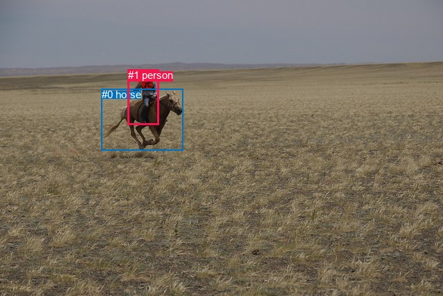
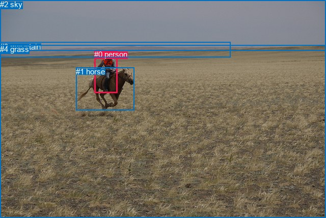

# 图片 1739：2397128.jpg

随机样本序号：333。图片 SHA256：`a179135a319f9461bd39980dc49ea40d7ecf201a1176a10fa37939d065ab1ecd`。

红色框表示人，蓝色框表示其他物体。两个模式分别保留自身框编号，可依据位置比较对应对象。

## 自动检测框与输出

人的框编号：`[1]`。状态：`ok`。

### 自动检测全部物体框

| 编号 | 类别 | 是否为人 | 检测分数 | 像素坐标 xyxy |
|---|---|---|---|---|
| 0 | horse | False | 0.9994 | 146.5, 128.2, 265.0, 217.5 |
| 1 | person | True | 0.9992 | 184.9, 100.4, 229.7, 180.7 |

### 自动检测 Top50 人相关候选

评分物体对：2；人相关物体对：2；输出关系：4。

| 排名 | 主语编号与类别 | 关系 | 宾语编号与类别 | 类型 | 人与人 | 排序分数 | 原始融合 logit |
|---|---|---|---|---|---|---|---|
| 1 | #1 person | riding | #0 horse | semantic | False | 0.96412 | 3.2912 |
| 2 | #1 person | on | #0 horse | spatial | False | 0.61222 | 0.4567 |
| 3 | #0 horse | carrying | #1 person | semantic | False | 0.04149 | -3.1400 |
| 4 | #0 horse | in | #1 person | spatial | False | 0.00210 | -6.1638 |

### 自动检测逐条人相关 GT 核验

R@50：33.33%；命中 1/3。

| GT 主语编号 | GT 关系 | GT 宾语编号 | 结果阶段 | 匹配预测主语编号 | 匹配预测宾语编号 |
|---|---|---|---|---|---|
| 0 | attached to | 1 | wrong_predicate | [1] | [0] |
| 0 | sitting on | 1 | wrong_predicate | [1] | [0] |
| 0 | riding | 1 | hit50 | [1] | [0] |

## 真实框与输出

人的框编号：`[0]`。

### 真实框全部物体框

| 编号 | 类别 | 是否为人 | 检测分数 | 像素坐标 xyxy |
|---|---|---|---|---|
| 0 | person | True | GT | 185.0, 98.0, 230.0, 182.0 |
| 1 | horse | False | GT | 149.0, 132.0, 263.0, 216.0 |
| 2 | sky | False | GT | 0.0, 0.0, 640.0, 99.0 |
| 3 | mountain | False | GT | 0.0, 83.0, 453.0, 113.0 |
| 4 | grass | False | GT | 0.0, 88.0, 640.0, 428.0 |

### 真实框 Top50 人相关候选

评分物体对：20；人相关物体对：8；输出关系：16。

| 排名 | 主语编号与类别 | 关系 | 宾语编号与类别 | 类型 | 人与人 | 排序分数 | 原始融合 logit |
|---|---|---|---|---|---|---|---|
| 1 | #0 person | riding | #1 horse | semantic | False | 0.99587 | 5.4854 |
| 2 | #0 person | on | #1 horse | spatial | False | 0.96797 | 3.4086 |
| 3 | #0 person | in | #4 grass | spatial | False | 0.79192 | 1.3365 |
| 4 | #0 person | riding | #4 grass | semantic | False | 0.69245 | 0.8116 |
| 5 | #1 horse | carrying | #0 person | semantic | False | 0.61558 | 0.4708 |
| 6 | #0 person | wearing | #2 sky | semantic | False | 0.48866 | -0.0454 |
| 7 | #2 sky | over | #0 person | spatial | False | 0.48384 | -0.0647 |
| 8 | #0 person | in | #2 sky | spatial | False | 0.33419 | -0.6893 |
| 9 | #0 person | wearing | #3 mountain | semantic | False | 0.27785 | -0.9551 |
| 10 | #3 mountain | over | #0 person | spatial | False | 0.17625 | -1.5419 |
| 11 | #1 horse | in | #0 person | spatial | False | 0.14586 | -1.7674 |
| 12 | #0 person | in | #3 mountain | spatial | False | 0.10544 | -2.1382 |
| 13 | #4 grass | in | #0 person | spatial | False | 0.05772 | -2.7928 |
| 14 | #4 grass | holding | #0 person | semantic | False | 0.05511 | -2.8418 |
| 15 | #2 sky | flying over | #0 person | semantic | False | 0.03583 | -3.2925 |
| 16 | #3 mountain | running on | #0 person | semantic | False | 0.00519 | -5.2568 |

### 真实框逐条人相关 GT 核验

R@50：33.33%；命中 1/3。

| GT 主语编号 | GT 关系 | GT 宾语编号 | 结果阶段 | 匹配预测主语编号 | 匹配预测宾语编号 |
|---|---|---|---|---|---|
| 0 | attached to | 1 | wrong_predicate | [0] | [1] |
| 0 | sitting on | 1 | wrong_predicate | [0] | [1] |
| 0 | riding | 1 | hit50 | [0] | [1] |

## 全部人相关 GT

| 主语编号与类别 | 关系 | 宾语编号与类别 |
|---|---|---|
| #0 person | attached to | #1 horse |
| #0 person | sitting on | #1 horse |
| #0 person | riding | #1 horse |

原始记录、全部人相关物体对的两项预测与分项分数见 [逐图证据 JSON](../evidence/cases/1739.json)。全部56类 logits 保留于本机 HOR/output/random500/logits/。

<!-- HOR_COMPLETE_RESULTS -->

## 六组条件的完整输出对照

以下保留同一图片三种框与候选模式、两种谓词输出规则的全部 Top50。框编号各自在所属模式内解释。

### 自动检测框完整枚举：空间与语义各保留一个谓词

| 排名 | 主语编号与类别 | 谓词 | 宾语编号与类别 | 分组 | 排序分数 | predicate logit | pair logit |
|---|---|---|---|---|---|---|---|
| 1 | #1 person | riding | #0 horse | semantic | 0.9641245 | 3.0936475 | 0.1975184 |
| 2 | #1 person | on | #0 horse | spatial | 0.6122193 | 0.2591324 | 0.1975184 |
| 3 | #0 horse | carrying | #1 person | semantic | 0.0414881 | -2.3520718 | -0.7879024 |
| 4 | #0 horse | in | #1 person | spatial | 0.0020998 | -5.3759260 | -0.7879024 |

GT 命中：1/3，R@50=33.33%。

| GT主语 | GT谓词 | GT宾语 | 结果阶段 | 匹配主语框 | 匹配宾语框 |
|---|---|---|---|---|---|
| 0 | attached to | 1 | wrong_predicate | [1] | [0] |
| 0 | sitting on | 1 | wrong_predicate | [1] | [0] |
| 0 | riding | 1 | hit50 | [1] | [0] |

### 自动检测框完整枚举：每对只保留一个谓词

| 排名 | 主语编号与类别 | 谓词 | 宾语编号与类别 | 分组 | 排序分数 | predicate logit | pair logit |
|---|---|---|---|---|---|---|---|
| 1 | #1 person | riding | #0 horse | single | 0.9641245 | 3.0936475 | 0.1975184 |
| 2 | #0 horse | carrying | #1 person | single | 0.0414881 | -2.3520718 | -0.7879024 |

GT 命中：1/3，R@50=33.33%。

| GT主语 | GT谓词 | GT宾语 | 结果阶段 | 匹配主语框 | 匹配宾语框 |
|---|---|---|---|---|---|
| 0 | attached to | 1 | wrong_predicate | [1] | [0] |
| 0 | sitting on | 1 | wrong_predicate | [1] | [0] |
| 0 | riding | 1 | hit50 | [1] | [0] |

### 真实框完整枚举：空间与语义各保留一个谓词

| 排名 | 主语编号与类别 | 谓词 | 宾语编号与类别 | 分组 | 排序分数 | predicate logit | pair logit |
|---|---|---|---|---|---|---|---|
| 1 | #0 person | riding | #1 horse | semantic | 0.9958701 | 5.2631497 | 0.2222129 |
| 2 | #0 person | on | #1 horse | spatial | 0.9679711 | 3.1863518 | 0.2222129 |
| 3 | #0 person | in | #4 grass | spatial | 0.7919189 | 2.1394315 | -0.8029001 |
| 4 | #0 person | riding | #4 grass | semantic | 0.6924497 | 1.6144972 | -0.8029001 |
| 5 | #1 horse | carrying | #0 person | semantic | 0.6155786 | 1.2500572 | -0.7792341 |
| 6 | #0 person | wearing | #2 sky | semantic | 0.4886569 | 1.1789722 | -1.2243524 |
| 7 | #2 sky | over | #0 person | spatial | 0.4838388 | 1.0473022 | -1.1119695 |
| 8 | #0 person | in | #2 sky | spatial | 0.3341870 | 0.5350442 | -1.2243524 |
| 9 | #0 person | wearing | #3 mountain | semantic | 0.2778515 | 0.6535034 | -1.6086473 |
| 10 | #3 mountain | over | #0 person | spatial | 0.1762521 | -0.1664286 | -1.3755205 |
| 11 | #1 horse | in | #0 person | spatial | 0.1458622 | -0.9881964 | -0.7792341 |
| 12 | #0 person | in | #3 mountain | spatial | 0.1054419 | -0.5295224 | -1.6086473 |
| 13 | #4 grass | in | #0 person | spatial | 0.0577154 | -1.2342486 | -1.5585353 |
| 14 | #4 grass | holding | #0 person | semantic | 0.0551088 | -1.2832246 | -1.5585353 |
| 15 | #2 sky | flying over | #0 person | semantic | 0.0358301 | -2.1805084 | -1.1119695 |
| 16 | #3 mountain | running on | #0 person | semantic | 0.0051851 | -3.8812413 | -1.3755205 |

GT 命中：1/3，R@50=33.33%。

| GT主语 | GT谓词 | GT宾语 | 结果阶段 | 匹配主语框 | 匹配宾语框 |
|---|---|---|---|---|---|
| 0 | attached to | 1 | wrong_predicate | [0] | [1] |
| 0 | sitting on | 1 | wrong_predicate | [0] | [1] |
| 0 | riding | 1 | hit50 | [0] | [1] |

### 真实框完整枚举：每对只保留一个谓词

| 排名 | 主语编号与类别 | 谓词 | 宾语编号与类别 | 分组 | 排序分数 | predicate logit | pair logit |
|---|---|---|---|---|---|---|---|
| 1 | #0 person | riding | #1 horse | single | 0.9958701 | 5.2631497 | 0.2222129 |
| 2 | #0 person | in | #4 grass | single | 0.7919189 | 2.1394315 | -0.8029001 |
| 3 | #1 horse | carrying | #0 person | single | 0.6155786 | 1.2500572 | -0.7792341 |
| 4 | #0 person | wearing | #2 sky | single | 0.4886569 | 1.1789722 | -1.2243524 |
| 5 | #2 sky | over | #0 person | single | 0.4838388 | 1.0473022 | -1.1119695 |
| 6 | #0 person | wearing | #3 mountain | single | 0.2778515 | 0.6535034 | -1.6086473 |
| 7 | #3 mountain | over | #0 person | single | 0.1762521 | -0.1664286 | -1.3755205 |
| 8 | #4 grass | in | #0 person | single | 0.0577154 | -1.2342486 | -1.5585353 |

GT 命中：1/3，R@50=33.33%。

| GT主语 | GT谓词 | GT宾语 | 结果阶段 | 匹配主语框 | 匹配宾语框 |
|---|---|---|---|---|---|
| 0 | attached to | 1 | wrong_predicate | [0] | [1] |
| 0 | sitting on | 1 | wrong_predicate | [0] | [1] |
| 0 | riding | 1 | hit50 | [0] | [1] |

### 真实框400候选：空间与语义各保留一个谓词

| 排名 | 主语编号与类别 | 谓词 | 宾语编号与类别 | 分组 | 排序分数 | predicate logit | pair logit |
|---|---|---|---|---|---|---|---|
| 1 | #0 person | riding | #1 horse | semantic | 0.9958701 | 5.2631497 | 0.2222129 |
| 2 | #0 person | on | #1 horse | spatial | 0.9691406 | 3.2247558 | 0.2222129 |
| 3 | #0 person | in | #4 grass | spatial | 0.7913715 | 2.1361127 | -0.8029001 |
| 4 | #0 person | riding | #4 grass | semantic | 0.6924497 | 1.6144972 | -0.8029001 |
| 5 | #1 horse | carrying | #0 person | semantic | 0.6155786 | 1.2500572 | -0.7792341 |
| 6 | #0 person | wearing | #2 sky | semantic | 0.4840715 | 1.1606169 | -1.2243524 |
| 7 | #2 sky | over | #0 person | spatial | 0.4831786 | 1.0446582 | -1.1119695 |
| 8 | #0 person | in | #2 sky | spatial | 0.3386820 | 0.5551791 | -1.2243524 |
| 9 | #0 person | wearing | #3 mountain | semantic | 0.2827380 | 0.6777267 | -1.6086473 |
| 10 | #3 mountain | over | #0 person | spatial | 0.1759164 | -0.1687427 | -1.3755205 |
| 11 | #1 horse | in | #0 person | spatial | 0.1489136 | -0.9639130 | -0.7792341 |
| 12 | #0 person | in | #3 mountain | spatial | 0.1010986 | -0.5764298 | -1.6086473 |
| 13 | #4 grass | in | #0 person | spatial | 0.0578057 | -1.2325892 | -1.5585353 |
| 14 | #4 grass | holding | #0 person | semantic | 0.0562247 | -1.2619960 | -1.5585353 |
| 15 | #2 sky | flying over | #0 person | semantic | 0.0353129 | -2.1955848 | -1.1119695 |
| 16 | #3 mountain | running on | #0 person | semantic | 0.0052209 | -3.8743386 | -1.3755205 |

GT 命中：1/3，R@50=33.33%。

| GT主语 | GT谓词 | GT宾语 | 结果阶段 | 匹配主语框 | 匹配宾语框 |
|---|---|---|---|---|---|
| 0 | attached to | 1 | wrong_predicate | [0] | [1] |
| 0 | sitting on | 1 | wrong_predicate | [0] | [1] |
| 0 | riding | 1 | hit50 | [0] | [1] |

### 真实框400候选：每对只保留一个谓词

| 排名 | 主语编号与类别 | 谓词 | 宾语编号与类别 | 分组 | 排序分数 | predicate logit | pair logit |
|---|---|---|---|---|---|---|---|
| 1 | #0 person | riding | #1 horse | single | 0.9958701 | 5.2631497 | 0.2222129 |
| 2 | #0 person | in | #4 grass | single | 0.7913715 | 2.1361127 | -0.8029001 |
| 3 | #1 horse | carrying | #0 person | single | 0.6155786 | 1.2500572 | -0.7792341 |
| 4 | #0 person | wearing | #2 sky | single | 0.4840715 | 1.1606169 | -1.2243524 |
| 5 | #2 sky | over | #0 person | single | 0.4831786 | 1.0446582 | -1.1119695 |
| 6 | #0 person | wearing | #3 mountain | single | 0.2827380 | 0.6777267 | -1.6086473 |
| 7 | #3 mountain | over | #0 person | single | 0.1759164 | -0.1687427 | -1.3755205 |
| 8 | #4 grass | in | #0 person | single | 0.0578057 | -1.2325892 | -1.5585353 |

GT 命中：1/3，R@50=33.33%。

| GT主语 | GT谓词 | GT宾语 | 结果阶段 | 匹配主语框 | 匹配宾语框 |
|---|---|---|---|---|---|
| 0 | attached to | 1 | wrong_predicate | [0] | [1] |
| 0 | sitting on | 1 | wrong_predicate | [0] | [1] |
| 0 | riding | 1 | hit50 | [0] | [1] |
