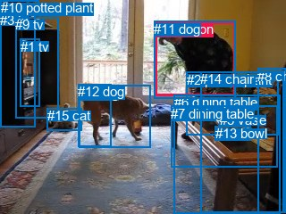
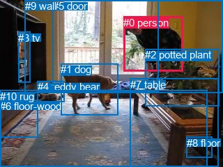

# 图片 1745：2397343.jpg

随机样本序号：381。图片 SHA256：`3e1fd76af6b82f92fb57bcc74b4e84064574ef59148b7c09f00642e5a9138c81`。

红色框表示人，蓝色框表示其他物体。两个模式分别保留自身框编号，可依据位置比较对应对象。

## 自动检测框与输出

人的框编号：`[4]`。状态：`ok`。

### 自动检测全部物体框

| 编号 | 类别 | 是否为人 | 检测分数 | 像素坐标 xyxy |
|---|---|---|---|---|
| 0 | dog | False | 0.9990 | 88.6, 96.0, 168.6, 165.6 |
| 1 | tv | False | 0.9784 | 22.7, 43.6, 45.0, 119.7 |
| 2 | potted plant | False | 0.9577 | 208.5, 80.6, 311.7, 151.4 |
| 3 | tv | False | 0.8515 | 0.2, 14.0, 39.6, 142.5 |
| 4 | person | True | 0.7883 | 173.6, 24.3, 263.4, 107.5 |
| 5 | vase | False | 0.7676 | 245.8, 126.2, 275.3, 150.0 |
| 6 | dining table | False | 0.7453 | 194.6, 106.0, 313.5, 239.9 |
| 7 | dining table | False | 0.5776 | 191.1, 118.7, 310.8, 187.9 |
| 8 | chair | False | 0.5551 | 288.2, 76.6, 319.2, 238.6 |
| 9 | tv | False | 0.5310 | 17.4, 19.1, 65.2, 132.9 |
| 10 | potted plant | False | 0.5014 | 0.7, 0.0, 44.0, 14.2 |
| 11 | dog | False | 0.4804 | 172.2, 23.9, 263.3, 110.0 |
| 12 | dog | False | 0.4294 | 87.0, 94.4, 124.5, 164.8 |
| 13 | bowl | False | 0.4288 | 240.8, 141.3, 280.4, 157.1 |
| 14 | chair | False | 0.3824 | 224.0, 80.4, 317.6, 238.5 |
| 15 | cat | False | 0.3694 | 52.7, 121.3, 91.7, 146.1 |

### 自动检测 Top50 人相关候选

评分物体对：240；人相关物体对：30；输出关系：50。

| 排名 | 主语编号与类别 | 关系 | 宾语编号与类别 | 类型 | 人与人 | 排序分数 | 原始融合 logit |
|---|---|---|---|---|---|---|---|
| 1 | #4 person | looking at | #0 dog | semantic | False | 0.98795 | 4.4062 |
| 2 | #11 dog | wearing | #4 person | semantic | False | 0.98459 | 4.1570 |
| 3 | #4 person | looking at | #12 dog | semantic | False | 0.97433 | 3.6365 |
| 4 | #4 person | wearing | #11 dog | semantic | False | 0.95173 | 2.9815 |
| 5 | #4 person | beside | #0 dog | spatial | False | 0.90337 | 2.2352 |
| 6 | #4 person | looking at | #1 tv | semantic | False | 0.90129 | 2.2116 |
| 7 | #11 dog | in | #4 person | spatial | False | 0.89022 | 2.0930 |
| 8 | #4 person | leaning on | #6 dining table | spatial | False | 0.84054 | 1.6623 |
| 9 | #4 person | beside | #12 dog | spatial | False | 0.79028 | 1.3266 |
| 10 | #4 person | on | #11 dog | spatial | False | 0.76218 | 1.1647 |
| 11 | #4 person | leaning on | #7 dining table | spatial | False | 0.68088 | 0.7578 |
| 12 | #8 chair | looking at | #4 person | semantic | False | 0.60360 | 0.4205 |
| 13 | #4 person | standing on | #6 dining table | semantic | False | 0.59320 | 0.3772 |
| 14 | #4 person | looking at | #9 tv | semantic | False | 0.58534 | 0.3447 |
| 15 | #0 dog | looking at | #4 person | semantic | False | 0.45599 | -0.1765 |
| 16 | #0 dog | in front of | #4 person | spatial | False | 0.45570 | -0.1776 |
| 17 | #4 person | standing on | #7 dining table | semantic | False | 0.42999 | -0.2819 |
| 18 | #4 person | looking at | #15 cat | semantic | False | 0.39939 | -0.4080 |
| 19 | #4 person | leaning on | #2 potted plant | spatial | False | 0.26401 | -1.0252 |
| 20 | #4 person | leaning on | #14 chair | spatial | False | 0.25291 | -1.0832 |
| 21 | #4 person | beside | #9 tv | spatial | False | 0.19427 | -1.4225 |
| 22 | #4 person | beside | #1 tv | spatial | False | 0.16966 | -1.5880 |
| 23 | #6 dining table | in front of | #4 person | spatial | False | 0.14475 | -1.7764 |
| 24 | #4 person | looking at | #2 potted plant | semantic | False | 0.14200 | -1.7988 |
| 25 | #4 person | standing on | #3 tv | semantic | False | 0.08876 | -2.3289 |
| 26 | #12 dog | in front of | #4 person | spatial | False | 0.08251 | -2.4087 |
| 27 | #7 dining table | in front of | #4 person | spatial | False | 0.08178 | -2.4185 |
| 28 | #15 cat | looking at | #4 person | semantic | False | 0.07763 | -2.4750 |
| 29 | #4 person | climbing | #14 chair | semantic | False | 0.06807 | -2.6167 |
| 30 | #4 person | leaning on | #3 tv | spatial | False | 0.04878 | -2.9704 |
| 31 | #4 person | on | #15 cat | spatial | False | 0.04523 | -3.0498 |
| 32 | #14 chair | in front of | #4 person | spatial | False | 0.03940 | -3.1938 |
| 33 | #12 dog | looking at | #4 person | semantic | False | 0.03884 | -3.2086 |
| 34 | #2 potted plant | in front of | #4 person | spatial | False | 0.03765 | -3.2410 |
| 35 | #8 chair | beside | #4 person | spatial | False | 0.02936 | -3.4982 |
| 36 | #4 person | leaning on | #5 vase | spatial | False | 0.01623 | -4.1047 |
| 37 | #4 person | looking at | #8 chair | semantic | False | 0.01522 | -4.1697 |
| 38 | #4 person | leaning on | #8 chair | spatial | False | 0.01268 | -4.3548 |
| 39 | #4 person | leaning on | #13 bowl | spatial | False | 0.01051 | -4.5452 |
| 40 | #15 cat | beside | #4 person | spatial | False | 0.00969 | -4.6270 |
| 41 | #4 person | leaning on | #10 potted plant | spatial | False | 0.00887 | -4.7158 |
| 42 | #9 tv | in front of | #4 person | spatial | False | 0.00711 | -4.9393 |
| 43 | #4 person | looking at | #5 vase | semantic | False | 0.00642 | -5.0423 |
| 44 | #3 tv | in front of | #4 person | spatial | False | 0.00527 | -5.2402 |
| 45 | #4 person | standing on | #10 potted plant | semantic | False | 0.00383 | -5.5598 |
| 46 | #4 person | standing on | #13 bowl | semantic | False | 0.00337 | -5.6899 |
| 47 | #6 dining table | holding | #4 person | semantic | False | 0.00299 | -5.8103 |
| 48 | #9 tv | holding | #4 person | semantic | False | 0.00294 | -5.8266 |
| 49 | #7 dining table | holding | #4 person | semantic | False | 0.00272 | -5.9051 |
| 50 | #1 tv | in front of | #4 person | spatial | False | 0.00247 | -6.0010 |

### 自动检测逐条人相关 GT 核验

R@50：28.57%；命中 2/7。

| GT 主语编号 | GT 关系 | GT 宾语编号 | 结果阶段 | 匹配预测主语编号 | 匹配预测宾语编号 |
|---|---|---|---|---|---|
| 0 | beside | 1 | hit50 | [4] | [0] |
| 0 | playing with | 1 | wrong_predicate | [4] | [0] |
| 0 | beside | 5 | endpoint_missing_or_wrong_class | [4] | [] |
| 0 | beside | 7 | endpoint_missing_or_wrong_class | [4] | [] |
| 2 | in front of | 0 | hit50 | [2] | [4] |
| 5 | in | 0 | endpoint_missing_or_wrong_class | [] | [4] |
| 7 | beside | 0 | endpoint_missing_or_wrong_class | [] | [4] |

## 真实框与输出

人的框编号：`[0]`。

### 真实框全部物体框

| 编号 | 类别 | 是否为人 | 检测分数 | 像素坐标 xyxy |
|---|---|---|---|---|
| 0 | person | True | GT | 177.0, 24.0, 262.0, 103.0 |
| 1 | dog | False | GT | 87.0, 91.0, 169.0, 165.0 |
| 2 | potted plant | False | GT | 208.0, 70.0, 314.0, 152.0 |
| 3 | tv | False | GT | 26.0, 46.0, 44.0, 118.0 |
| 4 | teddy bear | False | GT | 54.0, 116.0, 93.0, 146.0 |
| 5 | door | False | GT | 76.0, 0.0, 228.0, 132.0 |
| 6 | floor-wood | False | GT | 0.0, 144.0, 54.0, 198.0 |
| 7 | table | False | GT | 187.0, 113.0, 313.0, 240.0 |
| 8 | floor | False | GT | 268.0, 197.0, 305.0, 227.0 |
| 9 | wall | False | GT | 36.0, 0.0, 320.0, 133.0 |
| 10 | rug | False | GT | 0.0, 130.0, 297.0, 240.0 |

### 真实框 Top50 人相关候选

评分物体对：110；人相关物体对：20；输出关系：40。

| 排名 | 主语编号与类别 | 关系 | 宾语编号与类别 | 类型 | 人与人 | 排序分数 | 原始融合 logit |
|---|---|---|---|---|---|---|---|
| 1 | #0 person | looking at | #1 dog | semantic | False | 0.97836 | 3.8111 |
| 2 | #0 person | looking at | #3 tv | semantic | False | 0.96862 | 3.4298 |
| 3 | #0 person | in | #9 wall | spatial | False | 0.94766 | 2.8963 |
| 4 | #0 person | in | #5 door | spatial | False | 0.92548 | 2.5192 |
| 5 | #0 person | looking at | #5 door | semantic | False | 0.91857 | 2.4230 |
| 6 | #0 person | leaning on | #7 table | spatial | False | 0.89232 | 2.1147 |
| 7 | #0 person | beside | #1 dog | spatial | False | 0.84463 | 1.6931 |
| 8 | #0 person | standing on | #9 wall | semantic | False | 0.70623 | 0.8771 |
| 9 | #0 person | standing on | #10 rug | semantic | False | 0.69532 | 0.8251 |
| 10 | #0 person | on | #10 rug | spatial | False | 0.65680 | 0.6491 |
| 11 | #0 person | on | #2 potted plant | spatial | False | 0.62930 | 0.5292 |
| 12 | #0 person | looking at | #4 teddy bear | semantic | False | 0.57490 | 0.3019 |
| 13 | #0 person | beside | #3 tv | spatial | False | 0.55892 | 0.2368 |
| 14 | #0 person | climbing | #7 table | semantic | False | 0.53716 | 0.1489 |
| 15 | #0 person | looking at | #2 potted plant | semantic | False | 0.51969 | 0.0788 |
| 16 | #1 dog | looking at | #0 person | semantic | False | 0.28693 | -0.9103 |
| 17 | #0 person | in | #4 teddy bear | spatial | False | 0.17363 | -1.5601 |
| 18 | #5 door | beside | #0 person | spatial | False | 0.17091 | -1.5792 |
| 19 | #1 dog | in | #0 person | spatial | False | 0.11083 | -2.0823 |
| 20 | #4 teddy bear | looking at | #0 person | semantic | False | 0.06858 | -2.6087 |
| 21 | #0 person | on | #6 floor-wood | spatial | False | 0.05628 | -2.8196 |
| 22 | #0 person | leaning on | #8 floor | spatial | False | 0.05185 | -2.9062 |
| 23 | #2 potted plant | beside | #0 person | spatial | False | 0.04674 | -3.0153 |
| 24 | #5 door | holding | #0 person | semantic | False | 0.03113 | -3.4378 |
| 25 | #0 person | standing on | #6 floor-wood | semantic | False | 0.03089 | -3.4460 |
| 26 | #9 wall | beside | #0 person | spatial | False | 0.02796 | -3.5487 |
| 27 | #3 tv | beside | #0 person | spatial | False | 0.02669 | -3.5965 |
| 28 | #7 table | beside | #0 person | spatial | False | 0.02429 | -3.6931 |
| 29 | #4 teddy bear | beside | #0 person | spatial | False | 0.01570 | -4.1385 |
| 30 | #0 person | standing on | #8 floor | semantic | False | 0.01542 | -4.1564 |
| 31 | #10 rug | in | #0 person | spatial | False | 0.01361 | -4.2829 |
| 32 | #9 wall | holding | #0 person | semantic | False | 0.00994 | -4.6008 |
| 33 | #3 tv | playing | #0 person | semantic | False | 0.00684 | -4.9775 |
| 34 | #7 table | holding | #0 person | semantic | False | 0.00611 | -5.0911 |
| 35 | #2 potted plant | looking at | #0 person | semantic | False | 0.00600 | -5.1097 |
| 36 | #10 rug | holding | #0 person | semantic | False | 0.00316 | -5.7524 |
| 37 | #6 floor-wood | in | #0 person | spatial | False | 0.00262 | -5.9421 |
| 38 | #8 floor | in | #0 person | spatial | False | 0.00138 | -6.5855 |
| 39 | #6 floor-wood | holding | #0 person | semantic | False | 0.00074 | -7.2141 |
| 40 | #8 floor | holding | #0 person | semantic | False | 0.00072 | -7.2398 |

### 真实框逐条人相关 GT 核验

R@50：28.57%；命中 2/7。

| GT 主语编号 | GT 关系 | GT 宾语编号 | 结果阶段 | 匹配预测主语编号 | 匹配预测宾语编号 |
|---|---|---|---|---|---|
| 0 | beside | 1 | hit50 | [0] | [1] |
| 0 | playing with | 1 | wrong_predicate | [0] | [1] |
| 0 | beside | 5 | wrong_predicate | [0] | [5] |
| 0 | beside | 7 | wrong_predicate | [0] | [7] |
| 2 | in front of | 0 | wrong_predicate | [2] | [0] |
| 5 | in | 0 | wrong_predicate | [5] | [0] |
| 7 | beside | 0 | hit50 | [7] | [0] |

## 全部人相关 GT

| 主语编号与类别 | 关系 | 宾语编号与类别 |
|---|---|---|
| #0 person | beside | #1 dog |
| #0 person | playing with | #1 dog |
| #0 person | beside | #5 door |
| #0 person | beside | #7 table |
| #2 potted plant | in front of | #0 person |
| #5 door | in | #0 person |
| #7 table | beside | #0 person |

原始记录、全部人相关物体对的两项预测与分项分数见 [逐图证据 JSON](../evidence/cases/1745.json)。全部56类 logits 保留于本机 HOR/output/random500/logits/。

<!-- HOR_COMPLETE_RESULTS -->

## 六组条件的完整输出对照

以下保留同一图片三种框与候选模式、两种谓词输出规则的全部 Top50。框编号各自在所属模式内解释。

### 自动检测框完整枚举：空间与语义各保留一个谓词

| 排名 | 主语编号与类别 | 谓词 | 宾语编号与类别 | 分组 | 排序分数 | predicate logit | pair logit |
|---|---|---|---|---|---|---|---|
| 1 | #4 person | looking at | #0 dog | semantic | 0.9879452 | 3.9280505 | 0.4781117 |
| 2 | #11 dog | wearing | #4 person | semantic | 0.9845864 | 4.0826221 | 0.0743492 |
| 3 | #4 person | looking at | #12 dog | semantic | 0.9743312 | 3.7958331 | -0.1593576 |
| 4 | #4 person | wearing | #11 dog | semantic | 0.9517318 | 2.9844470 | -0.0029371 |
| 5 | #4 person | beside | #0 dog | spatial | 0.9033663 | 1.7570891 | 0.4781117 |
| 6 | #4 person | looking at | #1 tv | semantic | 0.9012894 | 2.2709408 | -0.0593065 |
| 7 | #11 dog | in | #4 person | spatial | 0.8902161 | 2.0186009 | 0.0743492 |
| 8 | #4 person | leaning on | #6 dining table | spatial | 0.8405437 | 2.0518441 | -0.3895648 |
| 9 | #4 person | beside | #12 dog | spatial | 0.7902812 | 1.4859791 | -0.1593576 |
| 10 | #4 person | on | #11 dog | spatial | 0.7621797 | 1.1676040 | -0.0029371 |
| 11 | #4 person | leaning on | #7 dining table | spatial | 0.6808752 | 1.3514080 | -0.5936115 |
| 12 | #8 chair | looking at | #4 person | semantic | 0.6036026 | 1.0409026 | -0.6204034 |
| 13 | #4 person | standing on | #6 dining table | semantic | 0.5931999 | 0.7667742 | -0.3895648 |
| 14 | #4 person | looking at | #9 tv | semantic | 0.5853376 | 0.7321033 | -0.3873793 |
| 15 | #0 dog | looking at | #4 person | semantic | 0.4559923 | 0.3822727 | -0.5587602 |
| 16 | #0 dog | in front of | #4 person | spatial | 0.4557043 | 0.3811116 | -0.5587602 |
| 17 | #4 person | standing on | #7 dining table | semantic | 0.4299935 | 0.3117337 | -0.5936115 |
| 18 | #4 person | looking at | #15 cat | semantic | 0.3993868 | 0.4161992 | -0.8242202 |
| 19 | #4 person | leaning on | #2 potted plant | spatial | 0.2640061 | -0.6093378 | -0.4159118 |
| 20 | #4 person | leaning on | #14 chair | spatial | 0.2529100 | -0.5994558 | -0.4836960 |
| 21 | #4 person | beside | #9 tv | spatial | 0.1942651 | -1.0351515 | -0.3873793 |
| 22 | #4 person | beside | #1 tv | spatial | 0.1696634 | -1.5287080 | -0.0593065 |
| 23 | #6 dining table | in front of | #4 person | spatial | 0.1447462 | -0.7569952 | -1.0194216 |
| 24 | #4 person | looking at | #2 potted plant | semantic | 0.1419982 | -1.3828800 | -0.4159118 |
| 25 | #4 person | standing on | #3 tv | semantic | 0.0887565 | -1.3612883 | -0.9676253 |
| 26 | #12 dog | in front of | #4 person | spatial | 0.0825096 | -1.4346611 | -0.9740664 |
| 27 | #7 dining table | in front of | #4 person | spatial | 0.0817751 | -1.2443111 | -1.1741583 |
| 28 | #15 cat | looking at | #4 person | semantic | 0.0776294 | -1.2300279 | -1.2449734 |
| 29 | #4 person | climbing | #14 chair | semantic | 0.0680717 | -2.1329985 | -0.4836960 |
| 30 | #4 person | leaning on | #3 tv | spatial | 0.0487831 | -2.0027320 | -0.9676253 |
| 31 | #4 person | on | #15 cat | spatial | 0.0452266 | -2.2255673 | -0.8242202 |
| 32 | #14 chair | in front of | #4 person | spatial | 0.0394001 | -1.9348423 | -1.2589481 |
| 33 | #12 dog | looking at | #4 person | semantic | 0.0388446 | -2.2344997 | -0.9740664 |
| 34 | #2 potted plant | in front of | #4 person | spatial | 0.0376502 | -2.0039799 | -1.2370605 |
| 35 | #8 chair | beside | #4 person | spatial | 0.0293630 | -2.8778143 | -0.6204034 |
| 36 | #4 person | leaning on | #5 vase | spatial | 0.0162271 | -2.8603106 | -1.2444001 |
| 37 | #4 person | looking at | #8 chair | semantic | 0.0152213 | -3.0545735 | -1.1151483 |
| 38 | #4 person | leaning on | #8 chair | spatial | 0.0126824 | -3.2396309 | -1.1151483 |
| 39 | #4 person | leaning on | #13 bowl | spatial | 0.0105063 | -3.1599531 | -1.3852636 |
| 40 | #15 cat | beside | #4 person | spatial | 0.0096892 | -3.3820376 | -1.2449734 |
| 41 | #4 person | leaning on | #10 potted plant | spatial | 0.0088729 | -3.3564675 | -1.3593774 |
| 42 | #9 tv | in front of | #4 person | spatial | 0.0071085 | -3.4550810 | -1.4842508 |
| 43 | #4 person | looking at | #5 vase | semantic | 0.0064174 | -3.7979043 | -1.2444001 |
| 44 | #3 tv | in front of | #4 person | spatial | 0.0052714 | -3.8444114 | -1.3957627 |
| 45 | #4 person | standing on | #10 potted plant | semantic | 0.0038348 | -4.2004128 | -1.3593774 |
| 46 | #4 person | standing on | #13 bowl | semantic | 0.0033686 | -4.3046279 | -1.3852636 |
| 47 | #6 dining table | holding | #4 person | semantic | 0.0029875 | -4.7909098 | -1.0194216 |
| 48 | #9 tv | holding | #4 person | semantic | 0.0029395 | -4.3423367 | -1.4842508 |
| 49 | #7 dining table | holding | #4 person | semantic | 0.0027180 | -4.7309694 | -1.1741583 |
| 50 | #1 tv | in front of | #4 person | spatial | 0.0024701 | -4.2939692 | -1.7070539 |

GT 命中：2/7，R@50=28.57%。

| GT主语 | GT谓词 | GT宾语 | 结果阶段 | 匹配主语框 | 匹配宾语框 |
|---|---|---|---|---|---|
| 0 | beside | 1 | hit50 | [4] | [0] |
| 0 | playing with | 1 | wrong_predicate | [4] | [0] |
| 0 | beside | 5 | endpoint_missing_or_wrong_class | [4] | [] |
| 0 | beside | 7 | endpoint_missing_or_wrong_class | [4] | [] |
| 2 | in front of | 0 | hit50 | [2] | [4] |
| 5 | in | 0 | endpoint_missing_or_wrong_class | [] | [4] |
| 7 | beside | 0 | endpoint_missing_or_wrong_class | [] | [4] |

### 自动检测框完整枚举：每对只保留一个谓词

| 排名 | 主语编号与类别 | 谓词 | 宾语编号与类别 | 分组 | 排序分数 | predicate logit | pair logit |
|---|---|---|---|---|---|---|---|
| 1 | #4 person | looking at | #0 dog | single | 0.9879452 | 3.9280505 | 0.4781117 |
| 2 | #11 dog | wearing | #4 person | single | 0.9845864 | 4.0826221 | 0.0743492 |
| 3 | #4 person | looking at | #12 dog | single | 0.9743312 | 3.7958331 | -0.1593576 |
| 4 | #4 person | wearing | #11 dog | single | 0.9517318 | 2.9844470 | -0.0029371 |
| 5 | #4 person | looking at | #1 tv | single | 0.9012894 | 2.2709408 | -0.0593065 |
| 6 | #4 person | leaning on | #6 dining table | single | 0.8405437 | 2.0518441 | -0.3895648 |
| 7 | #4 person | leaning on | #7 dining table | single | 0.6808752 | 1.3514080 | -0.5936115 |
| 8 | #8 chair | looking at | #4 person | single | 0.6036026 | 1.0409026 | -0.6204034 |
| 9 | #4 person | looking at | #9 tv | single | 0.5853376 | 0.7321033 | -0.3873793 |
| 10 | #0 dog | looking at | #4 person | single | 0.4559923 | 0.3822727 | -0.5587602 |
| 11 | #4 person | looking at | #15 cat | single | 0.3993868 | 0.4161992 | -0.8242202 |
| 12 | #4 person | leaning on | #2 potted plant | single | 0.2640061 | -0.6093378 | -0.4159118 |
| 13 | #4 person | leaning on | #14 chair | single | 0.2529100 | -0.5994558 | -0.4836960 |
| 14 | #6 dining table | in front of | #4 person | single | 0.1447462 | -0.7569952 | -1.0194216 |
| 15 | #4 person | standing on | #3 tv | single | 0.0887565 | -1.3612883 | -0.9676253 |
| 16 | #12 dog | in front of | #4 person | single | 0.0825096 | -1.4346611 | -0.9740664 |
| 17 | #7 dining table | in front of | #4 person | single | 0.0817751 | -1.2443111 | -1.1741583 |
| 18 | #15 cat | looking at | #4 person | single | 0.0776294 | -1.2300279 | -1.2449734 |
| 19 | #14 chair | in front of | #4 person | single | 0.0394001 | -1.9348423 | -1.2589481 |
| 20 | #2 potted plant | in front of | #4 person | single | 0.0376502 | -2.0039799 | -1.2370605 |
| 21 | #4 person | leaning on | #5 vase | single | 0.0162271 | -2.8603106 | -1.2444001 |
| 22 | #4 person | looking at | #8 chair | single | 0.0152213 | -3.0545735 | -1.1151483 |
| 23 | #4 person | leaning on | #13 bowl | single | 0.0105063 | -3.1599531 | -1.3852636 |
| 24 | #4 person | leaning on | #10 potted plant | single | 0.0088729 | -3.3564675 | -1.3593774 |
| 25 | #9 tv | in front of | #4 person | single | 0.0071085 | -3.4550810 | -1.4842508 |
| 26 | #3 tv | in front of | #4 person | single | 0.0052714 | -3.8444114 | -1.3957627 |
| 27 | #1 tv | in front of | #4 person | single | 0.0024701 | -4.2939692 | -1.7070539 |
| 28 | #5 vase | in | #4 person | single | 0.0021478 | -4.9925432 | -1.1486392 |
| 29 | #10 potted plant | climbing | #4 person | single | 0.0020475 | -5.0337214 | -1.1553714 |
| 30 | #13 bowl | in | #4 person | single | 0.0014191 | -5.2000518 | -1.3562458 |

GT 命中：1/7，R@50=14.29%。

| GT主语 | GT谓词 | GT宾语 | 结果阶段 | 匹配主语框 | 匹配宾语框 |
|---|---|---|---|---|---|
| 0 | beside | 1 | wrong_predicate | [4] | [0] |
| 0 | playing with | 1 | wrong_predicate | [4] | [0] |
| 0 | beside | 5 | endpoint_missing_or_wrong_class | [4] | [] |
| 0 | beside | 7 | endpoint_missing_or_wrong_class | [4] | [] |
| 2 | in front of | 0 | hit50 | [2] | [4] |
| 5 | in | 0 | endpoint_missing_or_wrong_class | [] | [4] |
| 7 | beside | 0 | endpoint_missing_or_wrong_class | [] | [4] |

### 真实框完整枚举：空间与语义各保留一个谓词

| 排名 | 主语编号与类别 | 谓词 | 宾语编号与类别 | 分组 | 排序分数 | predicate logit | pair logit |
|---|---|---|---|---|---|---|---|
| 1 | #0 person | looking at | #1 dog | semantic | 0.9783554 | 3.3703713 | 0.4407478 |
| 2 | #0 person | looking at | #3 tv | semantic | 0.9686221 | 3.6341109 | -0.2043402 |
| 3 | #0 person | in | #9 wall | spatial | 0.9476621 | 3.3718171 | -0.4755409 |
| 4 | #0 person | in | #5 door | spatial | 0.9254792 | 2.7107000 | -0.1914671 |
| 5 | #0 person | looking at | #5 door | semantic | 0.9185666 | 2.6144953 | -0.1914671 |
| 6 | #0 person | leaning on | #7 table | spatial | 0.8923228 | 2.5249672 | -0.4102767 |
| 7 | #0 person | beside | #1 dog | spatial | 0.8446251 | 1.2523036 | 0.4407478 |
| 8 | #0 person | standing on | #9 wall | semantic | 0.7062291 | 1.3526802 | -0.4755409 |
| 9 | #0 person | standing on | #10 rug | semantic | 0.6953248 | 1.7162361 | -0.8911035 |
| 10 | #0 person | on | #10 rug | spatial | 0.6567996 | 1.5401678 | -0.8911035 |
| 11 | #0 person | on | #2 potted plant | spatial | 0.6293008 | 0.9039369 | -0.3747183 |
| 12 | #0 person | looking at | #4 teddy bear | semantic | 0.5748972 | 1.1737099 | -0.8718496 |
| 13 | #0 person | beside | #3 tv | spatial | 0.5589179 | 0.4411120 | -0.2043402 |
| 14 | #0 person | climbing | #7 table | semantic | 0.5371605 | 0.5591931 | -0.4102767 |
| 15 | #0 person | looking at | #2 potted plant | semantic | 0.5196862 | 0.4535036 | -0.3747183 |
| 16 | #1 dog | looking at | #0 person | semantic | 0.2869337 | -0.3341646 | -0.5761585 |
| 17 | #0 person | in | #4 teddy bear | spatial | 0.1736258 | -0.6882958 | -0.8718496 |
| 18 | #5 door | beside | #0 person | spatial | 0.1709107 | -0.6808171 | -0.8983698 |
| 19 | #1 dog | in | #0 person | spatial | 0.1108285 | -1.5061474 | -0.5761585 |
| 20 | #4 teddy bear | looking at | #0 person | semantic | 0.0685824 | -1.2340260 | -1.3746459 |
| 21 | #0 person | on | #6 floor-wood | spatial | 0.0562753 | -1.2332375 | -1.5863413 |
| 22 | #0 person | leaning on | #8 floor | spatial | 0.0518502 | -1.6657393 | -1.2404137 |
| 23 | #2 potted plant | beside | #0 person | spatial | 0.0467380 | -1.7433729 | -1.2719593 |
| 24 | #5 door | holding | #0 person | semantic | 0.0311341 | -2.5394521 | -0.8983698 |
| 25 | #0 person | standing on | #6 floor-wood | semantic | 0.0308877 | -1.8596799 | -1.5863413 |
| 26 | #9 wall | beside | #0 person | spatial | 0.0279591 | -2.6049564 | -0.9436973 |
| 27 | #3 tv | beside | #0 person | spatial | 0.0266881 | -1.7893696 | -1.8071178 |
| 28 | #7 table | beside | #0 person | spatial | 0.0242909 | -2.6168795 | -1.0761850 |
| 29 | #4 teddy bear | beside | #0 person | spatial | 0.0156966 | -2.7638462 | -1.3746459 |
| 30 | #0 person | standing on | #8 floor | semantic | 0.0154230 | -2.9159398 | -1.2404137 |
| 31 | #10 rug | in | #0 person | spatial | 0.0136144 | -2.9711227 | -1.3117980 |
| 32 | #9 wall | holding | #0 person | semantic | 0.0099439 | -3.6571026 | -0.9436973 |
| 33 | #3 tv | playing | #0 person | semantic | 0.0068443 | -3.1703463 | -1.8071178 |
| 34 | #7 table | holding | #0 person | semantic | 0.0061138 | -4.0148940 | -1.0761850 |
| 35 | #2 potted plant | looking at | #0 person | semantic | 0.0060016 | -3.8377573 | -1.2719593 |
| 36 | #10 rug | holding | #0 person | semantic | 0.0031650 | -4.4406385 | -1.3117980 |
| 37 | #6 floor-wood | in | #0 person | spatial | 0.0026195 | -4.1062932 | -1.8358414 |
| 38 | #8 floor | in | #0 person | spatial | 0.0013783 | -5.0946259 | -1.4909089 |
| 39 | #6 floor-wood | holding | #0 person | semantic | 0.0007356 | -5.3782763 | -1.8358414 |
| 40 | #8 floor | holding | #0 person | semantic | 0.0007170 | -5.7488499 | -1.4909089 |

GT 命中：2/7，R@50=28.57%。

| GT主语 | GT谓词 | GT宾语 | 结果阶段 | 匹配主语框 | 匹配宾语框 |
|---|---|---|---|---|---|
| 0 | beside | 1 | hit50 | [0] | [1] |
| 0 | playing with | 1 | wrong_predicate | [0] | [1] |
| 0 | beside | 5 | wrong_predicate | [0] | [5] |
| 0 | beside | 7 | wrong_predicate | [0] | [7] |
| 2 | in front of | 0 | wrong_predicate | [2] | [0] |
| 5 | in | 0 | wrong_predicate | [5] | [0] |
| 7 | beside | 0 | hit50 | [7] | [0] |

### 真实框完整枚举：每对只保留一个谓词

| 排名 | 主语编号与类别 | 谓词 | 宾语编号与类别 | 分组 | 排序分数 | predicate logit | pair logit |
|---|---|---|---|---|---|---|---|
| 1 | #0 person | looking at | #1 dog | single | 0.9783554 | 3.3703713 | 0.4407478 |
| 2 | #0 person | looking at | #3 tv | single | 0.9686221 | 3.6341109 | -0.2043402 |
| 3 | #0 person | in | #9 wall | single | 0.9476621 | 3.3718171 | -0.4755409 |
| 4 | #0 person | in | #5 door | single | 0.9254792 | 2.7107000 | -0.1914671 |
| 5 | #0 person | leaning on | #7 table | single | 0.8923228 | 2.5249672 | -0.4102767 |
| 6 | #0 person | standing on | #10 rug | single | 0.6953248 | 1.7162361 | -0.8911035 |
| 7 | #0 person | on | #2 potted plant | single | 0.6293008 | 0.9039369 | -0.3747183 |
| 8 | #0 person | looking at | #4 teddy bear | single | 0.5748972 | 1.1737099 | -0.8718496 |
| 9 | #1 dog | looking at | #0 person | single | 0.2869337 | -0.3341646 | -0.5761585 |
| 10 | #5 door | beside | #0 person | single | 0.1709107 | -0.6808171 | -0.8983698 |
| 11 | #4 teddy bear | looking at | #0 person | single | 0.0685824 | -1.2340260 | -1.3746459 |
| 12 | #0 person | on | #6 floor-wood | single | 0.0562753 | -1.2332375 | -1.5863413 |
| 13 | #0 person | leaning on | #8 floor | single | 0.0518502 | -1.6657393 | -1.2404137 |
| 14 | #2 potted plant | beside | #0 person | single | 0.0467380 | -1.7433729 | -1.2719593 |
| 15 | #9 wall | beside | #0 person | single | 0.0279591 | -2.6049564 | -0.9436973 |
| 16 | #3 tv | beside | #0 person | single | 0.0266881 | -1.7893696 | -1.8071178 |
| 17 | #7 table | beside | #0 person | single | 0.0242909 | -2.6168795 | -1.0761850 |
| 18 | #10 rug | in | #0 person | single | 0.0136144 | -2.9711227 | -1.3117980 |
| 19 | #6 floor-wood | in | #0 person | single | 0.0026195 | -4.1062932 | -1.8358414 |
| 20 | #8 floor | in | #0 person | single | 0.0013783 | -5.0946259 | -1.4909089 |

GT 命中：1/7，R@50=14.29%。

| GT主语 | GT谓词 | GT宾语 | 结果阶段 | 匹配主语框 | 匹配宾语框 |
|---|---|---|---|---|---|
| 0 | beside | 1 | wrong_predicate | [0] | [1] |
| 0 | playing with | 1 | wrong_predicate | [0] | [1] |
| 0 | beside | 5 | wrong_predicate | [0] | [5] |
| 0 | beside | 7 | wrong_predicate | [0] | [7] |
| 2 | in front of | 0 | wrong_predicate | [2] | [0] |
| 5 | in | 0 | wrong_predicate | [5] | [0] |
| 7 | beside | 0 | hit50 | [7] | [0] |

### 真实框400候选：空间与语义各保留一个谓词

| 排名 | 主语编号与类别 | 谓词 | 宾语编号与类别 | 分组 | 排序分数 | predicate logit | pair logit |
|---|---|---|---|---|---|---|---|
| 1 | #0 person | looking at | #1 dog | semantic | 0.9783554 | 3.3703713 | 0.4407478 |
| 2 | #0 person | looking at | #3 tv | semantic | 0.9667628 | 3.5746264 | -0.2043402 |
| 3 | #0 person | in | #9 wall | spatial | 0.9479903 | 3.3784547 | -0.4755409 |
| 4 | #0 person | in | #5 door | spatial | 0.9254792 | 2.7107000 | -0.1914671 |
| 5 | #0 person | looking at | #5 door | semantic | 0.9207384 | 2.6438894 | -0.1914671 |
| 6 | #0 person | leaning on | #7 table | spatial | 0.8923228 | 2.5249672 | -0.4102767 |
| 7 | #0 person | beside | #1 dog | spatial | 0.8446175 | 1.2522459 | 0.4407478 |
| 8 | #0 person | standing on | #9 wall | semantic | 0.7047032 | 1.3453364 | -0.4755409 |
| 9 | #0 person | standing on | #10 rug | semantic | 0.6953248 | 1.7162361 | -0.8911035 |
| 10 | #0 person | on | #10 rug | spatial | 0.6567996 | 1.5401678 | -0.8911035 |
| 11 | #0 person | on | #2 potted plant | spatial | 0.6293008 | 0.9039369 | -0.3747183 |
| 12 | #0 person | looking at | #4 teddy bear | semantic | 0.5748972 | 1.1737099 | -0.8718496 |
| 13 | #0 person | beside | #3 tv | spatial | 0.5515156 | 0.4111366 | -0.2043402 |
| 14 | #0 person | climbing | #7 table | semantic | 0.5372103 | 0.5593934 | -0.4102767 |
| 15 | #0 person | looking at | #2 potted plant | semantic | 0.5195120 | 0.4528060 | -0.3747183 |
| 16 | #1 dog | looking at | #0 person | semantic | 0.2870051 | -0.3338156 | -0.5761585 |
| 17 | #0 person | in | #4 teddy bear | spatial | 0.1736258 | -0.6882958 | -0.8718496 |
| 18 | #5 door | beside | #0 person | spatial | 0.1709084 | -0.6808333 | -0.8983698 |
| 19 | #1 dog | in | #0 person | spatial | 0.1132963 | -1.4813454 | -0.5761585 |
| 20 | #4 teddy bear | looking at | #0 person | semantic | 0.0685852 | -1.2339823 | -1.3746459 |
| 21 | #0 person | on | #6 floor-wood | spatial | 0.0575986 | -1.2085912 | -1.5863413 |
| 22 | #0 person | leaning on | #8 floor | spatial | 0.0511425 | -1.6802287 | -1.2404137 |
| 23 | #2 potted plant | beside | #0 person | spatial | 0.0460703 | -1.7584620 | -1.2719593 |
| 24 | #0 person | standing on | #6 floor-wood | semantic | 0.0313971 | -1.8427982 | -1.5863413 |
| 25 | #5 door | holding | #0 person | semantic | 0.0311899 | -2.5376058 | -0.8983698 |
| 26 | #9 wall | beside | #0 person | spatial | 0.0275555 | -2.6199152 | -0.9436973 |
| 27 | #3 tv | beside | #0 person | spatial | 0.0263007 | -1.8043900 | -1.8071178 |
| 28 | #7 table | beside | #0 person | spatial | 0.0242892 | -2.6169515 | -1.0761850 |
| 29 | #4 teddy bear | beside | #0 person | spatial | 0.0159309 | -2.7487879 | -1.3746459 |
| 30 | #0 person | standing on | #8 floor | semantic | 0.0154230 | -2.9159398 | -1.2404137 |
| 31 | #10 rug | in | #0 person | spatial | 0.0134138 | -2.9861684 | -1.3117980 |
| 32 | #9 wall | holding | #0 person | semantic | 0.0098220 | -3.6695631 | -0.9436973 |
| 33 | #3 tv | playing | #0 person | semantic | 0.0068279 | -3.1727703 | -1.8071178 |
| 34 | #7 table | holding | #0 person | semantic | 0.0060593 | -4.0238938 | -1.0761850 |
| 35 | #2 potted plant | looking at | #0 person | semantic | 0.0058277 | -3.8673258 | -1.2719593 |
| 36 | #10 rug | holding | #0 person | semantic | 0.0031271 | -4.4527302 | -1.3117980 |
| 37 | #6 floor-wood | in | #0 person | spatial | 0.0025957 | -4.1154757 | -1.8358414 |
| 38 | #8 floor | in | #0 person | spatial | 0.0013557 | -5.1111374 | -1.4909089 |
| 39 | #6 floor-wood | holding | #0 person | semantic | 0.0007267 | -5.3903675 | -1.8358414 |
| 40 | #8 floor | holding | #0 person | semantic | 0.0007063 | -5.7638950 | -1.4909089 |

GT 命中：2/7，R@50=28.57%。

| GT主语 | GT谓词 | GT宾语 | 结果阶段 | 匹配主语框 | 匹配宾语框 |
|---|---|---|---|---|---|
| 0 | beside | 1 | hit50 | [0] | [1] |
| 0 | playing with | 1 | wrong_predicate | [0] | [1] |
| 0 | beside | 5 | wrong_predicate | [0] | [5] |
| 0 | beside | 7 | wrong_predicate | [0] | [7] |
| 2 | in front of | 0 | wrong_predicate | [2] | [0] |
| 5 | in | 0 | wrong_predicate | [5] | [0] |
| 7 | beside | 0 | hit50 | [7] | [0] |

### 真实框400候选：每对只保留一个谓词

| 排名 | 主语编号与类别 | 谓词 | 宾语编号与类别 | 分组 | 排序分数 | predicate logit | pair logit |
|---|---|---|---|---|---|---|---|
| 1 | #0 person | looking at | #1 dog | single | 0.9783554 | 3.3703713 | 0.4407478 |
| 2 | #0 person | looking at | #3 tv | single | 0.9667628 | 3.5746264 | -0.2043402 |
| 3 | #0 person | in | #9 wall | single | 0.9479903 | 3.3784547 | -0.4755409 |
| 4 | #0 person | in | #5 door | single | 0.9254792 | 2.7107000 | -0.1914671 |
| 5 | #0 person | leaning on | #7 table | single | 0.8923228 | 2.5249672 | -0.4102767 |
| 6 | #0 person | standing on | #10 rug | single | 0.6953248 | 1.7162361 | -0.8911035 |
| 7 | #0 person | on | #2 potted plant | single | 0.6293008 | 0.9039369 | -0.3747183 |
| 8 | #0 person | looking at | #4 teddy bear | single | 0.5748972 | 1.1737099 | -0.8718496 |
| 9 | #1 dog | looking at | #0 person | single | 0.2870051 | -0.3338156 | -0.5761585 |
| 10 | #5 door | beside | #0 person | single | 0.1709084 | -0.6808333 | -0.8983698 |
| 11 | #4 teddy bear | looking at | #0 person | single | 0.0685852 | -1.2339823 | -1.3746459 |
| 12 | #0 person | on | #6 floor-wood | single | 0.0575986 | -1.2085912 | -1.5863413 |
| 13 | #0 person | leaning on | #8 floor | single | 0.0511425 | -1.6802287 | -1.2404137 |
| 14 | #2 potted plant | beside | #0 person | single | 0.0460703 | -1.7584620 | -1.2719593 |
| 15 | #9 wall | beside | #0 person | single | 0.0275555 | -2.6199152 | -0.9436973 |
| 16 | #3 tv | beside | #0 person | single | 0.0263007 | -1.8043900 | -1.8071178 |
| 17 | #7 table | beside | #0 person | single | 0.0242892 | -2.6169515 | -1.0761850 |
| 18 | #10 rug | in | #0 person | single | 0.0134138 | -2.9861684 | -1.3117980 |
| 19 | #6 floor-wood | in | #0 person | single | 0.0025957 | -4.1154757 | -1.8358414 |
| 20 | #8 floor | in | #0 person | single | 0.0013557 | -5.1111374 | -1.4909089 |

GT 命中：1/7，R@50=14.29%。

| GT主语 | GT谓词 | GT宾语 | 结果阶段 | 匹配主语框 | 匹配宾语框 |
|---|---|---|---|---|---|
| 0 | beside | 1 | wrong_predicate | [0] | [1] |
| 0 | playing with | 1 | wrong_predicate | [0] | [1] |
| 0 | beside | 5 | wrong_predicate | [0] | [5] |
| 0 | beside | 7 | wrong_predicate | [0] | [7] |
| 2 | in front of | 0 | wrong_predicate | [2] | [0] |
| 5 | in | 0 | wrong_predicate | [5] | [0] |
| 7 | beside | 0 | hit50 | [7] | [0] |
