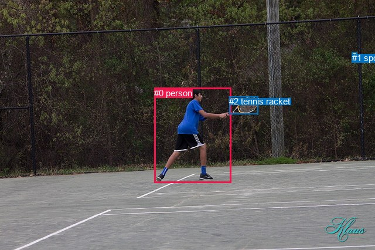
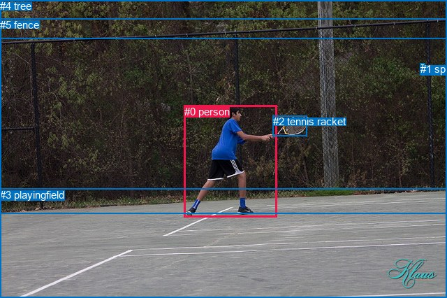

# 图片 1757：2397709.jpg

随机样本序号：271。图片 SHA256：`c3bd88960d608cb0406e870e224fdf0a5cfd8365537c2fee54bd10453dd402f0`。

红色框表示人，蓝色框表示其他物体。两个模式分别保留自身框编号，可依据位置比较对应对象。

## 自动检测框与输出

人的框编号：`[0]`。状态：`ok`。

### 自动检测全部物体框

| 编号 | 类别 | 是否为人 | 检测分数 | 像素坐标 xyxy |
|---|---|---|---|---|
| 0 | person | True | 0.9997 | 263.1, 149.7, 394.1, 311.0 |
| 1 | sports ball | False | 0.9987 | 600.8, 89.8, 609.7, 97.9 |
| 2 | tennis racket | False | 0.9983 | 391.0, 164.4, 440.7, 195.0 |

### 自动检测 Top50 人相关候选

评分物体对：6；人相关物体对：4；输出关系：8。

| 排名 | 主语编号与类别 | 关系 | 宾语编号与类别 | 类型 | 人与人 | 排序分数 | 原始融合 logit |
|---|---|---|---|---|---|---|---|
| 1 | #0 person | swinging | #2 tennis racket | semantic | False | 0.99759 | 6.0277 |
| 2 | #0 person | about to hit | #1 sports ball | semantic | False | 0.90998 | 2.3134 |
| 3 | #0 person | beside | #2 tennis racket | spatial | False | 0.84204 | 1.6735 |
| 4 | #1 sports ball | flying over | #0 person | semantic | False | 0.52092 | 0.0837 |
| 5 | #0 person | in | #1 sports ball | spatial | False | 0.48307 | -0.0677 |
| 6 | #2 tennis racket | beside | #0 person | spatial | False | 0.41226 | -0.3546 |
| 7 | #1 sports ball | over | #0 person | spatial | False | 0.31523 | -0.7758 |
| 8 | #2 tennis racket | holding | #0 person | semantic | False | 0.18143 | -1.5067 |

### 自动检测逐条人相关 GT 核验

R@50：25.00%；命中 1/4。

| GT 主语编号 | GT 关系 | GT 宾语编号 | 结果阶段 | 匹配预测主语编号 | 匹配预测宾语编号 |
|---|---|---|---|---|---|
| 0 | playing | 1 | wrong_predicate | [0] | [1] |
| 0 | holding | 2 | wrong_predicate | [0] | [2] |
| 0 | swinging | 2 | hit50 | [0] | [2] |
| 0 | standing on | 3 | endpoint_missing_or_wrong_class | [0] | [] |

## 真实框与输出

人的框编号：`[0]`。

### 真实框全部物体框

| 编号 | 类别 | 是否为人 | 检测分数 | 像素坐标 xyxy |
|---|---|---|---|---|
| 0 | person | True | GT | 264.0, 151.0, 397.0, 311.0 |
| 1 | sports ball | False | GT | 602.0, 90.0, 609.0, 97.0 |
| 2 | tennis racket | False | GT | 391.0, 165.0, 440.0, 194.0 |
| 3 | playingfield | False | GT | 0.0, 270.0, 640.0, 426.0 |
| 4 | tree | False | GT | 0.0, 0.0, 640.0, 56.0 |
| 5 | fence | False | GT | 0.0, 27.0, 640.0, 306.0 |

### 真实框 Top50 人相关候选

评分物体对：30；人相关物体对：10；输出关系：20。

| 排名 | 主语编号与类别 | 关系 | 宾语编号与类别 | 类型 | 人与人 | 排序分数 | 原始融合 logit |
|---|---|---|---|---|---|---|---|
| 1 | #0 person | swinging | #2 tennis racket | semantic | False | 0.99483 | 5.2603 |
| 2 | #0 person | playing | #3 playingfield | semantic | False | 0.97239 | 3.5616 |
| 3 | #0 person | on | #3 playingfield | spatial | False | 0.96883 | 3.4368 |
| 4 | #0 person | about to hit | #1 sports ball | semantic | False | 0.96173 | 3.2240 |
| 5 | #0 person | playing | #5 fence | semantic | False | 0.90896 | 2.3010 |
| 6 | #5 fence | beside | #0 person | spatial | False | 0.87355 | 1.9327 |
| 7 | #0 person | in front of | #5 fence | spatial | False | 0.79934 | 1.3822 |
| 8 | #0 person | in | #2 tennis racket | spatial | False | 0.79109 | 1.3315 |
| 9 | #5 fence | looking at | #0 person | semantic | False | 0.53756 | 0.1505 |
| 10 | #2 tennis racket | holding | #0 person | semantic | False | 0.53214 | 0.1287 |
| 11 | #0 person | in | #1 sports ball | spatial | False | 0.49607 | -0.0157 |
| 12 | #1 sports ball | over | #0 person | spatial | False | 0.41564 | -0.3407 |
| 13 | #2 tennis racket | in | #0 person | spatial | False | 0.39722 | -0.4171 |
| 14 | #1 sports ball | flying over | #0 person | semantic | False | 0.34756 | -0.6298 |
| 15 | #0 person | in | #4 tree | spatial | False | 0.31267 | -0.7877 |
| 16 | #0 person | looking at | #4 tree | semantic | False | 0.28598 | -0.9150 |
| 17 | #4 tree | beside | #0 person | spatial | False | 0.23917 | -1.1572 |
| 18 | #3 playingfield | in | #0 person | spatial | False | 0.19845 | -1.3960 |
| 19 | #4 tree | looking at | #0 person | semantic | False | 0.11795 | -2.0120 |
| 20 | #3 playingfield | holding | #0 person | semantic | False | 0.11071 | -2.0835 |

### 真实框逐条人相关 GT 核验

R@50：25.00%；命中 1/4。

| GT 主语编号 | GT 关系 | GT 宾语编号 | 结果阶段 | 匹配预测主语编号 | 匹配预测宾语编号 |
|---|---|---|---|---|---|
| 0 | playing | 1 | wrong_predicate | [0] | [1] |
| 0 | holding | 2 | wrong_predicate | [0] | [2] |
| 0 | swinging | 2 | hit50 | [0] | [2] |
| 0 | standing on | 3 | wrong_predicate | [0] | [3] |

## 全部人相关 GT

| 主语编号与类别 | 关系 | 宾语编号与类别 |
|---|---|---|
| #0 person | playing | #1 sports ball |
| #0 person | holding | #2 tennis racket |
| #0 person | swinging | #2 tennis racket |
| #0 person | standing on | #3 playingfield |

原始记录、全部人相关物体对的两项预测与分项分数见 [逐图证据 JSON](../evidence/cases/1757.json)。全部56类 logits 保留于本机 HOR/output/random500/logits/。

<!-- HOR_COMPLETE_RESULTS -->

## 六组条件的完整输出对照

以下保留同一图片三种框与候选模式、两种谓词输出规则的全部 Top50。框编号各自在所属模式内解释。

### 自动检测框完整枚举：空间与语义各保留一个谓词

| 排名 | 主语编号与类别 | 谓词 | 宾语编号与类别 | 分组 | 排序分数 | predicate logit | pair logit |
|---|---|---|---|---|---|---|---|
| 1 | #0 person | swinging | #2 tennis racket | semantic | 0.9975947 | 5.5335889 | 0.4940937 |
| 2 | #0 person | about to hit | #1 sports ball | semantic | 0.9099838 | 1.9937682 | 0.3196684 |
| 3 | #0 person | beside | #2 tennis racket | spatial | 0.8420439 | 1.1794214 | 0.4940937 |
| 4 | #1 sports ball | flying over | #0 person | semantic | 0.5209216 | 0.7428837 | -0.6591483 |
| 5 | #0 person | in | #1 sports ball | spatial | 0.4830727 | -0.3874035 | 0.3196684 |
| 6 | #2 tennis racket | beside | #0 person | spatial | 0.4122639 | 0.2864347 | -0.6410490 |
| 7 | #1 sports ball | over | #0 person | spatial | 0.3152313 | -0.1166263 | -0.6591483 |
| 8 | #2 tennis racket | holding | #0 person | semantic | 0.1814329 | -0.8656201 | -0.6410490 |

GT 命中：1/4，R@50=25.00%。

| GT主语 | GT谓词 | GT宾语 | 结果阶段 | 匹配主语框 | 匹配宾语框 |
|---|---|---|---|---|---|
| 0 | playing | 1 | wrong_predicate | [0] | [1] |
| 0 | holding | 2 | wrong_predicate | [0] | [2] |
| 0 | swinging | 2 | hit50 | [0] | [2] |
| 0 | standing on | 3 | endpoint_missing_or_wrong_class | [0] | [] |

### 自动检测框完整枚举：每对只保留一个谓词

| 排名 | 主语编号与类别 | 谓词 | 宾语编号与类别 | 分组 | 排序分数 | predicate logit | pair logit |
|---|---|---|---|---|---|---|---|
| 1 | #0 person | swinging | #2 tennis racket | single | 0.9975947 | 5.5335889 | 0.4940937 |
| 2 | #0 person | about to hit | #1 sports ball | single | 0.9099838 | 1.9937682 | 0.3196684 |
| 3 | #1 sports ball | flying over | #0 person | single | 0.5209216 | 0.7428837 | -0.6591483 |
| 4 | #2 tennis racket | beside | #0 person | single | 0.4122639 | 0.2864347 | -0.6410490 |

GT 命中：1/4，R@50=25.00%。

| GT主语 | GT谓词 | GT宾语 | 结果阶段 | 匹配主语框 | 匹配宾语框 |
|---|---|---|---|---|---|
| 0 | playing | 1 | wrong_predicate | [0] | [1] |
| 0 | holding | 2 | wrong_predicate | [0] | [2] |
| 0 | swinging | 2 | hit50 | [0] | [2] |
| 0 | standing on | 3 | endpoint_missing_or_wrong_class | [0] | [] |

### 真实框完整枚举：空间与语义各保留一个谓词

| 排名 | 主语编号与类别 | 谓词 | 宾语编号与类别 | 分组 | 排序分数 | predicate logit | pair logit |
|---|---|---|---|---|---|---|---|
| 1 | #0 person | swinging | #2 tennis racket | semantic | 0.9948332 | 4.7512670 | 0.5090533 |
| 2 | #0 person | playing | #3 playingfield | semantic | 0.9723918 | 3.6459537 | -0.0843094 |
| 3 | #0 person | on | #3 playingfield | spatial | 0.9688345 | 3.5210919 | -0.0843094 |
| 4 | #0 person | about to hit | #1 sports ball | semantic | 0.9617280 | 2.9041076 | 0.3199068 |
| 5 | #0 person | playing | #5 fence | semantic | 0.9089623 | 3.0195274 | -0.7184976 |
| 6 | #5 fence | beside | #0 person | spatial | 0.8735474 | 2.0019250 | -0.0692306 |
| 7 | #0 person | in front of | #5 fence | spatial | 0.7993417 | 2.1006827 | -0.7184976 |
| 8 | #0 person | in | #2 tennis racket | spatial | 0.7910906 | 0.8224587 | 0.5090533 |
| 9 | #5 fence | looking at | #0 person | semantic | 0.5375580 | 0.2197461 | -0.0692306 |
| 10 | #2 tennis racket | holding | #0 person | semantic | 0.5321407 | 0.7613735 | -0.6326333 |
| 11 | #0 person | in | #1 sports ball | spatial | 0.4960669 | -0.3356395 | 0.3199068 |
| 12 | #1 sports ball | over | #0 person | spatial | 0.4156408 | 0.3137856 | -0.6544800 |
| 13 | #2 tennis racket | in | #0 person | spatial | 0.3972160 | 0.2155547 | -0.6326333 |
| 14 | #1 sports ball | flying over | #0 person | semantic | 0.3475574 | 0.0246868 | -0.6544800 |
| 15 | #0 person | in | #4 tree | spatial | 0.3126665 | 0.2414370 | -1.0291195 |
| 16 | #0 person | looking at | #4 tree | semantic | 0.2859803 | 0.1141319 | -1.0291195 |
| 17 | #4 tree | beside | #0 person | spatial | 0.2391725 | -0.6425200 | -0.5147018 |
| 18 | #3 playingfield | in | #0 person | spatial | 0.1984469 | -0.3460002 | -1.0500295 |
| 19 | #4 tree | looking at | #0 person | semantic | 0.1179535 | -1.4972525 | -0.5147018 |
| 20 | #3 playingfield | holding | #0 person | semantic | 0.1107108 | -1.0334718 | -1.0500295 |

GT 命中：1/4，R@50=25.00%。

| GT主语 | GT谓词 | GT宾语 | 结果阶段 | 匹配主语框 | 匹配宾语框 |
|---|---|---|---|---|---|
| 0 | playing | 1 | wrong_predicate | [0] | [1] |
| 0 | holding | 2 | wrong_predicate | [0] | [2] |
| 0 | swinging | 2 | hit50 | [0] | [2] |
| 0 | standing on | 3 | wrong_predicate | [0] | [3] |

### 真实框完整枚举：每对只保留一个谓词

| 排名 | 主语编号与类别 | 谓词 | 宾语编号与类别 | 分组 | 排序分数 | predicate logit | pair logit |
|---|---|---|---|---|---|---|---|
| 1 | #0 person | swinging | #2 tennis racket | single | 0.9948332 | 4.7512670 | 0.5090533 |
| 2 | #0 person | playing | #3 playingfield | single | 0.9723918 | 3.6459537 | -0.0843094 |
| 3 | #0 person | about to hit | #1 sports ball | single | 0.9617280 | 2.9041076 | 0.3199068 |
| 4 | #0 person | playing | #5 fence | single | 0.9089623 | 3.0195274 | -0.7184976 |
| 5 | #5 fence | beside | #0 person | single | 0.8735474 | 2.0019250 | -0.0692306 |
| 6 | #2 tennis racket | holding | #0 person | single | 0.5321407 | 0.7613735 | -0.6326333 |
| 7 | #1 sports ball | over | #0 person | single | 0.4156408 | 0.3137856 | -0.6544800 |
| 8 | #0 person | in | #4 tree | single | 0.3126665 | 0.2414370 | -1.0291195 |
| 9 | #4 tree | beside | #0 person | single | 0.2391725 | -0.6425200 | -0.5147018 |
| 10 | #3 playingfield | in | #0 person | single | 0.1984469 | -0.3460002 | -1.0500295 |

GT 命中：1/4，R@50=25.00%。

| GT主语 | GT谓词 | GT宾语 | 结果阶段 | 匹配主语框 | 匹配宾语框 |
|---|---|---|---|---|---|
| 0 | playing | 1 | wrong_predicate | [0] | [1] |
| 0 | holding | 2 | wrong_predicate | [0] | [2] |
| 0 | swinging | 2 | hit50 | [0] | [2] |
| 0 | standing on | 3 | wrong_predicate | [0] | [3] |

### 真实框400候选：空间与语义各保留一个谓词

| 排名 | 主语编号与类别 | 谓词 | 宾语编号与类别 | 分组 | 排序分数 | predicate logit | pair logit |
|---|---|---|---|---|---|---|---|
| 1 | #0 person | swinging | #2 tennis racket | semantic | 0.9948332 | 4.7512670 | 0.5090533 |
| 2 | #0 person | playing | #3 playingfield | semantic | 0.9723918 | 3.6459537 | -0.0843094 |
| 3 | #0 person | on | #3 playingfield | spatial | 0.9688345 | 3.5210919 | -0.0843094 |
| 4 | #0 person | about to hit | #1 sports ball | semantic | 0.9600604 | 2.8597202 | 0.3199068 |
| 5 | #0 person | playing | #5 fence | semantic | 0.9089623 | 3.0195274 | -0.7184976 |
| 6 | #5 fence | beside | #0 person | spatial | 0.8735410 | 2.0018673 | -0.0692306 |
| 7 | #0 person | in front of | #5 fence | spatial | 0.7993909 | 2.1009893 | -0.7184976 |
| 8 | #0 person | in | #2 tennis racket | spatial | 0.7910906 | 0.8224587 | 0.5090533 |
| 9 | #5 fence | looking at | #0 person | semantic | 0.5375580 | 0.2197461 | -0.0692306 |
| 10 | #2 tennis racket | holding | #0 person | semantic | 0.5321407 | 0.7613735 | -0.6326333 |
| 11 | #0 person | in | #1 sports ball | spatial | 0.4960669 | -0.3356395 | 0.3199068 |
| 12 | #1 sports ball | over | #0 person | spatial | 0.4156408 | 0.3137856 | -0.6544800 |
| 13 | #2 tennis racket | in | #0 person | spatial | 0.4044428 | 0.2456460 | -0.6326333 |
| 14 | #1 sports ball | flying over | #0 person | semantic | 0.3475574 | 0.0246868 | -0.6544800 |
| 15 | #0 person | in | #4 tree | spatial | 0.3126665 | 0.2414370 | -1.0291195 |
| 16 | #0 person | looking at | #4 tree | semantic | 0.2859803 | 0.1141319 | -1.0291195 |
| 17 | #4 tree | beside | #0 person | spatial | 0.2391936 | -0.6424041 | -0.5147018 |
| 18 | #3 playingfield | in | #0 person | spatial | 0.1989753 | -0.3426814 | -1.0500295 |
| 19 | #4 tree | looking at | #0 person | semantic | 0.1195279 | -1.4822068 | -0.5147018 |
| 20 | #3 playingfield | holding | #0 person | semantic | 0.1132995 | -1.0074427 | -1.0500295 |

GT 命中：1/4，R@50=25.00%。

| GT主语 | GT谓词 | GT宾语 | 结果阶段 | 匹配主语框 | 匹配宾语框 |
|---|---|---|---|---|---|
| 0 | playing | 1 | wrong_predicate | [0] | [1] |
| 0 | holding | 2 | wrong_predicate | [0] | [2] |
| 0 | swinging | 2 | hit50 | [0] | [2] |
| 0 | standing on | 3 | wrong_predicate | [0] | [3] |

### 真实框400候选：每对只保留一个谓词

| 排名 | 主语编号与类别 | 谓词 | 宾语编号与类别 | 分组 | 排序分数 | predicate logit | pair logit |
|---|---|---|---|---|---|---|---|
| 1 | #0 person | swinging | #2 tennis racket | single | 0.9948332 | 4.7512670 | 0.5090533 |
| 2 | #0 person | playing | #3 playingfield | single | 0.9723918 | 3.6459537 | -0.0843094 |
| 3 | #0 person | about to hit | #1 sports ball | single | 0.9600604 | 2.8597202 | 0.3199068 |
| 4 | #0 person | playing | #5 fence | single | 0.9089623 | 3.0195274 | -0.7184976 |
| 5 | #5 fence | beside | #0 person | single | 0.8735410 | 2.0018673 | -0.0692306 |
| 6 | #2 tennis racket | holding | #0 person | single | 0.5321407 | 0.7613735 | -0.6326333 |
| 7 | #1 sports ball | over | #0 person | single | 0.4156408 | 0.3137856 | -0.6544800 |
| 8 | #0 person | in | #4 tree | single | 0.3126665 | 0.2414370 | -1.0291195 |
| 9 | #4 tree | beside | #0 person | single | 0.2391936 | -0.6424041 | -0.5147018 |
| 10 | #3 playingfield | in | #0 person | single | 0.1989753 | -0.3426814 | -1.0500295 |

GT 命中：1/4，R@50=25.00%。

| GT主语 | GT谓词 | GT宾语 | 结果阶段 | 匹配主语框 | 匹配宾语框 |
|---|---|---|---|---|---|
| 0 | playing | 1 | wrong_predicate | [0] | [1] |
| 0 | holding | 2 | wrong_predicate | [0] | [2] |
| 0 | swinging | 2 | hit50 | [0] | [2] |
| 0 | standing on | 3 | wrong_predicate | [0] | [3] |
