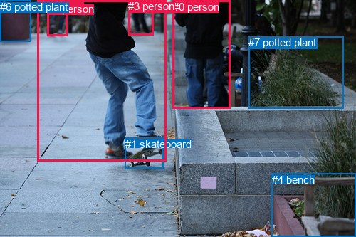
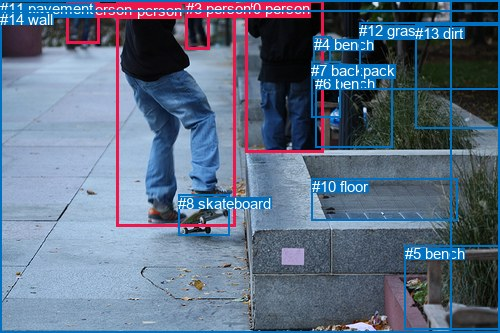

# 图片 1764：2398216.jpg

随机样本序号：131。图片 SHA256：`b0580bb47eee47184ec9aeef06ff9c7fd9e4b17c1187343069245d3e425e9744`。

红色框表示人，蓝色框表示其他物体。两个模式分别保留自身框编号，可依据位置比较对应对象。

## 自动检测框与输出

人的框编号：`[0, 2, 3, 5]`。状态：`ok`。

### 自动检测全部物体框

| 编号 | 类别 | 是否为人 | 检测分数 | 像素坐标 xyxy |
|---|---|---|---|---|
| 0 | person | True | 0.9988 | 242.5, 0.9, 323.9, 152.5 |
| 1 | skateboard | False | 0.9967 | 175.7, 193.7, 229.0, 236.3 |
| 2 | person | True | 0.9917 | 52.8, 0.0, 233.5, 227.0 |
| 3 | person | True | 0.9869 | 180.3, 0.2, 215.4, 49.8 |
| 4 | bench | False | 0.9722 | 381.5, 243.6, 500.0, 332.5 |
| 5 | person | True | 0.9681 | 66.6, 3.6, 94.9, 51.0 |
| 6 | potted plant | False | 0.5014 | 0.5, 0.7, 43.4, 58.1 |
| 7 | potted plant | False | 0.3579 | 349.5, 51.0, 482.9, 152.2 |

### 自动检测 Top50 人相关候选

评分物体对：56；人相关物体对：44；输出关系：50。

| 排名 | 主语编号与类别 | 关系 | 宾语编号与类别 | 类型 | 人与人 | 排序分数 | 原始融合 logit |
|---|---|---|---|---|---|---|---|
| 1 | #2 person | riding | #1 skateboard | semantic | False | 0.99132 | 4.7382 |
| 2 | #2 person | on | #1 skateboard | spatial | False | 0.97645 | 3.7247 |
| 3 | #5 person | walking on | #6 potted plant | semantic | False | 0.95923 | 3.1583 |
| 4 | #3 person | looking at | #2 person | semantic | True | 0.94052 | 2.7609 |
| 5 | #0 person | beside | #3 person | spatial | True | 0.93376 | 2.6459 |
| 6 | #0 person | walking on | #3 person | semantic | True | 0.93091 | 2.6007 |
| 7 | #5 person | walking on | #2 person | semantic | True | 0.92568 | 2.5221 |
| 8 | #0 person | looking at | #2 person | semantic | True | 0.92400 | 2.4980 |
| 9 | #0 person | beside | #2 person | spatial | True | 0.91808 | 2.4166 |
| 10 | #5 person | beside | #6 potted plant | spatial | False | 0.89406 | 2.1329 |
| 11 | #0 person | beside | #7 potted plant | spatial | False | 0.88776 | 2.0680 |
| 12 | #2 person | walking on | #3 person | semantic | True | 0.88485 | 2.0392 |
| 13 | #5 person | walking on | #3 person | semantic | True | 0.88075 | 1.9996 |
| 14 | #2 person | beside | #3 person | spatial | True | 0.85587 | 1.7814 |
| 15 | #2 person | beside | #0 person | spatial | True | 0.84836 | 1.7218 |
| 16 | #0 person | riding | #1 skateboard | semantic | False | 0.84396 | 1.6880 |
| 17 | #2 person | walking on | #5 person | semantic | True | 0.83295 | 1.6067 |
| 18 | #2 person | in front of | #5 person | spatial | True | 0.82032 | 1.5185 |
| 19 | #6 potted plant | beside | #5 person | spatial | False | 0.76343 | 1.1716 |
| 20 | #3 person | walking on | #0 person | semantic | True | 0.75756 | 1.1394 |
| 21 | #7 potted plant | beside | #0 person | spatial | False | 0.75274 | 1.1133 |
| 22 | #0 person | on | #1 skateboard | spatial | False | 0.72810 | 0.9850 |
| 23 | #3 person | walking on | #5 person | semantic | True | 0.72452 | 0.9670 |
| 24 | #6 potted plant | beside | #2 person | spatial | False | 0.70195 | 0.8566 |
| 25 | #0 person | walking on | #7 potted plant | semantic | False | 0.70156 | 0.8547 |
| 26 | #1 skateboard | on | #2 person | spatial | False | 0.70130 | 0.8535 |
| 27 | #4 bench | beside | #2 person | spatial | False | 0.64595 | 0.6013 |
| 28 | #3 person | walking on | #6 potted plant | semantic | False | 0.64203 | 0.5842 |
| 29 | #5 person | beside | #2 person | spatial | True | 0.64157 | 0.5822 |
| 30 | #3 person | beside | #0 person | spatial | True | 0.61806 | 0.4813 |
| 31 | #3 person | beside | #2 person | spatial | True | 0.60880 | 0.4423 |
| 32 | #2 person | walking on | #0 person | semantic | True | 0.60539 | 0.4280 |
| 33 | #0 person | beside | #4 bench | spatial | False | 0.53824 | 0.1533 |
| 34 | #2 person | walking on | #6 potted plant | semantic | False | 0.52888 | 0.1156 |
| 35 | #2 person | beside | #6 potted plant | spatial | False | 0.50789 | 0.0316 |
| 36 | #7 potted plant | beside | #2 person | spatial | False | 0.49410 | -0.0236 |
| 37 | #2 person | beside | #4 bench | spatial | False | 0.47798 | -0.0882 |
| 38 | #1 skateboard | riding | #2 person | semantic | False | 0.45067 | -0.1980 |
| 39 | #5 person | walking on | #0 person | semantic | True | 0.41234 | -0.3543 |
| 40 | #4 bench | beside | #0 person | spatial | False | 0.39430 | -0.4293 |
| 41 | #0 person | walking on | #5 person | semantic | True | 0.38405 | -0.4724 |
| 42 | #2 person | walking on | #7 potted plant | semantic | False | 0.37740 | -0.5006 |
| 43 | #6 potted plant | holding | #5 person | semantic | False | 0.36735 | -0.5436 |
| 44 | #2 person | beside | #7 potted plant | spatial | False | 0.32854 | -0.7148 |
| 45 | #0 person | in front of | #5 person | spatial | True | 0.29363 | -0.8778 |
| 46 | #3 person | riding | #1 skateboard | semantic | False | 0.27930 | -0.9479 |
| 47 | #2 person | walking on | #4 bench | semantic | False | 0.25680 | -1.0627 |
| 48 | #3 person | walking on | #7 potted plant | semantic | False | 0.24355 | -1.1333 |
| 49 | #3 person | beside | #5 person | spatial | True | 0.23455 | -1.1828 |
| 50 | #5 person | beside | #3 person | spatial | True | 0.20244 | -1.3711 |

### 自动检测逐条人相关 GT 核验

R@50：42.86%；命中 3/7。

| GT 主语编号 | GT 关系 | GT 宾语编号 | 结果阶段 | 匹配预测主语编号 | 匹配预测宾语编号 |
|---|---|---|---|---|---|
| 0 | in front of | 1 | wrong_predicate | [0] | [2] |
| 0 | beside | 1 | hit50 | [0] | [2] |
| 0 | standing on | 11 | endpoint_missing_or_wrong_class | [0] | [] |
| 1 | on | 8 | hit50 | [2] | [1] |
| 1 | riding | 8 | hit50 | [2] | [1] |
| 2 | standing on | 11 | endpoint_missing_or_wrong_class | [5] | [] |
| 3 | standing on | 11 | endpoint_missing_or_wrong_class | [3] | [] |

## 真实框与输出

人的框编号：`[0, 1, 2, 3]`。

### 真实框全部物体框

| 编号 | 类别 | 是否为人 | 检测分数 | 像素坐标 xyxy |
|---|---|---|---|---|
| 0 | person | True | GT | 245.0, 0.0, 323.0, 153.0 |
| 1 | person | True | GT | 117.0, 2.0, 236.0, 226.0 |
| 2 | person | True | GT | 67.0, 1.0, 100.0, 44.0 |
| 3 | person | True | GT | 186.0, 0.0, 210.0, 50.0 |
| 4 | bench | False | GT | 314.0, 36.0, 331.0, 62.0 |
| 5 | bench | False | GT | 405.0, 245.0, 500.0, 329.0 |
| 6 | bench | False | GT | 315.0, 75.0, 392.0, 147.0 |
| 7 | backpack | False | GT | 311.0, 62.0, 340.0, 118.0 |
| 8 | skateboard | False | GT | 178.0, 195.0, 229.0, 236.0 |
| 9 | tree | False | GT | 0.0, 0.0, 500.0, 333.0 |
| 10 | floor | False | GT | 312.0, 178.0, 458.0, 221.0 |
| 11 | pavement | False | GT | 0.0, 0.0, 452.0, 333.0 |
| 12 | grass | False | GT | 359.0, 22.0, 500.0, 89.0 |
| 13 | dirt | False | GT | 415.0, 25.0, 500.0, 129.0 |
| 14 | wall | False | GT | 0.0, 11.0, 500.0, 333.0 |

### 真实框 Top50 人相关候选

评分物体对：210；人相关物体对：100；输出关系：50。

| 排名 | 主语编号与类别 | 关系 | 宾语编号与类别 | 类型 | 人与人 | 排序分数 | 原始融合 logit |
|---|---|---|---|---|---|---|---|
| 1 | #1 person | riding | #8 skateboard | semantic | False | 0.99158 | 4.7683 |
| 2 | #3 person | walking on | #14 wall | semantic | False | 0.98942 | 4.5381 |
| 3 | #2 person | walking on | #9 tree | semantic | False | 0.98845 | 4.4498 |
| 4 | #2 person | walking on | #14 wall | semantic | False | 0.98661 | 4.2997 |
| 5 | #3 person | walking on | #9 tree | semantic | False | 0.98557 | 4.2239 |
| 6 | #2 person | walking on | #11 pavement | semantic | False | 0.98463 | 4.1599 |
| 7 | #0 person | standing on | #14 wall | semantic | False | 0.97830 | 3.8087 |
| 8 | #3 person | walking on | #11 pavement | semantic | False | 0.97455 | 3.6451 |
| 9 | #1 person | on | #8 skateboard | spatial | False | 0.97312 | 3.5889 |
| 10 | #0 person | in | #9 tree | spatial | False | 0.95613 | 3.0817 |
| 11 | #0 person | walking on | #9 tree | semantic | False | 0.95080 | 2.9615 |
| 12 | #1 person | walking on | #14 wall | semantic | False | 0.94972 | 2.9387 |
| 13 | #1 person | in | #9 tree | spatial | False | 0.94823 | 2.9077 |
| 14 | #0 person | on | #14 wall | spatial | False | 0.94361 | 2.8173 |
| 15 | #0 person | standing on | #11 pavement | semantic | False | 0.94234 | 2.7939 |
| 16 | #1 person | in | #11 pavement | spatial | False | 0.94117 | 2.7725 |
| 17 | #0 person | leaning on | #4 bench | spatial | False | 0.93022 | 2.5901 |
| 18 | #0 person | in | #11 pavement | spatial | False | 0.92749 | 2.5488 |
| 19 | #1 person | on | #14 wall | spatial | False | 0.92479 | 2.5093 |
| 20 | #1 person | walking on | #9 tree | semantic | False | 0.92209 | 2.4710 |
| 21 | #1 person | walking on | #11 pavement | semantic | False | 0.91338 | 2.3556 |
| 22 | #0 person | pushing | #7 backpack | semantic | False | 0.90682 | 2.2754 |
| 23 | #0 person | leaning on | #6 bench | spatial | False | 0.90253 | 2.2256 |
| 24 | #3 person | in | #9 tree | spatial | False | 0.88243 | 2.0156 |
| 25 | #3 person | on | #14 wall | spatial | False | 0.86567 | 1.8632 |
| 26 | #0 person | leaning on | #7 backpack | spatial | False | 0.86502 | 1.8576 |
| 27 | #0 person | holding | #4 bench | semantic | False | 0.85704 | 1.7909 |
| 28 | #2 person | in | #9 tree | spatial | False | 0.84004 | 1.6585 |
| 29 | #3 person | in | #11 pavement | spatial | False | 0.78651 | 1.3040 |
| 30 | #2 person | in | #11 pavement | spatial | False | 0.78532 | 1.2970 |
| 31 | #0 person | standing on | #6 bench | semantic | False | 0.77420 | 1.2322 |
| 32 | #2 person | on | #14 wall | spatial | False | 0.73167 | 1.0031 |
| 33 | #3 person | looking at | #1 person | semantic | True | 0.64306 | 0.5887 |
| 34 | #7 backpack | beside | #0 person | spatial | False | 0.53203 | 0.1283 |
| 35 | #2 person | looking at | #1 person | semantic | True | 0.46254 | -0.1501 |
| 36 | #0 person | riding | #8 skateboard | semantic | False | 0.45368 | -0.1858 |
| 37 | #6 bench | beside | #0 person | spatial | False | 0.42462 | -0.3039 |
| 38 | #0 person | on | #8 skateboard | spatial | False | 0.38956 | -0.4492 |
| 39 | #0 person | looking at | #1 person | semantic | True | 0.35866 | -0.5812 |
| 40 | #1 person | walking on | #3 person | semantic | True | 0.33762 | -0.6739 |
| 41 | #0 person | beside | #1 person | spatial | True | 0.31853 | -0.7605 |
| 42 | #3 person | walking on | #13 dirt | semantic | False | 0.28467 | -0.9214 |
| 43 | #2 person | walking on | #12 grass | semantic | False | 0.26920 | -0.9987 |
| 44 | #0 person | looking at | #10 floor | semantic | False | 0.26116 | -1.0399 |
| 45 | #8 skateboard | on | #1 person | spatial | False | 0.22834 | -1.2177 |
| 46 | #3 person | walking on | #12 grass | semantic | False | 0.22729 | -1.2237 |
| 47 | #2 person | walking on | #13 dirt | semantic | False | 0.20768 | -1.3389 |
| 48 | #0 person | on | #10 floor | spatial | False | 0.20767 | -1.3390 |
| 49 | #0 person | wearing | #3 person | semantic | True | 0.20755 | -1.3397 |
| 50 | #2 person | walking on | #3 person | semantic | True | 0.20183 | -1.3749 |

### 真实框逐条人相关 GT 核验

R@50：57.14%；命中 4/7。

| GT 主语编号 | GT 关系 | GT 宾语编号 | 结果阶段 | 匹配预测主语编号 | 匹配预测宾语编号 |
|---|---|---|---|---|---|
| 0 | in front of | 1 | wrong_predicate | [0] | [1] |
| 0 | beside | 1 | hit50 | [0] | [1] |
| 0 | standing on | 11 | hit50 | [0] | [11] |
| 1 | on | 8 | hit50 | [1] | [8] |
| 1 | riding | 8 | hit50 | [1] | [8] |
| 2 | standing on | 11 | wrong_predicate | [2] | [11] |
| 3 | standing on | 11 | wrong_predicate | [3] | [11] |

## 全部人相关 GT

| 主语编号与类别 | 关系 | 宾语编号与类别 |
|---|---|---|
| #0 person | in front of | #1 person |
| #0 person | beside | #1 person |
| #0 person | standing on | #11 pavement |
| #1 person | on | #8 skateboard |
| #1 person | riding | #8 skateboard |
| #2 person | standing on | #11 pavement |
| #3 person | standing on | #11 pavement |

原始记录、全部人相关物体对的两项预测与分项分数见 [逐图证据 JSON](../evidence/cases/1764.json)。全部56类 logits 保留于本机 HOR/output/random500/logits/。

<!-- HOR_COMPLETE_RESULTS -->

## 六组条件的完整输出对照

以下保留同一图片三种框与候选模式、两种谓词输出规则的全部 Top50。框编号各自在所属模式内解释。

### 自动检测框完整枚举：空间与语义各保留一个谓词

| 排名 | 主语编号与类别 | 谓词 | 宾语编号与类别 | 分组 | 排序分数 | predicate logit | pair logit |
|---|---|---|---|---|---|---|---|
| 1 | #2 person | riding | #1 skateboard | semantic | 0.9913216 | 4.7219958 | 0.0162081 |
| 2 | #2 person | on | #1 skateboard | spatial | 0.9764474 | 3.7084756 | 0.0162081 |
| 3 | #5 person | walking on | #6 potted plant | semantic | 0.9592339 | 3.8877387 | -0.7294548 |
| 4 | #3 person | looking at | #2 person | semantic | 0.9405242 | 3.5376706 | -0.7768030 |
| 5 | #0 person | beside | #3 person | spatial | 0.9337578 | 3.4093900 | -0.7634895 |
| 6 | #0 person | walking on | #3 person | semantic | 0.9309065 | 3.3641877 | -0.7634895 |
| 7 | #5 person | walking on | #2 person | semantic | 0.9256762 | 3.2482820 | -0.7261889 |
| 8 | #0 person | looking at | #2 person | semantic | 0.9239985 | 3.3101878 | -0.8122301 |
| 9 | #0 person | beside | #2 person | spatial | 0.9180810 | 3.2287850 | -0.8122301 |
| 10 | #5 person | beside | #6 potted plant | spatial | 0.8940642 | 2.8623991 | -0.7294548 |
| 11 | #0 person | beside | #7 potted plant | spatial | 0.8877559 | 3.3498435 | -1.2818229 |
| 12 | #2 person | walking on | #3 person | semantic | 0.8848531 | 2.8526497 | -0.8134369 |
| 13 | #5 person | walking on | #3 person | semantic | 0.8807533 | 2.5427060 | -0.5431229 |
| 14 | #2 person | beside | #3 person | spatial | 0.8558705 | 2.5948443 | -0.8134369 |
| 15 | #2 person | beside | #0 person | spatial | 0.8483599 | 2.9849901 | -1.2631943 |
| 16 | #0 person | riding | #1 skateboard | semantic | 0.8439555 | 2.4998860 | -0.8119274 |
| 17 | #2 person | walking on | #5 person | semantic | 0.8329525 | 2.6630430 | -1.0563446 |
| 18 | #2 person | in front of | #5 person | spatial | 0.8203201 | 2.5748625 | -1.0563446 |
| 19 | #6 potted plant | beside | #5 person | spatial | 0.7634286 | 1.8703856 | -0.6988158 |
| 20 | #3 person | walking on | #0 person | semantic | 0.7575648 | 2.4434004 | -1.3040253 |
| 21 | #7 potted plant | beside | #0 person | spatial | 0.7527374 | 2.3944993 | -1.2812338 |
| 22 | #0 person | on | #1 skateboard | spatial | 0.7281021 | 1.7969422 | -0.8119274 |
| 23 | #3 person | walking on | #5 person | semantic | 0.7245248 | 1.7422423 | -0.7752241 |
| 24 | #6 potted plant | beside | #2 person | spatial | 0.7019531 | 1.6313467 | -0.7747309 |
| 25 | #0 person | walking on | #7 potted plant | semantic | 0.7015608 | 2.1365643 | -1.2818229 |
| 26 | #1 skateboard | on | #2 person | spatial | 0.7012954 | 1.9958510 | -1.1423767 |
| 27 | #4 bench | beside | #2 person | spatial | 0.6459531 | 1.7564530 | -1.1551554 |
| 28 | #3 person | walking on | #6 potted plant | semantic | 0.6420332 | 1.9558911 | -1.3716916 |
| 29 | #5 person | beside | #2 person | spatial | 0.6415714 | 1.3083801 | -0.7261889 |
| 30 | #3 person | beside | #0 person | spatial | 0.6180559 | 1.7853298 | -1.3040253 |
| 31 | #3 person | beside | #2 person | spatial | 0.6088037 | 1.2190895 | -0.7768030 |
| 32 | #2 person | walking on | #0 person | semantic | 0.6053948 | 1.6911893 | -1.2631943 |
| 33 | #0 person | beside | #4 bench | spatial | 0.5382448 | 1.8427081 | -1.6894293 |
| 34 | #2 person | walking on | #6 potted plant | semantic | 0.5288792 | 1.8039856 | -1.6883399 |
| 35 | #2 person | beside | #6 potted plant | spatial | 0.5078930 | 1.7199144 | -1.6883399 |
| 36 | #7 potted plant | beside | #2 person | spatial | 0.4940993 | 1.1262717 | -1.1498755 |
| 37 | #2 person | beside | #4 bench | spatial | 0.4779757 | 1.2394013 | -1.3275557 |
| 38 | #1 skateboard | riding | #2 person | semantic | 0.4506734 | 0.9444265 | -1.1423767 |
| 39 | #5 person | walking on | #0 person | semantic | 0.4123374 | 0.9930134 | -1.3473244 |
| 40 | #4 bench | beside | #0 person | spatial | 0.3943005 | 1.3648043 | -1.7940748 |
| 41 | #0 person | walking on | #5 person | semantic | 0.3840506 | 0.8320341 | -1.3044248 |
| 42 | #2 person | walking on | #7 potted plant | semantic | 0.3773988 | 0.8246193 | -1.3252232 |
| 43 | #6 potted plant | holding | #5 person | semantic | 0.3673485 | 0.1552072 | -0.6988158 |
| 44 | #2 person | beside | #7 potted plant | spatial | 0.3285431 | 0.6104412 | -1.3252232 |
| 45 | #0 person | in front of | #5 person | spatial | 0.2936267 | 0.4265900 | -1.3044248 |
| 46 | #3 person | riding | #1 skateboard | semantic | 0.2793021 | 0.4091372 | -1.3570633 |
| 47 | #2 person | walking on | #4 bench | semantic | 0.2568022 | 0.2648997 | -1.3275557 |
| 48 | #3 person | walking on | #7 potted plant | semantic | 0.2435524 | 0.7221918 | -1.8554927 |
| 49 | #3 person | beside | #5 person | spatial | 0.2345549 | -0.4075437 | -0.7752241 |
| 50 | #5 person | beside | #3 person | spatial | 0.2024367 | -0.8280110 | -0.5431229 |

GT 命中：3/7，R@50=42.86%。

| GT主语 | GT谓词 | GT宾语 | 结果阶段 | 匹配主语框 | 匹配宾语框 |
|---|---|---|---|---|---|
| 0 | in front of | 1 | wrong_predicate | [0] | [2] |
| 0 | beside | 1 | hit50 | [0] | [2] |
| 0 | standing on | 11 | endpoint_missing_or_wrong_class | [0] | [] |
| 1 | on | 8 | hit50 | [2] | [1] |
| 1 | riding | 8 | hit50 | [2] | [1] |
| 2 | standing on | 11 | endpoint_missing_or_wrong_class | [5] | [] |
| 3 | standing on | 11 | endpoint_missing_or_wrong_class | [3] | [] |

### 自动检测框完整枚举：每对只保留一个谓词

| 排名 | 主语编号与类别 | 谓词 | 宾语编号与类别 | 分组 | 排序分数 | predicate logit | pair logit |
|---|---|---|---|---|---|---|---|
| 1 | #2 person | riding | #1 skateboard | single | 0.9913216 | 4.7219958 | 0.0162081 |
| 2 | #5 person | walking on | #6 potted plant | single | 0.9592339 | 3.8877387 | -0.7294548 |
| 3 | #3 person | looking at | #2 person | single | 0.9405242 | 3.5376706 | -0.7768030 |
| 4 | #0 person | beside | #3 person | single | 0.9337578 | 3.4093900 | -0.7634895 |
| 5 | #5 person | walking on | #2 person | single | 0.9256762 | 3.2482820 | -0.7261889 |
| 6 | #0 person | looking at | #2 person | single | 0.9239985 | 3.3101878 | -0.8122301 |
| 7 | #0 person | beside | #7 potted plant | single | 0.8877559 | 3.3498435 | -1.2818229 |
| 8 | #2 person | walking on | #3 person | single | 0.8848531 | 2.8526497 | -0.8134369 |
| 9 | #5 person | walking on | #3 person | single | 0.8807533 | 2.5427060 | -0.5431229 |
| 10 | #2 person | beside | #0 person | single | 0.8483599 | 2.9849901 | -1.2631943 |
| 11 | #0 person | riding | #1 skateboard | single | 0.8439555 | 2.4998860 | -0.8119274 |
| 12 | #2 person | walking on | #5 person | single | 0.8329525 | 2.6630430 | -1.0563446 |
| 13 | #6 potted plant | beside | #5 person | single | 0.7634286 | 1.8703856 | -0.6988158 |
| 14 | #3 person | walking on | #0 person | single | 0.7575648 | 2.4434004 | -1.3040253 |
| 15 | #7 potted plant | beside | #0 person | single | 0.7527374 | 2.3944993 | -1.2812338 |
| 16 | #3 person | walking on | #5 person | single | 0.7245248 | 1.7422423 | -0.7752241 |
| 17 | #6 potted plant | beside | #2 person | single | 0.7019531 | 1.6313467 | -0.7747309 |
| 18 | #1 skateboard | on | #2 person | single | 0.7012954 | 1.9958510 | -1.1423767 |
| 19 | #4 bench | beside | #2 person | single | 0.6459531 | 1.7564530 | -1.1551554 |
| 20 | #3 person | walking on | #6 potted plant | single | 0.6420332 | 1.9558911 | -1.3716916 |
| 21 | #0 person | beside | #4 bench | single | 0.5382448 | 1.8427081 | -1.6894293 |
| 22 | #2 person | walking on | #6 potted plant | single | 0.5288792 | 1.8039856 | -1.6883399 |
| 23 | #7 potted plant | beside | #2 person | single | 0.4940993 | 1.1262717 | -1.1498755 |
| 24 | #2 person | beside | #4 bench | single | 0.4779757 | 1.2394013 | -1.3275557 |
| 25 | #5 person | walking on | #0 person | single | 0.4123374 | 0.9930134 | -1.3473244 |
| 26 | #4 bench | beside | #0 person | single | 0.3943005 | 1.3648043 | -1.7940748 |
| 27 | #0 person | walking on | #5 person | single | 0.3840506 | 0.8320341 | -1.3044248 |
| 28 | #2 person | walking on | #7 potted plant | single | 0.3773988 | 0.8246193 | -1.3252232 |
| 29 | #3 person | riding | #1 skateboard | single | 0.2793021 | 0.4091372 | -1.3570633 |
| 30 | #3 person | walking on | #7 potted plant | single | 0.2435524 | 0.7221918 | -1.8554927 |
| 31 | #3 person | walking on | #4 bench | single | 0.1870762 | 0.2362165 | -1.7053376 |
| 32 | #0 person | walking on | #6 potted plant | single | 0.1231459 | 0.2046480 | -2.1676188 |
| 33 | #6 potted plant | in front of | #3 person | single | 0.0700687 | -1.3477924 | -1.2378416 |
| 34 | #5 person | walking on | #4 bench | single | 0.0657131 | -0.9598794 | -1.6946065 |
| 35 | #5 person | walking on | #7 potted plant | single | 0.0615539 | -0.8146777 | -1.9096341 |
| 36 | #7 potted plant | beside | #3 person | single | 0.0533328 | -1.0567317 | -1.8196641 |
| 37 | #5 person | riding | #1 skateboard | single | 0.0470279 | -1.3787446 | -1.6300993 |
| 38 | #1 skateboard | beside | #0 person | single | 0.0353900 | -1.4598680 | -1.8454270 |
| 39 | #4 bench | in front of | #3 person | single | 0.0237269 | -1.4770410 | -2.2400937 |
| 40 | #7 potted plant | in front of | #5 person | single | 0.0203449 | -1.8565512 | -2.0178196 |
| 41 | #6 potted plant | beside | #0 person | single | 0.0167002 | -2.6999431 | -1.3755486 |
| 42 | #4 bench | in front of | #5 person | single | 0.0091047 | -2.3573811 | -2.3324361 |
| 43 | #1 skateboard | riding | #3 person | single | 0.0032990 | -3.3879192 | -2.3228989 |
| 44 | #1 skateboard | riding | #5 person | single | 0.0022953 | -3.3615479 | -2.7130468 |

GT 命中：1/7，R@50=14.29%。

| GT主语 | GT谓词 | GT宾语 | 结果阶段 | 匹配主语框 | 匹配宾语框 |
|---|---|---|---|---|---|
| 0 | in front of | 1 | wrong_predicate | [0] | [2] |
| 0 | beside | 1 | wrong_predicate | [0] | [2] |
| 0 | standing on | 11 | endpoint_missing_or_wrong_class | [0] | [] |
| 1 | on | 8 | wrong_predicate | [2] | [1] |
| 1 | riding | 8 | hit50 | [2] | [1] |
| 2 | standing on | 11 | endpoint_missing_or_wrong_class | [5] | [] |
| 3 | standing on | 11 | endpoint_missing_or_wrong_class | [3] | [] |

### 真实框完整枚举：空间与语义各保留一个谓词

| 排名 | 主语编号与类别 | 谓词 | 宾语编号与类别 | 分组 | 排序分数 | predicate logit | pair logit |
|---|---|---|---|---|---|---|---|
| 1 | #1 person | riding | #8 skateboard | semantic | 0.9915766 | 4.7227283 | 0.0455489 |
| 2 | #3 person | walking on | #14 wall | semantic | 0.9894192 | 4.7664762 | -0.2283904 |
| 3 | #2 person | walking on | #9 tree | semantic | 0.9884534 | 4.9169183 | -0.4671639 |
| 4 | #2 person | walking on | #14 wall | semantic | 0.9866098 | 4.5829177 | -0.2831729 |
| 5 | #3 person | walking on | #9 tree | semantic | 0.9855704 | 4.6491208 | -0.4251798 |
| 6 | #2 person | walking on | #11 pavement | semantic | 0.9846309 | 4.8176255 | -0.6577215 |
| 7 | #0 person | standing on | #14 wall | semantic | 0.9783046 | 3.7868161 | 0.0219054 |
| 8 | #3 person | walking on | #11 pavement | semantic | 0.9745470 | 4.2128186 | -0.5676809 |
| 9 | #1 person | on | #8 skateboard | spatial | 0.9731151 | 3.5433936 | 0.0455489 |
| 10 | #0 person | in | #9 tree | spatial | 0.9561325 | 3.1204829 | -0.0387615 |
| 11 | #0 person | walking on | #9 tree | semantic | 0.9508023 | 3.0002208 | -0.0387615 |
| 12 | #1 person | walking on | #14 wall | semantic | 0.9497249 | 2.9310212 | 0.0076391 |
| 13 | #1 person | in | #9 tree | spatial | 0.9482265 | 2.9645023 | -0.0567872 |
| 14 | #0 person | on | #14 wall | spatial | 0.9436053 | 2.7954273 | 0.0219054 |
| 15 | #0 person | standing on | #11 pavement | semantic | 0.9423438 | 3.0044436 | -0.2105706 |
| 16 | #1 person | in | #11 pavement | spatial | 0.9411714 | 2.9175949 | -0.1450973 |
| 17 | #0 person | leaning on | #4 bench | spatial | 0.9302186 | 2.6251287 | -0.0350769 |
| 18 | #0 person | in | #11 pavement | spatial | 0.9274940 | 2.7593880 | -0.2105706 |
| 19 | #1 person | on | #14 wall | spatial | 0.9247937 | 2.5016971 | 0.0076391 |
| 20 | #1 person | walking on | #9 tree | semantic | 0.9220850 | 2.5278068 | -0.0567872 |
| 21 | #1 person | walking on | #11 pavement | semantic | 0.9133817 | 2.5007396 | -0.1450973 |
| 22 | #0 person | pushing | #7 backpack | semantic | 0.9068204 | 2.4632640 | -0.1878484 |
| 23 | #0 person | leaning on | #6 bench | spatial | 0.9025276 | 2.5999136 | -0.3742838 |
| 24 | #3 person | in | #9 tree | spatial | 0.8824263 | 2.4407892 | -0.4251798 |
| 25 | #3 person | on | #14 wall | spatial | 0.8656704 | 2.0915985 | -0.2283904 |
| 26 | #0 person | leaning on | #7 backpack | spatial | 0.8650212 | 2.0454845 | -0.1878484 |
| 27 | #0 person | holding | #4 bench | semantic | 0.8570361 | 1.8259654 | -0.0350769 |
| 28 | #2 person | in | #9 tree | spatial | 0.8400429 | 2.1257114 | -0.4671639 |
| 29 | #3 person | in | #11 pavement | spatial | 0.7865117 | 1.8717065 | -0.5676809 |
| 30 | #2 person | in | #11 pavement | spatial | 0.7853218 | 1.9546752 | -0.6577215 |
| 31 | #0 person | standing on | #6 bench | semantic | 0.7742012 | 1.6064711 | -0.3742838 |
| 32 | #2 person | on | #14 wall | spatial | 0.7316707 | 1.2862887 | -0.2831729 |
| 33 | #3 person | looking at | #1 person | semantic | 0.6430644 | 1.4228072 | -0.8341175 |
| 34 | #7 backpack | beside | #0 person | spatial | 0.5320316 | 0.5577183 | -0.4294161 |
| 35 | #2 person | looking at | #1 person | semantic | 0.4625449 | 0.7048011 | -0.8549030 |
| 36 | #0 person | riding | #8 skateboard | semantic | 0.4536833 | 0.6448579 | -0.8306571 |
| 37 | #6 bench | beside | #0 person | spatial | 0.4246151 | 0.4698153 | -0.7736712 |
| 38 | #0 person | on | #8 skateboard | spatial | 0.3895601 | 0.3814955 | -0.8306571 |
| 39 | #0 person | looking at | #1 person | semantic | 0.3586578 | 0.1970849 | -0.7782795 |
| 40 | #1 person | walking on | #3 person | semantic | 0.3376167 | 0.2423072 | -0.9162403 |
| 41 | #0 person | beside | #1 person | spatial | 0.3185320 | 0.0177531 | -0.7782795 |
| 42 | #3 person | walking on | #13 dirt | semantic | 0.2846684 | -0.1488514 | -0.7725701 |
| 43 | #2 person | walking on | #12 grass | semantic | 0.2692036 | -0.1022162 | -0.8964509 |
| 44 | #0 person | looking at | #10 floor | semantic | 0.2611645 | -0.0685067 | -0.9714181 |
| 45 | #8 skateboard | on | #1 person | spatial | 0.2283396 | -0.0148458 | -1.2028646 |
| 46 | #3 person | walking on | #12 grass | semantic | 0.2272872 | -0.4211922 | -0.8025010 |
| 47 | #2 person | walking on | #13 dirt | semantic | 0.2076832 | -0.4452343 | -0.8937133 |
| 48 | #0 person | on | #10 floor | spatial | 0.2076669 | -0.3676286 | -0.9714181 |
| 49 | #0 person | wearing | #3 person | semantic | 0.2075528 | -0.5347252 | -0.8050147 |
| 50 | #2 person | walking on | #3 person | semantic | 0.2018345 | -0.8469989 | -0.5278687 |

GT 命中：4/7，R@50=57.14%。

| GT主语 | GT谓词 | GT宾语 | 结果阶段 | 匹配主语框 | 匹配宾语框 |
|---|---|---|---|---|---|
| 0 | in front of | 1 | wrong_predicate | [0] | [1] |
| 0 | beside | 1 | hit50 | [0] | [1] |
| 0 | standing on | 11 | hit50 | [0] | [11] |
| 1 | on | 8 | hit50 | [1] | [8] |
| 1 | riding | 8 | hit50 | [1] | [8] |
| 2 | standing on | 11 | wrong_predicate | [2] | [11] |
| 3 | standing on | 11 | wrong_predicate | [3] | [11] |

### 真实框完整枚举：每对只保留一个谓词

| 排名 | 主语编号与类别 | 谓词 | 宾语编号与类别 | 分组 | 排序分数 | predicate logit | pair logit |
|---|---|---|---|---|---|---|---|
| 1 | #1 person | riding | #8 skateboard | single | 0.9915766 | 4.7227283 | 0.0455489 |
| 2 | #3 person | walking on | #14 wall | single | 0.9894192 | 4.7664762 | -0.2283904 |
| 3 | #2 person | walking on | #9 tree | single | 0.9884534 | 4.9169183 | -0.4671639 |
| 4 | #2 person | walking on | #14 wall | single | 0.9866098 | 4.5829177 | -0.2831729 |
| 5 | #3 person | walking on | #9 tree | single | 0.9855704 | 4.6491208 | -0.4251798 |
| 6 | #2 person | walking on | #11 pavement | single | 0.9846309 | 4.8176255 | -0.6577215 |
| 7 | #0 person | standing on | #14 wall | single | 0.9783046 | 3.7868161 | 0.0219054 |
| 8 | #3 person | walking on | #11 pavement | single | 0.9745470 | 4.2128186 | -0.5676809 |
| 9 | #0 person | in | #9 tree | single | 0.9561325 | 3.1204829 | -0.0387615 |
| 10 | #1 person | walking on | #14 wall | single | 0.9497249 | 2.9310212 | 0.0076391 |
| 11 | #1 person | in | #9 tree | single | 0.9482265 | 2.9645023 | -0.0567872 |
| 12 | #0 person | standing on | #11 pavement | single | 0.9423438 | 3.0044436 | -0.2105706 |
| 13 | #1 person | in | #11 pavement | single | 0.9411714 | 2.9175949 | -0.1450973 |
| 14 | #0 person | leaning on | #4 bench | single | 0.9302186 | 2.6251287 | -0.0350769 |
| 15 | #0 person | pushing | #7 backpack | single | 0.9068204 | 2.4632640 | -0.1878484 |
| 16 | #0 person | leaning on | #6 bench | single | 0.9025276 | 2.5999136 | -0.3742838 |
| 17 | #3 person | looking at | #1 person | single | 0.6430644 | 1.4228072 | -0.8341175 |
| 18 | #7 backpack | beside | #0 person | single | 0.5320316 | 0.5577183 | -0.4294161 |
| 19 | #2 person | looking at | #1 person | single | 0.4625449 | 0.7048011 | -0.8549030 |
| 20 | #0 person | riding | #8 skateboard | single | 0.4536833 | 0.6448579 | -0.8306571 |
| 21 | #6 bench | beside | #0 person | single | 0.4246151 | 0.4698153 | -0.7736712 |
| 22 | #0 person | looking at | #1 person | single | 0.3586578 | 0.1970849 | -0.7782795 |
| 23 | #1 person | walking on | #3 person | single | 0.3376167 | 0.2423072 | -0.9162403 |
| 24 | #3 person | walking on | #13 dirt | single | 0.2846684 | -0.1488514 | -0.7725701 |
| 25 | #2 person | walking on | #12 grass | single | 0.2692036 | -0.1022162 | -0.8964509 |
| 26 | #0 person | looking at | #10 floor | single | 0.2611645 | -0.0685067 | -0.9714181 |
| 27 | #8 skateboard | on | #1 person | single | 0.2283396 | -0.0148458 | -1.2028646 |
| 28 | #3 person | walking on | #12 grass | single | 0.2272872 | -0.4211922 | -0.8025010 |
| 29 | #2 person | walking on | #13 dirt | single | 0.2076832 | -0.4452343 | -0.8937133 |
| 30 | #0 person | wearing | #3 person | single | 0.2075528 | -0.5347252 | -0.8050147 |
| 31 | #2 person | walking on | #3 person | single | 0.2018345 | -0.8469989 | -0.5278687 |
| 32 | #0 person | in | #13 dirt | single | 0.2007187 | -0.2702560 | -1.1115527 |
| 33 | #4 bench | beside | #0 person | single | 0.1675790 | -1.0692077 | -0.5336754 |
| 34 | #10 floor | beside | #0 person | single | 0.1657712 | -0.2582583 | -1.3576405 |
| 35 | #0 person | in | #12 grass | single | 0.1585748 | -0.6164169 | -1.0524534 |
| 36 | #1 person | beside | #0 person | single | 0.1275835 | -0.6180525 | -1.3044431 |
| 37 | #3 person | on | #8 skateboard | single | 0.1089811 | -0.7496345 | -1.3515569 |
| 38 | #3 person | looking at | #0 person | single | 0.1084054 | -0.8042939 | -1.3028400 |
| 39 | #1 person | walking on | #2 person | single | 0.0898849 | -1.1418624 | -1.1731791 |
| 40 | #12 grass | beside | #0 person | single | 0.0831027 | -1.0695889 | -1.3313301 |
| 41 | #1 person | on | #10 floor | single | 0.0784516 | -1.5103724 | -0.9532006 |
| 42 | #10 floor | beside | #1 person | single | 0.0753209 | -0.9955354 | -1.5121534 |
| 43 | #3 person | walking on | #2 person | single | 0.0712885 | -1.8069153 | -0.7601472 |
| 44 | #1 person | in | #13 dirt | single | 0.0685908 | -1.4952552 | -1.1132842 |
| 45 | #13 dirt | beside | #0 person | single | 0.0677396 | -1.1745017 | -1.4474404 |
| 46 | #2 person | on | #8 skateboard | single | 0.0622969 | -1.1002741 | -1.6112474 |
| 47 | #2 person | looking at | #0 person | single | 0.0568196 | -1.4923291 | -1.3170469 |
| 48 | #5 bench | beside | #1 person | single | 0.0518441 | -1.5793097 | -1.3269680 |
| 49 | #6 bench | beside | #1 person | single | 0.0454973 | -1.9452043 | -1.0983328 |
| 50 | #0 person | wearing | #2 person | single | 0.0338738 | -2.0471077 | -1.3035463 |

GT 命中：2/7，R@50=28.57%。

| GT主语 | GT谓词 | GT宾语 | 结果阶段 | 匹配主语框 | 匹配宾语框 |
|---|---|---|---|---|---|
| 0 | in front of | 1 | wrong_predicate | [0] | [1] |
| 0 | beside | 1 | wrong_predicate | [0] | [1] |
| 0 | standing on | 11 | hit50 | [0] | [11] |
| 1 | on | 8 | wrong_predicate | [1] | [8] |
| 1 | riding | 8 | hit50 | [1] | [8] |
| 2 | standing on | 11 | wrong_predicate | [2] | [11] |
| 3 | standing on | 11 | wrong_predicate | [3] | [11] |

### 真实框400候选：空间与语义各保留一个谓词

| 排名 | 主语编号与类别 | 谓词 | 宾语编号与类别 | 分组 | 排序分数 | predicate logit | pair logit |
|---|---|---|---|---|---|---|---|
| 1 | #1 person | riding | #8 skateboard | semantic | 0.9915766 | 4.7227283 | 0.0455489 |
| 2 | #3 person | walking on | #14 wall | semantic | 0.9894192 | 4.7664762 | -0.2283904 |
| 3 | #2 person | walking on | #9 tree | semantic | 0.9884877 | 4.9199281 | -0.4671639 |
| 4 | #2 person | walking on | #14 wall | semantic | 0.9866098 | 4.5829177 | -0.2831729 |
| 5 | #3 person | walking on | #9 tree | semantic | 0.9855704 | 4.6491208 | -0.4251798 |
| 6 | #2 person | walking on | #11 pavement | semantic | 0.9846764 | 4.8206372 | -0.6577215 |
| 7 | #0 person | standing on | #14 wall | semantic | 0.9784600 | 3.7941594 | 0.0219054 |
| 8 | #3 person | walking on | #11 pavement | semantic | 0.9745470 | 4.2128186 | -0.5676809 |
| 9 | #1 person | on | #8 skateboard | spatial | 0.9731151 | 3.5433936 | 0.0455489 |
| 10 | #0 person | in | #9 tree | spatial | 0.9561325 | 3.1204829 | -0.0387615 |
| 11 | #0 person | walking on | #9 tree | semantic | 0.9508023 | 3.0002208 | -0.0387615 |
| 12 | #1 person | walking on | #14 wall | semantic | 0.9484159 | 2.9039402 | 0.0076391 |
| 13 | #1 person | in | #9 tree | spatial | 0.9483892 | 2.9678211 | -0.0567872 |
| 14 | #0 person | on | #14 wall | spatial | 0.9436053 | 2.7954273 | 0.0219054 |
| 15 | #0 person | standing on | #11 pavement | semantic | 0.9423438 | 3.0044436 | -0.2105706 |
| 16 | #1 person | in | #11 pavement | spatial | 0.9411714 | 2.9175949 | -0.1450973 |
| 17 | #0 person | leaning on | #4 bench | spatial | 0.9301865 | 2.6246343 | -0.0350769 |
| 18 | #0 person | in | #11 pavement | spatial | 0.9274940 | 2.7593880 | -0.2105706 |
| 19 | #1 person | on | #14 wall | spatial | 0.9247937 | 2.5016971 | 0.0076391 |
| 20 | #1 person | walking on | #9 tree | semantic | 0.9201171 | 2.5007257 | -0.0567872 |
| 21 | #1 person | walking on | #11 pavement | semantic | 0.9131432 | 2.4977293 | -0.1450973 |
| 22 | #0 person | pushing | #7 backpack | semantic | 0.9068204 | 2.4632640 | -0.1878484 |
| 23 | #0 person | leaning on | #6 bench | spatial | 0.8999372 | 2.5708113 | -0.3742838 |
| 24 | #3 person | in | #9 tree | spatial | 0.8824263 | 2.4407892 | -0.4251798 |
| 25 | #3 person | on | #14 wall | spatial | 0.8656704 | 2.0915985 | -0.2283904 |
| 26 | #0 person | leaning on | #7 backpack | spatial | 0.8650212 | 2.0454845 | -0.1878484 |
| 27 | #0 person | holding | #4 bench | semantic | 0.8570361 | 1.8259654 | -0.0350769 |
| 28 | #2 person | in | #9 tree | spatial | 0.8404884 | 2.1290302 | -0.4671639 |
| 29 | #3 person | in | #11 pavement | spatial | 0.7865117 | 1.8717065 | -0.5676809 |
| 30 | #2 person | in | #11 pavement | spatial | 0.7853218 | 1.9546752 | -0.6577215 |
| 31 | #0 person | standing on | #6 bench | semantic | 0.7742012 | 1.6064711 | -0.3742838 |
| 32 | #2 person | on | #14 wall | spatial | 0.7218834 | 1.2369957 | -0.2831729 |
| 33 | #3 person | looking at | #1 person | semantic | 0.6430644 | 1.4228072 | -0.8341175 |
| 34 | #7 backpack | beside | #0 person | spatial | 0.5320460 | 0.5577760 | -0.4294161 |
| 35 | #2 person | looking at | #1 person | semantic | 0.4624582 | 0.7044525 | -0.8549030 |
| 36 | #0 person | riding | #8 skateboard | semantic | 0.4536531 | 0.6447358 | -0.8306571 |
| 37 | #6 bench | beside | #0 person | spatial | 0.4246010 | 0.4697576 | -0.7736712 |
| 38 | #0 person | on | #8 skateboard | spatial | 0.3837153 | 0.3568492 | -0.8306571 |
| 39 | #0 person | looking at | #1 person | semantic | 0.3519249 | 0.1676908 | -0.7782795 |
| 40 | #1 person | walking on | #3 person | semantic | 0.3376167 | 0.2423072 | -0.9162403 |
| 41 | #0 person | beside | #1 person | spatial | 0.3120361 | -0.0123382 | -0.7782795 |
| 42 | #3 person | walking on | #13 dirt | semantic | 0.2908355 | -0.1187596 | -0.7725701 |
| 43 | #2 person | walking on | #12 grass | semantic | 0.2689075 | -0.1037216 | -0.8964509 |
| 44 | #0 person | looking at | #10 floor | semantic | 0.2610971 | -0.0688558 | -0.9714181 |
| 45 | #8 skateboard | on | #1 person | spatial | 0.2283396 | -0.0148458 | -1.2028646 |
| 46 | #3 person | walking on | #12 grass | semantic | 0.2223059 | -0.4497776 | -0.8025010 |
| 47 | #0 person | wearing | #3 person | semantic | 0.2075528 | -0.5347252 | -0.8050147 |
| 48 | #2 person | walking on | #3 person | semantic | 0.2064790 | -0.8184128 | -0.5278687 |
| 49 | #2 person | walking on | #13 dirt | semantic | 0.2027753 | -0.4753251 | -0.8937133 |
| 50 | #0 person | on | #10 floor | spatial | 0.2027591 | -0.3977199 | -0.9714181 |

GT 命中：4/7，R@50=57.14%。

| GT主语 | GT谓词 | GT宾语 | 结果阶段 | 匹配主语框 | 匹配宾语框 |
|---|---|---|---|---|---|
| 0 | in front of | 1 | wrong_predicate | [0] | [1] |
| 0 | beside | 1 | hit50 | [0] | [1] |
| 0 | standing on | 11 | hit50 | [0] | [11] |
| 1 | on | 8 | hit50 | [1] | [8] |
| 1 | riding | 8 | hit50 | [1] | [8] |
| 2 | standing on | 11 | wrong_predicate | [2] | [11] |
| 3 | standing on | 11 | wrong_predicate | [3] | [11] |

### 真实框400候选：每对只保留一个谓词

| 排名 | 主语编号与类别 | 谓词 | 宾语编号与类别 | 分组 | 排序分数 | predicate logit | pair logit |
|---|---|---|---|---|---|---|---|
| 1 | #1 person | riding | #8 skateboard | single | 0.9915766 | 4.7227283 | 0.0455489 |
| 2 | #3 person | walking on | #14 wall | single | 0.9894192 | 4.7664762 | -0.2283904 |
| 3 | #2 person | walking on | #9 tree | single | 0.9884877 | 4.9199281 | -0.4671639 |
| 4 | #2 person | walking on | #14 wall | single | 0.9866098 | 4.5829177 | -0.2831729 |
| 5 | #3 person | walking on | #9 tree | single | 0.9855704 | 4.6491208 | -0.4251798 |
| 6 | #2 person | walking on | #11 pavement | single | 0.9846764 | 4.8206372 | -0.6577215 |
| 7 | #0 person | standing on | #14 wall | single | 0.9784600 | 3.7941594 | 0.0219054 |
| 8 | #3 person | walking on | #11 pavement | single | 0.9745470 | 4.2128186 | -0.5676809 |
| 9 | #0 person | in | #9 tree | single | 0.9561325 | 3.1204829 | -0.0387615 |
| 10 | #1 person | walking on | #14 wall | single | 0.9484159 | 2.9039402 | 0.0076391 |
| 11 | #1 person | in | #9 tree | single | 0.9483892 | 2.9678211 | -0.0567872 |
| 12 | #0 person | standing on | #11 pavement | single | 0.9423438 | 3.0044436 | -0.2105706 |
| 13 | #1 person | in | #11 pavement | single | 0.9411714 | 2.9175949 | -0.1450973 |
| 14 | #0 person | leaning on | #4 bench | single | 0.9301865 | 2.6246343 | -0.0350769 |
| 15 | #0 person | pushing | #7 backpack | single | 0.9068204 | 2.4632640 | -0.1878484 |
| 16 | #0 person | leaning on | #6 bench | single | 0.8999372 | 2.5708113 | -0.3742838 |
| 17 | #3 person | looking at | #1 person | single | 0.6430644 | 1.4228072 | -0.8341175 |
| 18 | #7 backpack | beside | #0 person | single | 0.5320460 | 0.5577760 | -0.4294161 |
| 19 | #2 person | looking at | #1 person | single | 0.4624582 | 0.7044525 | -0.8549030 |
| 20 | #0 person | riding | #8 skateboard | single | 0.4536531 | 0.6447358 | -0.8306571 |
| 21 | #6 bench | beside | #0 person | single | 0.4246010 | 0.4697576 | -0.7736712 |
| 22 | #0 person | looking at | #1 person | single | 0.3519249 | 0.1676908 | -0.7782795 |
| 23 | #1 person | walking on | #3 person | single | 0.3376167 | 0.2423072 | -0.9162403 |
| 24 | #3 person | walking on | #13 dirt | single | 0.2908355 | -0.1187596 | -0.7725701 |
| 25 | #2 person | walking on | #12 grass | single | 0.2689075 | -0.1037216 | -0.8964509 |
| 26 | #0 person | looking at | #10 floor | single | 0.2610971 | -0.0688558 | -0.9714181 |
| 27 | #8 skateboard | on | #1 person | single | 0.2283396 | -0.0148458 | -1.2028646 |
| 28 | #3 person | walking on | #12 grass | single | 0.2223059 | -0.4497776 | -0.8025010 |
| 29 | #0 person | wearing | #3 person | single | 0.2075528 | -0.5347252 | -0.8050147 |
| 30 | #2 person | walking on | #3 person | single | 0.2064790 | -0.8184128 | -0.5278687 |
| 31 | #2 person | walking on | #13 dirt | single | 0.2027753 | -0.4753251 | -0.8937133 |
| 32 | #0 person | in | #13 dirt | single | 0.1967199 | -0.2953696 | -1.1115527 |
| 33 | #4 bench | beside | #0 person | single | 0.1675816 | -1.0691895 | -0.5336754 |
| 34 | #10 floor | beside | #0 person | single | 0.1616498 | -0.2883635 | -1.3576405 |
| 35 | #0 person | in | #12 grass | single | 0.1582430 | -0.6189060 | -1.0524534 |
| 36 | #1 person | beside | #0 person | single | 0.1275852 | -0.6180377 | -1.3044431 |
| 37 | #3 person | on | #8 skateboard | single | 0.1089811 | -0.7496345 | -1.3515569 |
| 38 | #3 person | looking at | #0 person | single | 0.1055640 | -0.8340361 | -1.3028400 |
| 39 | #1 person | walking on | #2 person | single | 0.0898849 | -1.1418624 | -1.1731791 |
| 40 | #12 grass | beside | #0 person | single | 0.0831055 | -1.0695510 | -1.3313301 |
| 41 | #1 person | on | #10 floor | single | 0.0763035 | -1.5404637 | -0.9532006 |
| 42 | #10 floor | beside | #1 person | single | 0.0753189 | -0.9955642 | -1.5121534 |
| 43 | #3 person | walking on | #2 person | single | 0.0713384 | -1.8061626 | -0.7601472 |
| 44 | #13 dirt | beside | #0 person | single | 0.0686954 | -1.1594632 | -1.4474404 |
| 45 | #1 person | in | #13 dirt | single | 0.0685908 | -1.4952552 | -1.1132842 |
| 46 | #2 person | on | #8 skateboard | single | 0.0621381 | -1.1029966 | -1.6112474 |
| 47 | #2 person | looking at | #0 person | single | 0.0560509 | -1.5067644 | -1.3170469 |
| 48 | #5 bench | beside | #1 person | single | 0.0518442 | -1.5793078 | -1.3269680 |
| 49 | #6 bench | beside | #1 person | single | 0.0461539 | -1.9301875 | -1.0983328 |
| 50 | #0 person | wearing | #2 person | single | 0.0347247 | -2.0214171 | -1.3035463 |

GT 命中：2/7，R@50=28.57%。

| GT主语 | GT谓词 | GT宾语 | 结果阶段 | 匹配主语框 | 匹配宾语框 |
|---|---|---|---|---|---|
| 0 | in front of | 1 | wrong_predicate | [0] | [1] |
| 0 | beside | 1 | wrong_predicate | [0] | [1] |
| 0 | standing on | 11 | hit50 | [0] | [11] |
| 1 | on | 8 | wrong_predicate | [1] | [8] |
| 1 | riding | 8 | hit50 | [1] | [8] |
| 2 | standing on | 11 | wrong_predicate | [2] | [11] |
| 3 | standing on | 11 | wrong_predicate | [3] | [11] |
