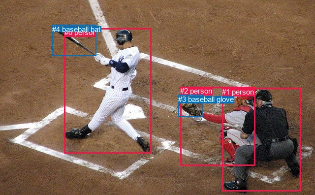
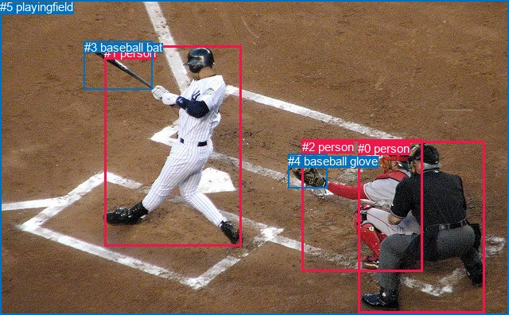

# 图片 1772：2398484.jpg

随机样本序号：421。图片 SHA256：`c3b94d44e9302362d39fc2a712631913633f1db45cd2b9ee1f9911b8a0d59ff3`。

红色框表示人，蓝色框表示其他物体。两个模式分别保留自身框编号，可依据位置比较对应对象。

## 自动检测框与输出

人的框编号：`[0, 1, 2]`。状态：`ok`。

### 自动检测全部物体框

| 编号 | 类别 | 是否为人 | 检测分数 | 像素坐标 xyxy |
|---|---|---|---|---|
| 0 | person | True | 0.9998 | 130.8, 57.2, 307.9, 311.5 |
| 1 | person | True | 0.9992 | 451.3, 178.5, 611.2, 388.1 |
| 2 | person | True | 0.9984 | 366.4, 176.1, 518.1, 336.0 |
| 3 | baseball glove | False | 0.9968 | 362.3, 192.5, 412.4, 237.5 |
| 4 | baseball bat | False | 0.9938 | 106.1, 50.8, 195.0, 113.7 |

### 自动检测 Top50 人相关候选

评分物体对：20；人相关物体对：18；输出关系：36。

| 排名 | 主语编号与类别 | 关系 | 宾语编号与类别 | 类型 | 人与人 | 排序分数 | 原始融合 logit |
|---|---|---|---|---|---|---|---|
| 1 | #0 person | swinging | #4 baseball bat | semantic | False | 0.99660 | 5.6807 |
| 2 | #2 person | holding | #3 baseball glove | semantic | False | 0.97496 | 3.6618 |
| 3 | #0 person | swinging | #3 baseball glove | semantic | False | 0.96814 | 3.4141 |
| 4 | #1 person | beside | #2 person | spatial | True | 0.95917 | 3.1566 |
| 5 | #1 person | looking at | #0 person | semantic | True | 0.95774 | 3.1206 |
| 6 | #2 person | beside | #1 person | spatial | True | 0.90730 | 2.2812 |
| 7 | #3 baseball glove | on | #2 person | spatial | False | 0.88930 | 2.0836 |
| 8 | #1 person | holding | #3 baseball glove | semantic | False | 0.87946 | 1.9873 |
| 9 | #0 person | in | #4 baseball bat | spatial | False | 0.83586 | 1.6278 |
| 10 | #2 person | beside | #0 person | spatial | True | 0.79534 | 1.3574 |
| 11 | #1 person | beside | #0 person | spatial | True | 0.79453 | 1.3524 |
| 12 | #0 person | beside | #2 person | spatial | True | 0.77962 | 1.2635 |
| 13 | #2 person | on | #3 baseball glove | spatial | False | 0.74726 | 1.0840 |
| 14 | #0 person | beside | #1 person | spatial | True | 0.71898 | 0.9394 |
| 15 | #1 person | beside | #3 baseball glove | spatial | False | 0.71664 | 0.9279 |
| 16 | #2 person | catching | #0 person | semantic | True | 0.69809 | 0.8382 |
| 17 | #1 person | holding | #2 person | semantic | True | 0.66868 | 0.7022 |
| 18 | #0 person | beside | #3 baseball glove | spatial | False | 0.65041 | 0.6208 |
| 19 | #2 person | catching | #1 person | semantic | True | 0.47871 | -0.0852 |
| 20 | #3 baseball glove | wearing | #2 person | semantic | False | 0.44280 | -0.2298 |
| 21 | #0 person | playing | #2 person | semantic | True | 0.42538 | -0.3007 |
| 22 | #0 person | playing | #1 person | semantic | True | 0.40567 | -0.3819 |
| 23 | #4 baseball bat | holding | #0 person | semantic | False | 0.39210 | -0.4385 |
| 24 | #4 baseball bat | beside | #0 person | spatial | False | 0.33218 | -0.6983 |
| 25 | #1 person | catching | #4 baseball bat | semantic | False | 0.31793 | -0.7633 |
| 26 | #3 baseball glove | in | #0 person | spatial | False | 0.23266 | -1.1933 |
| 27 | #2 person | swinging | #4 baseball bat | semantic | False | 0.22818 | -1.2186 |
| 28 | #3 baseball glove | in | #1 person | spatial | False | 0.20324 | -1.3662 |
| 29 | #3 baseball glove | catching | #0 person | semantic | False | 0.11762 | -2.0151 |
| 30 | #3 baseball glove | looking at | #1 person | semantic | False | 0.09575 | -2.2454 |
| 31 | #1 person | in | #4 baseball bat | spatial | False | 0.02188 | -3.8002 |
| 32 | #2 person | in | #4 baseball bat | spatial | False | 0.02005 | -3.8895 |
| 33 | #4 baseball bat | beside | #1 person | spatial | False | 0.00624 | -5.0708 |
| 34 | #4 baseball bat | beside | #2 person | spatial | False | 0.00495 | -5.3031 |
| 35 | #4 baseball bat | holding | #1 person | semantic | False | 0.00360 | -5.6228 |
| 36 | #4 baseball bat | holding | #2 person | semantic | False | 0.00267 | -5.9232 |

### 自动检测逐条人相关 GT 核验

R@50：16.67%；命中 1/6。

| GT 主语编号 | GT 关系 | GT 宾语编号 | 结果阶段 | 匹配预测主语编号 | 匹配预测宾语编号 |
|---|---|---|---|---|---|
| 0 | on back of | 2 | wrong_predicate | [1] | [2] |
| 1 | holding | 3 | wrong_predicate | [0] | [4] |
| 1 | swinging | 3 | hit50 | [0] | [4] |
| 1 | standing on | 5 | endpoint_missing_or_wrong_class | [0] | [] |
| 2 | attached to | 0 | wrong_predicate | [2] | [1] |
| 2 | wearing | 4 | wrong_predicate | [2] | [3] |

## 真实框与输出

人的框编号：`[0, 1, 2]`。

### 真实框全部物体框

| 编号 | 类别 | 是否为人 | 检测分数 | 像素坐标 xyxy |
|---|---|---|---|---|
| 0 | person | True | GT | 450.0, 178.0, 609.0, 394.0 |
| 1 | person | True | GT | 131.0, 58.0, 304.0, 310.0 |
| 2 | person | True | GT | 380.0, 176.0, 532.0, 342.0 |
| 3 | baseball bat | False | GT | 106.0, 51.0, 192.0, 112.0 |
| 4 | baseball glove | False | GT | 362.0, 194.0, 411.0, 237.0 |
| 5 | playingfield | False | GT | 0.0, 0.0, 640.0, 396.0 |

### 真实框 Top50 人相关候选

评分物体对：30；人相关物体对：24；输出关系：48。

| 排名 | 主语编号与类别 | 关系 | 宾语编号与类别 | 类型 | 人与人 | 排序分数 | 原始融合 logit |
|---|---|---|---|---|---|---|---|
| 1 | #1 person | swinging | #3 baseball bat | semantic | False | 0.99654 | 5.6636 |
| 2 | #2 person | wearing | #4 baseball glove | semantic | False | 0.96954 | 3.4603 |
| 3 | #1 person | on | #5 playingfield | spatial | False | 0.95986 | 3.1745 |
| 4 | #2 person | on | #5 playingfield | spatial | False | 0.95713 | 3.1059 |
| 5 | #1 person | playing | #5 playingfield | semantic | False | 0.95229 | 2.9938 |
| 6 | #0 person | on | #5 playingfield | spatial | False | 0.94226 | 2.7923 |
| 7 | #0 person | looking at | #1 person | semantic | True | 0.94060 | 2.7623 |
| 8 | #1 person | swinging | #4 baseball glove | semantic | False | 0.92275 | 2.4803 |
| 9 | #0 person | sitting on | #5 playingfield | semantic | False | 0.90335 | 2.2350 |
| 10 | #2 person | sitting on | #5 playingfield | semantic | False | 0.84326 | 1.6827 |
| 11 | #0 person | beside | #2 person | spatial | True | 0.83571 | 1.6266 |
| 12 | #4 baseball glove | on | #2 person | spatial | False | 0.82908 | 1.5791 |
| 13 | #2 person | in | #4 baseball glove | spatial | False | 0.82444 | 1.5467 |
| 14 | #1 person | in | #3 baseball bat | spatial | False | 0.80043 | 1.3890 |
| 15 | #2 person | beside | #0 person | spatial | True | 0.77114 | 1.2148 |
| 16 | #2 person | looking at | #1 person | semantic | True | 0.69173 | 0.8082 |
| 17 | #3 baseball bat | holding | #1 person | semantic | False | 0.59890 | 0.4009 |
| 18 | #2 person | beside | #1 person | spatial | True | 0.56568 | 0.2642 |
| 19 | #0 person | standing on | #2 person | semantic | True | 0.50443 | 0.0177 |
| 20 | #0 person | catching | #4 baseball glove | semantic | False | 0.50085 | 0.0034 |
| 21 | #4 baseball glove | holding | #2 person | semantic | False | 0.48109 | -0.0757 |
| 22 | #0 person | beside | #1 person | spatial | True | 0.47464 | -0.1015 |
| 23 | #1 person | beside | #2 person | spatial | True | 0.44530 | -0.2197 |
| 24 | #1 person | playing | #0 person | semantic | True | 0.42242 | -0.3129 |
| 25 | #1 person | in | #4 baseball glove | spatial | False | 0.41619 | -0.3384 |
| 26 | #1 person | playing | #2 person | semantic | True | 0.39942 | -0.4079 |
| 27 | #1 person | beside | #0 person | spatial | True | 0.39775 | -0.4148 |
| 28 | #3 baseball bat | in | #1 person | spatial | False | 0.37532 | -0.5095 |
| 29 | #0 person | swinging | #3 baseball bat | semantic | False | 0.35475 | -0.5982 |
| 30 | #0 person | in | #4 baseball glove | spatial | False | 0.32850 | -0.7150 |
| 31 | #2 person | sitting on | #0 person | semantic | True | 0.29983 | -0.8481 |
| 32 | #2 person | swinging | #3 baseball bat | semantic | False | 0.26618 | -1.0141 |
| 33 | #4 baseball glove | in | #1 person | spatial | False | 0.23617 | -1.1738 |
| 34 | #4 baseball glove | on | #0 person | spatial | False | 0.20135 | -1.3779 |
| 35 | #4 baseball glove | holding | #1 person | semantic | False | 0.09216 | -2.2876 |
| 36 | #5 playingfield | in | #1 person | spatial | False | 0.07108 | -2.5702 |
| 37 | #4 baseball glove | holding | #0 person | semantic | False | 0.05976 | -2.7558 |
| 38 | #5 playingfield | in | #0 person | spatial | False | 0.04842 | -2.9783 |
| 39 | #5 playingfield | in | #2 person | spatial | False | 0.04100 | -3.1524 |
| 40 | #0 person | in | #3 baseball bat | spatial | False | 0.03696 | -3.2602 |
| 41 | #5 playingfield | holding | #1 person | semantic | False | 0.02402 | -3.7045 |
| 42 | #2 person | in | #3 baseball bat | spatial | False | 0.02094 | -3.8449 |
| 43 | #3 baseball bat | holding | #0 person | semantic | False | 0.01881 | -3.9542 |
| 44 | #5 playingfield | holding | #0 person | semantic | False | 0.01733 | -4.0379 |
| 45 | #5 playingfield | holding | #2 person | semantic | False | 0.01512 | -4.1765 |
| 46 | #3 baseball bat | holding | #2 person | semantic | False | 0.01470 | -4.2049 |
| 47 | #3 baseball bat | in | #0 person | spatial | False | 0.01454 | -4.2163 |
| 48 | #3 baseball bat | in | #2 person | spatial | False | 0.01429 | -4.2338 |

### 真实框逐条人相关 GT 核验

R@50：33.33%；命中 2/6。

| GT 主语编号 | GT 关系 | GT 宾语编号 | 结果阶段 | 匹配预测主语编号 | 匹配预测宾语编号 |
|---|---|---|---|---|---|
| 0 | on back of | 2 | wrong_predicate | [0] | [2] |
| 1 | holding | 3 | wrong_predicate | [1] | [3] |
| 1 | swinging | 3 | hit50 | [1] | [3] |
| 1 | standing on | 5 | wrong_predicate | [1] | [5] |
| 2 | attached to | 0 | wrong_predicate | [2] | [0] |
| 2 | wearing | 4 | hit50 | [2] | [4] |

## 全部人相关 GT

| 主语编号与类别 | 关系 | 宾语编号与类别 |
|---|---|---|
| #0 person | on back of | #2 person |
| #1 person | holding | #3 baseball bat |
| #1 person | swinging | #3 baseball bat |
| #1 person | standing on | #5 playingfield |
| #2 person | attached to | #0 person |
| #2 person | wearing | #4 baseball glove |

原始记录、全部人相关物体对的两项预测与分项分数见 [逐图证据 JSON](../evidence/cases/1772.json)。全部56类 logits 保留于本机 HOR/output/random500/logits/。

<!-- HOR_COMPLETE_RESULTS -->

## 六组条件的完整输出对照

以下保留同一图片三种框与候选模式、两种谓词输出规则的全部 Top50。框编号各自在所属模式内解释。

### 自动检测框完整枚举：空间与语义各保留一个谓词

| 排名 | 主语编号与类别 | 谓词 | 宾语编号与类别 | 分组 | 排序分数 | predicate logit | pair logit |
|---|---|---|---|---|---|---|---|
| 1 | #0 person | swinging | #4 baseball bat | semantic | 0.9966004 | 5.1725602 | 0.5081239 |
| 2 | #2 person | holding | #3 baseball glove | semantic | 0.9749560 | 3.5085902 | 0.1531663 |
| 3 | #0 person | swinging | #3 baseball glove | semantic | 0.9681433 | 3.8484797 | -0.4343469 |
| 4 | #1 person | beside | #2 person | spatial | 0.9591669 | 3.3507686 | -0.1941953 |
| 5 | #1 person | looking at | #0 person | semantic | 0.9577361 | 3.4040570 | -0.2834152 |
| 6 | #2 person | beside | #1 person | spatial | 0.9073047 | 2.8742247 | -0.5930642 |
| 7 | #3 baseball glove | on | #2 person | spatial | 0.8892992 | 2.5592732 | -0.4756710 |
| 8 | #1 person | holding | #3 baseball glove | semantic | 0.8794588 | 2.4220114 | -0.4346960 |
| 9 | #0 person | in | #4 baseball bat | spatial | 0.8358614 | 1.1196280 | 0.5081239 |
| 10 | #2 person | beside | #0 person | spatial | 0.7953431 | 1.9981084 | -0.6406695 |
| 11 | #1 person | beside | #0 person | spatial | 0.7945285 | 1.6358571 | -0.2834152 |
| 12 | #0 person | beside | #2 person | spatial | 0.7796232 | 2.1437941 | -0.8803223 |
| 13 | #2 person | on | #3 baseball glove | spatial | 0.7472572 | 0.9308710 | 0.1531663 |
| 14 | #0 person | beside | #1 person | spatial | 0.7189764 | 1.9959688 | -1.0565790 |
| 15 | #1 person | beside | #3 baseball glove | spatial | 0.7166395 | 1.3625488 | -0.4346960 |
| 16 | #2 person | catching | #0 person | semantic | 0.6980919 | 1.4788971 | -0.6406695 |
| 17 | #1 person | holding | #2 person | semantic | 0.6686831 | 0.8964300 | -0.1941953 |
| 18 | #0 person | beside | #3 baseball glove | spatial | 0.6504100 | 1.0551887 | -0.4343469 |
| 19 | #2 person | catching | #1 person | semantic | 0.4787068 | 0.5078402 | -0.5930642 |
| 20 | #3 baseball glove | wearing | #2 person | semantic | 0.4427969 | 0.2458525 | -0.4756710 |
| 21 | #0 person | playing | #2 person | semantic | 0.4253760 | 0.5795798 | -0.8803223 |
| 22 | #0 person | playing | #1 person | semantic | 0.4056740 | 0.6747007 | -1.0565790 |
| 23 | #4 baseball bat | holding | #0 person | semantic | 0.3921030 | 0.0629473 | -0.5014279 |
| 24 | #4 baseball bat | beside | #0 person | spatial | 0.3321820 | -0.1969047 | -0.5014279 |
| 25 | #1 person | catching | #4 baseball bat | semantic | 0.3179341 | 0.0714016 | -0.8346837 |
| 26 | #3 baseball glove | in | #0 person | spatial | 0.2326640 | -0.3660140 | -0.8273154 |
| 27 | #2 person | swinging | #4 baseball bat | semantic | 0.2281759 | -0.0932999 | -1.1253402 |
| 28 | #3 baseball glove | in | #1 person | spatial | 0.2032362 | -0.4202266 | -0.9459629 |
| 29 | #3 baseball glove | catching | #0 person | semantic | 0.1176231 | -1.1878185 | -0.8273154 |
| 30 | #3 baseball glove | looking at | #1 person | semantic | 0.0957469 | -1.2994378 | -0.9459629 |
| 31 | #1 person | in | #4 baseball bat | spatial | 0.0218770 | -2.9655173 | -0.8346837 |
| 32 | #2 person | in | #4 baseball bat | spatial | 0.0200460 | -2.7641366 | -1.1253402 |
| 33 | #4 baseball bat | beside | #1 person | spatial | 0.0062383 | -3.6207094 | -1.4500732 |
| 34 | #4 baseball bat | beside | #2 person | spatial | 0.0049516 | -3.5233467 | -1.7797267 |
| 35 | #4 baseball bat | holding | #1 person | semantic | 0.0036013 | -4.1727753 | -1.4500732 |
| 36 | #4 baseball bat | holding | #2 person | semantic | 0.0026696 | -4.1434426 | -1.7797267 |

GT 命中：1/6，R@50=16.67%。

| GT主语 | GT谓词 | GT宾语 | 结果阶段 | 匹配主语框 | 匹配宾语框 |
|---|---|---|---|---|---|
| 0 | on back of | 2 | wrong_predicate | [1] | [2] |
| 1 | holding | 3 | wrong_predicate | [0] | [4] |
| 1 | swinging | 3 | hit50 | [0] | [4] |
| 1 | standing on | 5 | endpoint_missing_or_wrong_class | [0] | [] |
| 2 | attached to | 0 | wrong_predicate | [2] | [1] |
| 2 | wearing | 4 | wrong_predicate | [2] | [3] |

### 自动检测框完整枚举：每对只保留一个谓词

| 排名 | 主语编号与类别 | 谓词 | 宾语编号与类别 | 分组 | 排序分数 | predicate logit | pair logit |
|---|---|---|---|---|---|---|---|
| 1 | #0 person | swinging | #4 baseball bat | single | 0.9966004 | 5.1725602 | 0.5081239 |
| 2 | #2 person | holding | #3 baseball glove | single | 0.9749560 | 3.5085902 | 0.1531663 |
| 3 | #0 person | swinging | #3 baseball glove | single | 0.9681433 | 3.8484797 | -0.4343469 |
| 4 | #1 person | beside | #2 person | single | 0.9591669 | 3.3507686 | -0.1941953 |
| 5 | #1 person | looking at | #0 person | single | 0.9577361 | 3.4040570 | -0.2834152 |
| 6 | #2 person | beside | #1 person | single | 0.9073047 | 2.8742247 | -0.5930642 |
| 7 | #3 baseball glove | on | #2 person | single | 0.8892992 | 2.5592732 | -0.4756710 |
| 8 | #1 person | holding | #3 baseball glove | single | 0.8794588 | 2.4220114 | -0.4346960 |
| 9 | #2 person | beside | #0 person | single | 0.7953431 | 1.9981084 | -0.6406695 |
| 10 | #0 person | beside | #2 person | single | 0.7796232 | 2.1437941 | -0.8803223 |
| 11 | #0 person | beside | #1 person | single | 0.7189764 | 1.9959688 | -1.0565790 |
| 12 | #4 baseball bat | holding | #0 person | single | 0.3921030 | 0.0629473 | -0.5014279 |
| 13 | #1 person | catching | #4 baseball bat | single | 0.3179341 | 0.0714016 | -0.8346837 |
| 14 | #3 baseball glove | in | #0 person | single | 0.2326640 | -0.3660140 | -0.8273154 |
| 15 | #2 person | swinging | #4 baseball bat | single | 0.2281759 | -0.0932999 | -1.1253402 |
| 16 | #3 baseball glove | in | #1 person | single | 0.2032362 | -0.4202266 | -0.9459629 |
| 17 | #4 baseball bat | beside | #1 person | single | 0.0062383 | -3.6207094 | -1.4500732 |
| 18 | #4 baseball bat | beside | #2 person | single | 0.0049516 | -3.5233467 | -1.7797267 |

GT 命中：1/6，R@50=16.67%。

| GT主语 | GT谓词 | GT宾语 | 结果阶段 | 匹配主语框 | 匹配宾语框 |
|---|---|---|---|---|---|
| 0 | on back of | 2 | wrong_predicate | [1] | [2] |
| 1 | holding | 3 | wrong_predicate | [0] | [4] |
| 1 | swinging | 3 | hit50 | [0] | [4] |
| 1 | standing on | 5 | endpoint_missing_or_wrong_class | [0] | [] |
| 2 | attached to | 0 | wrong_predicate | [2] | [1] |
| 2 | wearing | 4 | wrong_predicate | [2] | [3] |

### 真实框完整枚举：空间与语义各保留一个谓词

| 排名 | 主语编号与类别 | 谓词 | 宾语编号与类别 | 分组 | 排序分数 | predicate logit | pair logit |
|---|---|---|---|---|---|---|---|
| 1 | #1 person | swinging | #3 baseball bat | semantic | 0.9965419 | 5.1725516 | 0.4910370 |
| 2 | #2 person | wearing | #4 baseball glove | semantic | 0.9695361 | 3.3265805 | 0.1336964 |
| 3 | #1 person | on | #5 playingfield | spatial | 0.9598637 | 3.4207683 | -0.2462582 |
| 4 | #2 person | on | #5 playingfield | spatial | 0.9571341 | 3.3342299 | -0.2283649 |
| 5 | #1 person | playing | #5 playingfield | semantic | 0.9522926 | 3.2400427 | -0.2462582 |
| 6 | #0 person | on | #5 playingfield | spatial | 0.9422580 | 3.0069623 | -0.2146690 |
| 7 | #0 person | looking at | #1 person | semantic | 0.9406050 | 3.0624862 | -0.3001725 |
| 8 | #1 person | swinging | #4 baseball glove | semantic | 0.9227498 | 2.9457736 | -0.4654644 |
| 9 | #0 person | sitting on | #5 playingfield | semantic | 0.9033516 | 2.4497018 | -0.2146690 |
| 10 | #2 person | sitting on | #5 playingfield | semantic | 0.8432573 | 1.9110312 | -0.2283649 |
| 11 | #0 person | beside | #2 person | spatial | 0.8357091 | 1.8525090 | -0.2258670 |
| 12 | #4 baseball glove | on | #2 person | spatial | 0.8290782 | 2.1144786 | -0.5353706 |
| 13 | #2 person | in | #4 baseball glove | spatial | 0.8244379 | 1.4130125 | 0.1336964 |
| 14 | #1 person | in | #3 baseball bat | spatial | 0.8004256 | 0.8979197 | 0.4910370 |
| 15 | #2 person | beside | #0 person | spatial | 0.7711435 | 1.8251939 | -0.6104145 |
| 16 | #2 person | looking at | #1 person | semantic | 0.6917306 | 1.3443871 | -0.5361649 |
| 17 | #3 baseball bat | holding | #1 person | semantic | 0.5989034 | 0.8909407 | -0.4900425 |
| 18 | #2 person | beside | #1 person | spatial | 0.5656806 | 0.8004141 | -0.5361649 |
| 19 | #0 person | standing on | #2 person | semantic | 0.5044309 | 0.2435913 | -0.2258670 |
| 20 | #0 person | catching | #4 baseball glove | semantic | 0.5008478 | 0.4555507 | -0.4521598 |
| 21 | #4 baseball glove | holding | #2 person | semantic | 0.4810919 | 0.4597025 | -0.5353706 |
| 22 | #0 person | beside | #1 person | spatial | 0.4746405 | 0.1986475 | -0.3001725 |
| 23 | #1 person | beside | #2 person | spatial | 0.4452980 | 0.7126274 | -0.9323148 |
| 24 | #1 person | playing | #0 person | semantic | 0.4224157 | 0.7554612 | -1.0683258 |
| 25 | #1 person | in | #4 baseball glove | spatial | 0.4161926 | 0.1270413 | -0.4654644 |
| 26 | #1 person | playing | #2 person | semantic | 0.3994186 | 0.5244265 | -0.9323148 |
| 27 | #1 person | beside | #0 person | spatial | 0.3977522 | 0.6534858 | -1.0683258 |
| 28 | #3 baseball bat | in | #1 person | spatial | 0.3753176 | -0.0194283 | -0.4900425 |
| 29 | #0 person | swinging | #3 baseball bat | semantic | 0.3547511 | 0.2677670 | -0.8659866 |
| 30 | #0 person | in | #4 baseball glove | spatial | 0.3285018 | -0.2628093 | -0.4521598 |
| 31 | #2 person | sitting on | #0 person | semantic | 0.2998277 | -0.2377038 | -0.6104145 |
| 32 | #2 person | swinging | #3 baseball bat | semantic | 0.2661777 | -0.0331445 | -0.9809582 |
| 33 | #4 baseball glove | in | #1 person | spatial | 0.2361730 | -0.3330493 | -0.8407275 |
| 34 | #4 baseball glove | on | #0 person | spatial | 0.2013515 | -0.4518781 | -0.9259906 |
| 35 | #4 baseball glove | holding | #1 person | semantic | 0.0921587 | -1.4468303 | -0.8407275 |
| 36 | #5 playingfield | in | #1 person | spatial | 0.0710795 | -1.3821552 | -1.1880696 |
| 37 | #4 baseball glove | holding | #0 person | semantic | 0.0597600 | -1.8298078 | -0.9259906 |
| 38 | #5 playingfield | in | #0 person | spatial | 0.0484151 | -1.5892222 | -1.3890954 |
| 39 | #5 playingfield | in | #2 person | spatial | 0.0409959 | -1.7352264 | -1.4171969 |
| 40 | #0 person | in | #3 baseball bat | spatial | 0.0369623 | -2.3942084 | -0.8659866 |
| 41 | #5 playingfield | holding | #1 person | semantic | 0.0240216 | -2.5164165 | -1.1880696 |
| 42 | #2 person | in | #3 baseball bat | spatial | 0.0209407 | -2.8639417 | -0.9809582 |
| 43 | #3 baseball bat | holding | #0 person | semantic | 0.0188139 | -2.4979429 | -1.4562240 |
| 44 | #5 playingfield | holding | #0 person | semantic | 0.0173292 | -2.6487882 | -1.3890954 |
| 45 | #5 playingfield | holding | #2 person | semantic | 0.0151204 | -2.7592773 | -1.4171969 |
| 46 | #3 baseball bat | holding | #2 person | semantic | 0.0147022 | -2.5117109 | -1.6932347 |
| 47 | #3 baseball bat | in | #0 person | spatial | 0.0145383 | -2.7600994 | -1.4562240 |
| 48 | #3 baseball bat | in | #2 person | spatial | 0.0142906 | -2.5405266 | -1.6932347 |

GT 命中：2/6，R@50=33.33%。

| GT主语 | GT谓词 | GT宾语 | 结果阶段 | 匹配主语框 | 匹配宾语框 |
|---|---|---|---|---|---|
| 0 | on back of | 2 | wrong_predicate | [0] | [2] |
| 1 | holding | 3 | wrong_predicate | [1] | [3] |
| 1 | swinging | 3 | hit50 | [1] | [3] |
| 1 | standing on | 5 | wrong_predicate | [1] | [5] |
| 2 | attached to | 0 | wrong_predicate | [2] | [0] |
| 2 | wearing | 4 | hit50 | [2] | [4] |

### 真实框完整枚举：每对只保留一个谓词

| 排名 | 主语编号与类别 | 谓词 | 宾语编号与类别 | 分组 | 排序分数 | predicate logit | pair logit |
|---|---|---|---|---|---|---|---|
| 1 | #1 person | swinging | #3 baseball bat | single | 0.9965419 | 5.1725516 | 0.4910370 |
| 2 | #2 person | wearing | #4 baseball glove | single | 0.9695361 | 3.3265805 | 0.1336964 |
| 3 | #1 person | on | #5 playingfield | single | 0.9598637 | 3.4207683 | -0.2462582 |
| 4 | #2 person | on | #5 playingfield | single | 0.9571341 | 3.3342299 | -0.2283649 |
| 5 | #0 person | on | #5 playingfield | single | 0.9422580 | 3.0069623 | -0.2146690 |
| 6 | #0 person | looking at | #1 person | single | 0.9406050 | 3.0624862 | -0.3001725 |
| 7 | #1 person | swinging | #4 baseball glove | single | 0.9227498 | 2.9457736 | -0.4654644 |
| 8 | #0 person | beside | #2 person | single | 0.8357091 | 1.8525090 | -0.2258670 |
| 9 | #4 baseball glove | on | #2 person | single | 0.8290782 | 2.1144786 | -0.5353706 |
| 10 | #2 person | beside | #0 person | single | 0.7711435 | 1.8251939 | -0.6104145 |
| 11 | #2 person | looking at | #1 person | single | 0.6917306 | 1.3443871 | -0.5361649 |
| 12 | #3 baseball bat | holding | #1 person | single | 0.5989034 | 0.8909407 | -0.4900425 |
| 13 | #0 person | catching | #4 baseball glove | single | 0.5008478 | 0.4555507 | -0.4521598 |
| 14 | #1 person | beside | #2 person | single | 0.4452980 | 0.7126274 | -0.9323148 |
| 15 | #1 person | playing | #0 person | single | 0.4224157 | 0.7554612 | -1.0683258 |
| 16 | #0 person | swinging | #3 baseball bat | single | 0.3547511 | 0.2677670 | -0.8659866 |
| 17 | #2 person | swinging | #3 baseball bat | single | 0.2661777 | -0.0331445 | -0.9809582 |
| 18 | #4 baseball glove | in | #1 person | single | 0.2361730 | -0.3330493 | -0.8407275 |
| 19 | #4 baseball glove | on | #0 person | single | 0.2013515 | -0.4518781 | -0.9259906 |
| 20 | #5 playingfield | in | #1 person | single | 0.0710795 | -1.3821552 | -1.1880696 |
| 21 | #5 playingfield | in | #0 person | single | 0.0484151 | -1.5892222 | -1.3890954 |
| 22 | #5 playingfield | in | #2 person | single | 0.0409959 | -1.7352264 | -1.4171969 |
| 23 | #3 baseball bat | holding | #0 person | single | 0.0188139 | -2.4979429 | -1.4562240 |
| 24 | #3 baseball bat | holding | #2 person | single | 0.0147022 | -2.5117109 | -1.6932347 |

GT 命中：2/6，R@50=33.33%。

| GT主语 | GT谓词 | GT宾语 | 结果阶段 | 匹配主语框 | 匹配宾语框 |
|---|---|---|---|---|---|
| 0 | on back of | 2 | wrong_predicate | [0] | [2] |
| 1 | holding | 3 | wrong_predicate | [1] | [3] |
| 1 | swinging | 3 | hit50 | [1] | [3] |
| 1 | standing on | 5 | wrong_predicate | [1] | [5] |
| 2 | attached to | 0 | wrong_predicate | [2] | [0] |
| 2 | wearing | 4 | hit50 | [2] | [4] |

### 真实框400候选：空间与语义各保留一个谓词

| 排名 | 主语编号与类别 | 谓词 | 宾语编号与类别 | 分组 | 排序分数 | predicate logit | pair logit |
|---|---|---|---|---|---|---|---|
| 1 | #1 person | swinging | #3 baseball bat | semantic | 0.9965419 | 5.1725516 | 0.4910370 |
| 2 | #2 person | wearing | #4 baseball glove | semantic | 0.9709349 | 3.3750272 | 0.1336964 |
| 3 | #1 person | on | #5 playingfield | spatial | 0.9598637 | 3.4207683 | -0.2462582 |
| 4 | #2 person | on | #5 playingfield | spatial | 0.9571341 | 3.3342299 | -0.2283649 |
| 5 | #1 person | playing | #5 playingfield | semantic | 0.9522926 | 3.2400427 | -0.2462582 |
| 6 | #0 person | on | #5 playingfield | spatial | 0.9425535 | 3.0124078 | -0.2146690 |
| 7 | #0 person | looking at | #1 person | semantic | 0.9406050 | 3.0624862 | -0.3001725 |
| 8 | #1 person | swinging | #4 baseball glove | semantic | 0.9227499 | 2.9457746 | -0.4654644 |
| 9 | #0 person | sitting on | #5 playingfield | semantic | 0.9017635 | 2.4316435 | -0.2146690 |
| 10 | #2 person | sitting on | #5 playingfield | semantic | 0.8432573 | 1.9110312 | -0.2283649 |
| 11 | #0 person | beside | #2 person | spatial | 0.8357250 | 1.8526249 | -0.2258670 |
| 12 | #4 baseball glove | on | #2 person | spatial | 0.8275296 | 2.1035895 | -0.5353706 |
| 13 | #2 person | in | #4 baseball glove | spatial | 0.8249177 | 1.4163308 | 0.1336964 |
| 14 | #1 person | in | #3 baseball bat | spatial | 0.8004256 | 0.8979197 | 0.4910370 |
| 15 | #2 person | beside | #0 person | spatial | 0.7711435 | 1.8251939 | -0.6104145 |
| 16 | #2 person | looking at | #1 person | semantic | 0.6917306 | 1.3443871 | -0.5361649 |
| 17 | #3 baseball bat | holding | #1 person | semantic | 0.5989034 | 0.8909407 | -0.4900425 |
| 18 | #2 person | beside | #1 person | spatial | 0.5656949 | 0.8004723 | -0.5361649 |
| 19 | #0 person | catching | #4 baseball glove | semantic | 0.5083697 | 0.4856420 | -0.4521598 |
| 20 | #0 person | standing on | #2 person | semantic | 0.5044309 | 0.2435913 | -0.2258670 |
| 21 | #4 baseball glove | holding | #2 person | semantic | 0.4810919 | 0.4597025 | -0.5353706 |
| 22 | #0 person | beside | #1 person | spatial | 0.4746405 | 0.1986475 | -0.3001725 |
| 23 | #1 person | beside | #2 person | spatial | 0.4452837 | 0.7125692 | -0.9323148 |
| 24 | #1 person | in | #4 baseball glove | spatial | 0.4235220 | 0.1571326 | -0.4654644 |
| 25 | #1 person | playing | #0 person | semantic | 0.4162691 | 0.7302175 | -1.0683258 |
| 26 | #1 person | playing | #2 person | semantic | 0.4054894 | 0.5496707 | -0.9323148 |
| 27 | #1 person | beside | #0 person | spatial | 0.4049263 | 0.6833453 | -1.0683258 |
| 28 | #3 baseball bat | in | #1 person | spatial | 0.3745398 | -0.0227470 | -0.4900425 |
| 29 | #0 person | swinging | #3 baseball bat | semantic | 0.3547513 | 0.2677679 | -0.8659866 |
| 30 | #0 person | in | #4 baseball glove | spatial | 0.3344344 | -0.2360368 | -0.4521598 |
| 31 | #2 person | sitting on | #0 person | semantic | 0.3052244 | -0.2121272 | -0.6104145 |
| 32 | #2 person | swinging | #3 baseball bat | semantic | 0.2720963 | -0.0030546 | -0.9809582 |
| 33 | #4 baseball glove | in | #1 person | spatial | 0.2407333 | -0.3079362 | -0.8407275 |
| 34 | #4 baseball glove | on | #0 person | spatial | 0.2013515 | -0.4518781 | -0.9259906 |
| 35 | #4 baseball glove | holding | #1 person | semantic | 0.0935504 | -1.4303076 | -0.8407275 |
| 36 | #5 playingfield | in | #1 person | spatial | 0.0711891 | -1.3804958 | -1.1880696 |
| 37 | #4 baseball glove | holding | #0 person | semantic | 0.0613032 | -1.8026707 | -0.9259906 |
| 38 | #5 playingfield | in | #0 person | spatial | 0.0480102 | -1.5980451 | -1.3890954 |
| 39 | #5 playingfield | in | #2 person | spatial | 0.0409470 | -1.7364709 | -1.4171969 |
| 40 | #0 person | in | #3 baseball bat | spatial | 0.0379878 | -2.3657768 | -0.8659866 |
| 41 | #5 playingfield | holding | #1 person | semantic | 0.0240563 | -2.5149395 | -1.1880696 |
| 42 | #2 person | in | #3 baseball bat | spatial | 0.0211652 | -2.8530445 | -0.9809582 |
| 43 | #3 baseball bat | holding | #0 person | semantic | 0.0191006 | -2.4825280 | -1.4562240 |
| 44 | #5 playingfield | holding | #0 person | semantic | 0.0173669 | -2.6465726 | -1.3890954 |
| 45 | #5 playingfield | holding | #2 person | semantic | 0.0150984 | -2.7607546 | -1.4171969 |
| 46 | #3 baseball bat | holding | #2 person | semantic | 0.0149435 | -2.4951880 | -1.6932347 |
| 47 | #3 baseball bat | beside | #0 person | spatial | 0.0148631 | -2.7376781 | -1.4562240 |
| 48 | #3 baseball bat | in | #2 person | spatial | 0.0146907 | -2.5125093 | -1.6932347 |

GT 命中：2/6，R@50=33.33%。

| GT主语 | GT谓词 | GT宾语 | 结果阶段 | 匹配主语框 | 匹配宾语框 |
|---|---|---|---|---|---|
| 0 | on back of | 2 | wrong_predicate | [0] | [2] |
| 1 | holding | 3 | wrong_predicate | [1] | [3] |
| 1 | swinging | 3 | hit50 | [1] | [3] |
| 1 | standing on | 5 | wrong_predicate | [1] | [5] |
| 2 | attached to | 0 | wrong_predicate | [2] | [0] |
| 2 | wearing | 4 | hit50 | [2] | [4] |

### 真实框400候选：每对只保留一个谓词

| 排名 | 主语编号与类别 | 谓词 | 宾语编号与类别 | 分组 | 排序分数 | predicate logit | pair logit |
|---|---|---|---|---|---|---|---|
| 1 | #1 person | swinging | #3 baseball bat | single | 0.9965419 | 5.1725516 | 0.4910370 |
| 2 | #2 person | wearing | #4 baseball glove | single | 0.9709349 | 3.3750272 | 0.1336964 |
| 3 | #1 person | on | #5 playingfield | single | 0.9598637 | 3.4207683 | -0.2462582 |
| 4 | #2 person | on | #5 playingfield | single | 0.9571341 | 3.3342299 | -0.2283649 |
| 5 | #0 person | on | #5 playingfield | single | 0.9425535 | 3.0124078 | -0.2146690 |
| 6 | #0 person | looking at | #1 person | single | 0.9406050 | 3.0624862 | -0.3001725 |
| 7 | #1 person | swinging | #4 baseball glove | single | 0.9227499 | 2.9457746 | -0.4654644 |
| 8 | #0 person | beside | #2 person | single | 0.8357250 | 1.8526249 | -0.2258670 |
| 9 | #4 baseball glove | on | #2 person | single | 0.8275296 | 2.1035895 | -0.5353706 |
| 10 | #2 person | beside | #0 person | single | 0.7711435 | 1.8251939 | -0.6104145 |
| 11 | #2 person | looking at | #1 person | single | 0.6917306 | 1.3443871 | -0.5361649 |
| 12 | #3 baseball bat | holding | #1 person | single | 0.5989034 | 0.8909407 | -0.4900425 |
| 13 | #0 person | catching | #4 baseball glove | single | 0.5083697 | 0.4856420 | -0.4521598 |
| 14 | #1 person | beside | #2 person | single | 0.4452837 | 0.7125692 | -0.9323148 |
| 15 | #1 person | playing | #0 person | single | 0.4162691 | 0.7302175 | -1.0683258 |
| 16 | #0 person | swinging | #3 baseball bat | single | 0.3547513 | 0.2677679 | -0.8659866 |
| 17 | #2 person | swinging | #3 baseball bat | single | 0.2720963 | -0.0030546 | -0.9809582 |
| 18 | #4 baseball glove | in | #1 person | single | 0.2407333 | -0.3079362 | -0.8407275 |
| 19 | #4 baseball glove | on | #0 person | single | 0.2013515 | -0.4518781 | -0.9259906 |
| 20 | #5 playingfield | in | #1 person | single | 0.0711891 | -1.3804958 | -1.1880696 |
| 21 | #5 playingfield | in | #0 person | single | 0.0480102 | -1.5980451 | -1.3890954 |
| 22 | #5 playingfield | in | #2 person | single | 0.0409470 | -1.7364709 | -1.4171969 |
| 23 | #3 baseball bat | holding | #0 person | single | 0.0191006 | -2.4825280 | -1.4562240 |
| 24 | #3 baseball bat | holding | #2 person | single | 0.0149435 | -2.4951880 | -1.6932347 |

GT 命中：2/6，R@50=33.33%。

| GT主语 | GT谓词 | GT宾语 | 结果阶段 | 匹配主语框 | 匹配宾语框 |
|---|---|---|---|---|---|
| 0 | on back of | 2 | wrong_predicate | [0] | [2] |
| 1 | holding | 3 | wrong_predicate | [1] | [3] |
| 1 | swinging | 3 | hit50 | [1] | [3] |
| 1 | standing on | 5 | wrong_predicate | [1] | [5] |
| 2 | attached to | 0 | wrong_predicate | [2] | [0] |
| 2 | wearing | 4 | hit50 | [2] | [4] |
