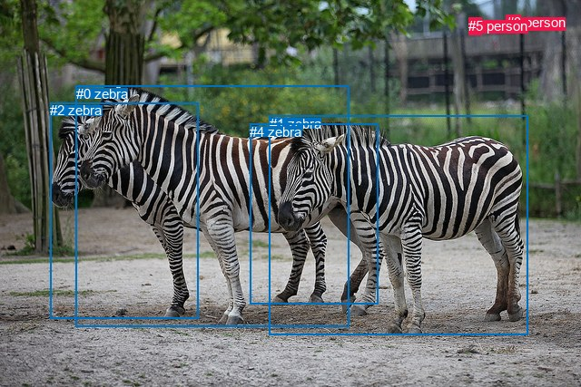
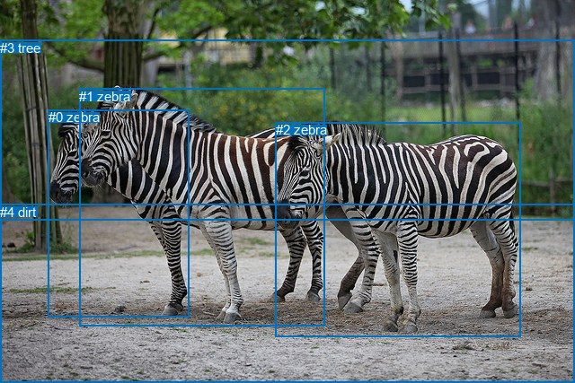

# 图片 1778：2398856.jpg

随机样本序号：288。图片 SHA256：`563be53973f8385eb1927f5f1ca5c4732272566a45000db7a21f99501ec5e233`。

红色框表示人，蓝色框表示其他物体。两个模式分别保留自身框编号，可依据位置比较对应对象。

## 自动检测框与输出

人的框编号：`[3, 5]`。状态：`ok`。

### 自动检测全部物体框

| 编号 | 类别 | 是否为人 | 检测分数 | 像素坐标 xyxy |
|---|---|---|---|---|
| 0 | zebra | False | 0.9993 | 83.7, 94.5, 384.1, 360.5 |
| 1 | zebra | False | 0.9991 | 296.7, 127.9, 581.4, 369.7 |
| 2 | zebra | False | 0.8551 | 55.3, 113.1, 218.4, 351.2 |
| 3 | person | True | 0.5874 | 557.6, 16.3, 573.1, 35.3 |
| 4 | zebra | False | 0.5695 | 275.3, 136.6, 416.5, 335.9 |
| 5 | person | True | 0.5101 | 516.4, 19.9, 530.3, 38.1 |

### 自动检测 Top50 人相关候选

评分物体对：30；人相关物体对：18；输出关系：36。

| 排名 | 主语编号与类别 | 关系 | 宾语编号与类别 | 类型 | 人与人 | 排序分数 | 原始融合 logit |
|---|---|---|---|---|---|---|---|
| 1 | #3 person | sitting on | #5 person | semantic | True | 0.91453 | 2.3703 |
| 2 | #5 person | playing with | #3 person | semantic | True | 0.89902 | 2.1864 |
| 3 | #3 person | looking at | #1 zebra | semantic | False | 0.87566 | 1.9519 |
| 4 | #3 person | on | #5 person | spatial | True | 0.77664 | 1.2462 |
| 5 | #5 person | looking at | #1 zebra | semantic | False | 0.74759 | 1.0858 |
| 6 | #3 person | looking at | #0 zebra | semantic | False | 0.64675 | 0.6048 |
| 7 | #5 person | beside | #3 person | spatial | True | 0.54260 | 0.1708 |
| 8 | #5 person | looking at | #0 zebra | semantic | False | 0.53710 | 0.1487 |
| 9 | #3 person | looking at | #4 zebra | semantic | False | 0.42650 | -0.2961 |
| 10 | #5 person | looking at | #4 zebra | semantic | False | 0.37052 | -0.5300 |
| 11 | #3 person | looking at | #2 zebra | semantic | False | 0.25171 | -1.0895 |
| 12 | #5 person | looking at | #2 zebra | semantic | False | 0.21770 | -1.2791 |
| 13 | #3 person | in | #1 zebra | spatial | False | 0.07387 | -2.5287 |
| 14 | #1 zebra | in | #5 person | spatial | False | 0.05905 | -2.7684 |
| 15 | #3 person | on | #0 zebra | spatial | False | 0.04566 | -3.0397 |
| 16 | #5 person | in | #1 zebra | spatial | False | 0.04541 | -3.0455 |
| 17 | #1 zebra | in | #3 person | spatial | False | 0.04522 | -3.0499 |
| 18 | #5 person | on | #0 zebra | spatial | False | 0.03564 | -3.2980 |
| 19 | #0 zebra | in | #5 person | spatial | False | 0.03354 | -3.3610 |
| 20 | #1 zebra | looking at | #3 person | semantic | False | 0.02113 | -3.8359 |
| 21 | #0 zebra | in | #3 person | spatial | False | 0.01835 | -3.9798 |
| 22 | #1 zebra | walking on | #5 person | semantic | False | 0.01765 | -4.0195 |
| 23 | #4 zebra | in | #5 person | spatial | False | 0.01330 | -4.3067 |
| 24 | #0 zebra | looking at | #5 person | semantic | False | 0.01329 | -4.3076 |
| 25 | #3 person | on | #2 zebra | spatial | False | 0.01282 | -4.3435 |
| 26 | #5 person | on | #2 zebra | spatial | False | 0.01158 | -4.4465 |
| 27 | #3 person | in | #4 zebra | spatial | False | 0.01094 | -4.5046 |
| 28 | #0 zebra | looking at | #3 person | semantic | False | 0.01055 | -4.5414 |
| 29 | #4 zebra | in | #3 person | spatial | False | 0.00993 | -4.6022 |
| 30 | #2 zebra | in | #5 person | spatial | False | 0.00826 | -4.7884 |
| 31 | #4 zebra | looking at | #5 person | semantic | False | 0.00802 | -4.8176 |
| 32 | #5 person | in | #4 zebra | spatial | False | 0.00789 | -4.8348 |
| 33 | #4 zebra | looking at | #3 person | semantic | False | 0.00780 | -4.8460 |
| 34 | #2 zebra | looking at | #3 person | semantic | False | 0.00658 | -5.0178 |
| 35 | #2 zebra | in | #3 person | spatial | False | 0.00617 | -5.0818 |
| 36 | #2 zebra | looking at | #5 person | semantic | False | 0.00616 | -5.0832 |

### 自动检测逐条人相关 GT 核验

本图没有人相关 GT，R@50 无分母；预测候选继续展示。

## 真实框与输出

人的框编号：`[]`。

### 真实框全部物体框

| 编号 | 类别 | 是否为人 | 检测分数 | 像素坐标 xyxy |
|---|---|---|---|---|
| 0 | zebra | False | GT | 54.0, 122.0, 210.0, 353.0 |
| 1 | zebra | False | GT | 88.0, 99.0, 361.0, 364.0 |
| 2 | zebra | False | GT | 307.0, 136.0, 580.0, 375.0 |
| 3 | tree | False | GT | 0.0, 45.0, 640.0, 245.0 |
| 4 | dirt | False | GT | 0.0, 228.0, 640.0, 427.0 |

### 真实框 Top50 人相关候选

评分物体对：0；人相关物体对：0；输出关系：0。

| 排名 | 主语编号与类别 | 关系 | 宾语编号与类别 | 类型 | 人与人 | 排序分数 | 原始融合 logit |
|---|---|---|---|---|---|---|---|

### 真实框逐条人相关 GT 核验

本图没有人相关 GT，R@50 无分母；预测候选继续展示。

## 全部人相关 GT

| 主语编号与类别 | 关系 | 宾语编号与类别 |
|---|---|---|

原始记录、全部人相关物体对的两项预测与分项分数见 [逐图证据 JSON](../evidence/cases/1778.json)。全部56类 logits 保留于本机 HOR/output/random500/logits/。

<!-- HOR_COMPLETE_RESULTS -->

## 六组条件的完整输出对照

以下保留同一图片三种框与候选模式、两种谓词输出规则的全部 Top50。框编号各自在所属模式内解释。

### 自动检测框完整枚举：空间与语义各保留一个谓词

| 排名 | 主语编号与类别 | 谓词 | 宾语编号与类别 | 分组 | 排序分数 | predicate logit | pair logit |
|---|---|---|---|---|---|---|---|
| 1 | #3 person | sitting on | #5 person | semantic | 0.9145318 | 2.4467297 | -0.0764613 |
| 2 | #5 person | playing with | #3 person | semantic | 0.8990185 | 2.6672873 | -0.4809208 |
| 3 | #3 person | looking at | #1 zebra | semantic | 0.8756588 | 2.2827945 | -0.3308479 |
| 4 | #3 person | on | #5 person | spatial | 0.7766370 | 1.3226361 | -0.0764613 |
| 5 | #5 person | looking at | #1 zebra | semantic | 0.7475900 | 1.6124191 | -0.5266191 |
| 6 | #3 person | looking at | #0 zebra | semantic | 0.6467534 | 1.1981144 | -0.5933158 |
| 7 | #5 person | beside | #3 person | spatial | 0.5426040 | 0.6517510 | -0.4809208 |
| 8 | #5 person | looking at | #0 zebra | semantic | 0.5370971 | 0.9518065 | -0.8031449 |
| 9 | #3 person | looking at | #4 zebra | semantic | 0.4265022 | 0.7072420 | -1.0033785 |
| 10 | #5 person | looking at | #4 zebra | semantic | 0.3705217 | 0.5819955 | -1.1119748 |
| 11 | #3 person | looking at | #2 zebra | semantic | 0.2517145 | 0.0182805 | -1.1077695 |
| 12 | #5 person | looking at | #2 zebra | semantic | 0.2176967 | 0.0123539 | -1.2914937 |
| 13 | #3 person | in | #1 zebra | spatial | 0.0738702 | -2.1978567 | -0.3308479 |
| 14 | #1 zebra | in | #5 person | spatial | 0.0590543 | -1.3321311 | -1.4362962 |
| 15 | #3 person | on | #0 zebra | spatial | 0.0456647 | -2.4463727 | -0.5933158 |
| 16 | #5 person | in | #1 zebra | spatial | 0.0454138 | -2.5188432 | -0.5266191 |
| 17 | #1 zebra | in | #3 person | spatial | 0.0452237 | -1.7538540 | -1.2960027 |
| 18 | #5 person | on | #0 zebra | spatial | 0.0356404 | -2.4948401 | -0.8031449 |
| 19 | #0 zebra | in | #5 person | spatial | 0.0335380 | -1.7451725 | -1.6157895 |
| 20 | #1 zebra | looking at | #3 person | semantic | 0.0211264 | -2.5398786 | -1.2960027 |
| 21 | #0 zebra | in | #3 person | spatial | 0.0183468 | -2.5337980 | -1.4459877 |
| 22 | #1 zebra | walking on | #5 person | semantic | 0.0176456 | -2.5831690 | -1.4362962 |
| 23 | #4 zebra | in | #5 person | spatial | 0.0132985 | -2.3511457 | -1.9555683 |
| 24 | #0 zebra | looking at | #5 person | semantic | 0.0132873 | -2.6917839 | -1.6157895 |
| 25 | #3 person | on | #2 zebra | spatial | 0.0128243 | -3.2357392 | -1.1077695 |
| 26 | #5 person | on | #2 zebra | spatial | 0.0115839 | -3.1549940 | -1.2914937 |
| 27 | #3 person | in | #4 zebra | spatial | 0.0109368 | -3.5012457 | -1.0033785 |
| 28 | #0 zebra | looking at | #3 person | semantic | 0.0105456 | -3.0954609 | -1.4459877 |
| 29 | #4 zebra | in | #3 person | spatial | 0.0099301 | -2.7412291 | -1.8609791 |
| 30 | #2 zebra | in | #5 person | spatial | 0.0082567 | -2.7812767 | -2.0071650 |
| 31 | #4 zebra | looking at | #5 person | semantic | 0.0080211 | -2.8620522 | -1.9555683 |
| 32 | #5 person | in | #4 zebra | spatial | 0.0078853 | -3.7228627 | -1.1119748 |
| 33 | #4 zebra | looking at | #3 person | semantic | 0.0077984 | -2.9850318 | -1.8609791 |
| 34 | #2 zebra | looking at | #3 person | semantic | 0.0065758 | -3.2326746 | -1.7850859 |
| 35 | #2 zebra | in | #3 person | spatial | 0.0061705 | -3.2967033 | -1.7850859 |
| 36 | #2 zebra | looking at | #5 person | semantic | 0.0061619 | -3.0760300 | -2.0071650 |

没有人相关 GT，本条件的召回率无分母。

### 自动检测框完整枚举：每对只保留一个谓词

| 排名 | 主语编号与类别 | 谓词 | 宾语编号与类别 | 分组 | 排序分数 | predicate logit | pair logit |
|---|---|---|---|---|---|---|---|
| 1 | #3 person | sitting on | #5 person | single | 0.9145318 | 2.4467297 | -0.0764613 |
| 2 | #5 person | playing with | #3 person | single | 0.8990185 | 2.6672873 | -0.4809208 |
| 3 | #3 person | looking at | #1 zebra | single | 0.8756588 | 2.2827945 | -0.3308479 |
| 4 | #5 person | looking at | #1 zebra | single | 0.7475900 | 1.6124191 | -0.5266191 |
| 5 | #3 person | looking at | #0 zebra | single | 0.6467534 | 1.1981144 | -0.5933158 |
| 6 | #5 person | looking at | #0 zebra | single | 0.5370971 | 0.9518065 | -0.8031449 |
| 7 | #3 person | looking at | #4 zebra | single | 0.4265022 | 0.7072420 | -1.0033785 |
| 8 | #5 person | looking at | #4 zebra | single | 0.3705217 | 0.5819955 | -1.1119748 |
| 9 | #3 person | looking at | #2 zebra | single | 0.2517145 | 0.0182805 | -1.1077695 |
| 10 | #5 person | looking at | #2 zebra | single | 0.2176967 | 0.0123539 | -1.2914937 |
| 11 | #1 zebra | in | #5 person | single | 0.0590543 | -1.3321311 | -1.4362962 |
| 12 | #1 zebra | in | #3 person | single | 0.0452237 | -1.7538540 | -1.2960027 |
| 13 | #0 zebra | in | #5 person | single | 0.0335380 | -1.7451725 | -1.6157895 |
| 14 | #0 zebra | in | #3 person | single | 0.0183468 | -2.5337980 | -1.4459877 |
| 15 | #4 zebra | in | #5 person | single | 0.0132985 | -2.3511457 | -1.9555683 |
| 16 | #4 zebra | in | #3 person | single | 0.0099301 | -2.7412291 | -1.8609791 |
| 17 | #2 zebra | in | #5 person | single | 0.0082567 | -2.7812767 | -2.0071650 |
| 18 | #2 zebra | looking at | #3 person | single | 0.0065758 | -3.2326746 | -1.7850859 |

没有人相关 GT，本条件的召回率无分母。

### 真实框完整枚举：空间与语义各保留一个谓词

| 排名 | 主语编号与类别 | 谓词 | 宾语编号与类别 | 分组 | 排序分数 | predicate logit | pair logit |
|---|---|---|---|---|---|---|---|

没有人相关 GT，本条件的召回率无分母。

### 真实框完整枚举：每对只保留一个谓词

| 排名 | 主语编号与类别 | 谓词 | 宾语编号与类别 | 分组 | 排序分数 | predicate logit | pair logit |
|---|---|---|---|---|---|---|---|

没有人相关 GT，本条件的召回率无分母。

### 真实框400候选：空间与语义各保留一个谓词

| 排名 | 主语编号与类别 | 谓词 | 宾语编号与类别 | 分组 | 排序分数 | predicate logit | pair logit |
|---|---|---|---|---|---|---|---|

没有人相关 GT，本条件的召回率无分母。

### 真实框400候选：每对只保留一个谓词

| 排名 | 主语编号与类别 | 谓词 | 宾语编号与类别 | 分组 | 排序分数 | predicate logit | pair logit |
|---|---|---|---|---|---|---|---|

没有人相关 GT，本条件的召回率无分母。
