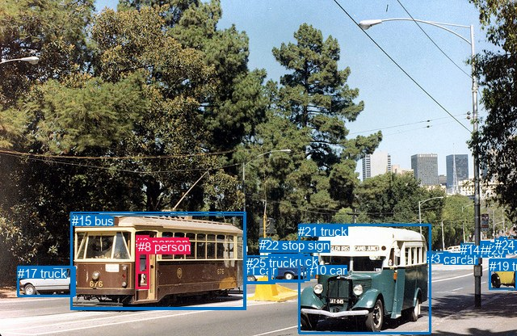
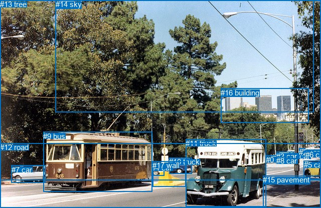

# 图片 1789：2400038.jpg

随机样本序号：305。图片 SHA256：`199402bfe3e935cf8c52e59271a9d5a0e2a20a7aa264472d7bcd0936b7c15d97`。

红色框表示人，蓝色框表示其他物体。两个模式分别保留自身框编号，可依据位置比较对应对象。

## 自动检测框与输出

人的框编号：`[6, 8]`。状态：`ok`。

### 自动检测全部物体框

| 编号 | 类别 | 是否为人 | 检测分数 | 像素坐标 xyxy |
|---|---|---|---|---|
| 0 | car | False | 0.9938 | 549.9, 313.2, 582.1, 325.2 |
| 1 | car | False | 0.9740 | 301.2, 326.2, 340.1, 351.2 |
| 2 | car | False | 0.9605 | 608.7, 300.7, 619.8, 308.3 |
| 3 | car | False | 0.9541 | 528.5, 312.0, 554.9, 324.3 |
| 4 | bus | False | 0.9434 | 370.7, 278.4, 532.5, 413.1 |
| 5 | car | False | 0.9092 | 22.3, 329.8, 92.0, 367.2 |
| 6 | person | True | 0.9076 | 168.1, 291.7, 184.2, 357.1 |
| 7 | train | False | 0.9010 | 87.7, 262.2, 304.1, 384.0 |
| 8 | person | True | 0.8143 | 170.7, 297.1, 183.4, 338.2 |
| 9 | car | False | 0.7548 | 606.1, 321.0, 639.7, 358.8 |
| 10 | car | False | 0.7509 | 379.9, 325.6, 389.8, 344.9 |
| 11 | car | False | 0.7393 | 575.2, 304.8, 586.1, 313.3 |
| 12 | bus | False | 0.7105 | 334.9, 314.6, 382.6, 347.5 |
| 13 | car | False | 0.7008 | 594.7, 298.4, 606.1, 309.0 |
| 14 | car | False | 0.6369 | 570.3, 301.3, 586.3, 313.6 |
| 15 | bus | False | 0.5759 | 88.7, 265.1, 302.2, 381.2 |
| 16 | truck | False | 0.5746 | 332.8, 314.6, 383.7, 347.9 |
| 17 | truck | False | 0.5416 | 21.5, 330.3, 93.9, 366.8 |
| 18 | car | False | 0.5312 | 595.4, 300.8, 602.8, 308.5 |
| 19 | truck | False | 0.4955 | 605.8, 321.0, 639.9, 358.3 |
| 20 | car | False | 0.4648 | 600.5, 300.7, 610.5, 308.3 |
| 21 | truck | False | 0.4529 | 369.1, 277.8, 533.2, 412.8 |
| 22 | stop sign | False | 0.4424 | 321.3, 295.1, 335.4, 309.4 |
| 23 | car | False | 0.4258 | 618.5, 293.9, 627.1, 300.5 |
| 24 | car | False | 0.3775 | 612.6, 295.3, 623.4, 302.9 |
| 25 | truck | False | 0.3645 | 304.5, 316.9, 376.4, 349.8 |

### 自动检测 Top50 人相关候选

评分物体对：650；人相关物体对：98；输出关系：50。

| 排名 | 主语编号与类别 | 关系 | 宾语编号与类别 | 类型 | 人与人 | 排序分数 | 原始融合 logit |
|---|---|---|---|---|---|---|---|
| 1 | #6 person | on | #7 train | spatial | False | 0.88396 | 2.0305 |
| 2 | #8 person | in | #7 train | spatial | False | 0.88364 | 2.0273 |
| 3 | #8 person | in | #15 bus | spatial | False | 0.88317 | 2.0228 |
| 4 | #6 person | on | #15 bus | spatial | False | 0.88268 | 2.0181 |
| 5 | #8 person | riding | #7 train | semantic | False | 0.85852 | 1.8030 |
| 6 | #8 person | riding | #15 bus | semantic | False | 0.85349 | 1.7623 |
| 7 | #6 person | wearing | #8 person | semantic | True | 0.80655 | 1.4277 |
| 8 | #6 person | walking on | #7 train | semantic | False | 0.79067 | 1.3290 |
| 9 | #6 person | walking on | #15 bus | semantic | False | 0.78810 | 1.3135 |
| 10 | #6 person | in | #8 person | spatial | True | 0.43572 | -0.2586 |
| 11 | #8 person | in | #6 person | spatial | True | 0.30120 | -0.8416 |
| 12 | #15 bus | carrying | #8 person | semantic | False | 0.27839 | -0.9524 |
| 13 | #7 train | carrying | #8 person | semantic | False | 0.26384 | -1.0261 |
| 14 | #8 person | walking on | #6 person | semantic | True | 0.23422 | -1.1846 |
| 15 | #15 bus | carrying | #6 person | semantic | False | 0.22832 | -1.2178 |
| 16 | #7 train | carrying | #6 person | semantic | False | 0.21968 | -1.2675 |
| 17 | #7 train | on | #6 person | spatial | False | 0.16445 | -1.6255 |
| 18 | #15 bus | on | #6 person | spatial | False | 0.16365 | -1.6313 |
| 19 | #15 bus | on | #8 person | spatial | False | 0.13252 | -1.8788 |
| 20 | #7 train | on | #8 person | spatial | False | 0.13156 | -1.8872 |
| 21 | #6 person | driving | #9 car | semantic | False | 0.04522 | -3.0498 |
| 22 | #6 person | driving | #19 truck | semantic | False | 0.04508 | -3.0533 |
| 23 | #6 person | walking on | #13 car | semantic | False | 0.04247 | -3.1156 |
| 24 | #8 person | driving | #9 car | semantic | False | 0.04159 | -3.1375 |
| 25 | #8 person | driving | #19 truck | semantic | False | 0.04151 | -3.1395 |
| 26 | #6 person | walking on | #24 car | semantic | False | 0.04024 | -3.1719 |
| 27 | #6 person | walking on | #20 car | semantic | False | 0.03928 | -3.1971 |
| 28 | #6 person | walking on | #18 car | semantic | False | 0.03882 | -3.2091 |
| 29 | #8 person | driving | #21 truck | semantic | False | 0.03876 | -3.2108 |
| 30 | #6 person | walking on | #1 car | semantic | False | 0.03846 | -3.2189 |
| 31 | #8 person | driving | #4 bus | semantic | False | 0.03800 | -3.2315 |
| 32 | #6 person | walking on | #25 truck | semantic | False | 0.03758 | -3.2430 |
| 33 | #6 person | walking on | #23 car | semantic | False | 0.03655 | -3.2718 |
| 34 | #6 person | walking on | #2 car | semantic | False | 0.03654 | -3.2722 |
| 35 | #6 person | walking on | #4 bus | semantic | False | 0.03411 | -3.3434 |
| 36 | #8 person | walking on | #1 car | semantic | False | 0.03371 | -3.3557 |
| 37 | #6 person | walking on | #14 car | semantic | False | 0.03348 | -3.3629 |
| 38 | #6 person | walking on | #21 truck | semantic | False | 0.03336 | -3.3665 |
| 39 | #8 person | walking on | #25 truck | semantic | False | 0.03184 | -3.4146 |
| 40 | #6 person | walking on | #11 car | semantic | False | 0.03067 | -3.4535 |
| 41 | #6 person | walking on | #16 truck | semantic | False | 0.02782 | -3.5537 |
| 42 | #6 person | walking on | #12 bus | semantic | False | 0.02711 | -3.5805 |
| 43 | #8 person | walking on | #17 truck | semantic | False | 0.02594 | -3.6258 |
| 44 | #8 person | walking on | #13 car | semantic | False | 0.02508 | -3.6601 |
| 45 | #8 person | walking on | #5 car | semantic | False | 0.02477 | -3.6730 |
| 46 | #6 person | walking on | #0 car | semantic | False | 0.02472 | -3.6752 |
| 47 | #8 person | walking on | #20 car | semantic | False | 0.02455 | -3.6824 |
| 48 | #8 person | walking on | #18 car | semantic | False | 0.02445 | -3.6864 |
| 49 | #8 person | walking on | #24 car | semantic | False | 0.02379 | -3.7145 |
| 50 | #23 car | driving | #6 person | semantic | False | 0.02279 | -3.7586 |

### 自动检测逐条人相关 GT 核验

本图没有人相关 GT，R@50 无分母；预测候选继续展示。

## 真实框与输出

人的框编号：`[]`。

### 真实框全部物体框

| 编号 | 类别 | 是否为人 | 检测分数 | 像素坐标 xyxy |
|---|---|---|---|---|
| 0 | car | False | GT | 530.0, 311.0, 555.0, 324.0 |
| 1 | car | False | GT | 577.0, 304.0, 586.0, 314.0 |
| 2 | car | False | GT | 596.0, 296.0, 609.0, 307.0 |
| 3 | car | False | GT | 551.0, 304.0, 579.0, 316.0 |
| 4 | car | False | GT | 302.0, 327.0, 328.0, 351.0 |
| 5 | car | False | GT | 606.0, 321.0, 640.0, 358.0 |
| 6 | car | False | GT | 609.0, 301.0, 619.0, 309.0 |
| 7 | car | False | GT | 23.0, 331.0, 91.0, 366.0 |
| 8 | car | False | GT | 551.0, 313.0, 583.0, 326.0 |
| 9 | bus | False | GT | 86.0, 264.0, 303.0, 384.0 |
| 10 | truck | False | GT | 337.0, 315.0, 383.0, 348.0 |
| 11 | truck | False | GT | 370.0, 278.0, 530.0, 413.0 |
| 12 | road | False | GT | 0.0, 286.0, 640.0, 416.0 |
| 13 | tree | False | GT | 0.0, 0.0, 640.0, 360.0 |
| 14 | sky | False | GT | 111.0, 0.0, 626.0, 225.0 |
| 15 | pavement | False | GT | 524.0, 351.0, 640.0, 416.0 |
| 16 | building | False | GT | 440.0, 177.0, 615.0, 246.0 |
| 17 | wall | False | GT | 304.0, 322.0, 371.0, 373.0 |

### 真实框 Top50 人相关候选

评分物体对：0；人相关物体对：0；输出关系：0。

| 排名 | 主语编号与类别 | 关系 | 宾语编号与类别 | 类型 | 人与人 | 排序分数 | 原始融合 logit |
|---|---|---|---|---|---|---|---|

### 真实框逐条人相关 GT 核验

本图没有人相关 GT，R@50 无分母；预测候选继续展示。

## 全部人相关 GT

| 主语编号与类别 | 关系 | 宾语编号与类别 |
|---|---|---|

原始记录、全部人相关物体对的两项预测与分项分数见 [逐图证据 JSON](../evidence/cases/1789.json)。全部56类 logits 保留于本机 HOR/output/random500/logits/。

<!-- HOR_COMPLETE_RESULTS -->

## 六组条件的完整输出对照

以下保留同一图片三种框与候选模式、两种谓词输出规则的全部 Top50。框编号各自在所属模式内解释。

### 自动检测框完整枚举：空间与语义各保留一个谓词

| 排名 | 主语编号与类别 | 谓词 | 宾语编号与类别 | 分组 | 排序分数 | predicate logit | pair logit |
|---|---|---|---|---|---|---|---|
| 1 | #6 person | on | #7 train | spatial | 0.8839635 | 2.1219511 | -0.0914401 |
| 2 | #8 person | in | #7 train | spatial | 0.8836379 | 2.1017923 | -0.0744516 |
| 3 | #8 person | in | #15 bus | spatial | 0.8831688 | 2.1084299 | -0.0856437 |
| 4 | #6 person | on | #15 bus | spatial | 0.8826847 | 2.1219511 | -0.1038479 |
| 5 | #8 person | riding | #7 train | semantic | 0.8585195 | 1.8774996 | -0.0744516 |
| 6 | #8 person | riding | #15 bus | semantic | 0.8534917 | 1.8478975 | -0.0856437 |
| 7 | #6 person | wearing | #8 person | semantic | 0.8065470 | 2.5603089 | -1.1325810 |
| 8 | #6 person | walking on | #7 train | semantic | 0.7906678 | 1.4203954 | -0.0914401 |
| 9 | #6 person | walking on | #15 bus | semantic | 0.7881045 | 1.4173856 | -0.1038479 |
| 10 | #6 person | in | #8 person | spatial | 0.4357178 | 0.8740211 | -1.1325810 |
| 11 | #8 person | in | #6 person | spatial | 0.3011989 | 0.1655512 | -1.0071465 |
| 12 | #15 bus | carrying | #8 person | semantic | 0.2783929 | -0.2898216 | -0.6626260 |
| 13 | #7 train | carrying | #8 person | semantic | 0.2638444 | -0.3742700 | -0.6518118 |
| 14 | #8 person | walking on | #6 person | semantic | 0.2342241 | -0.1774650 | -1.0071465 |
| 15 | #15 bus | carrying | #6 person | semantic | 0.2283182 | -0.5812135 | -0.6366188 |
| 16 | #7 train | carrying | #6 person | semantic | 0.2196830 | -0.6367359 | -0.6307790 |
| 17 | #7 train | on | #6 person | spatial | 0.1644534 | -0.9946795 | -0.6307790 |
| 18 | #15 bus | on | #6 person | spatial | 0.1636526 | -0.9946795 | -0.6366188 |
| 19 | #15 bus | on | #8 person | spatial | 0.1325229 | -1.2162077 | -0.6626260 |
| 20 | #7 train | on | #8 person | spatial | 0.1315616 | -1.2354095 | -0.6518118 |
| 21 | #6 person | driving | #9 car | semantic | 0.0452243 | -1.4928172 | -1.5570258 |
| 22 | #6 person | driving | #19 truck | semantic | 0.0450755 | -1.4928172 | -1.5604770 |
| 23 | #6 person | walking on | #13 car | semantic | 0.0424700 | -1.1012344 | -2.0143256 |
| 24 | #8 person | driving | #9 car | semantic | 0.0415866 | -1.6884036 | -1.4490968 |
| 25 | #8 person | driving | #19 truck | semantic | 0.0415084 | -1.6884060 | -1.4510579 |
| 26 | #6 person | walking on | #24 car | semantic | 0.0402356 | -1.1839819 | -1.9879532 |
| 27 | #6 person | walking on | #20 car | semantic | 0.0392764 | -1.2110693 | -1.9859948 |
| 28 | #6 person | walking on | #18 car | semantic | 0.0388249 | -1.2140801 | -1.9950135 |
| 29 | #8 person | driving | #21 truck | semantic | 0.0387619 | -2.1999645 | -1.0108211 |
| 30 | #6 person | walking on | #1 car | semantic | 0.0384594 | -1.1553886 | -2.0635438 |
| 31 | #8 person | driving | #4 bus | semantic | 0.0379970 | -2.2150080 | -1.0165030 |
| 32 | #6 person | walking on | #25 truck | semantic | 0.0375810 | -1.3991225 | -1.8438284 |
| 33 | #6 person | walking on | #23 car | semantic | 0.0365513 | -1.2426591 | -2.0291443 |
| 34 | #6 person | walking on | #2 car | semantic | 0.0365385 | -1.3178942 | -1.9542723 |
| 35 | #6 person | walking on | #4 bus | semantic | 0.0341111 | -2.3033164 | -1.0401105 |
| 36 | #8 person | walking on | #1 car | semantic | 0.0337098 | -1.2923048 | -2.0633717 |
| 37 | #6 person | walking on | #14 car | semantic | 0.0334755 | -1.1734450 | -2.1894469 |
| 38 | #6 person | walking on | #21 truck | semantic | 0.0333595 | -2.3303971 | -1.0360868 |
| 39 | #8 person | walking on | #25 truck | semantic | 0.0318412 | -1.6007364 | -1.8138987 |
| 40 | #6 person | walking on | #11 car | semantic | 0.0306655 | -1.2426591 | -2.2108121 |
| 41 | #6 person | walking on | #16 truck | semantic | 0.0278212 | -1.7331226 | -1.8206183 |
| 42 | #6 person | walking on | #12 bus | semantic | 0.0271056 | -1.7632139 | -1.8173206 |
| 43 | #8 person | walking on | #17 truck | semantic | 0.0259383 | -2.0325649 | -1.5931909 |
| 44 | #8 person | walking on | #13 car | semantic | 0.0250838 | -1.6910105 | -1.9691194 |
| 45 | #8 person | walking on | #5 car | semantic | 0.0247721 | -2.0528786 | -1.6200759 |
| 46 | #6 person | walking on | #0 car | semantic | 0.0247173 | -1.4397576 | -2.2354681 |
| 47 | #8 person | walking on | #20 car | semantic | 0.0245457 | -1.7466841 | -1.9356830 |
| 48 | #8 person | walking on | #18 car | semantic | 0.0244490 | -1.7376592 | -1.9487537 |
| 49 | #8 person | walking on | #24 car | semantic | 0.0237879 | -1.7767684 | -1.9377362 |
| 50 | #23 car | driving | #6 person | semantic | 0.0227861 | -1.8687441 | -1.8898097 |

没有人相关 GT，本条件的召回率无分母。

### 自动检测框完整枚举：每对只保留一个谓词

| 排名 | 主语编号与类别 | 谓词 | 宾语编号与类别 | 分组 | 排序分数 | predicate logit | pair logit |
|---|---|---|---|---|---|---|---|
| 1 | #6 person | on | #7 train | single | 0.8839635 | 2.1219511 | -0.0914401 |
| 2 | #8 person | in | #7 train | single | 0.8836379 | 2.1017923 | -0.0744516 |
| 3 | #8 person | in | #15 bus | single | 0.8831688 | 2.1084299 | -0.0856437 |
| 4 | #6 person | on | #15 bus | single | 0.8826847 | 2.1219511 | -0.1038479 |
| 5 | #6 person | wearing | #8 person | single | 0.8065470 | 2.5603089 | -1.1325810 |
| 6 | #8 person | in | #6 person | single | 0.3011989 | 0.1655512 | -1.0071465 |
| 7 | #15 bus | carrying | #8 person | single | 0.2783929 | -0.2898216 | -0.6626260 |
| 8 | #7 train | carrying | #8 person | single | 0.2638444 | -0.3742700 | -0.6518118 |
| 9 | #15 bus | carrying | #6 person | single | 0.2283182 | -0.5812135 | -0.6366188 |
| 10 | #7 train | carrying | #6 person | single | 0.2196830 | -0.6367359 | -0.6307790 |
| 11 | #6 person | driving | #9 car | single | 0.0452243 | -1.4928172 | -1.5570258 |
| 12 | #6 person | driving | #19 truck | single | 0.0450755 | -1.4928172 | -1.5604770 |
| 13 | #6 person | walking on | #13 car | single | 0.0424700 | -1.1012344 | -2.0143256 |
| 14 | #8 person | driving | #9 car | single | 0.0415866 | -1.6884036 | -1.4490968 |
| 15 | #8 person | driving | #19 truck | single | 0.0415084 | -1.6884060 | -1.4510579 |
| 16 | #6 person | walking on | #24 car | single | 0.0402356 | -1.1839819 | -1.9879532 |
| 17 | #6 person | walking on | #20 car | single | 0.0392764 | -1.2110693 | -1.9859948 |
| 18 | #6 person | walking on | #18 car | single | 0.0388249 | -1.2140801 | -1.9950135 |
| 19 | #8 person | driving | #21 truck | single | 0.0387619 | -2.1999645 | -1.0108211 |
| 20 | #6 person | walking on | #1 car | single | 0.0384594 | -1.1553886 | -2.0635438 |
| 21 | #8 person | driving | #4 bus | single | 0.0379970 | -2.2150080 | -1.0165030 |
| 22 | #6 person | walking on | #25 truck | single | 0.0375810 | -1.3991225 | -1.8438284 |
| 23 | #6 person | walking on | #23 car | single | 0.0365513 | -1.2426591 | -2.0291443 |
| 24 | #6 person | walking on | #2 car | single | 0.0365385 | -1.3178942 | -1.9542723 |
| 25 | #6 person | walking on | #4 bus | single | 0.0341111 | -2.3033164 | -1.0401105 |
| 26 | #8 person | walking on | #1 car | single | 0.0337098 | -1.2923048 | -2.0633717 |
| 27 | #6 person | walking on | #14 car | single | 0.0334755 | -1.1734450 | -2.1894469 |
| 28 | #6 person | walking on | #21 truck | single | 0.0333595 | -2.3303971 | -1.0360868 |
| 29 | #8 person | walking on | #25 truck | single | 0.0318412 | -1.6007364 | -1.8138987 |
| 30 | #6 person | walking on | #11 car | single | 0.0306655 | -1.2426591 | -2.2108121 |
| 31 | #6 person | walking on | #16 truck | single | 0.0278212 | -1.7331226 | -1.8206183 |
| 32 | #6 person | walking on | #12 bus | single | 0.0271056 | -1.7632139 | -1.8173206 |
| 33 | #8 person | walking on | #17 truck | single | 0.0259383 | -2.0325649 | -1.5931909 |
| 34 | #8 person | walking on | #13 car | single | 0.0250838 | -1.6910105 | -1.9691194 |
| 35 | #8 person | walking on | #5 car | single | 0.0247721 | -2.0528786 | -1.6200759 |
| 36 | #6 person | walking on | #0 car | single | 0.0247173 | -1.4397576 | -2.2354681 |
| 37 | #8 person | walking on | #20 car | single | 0.0245457 | -1.7466841 | -1.9356830 |
| 38 | #8 person | walking on | #18 car | single | 0.0244490 | -1.7376592 | -1.9487537 |
| 39 | #8 person | walking on | #24 car | single | 0.0237879 | -1.7767684 | -1.9377362 |
| 40 | #23 car | driving | #6 person | single | 0.0227861 | -1.8687441 | -1.8898097 |
| 41 | #8 person | walking on | #2 car | single | 0.0222589 | -1.8790839 | -1.9034196 |
| 42 | #6 person | walking on | #22 stop sign | single | 0.0221398 | -1.2050135 | -2.5829782 |
| 43 | #8 person | walking on | #23 car | single | 0.0214293 | -1.8474808 | -1.9738514 |
| 44 | #18 car | driving | #6 person | single | 0.0211672 | -1.8688035 | -1.9651061 |
| 45 | #8 person | walking on | #16 truck | single | 0.0205352 | -2.0881968 | -1.7766681 |
| 46 | #8 person | walking on | #12 bus | single | 0.0203844 | -2.0972211 | -1.7751701 |
| 47 | #8 person | walking on | #14 car | single | 0.0200010 | -1.7421610 | -2.1496065 |
| 48 | #6 person | walking on | #10 car | single | 0.0196028 | -1.8745403 | -2.0377471 |
| 49 | #6 person | walking on | #17 truck | single | 0.0192984 | -2.2259002 | -1.7023439 |
| 50 | #2 car | driving | #6 person | single | 0.0192687 | -2.0192010 | -1.9106181 |

没有人相关 GT，本条件的召回率无分母。

### 真实框完整枚举：空间与语义各保留一个谓词

| 排名 | 主语编号与类别 | 谓词 | 宾语编号与类别 | 分组 | 排序分数 | predicate logit | pair logit |
|---|---|---|---|---|---|---|---|

没有人相关 GT，本条件的召回率无分母。

### 真实框完整枚举：每对只保留一个谓词

| 排名 | 主语编号与类别 | 谓词 | 宾语编号与类别 | 分组 | 排序分数 | predicate logit | pair logit |
|---|---|---|---|---|---|---|---|

没有人相关 GT，本条件的召回率无分母。

### 真实框400候选：空间与语义各保留一个谓词

| 排名 | 主语编号与类别 | 谓词 | 宾语编号与类别 | 分组 | 排序分数 | predicate logit | pair logit |
|---|---|---|---|---|---|---|---|

没有人相关 GT，本条件的召回率无分母。

### 真实框400候选：每对只保留一个谓词

| 排名 | 主语编号与类别 | 谓词 | 宾语编号与类别 | 分组 | 排序分数 | predicate logit | pair logit |
|---|---|---|---|---|---|---|---|

没有人相关 GT，本条件的召回率无分母。
