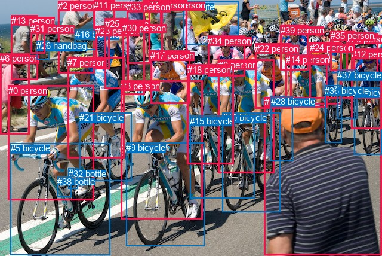
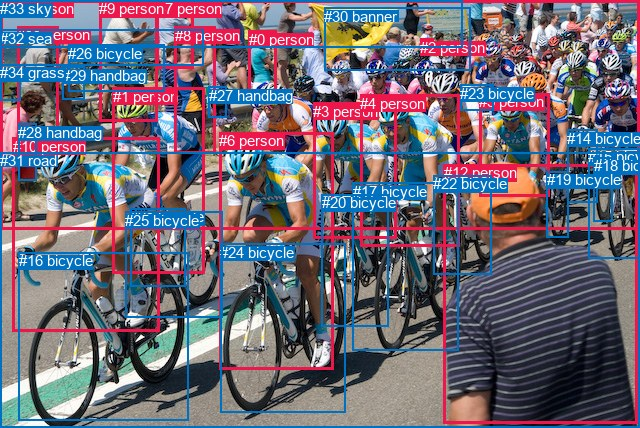

# 图片 1795：2400390.jpg

随机样本序号：104。图片 SHA256：`419354910c2d301ff5d82f5dfcd3480ca12cd15f3381aa5a7adfa0b94bae5ee5`。

红色框表示人，蓝色框表示其他物体。两个模式分别保留自身框编号，可依据位置比较对应对象。

## 自动检测框与输出

人的框编号：`[0, 1, 2, 3, 6, 7, 8, 11, 12, 13, 14, 17, 18, 20, 22, 23, 24, 25, 27, 29, 30, 31, 33, 34, 35, 39]`。状态：`ok`。

### 自动检测全部物体框

| 编号 | 类别 | 是否为人 | 检测分数 | 像素坐标 xyxy |
|---|---|---|---|---|
| 0 | person | True | 0.9979 | 13.7, 142.9, 157.8, 334.4 |
| 1 | person | True | 0.9977 | 442.6, 162.4, 639.1, 426.5 |
| 2 | person | True | 0.9958 | 97.4, 1.1, 158.5, 122.0 |
| 3 | person | True | 0.9955 | 202.7, 134.9, 339.5, 366.5 |
| 4 | bicycle | False | 0.9934 | 593.9, 146.1, 639.3, 258.1 |
| 5 | bicycle | False | 0.9933 | 18.0, 239.1, 184.7, 426.2 |
| 6 | person | True | 0.9860 | 0.0, 89.3, 49.4, 224.8 |
| 7 | person | True | 0.9859 | 113.4, 95.7, 208.2, 264.6 |
| 8 | person | True | 0.9858 | 365.8, 99.9, 459.8, 289.5 |
| 9 | bicycle | False | 0.9811 | 211.4, 238.4, 342.9, 411.6 |
| 10 | bicycle | False | 0.9811 | 373.0, 188.4, 469.5, 354.8 |
| 11 | person | True | 0.9556 | 157.1, 0.2, 192.9, 63.7 |
| 12 | person | True | 0.9428 | 588.8, 81.7, 639.8, 215.9 |
| 13 | person | True | 0.9427 | 18.7, 25.6, 63.6, 133.1 |
| 14 | person | True | 0.9390 | 478.7, 91.0, 548.6, 179.9 |
| 15 | bicycle | False | 0.9307 | 318.5, 193.6, 426.5, 331.9 |
| 16 | bicycle | False | 0.9283 | 125.9, 49.3, 162.4, 83.3 |
| 17 | person | True | 0.9252 | 252.2, 84.1, 318.4, 173.5 |
| 18 | person | True | 0.8850 | 313.9, 108.0, 391.1, 274.3 |
| 19 | kite | False | 0.8759 | 307.6, 2.9, 399.6, 74.1 |
| 20 | person | True | 0.8756 | 271.0, 0.1, 313.9, 91.5 |
| 21 | bicycle | False | 0.8639 | 133.5, 188.2, 220.5, 302.5 |
| 22 | person | True | 0.8611 | 427.4, 72.9, 488.1, 181.3 |
| 23 | person | True | 0.8593 | 160.2, 43.1, 183.2, 115.3 |
| 24 | person | True | 0.8513 | 518.5, 70.8, 572.5, 174.8 |
| 25 | person | True | 0.8464 | 175.9, 30.9, 215.7, 148.5 |
| 26 | handbag | False | 0.8305 | 61.3, 68.2, 82.7, 99.7 |
| 27 | person | True | 0.8176 | 240.7, 0.0, 271.0, 55.1 |
| 28 | bicycle | False | 0.7999 | 453.5, 161.5, 491.0, 269.9 |
| 29 | person | True | 0.7972 | 580.9, 57.0, 633.5, 134.6 |
| 30 | person | True | 0.7816 | 205.3, 37.5, 242.6, 158.2 |
| 31 | person | True | 0.7803 | 51.4, 39.2, 75.1, 89.7 |
| 32 | bottle | False | 0.7780 | 114.6, 281.5, 130.5, 315.6 |
| 33 | person | True | 0.7727 | 212.3, 3.0, 252.0, 106.8 |
| 34 | person | True | 0.7710 | 348.3, 59.9, 411.0, 127.4 |
| 35 | person | True | 0.7598 | 553.9, 51.2, 594.6, 118.9 |
| 36 | bicycle | False | 0.7462 | 544.5, 143.0, 572.3, 238.7 |
| 37 | bicycle | False | 0.7328 | 565.3, 117.4, 598.4, 199.0 |
| 38 | bottle | False | 0.7164 | 96.3, 295.3, 119.5, 329.9 |
| 39 | person | True | 0.6675 | 469.9, 41.8, 516.4, 117.7 |

### 自动检测 Top50 人相关候选

评分物体对：1560；人相关物体对：1378；输出关系：50。

| 排名 | 主语编号与类别 | 关系 | 宾语编号与类别 | 类型 | 人与人 | 排序分数 | 原始融合 logit |
|---|---|---|---|---|---|---|---|
| 1 | #0 person | riding | #5 bicycle | semantic | False | 0.99665 | 5.6966 |
| 2 | #7 person | riding | #21 bicycle | semantic | False | 0.99661 | 5.6844 |
| 3 | #3 person | riding | #9 bicycle | semantic | False | 0.99614 | 5.5520 |
| 4 | #12 person | riding | #4 bicycle | semantic | False | 0.99512 | 5.3173 |
| 5 | #8 person | riding | #10 bicycle | semantic | False | 0.99467 | 5.2297 |
| 6 | #8 person | riding | #15 bicycle | semantic | False | 0.99444 | 5.1865 |
| 7 | #24 person | riding | #36 bicycle | semantic | False | 0.99300 | 4.9554 |
| 8 | #7 person | riding | #5 bicycle | semantic | False | 0.99277 | 4.9228 |
| 9 | #18 person | riding | #15 bicycle | semantic | False | 0.99109 | 4.7116 |
| 10 | #24 person | riding | #37 bicycle | semantic | False | 0.99043 | 4.6392 |
| 11 | #13 person | holding | #26 handbag | semantic | False | 0.98929 | 4.5258 |
| 12 | #25 person | riding | #21 bicycle | semantic | False | 0.98920 | 4.5172 |
| 13 | #14 person | riding | #36 bicycle | semantic | False | 0.98893 | 4.4921 |
| 14 | #13 person | holding | #31 person | semantic | True | 0.98842 | 4.4467 |
| 15 | #22 person | riding | #10 bicycle | semantic | False | 0.98808 | 4.4177 |
| 16 | #30 person | riding | #21 bicycle | semantic | False | 0.98785 | 4.3979 |
| 17 | #18 person | riding | #10 bicycle | semantic | False | 0.98783 | 4.3964 |
| 18 | #29 person | riding | #37 bicycle | semantic | False | 0.98588 | 4.2458 |
| 19 | #22 person | riding | #15 bicycle | semantic | False | 0.98554 | 4.2222 |
| 20 | #6 person | riding | #5 bicycle | semantic | False | 0.98381 | 4.1070 |
| 21 | #24 person | riding | #4 bicycle | semantic | False | 0.98372 | 4.1012 |
| 22 | #29 person | riding | #4 bicycle | semantic | False | 0.98306 | 4.0610 |
| 23 | #3 person | riding | #15 bicycle | semantic | False | 0.98236 | 4.0196 |
| 24 | #7 person | riding | #9 bicycle | semantic | False | 0.98130 | 3.9602 |
| 25 | #12 person | riding | #37 bicycle | semantic | False | 0.98060 | 3.9231 |
| 26 | #0 person | riding | #21 bicycle | semantic | False | 0.97990 | 3.8870 |
| 27 | #35 person | riding | #37 bicycle | semantic | False | 0.97987 | 3.8853 |
| 28 | #18 person | riding | #9 bicycle | semantic | False | 0.97962 | 3.8725 |
| 29 | #31 person | riding | #26 handbag | semantic | False | 0.97942 | 3.8626 |
| 30 | #33 person | riding | #21 bicycle | semantic | False | 0.97688 | 3.7437 |
| 31 | #3 person | riding | #21 bicycle | semantic | False | 0.97654 | 3.7289 |
| 32 | #22 person | riding | #21 bicycle | semantic | False | 0.97618 | 3.7132 |
| 33 | #8 person | riding | #5 bicycle | semantic | False | 0.97544 | 3.6818 |
| 34 | #34 person | riding | #15 bicycle | semantic | False | 0.97476 | 3.6537 |
| 35 | #20 person | holding | #19 kite | semantic | False | 0.97314 | 3.5899 |
| 36 | #25 person | riding | #5 bicycle | semantic | False | 0.97313 | 3.5893 |
| 37 | #30 person | riding | #9 bicycle | semantic | False | 0.97245 | 3.5638 |
| 38 | #8 person | riding | #21 bicycle | semantic | False | 0.97147 | 3.5280 |
| 39 | #2 person | holding | #16 bicycle | semantic | False | 0.97071 | 3.5009 |
| 40 | #8 person | riding | #9 bicycle | semantic | False | 0.97025 | 3.4846 |
| 41 | #29 person | riding | #36 bicycle | semantic | False | 0.96998 | 3.4754 |
| 42 | #22 person | riding | #5 bicycle | semantic | False | 0.96988 | 3.4720 |
| 43 | #30 person | riding | #5 bicycle | semantic | False | 0.96960 | 3.4626 |
| 44 | #14 person | riding | #15 bicycle | semantic | False | 0.96858 | 3.4284 |
| 45 | #0 person | on | #5 bicycle | spatial | False | 0.96839 | 3.4222 |
| 46 | #22 person | riding | #9 bicycle | semantic | False | 0.96788 | 3.4055 |
| 47 | #18 person | riding | #21 bicycle | semantic | False | 0.96723 | 3.3849 |
| 48 | #7 person | on | #21 bicycle | spatial | False | 0.96694 | 3.3758 |
| 49 | #14 person | riding | #37 bicycle | semantic | False | 0.96620 | 3.3528 |
| 50 | #3 person | riding | #5 bicycle | semantic | False | 0.96588 | 3.3433 |

### 自动检测逐条人相关 GT 核验

R@50：66.67%；命中 2/3。

| GT 主语编号 | GT 关系 | GT 宾语编号 | 结果阶段 | 匹配预测主语编号 | 匹配预测宾语编号 |
|---|---|---|---|---|---|
| 6 | riding | 24 | hit50 | [3] | [9] |
| 10 | beside | 6 | wrong_predicate | [0] | [3] |
| 10 | riding | 16 | hit50 | [0] | [5] |

## 真实框与输出

人的框编号：`[0, 1, 2, 3, 4, 5, 6, 7, 8, 9, 10, 11, 12, 13]`。

### 真实框全部物体框

| 编号 | 类别 | 是否为人 | 检测分数 | 像素坐标 xyxy |
|---|---|---|---|---|
| 0 | person | True | GT | 249.0, 31.0, 277.0, 91.0 |
| 1 | person | True | GT | 113.0, 88.0, 205.0, 274.0 |
| 2 | person | True | GT | 420.0, 39.0, 433.0, 56.0 |
| 3 | person | True | GT | 313.0, 103.0, 397.0, 239.0 |
| 4 | person | True | GT | 360.0, 95.0, 459.0, 247.0 |
| 5 | person | True | GT | 479.0, 93.0, 549.0, 196.0 |
| 6 | person | True | GT | 219.0, 132.0, 333.0, 370.0 |
| 7 | person | True | GT | 157.0, 0.0, 194.0, 69.0 |
| 8 | person | True | GT | 175.0, 27.0, 216.0, 153.0 |
| 9 | person | True | GT | 99.0, 0.0, 157.0, 122.0 |
| 10 | person | True | GT | 13.0, 138.0, 160.0, 332.0 |
| 11 | person | True | GT | 17.0, 26.0, 59.0, 139.0 |
| 12 | person | True | GT | 444.0, 164.0, 638.0, 423.0 |
| 13 | person | True | GT | 1.0, 0.0, 640.0, 229.0 |
| 14 | bicycle | False | GT | 567.0, 130.0, 597.0, 203.0 |
| 15 | bicycle | False | GT | 588.0, 148.0, 640.0, 258.0 |
| 16 | bicycle | False | GT | 19.0, 252.0, 189.0, 420.0 |
| 17 | bicycle | False | GT | 353.0, 183.0, 459.0, 351.0 |
| 18 | bicycle | False | GT | 594.0, 157.0, 613.0, 221.0 |
| 19 | bicycle | False | GT | 547.0, 171.0, 569.0, 237.0 |
| 20 | bicycle | False | GT | 322.0, 194.0, 389.0, 326.0 |
| 21 | bicycle | False | GT | 130.0, 208.0, 185.0, 287.0 |
| 22 | bicycle | False | GT | 433.0, 175.0, 491.0, 274.0 |
| 23 | bicycle | False | GT | 460.0, 85.0, 493.0, 111.0 |
| 24 | bicycle | False | GT | 220.0, 244.0, 345.0, 413.0 |
| 25 | bicycle | False | GT | 125.0, 212.0, 222.0, 318.0 |
| 26 | bicycle | False | GT | 68.0, 45.0, 164.0, 92.0 |
| 27 | handbag | False | GT | 209.0, 87.0, 227.0, 117.0 |
| 28 | handbag | False | GT | 18.0, 124.0, 37.0, 181.0 |
| 29 | handbag | False | GT | 62.0, 67.0, 84.0, 100.0 |
| 30 | banner | False | GT | 324.0, 8.0, 470.0, 71.0 |
| 31 | road | False | GT | 0.0, 152.0, 640.0, 428.0 |
| 32 | sea | False | GT | 0.0, 30.0, 204.0, 66.0 |
| 33 | sky | False | GT | 0.0, 0.0, 462.0, 47.0 |
| 34 | grass | False | GT | 0.0, 64.0, 20.0, 101.0 |

### 真实框 Top50 人相关候选

评分物体对：1190；人相关物体对：770；输出关系：50。

| 排名 | 主语编号与类别 | 关系 | 宾语编号与类别 | 类型 | 人与人 | 排序分数 | 原始融合 logit |
|---|---|---|---|---|---|---|---|
| 1 | #10 person | riding | #16 bicycle | semantic | False | 0.99712 | 5.8488 |
| 2 | #4 person | riding | #17 bicycle | semantic | False | 0.99623 | 5.5781 |
| 3 | #6 person | riding | #24 bicycle | semantic | False | 0.99609 | 5.5409 |
| 4 | #1 person | riding | #25 bicycle | semantic | False | 0.99567 | 5.4371 |
| 5 | #1 person | riding | #16 bicycle | semantic | False | 0.99443 | 5.1849 |
| 6 | #4 person | riding | #20 bicycle | semantic | False | 0.99334 | 5.0054 |
| 7 | #3 person | riding | #20 bicycle | semantic | False | 0.99274 | 4.9182 |
| 8 | #1 person | riding | #21 bicycle | semantic | False | 0.99254 | 4.8905 |
| 9 | #3 person | riding | #17 bicycle | semantic | False | 0.99097 | 4.6983 |
| 10 | #1 person | riding | #31 road | semantic | False | 0.98669 | 4.3056 |
| 11 | #8 person | holding | #27 handbag | semantic | False | 0.98605 | 4.2583 |
| 12 | #8 person | riding | #25 bicycle | semantic | False | 0.98598 | 4.2531 |
| 13 | #10 person | riding | #25 bicycle | semantic | False | 0.98521 | 4.1986 |
| 14 | #4 person | riding | #31 road | semantic | False | 0.98271 | 4.0405 |
| 15 | #13 person | riding | #31 road | semantic | False | 0.98106 | 3.9471 |
| 16 | #10 person | riding | #31 road | semantic | False | 0.98044 | 3.9147 |
| 17 | #6 person | riding | #31 road | semantic | False | 0.97992 | 3.8878 |
| 18 | #4 person | riding | #22 bicycle | semantic | False | 0.97867 | 3.8262 |
| 19 | #1 person | riding | #24 bicycle | semantic | False | 0.97830 | 3.8083 |
| 20 | #9 person | standing on | #26 bicycle | semantic | False | 0.97756 | 3.7741 |
| 21 | #6 person | riding | #20 bicycle | semantic | False | 0.97703 | 3.7505 |
| 22 | #3 person | riding | #31 road | semantic | False | 0.97696 | 3.7472 |
| 23 | #3 person | riding | #24 bicycle | semantic | False | 0.97545 | 3.6823 |
| 24 | #8 person | riding | #21 bicycle | semantic | False | 0.97543 | 3.6812 |
| 25 | #11 person | holding | #34 grass | semantic | False | 0.97345 | 3.6020 |
| 26 | #6 person | riding | #17 bicycle | semantic | False | 0.96994 | 3.4741 |
| 27 | #30 banner | wearing | #2 person | semantic | False | 0.96942 | 3.4563 |
| 28 | #4 person | riding | #16 bicycle | semantic | False | 0.96648 | 3.3616 |
| 29 | #6 person | riding | #25 bicycle | semantic | False | 0.96466 | 3.3066 |
| 30 | #11 person | holding | #29 handbag | semantic | False | 0.96416 | 3.2921 |
| 31 | #8 person | riding | #16 bicycle | semantic | False | 0.96338 | 3.2699 |
| 32 | #10 person | on | #16 bicycle | spatial | False | 0.96179 | 3.2256 |
| 33 | #6 person | on | #24 bicycle | spatial | False | 0.96023 | 3.1841 |
| 34 | #7 person | standing on | #26 bicycle | semantic | False | 0.95958 | 3.1673 |
| 35 | #4 person | riding | #24 bicycle | semantic | False | 0.95562 | 3.0695 |
| 36 | #1 person | on | #25 bicycle | spatial | False | 0.95551 | 3.0670 |
| 37 | #4 person | on | #17 bicycle | spatial | False | 0.95335 | 3.0174 |
| 38 | #6 person | riding | #16 bicycle | semantic | False | 0.95194 | 2.9860 |
| 39 | #5 person | riding | #14 bicycle | semantic | False | 0.95095 | 2.9646 |
| 40 | #9 person | on | #26 bicycle | spatial | False | 0.95031 | 2.9510 |
| 41 | #7 person | leaning on | #26 bicycle | spatial | False | 0.94889 | 2.9212 |
| 42 | #5 person | riding | #20 bicycle | semantic | False | 0.94876 | 2.9186 |
| 43 | #5 person | riding | #17 bicycle | semantic | False | 0.94724 | 2.8879 |
| 44 | #5 person | riding | #22 bicycle | semantic | False | 0.94692 | 2.8814 |
| 45 | #13 person | on | #31 road | spatial | False | 0.94543 | 2.8522 |
| 46 | #3 person | riding | #16 bicycle | semantic | False | 0.94426 | 2.8297 |
| 47 | #3 person | riding | #25 bicycle | semantic | False | 0.94285 | 2.8032 |
| 48 | #1 person | on | #21 bicycle | spatial | False | 0.94267 | 2.7999 |
| 49 | #8 person | riding | #24 bicycle | semantic | False | 0.94160 | 2.7803 |
| 50 | #30 banner | in | #13 person | spatial | False | 0.94097 | 2.7688 |

### 真实框逐条人相关 GT 核验

R@50：66.67%；命中 2/3。

| GT 主语编号 | GT 关系 | GT 宾语编号 | 结果阶段 | 匹配预测主语编号 | 匹配预测宾语编号 |
|---|---|---|---|---|---|
| 6 | riding | 24 | hit50 | [6] | [24] |
| 10 | beside | 6 | rank_below50 | [10] | [6] |
| 10 | riding | 16 | hit50 | [10] | [16] |

## 全部人相关 GT

| 主语编号与类别 | 关系 | 宾语编号与类别 |
|---|---|---|
| #6 person | riding | #24 bicycle |
| #10 person | beside | #6 person |
| #10 person | riding | #16 bicycle |

原始记录、全部人相关物体对的两项预测与分项分数见 [逐图证据 JSON](../evidence/cases/1795.json)。全部56类 logits 保留于本机 HOR/output/random500/logits/。

<!-- HOR_COMPLETE_RESULTS -->

## 六组条件的完整输出对照

以下保留同一图片三种框与候选模式、两种谓词输出规则的全部 Top50。框编号各自在所属模式内解释。

### 自动检测框完整枚举：空间与语义各保留一个谓词

| 排名 | 主语编号与类别 | 谓词 | 宾语编号与类别 | 分组 | 排序分数 | predicate logit | pair logit |
|---|---|---|---|---|---|---|---|
| 1 | #0 person | riding | #5 bicycle | semantic | 0.9966538 | 5.5048566 | 0.1917131 |
| 2 | #7 person | riding | #21 bicycle | semantic | 0.9966130 | 5.3854690 | 0.2989239 |
| 3 | #3 person | riding | #9 bicycle | semantic | 0.9961352 | 5.2655931 | 0.2863939 |
| 4 | #12 person | riding | #4 bicycle | semantic | 0.9951179 | 4.9700561 | 0.3472320 |
| 5 | #8 person | riding | #10 bicycle | semantic | 0.9946736 | 5.0874896 | 0.1422304 |
| 6 | #8 person | riding | #15 bicycle | semantic | 0.9944396 | 5.0265737 | 0.1599416 |
| 7 | #24 person | riding | #36 bicycle | semantic | 0.9930038 | 4.6123824 | 0.3429907 |
| 8 | #7 person | riding | #5 bicycle | semantic | 0.9927736 | 5.0862670 | -0.1635071 |
| 9 | #18 person | riding | #15 bicycle | semantic | 0.9910895 | 4.8506684 | -0.1390974 |
| 10 | #24 person | riding | #37 bicycle | semantic | 0.9904274 | 4.3131804 | 0.3260465 |
| 11 | #13 person | holding | #26 handbag | semantic | 0.9892902 | 4.1001143 | 0.4257153 |
| 12 | #25 person | riding | #21 bicycle | semantic | 0.9891979 | 4.4289021 | 0.0882539 |
| 13 | #14 person | riding | #36 bicycle | semantic | 0.9889268 | 4.3129363 | 0.1791500 |
| 14 | #13 person | holding | #31 person | semantic | 0.9884179 | 3.9808478 | 0.4658027 |
| 15 | #22 person | riding | #10 bicycle | semantic | 0.9880819 | 4.4313464 | -0.0136372 |
| 16 | #30 person | riding | #21 bicycle | semantic | 0.9878458 | 4.2529979 | 0.1448559 |
| 17 | #18 person | riding | #10 bicycle | semantic | 0.9878287 | 4.6693883 | -0.2729609 |
| 18 | #29 person | riding | #37 bicycle | semantic | 0.9858775 | 3.9014325 | 0.3443282 |
| 19 | #22 person | riding | #15 bicycle | semantic | 0.9855450 | 4.2505546 | -0.0284032 |
| 20 | #6 person | riding | #5 bicycle | semantic | 0.9838088 | 3.9471984 | 0.1597669 |
| 21 | #24 person | riding | #4 bicycle | semantic | 0.9837172 | 3.8911700 | 0.2100603 |
| 22 | #29 person | riding | #4 bicycle | semantic | 0.9830594 | 3.7179523 | 0.3430061 |
| 23 | #3 person | riding | #15 bicycle | semantic | 0.9823567 | 4.3078046 | -0.2882044 |
| 24 | #7 person | riding | #9 bicycle | semantic | 0.9812973 | 4.1869512 | -0.2267477 |
| 25 | #12 person | riding | #37 bicycle | semantic | 0.9806034 | 3.6509290 | 0.2721389 |
| 26 | #0 person | riding | #21 bicycle | semantic | 0.9799044 | 4.2464004 | -0.3594425 |
| 27 | #35 person | riding | #37 bicycle | semantic | 0.9798718 | 3.7810674 | 0.1042313 |
| 28 | #18 person | riding | #9 bicycle | semantic | 0.9796181 | 4.3075604 | -0.4350431 |
| 29 | #31 person | riding | #26 handbag | semantic | 0.9794201 | 3.6677890 | 0.1948586 |
| 30 | #33 person | riding | #21 bicycle | semantic | 0.9768800 | 3.9506202 | -0.2069567 |
| 31 | #3 person | riding | #21 bicycle | semantic | 0.9765440 | 3.9462209 | -0.2173266 |
| 32 | #22 person | riding | #21 bicycle | semantic | 0.9761812 | 4.0673184 | -0.3541446 |
| 33 | #8 person | riding | #5 bicycle | semantic | 0.9754414 | 4.0051818 | -0.3233529 |
| 34 | #34 person | riding | #15 bicycle | semantic | 0.9747587 | 3.5924573 | 0.0612549 |
| 35 | #20 person | holding | #19 kite | semantic | 0.9731409 | 4.0351224 | -0.4451989 |
| 36 | #25 person | riding | #5 bicycle | semantic | 0.9731252 | 4.0685401 | -0.4792175 |
| 37 | #30 person | riding | #9 bicycle | semantic | 0.9724506 | 3.8290324 | -0.2651916 |
| 38 | #8 person | riding | #21 bicycle | semantic | 0.9714731 | 4.0044484 | -0.4764827 |
| 39 | #2 person | holding | #16 bicycle | semantic | 0.9707127 | 3.4089847 | 0.0918904 |
| 40 | #8 person | riding | #9 bicycle | semantic | 0.9702474 | 3.8263450 | -0.3417073 |
| 41 | #29 person | riding | #36 bicycle | semantic | 0.9699804 | 3.1200371 | 0.3553905 |
| 42 | #22 person | riding | #5 bicycle | semantic | 0.9698790 | 3.8265891 | -0.3546385 |
| 43 | #30 person | riding | #5 bicycle | semantic | 0.9696037 | 4.0115352 | -0.5489675 |
| 44 | #14 person | riding | #15 bicycle | semantic | 0.9685792 | 3.7725148 | -0.3441542 |
| 45 | #0 person | on | #5 bicycle | spatial | 0.9683912 | 3.2304897 | 0.1917131 |
| 46 | #22 person | riding | #9 bicycle | semantic | 0.9678770 | 3.9479318 | -0.5423998 |
| 47 | #18 person | riding | #21 bicycle | semantic | 0.9672290 | 3.8875041 | -0.5026128 |
| 48 | #7 person | on | #21 bicycle | spatial | 0.9669396 | 3.0768771 | 0.2989239 |
| 49 | #14 person | riding | #37 bicycle | semantic | 0.9661954 | 3.2320948 | 0.1206736 |
| 50 | #3 person | riding | #5 bicycle | semantic | 0.9658834 | 3.9447541 | -0.6014943 |

GT 命中：2/3，R@50=66.67%。

| GT主语 | GT谓词 | GT宾语 | 结果阶段 | 匹配主语框 | 匹配宾语框 |
|---|---|---|---|---|---|
| 6 | riding | 24 | hit50 | [3] | [9] |
| 10 | beside | 6 | wrong_predicate | [0] | [3] |
| 10 | riding | 16 | hit50 | [0] | [5] |

### 自动检测框完整枚举：每对只保留一个谓词

| 排名 | 主语编号与类别 | 谓词 | 宾语编号与类别 | 分组 | 排序分数 | predicate logit | pair logit |
|---|---|---|---|---|---|---|---|
| 1 | #0 person | riding | #5 bicycle | single | 0.9966538 | 5.5048566 | 0.1917131 |
| 2 | #7 person | riding | #21 bicycle | single | 0.9966130 | 5.3854690 | 0.2989239 |
| 3 | #3 person | riding | #9 bicycle | single | 0.9961352 | 5.2655931 | 0.2863939 |
| 4 | #12 person | riding | #4 bicycle | single | 0.9951179 | 4.9700561 | 0.3472320 |
| 5 | #8 person | riding | #10 bicycle | single | 0.9946736 | 5.0874896 | 0.1422304 |
| 6 | #8 person | riding | #15 bicycle | single | 0.9944396 | 5.0265737 | 0.1599416 |
| 7 | #24 person | riding | #36 bicycle | single | 0.9930038 | 4.6123824 | 0.3429907 |
| 8 | #7 person | riding | #5 bicycle | single | 0.9927736 | 5.0862670 | -0.1635071 |
| 9 | #18 person | riding | #15 bicycle | single | 0.9910895 | 4.8506684 | -0.1390974 |
| 10 | #24 person | riding | #37 bicycle | single | 0.9904274 | 4.3131804 | 0.3260465 |
| 11 | #13 person | holding | #26 handbag | single | 0.9892902 | 4.1001143 | 0.4257153 |
| 12 | #25 person | riding | #21 bicycle | single | 0.9891979 | 4.4289021 | 0.0882539 |
| 13 | #14 person | riding | #36 bicycle | single | 0.9889268 | 4.3129363 | 0.1791500 |
| 14 | #13 person | holding | #31 person | single | 0.9884179 | 3.9808478 | 0.4658027 |
| 15 | #22 person | riding | #10 bicycle | single | 0.9880819 | 4.4313464 | -0.0136372 |
| 16 | #30 person | riding | #21 bicycle | single | 0.9878458 | 4.2529979 | 0.1448559 |
| 17 | #18 person | riding | #10 bicycle | single | 0.9878287 | 4.6693883 | -0.2729609 |
| 18 | #29 person | riding | #37 bicycle | single | 0.9858775 | 3.9014325 | 0.3443282 |
| 19 | #22 person | riding | #15 bicycle | single | 0.9855450 | 4.2505546 | -0.0284032 |
| 20 | #6 person | riding | #5 bicycle | single | 0.9838088 | 3.9471984 | 0.1597669 |
| 21 | #24 person | riding | #4 bicycle | single | 0.9837172 | 3.8911700 | 0.2100603 |
| 22 | #29 person | riding | #4 bicycle | single | 0.9830594 | 3.7179523 | 0.3430061 |
| 23 | #3 person | riding | #15 bicycle | single | 0.9823567 | 4.3078046 | -0.2882044 |
| 24 | #7 person | riding | #9 bicycle | single | 0.9812973 | 4.1869512 | -0.2267477 |
| 25 | #12 person | riding | #37 bicycle | single | 0.9806034 | 3.6509290 | 0.2721389 |
| 26 | #0 person | riding | #21 bicycle | single | 0.9799044 | 4.2464004 | -0.3594425 |
| 27 | #35 person | riding | #37 bicycle | single | 0.9798718 | 3.7810674 | 0.1042313 |
| 28 | #18 person | riding | #9 bicycle | single | 0.9796181 | 4.3075604 | -0.4350431 |
| 29 | #31 person | riding | #26 handbag | single | 0.9794201 | 3.6677890 | 0.1948586 |
| 30 | #33 person | riding | #21 bicycle | single | 0.9768800 | 3.9506202 | -0.2069567 |
| 31 | #3 person | riding | #21 bicycle | single | 0.9765440 | 3.9462209 | -0.2173266 |
| 32 | #22 person | riding | #21 bicycle | single | 0.9761812 | 4.0673184 | -0.3541446 |
| 33 | #8 person | riding | #5 bicycle | single | 0.9754414 | 4.0051818 | -0.3233529 |
| 34 | #34 person | riding | #15 bicycle | single | 0.9747587 | 3.5924573 | 0.0612549 |
| 35 | #20 person | holding | #19 kite | single | 0.9731409 | 4.0351224 | -0.4451989 |
| 36 | #25 person | riding | #5 bicycle | single | 0.9731252 | 4.0685401 | -0.4792175 |
| 37 | #30 person | riding | #9 bicycle | single | 0.9724506 | 3.8290324 | -0.2651916 |
| 38 | #8 person | riding | #21 bicycle | single | 0.9714731 | 4.0044484 | -0.4764827 |
| 39 | #2 person | holding | #16 bicycle | single | 0.9707127 | 3.4089847 | 0.0918904 |
| 40 | #8 person | riding | #9 bicycle | single | 0.9702474 | 3.8263450 | -0.3417073 |
| 41 | #29 person | riding | #36 bicycle | single | 0.9699804 | 3.1200371 | 0.3553905 |
| 42 | #22 person | riding | #5 bicycle | single | 0.9698790 | 3.8265891 | -0.3546385 |
| 43 | #30 person | riding | #5 bicycle | single | 0.9696037 | 4.0115352 | -0.5489675 |
| 44 | #14 person | riding | #15 bicycle | single | 0.9685792 | 3.7725148 | -0.3441542 |
| 45 | #22 person | riding | #9 bicycle | single | 0.9678770 | 3.9479318 | -0.5423998 |
| 46 | #18 person | riding | #21 bicycle | single | 0.9672290 | 3.8875041 | -0.5026128 |
| 47 | #14 person | riding | #37 bicycle | single | 0.9661954 | 3.2320948 | 0.1206736 |
| 48 | #3 person | riding | #5 bicycle | single | 0.9658834 | 3.9447541 | -0.6014943 |
| 49 | #23 person | riding | #21 bicycle | single | 0.9656031 | 3.5278754 | -0.1930901 |
| 50 | #17 person | riding | #21 bicycle | single | 0.9653947 | 3.4718471 | -0.1433153 |

GT 命中：2/3，R@50=66.67%。

| GT主语 | GT谓词 | GT宾语 | 结果阶段 | 匹配主语框 | 匹配宾语框 |
|---|---|---|---|---|---|
| 6 | riding | 24 | hit50 | [3] | [9] |
| 10 | beside | 6 | wrong_predicate | [0] | [3] |
| 10 | riding | 16 | hit50 | [0] | [5] |

### 真实框完整枚举：空间与语义各保留一个谓词

| 排名 | 主语编号与类别 | 谓词 | 宾语编号与类别 | 分组 | 排序分数 | predicate logit | pair logit |
|---|---|---|---|---|---|---|---|
| 1 | #10 person | riding | #16 bicycle | semantic | 0.9971249 | 5.6834502 | 0.1653306 |
| 2 | #4 person | riding | #17 bicycle | semantic | 0.9962346 | 5.3255315 | 0.2526070 |
| 3 | #6 person | riding | #24 bicycle | semantic | 0.9960923 | 5.3247981 | 0.2161004 |
| 4 | #1 person | riding | #25 bicycle | semantic | 0.9956666 | 5.2056546 | 0.2314137 |
| 5 | #1 person | riding | #16 bicycle | semantic | 0.9944310 | 5.2638831 | -0.0789371 |
| 6 | #4 person | riding | #20 bicycle | semantic | 0.9933429 | 4.7846217 | 0.2207671 |
| 7 | #3 person | riding | #20 bicycle | semantic | 0.9927410 | 4.8487144 | 0.0695105 |
| 8 | #1 person | riding | #21 bicycle | semantic | 0.9925388 | 4.4871297 | 0.4034128 |
| 9 | #3 person | riding | #17 bicycle | semantic | 0.9909712 | 4.7890201 | -0.0907509 |
| 10 | #1 person | riding | #31 road | semantic | 0.9866862 | 4.5460906 | -0.2405401 |
| 11 | #8 person | holding | #27 handbag | semantic | 0.9860505 | 4.2134738 | 0.0447948 |
| 12 | #8 person | riding | #25 bicycle | semantic | 0.9859794 | 4.2461562 | 0.0069456 |
| 13 | #10 person | riding | #25 bicycle | semantic | 0.9852062 | 4.6050525 | -0.4064124 |
| 14 | #4 person | riding | #31 road | semantic | 0.9827147 | 4.4223046 | -0.3818417 |
| 15 | #13 person | riding | #31 road | semantic | 0.9810556 | 4.0766044 | -0.1294873 |
| 16 | #10 person | riding | #31 road | semantic | 0.9804426 | 4.2483544 | -0.3337028 |
| 17 | #6 person | riding | #31 road | semantic | 0.9799206 | 4.2481103 | -0.3603339 |
| 18 | #4 person | riding | #22 bicycle | semantic | 0.9786734 | 3.8870158 | -0.0607709 |
| 19 | #1 person | riding | #24 bicycle | semantic | 0.9782960 | 4.0673184 | -0.2589984 |
| 20 | #9 person | standing on | #26 bicycle | semantic | 0.9775581 | 3.6311593 | 0.1429714 |
| 21 | #6 person | riding | #20 bicycle | semantic | 0.9770329 | 4.0056710 | -0.2552123 |
| 22 | #3 person | riding | #31 road | semantic | 0.9769587 | 4.3056054 | -0.5584505 |
| 23 | #3 person | riding | #24 bicycle | semantic | 0.9754531 | 4.0668292 | -0.3845105 |
| 24 | #8 person | riding | #21 bicycle | semantic | 0.9754262 | 3.7074456 | -0.0262530 |
| 25 | #11 person | holding | #34 grass | semantic | 0.9734539 | 3.2010899 | 0.4008780 |
| 26 | #6 person | riding | #17 bicycle | semantic | 0.9699411 | 3.8231683 | -0.3490927 |
| 27 | #30 banner | wearing | #2 person | semantic | 0.9694194 | 3.4132419 | 0.0430893 |
| 28 | #4 person | riding | #16 bicycle | semantic | 0.9664841 | 3.7032914 | -0.3416468 |
| 29 | #6 person | riding | #25 bicycle | semantic | 0.9646559 | 3.7042689 | -0.3976281 |
| 30 | #11 person | holding | #29 handbag | semantic | 0.9641559 | 2.8577204 | 0.4343513 |
| 31 | #8 person | riding | #16 bicycle | semantic | 0.9633809 | 3.7661624 | -0.4962832 |
| 32 | #10 person | on | #16 bicycle | spatial | 0.9617858 | 3.0602527 | 0.1653306 |
| 33 | #6 person | on | #24 bicycle | spatial | 0.9602308 | 2.9679804 | 0.2161004 |
| 34 | #7 person | standing on | #26 bicycle | semantic | 0.9595842 | 3.2570033 | -0.0897241 |
| 35 | #4 person | riding | #24 bicycle | semantic | 0.9556188 | 3.4662271 | -0.3966844 |
| 36 | #1 person | on | #25 bicycle | spatial | 0.9555100 | 2.8355675 | 0.2314137 |
| 37 | #4 person | on | #17 bicycle | spatial | 0.9533537 | 2.7647853 | 0.2526070 |
| 38 | #6 person | riding | #16 bicycle | semantic | 0.9519382 | 3.6426206 | -0.6566083 |
| 39 | #5 person | riding | #14 bicycle | semantic | 0.9509469 | 2.8086181 | 0.1559370 |
| 40 | #9 person | on | #26 bicycle | spatial | 0.9503093 | 2.8079972 | 0.1429714 |
| 41 | #7 person | leaning on | #26 bicycle | spatial | 0.9488855 | 3.0109444 | -0.0897241 |
| 42 | #5 person | riding | #20 bicycle | semantic | 0.9487579 | 3.3485494 | -0.4299567 |
| 43 | #5 person | riding | #17 bicycle | semantic | 0.9472444 | 3.2333159 | -0.3454289 |
| 44 | #5 person | riding | #22 bicycle | semantic | 0.9469184 | 2.9964957 | -0.1151129 |
| 45 | #13 person | on | #31 road | spatial | 0.9454334 | 2.9817085 | -0.1294873 |
| 46 | #3 person | riding | #16 bicycle | semantic | 0.9442602 | 3.4060445 | -0.5763348 |
| 47 | #3 person | riding | #25 bicycle | semantic | 0.9428501 | 3.2883682 | -0.4851384 |
| 48 | #1 person | on | #21 bicycle | spatial | 0.9426715 | 2.3965082 | 0.4034128 |
| 49 | #8 person | riding | #24 bicycle | semantic | 0.9416046 | 3.2262306 | -0.4458830 |
| 50 | #30 banner | in | #13 person | spatial | 0.9409671 | 3.1010160 | -0.3322017 |

GT 命中：2/3，R@50=66.67%。

| GT主语 | GT谓词 | GT宾语 | 结果阶段 | 匹配主语框 | 匹配宾语框 |
|---|---|---|---|---|---|
| 6 | riding | 24 | hit50 | [6] | [24] |
| 10 | beside | 6 | rank_below50 | [10] | [6] |
| 10 | riding | 16 | hit50 | [10] | [16] |

### 真实框完整枚举：每对只保留一个谓词

| 排名 | 主语编号与类别 | 谓词 | 宾语编号与类别 | 分组 | 排序分数 | predicate logit | pair logit |
|---|---|---|---|---|---|---|---|
| 1 | #10 person | riding | #16 bicycle | single | 0.9971249 | 5.6834502 | 0.1653306 |
| 2 | #4 person | riding | #17 bicycle | single | 0.9962346 | 5.3255315 | 0.2526070 |
| 3 | #6 person | riding | #24 bicycle | single | 0.9960923 | 5.3247981 | 0.2161004 |
| 4 | #1 person | riding | #25 bicycle | single | 0.9956666 | 5.2056546 | 0.2314137 |
| 5 | #1 person | riding | #16 bicycle | single | 0.9944310 | 5.2638831 | -0.0789371 |
| 6 | #4 person | riding | #20 bicycle | single | 0.9933429 | 4.7846217 | 0.2207671 |
| 7 | #3 person | riding | #20 bicycle | single | 0.9927410 | 4.8487144 | 0.0695105 |
| 8 | #1 person | riding | #21 bicycle | single | 0.9925388 | 4.4871297 | 0.4034128 |
| 9 | #3 person | riding | #17 bicycle | single | 0.9909712 | 4.7890201 | -0.0907509 |
| 10 | #1 person | riding | #31 road | single | 0.9866862 | 4.5460906 | -0.2405401 |
| 11 | #8 person | holding | #27 handbag | single | 0.9860505 | 4.2134738 | 0.0447948 |
| 12 | #8 person | riding | #25 bicycle | single | 0.9859794 | 4.2461562 | 0.0069456 |
| 13 | #10 person | riding | #25 bicycle | single | 0.9852062 | 4.6050525 | -0.4064124 |
| 14 | #4 person | riding | #31 road | single | 0.9827147 | 4.4223046 | -0.3818417 |
| 15 | #13 person | riding | #31 road | single | 0.9810556 | 4.0766044 | -0.1294873 |
| 16 | #10 person | riding | #31 road | single | 0.9804426 | 4.2483544 | -0.3337028 |
| 17 | #6 person | riding | #31 road | single | 0.9799206 | 4.2481103 | -0.3603339 |
| 18 | #4 person | riding | #22 bicycle | single | 0.9786734 | 3.8870158 | -0.0607709 |
| 19 | #1 person | riding | #24 bicycle | single | 0.9782960 | 4.0673184 | -0.2589984 |
| 20 | #9 person | standing on | #26 bicycle | single | 0.9775581 | 3.6311593 | 0.1429714 |
| 21 | #6 person | riding | #20 bicycle | single | 0.9770329 | 4.0056710 | -0.2552123 |
| 22 | #3 person | riding | #31 road | single | 0.9769587 | 4.3056054 | -0.5584505 |
| 23 | #3 person | riding | #24 bicycle | single | 0.9754531 | 4.0668292 | -0.3845105 |
| 24 | #8 person | riding | #21 bicycle | single | 0.9754262 | 3.7074456 | -0.0262530 |
| 25 | #11 person | holding | #34 grass | single | 0.9734539 | 3.2010899 | 0.4008780 |
| 26 | #6 person | riding | #17 bicycle | single | 0.9699411 | 3.8231683 | -0.3490927 |
| 27 | #30 banner | wearing | #2 person | single | 0.9694194 | 3.4132419 | 0.0430893 |
| 28 | #4 person | riding | #16 bicycle | single | 0.9664841 | 3.7032914 | -0.3416468 |
| 29 | #6 person | riding | #25 bicycle | single | 0.9646559 | 3.7042689 | -0.3976281 |
| 30 | #11 person | holding | #29 handbag | single | 0.9641559 | 2.8577204 | 0.4343513 |
| 31 | #8 person | riding | #16 bicycle | single | 0.9633809 | 3.7661624 | -0.4962832 |
| 32 | #7 person | standing on | #26 bicycle | single | 0.9595842 | 3.2570033 | -0.0897241 |
| 33 | #4 person | riding | #24 bicycle | single | 0.9556188 | 3.4662271 | -0.3966844 |
| 34 | #6 person | riding | #16 bicycle | single | 0.9519382 | 3.6426206 | -0.6566083 |
| 35 | #5 person | riding | #14 bicycle | single | 0.9509469 | 2.8086181 | 0.1559370 |
| 36 | #5 person | riding | #20 bicycle | single | 0.9487579 | 3.3485494 | -0.4299567 |
| 37 | #5 person | riding | #17 bicycle | single | 0.9472444 | 3.2333159 | -0.3454289 |
| 38 | #5 person | riding | #22 bicycle | single | 0.9469184 | 2.9964957 | -0.1151129 |
| 39 | #3 person | riding | #16 bicycle | single | 0.9442602 | 3.4060445 | -0.5763348 |
| 40 | #3 person | riding | #25 bicycle | single | 0.9428501 | 3.2883682 | -0.4851384 |
| 41 | #8 person | riding | #24 bicycle | single | 0.9416046 | 3.2262306 | -0.4458830 |
| 42 | #30 banner | in | #13 person | single | 0.9409671 | 3.1010160 | -0.3322017 |
| 43 | #33 sky | in | #13 person | single | 0.9400918 | 2.8465657 | -0.0934003 |
| 44 | #12 person | crossing | #31 road | single | 0.9388711 | 3.3422742 | -0.6105799 |
| 45 | #4 person | riding | #25 bicycle | single | 0.9346555 | 3.1665363 | -0.5060322 |
| 46 | #11 person | riding | #16 bicycle | single | 0.9343278 | 2.8369985 | -0.1818469 |
| 47 | #0 person | riding | #25 bicycle | single | 0.9337552 | 3.1124625 | -0.4666049 |
| 48 | #5 person | riding | #15 bicycle | single | 0.9247621 | 2.5987120 | -0.0898294 |
| 49 | #5 person | riding | #19 bicycle | single | 0.9237939 | 2.4558306 | 0.0392159 |
| 50 | #1 person | riding | #15 bicycle | single | 0.9191920 | 2.5686207 | -0.1372014 |

GT 命中：2/3，R@50=66.67%。

| GT主语 | GT谓词 | GT宾语 | 结果阶段 | 匹配主语框 | 匹配宾语框 |
|---|---|---|---|---|---|
| 6 | riding | 24 | hit50 | [6] | [24] |
| 10 | beside | 6 | wrong_predicate | [10] | [6] |
| 10 | riding | 16 | hit50 | [10] | [16] |

### 真实框400候选：空间与语义各保留一个谓词

| 排名 | 主语编号与类别 | 谓词 | 宾语编号与类别 | 分组 | 排序分数 | predicate logit | pair logit |
|---|---|---|---|---|---|---|---|
| 1 | #10 person | riding | #16 bicycle | semantic | 0.9974457 | 5.8021035 | 0.1653306 |
| 2 | #6 person | riding | #24 bicycle | semantic | 0.9965298 | 5.4439416 | 0.2161004 |
| 3 | #4 person | riding | #17 bicycle | semantic | 0.9964521 | 5.3852239 | 0.2526070 |
| 4 | #1 person | riding | #25 bicycle | semantic | 0.9956624 | 5.2046781 | 0.2314137 |
| 5 | #1 person | riding | #16 bicycle | semantic | 0.9953353 | 5.4419856 | -0.0789371 |
| 6 | #3 person | riding | #20 bicycle | semantic | 0.9931571 | 4.9081626 | 0.0695105 |
| 7 | #4 person | riding | #20 bicycle | semantic | 0.9929242 | 4.7232165 | 0.2207671 |
| 8 | #1 person | riding | #21 bicycle | semantic | 0.9910778 | 4.3068271 | 0.4034128 |
| 9 | #3 person | riding | #17 bicycle | semantic | 0.9904165 | 4.7288365 | -0.0907509 |
| 10 | #1 person | riding | #31 road | semantic | 0.9894794 | 4.7843776 | -0.2405401 |
| 11 | #10 person | riding | #31 road | semantic | 0.9884890 | 4.7865767 | -0.3337028 |
| 12 | #4 person | riding | #31 road | semantic | 0.9878463 | 4.7797341 | -0.3818417 |
| 13 | #6 person | riding | #31 road | semantic | 0.9850280 | 4.5468240 | -0.3603339 |
| 14 | #13 person | riding | #31 road | semantic | 0.9850084 | 4.3146472 | -0.1294873 |
| 15 | #10 person | riding | #25 bicycle | semantic | 0.9833373 | 4.4841981 | -0.4064124 |
| 16 | #3 person | riding | #31 road | semantic | 0.9828021 | 4.6040740 | -0.5584505 |
| 17 | #8 person | holding | #27 handbag | semantic | 0.9823209 | 3.9727435 | 0.0447948 |
| 18 | #8 person | riding | #31 road | semantic | 0.9806717 | 4.0687842 | -0.1421137 |
| 19 | #9 person | standing on | #26 bicycle | semantic | 0.9791724 | 3.7074590 | 0.1429714 |
| 20 | #3 person | riding | #24 bicycle | semantic | 0.9754239 | 4.0656085 | -0.3845105 |
| 21 | #4 person | riding | #22 bicycle | semantic | 0.9730254 | 3.6462855 | -0.0607709 |
| 22 | #6 person | riding | #17 bicycle | semantic | 0.9681208 | 3.7624965 | -0.3490927 |
| 23 | #6 person | riding | #20 bicycle | semantic | 0.9673858 | 3.6450639 | -0.2552123 |
| 24 | #1 person | riding | #24 bicycle | semantic | 0.9673049 | 3.6462855 | -0.2589984 |
| 25 | #6 person | riding | #25 bicycle | semantic | 0.9665489 | 3.7612748 | -0.3976281 |
| 26 | #6 person | riding | #16 bicycle | semantic | 0.9659136 | 4.0007834 | -0.6566083 |
| 27 | #9 person | riding | #16 bicycle | semantic | 0.9644396 | 3.7642074 | -0.4638929 |
| 28 | #8 person | riding | #25 bicycle | semantic | 0.9642087 | 3.2866573 | 0.0069456 |
| 29 | #13 person | riding | #16 bicycle | semantic | 0.9630958 | 3.7681165 | -0.5062894 |
| 30 | #4 person | riding | #24 bicycle | semantic | 0.9603691 | 3.5843930 | -0.3966844 |
| 31 | #12 person | crossing | #31 road | semantic | 0.9589725 | 3.7622008 | -0.6105799 |
| 32 | #6 person | on | #24 bicycle | spatial | 0.9567314 | 2.8799953 | 0.2161004 |
| 33 | #10 person | on | #16 bicycle | spatial | 0.9550128 | 2.8900156 | 0.1653306 |
| 34 | #30 banner | in | #13 person | spatial | 0.9541395 | 3.3674054 | -0.3322017 |
| 35 | #11 person | holding | #34 grass | semantic | 0.9533261 | 2.6158929 | 0.4008780 |
| 36 | #5 person | riding | #17 bicycle | semantic | 0.9500679 | 3.2913003 | -0.3454289 |
| 37 | #10 person | riding | #17 bicycle | semantic | 0.9482054 | 3.4662271 | -0.5589421 |
| 38 | #33 sky | in | #13 person | spatial | 0.9481556 | 2.9996729 | -0.0934003 |
| 39 | #4 person | on | #17 bicycle | spatial | 0.9473999 | 2.6383958 | 0.2526070 |
| 40 | #7 person | standing on | #26 bicycle | semantic | 0.9450993 | 2.9354877 | -0.0897241 |
| 41 | #13 person | on | #31 road | spatial | 0.9442379 | 2.9587717 | -0.1294873 |
| 42 | #13 person | riding | #24 bicycle | semantic | 0.9442048 | 3.4097095 | -0.5810544 |
| 43 | #1 person | on | #25 bicycle | spatial | 0.9440474 | 2.5942588 | 0.2314137 |
| 44 | #3 person | riding | #25 bicycle | semantic | 0.9428368 | 3.2881227 | -0.4851384 |
| 45 | #7 person | standing on | #32 sea | semantic | 0.9395984 | 3.0397348 | -0.2952973 |
| 46 | #10 person | riding | #20 bicycle | semantic | 0.9382274 | 3.4038453 | -0.6833137 |
| 47 | #7 person | leaning on | #26 bicycle | spatial | 0.9358062 | 2.7692251 | -0.0897241 |
| 48 | #4 person | riding | #25 bicycle | semantic | 0.9345807 | 3.1653142 | -0.5060322 |
| 49 | #5 person | riding | #31 road | semantic | 0.9343815 | 2.9913645 | -0.3353370 |
| 50 | #9 person | leaning on | #26 bicycle | spatial | 0.9340888 | 2.5082922 | 0.1429714 |

GT 命中：2/3，R@50=66.67%。

| GT主语 | GT谓词 | GT宾语 | 结果阶段 | 匹配主语框 | 匹配宾语框 |
|---|---|---|---|---|---|
| 6 | riding | 24 | hit50 | [6] | [24] |
| 10 | beside | 6 | rank_below50 | [10] | [6] |
| 10 | riding | 16 | hit50 | [10] | [16] |

### 真实框400候选：每对只保留一个谓词

| 排名 | 主语编号与类别 | 谓词 | 宾语编号与类别 | 分组 | 排序分数 | predicate logit | pair logit |
|---|---|---|---|---|---|---|---|
| 1 | #10 person | riding | #16 bicycle | single | 0.9974457 | 5.8021035 | 0.1653306 |
| 2 | #6 person | riding | #24 bicycle | single | 0.9965298 | 5.4439416 | 0.2161004 |
| 3 | #4 person | riding | #17 bicycle | single | 0.9964521 | 5.3852239 | 0.2526070 |
| 4 | #1 person | riding | #25 bicycle | single | 0.9956624 | 5.2046781 | 0.2314137 |
| 5 | #1 person | riding | #16 bicycle | single | 0.9953353 | 5.4419856 | -0.0789371 |
| 6 | #3 person | riding | #20 bicycle | single | 0.9931571 | 4.9081626 | 0.0695105 |
| 7 | #4 person | riding | #20 bicycle | single | 0.9929242 | 4.7232165 | 0.2207671 |
| 8 | #1 person | riding | #21 bicycle | single | 0.9910778 | 4.3068271 | 0.4034128 |
| 9 | #3 person | riding | #17 bicycle | single | 0.9904165 | 4.7288365 | -0.0907509 |
| 10 | #1 person | riding | #31 road | single | 0.9894794 | 4.7843776 | -0.2405401 |
| 11 | #10 person | riding | #31 road | single | 0.9884890 | 4.7865767 | -0.3337028 |
| 12 | #4 person | riding | #31 road | single | 0.9878463 | 4.7797341 | -0.3818417 |
| 13 | #6 person | riding | #31 road | single | 0.9850280 | 4.5468240 | -0.3603339 |
| 14 | #13 person | riding | #31 road | single | 0.9850084 | 4.3146472 | -0.1294873 |
| 15 | #10 person | riding | #25 bicycle | single | 0.9833373 | 4.4841981 | -0.4064124 |
| 16 | #3 person | riding | #31 road | single | 0.9828021 | 4.6040740 | -0.5584505 |
| 17 | #8 person | holding | #27 handbag | single | 0.9823209 | 3.9727435 | 0.0447948 |
| 18 | #8 person | riding | #31 road | single | 0.9806717 | 4.0687842 | -0.1421137 |
| 19 | #9 person | standing on | #26 bicycle | single | 0.9791724 | 3.7074590 | 0.1429714 |
| 20 | #3 person | riding | #24 bicycle | single | 0.9754239 | 4.0656085 | -0.3845105 |
| 21 | #4 person | riding | #22 bicycle | single | 0.9730254 | 3.6462855 | -0.0607709 |
| 22 | #6 person | riding | #17 bicycle | single | 0.9681208 | 3.7624965 | -0.3490927 |
| 23 | #6 person | riding | #20 bicycle | single | 0.9673858 | 3.6450639 | -0.2552123 |
| 24 | #1 person | riding | #24 bicycle | single | 0.9673049 | 3.6462855 | -0.2589984 |
| 25 | #6 person | riding | #25 bicycle | single | 0.9665489 | 3.7612748 | -0.3976281 |
| 26 | #6 person | riding | #16 bicycle | single | 0.9659136 | 4.0007834 | -0.6566083 |
| 27 | #9 person | riding | #16 bicycle | single | 0.9644396 | 3.7642074 | -0.4638929 |
| 28 | #8 person | riding | #25 bicycle | single | 0.9642087 | 3.2866573 | 0.0069456 |
| 29 | #13 person | riding | #16 bicycle | single | 0.9630958 | 3.7681165 | -0.5062894 |
| 30 | #4 person | riding | #24 bicycle | single | 0.9603691 | 3.5843930 | -0.3966844 |
| 31 | #12 person | crossing | #31 road | single | 0.9589725 | 3.7622008 | -0.6105799 |
| 32 | #30 banner | in | #13 person | single | 0.9541395 | 3.3674054 | -0.3322017 |
| 33 | #11 person | holding | #34 grass | single | 0.9533261 | 2.6158929 | 0.4008780 |
| 34 | #5 person | riding | #17 bicycle | single | 0.9500679 | 3.2913003 | -0.3454289 |
| 35 | #10 person | riding | #17 bicycle | single | 0.9482054 | 3.4662271 | -0.5589421 |
| 36 | #33 sky | in | #13 person | single | 0.9481556 | 2.9996729 | -0.0934003 |
| 37 | #7 person | standing on | #26 bicycle | single | 0.9450993 | 2.9354877 | -0.0897241 |
| 38 | #13 person | riding | #24 bicycle | single | 0.9442048 | 3.4097095 | -0.5810544 |
| 39 | #3 person | riding | #25 bicycle | single | 0.9428368 | 3.2881227 | -0.4851384 |
| 40 | #7 person | standing on | #32 sea | single | 0.9395984 | 3.0397348 | -0.2952973 |
| 41 | #10 person | riding | #20 bicycle | single | 0.9382274 | 3.4038453 | -0.6833137 |
| 42 | #4 person | riding | #25 bicycle | single | 0.9345807 | 3.1653142 | -0.5060322 |
| 43 | #5 person | riding | #31 road | single | 0.9343815 | 2.9913645 | -0.3353370 |
| 44 | #1 person | riding | #20 bicycle | single | 0.9330388 | 3.0473928 | -0.4130612 |
| 45 | #7 person | standing on | #33 sky | single | 0.9293883 | 2.6603794 | -0.0830486 |
| 46 | #1 person | riding | #17 bicycle | single | 0.9147948 | 2.8098392 | -0.4362019 |
| 47 | #11 person | holding | #29 handbag | single | 0.9132425 | 1.9195328 | 0.4343513 |
| 48 | #5 person | riding | #22 bicycle | single | 0.9122328 | 2.4563193 | -0.1151129 |
| 49 | #11 person | wearing | #32 sea | single | 0.9121928 | 2.2578931 | 0.0828148 |
| 50 | #9 person | on | #31 road | single | 0.9117596 | 2.4371710 | -0.1018593 |

GT 命中：2/3，R@50=66.67%。

| GT主语 | GT谓词 | GT宾语 | 结果阶段 | 匹配主语框 | 匹配宾语框 |
|---|---|---|---|---|---|
| 6 | riding | 24 | hit50 | [6] | [24] |
| 10 | beside | 6 | wrong_predicate | [10] | [6] |
| 10 | riding | 16 | hit50 | [10] | [16] |
