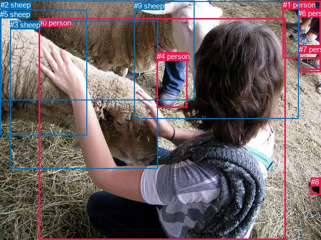
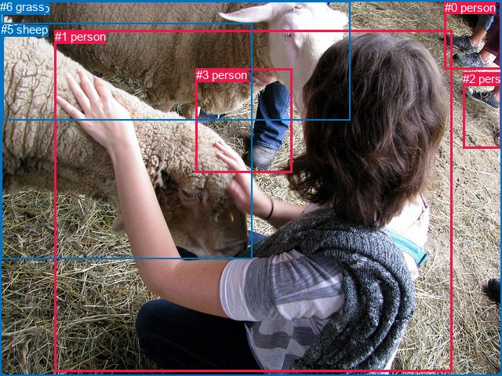

# 图片 1796：2400414.jpg

随机样本序号：101。图片 SHA256：`a46fe4379f6edc9e2d8652b0f929fe92851ff2b1c470c5fa355135323fa60774`。

红色框表示人，蓝色框表示其他物体。两个模式分别保留自身框编号，可依据位置比较对应对象。

## 自动检测框与输出

人的框编号：`[0, 1, 4, 6, 7, 8]`。状态：`ok`。

### 自动检测全部物体框

| 编号 | 类别 | 是否为人 | 检测分数 | 像素坐标 xyxy |
|---|---|---|---|---|
| 0 | person | True | 0.9984 | 77.1, 36.6, 569.0, 480.0 |
| 1 | person | True | 0.9950 | 563.7, 1.4, 639.3, 116.5 |
| 2 | sheep | False | 0.9736 | 1.1, 1.2, 387.2, 200.8 |
| 3 | sheep | False | 0.9710 | 20.3, 41.5, 314.4, 337.7 |
| 4 | person | True | 0.8840 | 312.6, 104.4, 373.1, 215.4 |
| 5 | sheep | False | 0.8616 | 0.3, 19.8, 173.0, 270.9 |
| 6 | person | True | 0.6067 | 594.3, 17.8, 639.7, 144.0 |
| 7 | person | True | 0.5914 | 595.7, 90.5, 639.7, 139.9 |
| 8 | person | True | 0.4166 | 619.6, 355.3, 639.9, 389.6 |
| 9 | sheep | False | 0.4005 | 267.4, 2.6, 595.7, 237.1 |

### 自动检测 Top50 人相关候选

评分物体对：90；人相关物体对：78；输出关系：50。

| 排名 | 主语编号与类别 | 关系 | 宾语编号与类别 | 类型 | 人与人 | 排序分数 | 原始融合 logit |
|---|---|---|---|---|---|---|---|
| 1 | #0 person | holding | #3 sheep | semantic | False | 0.99129 | 4.7350 |
| 2 | #6 person | wearing | #7 person | semantic | True | 0.99119 | 4.7228 |
| 3 | #0 person | holding | #5 sheep | semantic | False | 0.98442 | 4.1463 |
| 4 | #1 person | wearing | #7 person | semantic | True | 0.97438 | 3.6385 |
| 5 | #0 person | holding | #2 sheep | semantic | False | 0.97206 | 3.5494 |
| 6 | #9 sheep | wearing | #4 person | semantic | False | 0.97003 | 3.4771 |
| 7 | #0 person | wearing | #4 person | semantic | True | 0.96216 | 3.2358 |
| 8 | #1 person | wearing | #6 person | semantic | True | 0.93407 | 2.6510 |
| 9 | #7 person | on | #6 person | spatial | True | 0.93308 | 2.6350 |
| 10 | #1 person | in | #6 person | spatial | True | 0.87523 | 1.9480 |
| 11 | #6 person | in | #7 person | spatial | True | 0.86316 | 1.8418 |
| 12 | #7 person | on | #1 person | spatial | True | 0.82370 | 1.5416 |
| 13 | #6 person | in | #1 person | spatial | True | 0.81678 | 1.4947 |
| 14 | #0 person | feeding | #9 sheep | semantic | False | 0.80345 | 1.4080 |
| 15 | #4 person | on | #9 sheep | spatial | False | 0.72513 | 0.9700 |
| 16 | #0 person | beside | #2 sheep | spatial | False | 0.69281 | 0.8133 |
| 17 | #0 person | in | #3 sheep | spatial | False | 0.67541 | 0.7328 |
| 18 | #1 person | in | #7 person | spatial | True | 0.66356 | 0.6792 |
| 19 | #0 person | beside | #5 sheep | spatial | False | 0.64684 | 0.6052 |
| 20 | #9 sheep | in | #4 person | spatial | False | 0.61326 | 0.4610 |
| 21 | #1 person | looking at | #2 sheep | semantic | False | 0.58720 | 0.3524 |
| 22 | #6 person | standing on | #1 person | semantic | True | 0.56712 | 0.2701 |
| 23 | #8 person | beside | #0 person | spatial | True | 0.54621 | 0.1854 |
| 24 | #9 sheep | beside | #0 person | spatial | False | 0.54604 | 0.1847 |
| 25 | #0 person | in | #4 person | spatial | True | 0.54107 | 0.1647 |
| 26 | #7 person | wearing | #6 person | semantic | True | 0.53185 | 0.1276 |
| 27 | #0 person | in | #9 sheep | spatial | False | 0.52829 | 0.1133 |
| 28 | #0 person | beside | #1 person | spatial | True | 0.45819 | -0.1676 |
| 29 | #6 person | looking at | #2 sheep | semantic | False | 0.45696 | -0.1726 |
| 30 | #1 person | looking at | #9 sheep | semantic | False | 0.43997 | -0.2413 |
| 31 | #1 person | looking at | #3 sheep | semantic | False | 0.41949 | -0.3249 |
| 32 | #0 person | wearing | #7 person | semantic | True | 0.38342 | -0.4751 |
| 33 | #0 person | wearing | #8 person | semantic | True | 0.37541 | -0.5091 |
| 34 | #9 sheep | wearing | #7 person | semantic | False | 0.36841 | -0.5391 |
| 35 | #9 sheep | wearing | #6 person | semantic | False | 0.35670 | -0.5897 |
| 36 | #3 sheep | feeding | #0 person | semantic | False | 0.33315 | -0.6940 |
| 37 | #0 person | wearing | #1 person | semantic | True | 0.32519 | -0.7300 |
| 38 | #7 person | wearing | #1 person | semantic | True | 0.32479 | -0.7318 |
| 39 | #4 person | wearing | #9 sheep | semantic | False | 0.31277 | -0.7872 |
| 40 | #1 person | looking at | #0 person | semantic | True | 0.29929 | -0.8507 |
| 41 | #9 sheep | wearing | #1 person | semantic | False | 0.29834 | -0.8552 |
| 42 | #1 person | beside | #0 person | spatial | True | 0.29766 | -0.8585 |
| 43 | #6 person | looking at | #3 sheep | semantic | False | 0.29471 | -0.8726 |
| 44 | #1 person | beside | #9 sheep | spatial | False | 0.26705 | -1.0097 |
| 45 | #4 person | on | #0 person | spatial | True | 0.25671 | -1.0632 |
| 46 | #3 sheep | beside | #0 person | spatial | False | 0.24899 | -1.1040 |
| 47 | #2 sheep | beside | #0 person | spatial | False | 0.24808 | -1.1089 |
| 48 | #2 sheep | feeding | #0 person | semantic | False | 0.21938 | -1.2693 |
| 49 | #4 person | in | #2 sheep | spatial | False | 0.21380 | -1.3022 |
| 50 | #6 person | looking at | #9 sheep | semantic | False | 0.21366 | -1.3030 |

### 自动检测逐条人相关 GT 核验

R@50：0.00%；命中 0/5。

| GT 主语编号 | GT 关系 | GT 宾语编号 | 结果阶段 | 匹配预测主语编号 | 匹配预测宾语编号 |
|---|---|---|---|---|---|
| 0 | standing on | 6 | endpoint_missing_or_wrong_class | [1] | [] |
| 1 | playing with | 5 | wrong_predicate | [0] | [3] |
| 1 | touching | 5 | wrong_predicate | [0] | [3] |
| 3 | pulling | 4 | endpoint_missing_or_wrong_class | [] | [2] |
| 5 | playing with | 1 | wrong_predicate | [3] | [0] |

## 真实框与输出

人的框编号：`[0, 1, 2, 3]`。

### 真实框全部物体框

| 编号 | 类别 | 是否为人 | 检测分数 | 像素坐标 xyxy |
|---|---|---|---|---|
| 0 | person | True | GT | 567.0, 1.0, 640.0, 88.0 |
| 1 | person | True | GT | 70.0, 38.0, 577.0, 474.0 |
| 2 | person | True | GT | 590.0, 92.0, 640.0, 189.0 |
| 3 | person | True | GT | 250.0, 87.0, 373.0, 220.0 |
| 4 | sheep | False | GT | 3.0, 2.0, 446.0, 154.0 |
| 5 | sheep | False | GT | 1.0, 29.0, 322.0, 331.0 |
| 6 | grass | False | GT | 0.0, 0.0, 640.0, 480.0 |

### 真实框 Top50 人相关候选

评分物体对：42；人相关物体对：36；输出关系：50。

| 排名 | 主语编号与类别 | 关系 | 宾语编号与类别 | 类型 | 人与人 | 排序分数 | 原始融合 logit |
|---|---|---|---|---|---|---|---|
| 1 | #1 person | holding | #5 sheep | semantic | False | 0.98841 | 4.4458 |
| 2 | #0 person | standing on | #6 grass | semantic | False | 0.96491 | 3.3142 |
| 3 | #1 person | feeding | #4 sheep | semantic | False | 0.95749 | 3.1147 |
| 4 | #0 person | wearing | #2 person | semantic | True | 0.94624 | 2.8680 |
| 5 | #1 person | wearing | #3 person | semantic | True | 0.94352 | 2.8158 |
| 6 | #1 person | on | #6 grass | spatial | False | 0.93699 | 2.6994 |
| 7 | #1 person | sitting on | #6 grass | semantic | False | 0.91270 | 2.3471 |
| 8 | #2 person | on | #6 grass | spatial | False | 0.89430 | 2.1355 |
| 9 | #1 person | wearing | #2 person | semantic | True | 0.87982 | 1.9907 |
| 10 | #0 person | on | #6 grass | spatial | False | 0.87626 | 1.9575 |
| 11 | #0 person | looking at | #4 sheep | semantic | False | 0.80453 | 1.4149 |
| 12 | #2 person | standing on | #6 grass | semantic | False | 0.72513 | 0.9701 |
| 13 | #3 person | feeding | #4 sheep | semantic | False | 0.71478 | 0.9187 |
| 14 | #3 person | feeding | #5 sheep | semantic | False | 0.68019 | 0.7546 |
| 15 | #2 person | on | #0 person | spatial | True | 0.64353 | 0.5907 |
| 16 | #1 person | in | #5 sheep | spatial | False | 0.64271 | 0.5871 |
| 17 | #1 person | in | #3 person | spatial | True | 0.64254 | 0.5864 |
| 18 | #0 person | looking at | #5 sheep | semantic | False | 0.62228 | 0.4992 |
| 19 | #3 person | in | #4 sheep | spatial | False | 0.62142 | 0.4956 |
| 20 | #3 person | on | #6 grass | spatial | False | 0.61828 | 0.4823 |
| 21 | #3 person | touching | #6 grass | semantic | False | 0.55699 | 0.2290 |
| 22 | #0 person | in | #2 person | spatial | True | 0.54407 | 0.1767 |
| 23 | #0 person | looking at | #1 person | semantic | True | 0.49881 | -0.0048 |
| 24 | #3 person | beside | #5 sheep | spatial | False | 0.48995 | -0.0402 |
| 25 | #1 person | wearing | #0 person | semantic | True | 0.45385 | -0.1851 |
| 26 | #0 person | beside | #1 person | spatial | True | 0.45208 | -0.1923 |
| 27 | #5 sheep | feeding | #1 person | semantic | False | 0.44349 | -0.2270 |
| 28 | #1 person | beside | #4 sheep | spatial | False | 0.43420 | -0.2647 |
| 29 | #3 person | on | #1 person | spatial | True | 0.41051 | -0.3619 |
| 30 | #0 person | beside | #4 sheep | spatial | False | 0.38635 | -0.4627 |
| 31 | #4 sheep | eating | #1 person | semantic | False | 0.38075 | -0.4864 |
| 32 | #4 sheep | beside | #1 person | spatial | False | 0.37397 | -0.5152 |
| 33 | #1 person | in | #2 person | spatial | True | 0.35595 | -0.5930 |
| 34 | #2 person | wearing | #0 person | semantic | True | 0.35101 | -0.6146 |
| 35 | #5 sheep | beside | #1 person | spatial | False | 0.32047 | -0.7516 |
| 36 | #4 sheep | beside | #3 person | spatial | False | 0.31719 | -0.7667 |
| 37 | #3 person | wearing | #1 person | semantic | True | 0.24123 | -1.1460 |
| 38 | #1 person | in | #0 person | spatial | True | 0.22590 | -1.2316 |
| 39 | #4 sheep | eating | #3 person | semantic | False | 0.21048 | -1.3221 |
| 40 | #6 grass | beside | #1 person | spatial | False | 0.16863 | -1.5954 |
| 41 | #0 person | wearing | #3 person | semantic | True | 0.14429 | -1.7801 |
| 42 | #2 person | on | #1 person | spatial | True | 0.12277 | -1.9665 |
| 43 | #0 person | beside | #3 person | spatial | True | 0.10231 | -2.1718 |
| 44 | #5 sheep | in | #3 person | spatial | False | 0.09676 | -2.2337 |
| 45 | #0 person | beside | #5 sheep | spatial | False | 0.09607 | -2.2417 |
| 46 | #6 grass | holding | #1 person | semantic | False | 0.06332 | -2.6941 |
| 47 | #5 sheep | eating | #3 person | semantic | False | 0.05643 | -2.8167 |
| 48 | #2 person | wearing | #1 person | semantic | True | 0.05494 | -2.8451 |
| 49 | #4 sheep | beside | #0 person | spatial | False | 0.03138 | -3.4297 |
| 50 | #3 person | wearing | #0 person | semantic | True | 0.03101 | -3.4421 |

### 真实框逐条人相关 GT 核验

R@50：20.00%；命中 1/5。

| GT 主语编号 | GT 关系 | GT 宾语编号 | 结果阶段 | 匹配预测主语编号 | 匹配预测宾语编号 |
|---|---|---|---|---|---|
| 0 | standing on | 6 | hit50 | [0] | [6] |
| 1 | playing with | 5 | wrong_predicate | [1] | [5] |
| 1 | touching | 5 | wrong_predicate | [1] | [5] |
| 3 | pulling | 4 | wrong_predicate | [3] | [4] |
| 5 | playing with | 1 | wrong_predicate | [5] | [1] |

## 全部人相关 GT

| 主语编号与类别 | 关系 | 宾语编号与类别 |
|---|---|---|
| #0 person | standing on | #6 grass |
| #1 person | playing with | #5 sheep |
| #1 person | touching | #5 sheep |
| #3 person | pulling | #4 sheep |
| #5 sheep | playing with | #1 person |

原始记录、全部人相关物体对的两项预测与分项分数见 [逐图证据 JSON](../evidence/cases/1796.json)。全部56类 logits 保留于本机 HOR/output/random500/logits/。

<!-- HOR_COMPLETE_RESULTS -->

## 六组条件的完整输出对照

以下保留同一图片三种框与候选模式、两种谓词输出规则的全部 Top50。框编号各自在所属模式内解释。

### 自动检测框完整枚举：空间与语义各保留一个谓词

| 排名 | 主语编号与类别 | 谓词 | 宾语编号与类别 | 分组 | 排序分数 | predicate logit | pair logit |
|---|---|---|---|---|---|---|---|
| 1 | #0 person | holding | #3 sheep | semantic | 0.9912943 | 4.2625184 | 0.4725096 |
| 2 | #6 person | wearing | #7 person | semantic | 0.9911879 | 4.5187869 | 0.2039923 |
| 3 | #0 person | holding | #5 sheep | semantic | 0.9844242 | 3.8829389 | 0.2633939 |
| 4 | #1 person | wearing | #7 person | semantic | 0.9743815 | 3.2357020 | 0.4027846 |
| 5 | #0 person | holding | #2 sheep | semantic | 0.9720607 | 3.1397300 | 0.4096557 |
| 6 | #9 sheep | wearing | #4 person | semantic | 0.9700297 | 3.8376718 | -0.3605517 |
| 7 | #0 person | wearing | #4 person | semantic | 0.9621578 | 3.4574704 | -0.2217152 |
| 8 | #1 person | wearing | #6 person | semantic | 0.9340712 | 2.5308237 | 0.1201545 |
| 9 | #7 person | on | #6 person | spatial | 0.9330779 | 2.9777122 | -0.3427524 |
| 10 | #1 person | in | #6 person | spatial | 0.8752317 | 1.8278751 | 0.1201545 |
| 11 | #6 person | in | #7 person | spatial | 0.8631625 | 1.6378160 | 0.2039923 |
| 12 | #7 person | on | #1 person | spatial | 0.8237019 | 1.9591856 | -0.4175534 |
| 13 | #6 person | in | #1 person | spatial | 0.8167772 | 1.6243186 | -0.1296550 |
| 14 | #0 person | feeding | #9 sheep | semantic | 0.8034489 | 1.7412467 | -0.3332559 |
| 15 | #4 person | on | #9 sheep | spatial | 0.7251274 | 1.6800518 | -0.7100121 |
| 16 | #0 person | beside | #2 sheep | spatial | 0.6928132 | 0.4036484 | 0.4096557 |
| 17 | #0 person | in | #3 sheep | spatial | 0.6754119 | 0.2602563 | 0.4725096 |
| 18 | #1 person | in | #7 person | spatial | 0.6635578 | 0.2764053 | 0.4027846 |
| 19 | #0 person | beside | #5 sheep | spatial | 0.6468377 | 0.3417740 | 0.2633939 |
| 20 | #9 sheep | in | #4 person | spatial | 0.6132601 | 0.8215885 | -0.3605517 |
| 21 | #1 person | looking at | #2 sheep | semantic | 0.5871971 | 1.2312117 | -0.8788214 |
| 22 | #6 person | standing on | #1 person | semantic | 0.5671197 | 0.3997641 | -0.1296550 |
| 23 | #8 person | beside | #0 person | spatial | 0.5462063 | 0.5511694 | -0.3658153 |
| 24 | #9 sheep | beside | #0 person | spatial | 0.5460423 | 0.6744986 | -0.4898060 |
| 25 | #0 person | in | #4 person | spatial | 0.5410705 | 0.3863683 | -0.2217152 |
| 26 | #7 person | wearing | #6 person | semantic | 0.5318527 | 0.4703360 | -0.3427524 |
| 27 | #0 person | in | #9 sheep | spatial | 0.5282935 | 0.4465508 | -0.3332559 |
| 28 | #0 person | beside | #1 person | spatial | 0.4581891 | 0.8813496 | -1.0489845 |
| 29 | #6 person | looking at | #2 sheep | semantic | 0.4569557 | 0.8627954 | -1.0353997 |
| 30 | #1 person | looking at | #9 sheep | semantic | 0.4399655 | 0.4239779 | -0.6652797 |
| 31 | #1 person | looking at | #3 sheep | semantic | 0.4194852 | 0.8426404 | -1.1675277 |
| 32 | #0 person | wearing | #7 person | semantic | 0.3834199 | 0.1752324 | -0.6502900 |
| 33 | #0 person | wearing | #8 person | semantic | 0.3754053 | -0.1007047 | -0.4083923 |
| 34 | #9 sheep | wearing | #7 person | semantic | 0.3684078 | -0.0398436 | -0.4992098 |
| 35 | #9 sheep | wearing | #6 person | semantic | 0.3566991 | 0.5817308 | -1.1714509 |
| 36 | #3 sheep | feeding | #0 person | semantic | 0.3331502 | -0.0040946 | -0.6898769 |
| 37 | #0 person | wearing | #1 person | semantic | 0.3251894 | 0.3189602 | -1.0489845 |
| 38 | #7 person | wearing | #1 person | semantic | 0.3247900 | -0.3142915 | -0.4175534 |
| 39 | #4 person | wearing | #9 sheep | semantic | 0.3127731 | -0.0771742 | -0.7100121 |
| 40 | #1 person | looking at | #0 person | semantic | 0.2992867 | -0.0715365 | -0.7791603 |
| 41 | #9 sheep | wearing | #1 person | semantic | 0.2983395 | 0.4076571 | -1.2628748 |
| 42 | #1 person | beside | #0 person | spatial | 0.2976565 | -0.0793223 | -0.7791603 |
| 43 | #6 person | looking at | #3 sheep | semantic | 0.2947128 | 0.4385548 | -1.3111584 |
| 44 | #1 person | beside | #9 sheep | spatial | 0.2670459 | -0.3443828 | -0.6652797 |
| 45 | #4 person | on | #0 person | spatial | 0.2567058 | -0.2615714 | -0.8015900 |
| 46 | #3 sheep | beside | #0 person | spatial | 0.2489889 | -0.4141355 | -0.6898769 |
| 47 | #2 sheep | beside | #0 person | spatial | 0.2480799 | -0.4756770 | -0.6332020 |
| 48 | #2 sheep | feeding | #0 person | semantic | 0.2193781 | -0.6360922 | -0.6332020 |
| 49 | #4 person | in | #2 sheep | spatial | 0.2137953 | -0.4693398 | -0.8328581 |
| 50 | #6 person | looking at | #9 sheep | semantic | 0.2136553 | -0.5995607 | -0.7034707 |

GT 命中：0/5，R@50=0.00%。

| GT主语 | GT谓词 | GT宾语 | 结果阶段 | 匹配主语框 | 匹配宾语框 |
|---|---|---|---|---|---|
| 0 | standing on | 6 | endpoint_missing_or_wrong_class | [1] | [] |
| 1 | playing with | 5 | wrong_predicate | [0] | [3] |
| 1 | touching | 5 | wrong_predicate | [0] | [3] |
| 3 | pulling | 4 | endpoint_missing_or_wrong_class | [] | [2] |
| 5 | playing with | 1 | wrong_predicate | [3] | [0] |

### 自动检测框完整枚举：每对只保留一个谓词

| 排名 | 主语编号与类别 | 谓词 | 宾语编号与类别 | 分组 | 排序分数 | predicate logit | pair logit |
|---|---|---|---|---|---|---|---|
| 1 | #0 person | holding | #3 sheep | single | 0.9912943 | 4.2625184 | 0.4725096 |
| 2 | #6 person | wearing | #7 person | single | 0.9911879 | 4.5187869 | 0.2039923 |
| 3 | #0 person | holding | #5 sheep | single | 0.9844242 | 3.8829389 | 0.2633939 |
| 4 | #1 person | wearing | #7 person | single | 0.9743815 | 3.2357020 | 0.4027846 |
| 5 | #0 person | holding | #2 sheep | single | 0.9720607 | 3.1397300 | 0.4096557 |
| 6 | #9 sheep | wearing | #4 person | single | 0.9700297 | 3.8376718 | -0.3605517 |
| 7 | #0 person | wearing | #4 person | single | 0.9621578 | 3.4574704 | -0.2217152 |
| 8 | #1 person | wearing | #6 person | single | 0.9340712 | 2.5308237 | 0.1201545 |
| 9 | #7 person | on | #6 person | single | 0.9330779 | 2.9777122 | -0.3427524 |
| 10 | #7 person | on | #1 person | single | 0.8237019 | 1.9591856 | -0.4175534 |
| 11 | #6 person | in | #1 person | single | 0.8167772 | 1.6243186 | -0.1296550 |
| 12 | #0 person | feeding | #9 sheep | single | 0.8034489 | 1.7412467 | -0.3332559 |
| 13 | #4 person | on | #9 sheep | single | 0.7251274 | 1.6800518 | -0.7100121 |
| 14 | #1 person | looking at | #2 sheep | single | 0.5871971 | 1.2312117 | -0.8788214 |
| 15 | #8 person | beside | #0 person | single | 0.5462063 | 0.5511694 | -0.3658153 |
| 16 | #9 sheep | beside | #0 person | single | 0.5460423 | 0.6744986 | -0.4898060 |
| 17 | #0 person | beside | #1 person | single | 0.4581891 | 0.8813496 | -1.0489845 |
| 18 | #6 person | looking at | #2 sheep | single | 0.4569557 | 0.8627954 | -1.0353997 |
| 19 | #1 person | looking at | #9 sheep | single | 0.4399655 | 0.4239779 | -0.6652797 |
| 20 | #1 person | looking at | #3 sheep | single | 0.4194852 | 0.8426404 | -1.1675277 |
| 21 | #0 person | wearing | #7 person | single | 0.3834199 | 0.1752324 | -0.6502900 |
| 22 | #0 person | wearing | #8 person | single | 0.3754053 | -0.1007047 | -0.4083923 |
| 23 | #9 sheep | wearing | #7 person | single | 0.3684078 | -0.0398436 | -0.4992098 |
| 24 | #9 sheep | wearing | #6 person | single | 0.3566991 | 0.5817308 | -1.1714509 |
| 25 | #3 sheep | feeding | #0 person | single | 0.3331502 | -0.0040946 | -0.6898769 |
| 26 | #1 person | looking at | #0 person | single | 0.2992867 | -0.0715365 | -0.7791603 |
| 27 | #9 sheep | wearing | #1 person | single | 0.2983395 | 0.4076571 | -1.2628748 |
| 28 | #6 person | looking at | #3 sheep | single | 0.2947128 | 0.4385548 | -1.3111584 |
| 29 | #4 person | on | #0 person | single | 0.2567058 | -0.2615714 | -0.8015900 |
| 30 | #2 sheep | beside | #0 person | single | 0.2480799 | -0.4756770 | -0.6332020 |
| 31 | #4 person | in | #2 sheep | single | 0.2137953 | -0.4693398 | -0.8328581 |
| 32 | #6 person | looking at | #9 sheep | single | 0.2136553 | -0.5995607 | -0.7034707 |
| 33 | #1 person | looking at | #5 sheep | single | 0.1975983 | -0.1689353 | -1.2324377 |
| 34 | #6 person | looking at | #0 person | single | 0.1681704 | -0.7686026 | -0.8300470 |
| 35 | #0 person | wearing | #6 person | single | 0.1432983 | -0.8311636 | -0.9569979 |
| 36 | #5 sheep | feeding | #0 person | single | 0.1407073 | -0.9218321 | -0.8875960 |
| 37 | #4 person | beside | #3 sheep | single | 0.0857777 | -1.3285358 | -1.0377787 |
| 38 | #1 person | wearing | #8 person | single | 0.0820640 | -2.0782535 | -0.3363748 |
| 39 | #6 person | looking at | #5 sheep | single | 0.0819592 | -1.0073397 | -1.4086812 |
| 40 | #6 person | wearing | #8 person | single | 0.0566453 | -2.3157101 | -0.4969230 |
| 41 | #8 person | on | #9 sheep | single | 0.0538524 | -2.0251527 | -0.8409999 |
| 42 | #7 person | on | #9 sheep | single | 0.0519494 | -2.3569674 | -0.5471710 |
| 43 | #2 sheep | standing on | #4 person | single | 0.0456567 | -1.5838969 | -1.4559765 |
| 44 | #1 person | wearing | #4 person | single | 0.0453026 | -2.0447249 | -1.0033050 |
| 45 | #8 person | on | #6 person | single | 0.0391762 | -2.4701064 | -0.7296143 |
| 46 | #8 person | on | #1 person | single | 0.0370368 | -2.4161940 | -0.8419096 |
| 47 | #8 person | on | #7 person | single | 0.0278353 | -3.0617516 | -0.4914683 |
| 48 | #9 sheep | wearing | #8 person | single | 0.0260805 | -2.6406636 | -0.9794752 |
| 49 | #7 person | on | #0 person | single | 0.0238955 | -2.9669523 | -0.7429281 |
| 50 | #2 sheep | beside | #1 person | single | 0.0207787 | -1.9363170 | -1.9165132 |

GT 命中：0/5，R@50=0.00%。

| GT主语 | GT谓词 | GT宾语 | 结果阶段 | 匹配主语框 | 匹配宾语框 |
|---|---|---|---|---|---|
| 0 | standing on | 6 | endpoint_missing_or_wrong_class | [1] | [] |
| 1 | playing with | 5 | wrong_predicate | [0] | [3] |
| 1 | touching | 5 | wrong_predicate | [0] | [3] |
| 3 | pulling | 4 | endpoint_missing_or_wrong_class | [] | [2] |
| 5 | playing with | 1 | wrong_predicate | [3] | [0] |

### 真实框完整枚举：空间与语义各保留一个谓词

| 排名 | 主语编号与类别 | 谓词 | 宾语编号与类别 | 分组 | 排序分数 | predicate logit | pair logit |
|---|---|---|---|---|---|---|---|
| 1 | #1 person | holding | #5 sheep | semantic | 0.9884086 | 3.9479327 | 0.4979047 |
| 2 | #0 person | standing on | #6 grass | semantic | 0.9649119 | 3.8013062 | -0.4871321 |
| 3 | #1 person | feeding | #4 sheep | semantic | 0.9574934 | 2.8846521 | 0.2300057 |
| 4 | #0 person | wearing | #2 person | semantic | 0.9462424 | 2.6632161 | 0.2047970 |
| 5 | #1 person | wearing | #3 person | semantic | 0.9435238 | 3.1270728 | -0.3112704 |
| 6 | #1 person | on | #6 grass | spatial | 0.9369895 | 2.7057610 | -0.0063912 |
| 7 | #1 person | sitting on | #6 grass | semantic | 0.9127041 | 2.3534989 | -0.0063912 |
| 8 | #2 person | on | #6 grass | spatial | 0.8943035 | 2.7908511 | -0.6553780 |
| 9 | #1 person | wearing | #2 person | semantic | 0.8798178 | 2.4651375 | -0.4744318 |
| 10 | #0 person | on | #6 grass | spatial | 0.8762632 | 2.4446421 | -0.4871321 |
| 11 | #0 person | looking at | #4 sheep | semantic | 0.8045301 | 2.2854514 | -0.8705997 |
| 12 | #2 person | standing on | #6 grass | semantic | 0.7251331 | 1.6254463 | -0.6553780 |
| 13 | #3 person | feeding | #4 sheep | semantic | 0.7147791 | 1.5305996 | -0.6118898 |
| 14 | #3 person | feeding | #5 sheep | semantic | 0.6801888 | 1.5003624 | -0.7457225 |
| 15 | #2 person | on | #0 person | spatial | 0.6435281 | 1.0489764 | -0.4582661 |
| 16 | #1 person | in | #5 sheep | spatial | 0.6427051 | 0.0892200 | 0.4979047 |
| 17 | #1 person | in | #3 person | spatial | 0.6425449 | 0.8976970 | -0.3112704 |
| 18 | #0 person | looking at | #5 sheep | semantic | 0.6222805 | 1.7048931 | -1.2056539 |
| 19 | #3 person | in | #4 sheep | spatial | 0.6214191 | 1.1074657 | -0.6118898 |
| 20 | #3 person | on | #6 grass | spatial | 0.6182796 | 1.3252707 | -0.8430182 |
| 21 | #3 person | touching | #6 grass | semantic | 0.5569931 | 1.0719857 | -0.8430182 |
| 22 | #0 person | in | #2 person | spatial | 0.5440723 | -0.0280490 | 0.2047970 |
| 23 | #0 person | looking at | #1 person | semantic | 0.4988088 | 0.8640819 | -0.8688466 |
| 24 | #3 person | beside | #5 sheep | spatial | 0.4899494 | 0.7055149 | -0.7457225 |
| 25 | #1 person | wearing | #0 person | semantic | 0.4538478 | 0.9471903 | -1.1323264 |
| 26 | #0 person | beside | #1 person | spatial | 0.4520810 | 0.6765804 | -0.8688466 |
| 27 | #5 sheep | feeding | #1 person | semantic | 0.4434880 | 0.3871236 | -0.6141415 |
| 28 | #1 person | beside | #4 sheep | spatial | 0.4341972 | -0.4947524 | 0.2300057 |
| 29 | #3 person | on | #1 person | spatial | 0.4105057 | 0.4574618 | -0.8193371 |
| 30 | #0 person | beside | #4 sheep | spatial | 0.3863452 | 0.4078984 | -0.8705997 |
| 31 | #4 sheep | eating | #1 person | semantic | 0.3807517 | 0.1918545 | -0.6782134 |
| 32 | #4 sheep | beside | #1 person | spatial | 0.3739666 | 0.1629763 | -0.6782134 |
| 33 | #1 person | in | #2 person | spatial | 0.3559521 | -0.1185451 | -0.4744318 |
| 34 | #2 person | wearing | #0 person | semantic | 0.3510142 | -0.1563182 | -0.4582661 |
| 35 | #5 sheep | beside | #1 person | spatial | 0.3204694 | -0.1374741 | -0.6141415 |
| 36 | #4 sheep | beside | #3 person | spatial | 0.3171919 | 0.3079820 | -1.0746889 |
| 37 | #3 person | wearing | #1 person | semantic | 0.2412259 | -0.3266335 | -0.8193371 |
| 38 | #1 person | in | #0 person | spatial | 0.2258967 | -0.0993009 | -1.1323264 |
| 39 | #4 sheep | eating | #3 person | semantic | 0.2104768 | -0.2473650 | -1.0746889 |
| 40 | #6 grass | beside | #1 person | spatial | 0.1686299 | -0.7329092 | -0.8624593 |
| 41 | #0 person | wearing | #3 person | semantic | 0.1442945 | -0.6322970 | -1.1477733 |
| 42 | #2 person | on | #1 person | spatial | 0.1227654 | -1.2802422 | -0.6862568 |
| 43 | #0 person | beside | #3 person | spatial | 0.1023099 | -1.0240455 | -1.1477733 |
| 44 | #5 sheep | in | #3 person | spatial | 0.0967605 | -0.8314874 | -1.4022609 |
| 45 | #0 person | beside | #5 sheep | spatial | 0.0960677 | -1.0360477 | -1.2056539 |
| 46 | #6 grass | holding | #1 person | semantic | 0.0633210 | -1.8316638 | -0.8624593 |
| 47 | #5 sheep | eating | #3 person | semantic | 0.0564258 | -1.4144878 | -1.4022609 |
| 48 | #2 person | wearing | #1 person | semantic | 0.0549365 | -2.1588166 | -0.6862568 |
| 49 | #4 sheep | beside | #0 person | spatial | 0.0313785 | -1.5641918 | -1.8655578 |
| 50 | #3 person | wearing | #0 person | semantic | 0.0310062 | -1.6537392 | -1.7883322 |

GT 命中：1/5，R@50=20.00%。

| GT主语 | GT谓词 | GT宾语 | 结果阶段 | 匹配主语框 | 匹配宾语框 |
|---|---|---|---|---|---|
| 0 | standing on | 6 | hit50 | [0] | [6] |
| 1 | playing with | 5 | wrong_predicate | [1] | [5] |
| 1 | touching | 5 | wrong_predicate | [1] | [5] |
| 3 | pulling | 4 | wrong_predicate | [3] | [4] |
| 5 | playing with | 1 | wrong_predicate | [5] | [1] |

### 真实框完整枚举：每对只保留一个谓词

| 排名 | 主语编号与类别 | 谓词 | 宾语编号与类别 | 分组 | 排序分数 | predicate logit | pair logit |
|---|---|---|---|---|---|---|---|
| 1 | #1 person | holding | #5 sheep | single | 0.9884086 | 3.9479327 | 0.4979047 |
| 2 | #0 person | standing on | #6 grass | single | 0.9649119 | 3.8013062 | -0.4871321 |
| 3 | #1 person | feeding | #4 sheep | single | 0.9574934 | 2.8846521 | 0.2300057 |
| 4 | #0 person | wearing | #2 person | single | 0.9462424 | 2.6632161 | 0.2047970 |
| 5 | #1 person | wearing | #3 person | single | 0.9435238 | 3.1270728 | -0.3112704 |
| 6 | #1 person | on | #6 grass | single | 0.9369895 | 2.7057610 | -0.0063912 |
| 7 | #2 person | on | #6 grass | single | 0.8943035 | 2.7908511 | -0.6553780 |
| 8 | #1 person | wearing | #2 person | single | 0.8798178 | 2.4651375 | -0.4744318 |
| 9 | #0 person | looking at | #4 sheep | single | 0.8045301 | 2.2854514 | -0.8705997 |
| 10 | #3 person | feeding | #4 sheep | single | 0.7147791 | 1.5305996 | -0.6118898 |
| 11 | #3 person | feeding | #5 sheep | single | 0.6801888 | 1.5003624 | -0.7457225 |
| 12 | #2 person | on | #0 person | single | 0.6435281 | 1.0489764 | -0.4582661 |
| 13 | #0 person | looking at | #5 sheep | single | 0.6222805 | 1.7048931 | -1.2056539 |
| 14 | #3 person | on | #6 grass | single | 0.6182796 | 1.3252707 | -0.8430182 |
| 15 | #0 person | looking at | #1 person | single | 0.4988088 | 0.8640819 | -0.8688466 |
| 16 | #1 person | wearing | #0 person | single | 0.4538478 | 0.9471903 | -1.1323264 |
| 17 | #5 sheep | feeding | #1 person | single | 0.4434880 | 0.3871236 | -0.6141415 |
| 18 | #3 person | on | #1 person | single | 0.4105057 | 0.4574618 | -0.8193371 |
| 19 | #4 sheep | eating | #1 person | single | 0.3807517 | 0.1918545 | -0.6782134 |
| 20 | #4 sheep | beside | #3 person | single | 0.3171919 | 0.3079820 | -1.0746889 |
| 21 | #6 grass | beside | #1 person | single | 0.1686299 | -0.7329092 | -0.8624593 |
| 22 | #0 person | wearing | #3 person | single | 0.1442945 | -0.6322970 | -1.1477733 |
| 23 | #2 person | on | #1 person | single | 0.1227654 | -1.2802422 | -0.6862568 |
| 24 | #5 sheep | in | #3 person | single | 0.0967605 | -0.8314874 | -1.4022609 |
| 25 | #4 sheep | beside | #0 person | single | 0.0313785 | -1.5641918 | -1.8655578 |
| 26 | #3 person | wearing | #0 person | single | 0.0310062 | -1.6537392 | -1.7883322 |
| 27 | #5 sheep | beside | #0 person | single | 0.0302241 | -1.4768384 | -1.9915874 |
| 28 | #6 grass | on | #0 person | single | 0.0294847 | -1.9651589 | -1.5287957 |
| 29 | #2 person | on | #4 sheep | single | 0.0294652 | -2.1564655 | -1.3381717 |
| 30 | #6 grass | on | #2 person | single | 0.0292059 | -2.1814382 | -1.3223056 |
| 31 | #2 person | beside | #3 person | single | 0.0208133 | -2.2903574 | -1.5607733 |
| 32 | #3 person | wearing | #2 person | single | 0.0192639 | -2.3550158 | -1.5750531 |
| 33 | #6 grass | on | #3 person | single | 0.0149467 | -2.3342762 | -1.8539282 |
| 34 | #2 person | on | #5 sheep | single | 0.0125650 | -2.7603250 | -1.6038687 |
| 35 | #4 sheep | beside | #2 person | single | 0.0052206 | -3.7921438 | -1.4577658 |
| 36 | #5 sheep | in | #2 person | single | 0.0051358 | -3.5727251 | -1.6936362 |

GT 命中：1/5，R@50=20.00%。

| GT主语 | GT谓词 | GT宾语 | 结果阶段 | 匹配主语框 | 匹配宾语框 |
|---|---|---|---|---|---|
| 0 | standing on | 6 | hit50 | [0] | [6] |
| 1 | playing with | 5 | wrong_predicate | [1] | [5] |
| 1 | touching | 5 | wrong_predicate | [1] | [5] |
| 3 | pulling | 4 | wrong_predicate | [3] | [4] |
| 5 | playing with | 1 | wrong_predicate | [5] | [1] |

### 真实框400候选：空间与语义各保留一个谓词

| 排名 | 主语编号与类别 | 谓词 | 宾语编号与类别 | 分组 | 排序分数 | predicate logit | pair logit |
|---|---|---|---|---|---|---|---|
| 1 | #1 person | holding | #5 sheep | semantic | 0.9884086 | 3.9479327 | 0.4979047 |
| 2 | #0 person | standing on | #6 grass | semantic | 0.9649119 | 3.8013062 | -0.4871321 |
| 3 | #1 person | feeding | #4 sheep | semantic | 0.9574934 | 2.8846521 | 0.2300057 |
| 4 | #0 person | wearing | #2 person | semantic | 0.9486541 | 2.7116628 | 0.2047970 |
| 5 | #1 person | wearing | #3 person | semantic | 0.9435238 | 3.1270728 | -0.3112704 |
| 6 | #1 person | on | #6 grass | spatial | 0.9373102 | 2.7112060 | -0.0063912 |
| 7 | #1 person | sitting on | #6 grass | semantic | 0.9127041 | 2.3534989 | -0.0063912 |
| 8 | #2 person | on | #6 grass | spatial | 0.8943035 | 2.7908511 | -0.6553780 |
| 9 | #0 person | on | #6 grass | spatial | 0.8774391 | 2.4555321 | -0.4871321 |
| 10 | #1 person | wearing | #2 person | semantic | 0.8746002 | 2.4166913 | -0.4744318 |
| 11 | #0 person | looking at | #4 sheep | semantic | 0.8044752 | 2.2851028 | -0.8705997 |
| 12 | #2 person | standing on | #6 grass | semantic | 0.7251331 | 1.6254463 | -0.6553780 |
| 13 | #3 person | feeding | #4 sheep | semantic | 0.7147809 | 1.5306082 | -0.6118898 |
| 14 | #3 person | feeding | #5 sheep | semantic | 0.6801884 | 1.5003600 | -0.7457225 |
| 15 | #1 person | in | #3 person | spatial | 0.6479135 | 0.9211507 | -0.3112704 |
| 16 | #1 person | in | #5 sheep | spatial | 0.6427051 | 0.0892200 | 0.4979047 |
| 17 | #2 person | on | #0 person | spatial | 0.6391113 | 1.0297751 | -0.4582661 |
| 18 | #0 person | looking at | #5 sheep | semantic | 0.6293271 | 1.7349849 | -1.2056539 |
| 19 | #3 person | in | #4 sheep | spatial | 0.6229794 | 1.1141033 | -0.6118898 |
| 20 | #3 person | on | #6 grass | spatial | 0.6182796 | 1.3252707 | -0.8430182 |
| 21 | #3 person | touching | #6 grass | semantic | 0.5495734 | 1.0419655 | -0.8430182 |
| 22 | #0 person | in | #2 person | spatial | 0.5448955 | -0.0247302 | 0.2047970 |
| 23 | #0 person | looking at | #1 person | semantic | 0.4912869 | 0.8339906 | -0.8688466 |
| 24 | #3 person | beside | #5 sheep | spatial | 0.4824542 | 0.6755104 | -0.7457225 |
| 25 | #1 person | wearing | #0 person | semantic | 0.4605874 | 0.9743481 | -1.1323264 |
| 26 | #5 sheep | feeding | #1 person | semantic | 0.4509256 | 0.4172096 | -0.6141415 |
| 27 | #0 person | beside | #1 person | spatial | 0.4446528 | 0.6465468 | -0.8688466 |
| 28 | #1 person | beside | #4 sheep | spatial | 0.4341759 | -0.4948392 | 0.2300057 |
| 29 | #3 person | on | #1 person | spatial | 0.4138388 | 0.4712186 | -0.8193371 |
| 30 | #0 person | beside | #4 sheep | spatial | 0.3934619 | 0.4378161 | -0.8705997 |
| 31 | #4 sheep | eating | #1 person | semantic | 0.3807517 | 0.1918545 | -0.6782134 |
| 32 | #4 sheep | beside | #1 person | spatial | 0.3739598 | 0.1629472 | -0.6782134 |
| 33 | #2 person | wearing | #0 person | semantic | 0.3510142 | -0.1563182 | -0.4582661 |
| 34 | #1 person | in | #2 person | spatial | 0.3505937 | -0.1419988 | -0.4744318 |
| 35 | #5 sheep | beside | #1 person | spatial | 0.3336726 | -0.0774794 | -0.6141415 |
| 36 | #4 sheep | beside | #3 person | spatial | 0.3171880 | 0.3079638 | -1.0746889 |
| 37 | #3 person | wearing | #1 person | semantic | 0.2368200 | -0.3508568 | -0.8193371 |
| 38 | #1 person | in | #0 person | spatial | 0.2258967 | -0.0993009 | -1.1323264 |
| 39 | #4 sheep | eating | #3 person | semantic | 0.2105168 | -0.2471242 | -1.0746889 |
| 40 | #6 grass | beside | #1 person | spatial | 0.1686461 | -0.7327936 | -0.8624593 |
| 41 | #0 person | wearing | #3 person | semantic | 0.1442945 | -0.6322970 | -1.1477733 |
| 42 | #2 person | on | #1 person | spatial | 0.1227654 | -1.2802422 | -0.6862568 |
| 43 | #0 person | beside | #3 person | spatial | 0.1009343 | -1.0391126 | -1.1477733 |
| 44 | #5 sheep | in | #3 person | spatial | 0.0988299 | -0.8080332 | -1.4022609 |
| 45 | #0 person | beside | #5 sheep | spatial | 0.0973746 | -1.0210888 | -1.2056539 |
| 46 | #6 grass | holding | #1 person | semantic | 0.0643081 | -1.8151412 | -0.8624593 |
| 47 | #5 sheep | eating | #3 person | semantic | 0.0549952 | -1.4416828 | -1.4022609 |
| 48 | #2 person | wearing | #1 person | semantic | 0.0549365 | -2.1588166 | -0.6862568 |
| 49 | #4 sheep | beside | #0 person | spatial | 0.0318355 | -1.5492637 | -1.8655578 |
| 50 | #3 person | wearing | #0 person | semantic | 0.0310062 | -1.6537392 | -1.7883322 |

GT 命中：1/5，R@50=20.00%。

| GT主语 | GT谓词 | GT宾语 | 结果阶段 | 匹配主语框 | 匹配宾语框 |
|---|---|---|---|---|---|
| 0 | standing on | 6 | hit50 | [0] | [6] |
| 1 | playing with | 5 | wrong_predicate | [1] | [5] |
| 1 | touching | 5 | wrong_predicate | [1] | [5] |
| 3 | pulling | 4 | wrong_predicate | [3] | [4] |
| 5 | playing with | 1 | wrong_predicate | [5] | [1] |

### 真实框400候选：每对只保留一个谓词

| 排名 | 主语编号与类别 | 谓词 | 宾语编号与类别 | 分组 | 排序分数 | predicate logit | pair logit |
|---|---|---|---|---|---|---|---|
| 1 | #1 person | holding | #5 sheep | single | 0.9884086 | 3.9479327 | 0.4979047 |
| 2 | #0 person | standing on | #6 grass | single | 0.9649119 | 3.8013062 | -0.4871321 |
| 3 | #1 person | feeding | #4 sheep | single | 0.9574934 | 2.8846521 | 0.2300057 |
| 4 | #0 person | wearing | #2 person | single | 0.9486541 | 2.7116628 | 0.2047970 |
| 5 | #1 person | wearing | #3 person | single | 0.9435238 | 3.1270728 | -0.3112704 |
| 6 | #1 person | on | #6 grass | single | 0.9373102 | 2.7112060 | -0.0063912 |
| 7 | #2 person | on | #6 grass | single | 0.8943035 | 2.7908511 | -0.6553780 |
| 8 | #1 person | wearing | #2 person | single | 0.8746002 | 2.4166913 | -0.4744318 |
| 9 | #0 person | looking at | #4 sheep | single | 0.8044752 | 2.2851028 | -0.8705997 |
| 10 | #3 person | feeding | #4 sheep | single | 0.7147809 | 1.5306082 | -0.6118898 |
| 11 | #3 person | feeding | #5 sheep | single | 0.6801884 | 1.5003600 | -0.7457225 |
| 12 | #2 person | on | #0 person | single | 0.6391113 | 1.0297751 | -0.4582661 |
| 13 | #0 person | looking at | #5 sheep | single | 0.6293271 | 1.7349849 | -1.2056539 |
| 14 | #3 person | on | #6 grass | single | 0.6182796 | 1.3252707 | -0.8430182 |
| 15 | #0 person | looking at | #1 person | single | 0.4912869 | 0.8339906 | -0.8688466 |
| 16 | #1 person | wearing | #0 person | single | 0.4605874 | 0.9743481 | -1.1323264 |
| 17 | #5 sheep | feeding | #1 person | single | 0.4509256 | 0.4172096 | -0.6141415 |
| 18 | #3 person | on | #1 person | single | 0.4138388 | 0.4712186 | -0.8193371 |
| 19 | #4 sheep | eating | #1 person | single | 0.3807517 | 0.1918545 | -0.6782134 |
| 20 | #4 sheep | beside | #3 person | single | 0.3171880 | 0.3079638 | -1.0746889 |
| 21 | #6 grass | beside | #1 person | single | 0.1686461 | -0.7327936 | -0.8624593 |
| 22 | #0 person | wearing | #3 person | single | 0.1442945 | -0.6322970 | -1.1477733 |
| 23 | #2 person | on | #1 person | single | 0.1227654 | -1.2802422 | -0.6862568 |
| 24 | #5 sheep | in | #3 person | single | 0.0988299 | -0.8080332 | -1.4022609 |
| 25 | #4 sheep | beside | #0 person | single | 0.0318355 | -1.5492637 | -1.8655578 |
| 26 | #3 person | wearing | #0 person | single | 0.0310062 | -1.6537392 | -1.7883322 |
| 27 | #5 sheep | beside | #0 person | single | 0.0306648 | -1.4619081 | -1.9915874 |
| 28 | #6 grass | on | #0 person | single | 0.0294993 | -1.9646485 | -1.5287957 |
| 29 | #6 grass | on | #2 person | single | 0.0293219 | -2.1773543 | -1.3223056 |
| 30 | #2 person | on | #4 sheep | single | 0.0292691 | -2.1633439 | -1.3381717 |
| 31 | #2 person | beside | #3 person | single | 0.0211216 | -2.2753403 | -1.5607733 |
| 32 | #3 person | wearing | #2 person | single | 0.0193194 | -2.3520815 | -1.5750531 |
| 33 | #6 grass | on | #3 person | single | 0.0148568 | -2.3404016 | -1.8539282 |
| 34 | #2 person | on | #5 sheep | single | 0.0124047 | -2.7733285 | -1.6038687 |
| 35 | #4 sheep | beside | #2 person | single | 0.0051433 | -3.8071318 | -1.4577658 |
| 36 | #5 sheep | in | #2 person | single | 0.0050763 | -3.5844519 | -1.6936362 |

GT 命中：1/5，R@50=20.00%。

| GT主语 | GT谓词 | GT宾语 | 结果阶段 | 匹配主语框 | 匹配宾语框 |
|---|---|---|---|---|---|
| 0 | standing on | 6 | hit50 | [0] | [6] |
| 1 | playing with | 5 | wrong_predicate | [1] | [5] |
| 1 | touching | 5 | wrong_predicate | [1] | [5] |
| 3 | pulling | 4 | wrong_predicate | [3] | [4] |
| 5 | playing with | 1 | wrong_predicate | [5] | [1] |
