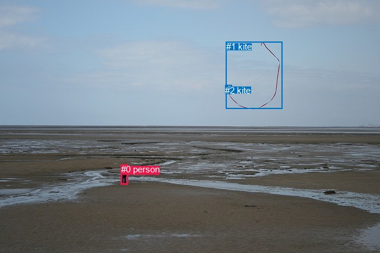
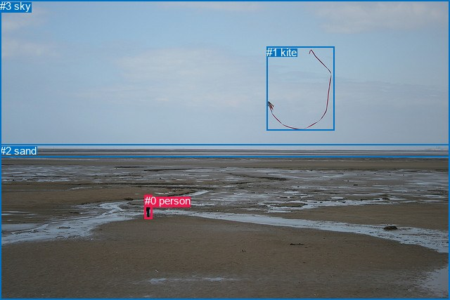

# 图片 1797：2400508.jpg

随机样本序号：466。图片 SHA256：`bdaff0380da866f91b3457760a54ea63131bf0e746cb14386d3dcbc3a6328258`。

红色框表示人，蓝色框表示其他物体。两个模式分别保留自身框编号，可依据位置比较对应对象。

## 自动检测框与输出

人的框编号：`[0]`。状态：`ok`。

### 自动检测全部物体框

| 编号 | 类别 | 是否为人 | 检测分数 | 像素坐标 xyxy |
|---|---|---|---|---|
| 0 | person | True | 0.9952 | 203.7, 277.1, 215.9, 311.9 |
| 1 | kite | False | 0.9529 | 380.6, 70.1, 475.2, 183.8 |
| 2 | kite | False | 0.4392 | 379.5, 143.8, 390.4, 158.5 |

### 自动检测 Top50 人相关候选

评分物体对：6；人相关物体对：4；输出关系：8。

| 排名 | 主语编号与类别 | 关系 | 宾语编号与类别 | 类型 | 人与人 | 排序分数 | 原始融合 logit |
|---|---|---|---|---|---|---|---|
| 1 | #0 person | flying over | #1 kite | semantic | False | 0.95248 | 2.9979 |
| 2 | #0 person | flying over | #2 kite | semantic | False | 0.94832 | 2.9097 |
| 3 | #0 person | hanging from | #2 kite | spatial | False | 0.27616 | -0.9636 |
| 4 | #0 person | hanging from | #1 kite | spatial | False | 0.27268 | -0.9811 |
| 5 | #1 kite | pulling | #0 person | semantic | False | 0.00505 | -5.2824 |
| 6 | #1 kite | over | #0 person | spatial | False | 0.00272 | -5.9054 |
| 7 | #2 kite | over | #0 person | spatial | False | 0.00062 | -7.3843 |
| 8 | #2 kite | flying over | #0 person | semantic | False | 0.00055 | -7.5057 |

### 自动检测逐条人相关 GT 核验

R@50：0.00%；命中 0/4。

| GT 主语编号 | GT 关系 | GT 宾语编号 | 结果阶段 | 匹配预测主语编号 | 匹配预测宾语编号 |
|---|---|---|---|---|---|
| 0 | playing | 1 | wrong_predicate | [0] | [1] |
| 0 | on | 2 | endpoint_missing_or_wrong_class | [0] | [] |
| 0 | standing on | 2 | endpoint_missing_or_wrong_class | [0] | [] |
| 3 | over | 0 | endpoint_missing_or_wrong_class | [] | [0] |

## 真实框与输出

人的框编号：`[0]`。

### 真实框全部物体框

| 编号 | 类别 | 是否为人 | 检测分数 | 像素坐标 xyxy |
|---|---|---|---|---|
| 0 | person | True | GT | 206.0, 277.0, 217.0, 311.0 |
| 1 | kite | False | GT | 379.0, 66.0, 476.0, 185.0 |
| 2 | sand | False | GT | 0.0, 206.0, 640.0, 427.0 |
| 3 | sky | False | GT | 0.0, 0.0, 640.0, 224.0 |

### 真实框 Top50 人相关候选

评分物体对：12；人相关物体对：6；输出关系：12。

| 排名 | 主语编号与类别 | 关系 | 宾语编号与类别 | 类型 | 人与人 | 排序分数 | 原始融合 logit |
|---|---|---|---|---|---|---|---|
| 1 | #0 person | on | #2 sand | spatial | False | 0.98618 | 4.2676 |
| 2 | #0 person | flying over | #1 kite | semantic | False | 0.98448 | 4.1499 |
| 3 | #0 person | standing on | #2 sand | semantic | False | 0.97698 | 3.7479 |
| 4 | #1 kite | pulling | #0 person | semantic | False | 0.83781 | 1.6421 |
| 5 | #0 person | looking at | #3 sky | semantic | False | 0.72993 | 0.9943 |
| 6 | #3 sky | over | #0 person | spatial | False | 0.66442 | 0.6831 |
| 7 | #0 person | on | #1 kite | spatial | False | 0.36432 | -0.5567 |
| 8 | #1 kite | attached to | #0 person | spatial | False | 0.33228 | -0.6979 |
| 9 | #2 sand | beside | #0 person | spatial | False | 0.24759 | -1.1115 |
| 10 | #0 person | in | #3 sky | spatial | False | 0.21759 | -1.2798 |
| 11 | #2 sand | holding | #0 person | semantic | False | 0.07350 | -2.5341 |
| 12 | #3 sky | flying over | #0 person | semantic | False | 0.07316 | -2.5391 |

### 真实框逐条人相关 GT 核验

R@50：75.00%；命中 3/4。

| GT 主语编号 | GT 关系 | GT 宾语编号 | 结果阶段 | 匹配预测主语编号 | 匹配预测宾语编号 |
|---|---|---|---|---|---|
| 0 | playing | 1 | wrong_predicate | [0] | [1] |
| 0 | on | 2 | hit50 | [0] | [2] |
| 0 | standing on | 2 | hit50 | [0] | [2] |
| 3 | over | 0 | hit50 | [3] | [0] |

## 全部人相关 GT

| 主语编号与类别 | 关系 | 宾语编号与类别 |
|---|---|---|
| #0 person | playing | #1 kite |
| #0 person | on | #2 sand |
| #0 person | standing on | #2 sand |
| #3 sky | over | #0 person |

原始记录、全部人相关物体对的两项预测与分项分数见 [逐图证据 JSON](../evidence/cases/1797.json)。全部56类 logits 保留于本机 HOR/output/random500/logits/。

<!-- HOR_COMPLETE_RESULTS -->

## 六组条件的完整输出对照

以下保留同一图片三种框与候选模式、两种谓词输出规则的全部 Top50。框编号各自在所属模式内解释。

### 自动检测框完整枚举：空间与语义各保留一个谓词

| 排名 | 主语编号与类别 | 谓词 | 宾语编号与类别 | 分组 | 排序分数 | predicate logit | pair logit |
|---|---|---|---|---|---|---|---|
| 1 | #0 person | flying over | #1 kite | semantic | 0.9524778 | 2.9981303 | -0.0002617 |
| 2 | #0 person | flying over | #2 kite | semantic | 0.9483225 | 3.0579128 | -0.1482394 |
| 3 | #0 person | hanging from | #2 kite | spatial | 0.2761633 | -0.8153343 | -0.1482394 |
| 4 | #0 person | hanging from | #1 kite | spatial | 0.2726763 | -0.9808242 | -0.0002617 |
| 5 | #1 kite | pulling | #0 person | semantic | 0.0050543 | -4.0395508 | -1.2428892 |
| 6 | #1 kite | over | #0 person | spatial | 0.0027172 | -4.6625462 | -1.2428892 |
| 7 | #2 kite | over | #0 person | spatial | 0.0006205 | -6.0268788 | -1.3574586 |
| 8 | #2 kite | flying over | #0 person | semantic | 0.0005496 | -6.1482401 | -1.3574586 |

GT 命中：0/4，R@50=0.00%。

| GT主语 | GT谓词 | GT宾语 | 结果阶段 | 匹配主语框 | 匹配宾语框 |
|---|---|---|---|---|---|
| 0 | playing | 1 | wrong_predicate | [0] | [1] |
| 0 | on | 2 | endpoint_missing_or_wrong_class | [0] | [] |
| 0 | standing on | 2 | endpoint_missing_or_wrong_class | [0] | [] |
| 3 | over | 0 | endpoint_missing_or_wrong_class | [] | [0] |

### 自动检测框完整枚举：每对只保留一个谓词

| 排名 | 主语编号与类别 | 谓词 | 宾语编号与类别 | 分组 | 排序分数 | predicate logit | pair logit |
|---|---|---|---|---|---|---|---|
| 1 | #0 person | flying over | #1 kite | single | 0.9524778 | 2.9981303 | -0.0002617 |
| 2 | #0 person | flying over | #2 kite | single | 0.9483225 | 3.0579128 | -0.1482394 |
| 3 | #1 kite | pulling | #0 person | single | 0.0050543 | -4.0395508 | -1.2428892 |
| 4 | #2 kite | over | #0 person | single | 0.0006205 | -6.0268788 | -1.3574586 |

GT 命中：0/4，R@50=0.00%。

| GT主语 | GT谓词 | GT宾语 | 结果阶段 | 匹配主语框 | 匹配宾语框 |
|---|---|---|---|---|---|
| 0 | playing | 1 | wrong_predicate | [0] | [1] |
| 0 | on | 2 | endpoint_missing_or_wrong_class | [0] | [] |
| 0 | standing on | 2 | endpoint_missing_or_wrong_class | [0] | [] |
| 3 | over | 0 | endpoint_missing_or_wrong_class | [] | [0] |

### 真实框完整枚举：空间与语义各保留一个谓词

| 排名 | 主语编号与类别 | 谓词 | 宾语编号与类别 | 分组 | 排序分数 | predicate logit | pair logit |
|---|---|---|---|---|---|---|---|
| 1 | #0 person | on | #2 sand | spatial | 0.9861788 | 3.9836106 | 0.2840180 |
| 2 | #0 person | flying over | #1 kite | semantic | 0.9844787 | 4.1368680 | 0.0130303 |
| 3 | #0 person | standing on | #2 sand | semantic | 0.9769752 | 3.4638715 | 0.2840180 |
| 4 | #1 kite | pulling | #0 person | semantic | 0.8378148 | 2.8846297 | -1.2425717 |
| 5 | #0 person | looking at | #3 sky | semantic | 0.7299319 | 2.5431561 | -1.5488789 |
| 6 | #3 sky | over | #0 person | spatial | 0.6644228 | 2.0639911 | -1.3809245 |
| 7 | #0 person | on | #1 kite | spatial | 0.3643196 | -0.5696945 | 0.0130303 |
| 8 | #1 kite | attached to | #0 person | spatial | 0.3322839 | 0.5446982 | -1.2425717 |
| 9 | #2 sand | beside | #0 person | spatial | 0.2475919 | 0.3806982 | -1.4921956 |
| 10 | #0 person | in | #3 sky | spatial | 0.2175878 | 0.2690997 | -1.5488789 |
| 11 | #2 sand | holding | #0 person | semantic | 0.0735019 | -1.0419056 | -1.4921956 |
| 12 | #3 sky | flying over | #0 person | semantic | 0.0731602 | -1.1582043 | -1.3809245 |

GT 命中：3/4，R@50=75.00%。

| GT主语 | GT谓词 | GT宾语 | 结果阶段 | 匹配主语框 | 匹配宾语框 |
|---|---|---|---|---|---|
| 0 | playing | 1 | wrong_predicate | [0] | [1] |
| 0 | on | 2 | hit50 | [0] | [2] |
| 0 | standing on | 2 | hit50 | [0] | [2] |
| 3 | over | 0 | hit50 | [3] | [0] |

### 真实框完整枚举：每对只保留一个谓词

| 排名 | 主语编号与类别 | 谓词 | 宾语编号与类别 | 分组 | 排序分数 | predicate logit | pair logit |
|---|---|---|---|---|---|---|---|
| 1 | #0 person | on | #2 sand | single | 0.9861788 | 3.9836106 | 0.2840180 |
| 2 | #0 person | flying over | #1 kite | single | 0.9844787 | 4.1368680 | 0.0130303 |
| 3 | #1 kite | pulling | #0 person | single | 0.8378148 | 2.8846297 | -1.2425717 |
| 4 | #0 person | looking at | #3 sky | single | 0.7299319 | 2.5431561 | -1.5488789 |
| 5 | #3 sky | over | #0 person | single | 0.6644228 | 2.0639911 | -1.3809245 |
| 6 | #2 sand | beside | #0 person | single | 0.2475919 | 0.3806982 | -1.4921956 |

GT 命中：2/4，R@50=50.00%。

| GT主语 | GT谓词 | GT宾语 | 结果阶段 | 匹配主语框 | 匹配宾语框 |
|---|---|---|---|---|---|
| 0 | playing | 1 | wrong_predicate | [0] | [1] |
| 0 | on | 2 | hit50 | [0] | [2] |
| 0 | standing on | 2 | wrong_predicate | [0] | [2] |
| 3 | over | 0 | hit50 | [3] | [0] |

### 真实框400候选：空间与语义各保留一个谓词

| 排名 | 主语编号与类别 | 谓词 | 宾语编号与类别 | 分组 | 排序分数 | predicate logit | pair logit |
|---|---|---|---|---|---|---|---|
| 1 | #0 person | on | #2 sand | spatial | 0.9861788 | 3.9836106 | 0.2840180 |
| 2 | #0 person | flying over | #1 kite | semantic | 0.9844787 | 4.1368680 | 0.0130303 |
| 3 | #0 person | standing on | #2 sand | semantic | 0.9781343 | 3.5167089 | 0.2840180 |
| 4 | #1 kite | pulling | #0 person | semantic | 0.8378144 | 2.8846269 | -1.2425717 |
| 5 | #0 person | looking at | #3 sky | semantic | 0.7297945 | 2.5424590 | -1.5488789 |
| 6 | #3 sky | over | #0 person | spatial | 0.6620606 | 2.0534148 | -1.3809245 |
| 7 | #0 person | on | #1 kite | spatial | 0.3643196 | -0.5696945 | 0.0130303 |
| 8 | #1 kite | attached to | #0 person | spatial | 0.3262908 | 0.5175624 | -1.2425717 |
| 9 | #2 sand | beside | #0 person | spatial | 0.2475811 | 0.3806405 | -1.4921956 |
| 10 | #0 person | in | #3 sky | spatial | 0.2175878 | 0.2690997 | -1.5488789 |
| 11 | #2 sand | holding | #0 person | semantic | 0.0735019 | -1.0419056 | -1.4921956 |
| 12 | #3 sky | flying over | #0 person | semantic | 0.0701640 | -1.2032492 | -1.3809245 |

GT 命中：3/4，R@50=75.00%。

| GT主语 | GT谓词 | GT宾语 | 结果阶段 | 匹配主语框 | 匹配宾语框 |
|---|---|---|---|---|---|
| 0 | playing | 1 | wrong_predicate | [0] | [1] |
| 0 | on | 2 | hit50 | [0] | [2] |
| 0 | standing on | 2 | hit50 | [0] | [2] |
| 3 | over | 0 | hit50 | [3] | [0] |

### 真实框400候选：每对只保留一个谓词

| 排名 | 主语编号与类别 | 谓词 | 宾语编号与类别 | 分组 | 排序分数 | predicate logit | pair logit |
|---|---|---|---|---|---|---|---|
| 1 | #0 person | on | #2 sand | single | 0.9861788 | 3.9836106 | 0.2840180 |
| 2 | #0 person | flying over | #1 kite | single | 0.9844787 | 4.1368680 | 0.0130303 |
| 3 | #1 kite | pulling | #0 person | single | 0.8378144 | 2.8846269 | -1.2425717 |
| 4 | #0 person | looking at | #3 sky | single | 0.7297945 | 2.5424590 | -1.5488789 |
| 5 | #3 sky | over | #0 person | single | 0.6620606 | 2.0534148 | -1.3809245 |
| 6 | #2 sand | beside | #0 person | single | 0.2475811 | 0.3806405 | -1.4921956 |

GT 命中：2/4，R@50=50.00%。

| GT主语 | GT谓词 | GT宾语 | 结果阶段 | 匹配主语框 | 匹配宾语框 |
|---|---|---|---|---|---|
| 0 | playing | 1 | wrong_predicate | [0] | [1] |
| 0 | on | 2 | hit50 | [0] | [2] |
| 0 | standing on | 2 | wrong_predicate | [0] | [2] |
| 3 | over | 0 | hit50 | [3] | [0] |
