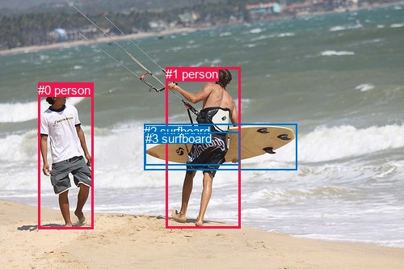
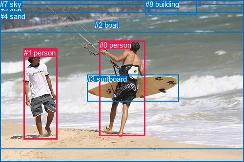

# 图片 1804：2400822.jpg

随机样本序号：478。图片 SHA256：`8550fc474a7255e1c81c944e7d6eda998cbf3b60e523d0819fda5702df5944ed`。

红色框表示人，蓝色框表示其他物体。两个模式分别保留自身框编号，可依据位置比较对应对象。

## 自动检测框与输出

人的框编号：`[0, 1]`。状态：`ok`。

### 自动检测全部物体框

| 编号 | 类别 | 是否为人 | 检测分数 | 像素坐标 xyxy |
|---|---|---|---|---|
| 0 | person | True | 0.9998 | 47.5, 103.0, 115.6, 283.4 |
| 1 | person | True | 0.9994 | 205.2, 83.1, 297.8, 282.0 |
| 2 | surfboard | False | 0.9993 | 178.3, 153.8, 367.3, 210.0 |
| 3 | surfboard | False | 0.4105 | 179.5, 163.1, 296.3, 204.2 |

### 自动检测 Top50 人相关候选

评分物体对：12；人相关物体对：10；输出关系：20。

| 排名 | 主语编号与类别 | 关系 | 宾语编号与类别 | 类型 | 人与人 | 排序分数 | 原始融合 logit |
|---|---|---|---|---|---|---|---|
| 1 | #1 person | carrying | #2 surfboard | semantic | False | 0.98311 | 4.0642 |
| 2 | #1 person | carrying | #3 surfboard | semantic | False | 0.97150 | 3.5290 |
| 3 | #0 person | holding | #3 surfboard | semantic | False | 0.93794 | 2.7156 |
| 4 | #0 person | holding | #2 surfboard | semantic | False | 0.91009 | 2.3148 |
| 5 | #0 person | looking at | #1 person | semantic | True | 0.86921 | 1.8940 |
| 6 | #0 person | beside | #1 person | spatial | True | 0.85568 | 1.7799 |
| 7 | #1 person | holding | #0 person | semantic | True | 0.77633 | 1.2444 |
| 8 | #1 person | in | #3 surfboard | spatial | False | 0.71957 | 0.9423 |
| 9 | #1 person | in | #2 surfboard | spatial | False | 0.61775 | 0.4800 |
| 10 | #0 person | on | #2 surfboard | spatial | False | 0.54101 | 0.1644 |
| 11 | #1 person | in | #0 person | spatial | True | 0.52662 | 0.1066 |
| 12 | #0 person | on | #3 surfboard | spatial | False | 0.52585 | 0.1035 |
| 13 | #3 surfboard | on | #1 person | spatial | False | 0.28640 | -0.9129 |
| 14 | #2 surfboard | beside | #1 person | spatial | False | 0.18840 | -1.4604 |
| 15 | #2 surfboard | carrying | #1 person | semantic | False | 0.11750 | -2.0164 |
| 16 | #3 surfboard | on | #0 person | spatial | False | 0.07371 | -2.5310 |
| 17 | #3 surfboard | holding | #1 person | semantic | False | 0.06543 | -2.6591 |
| 18 | #2 surfboard | beside | #0 person | spatial | False | 0.04410 | -3.0762 |
| 19 | #2 surfboard | holding | #0 person | semantic | False | 0.02712 | -3.5798 |
| 20 | #3 surfboard | holding | #0 person | semantic | False | 0.02141 | -3.8221 |

### 自动检测逐条人相关 GT 核验

R@50：15.38%；命中 2/13。

| GT 主语编号 | GT 关系 | GT 宾语编号 | 结果阶段 | 匹配预测主语编号 | 匹配预测宾语编号 |
|---|---|---|---|---|---|
| 0 | beside | 1 | wrong_predicate | [1] | [0] |
| 0 | attached to | 3 | wrong_predicate | [1] | [2] |
| 0 | playing | 3 | wrong_predicate | [1] | [2] |
| 0 | on | 4 | endpoint_missing_or_wrong_class | [1] | [] |
| 0 | standing on | 4 | endpoint_missing_or_wrong_class | [1] | [] |
| 0 | beside | 5 | endpoint_missing_or_wrong_class | [1] | [] |
| 1 | beside | 0 | hit50 | [0] | [1] |
| 1 | looking at | 0 | hit50 | [0] | [1] |
| 1 | on | 4 | endpoint_missing_or_wrong_class | [0] | [] |
| 1 | walking on | 4 | endpoint_missing_or_wrong_class | [0] | [] |
| 1 | beside | 5 | endpoint_missing_or_wrong_class | [0] | [] |
| 5 | beside | 0 | endpoint_missing_or_wrong_class | [] | [1] |
| 5 | beside | 1 | endpoint_missing_or_wrong_class | [] | [0] |

## 真实框与输出

人的框编号：`[0, 1]`。

### 真实框全部物体框

| 编号 | 类别 | 是否为人 | 检测分数 | 像素坐标 xyxy |
|---|---|---|---|---|
| 0 | person | True | GT | 204.0, 84.0, 298.0, 280.0 |
| 1 | person | True | GT | 49.0, 100.0, 118.0, 286.0 |
| 2 | boat | False | GT | 194.0, 43.0, 204.0, 48.0 |
| 3 | surfboard | False | GT | 178.0, 154.0, 366.0, 209.0 |
| 4 | sand | False | GT | 0.0, 25.0, 500.0, 333.0 |
| 5 | sea | False | GT | 0.0, 9.0, 500.0, 307.0 |
| 6 | tree | False | GT | 0.0, 0.0, 500.0, 67.0 |
| 7 | sky | False | GT | 0.0, 0.0, 39.0, 16.0 |
| 8 | building | False | GT | 298.0, 0.0, 403.0, 30.0 |

### 真实框 Top50 人相关候选

评分物体对：72；人相关物体对：30；输出关系：50。

| 排名 | 主语编号与类别 | 关系 | 宾语编号与类别 | 类型 | 人与人 | 排序分数 | 原始融合 logit |
|---|---|---|---|---|---|---|---|
| 1 | #0 person | carrying | #3 surfboard | semantic | False | 0.98518 | 4.1970 |
| 2 | #0 person | in | #4 sand | spatial | False | 0.97133 | 3.5229 |
| 3 | #1 person | walking on | #4 sand | semantic | False | 0.97046 | 3.4919 |
| 4 | #1 person | on | #4 sand | spatial | False | 0.96947 | 3.4582 |
| 5 | #0 person | walking on | #4 sand | semantic | False | 0.95692 | 3.1007 |
| 6 | #1 person | walking on | #5 sea | semantic | False | 0.92020 | 2.4451 |
| 7 | #0 person | in | #5 sea | spatial | False | 0.91900 | 2.4289 |
| 8 | #0 person | walking on | #5 sea | semantic | False | 0.90413 | 2.2440 |
| 9 | #1 person | in | #5 sea | spatial | False | 0.88292 | 2.0204 |
| 10 | #1 person | pulling | #3 surfboard | semantic | False | 0.85912 | 1.8080 |
| 11 | #0 person | on | #3 surfboard | spatial | False | 0.82328 | 1.5387 |
| 12 | #1 person | looking at | #0 person | semantic | True | 0.77784 | 1.2531 |
| 13 | #1 person | beside | #0 person | spatial | True | 0.68724 | 0.7872 |
| 14 | #0 person | holding | #1 person | semantic | True | 0.53332 | 0.1335 |
| 15 | #3 surfboard | beside | #0 person | spatial | False | 0.50780 | 0.0312 |
| 16 | #5 sea | beside | #0 person | spatial | False | 0.45121 | -0.1958 |
| 17 | #0 person | on | #1 person | spatial | True | 0.37717 | -0.5016 |
| 18 | #1 person | on | #3 surfboard | spatial | False | 0.37359 | -0.5168 |
| 19 | #3 surfboard | holding | #0 person | semantic | False | 0.36589 | -0.5499 |
| 20 | #5 sea | beside | #1 person | spatial | False | 0.21822 | -1.2761 |
| 21 | #0 person | holding | #2 boat | semantic | False | 0.20418 | -1.3604 |
| 22 | #4 sand | playing with | #0 person | semantic | False | 0.19623 | -1.4100 |
| 23 | #4 sand | in | #0 person | spatial | False | 0.17422 | -1.5560 |
| 24 | #1 person | holding | #2 boat | semantic | False | 0.16451 | -1.6250 |
| 25 | #5 sea | playing | #0 person | semantic | False | 0.12979 | -1.9028 |
| 26 | #7 sky | over | #1 person | spatial | False | 0.10425 | -2.1509 |
| 27 | #0 person | on | #2 boat | spatial | False | 0.06639 | -2.6435 |
| 28 | #4 sand | beside | #1 person | spatial | False | 0.05581 | -2.8283 |
| 29 | #1 person | on | #2 boat | spatial | False | 0.05316 | -2.8798 |
| 30 | #1 person | looking at | #7 sky | semantic | False | 0.04899 | -2.9659 |
| 31 | #1 person | walking on | #6 tree | semantic | False | 0.04336 | -3.0939 |
| 32 | #1 person | in | #6 tree | spatial | False | 0.03682 | -3.2641 |
| 33 | #5 sea | holding | #1 person | semantic | False | 0.03543 | -3.3040 |
| 34 | #2 boat | beside | #0 person | spatial | False | 0.03435 | -3.3362 |
| 35 | #7 sky | over | #0 person | spatial | False | 0.02945 | -3.4951 |
| 36 | #0 person | holding | #7 sky | semantic | False | 0.02794 | -3.5494 |
| 37 | #0 person | in | #6 tree | spatial | False | 0.02591 | -3.6268 |
| 38 | #3 surfboard | beside | #1 person | spatial | False | 0.02407 | -3.7025 |
| 39 | #8 building | looking at | #0 person | semantic | False | 0.02319 | -3.7406 |
| 40 | #2 boat | holding | #0 person | semantic | False | 0.02255 | -3.7692 |
| 41 | #4 sand | holding | #1 person | semantic | False | 0.02229 | -3.7810 |
| 42 | #6 tree | beside | #0 person | spatial | False | 0.02217 | -3.7868 |
| 43 | #1 person | looking at | #8 building | semantic | False | 0.01811 | -3.9928 |
| 44 | #1 person | in | #7 sky | spatial | False | 0.01715 | -4.0485 |
| 45 | #0 person | walking on | #6 tree | semantic | False | 0.01663 | -4.0800 |
| 46 | #0 person | in | #7 sky | spatial | False | 0.01446 | -4.2217 |
| 47 | #8 building | beside | #0 person | spatial | False | 0.01400 | -4.2549 |
| 48 | #6 tree | looking at | #0 person | semantic | False | 0.01269 | -4.3546 |
| 49 | #2 boat | holding | #1 person | semantic | False | 0.01138 | -4.4648 |
| 50 | #1 person | in | #8 building | spatial | False | 0.01118 | -4.4820 |

### 真实框逐条人相关 GT 核验

R@50：46.15%；命中 6/13。

| GT 主语编号 | GT 关系 | GT 宾语编号 | 结果阶段 | 匹配预测主语编号 | 匹配预测宾语编号 |
|---|---|---|---|---|---|
| 0 | beside | 1 | wrong_predicate | [0] | [1] |
| 0 | attached to | 3 | wrong_predicate | [0] | [3] |
| 0 | playing | 3 | wrong_predicate | [0] | [3] |
| 0 | on | 4 | wrong_predicate | [0] | [4] |
| 0 | standing on | 4 | wrong_predicate | [0] | [4] |
| 0 | beside | 5 | wrong_predicate | [0] | [5] |
| 1 | beside | 0 | hit50 | [1] | [0] |
| 1 | looking at | 0 | hit50 | [1] | [0] |
| 1 | on | 4 | hit50 | [1] | [4] |
| 1 | walking on | 4 | hit50 | [1] | [4] |
| 1 | beside | 5 | wrong_predicate | [1] | [5] |
| 5 | beside | 0 | hit50 | [5] | [0] |
| 5 | beside | 1 | hit50 | [5] | [1] |

## 全部人相关 GT

| 主语编号与类别 | 关系 | 宾语编号与类别 |
|---|---|---|
| #0 person | beside | #1 person |
| #0 person | attached to | #3 surfboard |
| #0 person | playing | #3 surfboard |
| #0 person | on | #4 sand |
| #0 person | standing on | #4 sand |
| #0 person | beside | #5 sea |
| #1 person | beside | #0 person |
| #1 person | looking at | #0 person |
| #1 person | on | #4 sand |
| #1 person | walking on | #4 sand |
| #1 person | beside | #5 sea |
| #5 sea | beside | #0 person |
| #5 sea | beside | #1 person |

原始记录、全部人相关物体对的两项预测与分项分数见 [逐图证据 JSON](../evidence/cases/1804.json)。全部56类 logits 保留于本机 HOR/output/random500/logits/。

<!-- HOR_COMPLETE_RESULTS -->

## 六组条件的完整输出对照

以下保留同一图片三种框与候选模式、两种谓词输出规则的全部 Top50。框编号各自在所属模式内解释。

### 自动检测框完整枚举：空间与语义各保留一个谓词

| 排名 | 主语编号与类别 | 谓词 | 宾语编号与类别 | 分组 | 排序分数 | predicate logit | pair logit |
|---|---|---|---|---|---|---|---|
| 1 | #1 person | carrying | #2 surfboard | semantic | 0.9831136 | 3.9648614 | 0.0993593 |
| 2 | #1 person | carrying | #3 surfboard | semantic | 0.9715016 | 3.5855250 | -0.0565259 |
| 3 | #0 person | holding | #3 surfboard | semantic | 0.9379410 | 3.5805898 | -0.8649892 |
| 4 | #0 person | holding | #2 surfboard | semantic | 0.9100943 | 3.2331672 | -0.9183806 |
| 5 | #0 person | looking at | #1 person | semantic | 0.8692122 | 2.4780931 | -0.5840825 |
| 6 | #0 person | beside | #1 person | spatial | 0.8556798 | 2.3639445 | -0.5840825 |
| 7 | #1 person | holding | #0 person | semantic | 0.7763255 | 2.1178050 | -0.8734252 |
| 8 | #1 person | in | #3 surfboard | spatial | 0.7195665 | 0.9988379 | -0.0565259 |
| 9 | #1 person | in | #2 surfboard | spatial | 0.6177481 | 0.3806419 | 0.0993593 |
| 10 | #0 person | on | #2 surfboard | spatial | 0.5410133 | 1.0828032 | -0.9183806 |
| 11 | #1 person | in | #0 person | spatial | 0.5266231 | 0.9800181 | -0.8734252 |
| 12 | #0 person | on | #3 surfboard | spatial | 0.5258453 | 0.9684625 | -0.8649892 |
| 13 | #3 surfboard | on | #1 person | spatial | 0.2864026 | -0.3800545 | -0.5328662 |
| 14 | #2 surfboard | beside | #1 person | spatial | 0.1884031 | -0.9514050 | -0.5090150 |
| 15 | #2 surfboard | carrying | #1 person | semantic | 0.1174952 | -1.5073519 | -0.5090150 |
| 16 | #3 surfboard | on | #0 person | spatial | 0.0737120 | -1.1914535 | -1.3395660 |
| 17 | #3 surfboard | holding | #1 person | semantic | 0.0654322 | -2.1262038 | -0.5328662 |
| 18 | #2 surfboard | beside | #0 person | spatial | 0.0440977 | -1.6301711 | -1.4460777 |
| 19 | #2 surfboard | holding | #0 person | semantic | 0.0271250 | -2.1337240 | -1.4460777 |
| 20 | #3 surfboard | holding | #0 person | semantic | 0.0214130 | -2.4825478 | -1.3395660 |

GT 命中：2/13，R@50=15.38%。

| GT主语 | GT谓词 | GT宾语 | 结果阶段 | 匹配主语框 | 匹配宾语框 |
|---|---|---|---|---|---|
| 0 | beside | 1 | wrong_predicate | [1] | [0] |
| 0 | attached to | 3 | wrong_predicate | [1] | [2] |
| 0 | playing | 3 | wrong_predicate | [1] | [2] |
| 0 | on | 4 | endpoint_missing_or_wrong_class | [1] | [] |
| 0 | standing on | 4 | endpoint_missing_or_wrong_class | [1] | [] |
| 0 | beside | 5 | endpoint_missing_or_wrong_class | [1] | [] |
| 1 | beside | 0 | hit50 | [0] | [1] |
| 1 | looking at | 0 | hit50 | [0] | [1] |
| 1 | on | 4 | endpoint_missing_or_wrong_class | [0] | [] |
| 1 | walking on | 4 | endpoint_missing_or_wrong_class | [0] | [] |
| 1 | beside | 5 | endpoint_missing_or_wrong_class | [0] | [] |
| 5 | beside | 0 | endpoint_missing_or_wrong_class | [] | [1] |
| 5 | beside | 1 | endpoint_missing_or_wrong_class | [] | [0] |

### 自动检测框完整枚举：每对只保留一个谓词

| 排名 | 主语编号与类别 | 谓词 | 宾语编号与类别 | 分组 | 排序分数 | predicate logit | pair logit |
|---|---|---|---|---|---|---|---|
| 1 | #1 person | carrying | #2 surfboard | single | 0.9831136 | 3.9648614 | 0.0993593 |
| 2 | #1 person | carrying | #3 surfboard | single | 0.9715016 | 3.5855250 | -0.0565259 |
| 3 | #0 person | holding | #3 surfboard | single | 0.9379410 | 3.5805898 | -0.8649892 |
| 4 | #0 person | holding | #2 surfboard | single | 0.9100943 | 3.2331672 | -0.9183806 |
| 5 | #0 person | looking at | #1 person | single | 0.8692122 | 2.4780931 | -0.5840825 |
| 6 | #1 person | holding | #0 person | single | 0.7763255 | 2.1178050 | -0.8734252 |
| 7 | #3 surfboard | on | #1 person | single | 0.2864026 | -0.3800545 | -0.5328662 |
| 8 | #2 surfboard | beside | #1 person | single | 0.1884031 | -0.9514050 | -0.5090150 |
| 9 | #3 surfboard | on | #0 person | single | 0.0737120 | -1.1914535 | -1.3395660 |
| 10 | #2 surfboard | beside | #0 person | single | 0.0440977 | -1.6301711 | -1.4460777 |

GT 命中：1/13，R@50=7.69%。

| GT主语 | GT谓词 | GT宾语 | 结果阶段 | 匹配主语框 | 匹配宾语框 |
|---|---|---|---|---|---|
| 0 | beside | 1 | wrong_predicate | [1] | [0] |
| 0 | attached to | 3 | wrong_predicate | [1] | [2] |
| 0 | playing | 3 | wrong_predicate | [1] | [2] |
| 0 | on | 4 | endpoint_missing_or_wrong_class | [1] | [] |
| 0 | standing on | 4 | endpoint_missing_or_wrong_class | [1] | [] |
| 0 | beside | 5 | endpoint_missing_or_wrong_class | [1] | [] |
| 1 | beside | 0 | wrong_predicate | [0] | [1] |
| 1 | looking at | 0 | hit50 | [0] | [1] |
| 1 | on | 4 | endpoint_missing_or_wrong_class | [0] | [] |
| 1 | walking on | 4 | endpoint_missing_or_wrong_class | [0] | [] |
| 1 | beside | 5 | endpoint_missing_or_wrong_class | [0] | [] |
| 5 | beside | 0 | endpoint_missing_or_wrong_class | [] | [1] |
| 5 | beside | 1 | endpoint_missing_or_wrong_class | [] | [0] |

### 真实框完整枚举：空间与语义各保留一个谓词

| 排名 | 主语编号与类别 | 谓词 | 宾语编号与类别 | 分组 | 排序分数 | predicate logit | pair logit |
|---|---|---|---|---|---|---|---|
| 1 | #0 person | carrying | #3 surfboard | semantic | 0.9851821 | 4.0623240 | 0.1346684 |
| 2 | #0 person | in | #4 sand | spatial | 0.9713330 | 3.2328753 | 0.2900475 |
| 3 | #1 person | walking on | #4 sand | semantic | 0.9704563 | 3.1627054 | 0.3291895 |
| 4 | #1 person | on | #4 sand | spatial | 0.9694747 | 3.1290088 | 0.3291895 |
| 5 | #0 person | walking on | #4 sand | semantic | 0.9569206 | 2.8106279 | 0.2900475 |
| 6 | #1 person | walking on | #5 sea | semantic | 0.9202033 | 2.5247679 | -0.0796557 |
| 7 | #0 person | in | #5 sea | spatial | 0.9190025 | 2.5230699 | -0.0941994 |
| 8 | #0 person | walking on | #5 sea | semantic | 0.9041317 | 2.3381991 | -0.0941994 |
| 9 | #1 person | in | #5 sea | spatial | 0.8829199 | 2.1000319 | -0.0796557 |
| 10 | #1 person | pulling | #3 surfboard | semantic | 0.8591201 | 2.7647710 | -0.9567695 |
| 11 | #0 person | on | #3 surfboard | spatial | 0.8232780 | 1.4040475 | 0.1346684 |
| 12 | #1 person | looking at | #0 person | semantic | 0.7778356 | 1.8153882 | -0.5622905 |
| 13 | #1 person | beside | #0 person | spatial | 0.6872352 | 1.3495159 | -0.5622905 |
| 14 | #0 person | holding | #1 person | semantic | 0.5333220 | 1.0225730 | -0.8890872 |
| 15 | #3 surfboard | beside | #0 person | spatial | 0.5077951 | 0.5272222 | -0.4960394 |
| 16 | #5 sea | beside | #0 person | spatial | 0.4512105 | 0.5910478 | -0.7868287 |
| 17 | #0 person | on | #1 person | spatial | 0.3771657 | 0.3874912 | -0.8890872 |
| 18 | #1 person | on | #3 surfboard | spatial | 0.3735940 | 0.4399405 | -0.9567695 |
| 19 | #3 surfboard | holding | #0 person | semantic | 0.3658935 | -0.0538354 | -0.4960394 |
| 20 | #5 sea | beside | #1 person | spatial | 0.2182232 | -0.5254507 | -0.7506002 |
| 21 | #0 person | holding | #2 boat | semantic | 0.2041830 | 0.0843854 | -1.4447381 |
| 22 | #4 sand | playing with | #0 person | semantic | 0.1962308 | -0.3007202 | -1.1093006 |
| 23 | #4 sand | in | #0 person | spatial | 0.1742248 | -0.4466753 | -1.1093006 |
| 24 | #1 person | holding | #2 boat | semantic | 0.1645143 | -0.2080836 | -1.4169317 |
| 25 | #5 sea | playing | #0 person | semantic | 0.1297933 | -1.1159587 | -0.7868287 |
| 26 | #7 sky | over | #1 person | spatial | 0.1042503 | -1.2127867 | -0.9380801 |
| 27 | #0 person | on | #2 boat | spatial | 0.0663919 | -1.1987436 | -1.4447381 |
| 28 | #4 sand | beside | #1 person | spatial | 0.0558147 | -1.7424405 | -1.0858455 |
| 29 | #1 person | on | #2 boat | spatial | 0.0531631 | -1.4628310 | -1.4169317 |
| 30 | #1 person | looking at | #7 sky | semantic | 0.0489912 | -1.7280035 | -1.2378790 |
| 31 | #1 person | walking on | #6 tree | semantic | 0.0433588 | -1.6037540 | -1.4901652 |
| 32 | #1 person | in | #6 tree | spatial | 0.0368246 | -1.7739029 | -1.4901652 |
| 33 | #5 sea | holding | #1 person | semantic | 0.0354348 | -2.5533817 | -0.7506002 |
| 34 | #2 boat | beside | #0 person | spatial | 0.0343495 | -2.1062100 | -1.2300054 |
| 35 | #7 sky | over | #0 person | spatial | 0.0294531 | -2.1773140 | -1.3177459 |
| 36 | #0 person | holding | #7 sky | semantic | 0.0279375 | -1.8038933 | -1.7455552 |
| 37 | #0 person | in | #6 tree | spatial | 0.0259109 | -2.1300271 | -1.4968133 |
| 38 | #3 surfboard | beside | #1 person | spatial | 0.0240671 | -2.2572877 | -1.4452587 |
| 39 | #8 building | looking at | #0 person | semantic | 0.0231903 | -2.6567903 | -1.0837656 |
| 40 | #2 boat | holding | #0 person | semantic | 0.0225513 | -2.5391479 | -1.2300054 |
| 41 | #4 sand | holding | #1 person | semantic | 0.0222926 | -2.6951079 | -1.0858455 |
| 42 | #6 tree | beside | #0 person | spatial | 0.0221659 | -2.9920225 | -0.7947642 |
| 43 | #1 person | looking at | #8 building | semantic | 0.0181130 | -1.7529197 | -2.2399278 |
| 44 | #1 person | in | #7 sky | spatial | 0.0171485 | -2.8106699 | -1.2378790 |
| 45 | #0 person | walking on | #6 tree | semantic | 0.0166264 | -2.5831831 | -1.4968133 |
| 46 | #0 person | in | #7 sky | spatial | 0.0144618 | -2.4761248 | -1.7455552 |
| 47 | #8 building | beside | #0 person | spatial | 0.0139956 | -3.1711531 | -1.0837656 |
| 48 | #6 tree | looking at | #0 person | semantic | 0.0126851 | -3.5597997 | -0.7947642 |
| 49 | #2 boat | holding | #1 person | semantic | 0.0113766 | -2.8129826 | -1.6517706 |
| 50 | #1 person | in | #8 building | spatial | 0.0111845 | -2.2420526 | -2.2399278 |

GT 命中：6/13，R@50=46.15%。

| GT主语 | GT谓词 | GT宾语 | 结果阶段 | 匹配主语框 | 匹配宾语框 |
|---|---|---|---|---|---|
| 0 | beside | 1 | wrong_predicate | [0] | [1] |
| 0 | attached to | 3 | wrong_predicate | [0] | [3] |
| 0 | playing | 3 | wrong_predicate | [0] | [3] |
| 0 | on | 4 | wrong_predicate | [0] | [4] |
| 0 | standing on | 4 | wrong_predicate | [0] | [4] |
| 0 | beside | 5 | wrong_predicate | [0] | [5] |
| 1 | beside | 0 | hit50 | [1] | [0] |
| 1 | looking at | 0 | hit50 | [1] | [0] |
| 1 | on | 4 | hit50 | [1] | [4] |
| 1 | walking on | 4 | hit50 | [1] | [4] |
| 1 | beside | 5 | wrong_predicate | [1] | [5] |
| 5 | beside | 0 | hit50 | [5] | [0] |
| 5 | beside | 1 | hit50 | [5] | [1] |

### 真实框完整枚举：每对只保留一个谓词

| 排名 | 主语编号与类别 | 谓词 | 宾语编号与类别 | 分组 | 排序分数 | predicate logit | pair logit |
|---|---|---|---|---|---|---|---|
| 1 | #0 person | carrying | #3 surfboard | single | 0.9851821 | 4.0623240 | 0.1346684 |
| 2 | #0 person | in | #4 sand | single | 0.9713330 | 3.2328753 | 0.2900475 |
| 3 | #1 person | walking on | #4 sand | single | 0.9704563 | 3.1627054 | 0.3291895 |
| 4 | #1 person | walking on | #5 sea | single | 0.9202033 | 2.5247679 | -0.0796557 |
| 5 | #0 person | in | #5 sea | single | 0.9190025 | 2.5230699 | -0.0941994 |
| 6 | #1 person | pulling | #3 surfboard | single | 0.8591201 | 2.7647710 | -0.9567695 |
| 7 | #1 person | looking at | #0 person | single | 0.7778356 | 1.8153882 | -0.5622905 |
| 8 | #0 person | holding | #1 person | single | 0.5333220 | 1.0225730 | -0.8890872 |
| 9 | #3 surfboard | beside | #0 person | single | 0.5077951 | 0.5272222 | -0.4960394 |
| 10 | #5 sea | beside | #0 person | single | 0.4512105 | 0.5910478 | -0.7868287 |
| 11 | #5 sea | beside | #1 person | single | 0.2182232 | -0.5254507 | -0.7506002 |
| 12 | #0 person | holding | #2 boat | single | 0.2041830 | 0.0843854 | -1.4447381 |
| 13 | #4 sand | playing with | #0 person | single | 0.1962308 | -0.3007202 | -1.1093006 |
| 14 | #1 person | holding | #2 boat | single | 0.1645143 | -0.2080836 | -1.4169317 |
| 15 | #7 sky | over | #1 person | single | 0.1042503 | -1.2127867 | -0.9380801 |
| 16 | #4 sand | beside | #1 person | single | 0.0558147 | -1.7424405 | -1.0858455 |
| 17 | #1 person | looking at | #7 sky | single | 0.0489912 | -1.7280035 | -1.2378790 |
| 18 | #1 person | walking on | #6 tree | single | 0.0433588 | -1.6037540 | -1.4901652 |
| 19 | #2 boat | beside | #0 person | single | 0.0343495 | -2.1062100 | -1.2300054 |
| 20 | #7 sky | over | #0 person | single | 0.0294531 | -2.1773140 | -1.3177459 |
| 21 | #0 person | holding | #7 sky | single | 0.0279375 | -1.8038933 | -1.7455552 |
| 22 | #0 person | in | #6 tree | single | 0.0259109 | -2.1300271 | -1.4968133 |
| 23 | #3 surfboard | beside | #1 person | single | 0.0240671 | -2.2572877 | -1.4452587 |
| 24 | #8 building | looking at | #0 person | single | 0.0231903 | -2.6567903 | -1.0837656 |
| 25 | #6 tree | beside | #0 person | single | 0.0221659 | -2.9920225 | -0.7947642 |
| 26 | #1 person | looking at | #8 building | single | 0.0181130 | -1.7529197 | -2.2399278 |
| 27 | #2 boat | holding | #1 person | single | 0.0113766 | -2.8129826 | -1.6517706 |
| 28 | #6 tree | beside | #1 person | single | 0.0091969 | -3.5963194 | -1.0833352 |
| 29 | #0 person | in | #8 building | single | 0.0046806 | -3.3487000 | -2.0109289 |
| 30 | #8 building | looking at | #1 person | single | 0.0037936 | -3.7520537 | -1.8185953 |

GT 命中：4/13，R@50=30.77%。

| GT主语 | GT谓词 | GT宾语 | 结果阶段 | 匹配主语框 | 匹配宾语框 |
|---|---|---|---|---|---|
| 0 | beside | 1 | wrong_predicate | [0] | [1] |
| 0 | attached to | 3 | wrong_predicate | [0] | [3] |
| 0 | playing | 3 | wrong_predicate | [0] | [3] |
| 0 | on | 4 | wrong_predicate | [0] | [4] |
| 0 | standing on | 4 | wrong_predicate | [0] | [4] |
| 0 | beside | 5 | wrong_predicate | [0] | [5] |
| 1 | beside | 0 | wrong_predicate | [1] | [0] |
| 1 | looking at | 0 | hit50 | [1] | [0] |
| 1 | on | 4 | wrong_predicate | [1] | [4] |
| 1 | walking on | 4 | hit50 | [1] | [4] |
| 1 | beside | 5 | wrong_predicate | [1] | [5] |
| 5 | beside | 0 | hit50 | [5] | [0] |
| 5 | beside | 1 | hit50 | [5] | [1] |

### 真实框400候选：空间与语义各保留一个谓词

| 排名 | 主语编号与类别 | 谓词 | 宾语编号与类别 | 分组 | 排序分数 | predicate logit | pair logit |
|---|---|---|---|---|---|---|---|
| 1 | #0 person | carrying | #3 surfboard | semantic | 0.9851821 | 4.0623240 | 0.1346684 |
| 2 | #0 person | in | #4 sand | spatial | 0.9713330 | 3.2328753 | 0.2900475 |
| 3 | #1 person | walking on | #4 sand | semantic | 0.9703699 | 3.1596951 | 0.3291895 |
| 4 | #1 person | on | #4 sand | spatial | 0.9694747 | 3.1290088 | 0.3291895 |
| 5 | #0 person | walking on | #4 sand | semantic | 0.9557903 | 2.7835474 | 0.2900475 |
| 6 | #0 person | in | #5 sea | spatial | 0.9228999 | 2.5766149 | -0.0941994 |
| 7 | #1 person | walking on | #5 sea | semantic | 0.9204241 | 2.5277786 | -0.0796557 |
| 8 | #0 person | walking on | #5 sea | semantic | 0.9064534 | 2.3652797 | -0.0941994 |
| 9 | #1 person | in | #5 sea | spatial | 0.8856592 | 2.1268044 | -0.0796557 |
| 10 | #1 person | pulling | #3 surfboard | semantic | 0.8554391 | 2.7346830 | -0.9567695 |
| 11 | #0 person | on | #3 surfboard | spatial | 0.8232780 | 1.4040475 | 0.1346684 |
| 12 | #1 person | looking at | #0 person | semantic | 0.7778356 | 1.8153882 | -0.5622905 |
| 13 | #1 person | beside | #0 person | spatial | 0.6807564 | 1.3195405 | -0.5622905 |
| 14 | #0 person | holding | #1 person | semantic | 0.5318511 | 1.0166645 | -0.8890872 |
| 15 | #3 surfboard | beside | #0 person | spatial | 0.5152993 | 0.5572557 | -0.4960394 |
| 16 | #5 sea | beside | #0 person | spatial | 0.4512105 | 0.5910478 | -0.7868287 |
| 17 | #0 person | on | #1 person | spatial | 0.3746109 | 0.3766012 | -0.8890872 |
| 18 | #1 person | on | #3 surfboard | spatial | 0.3691115 | 0.4207392 | -0.9567695 |
| 19 | #3 surfboard | holding | #0 person | semantic | 0.3672654 | -0.0479269 | -0.4960394 |
| 20 | #5 sea | beside | #1 person | spatial | 0.2131477 | -0.5554552 | -0.7506002 |
| 21 | #0 person | holding | #2 boat | semantic | 0.2037033 | 0.0814309 | -1.4447381 |
| 22 | #4 sand | playing with | #0 person | semantic | 0.1962308 | -0.3007202 | -1.1093006 |
| 23 | #4 sand | in | #0 person | spatial | 0.1742248 | -0.4466753 | -1.1093006 |
| 24 | #1 person | holding | #2 boat | semantic | 0.1606190 | -0.2366977 | -1.4169317 |
| 25 | #5 sea | playing | #0 person | semantic | 0.1283744 | -1.1285806 | -0.7868287 |
| 26 | #7 sky | over | #1 person | spatial | 0.1036960 | -1.2187357 | -0.9380801 |
| 27 | #0 person | on | #2 boat | spatial | 0.0648804 | -1.2233901 | -1.4447381 |
| 28 | #4 sand | beside | #1 person | spatial | 0.0542514 | -1.7725029 | -1.0858455 |
| 29 | #1 person | on | #2 boat | spatial | 0.0528897 | -1.4682758 | -1.4169317 |
| 30 | #1 person | looking at | #7 sky | semantic | 0.0476239 | -1.7577462 | -1.2378790 |
| 31 | #1 person | walking on | #6 tree | semantic | 0.0415846 | -1.6473856 | -1.4901652 |
| 32 | #1 person | in | #6 tree | spatial | 0.0361571 | -1.7928896 | -1.4901652 |
| 33 | #5 sea | holding | #1 person | semantic | 0.0354483 | -2.5529892 | -0.7506002 |
| 34 | #2 boat | beside | #0 person | spatial | 0.0333666 | -2.1362579 | -1.2300054 |
| 35 | #7 sky | over | #0 person | spatial | 0.0287154 | -2.2034392 | -1.3177459 |
| 36 | #0 person | holding | #7 sky | semantic | 0.0264818 | -1.8589056 | -1.7455552 |
| 37 | #0 person | in | #6 tree | spatial | 0.0252258 | -2.1575258 | -1.4968133 |
| 38 | #3 surfboard | beside | #1 person | spatial | 0.0237146 | -2.2724056 | -1.4452587 |
| 39 | #4 sand | holding | #1 person | semantic | 0.0222605 | -2.6965849 | -1.0858455 |
| 40 | #2 boat | holding | #0 person | semantic | 0.0222541 | -2.5527163 | -1.2300054 |
| 41 | #8 building | looking at | #0 person | semantic | 0.0222009 | -2.7014041 | -1.0837656 |
| 42 | #6 tree | beside | #0 person | spatial | 0.0216807 | -3.0146489 | -0.7947642 |
| 43 | #1 person | looking at | #8 building | semantic | 0.0175915 | -1.7826622 | -2.2399278 |
| 44 | #1 person | in | #7 sky | spatial | 0.0165115 | -2.8491693 | -1.2378790 |
| 45 | #0 person | walking on | #6 tree | semantic | 0.0163822 | -2.5982285 | -1.4968133 |
| 46 | #0 person | in | #7 sky | spatial | 0.0136957 | -2.5313294 | -1.7455552 |
| 47 | #8 building | beside | #0 person | spatial | 0.0136868 | -3.1937795 | -1.0837656 |
| 48 | #6 tree | looking at | #0 person | semantic | 0.0123169 | -3.5896297 | -0.7947642 |
| 49 | #2 boat | holding | #1 person | semantic | 0.0111841 | -2.8302441 | -1.6517706 |
| 50 | #1 person | in | #8 building | spatial | 0.0110216 | -2.2568905 | -2.2399278 |

GT 命中：6/13，R@50=46.15%。

| GT主语 | GT谓词 | GT宾语 | 结果阶段 | 匹配主语框 | 匹配宾语框 |
|---|---|---|---|---|---|
| 0 | beside | 1 | wrong_predicate | [0] | [1] |
| 0 | attached to | 3 | wrong_predicate | [0] | [3] |
| 0 | playing | 3 | wrong_predicate | [0] | [3] |
| 0 | on | 4 | wrong_predicate | [0] | [4] |
| 0 | standing on | 4 | wrong_predicate | [0] | [4] |
| 0 | beside | 5 | wrong_predicate | [0] | [5] |
| 1 | beside | 0 | hit50 | [1] | [0] |
| 1 | looking at | 0 | hit50 | [1] | [0] |
| 1 | on | 4 | hit50 | [1] | [4] |
| 1 | walking on | 4 | hit50 | [1] | [4] |
| 1 | beside | 5 | wrong_predicate | [1] | [5] |
| 5 | beside | 0 | hit50 | [5] | [0] |
| 5 | beside | 1 | hit50 | [5] | [1] |

### 真实框400候选：每对只保留一个谓词

| 排名 | 主语编号与类别 | 谓词 | 宾语编号与类别 | 分组 | 排序分数 | predicate logit | pair logit |
|---|---|---|---|---|---|---|---|
| 1 | #0 person | carrying | #3 surfboard | single | 0.9851821 | 4.0623240 | 0.1346684 |
| 2 | #0 person | in | #4 sand | single | 0.9713330 | 3.2328753 | 0.2900475 |
| 3 | #1 person | walking on | #4 sand | single | 0.9703699 | 3.1596951 | 0.3291895 |
| 4 | #0 person | in | #5 sea | single | 0.9228999 | 2.5766149 | -0.0941994 |
| 5 | #1 person | walking on | #5 sea | single | 0.9204241 | 2.5277786 | -0.0796557 |
| 6 | #1 person | pulling | #3 surfboard | single | 0.8554391 | 2.7346830 | -0.9567695 |
| 7 | #1 person | looking at | #0 person | single | 0.7778356 | 1.8153882 | -0.5622905 |
| 8 | #0 person | holding | #1 person | single | 0.5318511 | 1.0166645 | -0.8890872 |
| 9 | #3 surfboard | beside | #0 person | single | 0.5152993 | 0.5572557 | -0.4960394 |
| 10 | #5 sea | beside | #0 person | single | 0.4512105 | 0.5910478 | -0.7868287 |
| 11 | #5 sea | beside | #1 person | single | 0.2131477 | -0.5554552 | -0.7506002 |
| 12 | #0 person | holding | #2 boat | single | 0.2037033 | 0.0814309 | -1.4447381 |
| 13 | #4 sand | playing with | #0 person | single | 0.1962308 | -0.3007202 | -1.1093006 |
| 14 | #1 person | holding | #2 boat | single | 0.1606190 | -0.2366977 | -1.4169317 |
| 15 | #7 sky | over | #1 person | single | 0.1036960 | -1.2187357 | -0.9380801 |
| 16 | #4 sand | beside | #1 person | single | 0.0542514 | -1.7725029 | -1.0858455 |
| 17 | #1 person | looking at | #7 sky | single | 0.0476239 | -1.7577462 | -1.2378790 |
| 18 | #1 person | walking on | #6 tree | single | 0.0415846 | -1.6473856 | -1.4901652 |
| 19 | #2 boat | beside | #0 person | single | 0.0333666 | -2.1362579 | -1.2300054 |
| 20 | #7 sky | over | #0 person | single | 0.0287154 | -2.2034392 | -1.3177459 |
| 21 | #0 person | holding | #7 sky | single | 0.0264818 | -1.8589056 | -1.7455552 |
| 22 | #0 person | in | #6 tree | single | 0.0252258 | -2.1575258 | -1.4968133 |
| 23 | #3 surfboard | beside | #1 person | single | 0.0237146 | -2.2724056 | -1.4452587 |
| 24 | #8 building | looking at | #0 person | single | 0.0222009 | -2.7014041 | -1.0837656 |
| 25 | #6 tree | beside | #0 person | single | 0.0216807 | -3.0146489 | -0.7947642 |
| 26 | #1 person | looking at | #8 building | single | 0.0175915 | -1.7826622 | -2.2399278 |
| 27 | #2 boat | holding | #1 person | single | 0.0111841 | -2.8302441 | -1.6517706 |
| 28 | #6 tree | beside | #1 person | single | 0.0090602 | -3.6114230 | -1.0833352 |
| 29 | #0 person | in | #8 building | single | 0.0046187 | -3.3620863 | -2.0109289 |
| 30 | #8 building | looking at | #1 person | single | 0.0037649 | -3.7596636 | -1.8185953 |

GT 命中：4/13，R@50=30.77%。

| GT主语 | GT谓词 | GT宾语 | 结果阶段 | 匹配主语框 | 匹配宾语框 |
|---|---|---|---|---|---|
| 0 | beside | 1 | wrong_predicate | [0] | [1] |
| 0 | attached to | 3 | wrong_predicate | [0] | [3] |
| 0 | playing | 3 | wrong_predicate | [0] | [3] |
| 0 | on | 4 | wrong_predicate | [0] | [4] |
| 0 | standing on | 4 | wrong_predicate | [0] | [4] |
| 0 | beside | 5 | wrong_predicate | [0] | [5] |
| 1 | beside | 0 | wrong_predicate | [1] | [0] |
| 1 | looking at | 0 | hit50 | [1] | [0] |
| 1 | on | 4 | wrong_predicate | [1] | [4] |
| 1 | walking on | 4 | hit50 | [1] | [4] |
| 1 | beside | 5 | wrong_predicate | [1] | [5] |
| 5 | beside | 0 | hit50 | [5] | [0] |
| 5 | beside | 1 | hit50 | [5] | [1] |
