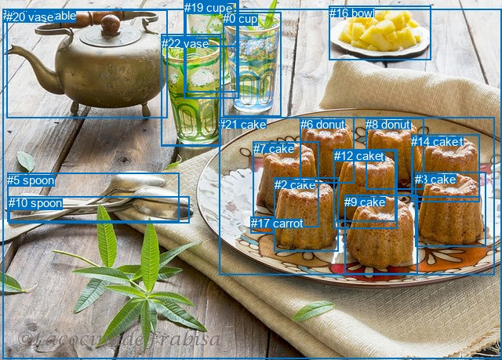
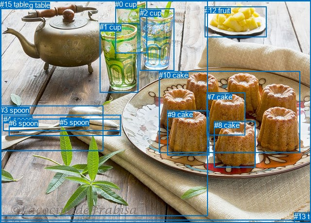

# 图片 1807：2400914.jpg

随机样本序号：13。图片 SHA256：`204922b21c091ed50b41c039b77a9859c3d9ede055a9bdb40afc51fc947a9d3b`。

红色框表示人，蓝色框表示其他物体。两个模式分别保留自身框编号，可依据位置比较对应对象。

## 自动检测框与输出

人的框编号：`[]`。状态：`no_person`。

### 自动检测全部物体框

| 编号 | 类别 | 是否为人 | 检测分数 | 像素坐标 xyxy |
|---|---|---|---|---|
| 0 | cup | False | 0.9788 | 284.2, 15.1, 358.5, 148.4 |
| 1 | cup | False | 0.9770 | 205.7, 43.1, 281.3, 186.4 |
| 2 | cake | False | 0.9732 | 349.5, 226.6, 431.4, 320.7 |
| 3 | cake | False | 0.9685 | 529.5, 219.7, 619.4, 314.6 |
| 4 | dining table | False | 0.9639 | 3.9, 11.1, 640.0, 457.1 |
| 5 | spoon | False | 0.9539 | 9.4, 220.5, 228.6, 282.8 |
| 6 | donut | False | 0.9413 | 382.7, 149.9, 451.2, 233.4 |
| 7 | cake | False | 0.9111 | 322.5, 180.9, 406.2, 289.2 |
| 8 | donut | False | 0.9038 | 466.4, 150.3, 541.0, 241.2 |
| 9 | cake | False | 0.8414 | 439.1, 248.8, 532.6, 349.3 |
| 10 | spoon | False | 0.7324 | 11.3, 250.4, 241.5, 284.2 |
| 11 | donut | False | 0.7029 | 425.3, 191.0, 504.8, 282.6 |
| 12 | cake | False | 0.7008 | 425.6, 190.4, 506.7, 291.5 |
| 13 | donut | False | 0.6239 | 525.6, 171.9, 611.4, 251.0 |
| 14 | cake | False | 0.5762 | 524.5, 171.6, 611.9, 257.9 |
| 15 | cup | False | 0.5201 | 236.4, 0.7, 302.5, 59.7 |
| 16 | bowl | False | 0.4814 | 419.8, 7.5, 549.6, 76.0 |
| 17 | carrot | False | 0.4415 | 319.7, 276.3, 348.3, 297.7 |
| 18 | vase | False | 0.4358 | 236.3, 2.1, 302.9, 117.4 |
| 19 | cup | False | 0.4301 | 234.9, 0.6, 304.2, 126.0 |
| 20 | vase | False | 0.3936 | 8.1, 12.9, 213.8, 151.0 |
| 21 | cake | False | 0.3616 | 279.2, 150.0, 630.3, 350.8 |
| 22 | vase | False | 0.3526 | 205.9, 46.7, 282.0, 185.9 |

### 自动检测 Top50 人相关候选

评分物体对：0；人相关物体对：0；输出关系：0。

| 排名 | 主语编号与类别 | 关系 | 宾语编号与类别 | 类型 | 人与人 | 排序分数 | 原始融合 logit |
|---|---|---|---|---|---|---|---|

### 自动检测逐条人相关 GT 核验

本图没有人相关 GT，R@50 无分母；预测候选继续展示。

## 真实框与输出

人的框编号：`[]`。

### 真实框全部物体框

| 编号 | 类别 | 是否为人 | 检测分数 | 像素坐标 xyxy |
|---|---|---|---|---|
| 0 | cup | False | GT | 237.0, 0.0, 303.0, 109.0 |
| 1 | cup | False | GT | 205.0, 47.0, 284.0, 190.0 |
| 2 | cup | False | GT | 288.0, 18.0, 359.0, 145.0 |
| 3 | spoon | False | GT | 0.0, 218.0, 212.0, 311.0 |
| 4 | spoon | False | GT | 7.0, 237.0, 248.0, 270.0 |
| 5 | spoon | False | GT | 123.0, 243.0, 168.0, 258.0 |
| 6 | spoon | False | GT | 18.0, 245.0, 248.0, 280.0 |
| 7 | cake | False | GT | 426.0, 191.0, 505.0, 279.0 |
| 8 | cake | False | GT | 441.0, 249.0, 526.0, 344.0 |
| 9 | cake | False | GT | 345.0, 227.0, 431.0, 319.0 |
| 10 | cake | False | GT | 327.0, 146.0, 617.0, 314.0 |
| 11 | dining table | False | GT | 2.0, 2.0, 640.0, 453.0 |
| 12 | fruit | False | GT | 421.0, 13.0, 548.0, 77.0 |
| 13 | towel | False | GT | 605.0, 437.0, 640.0, 459.0 |
| 14 | tree | False | GT | 0.0, 0.0, 427.0, 444.0 |
| 15 | table | False | GT | 0.0, 0.0, 640.0, 459.0 |

### 真实框 Top50 人相关候选

评分物体对：0；人相关物体对：0；输出关系：0。

| 排名 | 主语编号与类别 | 关系 | 宾语编号与类别 | 类型 | 人与人 | 排序分数 | 原始融合 logit |
|---|---|---|---|---|---|---|---|

### 真实框逐条人相关 GT 核验

本图没有人相关 GT，R@50 无分母；预测候选继续展示。

## 全部人相关 GT

| 主语编号与类别 | 关系 | 宾语编号与类别 |
|---|---|---|

原始记录、全部人相关物体对的两项预测与分项分数见 [逐图证据 JSON](../evidence/cases/1807.json)。全部56类 logits 保留于本机 HOR/output/random500/logits/。

<!-- HOR_COMPLETE_RESULTS -->

## 六组条件的完整输出对照

以下保留同一图片三种框与候选模式、两种谓词输出规则的全部 Top50。框编号各自在所属模式内解释。

### 自动检测框完整枚举：空间与语义各保留一个谓词

| 排名 | 主语编号与类别 | 谓词 | 宾语编号与类别 | 分组 | 排序分数 | predicate logit | pair logit |
|---|---|---|---|---|---|---|---|

没有人相关 GT，本条件的召回率无分母。

### 自动检测框完整枚举：每对只保留一个谓词

| 排名 | 主语编号与类别 | 谓词 | 宾语编号与类别 | 分组 | 排序分数 | predicate logit | pair logit |
|---|---|---|---|---|---|---|---|

没有人相关 GT，本条件的召回率无分母。

### 真实框完整枚举：空间与语义各保留一个谓词

| 排名 | 主语编号与类别 | 谓词 | 宾语编号与类别 | 分组 | 排序分数 | predicate logit | pair logit |
|---|---|---|---|---|---|---|---|

没有人相关 GT，本条件的召回率无分母。

### 真实框完整枚举：每对只保留一个谓词

| 排名 | 主语编号与类别 | 谓词 | 宾语编号与类别 | 分组 | 排序分数 | predicate logit | pair logit |
|---|---|---|---|---|---|---|---|

没有人相关 GT，本条件的召回率无分母。

### 真实框400候选：空间与语义各保留一个谓词

| 排名 | 主语编号与类别 | 谓词 | 宾语编号与类别 | 分组 | 排序分数 | predicate logit | pair logit |
|---|---|---|---|---|---|---|---|

没有人相关 GT，本条件的召回率无分母。

### 真实框400候选：每对只保留一个谓词

| 排名 | 主语编号与类别 | 谓词 | 宾语编号与类别 | 分组 | 排序分数 | predicate logit | pair logit |
|---|---|---|---|---|---|---|---|

没有人相关 GT，本条件的召回率无分母。
