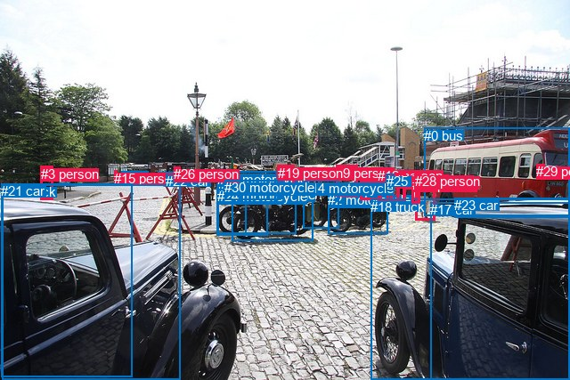
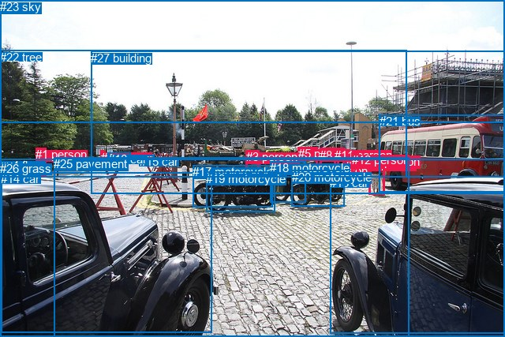

# 图片 1813：2401171.jpg

随机样本序号：156。图片 SHA256：`b86eeebe566cee1e853f153675db94ba23d6642956f29ea473804c7852cb6b37`。

红色框表示人，蓝色框表示其他物体。两个模式分别保留自身框编号，可依据位置比较对应对象。

## 自动检测框与输出

人的框编号：`[3, 5, 6, 7, 9, 10, 12, 13, 15, 19, 26, 27, 28, 29]`。状态：`ok`。

### 自动检测全部物体框

| 编号 | 类别 | 是否为人 | 检测分数 | 像素坐标 xyxy |
|---|---|---|---|---|
| 0 | bus | False | 0.9976 | 476.2, 143.5, 640.0, 242.3 |
| 1 | motorcycle | False | 0.9968 | 260.6, 209.6, 351.7, 270.1 |
| 2 | motorcycle | False | 0.9934 | 368.5, 216.4, 435.9, 262.0 |
| 3 | person | True | 0.9885 | 45.7, 186.8, 59.6, 224.4 |
| 4 | car | False | 0.9870 | 136.7, 192.8, 166.5, 206.0 |
| 5 | person | True | 0.9843 | 466.8, 194.8, 488.5, 248.0 |
| 6 | person | True | 0.9566 | 404.8, 188.2, 428.1, 224.3 |
| 7 | person | True | 0.9403 | 438.9, 194.0, 448.4, 226.9 |
| 8 | motorcycle | False | 0.9252 | 243.4, 206.7, 300.3, 264.6 |
| 9 | person | True | 0.9250 | 377.5, 186.0, 401.5, 220.9 |
| 10 | person | True | 0.9199 | 452.2, 195.2, 464.7, 228.8 |
| 11 | car | False | 0.9009 | 177.5, 193.3, 196.5, 204.1 |
| 12 | person | True | 0.8842 | 424.4, 188.5, 436.7, 227.0 |
| 13 | person | True | 0.8784 | 445.4, 194.1, 455.3, 227.9 |
| 14 | motorcycle | False | 0.8724 | 340.5, 202.6, 380.2, 256.3 |
| 15 | person | True | 0.8444 | 128.2, 191.9, 131.5, 203.6 |
| 16 | motorcycle | False | 0.8228 | 244.4, 192.9, 332.2, 262.0 |
| 17 | car | False | 0.7947 | 483.5, 227.5, 640.0, 426.9 |
| 18 | truck | False | 0.7690 | 416.2, 223.7, 640.0, 427.0 |
| 19 | person | True | 0.7626 | 311.6, 185.8, 330.6, 217.9 |
| 20 | truck | False | 0.7412 | 2.3, 207.1, 203.0, 427.0 |
| 21 | car | False | 0.6497 | 1.0, 206.4, 148.0, 423.2 |
| 22 | car | False | 0.6106 | 186.3, 195.3, 196.4, 203.7 |
| 23 | car | False | 0.5835 | 510.2, 222.1, 640.0, 244.6 |
| 24 | motorcycle | False | 0.4909 | 243.9, 212.1, 276.2, 262.2 |
| 25 | car | False | 0.4852 | 433.5, 195.2, 442.5, 214.8 |
| 26 | person | True | 0.4360 | 195.1, 187.3, 202.2, 197.9 |
| 27 | person | True | 0.4040 | 462.9, 198.5, 471.4, 228.8 |
| 28 | person | True | 0.3698 | 465.9, 195.4, 472.9, 207.6 |
| 29 | person | True | 0.3585 | 602.1, 184.1, 611.3, 195.6 |
| 30 | motorcycle | False | 0.3579 | 252.3, 202.0, 312.8, 224.4 |

### 自动检测 Top50 人相关候选

评分物体对：930；人相关物体对：658；输出关系：50。

| 排名 | 主语编号与类别 | 关系 | 宾语编号与类别 | 类型 | 人与人 | 排序分数 | 原始融合 logit |
|---|---|---|---|---|---|---|---|
| 1 | #29 person | riding | #0 bus | semantic | False | 0.99436 | 5.1731 |
| 2 | #27 person | carrying | #28 person | semantic | True | 0.95704 | 3.1036 |
| 3 | #26 person | walking on | #22 car | semantic | False | 0.95586 | 3.0754 |
| 4 | #26 person | walking on | #11 car | semantic | False | 0.95278 | 3.0046 |
| 5 | #29 person | in | #0 bus | spatial | False | 0.94927 | 2.9292 |
| 6 | #26 person | on | #22 car | spatial | False | 0.94681 | 2.8793 |
| 7 | #19 person | riding | #1 motorcycle | semantic | False | 0.92394 | 2.4971 |
| 8 | #11 car | parked on | #26 person | semantic | False | 0.92266 | 2.4791 |
| 9 | #19 person | on | #1 motorcycle | spatial | False | 0.92080 | 2.4533 |
| 10 | #5 person | carrying | #28 person | semantic | True | 0.92019 | 2.4450 |
| 11 | #26 person | beside | #11 car | spatial | False | 0.91281 | 2.3485 |
| 12 | #19 person | riding | #16 motorcycle | semantic | False | 0.90802 | 2.2898 |
| 13 | #22 car | on | #26 person | spatial | False | 0.90323 | 2.2337 |
| 14 | #5 person | walking on | #0 bus | semantic | False | 0.88779 | 2.0684 |
| 15 | #19 person | on | #16 motorcycle | spatial | False | 0.86906 | 1.8927 |
| 16 | #15 person | beside | #4 car | spatial | False | 0.86542 | 1.8611 |
| 17 | #9 person | standing on | #2 motorcycle | semantic | False | 0.85162 | 1.7474 |
| 18 | #0 bus | carrying | #29 person | semantic | False | 0.85063 | 1.7395 |
| 19 | #19 person | on | #30 motorcycle | spatial | False | 0.84129 | 1.6678 |
| 20 | #22 car | parked on | #26 person | semantic | False | 0.83932 | 1.6532 |
| 21 | #11 car | beside | #26 person | spatial | False | 0.82281 | 1.5355 |
| 22 | #12 person | carrying | #25 car | semantic | False | 0.82204 | 1.5302 |
| 23 | #19 person | sitting on | #30 motorcycle | semantic | False | 0.81023 | 1.4515 |
| 24 | #5 person | beside | #0 bus | spatial | False | 0.77868 | 1.2580 |
| 25 | #7 person | carrying | #25 car | semantic | False | 0.77473 | 1.2352 |
| 26 | #4 car | driving | #15 person | semantic | False | 0.77463 | 1.2347 |
| 27 | #27 person | in | #28 person | spatial | True | 0.76593 | 1.1855 |
| 28 | #6 person | walking on | #2 motorcycle | semantic | False | 0.74713 | 1.0834 |
| 29 | #4 car | beside | #15 person | spatial | False | 0.74362 | 1.0649 |
| 30 | #15 person | parked on | #4 car | semantic | False | 0.73167 | 1.0031 |
| 31 | #5 person | in | #28 person | spatial | True | 0.71900 | 0.9395 |
| 32 | #12 person | walking on | #2 motorcycle | semantic | False | 0.62331 | 0.5036 |
| 33 | #9 person | on | #2 motorcycle | spatial | False | 0.61758 | 0.4793 |
| 34 | #5 person | carrying | #27 person | semantic | True | 0.54709 | 0.1889 |
| 35 | #11 car | parked on | #15 person | semantic | False | 0.54468 | 0.1792 |
| 36 | #9 person | standing on | #14 motorcycle | semantic | False | 0.53725 | 0.1493 |
| 37 | #3 person | walking on | #4 car | semantic | False | 0.51998 | 0.0800 |
| 38 | #6 person | looking at | #0 bus | semantic | False | 0.50844 | 0.0338 |
| 39 | #0 bus | on | #29 person | spatial | False | 0.49827 | -0.0069 |
| 40 | #26 person | driving | #4 car | semantic | False | 0.49480 | -0.0208 |
| 41 | #10 person | walking on | #0 bus | semantic | False | 0.48045 | -0.0783 |
| 42 | #15 person | parked on | #11 car | semantic | False | 0.47526 | -0.0990 |
| 43 | #28 person | looking at | #0 bus | semantic | False | 0.47279 | -0.1089 |
| 44 | #3 person | walking on | #21 car | semantic | False | 0.46601 | -0.1362 |
| 45 | #27 person | walking on | #5 person | semantic | True | 0.46589 | -0.1367 |
| 46 | #27 person | walking on | #0 bus | semantic | False | 0.45988 | -0.1608 |
| 47 | #13 person | walking on | #10 person | semantic | True | 0.45125 | -0.1956 |
| 48 | #9 person | looking at | #0 bus | semantic | False | 0.44928 | -0.2036 |
| 49 | #13 person | walking on | #0 bus | semantic | False | 0.43831 | -0.2480 |
| 50 | #7 person | walking on | #13 person | semantic | True | 0.43780 | -0.2501 |

### 自动检测逐条人相关 GT 核验

R@50：0.00%；命中 0/1。

| GT 主语编号 | GT 关系 | GT 宾语编号 | 结果阶段 | 匹配预测主语编号 | 匹配预测宾语编号 |
|---|---|---|---|---|---|
| 9 | walking on | 25 | endpoint_missing_or_wrong_class | [5] | [] |

## 真实框与输出

人的框编号：`[0, 1, 2, 3, 4, 5, 6, 7, 8, 9, 10, 11, 12]`。

### 真实框全部物体框

| 编号 | 类别 | 是否为人 | 检测分数 | 像素坐标 xyxy |
|---|---|---|---|---|
| 0 | person | True | GT | 455.0, 195.0, 464.0, 229.0 |
| 1 | person | True | GT | 45.0, 187.0, 58.0, 224.0 |
| 2 | person | True | GT | 463.0, 199.0, 469.0, 209.0 |
| 3 | person | True | GT | 312.0, 190.0, 329.0, 218.0 |
| 4 | person | True | GT | 128.0, 191.0, 132.0, 203.0 |
| 5 | person | True | GT | 378.0, 186.0, 402.0, 221.0 |
| 6 | person | True | GT | 468.0, 195.0, 473.0, 206.0 |
| 7 | person | True | GT | 439.0, 194.0, 448.0, 227.0 |
| 8 | person | True | GT | 405.0, 188.0, 429.0, 224.0 |
| 9 | person | True | GT | 467.0, 196.0, 487.0, 246.0 |
| 10 | person | True | GT | 393.0, 208.0, 399.0, 219.0 |
| 11 | person | True | GT | 424.0, 188.0, 437.0, 225.0 |
| 12 | person | True | GT | 446.0, 194.0, 454.0, 229.0 |
| 13 | car | False | GT | 418.0, 223.0, 640.0, 422.0 |
| 14 | car | False | GT | 1.0, 218.0, 269.0, 421.0 |
| 15 | car | False | GT | 177.0, 196.0, 196.0, 204.0 |
| 16 | car | False | GT | 137.0, 193.0, 166.0, 205.0 |
| 17 | motorcycle | False | GT | 244.0, 209.0, 345.0, 262.0 |
| 18 | motorcycle | False | GT | 342.0, 204.0, 387.0, 256.0 |
| 19 | motorcycle | False | GT | 261.0, 218.0, 348.0, 269.0 |
| 20 | motorcycle | False | GT | 370.0, 216.0, 437.0, 262.0 |
| 21 | bus | False | GT | 481.0, 145.0, 640.0, 243.0 |
| 22 | tree | False | GT | 0.0, 64.0, 515.0, 225.0 |
| 23 | sky | False | GT | 0.0, 0.0, 640.0, 156.0 |
| 24 | floor | False | GT | 0.0, 201.0, 640.0, 427.0 |
| 25 | pavement | False | GT | 68.0, 199.0, 519.0, 427.0 |
| 26 | grass | False | GT | 0.0, 205.0, 18.0, 218.0 |
| 27 | building | False | GT | 115.0, 65.0, 640.0, 246.0 |

### 真实框 Top50 人相关候选

评分物体对：756；人相关物体对：546；输出关系：50。

| 排名 | 主语编号与类别 | 关系 | 宾语编号与类别 | 类型 | 人与人 | 排序分数 | 原始融合 logit |
|---|---|---|---|---|---|---|---|
| 1 | #1 person | walking on | #26 grass | semantic | False | 0.99089 | 4.6889 |
| 2 | #4 person | parked on | #25 pavement | semantic | False | 0.97434 | 3.6370 |
| 3 | #5 person | carrying | #10 person | semantic | True | 0.96878 | 3.4351 |
| 4 | #1 person | walking on | #24 floor | semantic | False | 0.96708 | 3.3801 |
| 5 | #4 person | parked on | #24 floor | semantic | False | 0.96481 | 3.3112 |
| 6 | #8 person | walking on | #24 floor | semantic | False | 0.94466 | 2.8373 |
| 7 | #11 person | walking on | #24 floor | semantic | False | 0.93600 | 2.6828 |
| 8 | #9 person | walking on | #24 floor | semantic | False | 0.93473 | 2.6618 |
| 9 | #5 person | walking on | #24 floor | semantic | False | 0.92832 | 2.5612 |
| 10 | #9 person | wearing | #6 person | semantic | True | 0.92756 | 2.5498 |
| 11 | #7 person | walking on | #24 floor | semantic | False | 0.92332 | 2.4883 |
| 12 | #9 person | walking on | #25 pavement | semantic | False | 0.92050 | 2.4492 |
| 13 | #1 person | on | #26 grass | spatial | False | 0.92028 | 2.4462 |
| 14 | #12 person | walking on | #24 floor | semantic | False | 0.91732 | 2.4064 |
| 15 | #8 person | standing on | #25 pavement | semantic | False | 0.91559 | 2.3838 |
| 16 | #5 person | standing on | #25 pavement | semantic | False | 0.91091 | 2.3248 |
| 17 | #0 person | carrying | #2 person | semantic | True | 0.90902 | 2.3017 |
| 18 | #9 person | holding | #2 person | semantic | True | 0.90838 | 2.2940 |
| 19 | #0 person | walking on | #24 floor | semantic | False | 0.90834 | 2.2935 |
| 20 | #11 person | walking on | #25 pavement | semantic | False | 0.89801 | 2.1754 |
| 21 | #3 person | on | #17 motorcycle | spatial | False | 0.88889 | 2.0794 |
| 22 | #10 person | standing on | #24 floor | semantic | False | 0.87820 | 1.9755 |
| 23 | #7 person | walking on | #25 pavement | semantic | False | 0.87200 | 1.9188 |
| 24 | #12 person | walking on | #25 pavement | semantic | False | 0.87089 | 1.9088 |
| 25 | #3 person | on | #24 floor | spatial | False | 0.85461 | 1.7713 |
| 26 | #0 person | walking on | #25 pavement | semantic | False | 0.85163 | 1.7474 |
| 27 | #3 person | sitting on | #17 motorcycle | semantic | False | 0.83961 | 1.6553 |
| 28 | #1 person | walking on | #25 pavement | semantic | False | 0.83138 | 1.5954 |
| 29 | #4 person | on | #25 pavement | spatial | False | 0.83003 | 1.5858 |
| 30 | #4 person | on | #24 floor | spatial | False | 0.82229 | 1.5319 |
| 31 | #4 person | parked on | #22 tree | semantic | False | 0.81310 | 1.4703 |
| 32 | #5 person | standing on | #20 motorcycle | semantic | False | 0.80946 | 1.4465 |
| 33 | #5 person | on | #24 floor | spatial | False | 0.80603 | 1.4244 |
| 34 | #5 person | in | #10 person | spatial | True | 0.80188 | 1.3981 |
| 35 | #3 person | on | #25 pavement | spatial | False | 0.78875 | 1.3174 |
| 36 | #9 person | beside | #21 bus | spatial | False | 0.78335 | 1.2853 |
| 37 | #9 person | in | #6 person | spatial | True | 0.77787 | 1.2533 |
| 38 | #8 person | on | #24 floor | spatial | False | 0.77325 | 1.2267 |
| 39 | #9 person | walking on | #21 bus | semantic | False | 0.77146 | 1.2166 |
| 40 | #10 person | standing on | #25 pavement | semantic | False | 0.76535 | 1.1822 |
| 41 | #10 person | on | #24 floor | spatial | False | 0.76272 | 1.1676 |
| 42 | #3 person | driving on | #24 floor | semantic | False | 0.75070 | 1.1024 |
| 43 | #3 person | parked on | #25 pavement | semantic | False | 0.73985 | 1.0452 |
| 44 | #4 person | in | #22 tree | spatial | False | 0.71405 | 0.9152 |
| 45 | #6 person | carrying | #2 person | semantic | True | 0.69953 | 0.8451 |
| 46 | #2 person | carrying | #6 person | semantic | True | 0.69174 | 0.8083 |
| 47 | #3 person | on | #19 motorcycle | spatial | False | 0.68454 | 0.7747 |
| 48 | #1 person | walking on | #22 tree | semantic | False | 0.68356 | 0.7702 |
| 49 | #2 person | walking on | #24 floor | semantic | False | 0.67734 | 0.7416 |
| 50 | #5 person | standing on | #18 motorcycle | semantic | False | 0.67286 | 0.7211 |

### 真实框逐条人相关 GT 核验

R@50：100.00%；命中 1/1。

| GT 主语编号 | GT 关系 | GT 宾语编号 | 结果阶段 | 匹配预测主语编号 | 匹配预测宾语编号 |
|---|---|---|---|---|---|
| 9 | walking on | 25 | hit50 | [9] | [25] |

## 全部人相关 GT

| 主语编号与类别 | 关系 | 宾语编号与类别 |
|---|---|---|
| #9 person | walking on | #25 pavement |

原始记录、全部人相关物体对的两项预测与分项分数见 [逐图证据 JSON](../evidence/cases/1813.json)。全部56类 logits 保留于本机 HOR/output/random500/logits/。

<!-- HOR_COMPLETE_RESULTS -->

## 六组条件的完整输出对照

以下保留同一图片三种框与候选模式、两种谓词输出规则的全部 Top50。框编号各自在所属模式内解释。

### 自动检测框完整枚举：空间与语义各保留一个谓词

| 排名 | 主语编号与类别 | 谓词 | 宾语编号与类别 | 分组 | 排序分数 | predicate logit | pair logit |
|---|---|---|---|---|---|---|---|
| 1 | #29 person | riding | #0 bus | semantic | 0.9943650 | 4.8289208 | 0.3441714 |
| 2 | #27 person | carrying | #28 person | semantic | 0.9570430 | 3.3929257 | -0.2892778 |
| 3 | #26 person | walking on | #22 car | semantic | 0.9558648 | 3.3341937 | -0.2588360 |
| 4 | #26 person | walking on | #11 car | semantic | 0.9527823 | 3.3161302 | -0.3115110 |
| 5 | #29 person | in | #0 bus | spatial | 0.9492714 | 2.5850329 | 0.3441714 |
| 6 | #26 person | on | #22 car | spatial | 0.9468148 | 3.1381607 | -0.2588360 |
| 7 | #19 person | riding | #1 motorcycle | semantic | 0.9239415 | 2.6363778 | -0.1392317 |
| 8 | #11 car | parked on | #26 person | semantic | 0.9226613 | 2.7021551 | -0.2230870 |
| 9 | #19 person | on | #1 motorcycle | spatial | 0.9208016 | 2.5925212 | -0.1392317 |
| 10 | #5 person | carrying | #28 person | semantic | 0.9201926 | 2.7522898 | -0.3073239 |
| 11 | #26 person | beside | #11 car | spatial | 0.9128141 | 2.6600003 | -0.3115110 |
| 12 | #19 person | riding | #16 motorcycle | semantic | 0.9080248 | 2.4851890 | -0.1954369 |
| 13 | #22 car | on | #26 person | spatial | 0.9032344 | 2.5019293 | -0.2682386 |
| 14 | #5 person | walking on | #0 bus | semantic | 0.8877946 | 2.5698700 | -0.5014610 |
| 15 | #19 person | on | #16 motorcycle | spatial | 0.8690615 | 2.0881233 | -0.1954369 |
| 16 | #15 person | beside | #4 car | spatial | 0.8654215 | 2.2959561 | -0.4348871 |
| 17 | #9 person | standing on | #2 motorcycle | semantic | 0.8516247 | 2.0709004 | -0.3234997 |
| 18 | #0 bus | carrying | #29 person | semantic | 0.8506258 | 1.8577075 | -0.1181893 |
| 19 | #19 person | on | #30 motorcycle | spatial | 0.8412873 | 1.8084111 | -0.1405742 |
| 20 | #22 car | parked on | #26 person | semantic | 0.8393217 | 1.9214292 | -0.2682386 |
| 21 | #11 car | beside | #26 person | spatial | 0.8228105 | 1.7585931 | -0.2230870 |
| 22 | #12 person | carrying | #25 car | semantic | 0.8220388 | 1.7870398 | -0.2568177 |
| 23 | #19 person | sitting on | #30 motorcycle | semantic | 0.8102295 | 1.5920768 | -0.1405742 |
| 24 | #5 person | beside | #0 bus | spatial | 0.7786815 | 1.7594604 | -0.5014610 |
| 25 | #7 person | carrying | #25 car | semantic | 0.7747325 | 1.5150537 | -0.2798247 |
| 26 | #4 car | driving | #15 person | semantic | 0.7746332 | 1.5614600 | -0.3267994 |
| 27 | #27 person | in | #28 person | spatial | 0.7659310 | 1.4747534 | -0.2892778 |
| 28 | #6 person | walking on | #2 motorcycle | semantic | 0.7471276 | 1.4595327 | -0.3761818 |
| 29 | #4 car | beside | #15 person | spatial | 0.7436178 | 1.3916574 | -0.3267994 |
| 30 | #15 person | parked on | #4 car | semantic | 0.7316737 | 1.4380178 | -0.4348871 |
| 31 | #5 person | in | #28 person | spatial | 0.7190044 | 1.2468524 | -0.3073239 |
| 32 | #12 person | walking on | #2 motorcycle | semantic | 0.6233061 | 0.9569988 | -0.4533941 |
| 33 | #9 person | on | #2 motorcycle | spatial | 0.6175762 | 0.8027730 | -0.3234997 |
| 34 | #5 person | carrying | #27 person | semantic | 0.5470940 | 0.5847549 | -0.3958189 |
| 35 | #11 car | parked on | #15 person | semantic | 0.5446782 | 0.5926838 | -0.4134930 |
| 36 | #9 person | standing on | #14 motorcycle | semantic | 0.5372465 | 0.3770170 | -0.2277548 |
| 37 | #3 person | walking on | #4 car | semantic | 0.5199831 | 1.0231466 | -0.9431716 |
| 38 | #6 person | looking at | #0 bus | semantic | 0.5084430 | 0.6051140 | -0.5713388 |
| 39 | #0 bus | on | #29 person | spatial | 0.4982661 | 0.1112537 | -0.1181893 |
| 40 | #26 person | driving | #4 car | semantic | 0.4947953 | 0.5081530 | -0.5289726 |
| 41 | #10 person | walking on | #0 bus | semantic | 0.4804470 | 0.3281207 | -0.4063727 |
| 42 | #15 person | parked on | #11 car | semantic | 0.4752608 | 0.2938871 | -0.3929250 |
| 43 | #28 person | looking at | #0 bus | semantic | 0.4727923 | 0.1378822 | -0.2468208 |
| 44 | #3 person | walking on | #21 car | semantic | 0.4660095 | 1.2187185 | -1.3548906 |
| 45 | #27 person | walking on | #5 person | semantic | 0.4658857 | 0.4408622 | -0.5775316 |
| 46 | #27 person | walking on | #0 bus | semantic | 0.4598840 | 0.2589073 | -0.4197168 |
| 47 | #13 person | walking on | #10 person | semantic | 0.4512543 | 0.2663355 | -0.4619397 |
| 48 | #9 person | looking at | #0 bus | semantic | 0.4492834 | 0.4494281 | -0.6529945 |
| 49 | #13 person | walking on | #0 bus | semantic | 0.4383111 | 0.1897068 | -0.4377259 |
| 50 | #7 person | walking on | #13 person | semantic | 0.4378042 | 0.2362442 | -0.4863229 |

GT 命中：0/1，R@50=0.00%。

| GT主语 | GT谓词 | GT宾语 | 结果阶段 | 匹配主语框 | 匹配宾语框 |
|---|---|---|---|---|---|
| 9 | walking on | 25 | endpoint_missing_or_wrong_class | [5] | [] |

### 自动检测框完整枚举：每对只保留一个谓词

| 排名 | 主语编号与类别 | 谓词 | 宾语编号与类别 | 分组 | 排序分数 | predicate logit | pair logit |
|---|---|---|---|---|---|---|---|
| 1 | #29 person | riding | #0 bus | single | 0.9943650 | 4.8289208 | 0.3441714 |
| 2 | #27 person | carrying | #28 person | single | 0.9570430 | 3.3929257 | -0.2892778 |
| 3 | #26 person | walking on | #22 car | single | 0.9558648 | 3.3341937 | -0.2588360 |
| 4 | #26 person | walking on | #11 car | single | 0.9527823 | 3.3161302 | -0.3115110 |
| 5 | #19 person | riding | #1 motorcycle | single | 0.9239415 | 2.6363778 | -0.1392317 |
| 6 | #11 car | parked on | #26 person | single | 0.9226613 | 2.7021551 | -0.2230870 |
| 7 | #5 person | carrying | #28 person | single | 0.9201926 | 2.7522898 | -0.3073239 |
| 8 | #19 person | riding | #16 motorcycle | single | 0.9080248 | 2.4851890 | -0.1954369 |
| 9 | #22 car | on | #26 person | single | 0.9032344 | 2.5019293 | -0.2682386 |
| 10 | #5 person | walking on | #0 bus | single | 0.8877946 | 2.5698700 | -0.5014610 |
| 11 | #15 person | beside | #4 car | single | 0.8654215 | 2.2959561 | -0.4348871 |
| 12 | #9 person | standing on | #2 motorcycle | single | 0.8516247 | 2.0709004 | -0.3234997 |
| 13 | #0 bus | carrying | #29 person | single | 0.8506258 | 1.8577075 | -0.1181893 |
| 14 | #19 person | on | #30 motorcycle | single | 0.8412873 | 1.8084111 | -0.1405742 |
| 15 | #12 person | carrying | #25 car | single | 0.8220388 | 1.7870398 | -0.2568177 |
| 16 | #7 person | carrying | #25 car | single | 0.7747325 | 1.5150537 | -0.2798247 |
| 17 | #4 car | driving | #15 person | single | 0.7746332 | 1.5614600 | -0.3267994 |
| 18 | #6 person | walking on | #2 motorcycle | single | 0.7471276 | 1.4595327 | -0.3761818 |
| 19 | #12 person | walking on | #2 motorcycle | single | 0.6233061 | 0.9569988 | -0.4533941 |
| 20 | #5 person | carrying | #27 person | single | 0.5470940 | 0.5847549 | -0.3958189 |
| 21 | #11 car | parked on | #15 person | single | 0.5446782 | 0.5926838 | -0.4134930 |
| 22 | #9 person | standing on | #14 motorcycle | single | 0.5372465 | 0.3770170 | -0.2277548 |
| 23 | #3 person | walking on | #4 car | single | 0.5199831 | 1.0231466 | -0.9431716 |
| 24 | #6 person | looking at | #0 bus | single | 0.5084430 | 0.6051140 | -0.5713388 |
| 25 | #26 person | driving | #4 car | single | 0.4947953 | 0.5081530 | -0.5289726 |
| 26 | #10 person | walking on | #0 bus | single | 0.4804470 | 0.3281207 | -0.4063727 |
| 27 | #15 person | parked on | #11 car | single | 0.4752608 | 0.2938871 | -0.3929250 |
| 28 | #28 person | looking at | #0 bus | single | 0.4727923 | 0.1378822 | -0.2468208 |
| 29 | #3 person | walking on | #21 car | single | 0.4660095 | 1.2187185 | -1.3548906 |
| 30 | #27 person | walking on | #5 person | single | 0.4658857 | 0.4408622 | -0.5775316 |
| 31 | #27 person | walking on | #0 bus | single | 0.4598840 | 0.2589073 | -0.4197168 |
| 32 | #13 person | walking on | #10 person | single | 0.4512543 | 0.2663355 | -0.4619397 |
| 33 | #9 person | looking at | #0 bus | single | 0.4492834 | 0.4494281 | -0.6529945 |
| 34 | #13 person | walking on | #0 bus | single | 0.4383111 | 0.1897068 | -0.4377259 |
| 35 | #7 person | walking on | #13 person | single | 0.4378042 | 0.2362442 | -0.4863229 |
| 36 | #12 person | looking at | #0 bus | single | 0.4370615 | 0.2464595 | -0.4995562 |
| 37 | #3 person | walking on | #20 truck | single | 0.4355844 | 1.1856031 | -1.4447055 |
| 38 | #4 car | driving | #26 person | single | 0.4177491 | -0.0332012 | -0.2988191 |
| 39 | #10 person | walking on | #27 person | single | 0.4175329 | 0.0888128 | -0.4217221 |
| 40 | #12 person | walking on | #6 person | single | 0.4093598 | -0.0360403 | -0.3305724 |
| 41 | #7 person | walking on | #0 bus | single | 0.3932438 | 0.0452714 | -0.4789689 |
| 42 | #6 person | walking on | #12 person | single | 0.3892904 | 0.0361562 | -0.4864523 |
| 43 | #13 person | walking on | #7 person | single | 0.3881779 | -0.0571280 | -0.3978498 |
| 44 | #10 person | walking on | #13 person | single | 0.3858826 | -0.0390787 | -0.4255744 |
| 45 | #22 car | parked on | #15 person | single | 0.3817527 | 0.0505109 | -0.5326264 |
| 46 | #27 person | walking on | #10 person | single | 0.3751101 | -0.0571280 | -0.4532279 |
| 47 | #26 person | looking at | #0 bus | single | 0.3628810 | 0.2600117 | -0.8228933 |
| 48 | #9 person | looking at | #1 motorcycle | single | 0.3623069 | 0.0338378 | -0.5992033 |
| 49 | #26 person | driving | #15 person | single | 0.3512015 | -0.1237731 | -0.4899890 |
| 50 | #3 person | walking on | #11 car | single | 0.3466676 | 0.3009987 | -0.9347183 |

GT 命中：0/1，R@50=0.00%。

| GT主语 | GT谓词 | GT宾语 | 结果阶段 | 匹配主语框 | 匹配宾语框 |
|---|---|---|---|---|---|
| 9 | walking on | 25 | endpoint_missing_or_wrong_class | [5] | [] |

### 真实框完整枚举：空间与语义各保留一个谓词

| 排名 | 主语编号与类别 | 谓词 | 宾语编号与类别 | 分组 | 排序分数 | predicate logit | pair logit |
|---|---|---|---|---|---|---|---|
| 1 | #1 person | walking on | #26 grass | semantic | 0.9908870 | 4.5136752 | 0.1752256 |
| 2 | #4 person | parked on | #25 pavement | semantic | 0.9743443 | 3.7232289 | -0.0862319 |
| 3 | #5 person | carrying | #10 person | semantic | 0.9687843 | 3.5369925 | -0.1018748 |
| 4 | #1 person | walking on | #24 floor | semantic | 0.9670778 | 3.7915416 | -0.4114093 |
| 5 | #4 person | parked on | #24 floor | semantic | 0.9648116 | 3.3025770 | 0.0086362 |
| 6 | #8 person | walking on | #24 floor | semantic | 0.9446606 | 3.0874701 | -0.2501298 |
| 7 | #11 person | walking on | #24 floor | semantic | 0.9360012 | 2.9550633 | -0.2723104 |
| 8 | #9 person | walking on | #24 floor | semantic | 0.9347336 | 3.1596665 | -0.4978826 |
| 9 | #5 person | walking on | #24 floor | semantic | 0.9283224 | 2.8437438 | -0.2825432 |
| 10 | #9 person | wearing | #6 person | semantic | 0.9275632 | 2.9244108 | -0.3745644 |
| 11 | #7 person | walking on | #24 floor | semantic | 0.9233205 | 2.7654843 | -0.2771419 |
| 12 | #9 person | walking on | #25 pavement | semantic | 0.9205009 | 2.8467264 | -0.3975542 |
| 13 | #1 person | on | #26 grass | spatial | 0.9202840 | 2.2709875 | 0.1752256 |
| 14 | #12 person | walking on | #24 floor | semantic | 0.9173175 | 2.6752100 | -0.2687641 |
| 15 | #8 person | standing on | #25 pavement | semantic | 0.9155871 | 2.6682391 | -0.2843945 |
| 16 | #5 person | standing on | #25 pavement | semantic | 0.9109117 | 2.6902719 | -0.3654531 |
| 17 | #0 person | carrying | #2 person | semantic | 0.9090213 | 2.5533013 | -0.2515588 |
| 18 | #9 person | holding | #2 person | semantic | 0.9083779 | 2.6121802 | -0.3181928 |
| 19 | #0 person | walking on | #24 floor | semantic | 0.9083409 | 2.5879469 | -0.2944039 |
| 20 | #11 person | walking on | #25 pavement | semantic | 0.8980147 | 2.4525571 | -0.2771989 |
| 21 | #3 person | on | #17 motorcycle | spatial | 0.8888878 | 2.2148023 | -0.1353727 |
| 22 | #10 person | standing on | #24 floor | semantic | 0.8781972 | 2.3130593 | -0.3375916 |
| 23 | #7 person | walking on | #25 pavement | semantic | 0.8720011 | 2.1787257 | -0.2599574 |
| 24 | #12 person | walking on | #25 pavement | semantic | 0.8708898 | 2.1486344 | -0.2397849 |
| 25 | #3 person | on | #24 floor | spatial | 0.8546145 | 2.0480399 | -0.2767780 |
| 26 | #0 person | walking on | #25 pavement | semantic | 0.8516302 | 2.0011888 | -0.2537442 |
| 27 | #3 person | sitting on | #17 motorcycle | semantic | 0.8396096 | 1.7906985 | -0.1353727 |
| 28 | #1 person | walking on | #25 pavement | semantic | 0.8313782 | 1.9259257 | -0.3304991 |
| 29 | #4 person | on | #25 pavement | spatial | 0.8300281 | 1.6720586 | -0.0862319 |
| 30 | #4 person | on | #24 floor | spatial | 0.8222910 | 1.5233107 | 0.0086362 |
| 31 | #4 person | parked on | #22 tree | semantic | 0.8130962 | 1.7068186 | -0.2365631 |
| 32 | #5 person | standing on | #20 motorcycle | semantic | 0.8094586 | 1.7707024 | -0.3242062 |
| 33 | #5 person | on | #24 floor | spatial | 0.8060340 | 1.7069864 | -0.2825432 |
| 34 | #5 person | in | #10 person | spatial | 0.8018810 | 1.4999671 | -0.1018748 |
| 35 | #3 person | on | #25 pavement | spatial | 0.7887474 | 1.7416825 | -0.4242915 |
| 36 | #9 person | beside | #21 bus | spatial | 0.7833472 | 1.8201051 | -0.5348254 |
| 37 | #9 person | in | #6 person | spatial | 0.7778698 | 1.6278601 | -0.3745644 |
| 38 | #8 person | on | #24 floor | spatial | 0.7732453 | 1.4768572 | -0.2501298 |
| 39 | #9 person | walking on | #21 bus | semantic | 0.7714601 | 1.7513995 | -0.5348254 |
| 40 | #10 person | standing on | #25 pavement | semantic | 0.7653474 | 1.5835252 | -0.4013014 |
| 41 | #10 person | on | #24 floor | spatial | 0.7627196 | 1.5052395 | -0.3375916 |
| 42 | #3 person | driving on | #24 floor | semantic | 0.7507004 | 1.3791289 | -0.2767780 |
| 43 | #3 person | parked on | #25 pavement | semantic | 0.7398502 | 1.4694815 | -0.4242915 |
| 44 | #4 person | in | #22 tree | spatial | 0.7140548 | 1.1517224 | -0.2365631 |
| 45 | #6 person | carrying | #2 person | semantic | 0.6995299 | 1.2259917 | -0.3809313 |
| 46 | #2 person | carrying | #6 person | semantic | 0.6917398 | 1.2096810 | -0.4014156 |
| 47 | #3 person | on | #19 motorcycle | spatial | 0.6845430 | 0.8945231 | -0.1197940 |
| 48 | #1 person | walking on | #22 tree | semantic | 0.6835588 | 1.4293990 | -0.6592238 |
| 49 | #2 person | walking on | #24 floor | semantic | 0.6773420 | 1.1105070 | -0.3689235 |
| 50 | #5 person | standing on | #18 motorcycle | semantic | 0.6728590 | 0.9414067 | -0.2202623 |

GT 命中：1/1，R@50=100.00%。

| GT主语 | GT谓词 | GT宾语 | 结果阶段 | 匹配主语框 | 匹配宾语框 |
|---|---|---|---|---|---|
| 9 | walking on | 25 | hit50 | [9] | [25] |

### 真实框完整枚举：每对只保留一个谓词

| 排名 | 主语编号与类别 | 谓词 | 宾语编号与类别 | 分组 | 排序分数 | predicate logit | pair logit |
|---|---|---|---|---|---|---|---|
| 1 | #1 person | walking on | #26 grass | single | 0.9908870 | 4.5136752 | 0.1752256 |
| 2 | #4 person | parked on | #25 pavement | single | 0.9743443 | 3.7232289 | -0.0862319 |
| 3 | #5 person | carrying | #10 person | single | 0.9687843 | 3.5369925 | -0.1018748 |
| 4 | #1 person | walking on | #24 floor | single | 0.9670778 | 3.7915416 | -0.4114093 |
| 5 | #4 person | parked on | #24 floor | single | 0.9648116 | 3.3025770 | 0.0086362 |
| 6 | #8 person | walking on | #24 floor | single | 0.9446606 | 3.0874701 | -0.2501298 |
| 7 | #11 person | walking on | #24 floor | single | 0.9360012 | 2.9550633 | -0.2723104 |
| 8 | #9 person | walking on | #24 floor | single | 0.9347336 | 3.1596665 | -0.4978826 |
| 9 | #5 person | walking on | #24 floor | single | 0.9283224 | 2.8437438 | -0.2825432 |
| 10 | #9 person | wearing | #6 person | single | 0.9275632 | 2.9244108 | -0.3745644 |
| 11 | #7 person | walking on | #24 floor | single | 0.9233205 | 2.7654843 | -0.2771419 |
| 12 | #9 person | walking on | #25 pavement | single | 0.9205009 | 2.8467264 | -0.3975542 |
| 13 | #12 person | walking on | #24 floor | single | 0.9173175 | 2.6752100 | -0.2687641 |
| 14 | #8 person | standing on | #25 pavement | single | 0.9155871 | 2.6682391 | -0.2843945 |
| 15 | #5 person | standing on | #25 pavement | single | 0.9109117 | 2.6902719 | -0.3654531 |
| 16 | #0 person | carrying | #2 person | single | 0.9090213 | 2.5533013 | -0.2515588 |
| 17 | #9 person | holding | #2 person | single | 0.9083779 | 2.6121802 | -0.3181928 |
| 18 | #0 person | walking on | #24 floor | single | 0.9083409 | 2.5879469 | -0.2944039 |
| 19 | #11 person | walking on | #25 pavement | single | 0.8980147 | 2.4525571 | -0.2771989 |
| 20 | #3 person | on | #17 motorcycle | single | 0.8888878 | 2.2148023 | -0.1353727 |
| 21 | #10 person | standing on | #24 floor | single | 0.8781972 | 2.3130593 | -0.3375916 |
| 22 | #7 person | walking on | #25 pavement | single | 0.8720011 | 2.1787257 | -0.2599574 |
| 23 | #12 person | walking on | #25 pavement | single | 0.8708898 | 2.1486344 | -0.2397849 |
| 24 | #3 person | on | #24 floor | single | 0.8546145 | 2.0480399 | -0.2767780 |
| 25 | #0 person | walking on | #25 pavement | single | 0.8516302 | 2.0011888 | -0.2537442 |
| 26 | #1 person | walking on | #25 pavement | single | 0.8313782 | 1.9259257 | -0.3304991 |
| 27 | #4 person | parked on | #22 tree | single | 0.8130962 | 1.7068186 | -0.2365631 |
| 28 | #5 person | standing on | #20 motorcycle | single | 0.8094586 | 1.7707024 | -0.3242062 |
| 29 | #3 person | on | #25 pavement | single | 0.7887474 | 1.7416825 | -0.4242915 |
| 30 | #9 person | beside | #21 bus | single | 0.7833472 | 1.8201051 | -0.5348254 |
| 31 | #10 person | standing on | #25 pavement | single | 0.7653474 | 1.5835252 | -0.4013014 |
| 32 | #6 person | carrying | #2 person | single | 0.6995299 | 1.2259917 | -0.3809313 |
| 33 | #2 person | carrying | #6 person | single | 0.6917398 | 1.2096810 | -0.4014156 |
| 34 | #3 person | on | #19 motorcycle | single | 0.6845430 | 0.8945231 | -0.1197940 |
| 35 | #1 person | walking on | #22 tree | single | 0.6835588 | 1.4293990 | -0.6592238 |
| 36 | #2 person | walking on | #24 floor | single | 0.6773420 | 1.1105070 | -0.3689235 |
| 37 | #5 person | standing on | #18 motorcycle | single | 0.6728590 | 0.9414067 | -0.2202623 |
| 38 | #8 person | standing on | #20 motorcycle | single | 0.6566188 | 1.0250502 | -0.3767878 |
| 39 | #4 person | parked on | #16 car | single | 0.6536148 | 1.0777464 | -0.4427794 |
| 40 | #4 person | parked on | #26 grass | single | 0.6518725 | 0.9858103 | -0.3585303 |
| 41 | #4 person | in | #27 building | single | 0.5986176 | 0.5691419 | -0.1694334 |
| 42 | #10 person | on | #5 person | single | 0.5843189 | 0.9538369 | -0.6133083 |
| 43 | #6 person | walking on | #24 floor | single | 0.5704941 | 0.6380792 | -0.3542118 |
| 44 | #2 person | walking on | #25 pavement | single | 0.5294558 | 0.4816151 | -0.3636553 |
| 45 | #10 person | on | #20 motorcycle | single | 0.4787092 | 0.2170210 | -0.3022357 |
| 46 | #8 person | walking on | #26 grass | single | 0.4553446 | 0.4845705 | -0.6636691 |
| 47 | #5 person | walking on | #26 grass | single | 0.4396590 | 0.6169772 | -0.8595232 |
| 48 | #6 person | walking on | #26 grass | single | 0.4374889 | 0.2904611 | -0.5418205 |
| 49 | #8 person | looking at | #21 bus | single | 0.4283301 | 0.2897992 | -0.5784667 |
| 50 | #11 person | walking on | #26 grass | single | 0.4220905 | 0.2709208 | -0.5851183 |

GT 命中：1/1，R@50=100.00%。

| GT主语 | GT谓词 | GT宾语 | 结果阶段 | 匹配主语框 | 匹配宾语框 |
|---|---|---|---|---|---|
| 9 | walking on | 25 | hit50 | [9] | [25] |

### 真实框400候选：空间与语义各保留一个谓词

| 排名 | 主语编号与类别 | 谓词 | 宾语编号与类别 | 分组 | 排序分数 | predicate logit | pair logit |
|---|---|---|---|---|---|---|---|
| 1 | #1 person | walking on | #26 grass | semantic | 0.9893282 | 4.3542027 | 0.1752256 |
| 2 | #4 person | parked on | #25 pavement | semantic | 0.9728006 | 3.6632152 | -0.0862319 |
| 3 | #5 person | wearing | #10 person | semantic | 0.9692562 | 3.5527139 | -0.1018748 |
| 4 | #1 person | walking on | #25 pavement | semantic | 0.9687496 | 3.7644744 | -0.3304991 |
| 5 | #11 person | walking on | #24 floor | semantic | 0.9587567 | 3.4184594 | -0.2723104 |
| 6 | #8 person | walking on | #24 floor | semantic | 0.9578397 | 3.3733306 | -0.2501298 |
| 7 | #7 person | walking on | #24 floor | semantic | 0.9532442 | 3.2920742 | -0.2771419 |
| 8 | #9 person | walking on | #24 floor | semantic | 0.9507193 | 3.4575686 | -0.4978826 |
| 9 | #12 person | walking on | #24 floor | semantic | 0.9481401 | 3.1747198 | -0.2687641 |
| 10 | #9 person | walking on | #25 pavement | semantic | 0.9443454 | 3.2288809 | -0.3975542 |
| 11 | #0 person | walking on | #24 floor | semantic | 0.9439138 | 3.1175475 | -0.2944039 |
| 12 | #5 person | walking on | #24 floor | semantic | 0.9435859 | 3.0995126 | -0.2825432 |
| 13 | #9 person | wearing | #6 person | semantic | 0.9409557 | 3.1431727 | -0.3745644 |
| 14 | #11 person | walking on | #25 pavement | semantic | 0.9397481 | 3.0242772 | -0.2771989 |
| 15 | #8 person | walking on | #25 pavement | semantic | 0.9396816 | 3.0302987 | -0.2843945 |
| 16 | #5 person | standing on | #25 pavement | semantic | 0.9310074 | 2.9677224 | -0.3654531 |
| 17 | #4 person | parked on | #24 floor | semantic | 0.9281906 | 2.5505857 | 0.0086362 |
| 18 | #7 person | walking on | #25 pavement | semantic | 0.9241081 | 2.7594767 | -0.2599574 |
| 19 | #12 person | walking on | #25 pavement | semantic | 0.9214721 | 2.7023048 | -0.2397849 |
| 20 | #0 person | walking on | #25 pavement | semantic | 0.9135907 | 2.6120315 | -0.2537442 |
| 21 | #9 person | holding | #2 person | semantic | 0.9132650 | 2.6723623 | -0.3181928 |
| 22 | #1 person | on | #26 grass | spatial | 0.9114124 | 2.1557779 | 0.1752256 |
| 23 | #10 person | standing on | #24 floor | semantic | 0.9056543 | 2.5992832 | -0.3375916 |
| 24 | #0 person | carrying | #2 person | semantic | 0.9047265 | 2.5024400 | -0.2515588 |
| 25 | #1 person | walking on | #24 floor | semantic | 0.8813190 | 2.4163895 | -0.4114093 |
| 26 | #3 person | on | #24 floor | spatial | 0.8731886 | 2.2062292 | -0.2767780 |
| 27 | #3 person | on | #17 motorcycle | spatial | 0.8722121 | 2.0560336 | -0.1353727 |
| 28 | #3 person | sitting on | #17 motorcycle | semantic | 0.8617456 | 1.9652371 | -0.1353727 |
| 29 | #5 person | standing on | #20 motorcycle | semantic | 0.8409339 | 1.9893994 | -0.3242062 |
| 30 | #10 person | standing on | #25 pavement | semantic | 0.8377595 | 2.0429525 | -0.4013014 |
| 31 | #4 person | on | #25 pavement | spatial | 0.8338345 | 1.6992822 | -0.0862319 |
| 32 | #5 person | on | #24 floor | spatial | 0.8256935 | 1.8379521 | -0.2825432 |
| 33 | #3 person | on | #25 pavement | spatial | 0.8122931 | 1.8892713 | -0.4242915 |
| 34 | #3 person | parked on | #24 floor | semantic | 0.8074974 | 1.7106080 | -0.2767780 |
| 35 | #5 person | in | #10 person | spatial | 0.8045390 | 1.5167832 | -0.1018748 |
| 36 | #10 person | on | #24 floor | spatial | 0.7973292 | 1.7072763 | -0.3375916 |
| 37 | #3 person | parked on | #25 pavement | semantic | 0.7934967 | 1.7704244 | -0.4242915 |
| 38 | #8 person | on | #24 floor | spatial | 0.7927131 | 1.5914874 | -0.2501298 |
| 39 | #2 person | walking on | #24 floor | semantic | 0.7880678 | 1.6822410 | -0.3689235 |
| 40 | #9 person | beside | #21 bus | spatial | 0.7782366 | 1.7902451 | -0.5348254 |
| 41 | #9 person | walking on | #21 bus | semantic | 0.7634059 | 1.7062693 | -0.5348254 |
| 42 | #9 person | in | #6 person | spatial | 0.7630432 | 1.5440011 | -0.3745644 |
| 43 | #1 person | walking on | #22 tree | semantic | 0.7549612 | 1.7844734 | -0.6592238 |
| 44 | #8 person | standing on | #20 motorcycle | semantic | 0.7344691 | 1.3942046 | -0.3767878 |
| 45 | #4 person | on | #24 floor | spatial | 0.7258527 | 0.9650450 | 0.0086362 |
| 46 | #5 person | on | #25 pavement | spatial | 0.7020161 | 1.2223697 | -0.3654531 |
| 47 | #5 person | standing on | #18 motorcycle | semantic | 0.7004764 | 1.0698299 | -0.2202623 |
| 48 | #8 person | on | #25 pavement | spatial | 0.6843343 | 1.0581574 | -0.2843945 |
| 49 | #6 person | walking on | #24 floor | semantic | 0.6766123 | 1.0924582 | -0.3542118 |
| 50 | #2 person | walking on | #25 pavement | semantic | 0.6705677 | 1.0744090 | -0.3636553 |

GT 命中：1/1，R@50=100.00%。

| GT主语 | GT谓词 | GT宾语 | 结果阶段 | 匹配主语框 | 匹配宾语框 |
|---|---|---|---|---|---|
| 9 | walking on | 25 | hit50 | [9] | [25] |

### 真实框400候选：每对只保留一个谓词

| 排名 | 主语编号与类别 | 谓词 | 宾语编号与类别 | 分组 | 排序分数 | predicate logit | pair logit |
|---|---|---|---|---|---|---|---|
| 1 | #1 person | walking on | #26 grass | single | 0.9893282 | 4.3542027 | 0.1752256 |
| 2 | #4 person | parked on | #25 pavement | single | 0.9728006 | 3.6632152 | -0.0862319 |
| 3 | #5 person | wearing | #10 person | single | 0.9692562 | 3.5527139 | -0.1018748 |
| 4 | #1 person | walking on | #25 pavement | single | 0.9687496 | 3.7644744 | -0.3304991 |
| 5 | #11 person | walking on | #24 floor | single | 0.9587567 | 3.4184594 | -0.2723104 |
| 6 | #8 person | walking on | #24 floor | single | 0.9578397 | 3.3733306 | -0.2501298 |
| 7 | #7 person | walking on | #24 floor | single | 0.9532442 | 3.2920742 | -0.2771419 |
| 8 | #9 person | walking on | #24 floor | single | 0.9507193 | 3.4575686 | -0.4978826 |
| 9 | #12 person | walking on | #24 floor | single | 0.9481401 | 3.1747198 | -0.2687641 |
| 10 | #9 person | walking on | #25 pavement | single | 0.9443454 | 3.2288809 | -0.3975542 |
| 11 | #0 person | walking on | #24 floor | single | 0.9439138 | 3.1175475 | -0.2944039 |
| 12 | #5 person | walking on | #24 floor | single | 0.9435859 | 3.0995126 | -0.2825432 |
| 13 | #9 person | wearing | #6 person | single | 0.9409557 | 3.1431727 | -0.3745644 |
| 14 | #11 person | walking on | #25 pavement | single | 0.9397481 | 3.0242772 | -0.2771989 |
| 15 | #8 person | walking on | #25 pavement | single | 0.9396816 | 3.0302987 | -0.2843945 |
| 16 | #5 person | standing on | #25 pavement | single | 0.9310074 | 2.9677224 | -0.3654531 |
| 17 | #4 person | parked on | #24 floor | single | 0.9281906 | 2.5505857 | 0.0086362 |
| 18 | #7 person | walking on | #25 pavement | single | 0.9241081 | 2.7594767 | -0.2599574 |
| 19 | #12 person | walking on | #25 pavement | single | 0.9214721 | 2.7023048 | -0.2397849 |
| 20 | #0 person | walking on | #25 pavement | single | 0.9135907 | 2.6120315 | -0.2537442 |
| 21 | #9 person | holding | #2 person | single | 0.9132650 | 2.6723623 | -0.3181928 |
| 22 | #10 person | standing on | #24 floor | single | 0.9056543 | 2.5992832 | -0.3375916 |
| 23 | #0 person | carrying | #2 person | single | 0.9047265 | 2.5024400 | -0.2515588 |
| 24 | #1 person | walking on | #24 floor | single | 0.8813190 | 2.4163895 | -0.4114093 |
| 25 | #3 person | on | #24 floor | single | 0.8731886 | 2.2062292 | -0.2767780 |
| 26 | #3 person | on | #17 motorcycle | single | 0.8722121 | 2.0560336 | -0.1353727 |
| 27 | #5 person | standing on | #20 motorcycle | single | 0.8409339 | 1.9893994 | -0.3242062 |
| 28 | #10 person | standing on | #25 pavement | single | 0.8377595 | 2.0429525 | -0.4013014 |
| 29 | #3 person | on | #25 pavement | single | 0.8122931 | 1.8892713 | -0.4242915 |
| 30 | #2 person | walking on | #24 floor | single | 0.7880678 | 1.6822410 | -0.3689235 |
| 31 | #9 person | beside | #21 bus | single | 0.7782366 | 1.7902451 | -0.5348254 |
| 32 | #1 person | walking on | #22 tree | single | 0.7549612 | 1.7844734 | -0.6592238 |
| 33 | #8 person | standing on | #20 motorcycle | single | 0.7344691 | 1.3942046 | -0.3767878 |
| 34 | #5 person | standing on | #18 motorcycle | single | 0.7004764 | 1.0698299 | -0.2202623 |
| 35 | #6 person | walking on | #24 floor | single | 0.6766123 | 1.0924582 | -0.3542118 |
| 36 | #2 person | walking on | #25 pavement | single | 0.6705677 | 1.0744090 | -0.3636553 |
| 37 | #3 person | on | #19 motorcycle | single | 0.6201421 | 0.6099453 | -0.1197940 |
| 38 | #4 person | parked on | #22 tree | single | 0.6172662 | 0.7145238 | -0.2365631 |
| 39 | #2 person | carrying | #6 person | single | 0.6124578 | 0.8590708 | -0.4014156 |
| 40 | #6 person | carrying | #2 person | single | 0.5930082 | 0.7573466 | -0.3809313 |
| 41 | #6 person | walking on | #25 pavement | single | 0.5584511 | 0.6080017 | -0.3731238 |
| 42 | #11 person | looking at | #19 motorcycle | single | 0.4794742 | 0.8755870 | -0.9577365 |
| 43 | #10 person | on | #5 person | single | 0.4688189 | 0.4884219 | -0.6133083 |
| 44 | #4 person | parked on | #16 car | single | 0.4632683 | 0.2955875 | -0.4427794 |
| 45 | #10 person | standing on | #20 motorcycle | single | 0.4604318 | 0.1436315 | -0.3022357 |
| 46 | #8 person | looking at | #21 bus | single | 0.4531540 | 0.3905315 | -0.5784667 |
| 47 | #3 person | in | #27 building | single | 0.4473037 | 0.6317530 | -0.8433239 |
| 48 | #11 person | looking at | #17 motorcycle | single | 0.4463416 | 0.7569647 | -0.9724279 |
| 49 | #11 person | standing on | #20 motorcycle | single | 0.4356337 | 0.2257471 | -0.4846489 |
| 50 | #5 person | walking on | #14 car | single | 0.4239864 | 1.3361568 | -1.6425868 |

GT 命中：1/1，R@50=100.00%。

| GT主语 | GT谓词 | GT宾语 | 结果阶段 | 匹配主语框 | 匹配宾语框 |
|---|---|---|---|---|---|
| 9 | walking on | 25 | hit50 | [9] | [25] |
