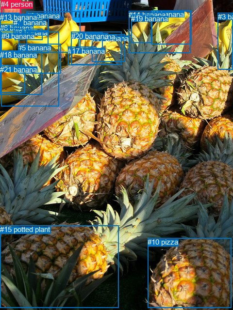
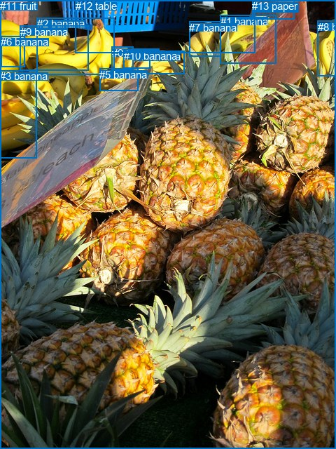

# 图片 1826：2401691.jpg

随机样本序号：303。图片 SHA256：`fb236fc376abd9564731a290666c32ed25e44a4db8158fb4c0c7d597b1b1beee`。

红色框表示人，蓝色框表示其他物体。两个模式分别保留自身框编号，可依据位置比较对应对象。

## 自动检测框与输出

人的框编号：`[4]`。状态：`ok`。

### 自动检测全部物体框

| 编号 | 类别 | 是否为人 | 检测分数 | 像素坐标 xyxy |
|---|---|---|---|---|
| 0 | banana | False | 0.9665 | 54.7, 23.8, 165.6, 108.4 |
| 1 | banana | False | 0.9321 | 311.4, 21.4, 394.3, 91.5 |
| 2 | banana | False | 0.8209 | 0.3, 28.9, 100.0, 110.0 |
| 3 | banana | False | 0.8027 | 448.5, 26.3, 480.0, 143.1 |
| 4 | person | True | 0.7952 | 2.4, 0.0, 43.2, 39.4 |
| 5 | banana | False | 0.7850 | 37.3, 90.1, 125.4, 151.4 |
| 6 | banana | False | 0.7570 | 0.3, 49.5, 39.2, 108.1 |
| 7 | banana | False | 0.7131 | 27.8, 38.2, 100.3, 72.1 |
| 8 | banana | False | 0.6748 | 30.5, 59.3, 87.7, 82.7 |
| 9 | banana | False | 0.5985 | 2.6, 66.0, 121.2, 219.6 |
| 10 | pizza | False | 0.5963 | 304.2, 491.0, 476.4, 635.2 |
| 11 | banana | False | 0.5893 | 189.0, 70.7, 257.2, 127.5 |
| 12 | banana | False | 0.5846 | 161.4, 67.1, 211.5, 101.6 |
| 13 | banana | False | 0.5722 | 0.0, 27.0, 40.0, 58.8 |
| 14 | banana | False | 0.5423 | 265.3, 22.2, 392.4, 109.2 |
| 15 | potted plant | False | 0.5381 | 0.0, 465.4, 244.5, 635.2 |
| 16 | banana | False | 0.5254 | 0.1, 104.1, 86.6, 195.5 |
| 17 | banana | False | 0.5116 | 140.3, 96.6, 198.3, 134.4 |
| 18 | banana | False | 0.4214 | 0.1, 105.5, 44.6, 138.8 |
| 19 | banana | False | 0.4179 | 270.3, 30.5, 314.0, 88.9 |
| 20 | banana | False | 0.3691 | 146.9, 65.7, 250.9, 133.6 |
| 21 | banana | False | 0.3601 | 0.0, 134.8, 51.2, 191.7 |

### 自动检测 Top50 人相关候选

评分物体对：462；人相关物体对：42；输出关系：50。

| 排名 | 主语编号与类别 | 关系 | 宾语编号与类别 | 类型 | 人与人 | 排序分数 | 原始融合 logit |
|---|---|---|---|---|---|---|---|
| 1 | #4 person | holding | #13 banana | semantic | False | 0.93610 | 2.6844 |
| 2 | #4 person | holding | #2 banana | semantic | False | 0.91926 | 2.4324 |
| 3 | #4 person | in | #13 banana | spatial | False | 0.90877 | 2.2987 |
| 4 | #4 person | holding | #7 banana | semantic | False | 0.87692 | 1.9636 |
| 5 | #13 banana | in | #4 person | spatial | False | 0.82410 | 1.5444 |
| 6 | #4 person | holding | #6 banana | semantic | False | 0.80233 | 1.4010 |
| 7 | #4 person | holding | #0 banana | semantic | False | 0.69891 | 0.8421 |
| 8 | #4 person | holding | #9 banana | semantic | False | 0.69825 | 0.8390 |
| 9 | #4 person | holding | #8 banana | semantic | False | 0.64958 | 0.6172 |
| 10 | #4 person | holding | #17 banana | semantic | False | 0.64930 | 0.6160 |
| 11 | #4 person | in | #2 banana | spatial | False | 0.60860 | 0.4414 |
| 12 | #4 person | in | #6 banana | spatial | False | 0.53810 | 0.1527 |
| 13 | #4 person | on | #7 banana | spatial | False | 0.49976 | -0.0010 |
| 14 | #4 person | holding | #5 banana | semantic | False | 0.47710 | -0.0917 |
| 15 | #4 person | holding | #16 banana | semantic | False | 0.43882 | -0.2459 |
| 16 | #4 person | on | #8 banana | spatial | False | 0.33512 | -0.6851 |
| 17 | #4 person | holding | #21 banana | semantic | False | 0.31717 | -0.7668 |
| 18 | #4 person | holding | #1 banana | semantic | False | 0.29621 | -0.8654 |
| 19 | #13 banana | sitting on | #4 person | semantic | False | 0.29262 | -0.8827 |
| 20 | #4 person | holding | #20 banana | semantic | False | 0.23515 | -1.1794 |
| 21 | #4 person | holding | #14 banana | semantic | False | 0.23424 | -1.1845 |
| 22 | #4 person | holding | #18 banana | semantic | False | 0.22753 | -1.2223 |
| 23 | #4 person | holding | #12 banana | semantic | False | 0.21667 | -1.2852 |
| 24 | #4 person | holding | #3 banana | semantic | False | 0.19214 | -1.4362 |
| 25 | #4 person | in | #0 banana | spatial | False | 0.18709 | -1.4690 |
| 26 | #4 person | in | #9 banana | spatial | False | 0.17245 | -1.5683 |
| 27 | #4 person | holding | #11 banana | semantic | False | 0.16020 | -1.6568 |
| 28 | #4 person | in | #16 banana | spatial | False | 0.15666 | -1.6833 |
| 29 | #4 person | holding | #19 banana | semantic | False | 0.15354 | -1.7071 |
| 30 | #4 person | on | #18 banana | spatial | False | 0.13622 | -1.8471 |
| 31 | #4 person | in | #17 banana | spatial | False | 0.13550 | -1.8532 |
| 32 | #2 banana | in | #4 person | spatial | False | 0.11817 | -2.0099 |
| 33 | #6 banana | in | #4 person | spatial | False | 0.11568 | -2.0340 |
| 34 | #4 person | in | #21 banana | spatial | False | 0.11069 | -2.0837 |
| 35 | #4 person | in | #5 banana | spatial | False | 0.10424 | -2.1509 |
| 36 | #4 person | in | #20 banana | spatial | False | 0.08881 | -2.3282 |
| 37 | #4 person | in | #12 banana | spatial | False | 0.08838 | -2.3336 |
| 38 | #4 person | in | #11 banana | spatial | False | 0.08131 | -2.4247 |
| 39 | #4 person | holding | #10 pizza | semantic | False | 0.07835 | -2.4649 |
| 40 | #7 banana | in | #4 person | spatial | False | 0.06968 | -2.5916 |
| 41 | #4 person | on | #15 potted plant | spatial | False | 0.06817 | -2.6152 |
| 42 | #4 person | standing on | #15 potted plant | semantic | False | 0.06348 | -2.6915 |
| 43 | #4 person | in | #14 banana | spatial | False | 0.05873 | -2.7743 |
| 44 | #4 person | in | #19 banana | spatial | False | 0.05135 | -2.9163 |
| 45 | #0 banana | in | #4 person | spatial | False | 0.04933 | -2.9585 |
| 46 | #4 person | in | #1 banana | spatial | False | 0.04801 | -2.9872 |
| 47 | #16 banana | in | #4 person | spatial | False | 0.03901 | -3.2042 |
| 48 | #12 banana | in | #4 person | spatial | False | 0.03846 | -3.2190 |
| 49 | #9 banana | in | #4 person | spatial | False | 0.03668 | -3.2682 |
| 50 | #21 banana | in | #4 person | spatial | False | 0.03192 | -3.4121 |

### 自动检测逐条人相关 GT 核验

本图没有人相关 GT，R@50 无分母；预测候选继续展示。

## 真实框与输出

人的框编号：`[]`。

### 真实框全部物体框

| 编号 | 类别 | 是否为人 | 检测分数 | 像素坐标 xyxy |
|---|---|---|---|---|
| 0 | banana | False | GT | 160.0, 67.0, 191.0, 101.0 |
| 1 | banana | False | GT | 315.0, 22.0, 395.0, 90.0 |
| 2 | banana | False | GT | 53.0, 25.0, 164.0, 106.0 |
| 3 | banana | False | GT | 0.0, 100.0, 53.0, 225.0 |
| 4 | banana | False | GT | 190.0, 72.0, 264.0, 105.0 |
| 5 | banana | False | GT | 142.0, 98.0, 197.0, 130.0 |
| 6 | banana | False | GT | 1.0, 51.0, 35.0, 95.0 |
| 7 | banana | False | GT | 270.0, 31.0, 315.0, 81.0 |
| 8 | banana | False | GT | 454.0, 30.0, 480.0, 109.0 |
| 9 | banana | False | GT | 29.0, 37.0, 127.0, 100.0 |
| 10 | banana | False | GT | 177.0, 71.0, 215.0, 98.0 |
| 11 | fruit | False | GT | 0.0, 0.0, 480.0, 640.0 |
| 12 | table | False | GT | 108.0, 0.0, 364.0, 76.0 |
| 13 | paper | False | GT | 360.0, 0.0, 420.0, 28.0 |

### 真实框 Top50 人相关候选

评分物体对：0；人相关物体对：0；输出关系：0。

| 排名 | 主语编号与类别 | 关系 | 宾语编号与类别 | 类型 | 人与人 | 排序分数 | 原始融合 logit |
|---|---|---|---|---|---|---|---|

### 真实框逐条人相关 GT 核验

本图没有人相关 GT，R@50 无分母；预测候选继续展示。

## 全部人相关 GT

| 主语编号与类别 | 关系 | 宾语编号与类别 |
|---|---|---|

原始记录、全部人相关物体对的两项预测与分项分数见 [逐图证据 JSON](../evidence/cases/1826.json)。全部56类 logits 保留于本机 HOR/output/random500/logits/。

<!-- HOR_COMPLETE_RESULTS -->

## 六组条件的完整输出对照

以下保留同一图片三种框与候选模式、两种谓词输出规则的全部 Top50。框编号各自在所属模式内解释。

### 自动检测框完整枚举：空间与语义各保留一个谓词

| 排名 | 主语编号与类别 | 谓词 | 宾语编号与类别 | 分组 | 排序分数 | predicate logit | pair logit |
|---|---|---|---|---|---|---|---|
| 1 | #4 person | holding | #13 banana | semantic | 0.9360981 | 2.3507700 | 0.3336011 |
| 2 | #4 person | holding | #2 banana | semantic | 0.9192632 | 2.4187174 | 0.0136613 |
| 3 | #4 person | in | #13 banana | spatial | 0.9087658 | 1.9650559 | 0.3336011 |
| 4 | #4 person | holding | #7 banana | semantic | 0.8769187 | 1.9531269 | 0.0104420 |
| 5 | #13 banana | in | #4 person | spatial | 0.8240989 | 1.4703217 | 0.0740466 |
| 6 | #4 person | holding | #6 banana | semantic | 0.8023349 | 1.2994332 | 0.1015188 |
| 7 | #4 person | holding | #0 banana | semantic | 0.6989144 | 1.2940741 | -0.4519401 |
| 8 | #4 person | holding | #9 banana | semantic | 0.6982474 | 1.3418899 | -0.5029238 |
| 9 | #4 person | holding | #8 banana | semantic | 0.6495838 | 0.6403799 | -0.0231695 |
| 10 | #4 person | holding | #17 banana | semantic | 0.6493012 | 1.2414460 | -0.6254768 |
| 11 | #4 person | in | #2 banana | spatial | 0.6085955 | 0.4277511 | 0.0136613 |
| 12 | #4 person | in | #6 banana | spatial | 0.5380996 | 0.0511756 | 0.1015188 |
| 13 | #4 person | on | #7 banana | spatial | 0.4997606 | -0.0113997 | 0.0104420 |
| 14 | #4 person | holding | #5 banana | semantic | 0.4771011 | 0.4993353 | -0.5909950 |
| 15 | #4 person | holding | #16 banana | semantic | 0.4388231 | 0.2916508 | -0.5375905 |
| 16 | #4 person | on | #8 banana | spatial | 0.3351222 | -0.6619387 | -0.0231695 |
| 17 | #4 person | holding | #21 banana | semantic | 0.3171668 | -0.1859269 | -0.5808957 |
| 18 | #4 person | holding | #1 banana | semantic | 0.2962146 | 0.0658422 | -0.9312316 |
| 19 | #13 banana | sitting on | #4 person | semantic | 0.2926187 | -0.9567461 | 0.0740466 |
| 20 | #4 person | holding | #20 banana | semantic | 0.2351511 | -0.4672575 | -0.7121924 |
| 21 | #4 person | holding | #14 banana | semantic | 0.2342359 | -0.4844537 | -0.7000921 |
| 22 | #4 person | holding | #18 banana | semantic | 0.2275296 | -0.8421957 | -0.3801175 |
| 23 | #4 person | holding | #12 banana | semantic | 0.2166670 | -0.2837558 | -1.0014404 |
| 24 | #4 person | holding | #3 banana | semantic | 0.1921405 | -0.7560136 | -0.6801476 |
| 25 | #4 person | in | #0 banana | spatial | 0.1870926 | -1.0170736 | -0.4519401 |
| 26 | #4 person | in | #9 banana | spatial | 0.1724529 | -1.0654180 | -0.5029238 |
| 27 | #4 person | holding | #11 banana | semantic | 0.1601964 | -0.9084764 | -0.7482914 |
| 28 | #4 person | in | #16 banana | spatial | 0.1566636 | -1.1456747 | -0.5375905 |
| 29 | #4 person | holding | #19 banana | semantic | 0.1535384 | -0.9743974 | -0.7327168 |
| 30 | #4 person | on | #18 banana | spatial | 0.1362165 | -1.4669588 | -0.3801175 |
| 31 | #4 person | in | #17 banana | spatial | 0.1354989 | -1.2277124 | -0.6254768 |
| 32 | #2 banana | in | #4 person | spatial | 0.1181671 | -0.8391769 | -1.1707258 |
| 33 | #6 banana | in | #4 person | spatial | 0.1156814 | -0.8890896 | -1.1448882 |
| 34 | #4 person | in | #21 banana | spatial | 0.1106888 | -1.5028286 | -0.5808957 |
| 35 | #4 person | in | #5 banana | spatial | 0.1042448 | -1.5599301 | -0.5909950 |
| 36 | #4 person | in | #20 banana | spatial | 0.0888128 | -1.6160250 | -0.7121924 |
| 37 | #4 person | in | #12 banana | spatial | 0.0883789 | -1.3321512 | -1.0014404 |
| 38 | #4 person | in | #11 banana | spatial | 0.0813069 | -1.6764302 | -0.7482914 |
| 39 | #4 person | holding | #10 pizza | semantic | 0.0783539 | -1.3443353 | -1.1205900 |
| 40 | #7 banana | in | #4 person | spatial | 0.0696835 | -1.3776627 | -1.2138984 |
| 41 | #4 person | on | #15 potted plant | spatial | 0.0681652 | -1.2867007 | -1.3285204 |
| 42 | #4 person | standing on | #15 potted plant | semantic | 0.0634776 | -1.3629658 | -1.3285204 |
| 43 | #4 person | in | #14 banana | spatial | 0.0587263 | -2.0742540 | -0.7000921 |
| 44 | #4 person | in | #19 banana | spatial | 0.0513548 | -2.1835597 | -0.7327168 |
| 45 | #0 banana | in | #4 person | spatial | 0.0493340 | -1.5843604 | -1.3741896 |
| 46 | #4 person | in | #1 banana | spatial | 0.0480077 | -2.0559628 | -0.9312316 |
| 47 | #16 banana | in | #4 person | spatial | 0.0390085 | -2.0543818 | -1.1498051 |
| 48 | #12 banana | in | #4 person | spatial | 0.0384568 | -1.5755322 | -1.6434705 |
| 49 | #9 banana | in | #4 person | spatial | 0.0366792 | -2.1353066 | -1.1328706 |
| 50 | #21 banana | in | #4 person | spatial | 0.0319199 | -2.2763629 | -1.1357232 |

没有人相关 GT，本条件的召回率无分母。

### 自动检测框完整枚举：每对只保留一个谓词

| 排名 | 主语编号与类别 | 谓词 | 宾语编号与类别 | 分组 | 排序分数 | predicate logit | pair logit |
|---|---|---|---|---|---|---|---|
| 1 | #4 person | holding | #13 banana | single | 0.9360981 | 2.3507700 | 0.3336011 |
| 2 | #4 person | holding | #2 banana | single | 0.9192632 | 2.4187174 | 0.0136613 |
| 3 | #4 person | holding | #7 banana | single | 0.8769187 | 1.9531269 | 0.0104420 |
| 4 | #13 banana | in | #4 person | single | 0.8240989 | 1.4703217 | 0.0740466 |
| 5 | #4 person | holding | #6 banana | single | 0.8023349 | 1.2994332 | 0.1015188 |
| 6 | #4 person | holding | #0 banana | single | 0.6989144 | 1.2940741 | -0.4519401 |
| 7 | #4 person | holding | #9 banana | single | 0.6982474 | 1.3418899 | -0.5029238 |
| 8 | #4 person | holding | #8 banana | single | 0.6495838 | 0.6403799 | -0.0231695 |
| 9 | #4 person | holding | #17 banana | single | 0.6493012 | 1.2414460 | -0.6254768 |
| 10 | #4 person | holding | #5 banana | single | 0.4771011 | 0.4993353 | -0.5909950 |
| 11 | #4 person | holding | #16 banana | single | 0.4388231 | 0.2916508 | -0.5375905 |
| 12 | #4 person | holding | #21 banana | single | 0.3171668 | -0.1859269 | -0.5808957 |
| 13 | #4 person | holding | #1 banana | single | 0.2962146 | 0.0658422 | -0.9312316 |
| 14 | #4 person | holding | #20 banana | single | 0.2351511 | -0.4672575 | -0.7121924 |
| 15 | #4 person | holding | #14 banana | single | 0.2342359 | -0.4844537 | -0.7000921 |
| 16 | #4 person | holding | #18 banana | single | 0.2275296 | -0.8421957 | -0.3801175 |
| 17 | #4 person | holding | #12 banana | single | 0.2166670 | -0.2837558 | -1.0014404 |
| 18 | #4 person | holding | #3 banana | single | 0.1921405 | -0.7560136 | -0.6801476 |
| 19 | #4 person | holding | #11 banana | single | 0.1601964 | -0.9084764 | -0.7482914 |
| 20 | #4 person | holding | #19 banana | single | 0.1535384 | -0.9743974 | -0.7327168 |
| 21 | #2 banana | in | #4 person | single | 0.1181671 | -0.8391769 | -1.1707258 |
| 22 | #6 banana | in | #4 person | single | 0.1156814 | -0.8890896 | -1.1448882 |
| 23 | #4 person | holding | #10 pizza | single | 0.0783539 | -1.3443353 | -1.1205900 |
| 24 | #7 banana | in | #4 person | single | 0.0696835 | -1.3776627 | -1.2138984 |
| 25 | #4 person | on | #15 potted plant | single | 0.0681652 | -1.2867007 | -1.3285204 |
| 26 | #0 banana | in | #4 person | single | 0.0493340 | -1.5843604 | -1.3741896 |
| 27 | #16 banana | in | #4 person | single | 0.0390085 | -2.0543818 | -1.1498051 |
| 28 | #12 banana | in | #4 person | single | 0.0384568 | -1.5755322 | -1.6434705 |
| 29 | #9 banana | in | #4 person | single | 0.0366792 | -2.1353066 | -1.1328706 |
| 30 | #21 banana | in | #4 person | single | 0.0319199 | -2.2763629 | -1.1357232 |
| 31 | #8 banana | in | #4 person | single | 0.0284584 | -2.2396340 | -1.2908084 |
| 32 | #1 banana | in | #4 person | single | 0.0273019 | -1.9774945 | -1.5956222 |
| 33 | #19 banana | in | #4 person | single | 0.0254608 | -1.6951828 | -1.9496406 |
| 34 | #18 banana | in | #4 person | single | 0.0244450 | -2.4879427 | -1.1986390 |
| 35 | #11 banana | in | #4 person | single | 0.0235351 | -1.9674141 | -1.7580321 |
| 36 | #20 banana | in | #4 person | single | 0.0213904 | -2.0595317 | -1.7636569 |
| 37 | #14 banana | in | #4 person | single | 0.0208429 | -2.1819408 | -1.6677387 |
| 38 | #5 banana | in | #4 person | single | 0.0197300 | -2.4662595 | -1.4394281 |
| 39 | #17 banana | in | #4 person | single | 0.0193183 | -2.1631920 | -1.7640013 |
| 40 | #3 banana | in | #4 person | single | 0.0137612 | -2.2874827 | -1.9845618 |
| 41 | #10 pizza | in | #4 person | single | 0.0057064 | -3.0209038 | -2.1395321 |
| 42 | #15 potted plant | in | #4 person | single | 0.0054671 | -3.0147724 | -2.1887500 |

没有人相关 GT，本条件的召回率无分母。

### 真实框完整枚举：空间与语义各保留一个谓词

| 排名 | 主语编号与类别 | 谓词 | 宾语编号与类别 | 分组 | 排序分数 | predicate logit | pair logit |
|---|---|---|---|---|---|---|---|

没有人相关 GT，本条件的召回率无分母。

### 真实框完整枚举：每对只保留一个谓词

| 排名 | 主语编号与类别 | 谓词 | 宾语编号与类别 | 分组 | 排序分数 | predicate logit | pair logit |
|---|---|---|---|---|---|---|---|

没有人相关 GT，本条件的召回率无分母。

### 真实框400候选：空间与语义各保留一个谓词

| 排名 | 主语编号与类别 | 谓词 | 宾语编号与类别 | 分组 | 排序分数 | predicate logit | pair logit |
|---|---|---|---|---|---|---|---|

没有人相关 GT，本条件的召回率无分母。

### 真实框400候选：每对只保留一个谓词

| 排名 | 主语编号与类别 | 谓词 | 宾语编号与类别 | 分组 | 排序分数 | predicate logit | pair logit |
|---|---|---|---|---|---|---|---|

没有人相关 GT，本条件的召回率无分母。
