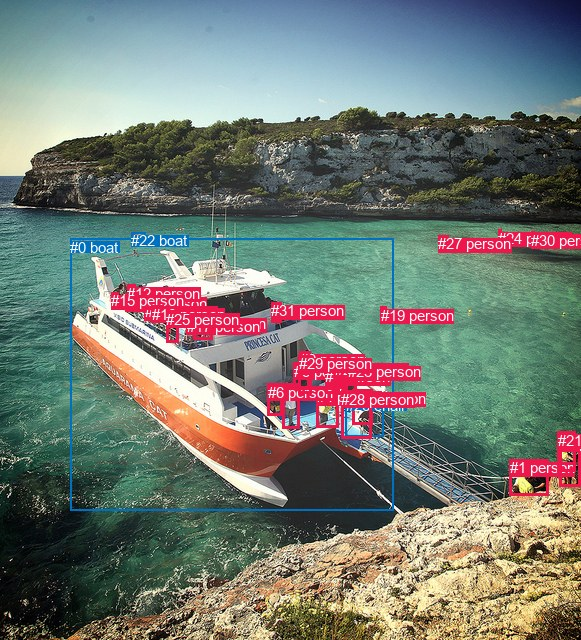
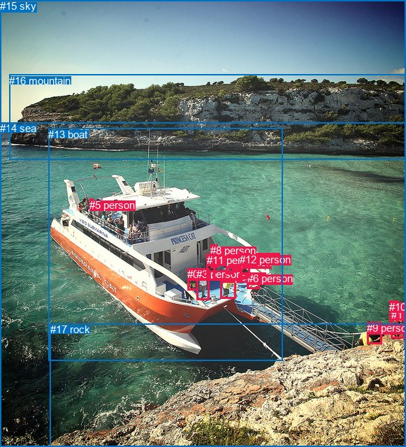

# 图片 1835：2402046.jpg

随机样本序号：399。图片 SHA256：`b509de8e812983a3fc0d0d271281321c2a248a1d57d9722f4dcfd542d500e747`。

红色框表示人，蓝色框表示其他物体。两个模式分别保留自身框编号，可依据位置比较对应对象。

## 自动检测框与输出

人的框编号：`[1, 2, 3, 4, 5, 6, 7, 8, 9, 10, 11, 12, 13, 14, 15, 16, 17, 18, 19, 20, 21, 23, 24, 25, 27, 28, 29, 30, 31]`。状态：`ok`。

### 自动检测全部物体框

| 编号 | 类别 | 是否为人 | 检测分数 | 像素坐标 xyxy |
|---|---|---|---|---|
| 0 | boat | False | 0.9942 | 70.3, 238.5, 393.6, 510.1 |
| 1 | person | True | 0.9938 | 509.9, 459.3, 548.1, 495.3 |
| 2 | person | True | 0.9851 | 282.0, 383.4, 299.4, 428.1 |
| 3 | person | True | 0.9691 | 559.2, 434.2, 580.3, 486.7 |
| 4 | person | True | 0.9656 | 316.9, 388.4, 338.9, 428.0 |
| 5 | person | True | 0.9491 | 293.7, 362.9, 309.7, 400.8 |
| 6 | person | True | 0.9272 | 267.7, 384.0, 282.8, 415.5 |
| 7 | person | True | 0.9146 | 325.0, 368.5, 334.2, 393.8 |
| 8 | person | True | 0.8771 | 125.5, 294.6, 135.3, 311.5 |
| 9 | person | True | 0.8711 | 299.9, 351.0, 310.2, 374.6 |
| 10 | person | True | 0.8524 | 352.9, 389.9, 372.1, 424.9 |
| 11 | person | True | 0.7983 | 133.8, 294.8, 144.0, 310.8 |
| 12 | person | True | 0.7312 | 127.3, 284.8, 135.9, 295.0 |
| 13 | person | True | 0.7066 | 144.8, 303.2, 153.0, 315.6 |
| 14 | person | True | 0.6810 | 193.0, 315.2, 212.2, 339.8 |
| 15 | person | True | 0.6172 | 111.0, 292.5, 118.6, 304.3 |
| 16 | person | True | 0.5918 | 151.9, 305.8, 163.1, 321.3 |
| 17 | person | True | 0.5741 | 186.7, 317.7, 198.1, 334.1 |
| 18 | person | True | 0.5414 | 342.5, 363.4, 356.7, 394.9 |
| 19 | person | True | 0.5102 | 380.6, 306.5, 387.0, 314.3 |
| 20 | person | True | 0.5049 | 335.2, 360.8, 347.2, 394.1 |
| 21 | person | True | 0.5002 | 557.8, 431.7, 575.3, 471.1 |
| 22 | boat | False | 0.4822 | 131.4, 232.3, 145.4, 242.4 |
| 23 | person | True | 0.4794 | 347.6, 363.3, 357.6, 383.3 |
| 24 | person | True | 0.4751 | 498.3, 229.8, 502.0, 234.1 |
| 25 | person | True | 0.4675 | 166.1, 310.9, 178.7, 342.7 |
| 26 | chair | False | 0.4540 | 345.8, 396.6, 383.4, 436.3 |
| 27 | person | True | 0.4486 | 438.4, 235.0, 448.3, 238.8 |
| 28 | person | True | 0.4151 | 341.3, 390.6, 371.7, 438.0 |
| 29 | person | True | 0.4068 | 298.9, 355.1, 311.4, 393.5 |
| 30 | person | True | 0.3598 | 531.4, 231.6, 534.9, 237.5 |
| 31 | person | True | 0.3556 | 271.5, 302.0, 281.8, 322.1 |

### 自动检测 Top50 人相关候选

评分物体对：992；人相关物体对：986；输出关系：50。

| 排名 | 主语编号与类别 | 关系 | 宾语编号与类别 | 类型 | 人与人 | 排序分数 | 原始融合 logit |
|---|---|---|---|---|---|---|---|
| 1 | #29 person | standing on | #0 boat | semantic | False | 0.98244 | 4.0246 |
| 2 | #9 person | standing on | #0 boat | semantic | False | 0.98134 | 3.9623 |
| 3 | #20 person | standing on | #0 boat | semantic | False | 0.98099 | 3.9438 |
| 4 | #5 person | standing on | #0 boat | semantic | False | 0.98064 | 3.9248 |
| 5 | #7 person | standing on | #0 boat | semantic | False | 0.98038 | 3.9113 |
| 6 | #18 person | standing on | #0 boat | semantic | False | 0.98018 | 3.9011 |
| 7 | #23 person | standing on | #0 boat | semantic | False | 0.97911 | 3.8472 |
| 8 | #4 person | standing on | #0 boat | semantic | False | 0.97905 | 3.8444 |
| 9 | #31 person | riding | #0 boat | semantic | False | 0.97847 | 3.8166 |
| 10 | #25 person | on | #0 boat | spatial | False | 0.97321 | 3.5926 |
| 11 | #2 person | standing on | #0 boat | semantic | False | 0.97294 | 3.5822 |
| 12 | #16 person | on | #0 boat | spatial | False | 0.97260 | 3.5694 |
| 13 | #31 person | on | #0 boat | spatial | False | 0.97255 | 3.5676 |
| 14 | #10 person | standing on | #0 boat | semantic | False | 0.97091 | 3.5078 |
| 15 | #6 person | standing on | #0 boat | semantic | False | 0.96916 | 3.4475 |
| 16 | #28 person | standing on | #0 boat | semantic | False | 0.96886 | 3.4375 |
| 17 | #13 person | on | #0 boat | spatial | False | 0.96854 | 3.4272 |
| 18 | #14 person | on | #0 boat | spatial | False | 0.96806 | 3.4115 |
| 19 | #3 person | wearing | #21 person | semantic | True | 0.96747 | 3.3927 |
| 20 | #17 person | on | #0 boat | spatial | False | 0.96689 | 3.3743 |
| 21 | #11 person | on | #0 boat | spatial | False | 0.96333 | 3.2685 |
| 22 | #8 person | on | #0 boat | spatial | False | 0.96287 | 3.2554 |
| 23 | #12 person | standing on | #0 boat | semantic | False | 0.96243 | 3.2433 |
| 24 | #15 person | standing on | #0 boat | semantic | False | 0.96238 | 3.2420 |
| 25 | #25 person | riding | #0 boat | semantic | False | 0.96159 | 3.2204 |
| 26 | #8 person | standing on | #0 boat | semantic | False | 0.96107 | 3.2062 |
| 27 | #17 person | riding | #0 boat | semantic | False | 0.96031 | 3.1861 |
| 28 | #16 person | riding | #0 boat | semantic | False | 0.95904 | 3.1533 |
| 29 | #11 person | standing on | #0 boat | semantic | False | 0.95898 | 3.1518 |
| 30 | #28 person | on | #0 boat | spatial | False | 0.95658 | 3.0925 |
| 31 | #15 person | on | #0 boat | spatial | False | 0.95610 | 3.0809 |
| 32 | #13 person | riding | #0 boat | semantic | False | 0.95569 | 3.0711 |
| 33 | #4 person | on | #0 boat | spatial | False | 0.95268 | 3.0022 |
| 34 | #10 person | on | #0 boat | spatial | False | 0.95244 | 2.9969 |
| 35 | #14 person | riding | #0 boat | semantic | False | 0.94957 | 2.9354 |
| 36 | #12 person | on | #0 boat | spatial | False | 0.94935 | 2.9308 |
| 37 | #3 person | in | #21 person | spatial | True | 0.94868 | 2.9170 |
| 38 | #2 person | on | #0 boat | spatial | False | 0.94848 | 2.9128 |
| 39 | #23 person | on | #0 boat | spatial | False | 0.94717 | 2.8865 |
| 40 | #6 person | on | #0 boat | spatial | False | 0.94556 | 2.8547 |
| 41 | #9 person | on | #0 boat | spatial | False | 0.94370 | 2.8190 |
| 42 | #7 person | leaning on | #0 boat | spatial | False | 0.94150 | 2.7785 |
| 43 | #18 person | wearing | #23 person | semantic | True | 0.94100 | 2.7694 |
| 44 | #18 person | leaning on | #0 boat | spatial | False | 0.94029 | 2.7567 |
| 45 | #20 person | leaning on | #0 boat | spatial | False | 0.93884 | 2.7312 |
| 46 | #29 person | on | #0 boat | spatial | False | 0.93790 | 2.7149 |
| 47 | #5 person | on | #0 boat | spatial | False | 0.93640 | 2.6895 |
| 48 | #28 person | wearing | #10 person | semantic | True | 0.91471 | 2.3725 |
| 49 | #1 person | looking at | #0 boat | semantic | False | 0.89943 | 2.1909 |
| 50 | #1 person | on | #0 boat | spatial | False | 0.89868 | 2.1827 |

### 自动检测逐条人相关 GT 核验

R@50：33.33%；命中 1/3。

| GT 主语编号 | GT 关系 | GT 宾语编号 | 结果阶段 | 匹配预测主语编号 | 匹配预测宾语编号 |
|---|---|---|---|---|---|
| 1 | standing on | 17 | endpoint_missing_or_wrong_class | [3] | [] |
| 9 | entering | 13 | endpoint_missing_or_wrong_class | [] | [0] |
| 11 | standing on | 13 | hit50 | [5] | [0] |

## 真实框与输出

人的框编号：`[0, 1, 2, 3, 4, 5, 6, 7, 8, 9, 10, 11, 12]`。

### 真实框全部物体框

| 编号 | 类别 | 是否为人 | 检测分数 | 像素坐标 xyxy |
|---|---|---|---|---|
| 0 | person | True | GT | 268.0, 384.0, 283.0, 415.0 |
| 1 | person | True | GT | 560.0, 442.0, 580.0, 485.0 |
| 2 | person | True | GT | 316.0, 388.0, 338.0, 427.0 |
| 3 | person | True | GT | 281.0, 384.0, 299.0, 429.0 |
| 4 | person | True | GT | 336.0, 360.0, 348.0, 387.0 |
| 5 | person | True | GT | 128.0, 285.0, 133.0, 293.0 |
| 6 | person | True | GT | 354.0, 390.0, 372.0, 413.0 |
| 7 | person | True | GT | 324.0, 367.0, 335.0, 393.0 |
| 8 | person | True | GT | 301.0, 350.0, 311.0, 383.0 |
| 9 | person | True | GT | 525.0, 461.0, 546.0, 492.0 |
| 10 | person | True | GT | 557.0, 431.0, 569.0, 466.0 |
| 11 | person | True | GT | 296.0, 364.0, 308.0, 401.0 |
| 12 | person | True | GT | 343.0, 363.0, 357.0, 398.0 |
| 13 | boat | False | GT | 69.0, 184.0, 405.0, 516.0 |
| 14 | sea | False | GT | 0.0, 175.0, 581.0, 640.0 |
| 15 | sky | False | GT | 0.0, 0.0, 581.0, 176.0 |
| 16 | mountain | False | GT | 13.0, 107.0, 581.0, 229.0 |
| 17 | rock | False | GT | 72.0, 463.0, 581.0, 640.0 |

### 真实框 Top50 人相关候选

评分物体对：306；人相关物体对：286；输出关系：50。

| 排名 | 主语编号与类别 | 关系 | 宾语编号与类别 | 类型 | 人与人 | 排序分数 | 原始融合 logit |
|---|---|---|---|---|---|---|---|
| 1 | #8 person | standing on | #13 boat | semantic | False | 0.98425 | 4.1352 |
| 2 | #11 person | standing on | #13 boat | semantic | False | 0.98380 | 4.1065 |
| 3 | #7 person | standing on | #13 boat | semantic | False | 0.98370 | 4.1000 |
| 4 | #4 person | standing on | #13 boat | semantic | False | 0.98342 | 4.0826 |
| 5 | #12 person | standing on | #13 boat | semantic | False | 0.98303 | 4.0593 |
| 6 | #2 person | standing on | #13 boat | semantic | False | 0.98204 | 4.0014 |
| 7 | #3 person | standing on | #13 boat | semantic | False | 0.97887 | 3.8358 |
| 8 | #6 person | standing on | #13 boat | semantic | False | 0.97697 | 3.7475 |
| 9 | #0 person | standing on | #13 boat | semantic | False | 0.97691 | 3.7451 |
| 10 | #5 person | standing on | #13 boat | semantic | False | 0.97347 | 3.6027 |
| 11 | #9 person | sitting on | #17 rock | semantic | False | 0.96492 | 3.3144 |
| 12 | #1 person | holding | #10 person | semantic | True | 0.96379 | 3.2816 |
| 13 | #5 person | on | #13 boat | spatial | False | 0.96338 | 3.2698 |
| 14 | #4 person | standing on | #14 sea | semantic | False | 0.95804 | 3.1283 |
| 15 | #12 person | standing on | #14 sea | semantic | False | 0.95762 | 3.1177 |
| 16 | #0 person | on | #13 boat | spatial | False | 0.95638 | 3.0876 |
| 17 | #7 person | standing on | #14 sea | semantic | False | 0.95364 | 3.0238 |
| 18 | #6 person | on | #13 boat | spatial | False | 0.95361 | 3.0232 |
| 19 | #3 person | on | #13 boat | spatial | False | 0.95329 | 3.0159 |
| 20 | #9 person | sitting on | #14 sea | semantic | False | 0.94267 | 2.7999 |
| 21 | #2 person | on | #13 boat | spatial | False | 0.94158 | 2.7800 |
| 22 | #11 person | standing on | #14 sea | semantic | False | 0.94121 | 2.7733 |
| 23 | #8 person | standing on | #14 sea | semantic | False | 0.94043 | 2.7591 |
| 24 | #1 person | looking at | #14 sea | semantic | False | 0.93701 | 2.6998 |
| 25 | #8 person | on | #13 boat | spatial | False | 0.93378 | 2.6462 |
| 26 | #2 person | standing on | #14 sea | semantic | False | 0.93289 | 2.6320 |
| 27 | #1 person | sitting on | #17 rock | semantic | False | 0.93177 | 2.6142 |
| 28 | #4 person | on | #13 boat | spatial | False | 0.93139 | 2.6083 |
| 29 | #1 person | on | #14 sea | spatial | False | 0.93003 | 2.5872 |
| 30 | #11 person | on | #13 boat | spatial | False | 0.92790 | 2.5549 |
| 31 | #12 person | on | #13 boat | spatial | False | 0.92749 | 2.5487 |
| 32 | #7 person | on | #13 boat | spatial | False | 0.92084 | 2.4538 |
| 33 | #9 person | on | #14 sea | spatial | False | 0.92034 | 2.4470 |
| 34 | #9 person | on | #17 rock | spatial | False | 0.91507 | 2.3772 |
| 35 | #3 person | standing on | #14 sea | semantic | False | 0.91305 | 2.3515 |
| 36 | #1 person | on | #17 rock | spatial | False | 0.91204 | 2.3389 |
| 37 | #5 person | standing on | #14 sea | semantic | False | 0.90019 | 2.1994 |
| 38 | #8 person | in | #14 sea | spatial | False | 0.89586 | 2.1521 |
| 39 | #3 person | in | #14 sea | spatial | False | 0.89210 | 2.1123 |
| 40 | #5 person | in | #14 sea | spatial | False | 0.89097 | 2.1007 |
| 41 | #11 person | in | #14 sea | spatial | False | 0.88680 | 2.0584 |
| 42 | #10 person | looking at | #14 sea | semantic | False | 0.88180 | 2.0096 |
| 43 | #4 person | on | #14 sea | spatial | False | 0.87541 | 1.9497 |
| 44 | #12 person | on | #14 sea | spatial | False | 0.87284 | 1.9263 |
| 45 | #0 person | standing on | #14 sea | semantic | False | 0.86683 | 1.8732 |
| 46 | #2 person | on | #14 sea | spatial | False | 0.86439 | 1.8523 |
| 47 | #1 person | on | #13 boat | spatial | False | 0.86265 | 1.8375 |
| 48 | #6 person | standing on | #14 sea | semantic | False | 0.86214 | 1.8332 |
| 49 | #7 person | on | #14 sea | spatial | False | 0.85491 | 1.7736 |
| 50 | #9 person | sitting on | #13 boat | semantic | False | 0.85489 | 1.7735 |

### 真实框逐条人相关 GT 核验

R@50：33.33%；命中 1/3。

| GT 主语编号 | GT 关系 | GT 宾语编号 | 结果阶段 | 匹配预测主语编号 | 匹配预测宾语编号 |
|---|---|---|---|---|---|
| 1 | standing on | 17 | wrong_predicate | [1] | [17] |
| 9 | entering | 13 | wrong_predicate | [9] | [13] |
| 11 | standing on | 13 | hit50 | [11] | [13] |

## 全部人相关 GT

| 主语编号与类别 | 关系 | 宾语编号与类别 |
|---|---|---|
| #1 person | standing on | #17 rock |
| #9 person | entering | #13 boat |
| #11 person | standing on | #13 boat |

原始记录、全部人相关物体对的两项预测与分项分数见 [逐图证据 JSON](../evidence/cases/1835.json)。全部56类 logits 保留于本机 HOR/output/random500/logits/。

<!-- HOR_COMPLETE_RESULTS -->

## 六组条件的完整输出对照

以下保留同一图片三种框与候选模式、两种谓词输出规则的全部 Top50。框编号各自在所属模式内解释。

### 自动检测框完整枚举：空间与语义各保留一个谓词

| 排名 | 主语编号与类别 | 谓词 | 宾语编号与类别 | 分组 | 排序分数 | predicate logit | pair logit |
|---|---|---|---|---|---|---|---|
| 1 | #29 person | standing on | #0 boat | semantic | 0.9824425 | 3.8672051 | 0.1573548 |
| 2 | #9 person | standing on | #0 boat | semantic | 0.9813350 | 3.8217101 | 0.1405579 |
| 3 | #20 person | standing on | #0 boat | semantic | 0.9809932 | 3.9053540 | 0.0384107 |
| 4 | #5 person | standing on | #0 boat | semantic | 0.9806363 | 3.8363986 | 0.0884049 |
| 5 | #7 person | standing on | #0 boat | semantic | 0.9803787 | 3.8818936 | 0.0294359 |
| 6 | #18 person | standing on | #0 boat | semantic | 0.9801803 | 3.8672051 | 0.0338537 |
| 7 | #23 person | standing on | #0 boat | semantic | 0.9791068 | 3.7762160 | 0.0710012 |
| 8 | #4 person | standing on | #0 boat | semantic | 0.9790488 | 3.8702607 | -0.0258708 |
| 9 | #31 person | riding | #0 boat | semantic | 0.9784721 | 3.4708695 | 0.3457758 |
| 10 | #25 person | on | #0 boat | spatial | 0.9732115 | 3.2241764 | 0.3684516 |
| 11 | #2 person | standing on | #0 boat | semantic | 0.9729382 | 3.5501742 | 0.0320239 |
| 12 | #16 person | on | #0 boat | spatial | 0.9726000 | 3.1192775 | 0.4501510 |
| 13 | #31 person | on | #0 boat | spatial | 0.9725521 | 3.2218595 | 0.3457758 |
| 14 | #10 person | standing on | #0 boat | semantic | 0.9709097 | 3.5458875 | -0.0380588 |
| 15 | #6 person | standing on | #0 boat | semantic | 0.9691557 | 3.4518418 | -0.0043671 |
| 16 | #28 person | standing on | #0 boat | semantic | 0.9688565 | 3.4402108 | -0.0027025 |
| 17 | #13 person | on | #0 boat | spatial | 0.9685447 | 2.9983330 | 0.4288923 |
| 18 | #14 person | on | #0 boat | spatial | 0.9680606 | 3.0590949 | 0.3523593 |
| 19 | #3 person | wearing | #21 person | semantic | 0.9674749 | 3.6687140 | -0.2760370 |
| 20 | #17 person | on | #0 boat | spatial | 0.9668929 | 3.0098019 | 0.3645360 |
| 21 | #11 person | on | #0 boat | spatial | 0.9633328 | 2.8831229 | 0.3853941 |
| 22 | #8 person | on | #0 boat | spatial | 0.9628680 | 2.8831229 | 0.3723124 |
| 23 | #12 person | standing on | #0 boat | semantic | 0.9624322 | 2.9703822 | 0.2729335 |
| 24 | #15 person | standing on | #0 boat | semantic | 0.9623836 | 2.9616089 | 0.2803645 |
| 25 | #25 person | riding | #0 boat | semantic | 0.9615932 | 2.8519039 | 0.3684516 |
| 26 | #8 person | standing on | #0 boat | semantic | 0.9610673 | 2.8338995 | 0.3723124 |
| 27 | #17 person | riding | #0 boat | semantic | 0.9603080 | 2.8215685 | 0.3645360 |
| 28 | #16 person | riding | #0 boat | semantic | 0.9590389 | 2.7031584 | 0.4501510 |
| 29 | #11 person | standing on | #0 boat | semantic | 0.9589783 | 2.7663727 | 0.3853941 |
| 30 | #28 person | on | #0 boat | spatial | 0.9565814 | 3.0951819 | -0.0027025 |
| 31 | #15 person | on | #0 boat | spatial | 0.9561000 | 2.8005824 | 0.2803645 |
| 32 | #13 person | riding | #0 boat | semantic | 0.9556863 | 2.6422429 | 0.4288923 |
| 33 | #4 person | on | #0 boat | spatial | 0.9526751 | 3.0281067 | -0.0258708 |
| 34 | #10 person | on | #0 boat | spatial | 0.9524357 | 3.0349984 | -0.0380588 |
| 35 | #14 person | riding | #0 boat | semantic | 0.9495687 | 2.5830374 | 0.3523593 |
| 36 | #12 person | on | #0 boat | spatial | 0.9493478 | 2.6578593 | 0.2729335 |
| 37 | #3 person | in | #21 person | spatial | 0.9486811 | 3.1930499 | -0.2760370 |
| 38 | #2 person | on | #0 boat | spatial | 0.9484770 | 2.8808064 | 0.0320239 |
| 39 | #23 person | on | #0 boat | spatial | 0.9471735 | 2.8154693 | 0.0710012 |
| 40 | #6 person | on | #0 boat | spatial | 0.9455591 | 2.8590274 | -0.0043671 |
| 41 | #9 person | on | #0 boat | spatial | 0.9436960 | 2.6784801 | 0.1405579 |
| 42 | #7 person | leaning on | #0 boat | spatial | 0.9415005 | 2.7490225 | 0.0294359 |
| 43 | #18 person | wearing | #23 person | semantic | 0.9409986 | 3.4251237 | -0.6557429 |
| 44 | #18 person | leaning on | #0 boat | spatial | 0.9402928 | 2.7228861 | 0.0338537 |
| 45 | #20 person | leaning on | #0 boat | spatial | 0.9388431 | 2.6927948 | 0.0384107 |
| 46 | #29 person | on | #0 boat | spatial | 0.9378996 | 2.5575356 | 0.1573548 |
| 47 | #5 person | on | #0 boat | spatial | 0.9364042 | 2.6010942 | 0.0884049 |
| 48 | #28 person | wearing | #10 person | semantic | 0.9147061 | 2.8731031 | -0.5006025 |
| 49 | #1 person | looking at | #0 boat | semantic | 0.8994252 | 2.4722748 | -0.2814205 |
| 50 | #1 person | on | #0 boat | spatial | 0.8986837 | 2.4641051 | -0.2814205 |

GT 命中：1/3，R@50=33.33%。

| GT主语 | GT谓词 | GT宾语 | 结果阶段 | 匹配主语框 | 匹配宾语框 |
|---|---|---|---|---|---|
| 1 | standing on | 17 | endpoint_missing_or_wrong_class | [3] | [] |
| 9 | entering | 13 | endpoint_missing_or_wrong_class | [] | [0] |
| 11 | standing on | 13 | hit50 | [5] | [0] |

### 自动检测框完整枚举：每对只保留一个谓词

| 排名 | 主语编号与类别 | 谓词 | 宾语编号与类别 | 分组 | 排序分数 | predicate logit | pair logit |
|---|---|---|---|---|---|---|---|
| 1 | #29 person | standing on | #0 boat | single | 0.9824425 | 3.8672051 | 0.1573548 |
| 2 | #9 person | standing on | #0 boat | single | 0.9813350 | 3.8217101 | 0.1405579 |
| 3 | #20 person | standing on | #0 boat | single | 0.9809932 | 3.9053540 | 0.0384107 |
| 4 | #5 person | standing on | #0 boat | single | 0.9806363 | 3.8363986 | 0.0884049 |
| 5 | #7 person | standing on | #0 boat | single | 0.9803787 | 3.8818936 | 0.0294359 |
| 6 | #18 person | standing on | #0 boat | single | 0.9801803 | 3.8672051 | 0.0338537 |
| 7 | #23 person | standing on | #0 boat | single | 0.9791068 | 3.7762160 | 0.0710012 |
| 8 | #4 person | standing on | #0 boat | single | 0.9790488 | 3.8702607 | -0.0258708 |
| 9 | #31 person | riding | #0 boat | single | 0.9784721 | 3.4708695 | 0.3457758 |
| 10 | #25 person | on | #0 boat | single | 0.9732115 | 3.2241764 | 0.3684516 |
| 11 | #2 person | standing on | #0 boat | single | 0.9729382 | 3.5501742 | 0.0320239 |
| 12 | #16 person | on | #0 boat | single | 0.9726000 | 3.1192775 | 0.4501510 |
| 13 | #10 person | standing on | #0 boat | single | 0.9709097 | 3.5458875 | -0.0380588 |
| 14 | #6 person | standing on | #0 boat | single | 0.9691557 | 3.4518418 | -0.0043671 |
| 15 | #28 person | standing on | #0 boat | single | 0.9688565 | 3.4402108 | -0.0027025 |
| 16 | #13 person | on | #0 boat | single | 0.9685447 | 2.9983330 | 0.4288923 |
| 17 | #14 person | on | #0 boat | single | 0.9680606 | 3.0590949 | 0.3523593 |
| 18 | #3 person | wearing | #21 person | single | 0.9674749 | 3.6687140 | -0.2760370 |
| 19 | #17 person | on | #0 boat | single | 0.9668929 | 3.0098019 | 0.3645360 |
| 20 | #11 person | on | #0 boat | single | 0.9633328 | 2.8831229 | 0.3853941 |
| 21 | #8 person | on | #0 boat | single | 0.9628680 | 2.8831229 | 0.3723124 |
| 22 | #12 person | standing on | #0 boat | single | 0.9624322 | 2.9703822 | 0.2729335 |
| 23 | #15 person | standing on | #0 boat | single | 0.9623836 | 2.9616089 | 0.2803645 |
| 24 | #18 person | wearing | #23 person | single | 0.9409986 | 3.4251237 | -0.6557429 |
| 25 | #28 person | wearing | #10 person | single | 0.9147061 | 2.8731031 | -0.5006025 |
| 26 | #1 person | looking at | #0 boat | single | 0.8994252 | 2.4722748 | -0.2814205 |
| 27 | #19 person | on | #0 boat | single | 0.8961560 | 2.5575356 | -0.4023110 |
| 28 | #27 person | in | #24 person | single | 0.8915784 | 2.2708249 | -0.1638588 |
| 29 | #3 person | on | #0 boat | single | 0.8827165 | 2.4973536 | -0.4789442 |
| 30 | #29 person | wearing | #9 person | single | 0.8820119 | 2.5208826 | -0.5092607 |
| 31 | #28 person | pushing | #26 chair | single | 0.8699068 | 2.3129244 | -0.4127891 |
| 32 | #27 person | in | #30 person | single | 0.8647484 | 2.1168280 | -0.2615269 |
| 33 | #21 person | on | #0 boat | single | 0.8353867 | 2.4262810 | -0.8019855 |
| 34 | #24 person | on | #30 person | single | 0.7669291 | 1.3610396 | -0.1699879 |
| 35 | #21 person | on | #3 person | single | 0.7614700 | 1.7995200 | -0.6387647 |
| 36 | #10 person | pushing | #26 chair | single | 0.7209886 | 1.3806667 | -0.4312962 |
| 37 | #19 person | in | #30 person | single | 0.6855602 | 1.4725266 | -0.6930828 |
| 38 | #19 person | in | #24 person | single | 0.6228723 | 0.9673905 | -0.4656329 |
| 39 | #19 person | in | #27 person | single | 0.6130787 | 0.9808884 | -0.5206164 |
| 40 | #30 person | on | #0 boat | single | 0.6044095 | 1.5031843 | -1.0793120 |
| 41 | #18 person | standing on | #28 person | single | 0.6002518 | 1.1062531 | -0.6997386 |
| 42 | #0 boat | carrying | #25 person | single | 0.5507265 | 1.1094871 | -0.9058808 |
| 43 | #20 person | standing on | #28 person | single | 0.5311410 | 0.8552213 | -0.7304959 |
| 44 | #26 chair | holding | #10 person | single | 0.5230498 | 0.5876226 | -0.4953581 |
| 45 | #0 boat | carrying | #16 person | single | 0.5142398 | 1.2123761 | -1.1554013 |
| 46 | #0 boat | carrying | #13 person | single | 0.5111356 | 1.2574129 | -1.2128630 |
| 47 | #30 person | on | #24 person | single | 0.4819028 | 0.2296205 | -0.3020406 |
| 48 | #0 boat | carrying | #11 person | single | 0.4803950 | 1.2249918 | -1.3034521 |
| 49 | #0 boat | carrying | #17 person | single | 0.4769493 | 0.9636908 | -1.0559589 |
| 50 | #18 person | standing on | #26 chair | single | 0.4681436 | 0.5455351 | -0.6731338 |

GT 命中：1/3，R@50=33.33%。

| GT主语 | GT谓词 | GT宾语 | 结果阶段 | 匹配主语框 | 匹配宾语框 |
|---|---|---|---|---|---|
| 1 | standing on | 17 | endpoint_missing_or_wrong_class | [3] | [] |
| 9 | entering | 13 | endpoint_missing_or_wrong_class | [] | [0] |
| 11 | standing on | 13 | hit50 | [5] | [0] |

### 真实框完整枚举：空间与语义各保留一个谓词

| 排名 | 主语编号与类别 | 谓词 | 宾语编号与类别 | 分组 | 排序分数 | predicate logit | pair logit |
|---|---|---|---|---|---|---|---|
| 1 | #8 person | standing on | #13 boat | semantic | 0.9842529 | 4.0138898 | 0.1213322 |
| 2 | #11 person | standing on | #13 boat | semantic | 0.9838018 | 4.0432658 | 0.0632652 |
| 3 | #7 person | standing on | #13 boat | semantic | 0.9836968 | 4.0667272 | 0.0332289 |
| 4 | #4 person | standing on | #13 boat | semantic | 0.9834166 | 3.9992013 | 0.0834253 |
| 5 | #12 person | standing on | #13 boat | semantic | 0.9830314 | 4.0520387 | 0.0072392 |
| 6 | #2 person | standing on | #13 boat | semantic | 0.9820390 | 4.0638700 | -0.0624370 |
| 7 | #3 person | standing on | #13 boat | semantic | 0.9788714 | 3.8319135 | 0.0038601 |
| 8 | #6 person | standing on | #13 boat | semantic | 0.9769673 | 3.8143659 | -0.0668244 |
| 9 | #0 person | standing on | #13 boat | semantic | 0.9769130 | 3.7790742 | -0.0339479 |
| 10 | #5 person | standing on | #13 boat | semantic | 0.9734724 | 3.2916999 | 0.3109840 |
| 11 | #9 person | sitting on | #17 rock | semantic | 0.9649203 | 3.8369679 | -0.5225458 |
| 12 | #1 person | holding | #10 person | semantic | 0.9637932 | 3.5293498 | -0.2477200 |
| 13 | #5 person | on | #13 boat | spatial | 0.9633765 | 2.9587717 | 0.3109840 |
| 14 | #4 person | standing on | #14 sea | semantic | 0.9580444 | 3.5664907 | -0.4382073 |
| 15 | #12 person | standing on | #14 sea | semantic | 0.9576153 | 3.5958667 | -0.4782107 |
| 16 | #0 person | on | #13 boat | spatial | 0.9563778 | 3.1215363 | -0.0339479 |
| 17 | #7 person | standing on | #14 sea | semantic | 0.9536387 | 3.4901910 | -0.4663719 |
| 18 | #6 person | on | #13 boat | spatial | 0.9536113 | 3.0900254 | -0.0668244 |
| 19 | #3 person | on | #13 boat | spatial | 0.9532883 | 3.0120616 | 0.0038601 |
| 20 | #9 person | sitting on | #14 sea | semantic | 0.9426702 | 2.8709149 | -0.0710198 |
| 21 | #2 person | on | #13 boat | spatial | 0.9415836 | 2.8424034 | -0.0624370 |
| 22 | #11 person | standing on | #14 sea | semantic | 0.9412141 | 3.3653388 | -0.5920689 |
| 23 | #8 person | standing on | #14 sea | semantic | 0.9404275 | 3.3212752 | -0.5621347 |
| 24 | #1 person | looking at | #14 sea | semantic | 0.9370121 | 2.7950425 | -0.0952897 |
| 25 | #8 person | on | #13 boat | spatial | 0.9337764 | 2.5248671 | 0.1213322 |
| 26 | #2 person | standing on | #14 sea | semantic | 0.9328919 | 3.2392588 | -0.6072733 |
| 27 | #1 person | sitting on | #17 rock | semantic | 0.9317681 | 3.2019992 | -0.5878273 |
| 28 | #4 person | on | #13 boat | spatial | 0.9313933 | 2.5248671 | 0.0834253 |
| 29 | #1 person | on | #14 sea | spatial | 0.9300324 | 2.6824770 | -0.0952897 |
| 30 | #11 person | on | #13 boat | spatial | 0.9279010 | 2.4916191 | 0.0632652 |
| 31 | #12 person | on | #13 boat | spatial | 0.9274881 | 2.5414906 | 0.0072392 |
| 32 | #7 person | on | #13 boat | spatial | 0.9208371 | 2.4205465 | 0.0332289 |
| 33 | #9 person | on | #14 sea | spatial | 0.9203385 | 2.5179744 | -0.0710198 |
| 34 | #9 person | on | #17 rock | spatial | 0.9150721 | 2.8997469 | -0.5225458 |
| 35 | #3 person | standing on | #14 sea | semantic | 0.9130507 | 3.0409656 | -0.6894990 |
| 36 | #1 person | on | #17 rock | spatial | 0.9120442 | 2.9266815 | -0.5878273 |
| 37 | #5 person | standing on | #14 sea | semantic | 0.9001949 | 2.7208786 | -0.5214860 |
| 38 | #8 person | in | #14 sea | spatial | 0.8958635 | 2.7142210 | -0.5621347 |
| 39 | #3 person | in | #14 sea | spatial | 0.8920972 | 2.8018436 | -0.6894990 |
| 40 | #5 person | in | #14 sea | spatial | 0.8909712 | 2.6221867 | -0.5214860 |
| 41 | #11 person | in | #14 sea | spatial | 0.8867965 | 2.6504970 | -0.5920689 |
| 42 | #10 person | looking at | #14 sea | semantic | 0.8817981 | 2.5263133 | -0.5167447 |
| 43 | #4 person | on | #14 sea | spatial | 0.8754107 | 2.3878775 | -0.4382073 |
| 44 | #12 person | on | #14 sea | spatial | 0.8728383 | 2.4045019 | -0.4782107 |
| 45 | #0 person | standing on | #14 sea | semantic | 0.8668287 | 2.6431499 | -0.7699449 |
| 46 | #2 person | on | #14 sea | spatial | 0.8643918 | 2.4595294 | -0.6072733 |
| 47 | #1 person | on | #13 boat | spatial | 0.8626543 | 2.2408395 | -0.4033270 |
| 48 | #6 person | standing on | #14 sea | semantic | 0.8621386 | 2.6139717 | -0.7808046 |
| 49 | #7 person | on | #14 sea | spatial | 0.8549082 | 2.2399993 | -0.4663719 |
| 50 | #9 person | sitting on | #13 boat | semantic | 0.8548945 | 2.0674005 | -0.2938832 |

GT 命中：1/3，R@50=33.33%。

| GT主语 | GT谓词 | GT宾语 | 结果阶段 | 匹配主语框 | 匹配宾语框 |
|---|---|---|---|---|---|
| 1 | standing on | 17 | wrong_predicate | [1] | [17] |
| 9 | entering | 13 | wrong_predicate | [9] | [13] |
| 11 | standing on | 13 | hit50 | [11] | [13] |

### 真实框完整枚举：每对只保留一个谓词

| 排名 | 主语编号与类别 | 谓词 | 宾语编号与类别 | 分组 | 排序分数 | predicate logit | pair logit |
|---|---|---|---|---|---|---|---|
| 1 | #8 person | standing on | #13 boat | single | 0.9842529 | 4.0138898 | 0.1213322 |
| 2 | #11 person | standing on | #13 boat | single | 0.9838018 | 4.0432658 | 0.0632652 |
| 3 | #7 person | standing on | #13 boat | single | 0.9836968 | 4.0667272 | 0.0332289 |
| 4 | #4 person | standing on | #13 boat | single | 0.9834166 | 3.9992013 | 0.0834253 |
| 5 | #12 person | standing on | #13 boat | single | 0.9830314 | 4.0520387 | 0.0072392 |
| 6 | #2 person | standing on | #13 boat | single | 0.9820390 | 4.0638700 | -0.0624370 |
| 7 | #3 person | standing on | #13 boat | single | 0.9788714 | 3.8319135 | 0.0038601 |
| 8 | #6 person | standing on | #13 boat | single | 0.9769673 | 3.8143659 | -0.0668244 |
| 9 | #0 person | standing on | #13 boat | single | 0.9769130 | 3.7790742 | -0.0339479 |
| 10 | #5 person | standing on | #13 boat | single | 0.9734724 | 3.2916999 | 0.3109840 |
| 11 | #9 person | sitting on | #17 rock | single | 0.9649203 | 3.8369679 | -0.5225458 |
| 12 | #1 person | holding | #10 person | single | 0.9637932 | 3.5293498 | -0.2477200 |
| 13 | #4 person | standing on | #14 sea | single | 0.9580444 | 3.5664907 | -0.4382073 |
| 14 | #12 person | standing on | #14 sea | single | 0.9576153 | 3.5958667 | -0.4782107 |
| 15 | #7 person | standing on | #14 sea | single | 0.9536387 | 3.4901910 | -0.4663719 |
| 16 | #9 person | sitting on | #14 sea | single | 0.9426702 | 2.8709149 | -0.0710198 |
| 17 | #11 person | standing on | #14 sea | single | 0.9412141 | 3.3653388 | -0.5920689 |
| 18 | #8 person | standing on | #14 sea | single | 0.9404275 | 3.3212752 | -0.5621347 |
| 19 | #1 person | looking at | #14 sea | single | 0.9370121 | 2.7950425 | -0.0952897 |
| 20 | #2 person | standing on | #14 sea | single | 0.9328919 | 3.2392588 | -0.6072733 |
| 21 | #1 person | sitting on | #17 rock | single | 0.9317681 | 3.2019992 | -0.5878273 |
| 22 | #3 person | standing on | #14 sea | single | 0.9130507 | 3.0409656 | -0.6894990 |
| 23 | #5 person | standing on | #14 sea | single | 0.9001949 | 2.7208786 | -0.5214860 |
| 24 | #10 person | looking at | #14 sea | single | 0.8817981 | 2.5263133 | -0.5167447 |
| 25 | #0 person | standing on | #14 sea | single | 0.8668287 | 2.6431499 | -0.7699449 |
| 26 | #1 person | on | #13 boat | single | 0.8626543 | 2.2408395 | -0.4033270 |
| 27 | #6 person | standing on | #14 sea | single | 0.8621386 | 2.6139717 | -0.7808046 |
| 28 | #9 person | sitting on | #13 boat | single | 0.8548945 | 2.0674005 | -0.2938832 |
| 29 | #10 person | on | #13 boat | single | 0.8442445 | 2.5282850 | -0.8381306 |
| 30 | #10 person | in | #1 person | single | 0.7935316 | 2.0544395 | -0.7080935 |
| 31 | #10 person | on | #17 rock | single | 0.7750825 | 2.2096472 | -0.9724116 |
| 32 | #11 person | standing on | #8 person | single | 0.4398093 | 0.3218365 | -0.5637723 |
| 33 | #12 person | standing on | #17 rock | single | 0.4063489 | 0.7394414 | -1.1185212 |
| 34 | #4 person | standing on | #17 rock | single | 0.3945316 | 0.6659999 | -1.0943029 |
| 35 | #13 boat | carrying | #5 person | single | 0.3614432 | 0.7779179 | -1.3470236 |
| 36 | #11 person | standing on | #17 rock | single | 0.3510118 | 0.6549835 | -1.2695785 |
| 37 | #7 person | standing on | #17 rock | single | 0.3371391 | 0.4663777 | -1.1424475 |
| 38 | #12 person | standing on | #6 person | single | 0.3320730 | -0.0239549 | -0.6748690 |
| 39 | #8 person | standing on | #17 rock | single | 0.3273522 | 0.5426774 | -1.2628624 |
| 40 | #13 boat | carrying | #6 person | single | 0.3185126 | 0.5523334 | -1.3129491 |
| 41 | #8 person | standing on | #11 person | single | 0.3108010 | -0.1375914 | -0.6587857 |
| 42 | #13 boat | carrying | #8 person | single | 0.3092733 | 0.2436481 | -1.0471671 |
| 43 | #13 boat | carrying | #4 person | single | 0.3054447 | 0.5334930 | -1.3549958 |
| 44 | #4 person | standing on | #12 person | single | 0.3036898 | -0.1383061 | -0.6914824 |
| 45 | #13 boat | carrying | #12 person | single | 0.2985968 | 0.5486383 | -1.4026270 |
| 46 | #2 person | standing on | #17 rock | single | 0.2872207 | 0.2558384 | -1.1647594 |
| 47 | #7 person | standing on | #2 person | single | 0.2838353 | -0.0811801 | -0.8443357 |
| 48 | #3 person | standing on | #17 rock | single | 0.2823311 | 0.4164968 | -1.3494245 |
| 49 | #12 person | standing on | #4 person | single | 0.2719356 | -0.3071222 | -0.6777019 |
| 50 | #11 person | standing on | #3 person | single | 0.2539628 | -0.4510479 | -0.6265401 |

GT 命中：1/3，R@50=33.33%。

| GT主语 | GT谓词 | GT宾语 | 结果阶段 | 匹配主语框 | 匹配宾语框 |
|---|---|---|---|---|---|
| 1 | standing on | 17 | wrong_predicate | [1] | [17] |
| 9 | entering | 13 | wrong_predicate | [9] | [13] |
| 11 | standing on | 13 | hit50 | [11] | [13] |

### 真实框400候选：空间与语义各保留一个谓词

| 排名 | 主语编号与类别 | 谓词 | 宾语编号与类别 | 分组 | 排序分数 | predicate logit | pair logit |
|---|---|---|---|---|---|---|---|
| 1 | #8 person | standing on | #13 boat | semantic | 0.9842529 | 4.0138898 | 0.1213322 |
| 2 | #11 person | standing on | #13 boat | semantic | 0.9838018 | 4.0432658 | 0.0632652 |
| 3 | #7 person | standing on | #13 boat | semantic | 0.9836968 | 4.0667272 | 0.0332289 |
| 4 | #4 person | standing on | #13 boat | semantic | 0.9832963 | 3.9918571 | 0.0834253 |
| 5 | #12 person | standing on | #13 boat | semantic | 0.9830314 | 4.0520387 | 0.0072392 |
| 6 | #2 person | standing on | #13 boat | semantic | 0.9820390 | 4.0638700 | -0.0624370 |
| 7 | #3 person | standing on | #13 boat | semantic | 0.9790228 | 3.8392568 | 0.0038601 |
| 8 | #6 person | standing on | #13 boat | semantic | 0.9771320 | 3.8217101 | -0.0668244 |
| 9 | #0 person | standing on | #13 boat | semantic | 0.9769130 | 3.7790742 | -0.0339479 |
| 10 | #5 person | standing on | #13 boat | semantic | 0.9734724 | 3.2916999 | 0.3109840 |
| 11 | #9 person | sitting on | #17 rock | semantic | 0.9649203 | 3.8369679 | -0.5225458 |
| 12 | #1 person | holding | #10 person | semantic | 0.9637932 | 3.5293498 | -0.2477200 |
| 13 | #5 person | on | #13 boat | spatial | 0.9633765 | 2.9587717 | 0.3109840 |
| 14 | #4 person | standing on | #14 sea | semantic | 0.9580444 | 3.5664907 | -0.4382073 |
| 15 | #12 person | standing on | #14 sea | semantic | 0.9576153 | 3.5958667 | -0.4782107 |
| 16 | #0 person | on | #13 boat | spatial | 0.9563778 | 3.1215363 | -0.0339479 |
| 17 | #7 person | standing on | #14 sea | semantic | 0.9536387 | 3.4901910 | -0.4663719 |
| 18 | #6 person | on | #13 boat | spatial | 0.9536113 | 3.0900254 | -0.0668244 |
| 19 | #3 person | on | #13 boat | spatial | 0.9532883 | 3.0120616 | 0.0038601 |
| 20 | #9 person | sitting on | #14 sea | semantic | 0.9426702 | 2.8709149 | -0.0710198 |
| 21 | #11 person | standing on | #14 sea | semantic | 0.9416192 | 3.3726840 | -0.5920689 |
| 22 | #2 person | on | #13 boat | spatial | 0.9415836 | 2.8424034 | -0.0624370 |
| 23 | #8 person | standing on | #14 sea | semantic | 0.9408375 | 3.3286185 | -0.5621347 |
| 24 | #1 person | looking at | #14 sea | semantic | 0.9370121 | 2.7950425 | -0.0952897 |
| 25 | #8 person | on | #13 boat | spatial | 0.9337764 | 2.5248671 | 0.1213322 |
| 26 | #2 person | standing on | #14 sea | semantic | 0.9328919 | 3.2392588 | -0.6072733 |
| 27 | #4 person | on | #13 boat | spatial | 0.9320860 | 2.5357566 | 0.0834253 |
| 28 | #1 person | sitting on | #17 rock | semantic | 0.9317681 | 3.2019992 | -0.5878273 |
| 29 | #1 person | on | #14 sea | spatial | 0.9300324 | 2.6824770 | -0.0952897 |
| 30 | #12 person | on | #13 boat | spatial | 0.9282171 | 2.5523806 | 0.0072392 |
| 31 | #11 person | on | #13 boat | spatial | 0.9279010 | 2.4916191 | 0.0632652 |
| 32 | #7 person | on | #13 boat | spatial | 0.9208371 | 2.4205465 | 0.0332289 |
| 33 | #9 person | on | #14 sea | spatial | 0.9203385 | 2.5179744 | -0.0710198 |
| 34 | #9 person | on | #17 rock | spatial | 0.9159147 | 2.9106369 | -0.5225458 |
| 35 | #3 person | standing on | #14 sea | semantic | 0.9130507 | 3.0409656 | -0.6894990 |
| 36 | #1 person | on | #17 rock | spatial | 0.9120442 | 2.9266815 | -0.5878273 |
| 37 | #5 person | standing on | #14 sea | semantic | 0.9001949 | 2.7208786 | -0.5214860 |
| 38 | #8 person | in | #14 sea | spatial | 0.8958635 | 2.7142210 | -0.5621347 |
| 39 | #3 person | in | #14 sea | spatial | 0.8920972 | 2.8018436 | -0.6894990 |
| 40 | #5 person | in | #14 sea | spatial | 0.8909712 | 2.6221867 | -0.5214860 |
| 41 | #11 person | in | #14 sea | spatial | 0.8891297 | 2.6739511 | -0.5920689 |
| 42 | #10 person | looking at | #14 sea | semantic | 0.8817981 | 2.5263133 | -0.5167447 |
| 43 | #12 person | on | #14 sea | spatial | 0.8728383 | 2.4045019 | -0.4782107 |
| 44 | #4 person | on | #14 sea | spatial | 0.8723787 | 2.3603640 | -0.4382073 |
| 45 | #0 person | standing on | #14 sea | semantic | 0.8668287 | 2.6431499 | -0.7699449 |
| 46 | #2 person | on | #14 sea | spatial | 0.8643918 | 2.4595294 | -0.6072733 |
| 47 | #1 person | on | #13 boat | spatial | 0.8626543 | 2.2408395 | -0.4033270 |
| 48 | #6 person | standing on | #14 sea | semantic | 0.8621386 | 2.6139717 | -0.7808046 |
| 49 | #9 person | sitting on | #13 boat | semantic | 0.8560110 | 2.0764294 | -0.2938832 |
| 50 | #7 person | on | #14 sea | spatial | 0.8549082 | 2.2399993 | -0.4663719 |

GT 命中：1/3，R@50=33.33%。

| GT主语 | GT谓词 | GT宾语 | 结果阶段 | 匹配主语框 | 匹配宾语框 |
|---|---|---|---|---|---|
| 1 | standing on | 17 | wrong_predicate | [1] | [17] |
| 9 | entering | 13 | wrong_predicate | [9] | [13] |
| 11 | standing on | 13 | hit50 | [11] | [13] |

### 真实框400候选：每对只保留一个谓词

| 排名 | 主语编号与类别 | 谓词 | 宾语编号与类别 | 分组 | 排序分数 | predicate logit | pair logit |
|---|---|---|---|---|---|---|---|
| 1 | #8 person | standing on | #13 boat | single | 0.9842529 | 4.0138898 | 0.1213322 |
| 2 | #11 person | standing on | #13 boat | single | 0.9838018 | 4.0432658 | 0.0632652 |
| 3 | #7 person | standing on | #13 boat | single | 0.9836968 | 4.0667272 | 0.0332289 |
| 4 | #4 person | standing on | #13 boat | single | 0.9832963 | 3.9918571 | 0.0834253 |
| 5 | #12 person | standing on | #13 boat | single | 0.9830314 | 4.0520387 | 0.0072392 |
| 6 | #2 person | standing on | #13 boat | single | 0.9820390 | 4.0638700 | -0.0624370 |
| 7 | #3 person | standing on | #13 boat | single | 0.9790228 | 3.8392568 | 0.0038601 |
| 8 | #6 person | standing on | #13 boat | single | 0.9771320 | 3.8217101 | -0.0668244 |
| 9 | #0 person | standing on | #13 boat | single | 0.9769130 | 3.7790742 | -0.0339479 |
| 10 | #5 person | standing on | #13 boat | single | 0.9734724 | 3.2916999 | 0.3109840 |
| 11 | #9 person | sitting on | #17 rock | single | 0.9649203 | 3.8369679 | -0.5225458 |
| 12 | #1 person | holding | #10 person | single | 0.9637932 | 3.5293498 | -0.2477200 |
| 13 | #4 person | standing on | #14 sea | single | 0.9580444 | 3.5664907 | -0.4382073 |
| 14 | #12 person | standing on | #14 sea | single | 0.9576153 | 3.5958667 | -0.4782107 |
| 15 | #7 person | standing on | #14 sea | single | 0.9536387 | 3.4901910 | -0.4663719 |
| 16 | #9 person | sitting on | #14 sea | single | 0.9426702 | 2.8709149 | -0.0710198 |
| 17 | #11 person | standing on | #14 sea | single | 0.9416192 | 3.3726840 | -0.5920689 |
| 18 | #8 person | standing on | #14 sea | single | 0.9408375 | 3.3286185 | -0.5621347 |
| 19 | #1 person | looking at | #14 sea | single | 0.9370121 | 2.7950425 | -0.0952897 |
| 20 | #2 person | standing on | #14 sea | single | 0.9328919 | 3.2392588 | -0.6072733 |
| 21 | #1 person | sitting on | #17 rock | single | 0.9317681 | 3.2019992 | -0.5878273 |
| 22 | #3 person | standing on | #14 sea | single | 0.9130507 | 3.0409656 | -0.6894990 |
| 23 | #5 person | standing on | #14 sea | single | 0.9001949 | 2.7208786 | -0.5214860 |
| 24 | #10 person | looking at | #14 sea | single | 0.8817981 | 2.5263133 | -0.5167447 |
| 25 | #0 person | standing on | #14 sea | single | 0.8668287 | 2.6431499 | -0.7699449 |
| 26 | #1 person | on | #13 boat | single | 0.8626543 | 2.2408395 | -0.4033270 |
| 27 | #6 person | standing on | #14 sea | single | 0.8621386 | 2.6139717 | -0.7808046 |
| 28 | #9 person | sitting on | #13 boat | single | 0.8560110 | 2.0764294 | -0.2938832 |
| 29 | #10 person | on | #13 boat | single | 0.8492277 | 2.5666876 | -0.8381306 |
| 30 | #10 person | in | #1 person | single | 0.7885579 | 2.0243483 | -0.7080935 |
| 31 | #10 person | on | #17 rock | single | 0.7731783 | 2.1987572 | -0.9724116 |
| 32 | #11 person | standing on | #8 person | single | 0.4398093 | 0.3218365 | -0.5637723 |
| 33 | #12 person | standing on | #17 rock | single | 0.4136277 | 0.7695327 | -1.1185212 |
| 34 | #4 person | standing on | #17 rock | single | 0.3882386 | 0.6395807 | -1.0943029 |
| 35 | #13 boat | carrying | #5 person | single | 0.3614432 | 0.7779179 | -1.3470236 |
| 36 | #11 person | standing on | #17 rock | single | 0.3510118 | 0.6549835 | -1.2695785 |
| 37 | #7 person | standing on | #17 rock | single | 0.3379601 | 0.4700494 | -1.1424475 |
| 38 | #12 person | standing on | #6 person | single | 0.3320730 | -0.0239549 | -0.6748690 |
| 39 | #8 person | standing on | #17 rock | single | 0.3281613 | 0.5463495 | -1.2628624 |
| 40 | #13 boat | carrying | #8 person | single | 0.3153608 | 0.2719922 | -1.0471671 |
| 41 | #13 boat | carrying | #6 person | single | 0.3122670 | 0.5234070 | -1.3129491 |
| 42 | #8 person | standing on | #11 person | single | 0.3115881 | -0.1339192 | -0.6587857 |
| 43 | #13 boat | carrying | #12 person | single | 0.3041967 | 0.5752344 | -1.4026270 |
| 44 | #4 person | standing on | #12 person | single | 0.3021391 | -0.1456499 | -0.6914824 |
| 45 | #13 boat | carrying | #4 person | single | 0.2993428 | 0.5045667 | -1.3549958 |
| 46 | #7 person | standing on | #2 person | single | 0.2892363 | -0.0547605 | -0.8443357 |
| 47 | #3 person | standing on | #17 rock | single | 0.2884680 | 0.4465880 | -1.3494245 |
| 48 | #2 person | standing on | #17 rock | single | 0.2872207 | 0.2558384 | -1.1647594 |
| 49 | #12 person | standing on | #4 person | single | 0.2712092 | -0.3107944 | -0.6777019 |
| 50 | #11 person | standing on | #3 person | single | 0.2539628 | -0.4510479 | -0.6265401 |

GT 命中：1/3，R@50=33.33%。

| GT主语 | GT谓词 | GT宾语 | 结果阶段 | 匹配主语框 | 匹配宾语框 |
|---|---|---|---|---|---|
| 1 | standing on | 17 | wrong_predicate | [1] | [17] |
| 9 | entering | 13 | wrong_predicate | [9] | [13] |
| 11 | standing on | 13 | hit50 | [11] | [13] |
