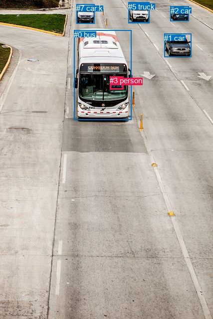
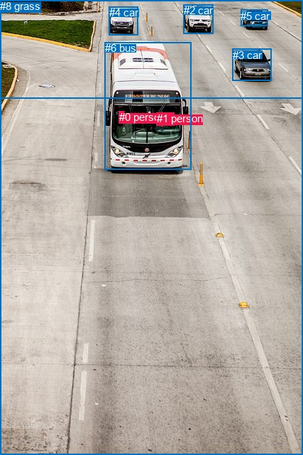

# 图片 1841：2402294.jpg

随机样本序号：100。图片 SHA256：`431bf6f6a8153c8da75c77d1259af7c168d434585f26ba296198927a4960a4e3`。

红色框表示人，蓝色框表示其他物体。两个模式分别保留自身框编号，可依据位置比较对应对象。

## 自动检测框与输出

人的框编号：`[3]`。状态：`ok`。

### 自动检测全部物体框

| 编号 | 类别 | 是否为人 | 检测分数 | 像素坐标 xyxy |
|---|---|---|---|---|
| 0 | bus | False | 0.9991 | 148.5, 60.6, 263.2, 241.0 |
| 1 | car | False | 0.9844 | 329.2, 67.6, 383.7, 114.2 |
| 2 | car | False | 0.9832 | 341.7, 12.6, 378.4, 42.2 |
| 3 | person | True | 0.9037 | 220.4, 153.3, 247.7, 179.2 |
| 4 | car | False | 0.6953 | 257.9, 5.4, 299.6, 45.6 |
| 5 | truck | False | 0.6574 | 257.2, 4.9, 299.5, 46.3 |
| 6 | truck | False | 0.6530 | 153.1, 8.5, 189.5, 47.4 |
| 7 | car | False | 0.6357 | 153.5, 8.5, 189.6, 47.9 |

### 自动检测 Top50 人相关候选

评分物体对：56；人相关物体对：14；输出关系：28。

| 排名 | 主语编号与类别 | 关系 | 宾语编号与类别 | 类型 | 人与人 | 排序分数 | 原始融合 logit |
|---|---|---|---|---|---|---|---|
| 1 | #3 person | driving on | #0 bus | semantic | False | 0.99143 | 4.7514 |
| 2 | #0 bus | carrying | #3 person | semantic | False | 0.96587 | 3.3427 |
| 3 | #3 person | in | #0 bus | spatial | False | 0.96146 | 3.2167 |
| 4 | #3 person | driving on | #1 car | semantic | False | 0.50502 | 0.0201 |
| 5 | #0 bus | beside | #3 person | spatial | False | 0.28180 | -0.9355 |
| 6 | #3 person | driving | #4 car | semantic | False | 0.16944 | -1.5896 |
| 7 | #3 person | driving | #5 truck | semantic | False | 0.16349 | -1.6325 |
| 8 | #3 person | driving on | #2 car | semantic | False | 0.08927 | -2.3226 |
| 9 | #1 car | driving | #3 person | semantic | False | 0.01879 | -3.9552 |
| 10 | #3 person | in | #4 car | spatial | False | 0.01462 | -4.2110 |
| 11 | #3 person | in | #5 truck | spatial | False | 0.01424 | -4.2372 |
| 12 | #3 person | in | #1 car | spatial | False | 0.01303 | -4.3275 |
| 13 | #3 person | driving on | #7 car | semantic | False | 0.01064 | -4.5326 |
| 14 | #3 person | driving on | #6 truck | semantic | False | 0.01013 | -4.5817 |
| 15 | #3 person | in | #2 car | spatial | False | 0.00945 | -4.6526 |
| 16 | #3 person | in | #6 truck | spatial | False | 0.00872 | -4.7336 |
| 17 | #3 person | in | #7 car | spatial | False | 0.00864 | -4.7422 |
| 18 | #5 truck | driving | #3 person | semantic | False | 0.00645 | -5.0373 |
| 19 | #4 car | driving | #3 person | semantic | False | 0.00628 | -5.0645 |
| 20 | #2 car | driving | #3 person | semantic | False | 0.00226 | -6.0903 |
| 21 | #7 car | over | #3 person | spatial | False | 0.00158 | -6.4495 |
| 22 | #6 truck | over | #3 person | spatial | False | 0.00147 | -6.5207 |
| 23 | #4 car | over | #3 person | spatial | False | 0.00133 | -6.6236 |
| 24 | #5 truck | over | #3 person | spatial | False | 0.00133 | -6.6249 |
| 25 | #1 car | in | #3 person | spatial | False | 0.00111 | -6.8014 |
| 26 | #7 car | parked on | #3 person | semantic | False | 0.00096 | -6.9425 |
| 27 | #6 truck | parked on | #3 person | semantic | False | 0.00093 | -6.9774 |
| 28 | #2 car | in | #3 person | spatial | False | 0.00051 | -7.5851 |

### 自动检测逐条人相关 GT 核验

R@50：0.00%；命中 0/1。

| GT 主语编号 | GT 关系 | GT 宾语编号 | 结果阶段 | 匹配预测主语编号 | 匹配预测宾语编号 |
|---|---|---|---|---|---|
| 1 | driving | 6 | wrong_predicate | [3] | [0] |

## 真实框与输出

人的框编号：`[0, 1]`。

### 真实框全部物体框

| 编号 | 类别 | 是否为人 | 检测分数 | 像素坐标 xyxy |
|---|---|---|---|---|
| 0 | person | True | GT | 168.0, 156.0, 175.0, 166.0 |
| 1 | person | True | GT | 221.0, 158.0, 246.0, 176.0 |
| 2 | car | False | GT | 259.0, 6.0, 301.0, 48.0 |
| 3 | car | False | GT | 328.0, 69.0, 383.0, 114.0 |
| 4 | car | False | GT | 154.0, 9.0, 195.0, 49.0 |
| 5 | car | False | GT | 339.0, 14.0, 377.0, 37.0 |
| 6 | bus | False | GT | 148.0, 59.0, 269.0, 238.0 |
| 7 | road | False | GT | 0.0, 0.0, 427.0, 640.0 |
| 8 | grass | False | GT | 0.0, 0.0, 427.0, 138.0 |

### 真实框 Top50 人相关候选

评分物体对：72；人相关物体对：30；输出关系：50。

| 排名 | 主语编号与类别 | 关系 | 宾语编号与类别 | 类型 | 人与人 | 排序分数 | 原始融合 logit |
|---|---|---|---|---|---|---|---|
| 1 | #1 person | driving on | #6 bus | semantic | False | 0.97849 | 3.8174 |
| 2 | #1 person | in | #6 bus | spatial | False | 0.97124 | 3.5195 |
| 3 | #0 person | on | #6 bus | spatial | False | 0.96457 | 3.3040 |
| 4 | #0 person | standing on | #6 bus | semantic | False | 0.57703 | 0.3106 |
| 5 | #6 bus | carrying | #1 person | semantic | False | 0.42918 | -0.2852 |
| 6 | #6 bus | on | #0 person | spatial | False | 0.33919 | -0.6669 |
| 7 | #6 bus | in | #1 person | spatial | False | 0.26869 | -1.0013 |
| 8 | #6 bus | carrying | #0 person | semantic | False | 0.26655 | -1.0122 |
| 9 | #0 person | on | #7 road | spatial | False | 0.10237 | -2.1711 |
| 10 | #1 person | in | #7 road | spatial | False | 0.06274 | -2.7040 |
| 11 | #1 person | driving on | #7 road | semantic | False | 0.05495 | -2.8448 |
| 12 | #0 person | walking on | #7 road | semantic | False | 0.04214 | -3.1237 |
| 13 | #1 person | driving on | #3 car | semantic | False | 0.01919 | -3.9339 |
| 14 | #1 person | in | #3 car | spatial | False | 0.01163 | -4.4425 |
| 15 | #0 person | on | #3 car | spatial | False | 0.01162 | -4.4430 |
| 16 | #0 person | on | #5 car | spatial | False | 0.01056 | -4.5397 |
| 17 | #0 person | on | #4 car | spatial | False | 0.01043 | -4.5524 |
| 18 | #0 person | on | #1 person | spatial | True | 0.01042 | -4.5534 |
| 19 | #1 person | in | #5 car | spatial | False | 0.00967 | -4.6285 |
| 20 | #1 person | in | #0 person | spatial | True | 0.00887 | -4.7165 |
| 21 | #1 person | in | #2 car | spatial | False | 0.00862 | -4.7450 |
| 22 | #0 person | on | #2 car | spatial | False | 0.00823 | -4.7918 |
| 23 | #1 person | driving on | #2 car | semantic | False | 0.00540 | -5.2158 |
| 24 | #0 person | in | #8 grass | spatial | False | 0.00398 | -5.5228 |
| 25 | #1 person | in | #4 car | spatial | False | 0.00366 | -5.6060 |
| 26 | #1 person | driving on | #5 car | semantic | False | 0.00261 | -5.9445 |
| 27 | #1 person | in | #8 grass | spatial | False | 0.00226 | -6.0891 |
| 28 | #0 person | sitting on | #3 car | semantic | False | 0.00191 | -6.2566 |
| 29 | #7 road | in | #0 person | spatial | False | 0.00164 | -6.4122 |
| 30 | #0 person | walking on | #8 grass | semantic | False | 0.00164 | -6.4123 |
| 31 | #3 car | in | #1 person | spatial | False | 0.00161 | -6.4276 |
| 32 | #0 person | wearing | #1 person | semantic | True | 0.00148 | -6.5127 |
| 33 | #1 person | wearing | #0 person | semantic | True | 0.00137 | -6.5927 |
| 34 | #0 person | standing on | #5 car | semantic | False | 0.00132 | -6.6292 |
| 35 | #0 person | standing on | #4 car | semantic | False | 0.00129 | -6.6498 |
| 36 | #5 car | in | #1 person | spatial | False | 0.00121 | -6.7125 |
| 37 | #1 person | looking at | #8 grass | semantic | False | 0.00117 | -6.7536 |
| 38 | #0 person | standing on | #2 car | semantic | False | 0.00112 | -6.7919 |
| 39 | #5 car | in | #0 person | spatial | False | 0.00102 | -6.8917 |
| 40 | #4 car | in | #0 person | spatial | False | 0.00099 | -6.9123 |
| 41 | #3 car | in | #0 person | spatial | False | 0.00093 | -6.9763 |
| 42 | #2 car | in | #1 person | spatial | False | 0.00082 | -7.1046 |
| 43 | #3 car | driving | #1 person | semantic | False | 0.00079 | -7.1464 |
| 44 | #1 person | sitting on | #4 car | semantic | False | 0.00065 | -7.3333 |
| 45 | #2 car | in | #0 person | spatial | False | 0.00055 | -7.5124 |
| 46 | #7 road | in | #1 person | spatial | False | 0.00053 | -7.5385 |
| 47 | #2 car | driving | #1 person | semantic | False | 0.00047 | -7.6587 |
| 48 | #4 car | parked on | #0 person | semantic | False | 0.00043 | -7.7587 |
| 49 | #3 car | playing | #0 person | semantic | False | 0.00042 | -7.7791 |
| 50 | #5 car | carrying | #0 person | semantic | False | 0.00039 | -7.8611 |

### 真实框逐条人相关 GT 核验

R@50：0.00%；命中 0/1。

| GT 主语编号 | GT 关系 | GT 宾语编号 | 结果阶段 | 匹配预测主语编号 | 匹配预测宾语编号 |
|---|---|---|---|---|---|
| 1 | driving | 6 | wrong_predicate | [1] | [6] |

## 全部人相关 GT

| 主语编号与类别 | 关系 | 宾语编号与类别 |
|---|---|---|
| #1 person | driving | #6 bus |

原始记录、全部人相关物体对的两项预测与分项分数见 [逐图证据 JSON](../evidence/cases/1841.json)。全部56类 logits 保留于本机 HOR/output/random500/logits/。

<!-- HOR_COMPLETE_RESULTS -->

## 六组条件的完整输出对照

以下保留同一图片三种框与候选模式、两种谓词输出规则的全部 Top50。框编号各自在所属模式内解释。

### 自动检测框完整枚举：空间与语义各保留一个谓词

| 排名 | 主语编号与类别 | 谓词 | 宾语编号与类别 | 分组 | 排序分数 | predicate logit | pair logit |
|---|---|---|---|---|---|---|---|
| 1 | #3 person | driving on | #0 bus | semantic | 0.9914345 | 4.3860717 | 0.3653246 |
| 2 | #0 bus | carrying | #3 person | semantic | 0.9658654 | 3.8029199 | -0.4602070 |
| 3 | #3 person | in | #0 bus | spatial | 0.9614597 | 2.8514228 | 0.3653246 |
| 4 | #3 person | driving on | #1 car | semantic | 0.5050226 | 0.7761283 | -0.7560369 |
| 5 | #0 bus | beside | #3 person | spatial | 0.2818027 | -0.4753304 | -0.4602070 |
| 6 | #3 person | driving | #4 car | semantic | 0.1694420 | -0.9664044 | -0.6231823 |
| 7 | #3 person | driving | #5 truck | semantic | 0.1634854 | -1.0115361 | -0.6209841 |
| 8 | #3 person | driving on | #2 car | semantic | 0.0892696 | -1.2841544 | -1.0384309 |
| 9 | #1 car | driving | #3 person | semantic | 0.0187947 | -2.5908825 | -1.3643224 |
| 10 | #3 person | in | #4 car | spatial | 0.0146152 | -3.5877857 | -0.6231823 |
| 11 | #3 person | in | #5 truck | spatial | 0.0142422 | -3.6162179 | -0.6209841 |
| 12 | #3 person | in | #1 car | spatial | 0.0130282 | -3.5714855 | -0.7560369 |
| 13 | #3 person | driving on | #7 car | semantic | 0.0106385 | -3.4651554 | -1.0674222 |
| 14 | #3 person | driving on | #6 truck | semantic | 0.0101335 | -3.5102563 | -1.0714662 |
| 15 | #3 person | in | #2 car | spatial | 0.0094464 | -3.6141942 | -1.0384309 |
| 16 | #3 person | in | #6 truck | spatial | 0.0087182 | -3.6621237 | -1.0714662 |
| 17 | #3 person | in | #7 car | spatial | 0.0086444 | -3.6747360 | -1.0674222 |
| 18 | #5 truck | driving | #3 person | semantic | 0.0064494 | -3.6440573 | -1.3932440 |
| 19 | #4 car | driving | #3 person | semantic | 0.0062772 | -3.6741424 | -1.3903971 |
| 20 | #2 car | driving | #3 person | semantic | 0.0022596 | -4.4055605 | -1.6847420 |
| 21 | #7 car | over | #3 person | spatial | 0.0015788 | -4.7074013 | -1.7420835 |
| 22 | #6 truck | over | #3 person | spatial | 0.0014705 | -4.7737846 | -1.7469029 |
| 23 | #4 car | over | #3 person | spatial | 0.0013268 | -5.2332358 | -1.3903971 |
| 24 | #5 truck | over | #3 person | spatial | 0.0013252 | -5.2316170 | -1.3932440 |
| 25 | #1 car | in | #3 person | spatial | 0.0011109 | -5.4371204 | -1.3643224 |
| 26 | #7 car | parked on | #3 person | semantic | 0.0009649 | -5.2004485 | -1.7420835 |
| 27 | #6 truck | parked on | #3 person | semantic | 0.0009318 | -5.2305398 | -1.7469029 |
| 28 | #2 car | in | #3 person | spatial | 0.0005077 | -5.9003801 | -1.6847420 |

GT 命中：0/1，R@50=0.00%。

| GT主语 | GT谓词 | GT宾语 | 结果阶段 | 匹配主语框 | 匹配宾语框 |
|---|---|---|---|---|---|
| 1 | driving | 6 | wrong_predicate | [3] | [0] |

### 自动检测框完整枚举：每对只保留一个谓词

| 排名 | 主语编号与类别 | 谓词 | 宾语编号与类别 | 分组 | 排序分数 | predicate logit | pair logit |
|---|---|---|---|---|---|---|---|
| 1 | #3 person | driving on | #0 bus | single | 0.9914345 | 4.3860717 | 0.3653246 |
| 2 | #0 bus | carrying | #3 person | single | 0.9658654 | 3.8029199 | -0.4602070 |
| 3 | #3 person | driving on | #1 car | single | 0.5050226 | 0.7761283 | -0.7560369 |
| 4 | #3 person | driving | #4 car | single | 0.1694420 | -0.9664044 | -0.6231823 |
| 5 | #3 person | driving | #5 truck | single | 0.1634854 | -1.0115361 | -0.6209841 |
| 6 | #3 person | driving on | #2 car | single | 0.0892696 | -1.2841544 | -1.0384309 |
| 7 | #1 car | driving | #3 person | single | 0.0187947 | -2.5908825 | -1.3643224 |
| 8 | #3 person | driving on | #7 car | single | 0.0106385 | -3.4651554 | -1.0674222 |
| 9 | #3 person | driving on | #6 truck | single | 0.0101335 | -3.5102563 | -1.0714662 |
| 10 | #5 truck | driving | #3 person | single | 0.0064494 | -3.6440573 | -1.3932440 |
| 11 | #4 car | driving | #3 person | single | 0.0062772 | -3.6741424 | -1.3903971 |
| 12 | #2 car | driving | #3 person | single | 0.0022596 | -4.4055605 | -1.6847420 |
| 13 | #7 car | over | #3 person | single | 0.0015788 | -4.7074013 | -1.7420835 |
| 14 | #6 truck | over | #3 person | single | 0.0014705 | -4.7737846 | -1.7469029 |

GT 命中：0/1，R@50=0.00%。

| GT主语 | GT谓词 | GT宾语 | 结果阶段 | 匹配主语框 | 匹配宾语框 |
|---|---|---|---|---|---|
| 1 | driving | 6 | wrong_predicate | [3] | [0] |

### 真实框完整枚举：空间与语义各保留一个谓词

| 排名 | 主语编号与类别 | 谓词 | 宾语编号与类别 | 分组 | 排序分数 | predicate logit | pair logit |
|---|---|---|---|---|---|---|---|
| 1 | #1 person | driving on | #6 bus | semantic | 0.9784886 | 3.4843335 | 0.3330903 |
| 2 | #1 person | in | #6 bus | spatial | 0.9712375 | 3.1864123 | 0.3330903 |
| 3 | #0 person | on | #6 bus | spatial | 0.9645659 | 3.0585155 | 0.2454871 |
| 4 | #0 person | standing on | #6 bus | semantic | 0.5770257 | 0.0650883 | 0.2454871 |
| 5 | #6 bus | carrying | #1 person | semantic | 0.4291761 | 0.2263899 | -0.5116031 |
| 6 | #6 bus | on | #0 person | spatial | 0.3391923 | -0.2229071 | -0.4439887 |
| 7 | #6 bus | in | #1 person | spatial | 0.2686858 | -0.4896975 | -0.5116031 |
| 8 | #6 bus | carrying | #0 person | semantic | 0.2665520 | -0.5681987 | -0.4439887 |
| 9 | #0 person | on | #7 road | spatial | 0.1023735 | -1.1431086 | -1.0280178 |
| 10 | #1 person | in | #7 road | spatial | 0.0627377 | -1.5194070 | -1.1845930 |
| 11 | #1 person | driving on | #7 road | semantic | 0.0549500 | -1.6602206 | -1.1845930 |
| 12 | #0 person | walking on | #7 road | semantic | 0.0421397 | -2.0956950 | -1.0280178 |
| 13 | #1 person | driving on | #3 car | semantic | 0.0191918 | -3.1936510 | -0.7402428 |
| 14 | #1 person | in | #3 car | spatial | 0.0116294 | -3.7022774 | -0.7402428 |
| 15 | #0 person | on | #3 car | spatial | 0.0116243 | -3.5893767 | -0.8535856 |
| 16 | #0 person | on | #5 car | spatial | 0.0105635 | -3.4998126 | -1.0399203 |
| 17 | #0 person | on | #4 car | spatial | 0.0104316 | -3.8295274 | -0.7229013 |
| 18 | #0 person | on | #1 person | spatial | 0.0104216 | -3.7358217 | -0.8175782 |
| 19 | #1 person | in | #5 car | spatial | 0.0096749 | -3.6388822 | -0.9896150 |
| 20 | #1 person | in | #0 person | spatial | 0.0088672 | -3.8968740 | -0.8196102 |
| 21 | #1 person | in | #2 car | spatial | 0.0086202 | -4.1152530 | -0.6297354 |
| 22 | #0 person | on | #2 car | spatial | 0.0082295 | -3.5609944 | -1.2307718 |
| 23 | #1 person | driving on | #2 car | semantic | 0.0054008 | -4.5860639 | -0.6297354 |
| 24 | #0 person | in | #8 grass | spatial | 0.0039787 | -3.6798153 | -1.8429902 |
| 25 | #1 person | in | #4 car | spatial | 0.0036623 | -4.5810575 | -1.0249379 |
| 26 | #1 person | driving on | #5 car | semantic | 0.0026133 | -4.9549141 | -0.9896150 |
| 27 | #1 person | in | #8 grass | spatial | 0.0022623 | -4.1931319 | -1.8959813 |
| 28 | #0 person | sitting on | #3 car | semantic | 0.0019141 | -5.4030094 | -0.8535856 |
| 29 | #7 road | in | #0 person | spatial | 0.0016388 | -4.5969357 | -1.8152263 |
| 30 | #0 person | walking on | #8 grass | semantic | 0.0016386 | -4.5692711 | -1.8429902 |
| 31 | #3 car | in | #1 person | spatial | 0.0016137 | -5.0538387 | -1.3737879 |
| 32 | #0 person | wearing | #1 person | semantic | 0.0014823 | -5.6950784 | -0.8175782 |
| 33 | #1 person | wearing | #0 person | semantic | 0.0013685 | -5.7730889 | -0.8196102 |
| 34 | #0 person | standing on | #5 car | semantic | 0.0013195 | -5.5892525 | -1.0399203 |
| 35 | #0 person | standing on | #4 car | semantic | 0.0012927 | -5.9268513 | -0.7229013 |
| 36 | #5 car | in | #1 person | spatial | 0.0012141 | -5.0156684 | -1.6968811 |
| 37 | #1 person | looking at | #8 grass | semantic | 0.0011653 | -4.8576021 | -1.8959813 |
| 38 | #0 person | standing on | #2 car | semantic | 0.0011215 | -5.5611763 | -1.2307718 |
| 39 | #5 car | in | #0 person | spatial | 0.0010151 | -5.1816154 | -1.7101053 |
| 40 | #4 car | in | #0 person | spatial | 0.0009945 | -5.6722574 | -1.2400625 |
| 41 | #3 car | in | #0 person | spatial | 0.0009329 | -5.5017657 | -1.4745209 |
| 42 | #2 car | in | #1 person | spatial | 0.0008206 | -5.6850462 | -1.4195582 |
| 43 | #3 car | driving | #1 person | semantic | 0.0007871 | -5.7726431 | -1.3737879 |
| 44 | #1 person | sitting on | #4 car | semantic | 0.0006530 | -6.3083777 | -1.0249379 |
| 45 | #2 car | in | #0 person | spatial | 0.0005460 | -5.5564137 | -1.9559729 |
| 46 | #7 road | in | #1 person | spatial | 0.0005319 | -5.3910556 | -2.1474175 |
| 47 | #2 car | driving | #1 person | semantic | 0.0004717 | -6.2390971 | -1.4195582 |
| 48 | #4 car | parked on | #0 person | semantic | 0.0004268 | -6.5186014 | -1.2400625 |
| 49 | #3 car | playing | #0 person | semantic | 0.0004182 | -6.3045897 | -1.4745209 |
| 50 | #5 car | carrying | #0 person | semantic | 0.0003853 | -6.1510224 | -1.7101053 |

GT 命中：0/1，R@50=0.00%。

| GT主语 | GT谓词 | GT宾语 | 结果阶段 | 匹配主语框 | 匹配宾语框 |
|---|---|---|---|---|---|
| 1 | driving | 6 | wrong_predicate | [1] | [6] |

### 真实框完整枚举：每对只保留一个谓词

| 排名 | 主语编号与类别 | 谓词 | 宾语编号与类别 | 分组 | 排序分数 | predicate logit | pair logit |
|---|---|---|---|---|---|---|---|
| 1 | #1 person | driving on | #6 bus | single | 0.9784886 | 3.4843335 | 0.3330903 |
| 2 | #0 person | on | #6 bus | single | 0.9645659 | 3.0585155 | 0.2454871 |
| 3 | #6 bus | carrying | #1 person | single | 0.4291761 | 0.2263899 | -0.5116031 |
| 4 | #6 bus | on | #0 person | single | 0.3391923 | -0.2229071 | -0.4439887 |
| 5 | #0 person | on | #7 road | single | 0.1023735 | -1.1431086 | -1.0280178 |
| 6 | #1 person | in | #7 road | single | 0.0627377 | -1.5194070 | -1.1845930 |
| 7 | #1 person | driving on | #3 car | single | 0.0191918 | -3.1936510 | -0.7402428 |
| 8 | #0 person | on | #3 car | single | 0.0116243 | -3.5893767 | -0.8535856 |
| 9 | #0 person | on | #5 car | single | 0.0105635 | -3.4998126 | -1.0399203 |
| 10 | #0 person | on | #4 car | single | 0.0104316 | -3.8295274 | -0.7229013 |
| 11 | #0 person | on | #1 person | single | 0.0104216 | -3.7358217 | -0.8175782 |
| 12 | #1 person | in | #5 car | single | 0.0096749 | -3.6388822 | -0.9896150 |
| 13 | #1 person | in | #0 person | single | 0.0088672 | -3.8968740 | -0.8196102 |
| 14 | #1 person | in | #2 car | single | 0.0086202 | -4.1152530 | -0.6297354 |
| 15 | #0 person | on | #2 car | single | 0.0082295 | -3.5609944 | -1.2307718 |
| 16 | #0 person | in | #8 grass | single | 0.0039787 | -3.6798153 | -1.8429902 |
| 17 | #1 person | in | #4 car | single | 0.0036623 | -4.5810575 | -1.0249379 |
| 18 | #1 person | in | #8 grass | single | 0.0022623 | -4.1931319 | -1.8959813 |
| 19 | #7 road | in | #0 person | single | 0.0016388 | -4.5969357 | -1.8152263 |
| 20 | #3 car | in | #1 person | single | 0.0016137 | -5.0538387 | -1.3737879 |
| 21 | #5 car | in | #1 person | single | 0.0012141 | -5.0156684 | -1.6968811 |
| 22 | #5 car | in | #0 person | single | 0.0010151 | -5.1816154 | -1.7101053 |
| 23 | #4 car | in | #0 person | single | 0.0009945 | -5.6722574 | -1.2400625 |
| 24 | #3 car | in | #0 person | single | 0.0009329 | -5.5017657 | -1.4745209 |
| 25 | #2 car | in | #1 person | single | 0.0008206 | -5.6850462 | -1.4195582 |
| 26 | #2 car | in | #0 person | single | 0.0005460 | -5.5564137 | -1.9559729 |
| 27 | #7 road | in | #1 person | single | 0.0005319 | -5.3910556 | -2.1474175 |
| 28 | #4 car | in | #1 person | single | 0.0003237 | -6.3188324 | -1.7165180 |
| 29 | #8 grass | in | #0 person | single | 0.0002092 | -6.5786529 | -1.8933730 |
| 30 | #8 grass | in | #1 person | single | 0.0001137 | -6.9432888 | -2.1384244 |

GT 命中：0/1，R@50=0.00%。

| GT主语 | GT谓词 | GT宾语 | 结果阶段 | 匹配主语框 | 匹配宾语框 |
|---|---|---|---|---|---|
| 1 | driving | 6 | wrong_predicate | [1] | [6] |

### 真实框400候选：空间与语义各保留一个谓词

| 排名 | 主语编号与类别 | 谓词 | 宾语编号与类别 | 分组 | 排序分数 | predicate logit | pair logit |
|---|---|---|---|---|---|---|---|
| 1 | #1 person | driving on | #6 bus | semantic | 0.9784886 | 3.4843335 | 0.3330903 |
| 2 | #1 person | in | #6 bus | spatial | 0.9712375 | 3.1864123 | 0.3330903 |
| 3 | #0 person | on | #6 bus | spatial | 0.9645659 | 3.0585155 | 0.2454871 |
| 4 | #0 person | standing on | #6 bus | semantic | 0.5779217 | 0.0687604 | 0.2454871 |
| 5 | #6 bus | carrying | #1 person | semantic | 0.4294615 | 0.2275548 | -0.5116031 |
| 6 | #6 bus | on | #0 person | spatial | 0.3447382 | -0.1982608 | -0.4439887 |
| 7 | #6 bus | carrying | #0 person | semantic | 0.2720145 | -0.5404372 | -0.4439887 |
| 8 | #6 bus | in | #1 person | spatial | 0.2696651 | -0.4847193 | -0.5116031 |
| 9 | #0 person | on | #7 road | spatial | 0.1072531 | -1.0910933 | -1.0280178 |
| 10 | #1 person | in | #7 road | spatial | 0.0658429 | -1.4677806 | -1.1845930 |
| 11 | #1 person | driving on | #7 road | semantic | 0.0557365 | -1.6451769 | -1.1845930 |
| 12 | #0 person | walking on | #7 road | semantic | 0.0433711 | -2.0656040 | -1.0280178 |
| 13 | #1 person | driving on | #3 car | semantic | 0.0184968 | -3.2312424 | -0.7402428 |
| 14 | #0 person | on | #3 car | spatial | 0.0118303 | -3.5716085 | -0.8535856 |
| 15 | #1 person | in | #3 car | spatial | 0.0116778 | -3.6980734 | -0.7402428 |
| 16 | #0 person | on | #4 car | spatial | 0.0106453 | -3.8090372 | -0.7229013 |
| 17 | #0 person | on | #5 car | spatial | 0.0105920 | -3.4970901 | -1.0399203 |
| 18 | #0 person | on | #1 person | spatial | 0.0104497 | -3.7330995 | -0.8175782 |
| 19 | #1 person | in | #5 car | spatial | 0.0097633 | -3.6297002 | -0.9896150 |
| 20 | #1 person | in | #0 person | spatial | 0.0088159 | -3.9027371 | -0.8196102 |
| 21 | #1 person | in | #2 car | spatial | 0.0086486 | -4.1119342 | -0.6297354 |
| 22 | #0 person | on | #2 car | spatial | 0.0081076 | -3.5760398 | -1.2307718 |
| 23 | #1 person | driving on | #2 car | semantic | 0.0055647 | -4.5559907 | -0.6297354 |
| 24 | #0 person | in | #8 grass | spatial | 0.0040759 | -3.6555872 | -1.8429902 |
| 25 | #1 person | in | #4 car | spatial | 0.0036852 | -4.5748072 | -1.0249379 |
| 26 | #1 person | driving on | #5 car | semantic | 0.0026627 | -4.9361162 | -0.9896150 |
| 27 | #1 person | in | #8 grass | spatial | 0.0022229 | -4.2107224 | -1.8959813 |
| 28 | #0 person | sitting on | #3 car | semantic | 0.0019562 | -5.3811922 | -0.8535856 |
| 29 | #7 road | in | #0 person | spatial | 0.0016685 | -4.5789580 | -1.8152263 |
| 30 | #0 person | walking on | #8 grass | semantic | 0.0016504 | -4.5621247 | -1.8429902 |
| 31 | #3 car | in | #1 person | spatial | 0.0015966 | -5.0644870 | -1.3737879 |
| 32 | #0 person | wearing | #1 person | semantic | 0.0014769 | -5.6987457 | -0.8175782 |
| 33 | #1 person | wearing | #0 person | semantic | 0.0013399 | -5.7941904 | -0.8196102 |
| 34 | #0 person | standing on | #5 car | semantic | 0.0013332 | -5.5788865 | -1.0399203 |
| 35 | #0 person | standing on | #4 car | semantic | 0.0013270 | -5.9006104 | -0.7229013 |
| 36 | #5 car | in | #1 person | spatial | 0.0011977 | -5.0292482 | -1.6968811 |
| 37 | #1 person | looking at | #8 grass | semantic | 0.0011615 | -4.8608809 | -1.8959813 |
| 38 | #0 person | standing on | #2 car | semantic | 0.0011163 | -5.5658555 | -1.2307718 |
| 39 | #5 car | in | #0 person | spatial | 0.0010151 | -5.1816154 | -1.7101053 |
| 40 | #4 car | in | #0 person | spatial | 0.0010036 | -5.6630754 | -1.2400625 |
| 41 | #3 car | in | #0 person | spatial | 0.0009446 | -5.4893055 | -1.4745209 |
| 42 | #2 car | in | #1 person | spatial | 0.0008273 | -5.6769838 | -1.4195582 |
| 43 | #3 car | driving | #1 person | semantic | 0.0007870 | -5.7726440 | -1.3737879 |
| 44 | #1 person | sitting on | #4 car | semantic | 0.0006537 | -6.3072491 | -1.0249379 |
| 45 | #2 car | in | #0 person | spatial | 0.0005583 | -5.5340385 | -1.9559729 |
| 46 | #7 road | in | #1 person | spatial | 0.0005404 | -5.3752766 | -2.1474175 |
| 47 | #2 car | driving | #1 person | semantic | 0.0004825 | -6.2165308 | -1.4195582 |
| 48 | #4 car | parked on | #0 person | semantic | 0.0004301 | -6.5111017 | -1.2400625 |
| 49 | #3 car | playing | #0 person | semantic | 0.0004137 | -6.3153934 | -1.4745209 |
| 50 | #7 road | playing | #0 person | semantic | 0.0003872 | -6.0410395 | -1.8152263 |

GT 命中：0/1，R@50=0.00%。

| GT主语 | GT谓词 | GT宾语 | 结果阶段 | 匹配主语框 | 匹配宾语框 |
|---|---|---|---|---|---|
| 1 | driving | 6 | wrong_predicate | [1] | [6] |

### 真实框400候选：每对只保留一个谓词

| 排名 | 主语编号与类别 | 谓词 | 宾语编号与类别 | 分组 | 排序分数 | predicate logit | pair logit |
|---|---|---|---|---|---|---|---|
| 1 | #1 person | driving on | #6 bus | single | 0.9784886 | 3.4843335 | 0.3330903 |
| 2 | #0 person | on | #6 bus | single | 0.9645659 | 3.0585155 | 0.2454871 |
| 3 | #6 bus | carrying | #1 person | single | 0.4294615 | 0.2275548 | -0.5116031 |
| 4 | #6 bus | on | #0 person | single | 0.3447382 | -0.1982608 | -0.4439887 |
| 5 | #0 person | on | #7 road | single | 0.1072531 | -1.0910933 | -1.0280178 |
| 6 | #1 person | in | #7 road | single | 0.0658429 | -1.4677806 | -1.1845930 |
| 7 | #1 person | driving on | #3 car | single | 0.0184968 | -3.2312424 | -0.7402428 |
| 8 | #0 person | on | #3 car | single | 0.0118303 | -3.5716085 | -0.8535856 |
| 9 | #0 person | on | #4 car | single | 0.0106453 | -3.8090372 | -0.7229013 |
| 10 | #0 person | on | #5 car | single | 0.0105920 | -3.4970901 | -1.0399203 |
| 11 | #0 person | on | #1 person | single | 0.0104497 | -3.7330995 | -0.8175782 |
| 12 | #1 person | in | #5 car | single | 0.0097633 | -3.6297002 | -0.9896150 |
| 13 | #1 person | in | #0 person | single | 0.0088159 | -3.9027371 | -0.8196102 |
| 14 | #1 person | in | #2 car | single | 0.0086486 | -4.1119342 | -0.6297354 |
| 15 | #0 person | on | #2 car | single | 0.0081076 | -3.5760398 | -1.2307718 |
| 16 | #0 person | in | #8 grass | single | 0.0040759 | -3.6555872 | -1.8429902 |
| 17 | #1 person | in | #4 car | single | 0.0036852 | -4.5748072 | -1.0249379 |
| 18 | #1 person | in | #8 grass | single | 0.0022229 | -4.2107224 | -1.8959813 |
| 19 | #7 road | in | #0 person | single | 0.0016685 | -4.5789580 | -1.8152263 |
| 20 | #3 car | in | #1 person | single | 0.0015966 | -5.0644870 | -1.3737879 |
| 21 | #5 car | in | #1 person | single | 0.0011977 | -5.0292482 | -1.6968811 |
| 22 | #5 car | in | #0 person | single | 0.0010151 | -5.1816154 | -1.7101053 |
| 23 | #4 car | in | #0 person | single | 0.0010036 | -5.6630754 | -1.2400625 |
| 24 | #3 car | in | #0 person | single | 0.0009446 | -5.4893055 | -1.4745209 |
| 25 | #2 car | in | #1 person | single | 0.0008273 | -5.6769838 | -1.4195582 |
| 26 | #2 car | in | #0 person | single | 0.0005583 | -5.5340385 | -1.9559729 |
| 27 | #7 road | in | #1 person | single | 0.0005404 | -5.3752766 | -2.1474175 |
| 28 | #4 car | in | #1 person | single | 0.0003209 | -6.3276277 | -1.7165180 |
| 29 | #8 grass | in | #0 person | single | 0.0002103 | -6.5735631 | -1.8933730 |
| 30 | #8 grass | in | #1 person | single | 0.0001158 | -6.9249249 | -2.1384244 |

GT 命中：0/1，R@50=0.00%。

| GT主语 | GT谓词 | GT宾语 | 结果阶段 | 匹配主语框 | 匹配宾语框 |
|---|---|---|---|---|---|
| 1 | driving | 6 | wrong_predicate | [1] | [6] |
