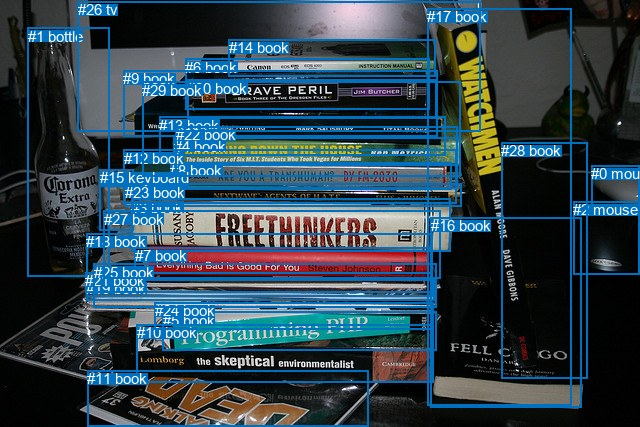
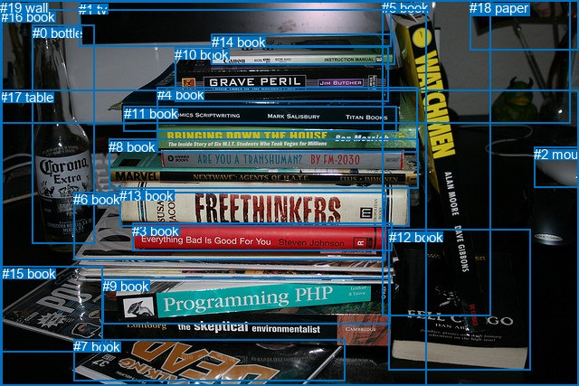

# 图片 1849：2402636.jpg

随机样本序号：202。图片 SHA256：`7e4985f7c75dd8940526cef636179af20151b3af7b7653f6986eed71f32488b0`。

红色框表示人，蓝色框表示其他物体。两个模式分别保留自身框编号，可依据位置比较对应对象。

## 自动检测框与输出

人的框编号：`[]`。状态：`no_person`。

### 自动检测全部物体框

| 编号 | 类别 | 是否为人 | 检测分数 | 像素坐标 xyxy |
|---|---|---|---|---|
| 0 | mouse | False | 0.9985 | 591.1, 165.2, 640.0, 207.9 |
| 1 | bottle | False | 0.9963 | 27.5, 27.8, 109.2, 276.5 |
| 2 | mouse | False | 0.9880 | 573.1, 201.3, 639.4, 274.5 |
| 3 | book | False | 0.9835 | 131.4, 198.7, 450.8, 251.3 |
| 4 | book | False | 0.9777 | 173.5, 138.0, 460.7, 166.0 |
| 5 | book | False | 0.9668 | 162.7, 311.6, 436.7, 350.2 |
| 6 | book | False | 0.9649 | 185.1, 58.8, 429.5, 109.6 |
| 7 | book | False | 0.9638 | 134.6, 247.5, 431.4, 279.9 |
| 8 | book | False | 0.9403 | 170.2, 162.5, 451.3, 189.4 |
| 9 | book | False | 0.9349 | 123.3, 70.1, 437.9, 136.8 |
| 10 | book | False | 0.9093 | 137.0, 324.3, 433.1, 382.4 |
| 11 | book | False | 0.8894 | 87.3, 370.4, 368.9, 427.0 |
| 12 | book | False | 0.8755 | 123.5, 149.8, 456.9, 203.2 |
| 13 | book | False | 0.8733 | 159.2, 116.6, 445.4, 155.6 |
| 14 | book | False | 0.8624 | 228.6, 39.0, 435.3, 76.1 |
| 15 | keyboard | False | 0.8439 | 99.9, 169.3, 133.1, 230.5 |
| 16 | book | False | 0.8201 | 430.7, 217.0, 581.0, 407.4 |
| 17 | book | False | 0.8155 | 427.4, 8.4, 571.6, 405.1 |
| 18 | book | False | 0.7607 | 86.5, 233.3, 432.5, 296.5 |
| 19 | book | False | 0.7585 | 86.0, 279.9, 434.4, 300.9 |
| 20 | book | False | 0.7200 | 187.4, 79.6, 436.5, 118.9 |
| 21 | book | False | 0.6006 | 85.1, 272.3, 431.2, 293.0 |
| 22 | book | False | 0.5891 | 176.0, 126.5, 457.3, 188.4 |
| 23 | book | False | 0.5871 | 124.5, 184.0, 461.3, 206.4 |
| 24 | book | False | 0.5573 | 154.6, 302.2, 433.9, 329.2 |
| 25 | book | False | 0.5152 | 93.8, 263.8, 437.0, 307.5 |
| 26 | tv | False | 0.4761 | 77.8, 1.1, 481.0, 131.3 |
| 27 | book | False | 0.4255 | 103.7, 210.6, 440.8, 278.2 |
| 28 | book | False | 0.4178 | 501.5, 142.2, 587.5, 378.9 |
| 29 | book | False | 0.4048 | 142.2, 81.8, 460.1, 176.7 |

### 自动检测 Top50 人相关候选

评分物体对：0；人相关物体对：0；输出关系：0。

| 排名 | 主语编号与类别 | 关系 | 宾语编号与类别 | 类型 | 人与人 | 排序分数 | 原始融合 logit |
|---|---|---|---|---|---|---|---|

### 自动检测逐条人相关 GT 核验

本图没有人相关 GT，R@50 无分母；预测候选继续展示。

## 真实框与输出

人的框编号：`[]`。

### 真实框全部物体框

| 编号 | 类别 | 是否为人 | 检测分数 | 像素坐标 xyxy |
|---|---|---|---|---|
| 0 | bottle | False | GT | 36.0, 28.0, 104.0, 270.0 |
| 1 | tv | False | GT | 87.0, 2.0, 432.0, 52.0 |
| 2 | mouse | False | GT | 590.0, 162.0, 640.0, 207.0 |
| 3 | book | False | GT | 146.0, 247.0, 433.0, 278.0 |
| 4 | book | False | GT | 174.0, 96.0, 462.0, 168.0 |
| 5 | book | False | GT | 422.0, 0.0, 542.0, 350.0 |
| 6 | book | False | GT | 81.0, 212.0, 427.0, 287.0 |
| 7 | book | False | GT | 81.0, 375.0, 381.0, 421.0 |
| 8 | book | False | GT | 120.0, 154.0, 463.0, 209.0 |
| 9 | book | False | GT | 113.0, 308.0, 432.0, 359.0 |
| 10 | book | False | GT | 193.0, 52.0, 429.0, 113.0 |
| 11 | book | False | GT | 137.0, 117.0, 439.0, 145.0 |
| 12 | book | False | GT | 430.0, 254.0, 587.0, 410.0 |
| 13 | book | False | GT | 132.0, 208.0, 452.0, 251.0 |
| 14 | book | False | GT | 234.0, 38.0, 437.0, 71.0 |
| 15 | book | False | GT | 2.0, 294.0, 113.0, 389.0 |
| 16 | book | False | GT | 1.0, 10.0, 471.0, 427.0 |
| 17 | table | False | GT | 0.0, 99.0, 640.0, 427.0 |
| 18 | paper | False | GT | 519.0, 0.0, 640.0, 55.0 |
| 19 | wall | False | GT | 0.0, 0.0, 631.0, 136.0 |

### 真实框 Top50 人相关候选

评分物体对：0；人相关物体对：0；输出关系：0。

| 排名 | 主语编号与类别 | 关系 | 宾语编号与类别 | 类型 | 人与人 | 排序分数 | 原始融合 logit |
|---|---|---|---|---|---|---|---|

### 真实框逐条人相关 GT 核验

本图没有人相关 GT，R@50 无分母；预测候选继续展示。

## 全部人相关 GT

| 主语编号与类别 | 关系 | 宾语编号与类别 |
|---|---|---|

原始记录、全部人相关物体对的两项预测与分项分数见 [逐图证据 JSON](../evidence/cases/1849.json)。全部56类 logits 保留于本机 HOR/output/random500/logits/。

<!-- HOR_COMPLETE_RESULTS -->

## 六组条件的完整输出对照

以下保留同一图片三种框与候选模式、两种谓词输出规则的全部 Top50。框编号各自在所属模式内解释。

### 自动检测框完整枚举：空间与语义各保留一个谓词

| 排名 | 主语编号与类别 | 谓词 | 宾语编号与类别 | 分组 | 排序分数 | predicate logit | pair logit |
|---|---|---|---|---|---|---|---|

没有人相关 GT，本条件的召回率无分母。

### 自动检测框完整枚举：每对只保留一个谓词

| 排名 | 主语编号与类别 | 谓词 | 宾语编号与类别 | 分组 | 排序分数 | predicate logit | pair logit |
|---|---|---|---|---|---|---|---|

没有人相关 GT，本条件的召回率无分母。

### 真实框完整枚举：空间与语义各保留一个谓词

| 排名 | 主语编号与类别 | 谓词 | 宾语编号与类别 | 分组 | 排序分数 | predicate logit | pair logit |
|---|---|---|---|---|---|---|---|

没有人相关 GT，本条件的召回率无分母。

### 真实框完整枚举：每对只保留一个谓词

| 排名 | 主语编号与类别 | 谓词 | 宾语编号与类别 | 分组 | 排序分数 | predicate logit | pair logit |
|---|---|---|---|---|---|---|---|

没有人相关 GT，本条件的召回率无分母。

### 真实框400候选：空间与语义各保留一个谓词

| 排名 | 主语编号与类别 | 谓词 | 宾语编号与类别 | 分组 | 排序分数 | predicate logit | pair logit |
|---|---|---|---|---|---|---|---|

没有人相关 GT，本条件的召回率无分母。

### 真实框400候选：每对只保留一个谓词

| 排名 | 主语编号与类别 | 谓词 | 宾语编号与类别 | 分组 | 排序分数 | predicate logit | pair logit |
|---|---|---|---|---|---|---|---|

没有人相关 GT，本条件的召回率无分母。
