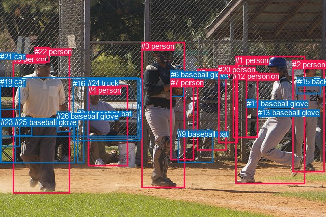
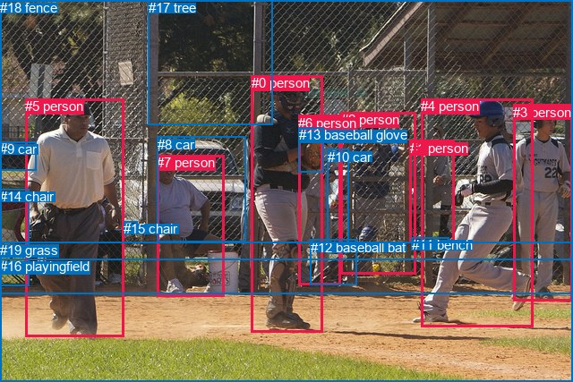

# 图片 1854：2402990.jpg

随机样本序号：347。图片 SHA256：`7d41021f6690f97184495abbe2e70d45eba3816eff5f2a41e813011976254d3b`。

红色框表示人，蓝色框表示其他物体。两个模式分别保留自身框编号，可依据位置比较对应对象。

## 自动检测框与输出

人的框编号：`[0, 1, 2, 3, 4, 5, 7, 8, 12, 20, 22]`。状态：`ok`。

### 自动检测全部物体框

| 编号 | 类别 | 是否为人 | 检测分数 | 像素坐标 xyxy |
|---|---|---|---|---|
| 0 | person | True | 0.9996 | 26.0, 107.8, 137.2, 380.3 |
| 1 | person | True | 0.9992 | 462.5, 110.3, 598.1, 362.0 |
| 2 | person | True | 0.9989 | 574.2, 118.1, 637.2, 338.8 |
| 3 | person | True | 0.9981 | 277.2, 82.4, 363.8, 369.9 |
| 4 | person | True | 0.9899 | 172.7, 168.8, 251.3, 326.7 |
| 5 | person | True | 0.9740 | 386.8, 135.1, 444.2, 296.5 |
| 6 | baseball glove | False | 0.9713 | 334.9, 137.9, 361.2, 189.4 |
| 7 | person | True | 0.9528 | 334.6, 154.4, 380.3, 314.7 |
| 8 | person | True | 0.9321 | 482.9, 141.3, 506.3, 270.8 |
| 9 | baseball bat | False | 0.9064 | 349.2, 255.1, 419.0, 319.3 |
| 10 | chair | False | 0.8947 | 0.2, 234.1, 30.6, 319.1 |
| 11 | baseball glove | False | 0.8697 | 483.7, 194.8, 498.6, 208.0 |
| 12 | person | True | 0.8519 | 457.0, 140.7, 506.1, 271.8 |
| 13 | baseball glove | False | 0.7177 | 506.1, 212.8, 518.3, 230.7 |
| 14 | car | False | 0.6680 | 0.3, 157.2, 39.4, 288.4 |
| 15 | backpack | False | 0.5756 | 583.5, 152.2, 629.2, 184.8 |
| 16 | car | False | 0.5754 | 143.4, 155.5, 274.9, 277.5 |
| 17 | baseball bat | False | 0.5484 | 152.4, 215.3, 164.1, 320.5 |
| 18 | car | False | 0.5339 | 0.1, 157.4, 38.3, 215.8 |
| 19 | car | False | 0.4659 | 0.0, 152.5, 270.4, 268.8 |
| 20 | person | True | 0.4286 | 428.1, 128.2, 467.3, 281.8 |
| 21 | car | False | 0.4263 | 0.2, 103.5, 33.0, 117.2 |
| 22 | person | True | 0.4160 | 67.6, 92.9, 97.3, 122.3 |
| 23 | bench | False | 0.3662 | 1.0, 232.4, 148.0, 321.0 |
| 24 | truck | False | 0.3607 | 171.5, 154.9, 277.2, 272.8 |
| 25 | baseball glove | False | 0.3554 | 29.5, 231.9, 62.8, 266.8 |
| 26 | baseball glove | False | 0.3501 | 111.4, 220.0, 137.0, 259.5 |

### 自动检测 Top50 人相关候选

评分物体对：702；人相关物体对：462；输出关系：50。

| 排名 | 主语编号与类别 | 关系 | 宾语编号与类别 | 类型 | 人与人 | 排序分数 | 原始融合 logit |
|---|---|---|---|---|---|---|---|
| 1 | #2 person | wearing | #15 backpack | semantic | False | 0.98775 | 4.3901 |
| 2 | #0 person | wearing | #22 person | semantic | True | 0.98625 | 4.2726 |
| 3 | #0 person | wearing | #23 bench | semantic | False | 0.98403 | 4.1207 |
| 4 | #3 person | holding | #6 baseball glove | semantic | False | 0.98309 | 4.0630 |
| 5 | #0 person | holding | #25 baseball glove | semantic | False | 0.98135 | 3.9632 |
| 6 | #8 person | holding | #11 baseball glove | semantic | False | 0.97490 | 3.6595 |
| 7 | #0 person | holding | #26 baseball glove | semantic | False | 0.97093 | 3.5084 |
| 8 | #12 person | holding | #11 baseball glove | semantic | False | 0.97091 | 3.5079 |
| 9 | #1 person | throwing | #11 baseball glove | semantic | False | 0.96538 | 3.3282 |
| 10 | #1 person | holding | #13 baseball glove | semantic | False | 0.93667 | 2.6940 |
| 11 | #2 person | in | #15 backpack | spatial | False | 0.93519 | 2.6693 |
| 12 | #7 person | holding | #6 baseball glove | semantic | False | 0.92082 | 2.4536 |
| 13 | #0 person | in | #23 bench | spatial | False | 0.89928 | 2.1892 |
| 14 | #1 person | wearing | #15 backpack | semantic | False | 0.89747 | 2.1694 |
| 15 | #0 person | holding | #10 chair | semantic | False | 0.89321 | 2.1240 |
| 16 | #8 person | in | #11 baseball glove | spatial | False | 0.85780 | 1.7972 |
| 17 | #0 person | in | #25 baseball glove | spatial | False | 0.85364 | 1.7634 |
| 18 | #0 person | in | #22 person | spatial | True | 0.84001 | 1.6583 |
| 19 | #3 person | in | #6 baseball glove | spatial | False | 0.80544 | 1.4206 |
| 20 | #12 person | in | #11 baseball glove | spatial | False | 0.78612 | 1.3017 |
| 21 | #22 person | on | #0 person | spatial | True | 0.77062 | 1.2118 |
| 22 | #4 person | in | #24 truck | spatial | False | 0.75085 | 1.1031 |
| 23 | #4 person | sitting on | #24 truck | semantic | False | 0.75074 | 1.1026 |
| 24 | #0 person | in | #26 baseball glove | spatial | False | 0.75063 | 1.1020 |
| 25 | #4 person | looking at | #3 person | semantic | True | 0.72676 | 0.9783 |
| 26 | #15 backpack | on | #2 person | spatial | False | 0.72250 | 0.9569 |
| 27 | #4 person | sitting on | #16 car | semantic | False | 0.71782 | 0.9337 |
| 28 | #1 person | in | #15 backpack | spatial | False | 0.71222 | 0.9062 |
| 29 | #1 person | in | #13 baseball glove | spatial | False | 0.69337 | 0.8159 |
| 30 | #5 person | looking at | #3 person | semantic | True | 0.67817 | 0.7454 |
| 31 | #7 person | pushing | #9 baseball bat | semantic | False | 0.67778 | 0.7436 |
| 32 | #8 person | holding | #13 baseball glove | semantic | False | 0.66985 | 0.7075 |
| 33 | #4 person | in | #16 car | spatial | False | 0.66307 | 0.6770 |
| 34 | #0 person | wearing | #18 car | semantic | False | 0.65808 | 0.6547 |
| 35 | #1 person | in | #11 baseball glove | spatial | False | 0.64986 | 0.6184 |
| 36 | #25 baseball glove | on | #0 person | spatial | False | 0.61716 | 0.4775 |
| 37 | #0 person | in | #14 car | spatial | False | 0.61543 | 0.4702 |
| 38 | #9 baseball bat | leaning on | #5 person | spatial | False | 0.61177 | 0.4548 |
| 39 | #3 person | holding | #26 baseball glove | semantic | False | 0.59420 | 0.3814 |
| 40 | #7 person | looking at | #3 person | semantic | True | 0.59070 | 0.3669 |
| 41 | #5 person | talking to | #20 person | semantic | True | 0.58540 | 0.3450 |
| 42 | #5 person | pushing | #9 baseball bat | semantic | False | 0.57876 | 0.3177 |
| 43 | #0 person | in | #18 car | spatial | False | 0.56197 | 0.2492 |
| 44 | #12 person | looking at | #1 person | semantic | True | 0.56093 | 0.2450 |
| 45 | #1 person | holding | #6 baseball glove | semantic | False | 0.55484 | 0.2203 |
| 46 | #20 person | looking at | #3 person | semantic | True | 0.52501 | 0.1001 |
| 47 | #0 person | on | #10 chair | spatial | False | 0.52443 | 0.0978 |
| 48 | #8 person | looking at | #3 person | semantic | True | 0.51151 | 0.0461 |
| 49 | #8 person | looking at | #1 person | semantic | True | 0.50845 | 0.0338 |
| 50 | #11 baseball glove | on | #8 person | spatial | False | 0.49782 | -0.0087 |

### 自动检测逐条人相关 GT 核验

R@50：0.00%；命中 0/4。

| GT 主语编号 | GT 关系 | GT 宾语编号 | 结果阶段 | 匹配预测主语编号 | 匹配预测宾语编号 |
|---|---|---|---|---|---|
| 0 | wearing | 13 | wrong_predicate | [3] | [6] |
| 2 | leaning on | 18 | endpoint_missing_or_wrong_class | [5] | [] |
| 4 | running on | 16 | endpoint_missing_or_wrong_class | [1] | [] |
| 5 | walking on | 16 | endpoint_missing_or_wrong_class | [0] | [] |

## 真实框与输出

人的框编号：`[0, 1, 2, 3, 4, 5, 6, 7]`。

### 真实框全部物体框

| 编号 | 类别 | 是否为人 | 检测分数 | 像素坐标 xyxy |
|---|---|---|---|---|
| 0 | person | True | GT | 281.0, 84.0, 361.0, 372.0 |
| 1 | person | True | GT | 458.0, 157.0, 508.0, 271.0 |
| 2 | person | True | GT | 381.0, 125.0, 464.0, 306.0 |
| 3 | person | True | GT | 573.0, 117.0, 640.0, 337.0 |
| 4 | person | True | GT | 470.0, 110.0, 595.0, 366.0 |
| 5 | person | True | GT | 28.0, 110.0, 138.0, 377.0 |
| 6 | person | True | GT | 333.0, 129.0, 380.0, 319.0 |
| 7 | person | True | GT | 175.0, 173.0, 250.0, 331.0 |
| 8 | car | False | GT | 176.0, 153.0, 275.0, 271.0 |
| 9 | car | False | GT | 0.0, 158.0, 40.0, 190.0 |
| 10 | car | False | GT | 366.0, 167.0, 390.0, 283.0 |
| 11 | bench | False | GT | 460.0, 265.0, 502.0, 276.0 |
| 12 | baseball bat | False | GT | 347.0, 268.0, 399.0, 319.0 |
| 13 | baseball glove | False | GT | 334.0, 142.0, 361.0, 192.0 |
| 14 | chair | False | GT | 0.0, 211.0, 32.0, 320.0 |
| 15 | chair | False | GT | 138.0, 247.0, 153.0, 261.0 |
| 16 | playingfield | False | GT | 0.0, 289.0, 640.0, 427.0 |
| 17 | tree | False | GT | 166.0, 0.0, 305.0, 140.0 |
| 18 | fence | False | GT | 0.0, 0.0, 640.0, 328.0 |
| 19 | grass | False | GT | 0.0, 271.0, 640.0, 427.0 |

### 真实框 Top50 人相关候选

评分物体对：380；人相关物体对：248；输出关系：50。

| 排名 | 主语编号与类别 | 关系 | 宾语编号与类别 | 类型 | 人与人 | 排序分数 | 原始融合 logit |
|---|---|---|---|---|---|---|---|
| 1 | #0 person | holding | #13 baseball glove | semantic | False | 0.98555 | 4.2224 |
| 2 | #5 person | holding | #14 chair | semantic | False | 0.97941 | 3.8622 |
| 3 | #4 person | running on | #19 grass | semantic | False | 0.97544 | 3.6818 |
| 4 | #6 person | holding | #13 baseball glove | semantic | False | 0.97472 | 3.6521 |
| 5 | #4 person | running on | #16 playingfield | semantic | False | 0.96346 | 3.2721 |
| 6 | #7 person | sitting on | #19 grass | semantic | False | 0.96154 | 3.2189 |
| 7 | #7 person | leaning on | #18 fence | spatial | False | 0.95913 | 3.1556 |
| 8 | #5 person | standing on | #19 grass | semantic | False | 0.95478 | 3.0500 |
| 9 | #5 person | standing on | #16 playingfield | semantic | False | 0.95395 | 3.0308 |
| 10 | #7 person | sitting on | #16 playingfield | semantic | False | 0.94367 | 2.8185 |
| 11 | #1 person | standing on | #11 bench | semantic | False | 0.94341 | 2.8136 |
| 12 | #0 person | standing on | #19 grass | semantic | False | 0.93190 | 2.6163 |
| 13 | #2 person | leaning on | #18 fence | spatial | False | 0.92814 | 2.5585 |
| 14 | #5 person | on | #19 grass | spatial | False | 0.92076 | 2.4527 |
| 15 | #0 person | standing on | #16 playingfield | semantic | False | 0.91743 | 2.4079 |
| 16 | #5 person | on | #16 playingfield | spatial | False | 0.91305 | 2.3515 |
| 17 | #4 person | on | #19 grass | spatial | False | 0.91040 | 2.3186 |
| 18 | #4 person | on | #16 playingfield | spatial | False | 0.90726 | 2.2806 |
| 19 | #7 person | leaning on | #8 car | spatial | False | 0.90194 | 2.2189 |
| 20 | #0 person | on | #19 grass | spatial | False | 0.89507 | 2.1436 |
| 21 | #1 person | leaning on | #11 bench | spatial | False | 0.88890 | 2.0795 |
| 22 | #7 person | sitting on | #8 car | semantic | False | 0.88057 | 1.9978 |
| 23 | #3 person | running on | #19 grass | semantic | False | 0.87841 | 1.9774 |
| 24 | #0 person | on | #16 playingfield | spatial | False | 0.87488 | 1.9448 |
| 25 | #7 person | sitting on | #18 fence | semantic | False | 0.87058 | 1.9061 |
| 26 | #2 person | looking at | #18 fence | semantic | False | 0.85804 | 1.7991 |
| 27 | #6 person | standing on | #19 grass | semantic | False | 0.85361 | 1.7632 |
| 28 | #7 person | on | #19 grass | spatial | False | 0.83807 | 1.6439 |
| 29 | #6 person | pushing | #12 baseball bat | semantic | False | 0.80942 | 1.4462 |
| 30 | #6 person | standing on | #16 playingfield | semantic | False | 0.78720 | 1.3082 |
| 31 | #6 person | looking at | #0 person | semantic | True | 0.78544 | 1.2976 |
| 32 | #5 person | wearing | #9 car | semantic | False | 0.78464 | 1.2929 |
| 33 | #6 person | leaning on | #18 fence | spatial | False | 0.78385 | 1.2883 |
| 34 | #7 person | on | #16 playingfield | spatial | False | 0.77910 | 1.2605 |
| 35 | #4 person | throwing | #11 bench | semantic | False | 0.76902 | 1.2028 |
| 36 | #5 person | leaning on | #14 chair | spatial | False | 0.76620 | 1.1870 |
| 37 | #0 person | in | #13 baseball glove | spatial | False | 0.76605 | 1.1862 |
| 38 | #7 person | looking at | #0 person | semantic | True | 0.75895 | 1.1469 |
| 39 | #2 person | standing on | #11 bench | semantic | False | 0.72507 | 0.9697 |
| 40 | #2 person | standing on | #19 grass | semantic | False | 0.72282 | 0.9585 |
| 41 | #6 person | in | #13 baseball glove | spatial | False | 0.71893 | 0.9392 |
| 42 | #3 person | on | #19 grass | spatial | False | 0.71839 | 0.9365 |
| 43 | #2 person | looking at | #0 person | semantic | True | 0.71824 | 0.9357 |
| 44 | #3 person | standing on | #16 playingfield | semantic | False | 0.71032 | 0.8969 |
| 45 | #6 person | holding | #10 car | semantic | False | 0.69668 | 0.8315 |
| 46 | #1 person | leaning on | #18 fence | spatial | False | 0.66288 | 0.6761 |
| 47 | #0 person | holding | #6 person | semantic | True | 0.65274 | 0.6311 |
| 48 | #5 person | leaning on | #18 fence | spatial | False | 0.65147 | 0.6255 |
| 49 | #1 person | looking at | #4 person | semantic | True | 0.64085 | 0.5790 |
| 50 | #5 person | holding | #15 chair | semantic | False | 0.63246 | 0.5428 |

### 真实框逐条人相关 GT 核验

R@50：50.00%；命中 2/4。

| GT 主语编号 | GT 关系 | GT 宾语编号 | 结果阶段 | 匹配预测主语编号 | 匹配预测宾语编号 |
|---|---|---|---|---|---|
| 0 | wearing | 13 | wrong_predicate | [0] | [13] |
| 2 | leaning on | 18 | hit50 | [2] | [18] |
| 4 | running on | 16 | hit50 | [4] | [16] |
| 5 | walking on | 16 | wrong_predicate | [5] | [16] |

## 全部人相关 GT

| 主语编号与类别 | 关系 | 宾语编号与类别 |
|---|---|---|
| #0 person | wearing | #13 baseball glove |
| #2 person | leaning on | #18 fence |
| #4 person | running on | #16 playingfield |
| #5 person | walking on | #16 playingfield |

原始记录、全部人相关物体对的两项预测与分项分数见 [逐图证据 JSON](../evidence/cases/1854.json)。全部56类 logits 保留于本机 HOR/output/random500/logits/。

<!-- HOR_COMPLETE_RESULTS -->

## 六组条件的完整输出对照

以下保留同一图片三种框与候选模式、两种谓词输出规则的全部 Top50。框编号各自在所属模式内解释。

### 自动检测框完整枚举：空间与语义各保留一个谓词

| 排名 | 主语编号与类别 | 谓词 | 宾语编号与类别 | 分组 | 排序分数 | predicate logit | pair logit |
|---|---|---|---|---|---|---|---|
| 1 | #2 person | wearing | #15 backpack | semantic | 0.9877528 | 4.0916409 | 0.2984964 |
| 2 | #0 person | wearing | #22 person | semantic | 0.9862465 | 3.9447989 | 0.3278078 |
| 3 | #0 person | wearing | #23 bench | semantic | 0.9840262 | 4.0107026 | 0.1099983 |
| 4 | #3 person | holding | #6 baseball glove | semantic | 0.9830927 | 3.9480119 | 0.1149484 |
| 5 | #0 person | holding | #25 baseball glove | semantic | 0.9813526 | 3.6492963 | 0.3139272 |
| 6 | #8 person | holding | #11 baseball glove | semantic | 0.9749004 | 3.4724603 | 0.1870190 |
| 7 | #0 person | holding | #26 baseball glove | semantic | 0.9709269 | 3.5847211 | -0.0762856 |
| 8 | #12 person | holding | #11 baseball glove | semantic | 0.9709103 | 3.3886437 | 0.1192073 |
| 9 | #1 person | throwing | #11 baseball glove | semantic | 0.9653835 | 3.7019439 | -0.3737485 |
| 10 | #1 person | holding | #13 baseball glove | semantic | 0.9366716 | 2.9060864 | -0.2120875 |
| 11 | #2 person | in | #15 backpack | spatial | 0.9351936 | 2.3708525 | 0.2984964 |
| 12 | #7 person | holding | #6 baseball glove | semantic | 0.9208232 | 3.0393658 | -0.5857815 |
| 13 | #0 person | in | #23 bench | spatial | 0.8992779 | 2.0792289 | 0.1099983 |
| 14 | #1 person | wearing | #15 backpack | semantic | 0.8974701 | 2.2903852 | -0.1209604 |
| 15 | #0 person | holding | #10 chair | semantic | 0.8932146 | 2.2612553 | -0.1372494 |
| 16 | #8 person | in | #11 baseball glove | spatial | 0.8578044 | 1.6101537 | 0.1870190 |
| 17 | #0 person | in | #25 baseball glove | spatial | 0.8536407 | 1.4495182 | 0.3139272 |
| 18 | #0 person | in | #22 person | spatial | 0.8400093 | 1.3304892 | 0.3278078 |
| 19 | #3 person | in | #6 baseball glove | spatial | 0.8054400 | 1.3056998 | 0.1149484 |
| 20 | #12 person | in | #11 baseball glove | spatial | 0.7861156 | 1.1824608 | 0.1192073 |
| 21 | #22 person | on | #0 person | spatial | 0.7706165 | 1.7949729 | -0.5831774 |
| 22 | #4 person | in | #24 truck | spatial | 0.7508455 | 1.6798673 | -0.5767406 |
| 23 | #4 person | sitting on | #24 truck | semantic | 0.7507421 | 1.6793146 | -0.5767406 |
| 24 | #0 person | in | #26 baseball glove | spatial | 0.7506284 | 1.1782517 | -0.0762856 |
| 25 | #4 person | looking at | #3 person | semantic | 0.7267650 | 1.6852612 | -0.7069902 |
| 26 | #15 backpack | on | #2 person | spatial | 0.7224987 | 1.4662571 | -0.5093672 |
| 27 | #4 person | sitting on | #16 car | semantic | 0.7178243 | 1.5619540 | -0.6282589 |
| 28 | #1 person | in | #15 backpack | spatial | 0.7122194 | 1.0271482 | -0.1209604 |
| 29 | #1 person | in | #13 baseball glove | spatial | 0.6933719 | 1.0280185 | -0.2120875 |
| 30 | #5 person | looking at | #3 person | semantic | 0.6781712 | 1.4165316 | -0.6711515 |
| 31 | #7 person | pushing | #9 baseball bat | semantic | 0.6777806 | 1.2898631 | -0.5462720 |
| 32 | #8 person | holding | #13 baseball glove | semantic | 0.6698464 | 0.8098292 | -0.1023390 |
| 33 | #4 person | in | #16 car | spatial | 0.6630723 | 1.3052750 | -0.6282589 |
| 34 | #0 person | wearing | #18 car | semantic | 0.6580787 | 1.3389096 | -0.6841658 |
| 35 | #1 person | in | #11 baseball glove | spatial | 0.6498616 | 0.9921799 | -0.3737485 |
| 36 | #25 baseball glove | on | #0 person | spatial | 0.6171590 | 0.9584131 | -0.4809060 |
| 37 | #0 person | in | #14 car | spatial | 0.6154279 | 1.1273780 | -0.6571916 |
| 38 | #9 baseball bat | leaning on | #5 person | spatial | 0.6117690 | 1.1852946 | -0.7305405 |
| 39 | #3 person | holding | #26 baseball glove | semantic | 0.5942010 | 1.5549340 | -1.1735743 |
| 40 | #7 person | looking at | #3 person | semantic | 0.5907021 | 1.1691775 | -0.8023088 |
| 41 | #5 person | talking to | #20 person | semantic | 0.5854036 | 0.8664317 | -0.5214356 |
| 42 | #5 person | pushing | #9 baseball bat | semantic | 0.5787559 | 0.7184963 | -0.4008282 |
| 43 | #0 person | in | #18 car | spatial | 0.5619715 | 0.9333329 | -0.6841658 |
| 44 | #12 person | looking at | #1 person | semantic | 0.5609336 | 1.0740228 | -0.8290710 |
| 45 | #1 person | holding | #6 baseball glove | semantic | 0.5548449 | 0.9442468 | -0.7239812 |
| 46 | #20 person | looking at | #3 person | semantic | 0.5250128 | 0.9630713 | -0.8629366 |
| 47 | #0 person | on | #10 chair | spatial | 0.5244273 | 0.2350364 | -0.1372494 |
| 48 | #8 person | looking at | #3 person | semantic | 0.5115106 | 1.0312724 | -0.9852219 |
| 49 | #8 person | looking at | #1 person | semantic | 0.5084479 | 0.8578062 | -0.8240116 |
| 50 | #11 baseball glove | on | #8 person | spatial | 0.4978164 | 0.8523836 | -0.8611183 |

GT 命中：0/4，R@50=0.00%。

| GT主语 | GT谓词 | GT宾语 | 结果阶段 | 匹配主语框 | 匹配宾语框 |
|---|---|---|---|---|---|
| 0 | wearing | 13 | wrong_predicate | [3] | [6] |
| 2 | leaning on | 18 | endpoint_missing_or_wrong_class | [5] | [] |
| 4 | running on | 16 | endpoint_missing_or_wrong_class | [1] | [] |
| 5 | walking on | 16 | endpoint_missing_or_wrong_class | [0] | [] |

### 自动检测框完整枚举：每对只保留一个谓词

| 排名 | 主语编号与类别 | 谓词 | 宾语编号与类别 | 分组 | 排序分数 | predicate logit | pair logit |
|---|---|---|---|---|---|---|---|
| 1 | #2 person | wearing | #15 backpack | single | 0.9877528 | 4.0916409 | 0.2984964 |
| 2 | #0 person | wearing | #22 person | single | 0.9862465 | 3.9447989 | 0.3278078 |
| 3 | #0 person | wearing | #23 bench | single | 0.9840262 | 4.0107026 | 0.1099983 |
| 4 | #3 person | holding | #6 baseball glove | single | 0.9830927 | 3.9480119 | 0.1149484 |
| 5 | #0 person | holding | #25 baseball glove | single | 0.9813526 | 3.6492963 | 0.3139272 |
| 6 | #8 person | holding | #11 baseball glove | single | 0.9749004 | 3.4724603 | 0.1870190 |
| 7 | #0 person | holding | #26 baseball glove | single | 0.9709269 | 3.5847211 | -0.0762856 |
| 8 | #12 person | holding | #11 baseball glove | single | 0.9709103 | 3.3886437 | 0.1192073 |
| 9 | #1 person | throwing | #11 baseball glove | single | 0.9653835 | 3.7019439 | -0.3737485 |
| 10 | #1 person | holding | #13 baseball glove | single | 0.9366716 | 2.9060864 | -0.2120875 |
| 11 | #7 person | holding | #6 baseball glove | single | 0.9208232 | 3.0393658 | -0.5857815 |
| 12 | #1 person | wearing | #15 backpack | single | 0.8974701 | 2.2903852 | -0.1209604 |
| 13 | #0 person | holding | #10 chair | single | 0.8932146 | 2.2612553 | -0.1372494 |
| 14 | #22 person | on | #0 person | single | 0.7706165 | 1.7949729 | -0.5831774 |
| 15 | #4 person | in | #24 truck | single | 0.7508455 | 1.6798673 | -0.5767406 |
| 16 | #4 person | looking at | #3 person | single | 0.7267650 | 1.6852612 | -0.7069902 |
| 17 | #15 backpack | on | #2 person | single | 0.7224987 | 1.4662571 | -0.5093672 |
| 18 | #4 person | sitting on | #16 car | single | 0.7178243 | 1.5619540 | -0.6282589 |
| 19 | #5 person | looking at | #3 person | single | 0.6781712 | 1.4165316 | -0.6711515 |
| 20 | #7 person | pushing | #9 baseball bat | single | 0.6777806 | 1.2898631 | -0.5462720 |
| 21 | #8 person | holding | #13 baseball glove | single | 0.6698464 | 0.8098292 | -0.1023390 |
| 22 | #0 person | wearing | #18 car | single | 0.6580787 | 1.3389096 | -0.6841658 |
| 23 | #25 baseball glove | on | #0 person | single | 0.6171590 | 0.9584131 | -0.4809060 |
| 24 | #0 person | in | #14 car | single | 0.6154279 | 1.1273780 | -0.6571916 |
| 25 | #9 baseball bat | leaning on | #5 person | single | 0.6117690 | 1.1852946 | -0.7305405 |
| 26 | #3 person | holding | #26 baseball glove | single | 0.5942010 | 1.5549340 | -1.1735743 |
| 27 | #7 person | looking at | #3 person | single | 0.5907021 | 1.1691775 | -0.8023088 |
| 28 | #5 person | talking to | #20 person | single | 0.5854036 | 0.8664317 | -0.5214356 |
| 29 | #5 person | pushing | #9 baseball bat | single | 0.5787559 | 0.7184963 | -0.4008282 |
| 30 | #12 person | looking at | #1 person | single | 0.5609336 | 1.0740228 | -0.8290710 |
| 31 | #1 person | holding | #6 baseball glove | single | 0.5548449 | 0.9442468 | -0.7239812 |
| 32 | #20 person | looking at | #3 person | single | 0.5250128 | 0.9630713 | -0.8629366 |
| 33 | #8 person | looking at | #3 person | single | 0.5115106 | 1.0312724 | -0.9852219 |
| 34 | #8 person | looking at | #1 person | single | 0.5084479 | 0.8578062 | -0.8240116 |
| 35 | #11 baseball glove | on | #8 person | single | 0.4978164 | 0.8523836 | -0.8611183 |
| 36 | #20 person | looking at | #1 person | single | 0.4967867 | 0.8997507 | -0.9126042 |
| 37 | #1 person | running on | #2 person | single | 0.4828035 | 0.7209735 | -0.7897868 |
| 38 | #12 person | looking at | #3 person | single | 0.4775726 | 0.8447986 | -0.9345685 |
| 39 | #4 person | sitting on | #23 bench | single | 0.4753757 | 0.4546185 | -0.5531955 |
| 40 | #6 baseball glove | on | #3 person | single | 0.4752833 | 0.5703835 | -0.6693309 |
| 41 | #1 person | holding | #25 baseball glove | single | 0.4733636 | 0.4960022 | -0.6026487 |
| 42 | #20 person | talking to | #12 person | single | 0.4681340 | 0.5659566 | -0.6935936 |
| 43 | #5 person | looking at | #1 person | single | 0.4424482 | 0.7300115 | -0.9612435 |
| 44 | #12 person | talking to | #8 person | single | 0.4313602 | 0.4162502 | -0.6925541 |
| 45 | #0 person | in | #21 car | single | 0.3998706 | 0.6005487 | -1.0065532 |
| 46 | #0 person | looking at | #3 person | single | 0.3987470 | 0.3346419 | -0.7453308 |
| 47 | #11 baseball glove | on | #12 person | single | 0.3949817 | 0.4746652 | -0.9010842 |
| 48 | #4 person | looking at | #1 person | single | 0.3889671 | 0.7919374 | -1.2435932 |
| 49 | #1 person | swinging | #26 baseball glove | single | 0.3888544 | 0.3279638 | -0.7800943 |
| 50 | #12 person | holding | #13 baseball glove | single | 0.3885936 | -0.2435346 | -0.2096933 |

GT 命中：0/4，R@50=0.00%。

| GT主语 | GT谓词 | GT宾语 | 结果阶段 | 匹配主语框 | 匹配宾语框 |
|---|---|---|---|---|---|
| 0 | wearing | 13 | wrong_predicate | [3] | [6] |
| 2 | leaning on | 18 | endpoint_missing_or_wrong_class | [5] | [] |
| 4 | running on | 16 | endpoint_missing_or_wrong_class | [1] | [] |
| 5 | walking on | 16 | endpoint_missing_or_wrong_class | [0] | [] |

### 真实框完整枚举：空间与语义各保留一个谓词

| 排名 | 主语编号与类别 | 谓词 | 宾语编号与类别 | 分组 | 排序分数 | predicate logit | pair logit |
|---|---|---|---|---|---|---|---|
| 1 | #0 person | holding | #13 baseball glove | semantic | 0.9855479 | 4.1038280 | 0.1185319 |
| 2 | #5 person | holding | #14 chair | semantic | 0.9794113 | 4.0484557 | -0.1862477 |
| 3 | #4 person | running on | #19 grass | semantic | 0.9754400 | 4.0273709 | -0.3456051 |
| 4 | #6 person | holding | #13 baseball glove | semantic | 0.9747180 | 3.8276467 | -0.1755927 |
| 5 | #4 person | running on | #16 playingfield | semantic | 0.9634596 | 3.6338716 | -0.3617577 |
| 6 | #7 person | sitting on | #19 grass | semantic | 0.9615391 | 3.5510764 | -0.3321826 |
| 7 | #7 person | leaning on | #18 fence | spatial | 0.9591277 | 3.3290257 | -0.1734527 |
| 8 | #5 person | standing on | #19 grass | semantic | 0.9547834 | 3.1629577 | -0.1129364 |
| 9 | #5 person | standing on | #16 playingfield | semantic | 0.9539463 | 3.1629577 | -0.1321573 |
| 10 | #7 person | sitting on | #16 playingfield | semantic | 0.9436693 | 3.2441549 | -0.4256207 |
| 11 | #1 person | standing on | #11 bench | semantic | 0.9434070 | 2.7006726 | 0.1129400 |
| 12 | #0 person | standing on | #19 grass | semantic | 0.9319037 | 2.9499774 | -0.3336700 |
| 13 | #2 person | leaning on | #18 fence | spatial | 0.9281420 | 2.4864707 | 0.0720204 |
| 14 | #5 person | on | #19 grass | spatial | 0.9207550 | 2.5655866 | -0.1129364 |
| 15 | #0 person | standing on | #16 playingfield | semantic | 0.9174281 | 2.7547417 | -0.3468364 |
| 16 | #5 person | on | #16 playingfield | spatial | 0.9130508 | 2.4836249 | -0.1321573 |
| 17 | #4 person | on | #19 grass | spatial | 0.9104031 | 2.6641722 | -0.3456051 |
| 18 | #4 person | on | #16 playingfield | spatial | 0.9072605 | 2.6423931 | -0.3617577 |
| 19 | #7 person | leaning on | #8 car | spatial | 0.9019364 | 2.8061705 | -0.5872430 |
| 20 | #0 person | on | #19 grass | spatial | 0.8950731 | 2.4773111 | -0.3336700 |
| 21 | #1 person | leaning on | #11 bench | spatial | 0.8888968 | 1.9665818 | 0.1129400 |
| 22 | #7 person | sitting on | #8 car | semantic | 0.8805706 | 2.5850878 | -0.5872430 |
| 23 | #3 person | running on | #19 grass | semantic | 0.8784057 | 2.4960294 | -0.5186100 |
| 24 | #0 person | on | #16 playingfield | spatial | 0.8748755 | 2.2916088 | -0.3468364 |
| 25 | #7 person | sitting on | #18 fence | semantic | 0.8705814 | 2.0795617 | -0.1734527 |
| 26 | #2 person | looking at | #18 fence | semantic | 0.8580415 | 1.7270975 | 0.0720204 |
| 27 | #6 person | standing on | #19 grass | semantic | 0.8536056 | 2.4713755 | -0.7082099 |
| 28 | #7 person | on | #19 grass | spatial | 0.8380672 | 1.9760990 | -0.3321826 |
| 29 | #6 person | pushing | #12 baseball bat | semantic | 0.8094185 | 1.7714338 | -0.3251977 |
| 30 | #6 person | standing on | #16 playingfield | semantic | 0.7872036 | 2.0647864 | -0.7566355 |
| 31 | #6 person | looking at | #0 person | semantic | 0.7854383 | 2.0526319 | -0.7549872 |
| 32 | #5 person | wearing | #9 car | semantic | 0.7846416 | 2.0729814 | -0.7800579 |
| 33 | #6 person | leaning on | #18 fence | spatial | 0.7838514 | 1.6140718 | -0.3258187 |
| 34 | #7 person | on | #16 playingfield | spatial | 0.7791046 | 1.6860766 | -0.4256207 |
| 35 | #4 person | throwing | #11 bench | semantic | 0.7690238 | 2.0478592 | -0.8450519 |
| 36 | #5 person | leaning on | #14 chair | spatial | 0.7662008 | 1.3732295 | -0.1862477 |
| 37 | #0 person | in | #13 baseball glove | spatial | 0.7660523 | 1.0676208 | 0.1185319 |
| 38 | #7 person | looking at | #0 person | semantic | 0.7589530 | 1.8685975 | -0.7216496 |
| 39 | #2 person | standing on | #11 bench | semantic | 0.7250680 | 1.1989684 | -0.2292269 |
| 40 | #2 person | standing on | #19 grass | semantic | 0.7228249 | 1.6948185 | -0.7363008 |
| 41 | #6 person | in | #13 baseball glove | spatial | 0.7189295 | 1.1147504 | -0.1755927 |
| 42 | #3 person | on | #19 grass | spatial | 0.7183856 | 1.4550781 | -0.5186100 |
| 43 | #2 person | looking at | #0 person | semantic | 0.7182382 | 1.6292624 | -0.6935232 |
| 44 | #3 person | standing on | #16 playingfield | semantic | 0.7103173 | 1.4726477 | -0.5757223 |
| 45 | #6 person | holding | #10 car | semantic | 0.6966756 | 1.1578398 | -0.3263229 |
| 46 | #1 person | leaning on | #18 fence | spatial | 0.6628789 | 0.6055546 | 0.0705954 |
| 47 | #0 person | holding | #6 person | semantic | 0.6527437 | 1.3721910 | -0.7410693 |
| 48 | #5 person | leaning on | #18 fence | spatial | 0.6514678 | 1.1814904 | -0.5559932 |
| 49 | #1 person | looking at | #4 person | semantic | 0.6408460 | 1.5732632 | -0.9942256 |
| 50 | #5 person | holding | #15 chair | semantic | 0.6324605 | 0.9983902 | -0.4556031 |

GT 命中：2/4，R@50=50.00%。

| GT主语 | GT谓词 | GT宾语 | 结果阶段 | 匹配主语框 | 匹配宾语框 |
|---|---|---|---|---|---|
| 0 | wearing | 13 | wrong_predicate | [0] | [13] |
| 2 | leaning on | 18 | hit50 | [2] | [18] |
| 4 | running on | 16 | hit50 | [4] | [16] |
| 5 | walking on | 16 | wrong_predicate | [5] | [16] |

### 真实框完整枚举：每对只保留一个谓词

| 排名 | 主语编号与类别 | 谓词 | 宾语编号与类别 | 分组 | 排序分数 | predicate logit | pair logit |
|---|---|---|---|---|---|---|---|
| 1 | #0 person | holding | #13 baseball glove | single | 0.9855479 | 4.1038280 | 0.1185319 |
| 2 | #5 person | holding | #14 chair | single | 0.9794113 | 4.0484557 | -0.1862477 |
| 3 | #4 person | running on | #19 grass | single | 0.9754400 | 4.0273709 | -0.3456051 |
| 4 | #6 person | holding | #13 baseball glove | single | 0.9747180 | 3.8276467 | -0.1755927 |
| 5 | #4 person | running on | #16 playingfield | single | 0.9634596 | 3.6338716 | -0.3617577 |
| 6 | #7 person | sitting on | #19 grass | single | 0.9615391 | 3.5510764 | -0.3321826 |
| 7 | #7 person | leaning on | #18 fence | single | 0.9591277 | 3.3290257 | -0.1734527 |
| 8 | #5 person | standing on | #19 grass | single | 0.9547834 | 3.1629577 | -0.1129364 |
| 9 | #5 person | standing on | #16 playingfield | single | 0.9539463 | 3.1629577 | -0.1321573 |
| 10 | #7 person | sitting on | #16 playingfield | single | 0.9436693 | 3.2441549 | -0.4256207 |
| 11 | #1 person | standing on | #11 bench | single | 0.9434070 | 2.7006726 | 0.1129400 |
| 12 | #0 person | standing on | #19 grass | single | 0.9319037 | 2.9499774 | -0.3336700 |
| 13 | #2 person | leaning on | #18 fence | single | 0.9281420 | 2.4864707 | 0.0720204 |
| 14 | #0 person | standing on | #16 playingfield | single | 0.9174281 | 2.7547417 | -0.3468364 |
| 15 | #7 person | leaning on | #8 car | single | 0.9019364 | 2.8061705 | -0.5872430 |
| 16 | #3 person | running on | #19 grass | single | 0.8784057 | 2.4960294 | -0.5186100 |
| 17 | #6 person | standing on | #19 grass | single | 0.8536056 | 2.4713755 | -0.7082099 |
| 18 | #6 person | pushing | #12 baseball bat | single | 0.8094185 | 1.7714338 | -0.3251977 |
| 19 | #6 person | standing on | #16 playingfield | single | 0.7872036 | 2.0647864 | -0.7566355 |
| 20 | #6 person | looking at | #0 person | single | 0.7854383 | 2.0526319 | -0.7549872 |
| 21 | #5 person | wearing | #9 car | single | 0.7846416 | 2.0729814 | -0.7800579 |
| 22 | #6 person | leaning on | #18 fence | single | 0.7838514 | 1.6140718 | -0.3258187 |
| 23 | #4 person | throwing | #11 bench | single | 0.7690238 | 2.0478592 | -0.8450519 |
| 24 | #7 person | looking at | #0 person | single | 0.7589530 | 1.8685975 | -0.7216496 |
| 25 | #2 person | standing on | #11 bench | single | 0.7250680 | 1.1989684 | -0.2292269 |
| 26 | #2 person | standing on | #19 grass | single | 0.7228249 | 1.6948185 | -0.7363008 |
| 27 | #2 person | looking at | #0 person | single | 0.7182382 | 1.6292624 | -0.6935232 |
| 28 | #3 person | standing on | #16 playingfield | single | 0.7103173 | 1.4726477 | -0.5757223 |
| 29 | #6 person | holding | #10 car | single | 0.6966756 | 1.1578398 | -0.3263229 |
| 30 | #1 person | leaning on | #18 fence | single | 0.6628789 | 0.6055546 | 0.0705954 |
| 31 | #0 person | holding | #6 person | single | 0.6527437 | 1.3721910 | -0.7410693 |
| 32 | #5 person | leaning on | #18 fence | single | 0.6514678 | 1.1814904 | -0.5559932 |
| 33 | #1 person | looking at | #4 person | single | 0.6408460 | 1.5732632 | -0.9942256 |
| 34 | #5 person | holding | #15 chair | single | 0.6324605 | 0.9983902 | -0.4556031 |
| 35 | #11 bench | on | #1 person | single | 0.5673628 | 0.8626947 | -0.5915951 |
| 36 | #7 person | holding | #15 chair | single | 0.5506998 | 0.4261079 | -0.2226095 |
| 37 | #2 person | standing on | #16 playingfield | single | 0.5446678 | 0.9976192 | -0.8184705 |
| 38 | #2 person | looking at | #4 person | single | 0.5331808 | 1.0634556 | -0.9305368 |
| 39 | #12 baseball bat | leaning on | #2 person | single | 0.5213795 | 0.8585711 | -0.7730006 |
| 40 | #3 person | chasing | #4 person | single | 0.5212941 | 0.6991253 | -0.6138975 |
| 41 | #4 person | chasing | #3 person | single | 0.5115436 | 0.8347712 | -0.7885887 |
| 42 | #0 person | in front of | #18 fence | single | 0.5082555 | 0.6185541 | -0.5855289 |
| 43 | #7 person | looking at | #4 person | single | 0.5049108 | 1.2699103 | -1.2502666 |
| 44 | #14 chair | beside | #5 person | single | 0.4696082 | 0.4977670 | -0.6194842 |
| 45 | #4 person | holding | #13 baseball glove | single | 0.4649611 | 0.6444321 | -0.7848181 |
| 46 | #2 person | talking to | #10 car | single | 0.4581227 | -0.0592690 | -0.1086334 |
| 47 | #12 baseball bat | leaning on | #6 person | single | 0.4514837 | 0.6368141 | -0.8314921 |
| 48 | #1 person | looking at | #0 person | single | 0.4467176 | 0.9382095 | -1.1521516 |
| 49 | #2 person | pushing | #12 baseball bat | single | 0.4371775 | 0.1770287 | -0.4296534 |
| 50 | #13 baseball glove | on | #0 person | single | 0.4346162 | 0.4004359 | -0.6634772 |

GT 命中：2/4，R@50=50.00%。

| GT主语 | GT谓词 | GT宾语 | 结果阶段 | 匹配主语框 | 匹配宾语框 |
|---|---|---|---|---|---|
| 0 | wearing | 13 | wrong_predicate | [0] | [13] |
| 2 | leaning on | 18 | hit50 | [2] | [18] |
| 4 | running on | 16 | hit50 | [4] | [16] |
| 5 | walking on | 16 | wrong_predicate | [5] | [16] |

### 真实框400候选：空间与语义各保留一个谓词

| 排名 | 主语编号与类别 | 谓词 | 宾语编号与类别 | 分组 | 排序分数 | predicate logit | pair logit |
|---|---|---|---|---|---|---|---|
| 1 | #0 person | holding | #13 baseball glove | semantic | 0.9855479 | 4.1038280 | 0.1185319 |
| 2 | #5 person | holding | #14 chair | semantic | 0.9794113 | 4.0484557 | -0.1862477 |
| 3 | #4 person | running on | #19 grass | semantic | 0.9754400 | 4.0273709 | -0.3456051 |
| 4 | #6 person | holding | #13 baseball glove | semantic | 0.9747180 | 3.8276467 | -0.1755927 |
| 5 | #4 person | running on | #16 playingfield | semantic | 0.9634596 | 3.6338716 | -0.3617577 |
| 6 | #7 person | sitting on | #19 grass | semantic | 0.9615391 | 3.5510764 | -0.3321826 |
| 7 | #7 person | leaning on | #18 fence | spatial | 0.9591277 | 3.3290257 | -0.1734527 |
| 8 | #5 person | standing on | #19 grass | semantic | 0.9547834 | 3.1629577 | -0.1129364 |
| 9 | #5 person | standing on | #16 playingfield | semantic | 0.9539463 | 3.1629577 | -0.1321573 |
| 10 | #7 person | sitting on | #16 playingfield | semantic | 0.9436693 | 3.2441549 | -0.4256207 |
| 11 | #1 person | standing on | #11 bench | semantic | 0.9434070 | 2.7006726 | 0.1129400 |
| 12 | #0 person | standing on | #19 grass | semantic | 0.9319037 | 2.9499774 | -0.3336700 |
| 13 | #2 person | leaning on | #18 fence | spatial | 0.9281420 | 2.4864707 | 0.0720204 |
| 14 | #5 person | on | #19 grass | spatial | 0.9207550 | 2.5655866 | -0.1129364 |
| 15 | #0 person | standing on | #16 playingfield | semantic | 0.9174281 | 2.7547417 | -0.3468364 |
| 16 | #5 person | on | #16 playingfield | spatial | 0.9130508 | 2.4836249 | -0.1321573 |
| 17 | #4 person | on | #19 grass | spatial | 0.9104031 | 2.6641722 | -0.3456051 |
| 18 | #4 person | on | #16 playingfield | spatial | 0.9072605 | 2.6423931 | -0.3617577 |
| 19 | #7 person | leaning on | #8 car | spatial | 0.9019364 | 2.8061705 | -0.5872430 |
| 20 | #0 person | on | #19 grass | spatial | 0.8950731 | 2.4773111 | -0.3336700 |
| 21 | #1 person | leaning on | #11 bench | spatial | 0.8888968 | 1.9665818 | 0.1129400 |
| 22 | #7 person | sitting on | #8 car | semantic | 0.8805706 | 2.5850878 | -0.5872430 |
| 23 | #3 person | running on | #19 grass | semantic | 0.8784057 | 2.4960294 | -0.5186100 |
| 24 | #0 person | on | #16 playingfield | spatial | 0.8748755 | 2.2916088 | -0.3468364 |
| 25 | #7 person | sitting on | #18 fence | semantic | 0.8705814 | 2.0795617 | -0.1734527 |
| 26 | #2 person | looking at | #18 fence | semantic | 0.8580415 | 1.7270975 | 0.0720204 |
| 27 | #6 person | standing on | #19 grass | semantic | 0.8536056 | 2.4713755 | -0.7082099 |
| 28 | #7 person | on | #19 grass | spatial | 0.8380672 | 1.9760990 | -0.3321826 |
| 29 | #6 person | pushing | #12 baseball bat | semantic | 0.8094185 | 1.7714338 | -0.3251977 |
| 30 | #6 person | standing on | #16 playingfield | semantic | 0.7872036 | 2.0647864 | -0.7566355 |
| 31 | #6 person | looking at | #0 person | semantic | 0.7854383 | 2.0526319 | -0.7549872 |
| 32 | #5 person | wearing | #9 car | semantic | 0.7846416 | 2.0729814 | -0.7800579 |
| 33 | #6 person | leaning on | #18 fence | spatial | 0.7838514 | 1.6140718 | -0.3258187 |
| 34 | #7 person | on | #16 playingfield | spatial | 0.7791046 | 1.6860766 | -0.4256207 |
| 35 | #4 person | throwing | #11 bench | semantic | 0.7690238 | 2.0478592 | -0.8450519 |
| 36 | #5 person | leaning on | #14 chair | spatial | 0.7662008 | 1.3732295 | -0.1862477 |
| 37 | #0 person | in | #13 baseball glove | spatial | 0.7660523 | 1.0676208 | 0.1185319 |
| 38 | #7 person | looking at | #0 person | semantic | 0.7589530 | 1.8685975 | -0.7216496 |
| 39 | #2 person | standing on | #11 bench | semantic | 0.7250680 | 1.1989684 | -0.2292269 |
| 40 | #2 person | standing on | #19 grass | semantic | 0.7228249 | 1.6948185 | -0.7363008 |
| 41 | #6 person | in | #13 baseball glove | spatial | 0.7189295 | 1.1147504 | -0.1755927 |
| 42 | #3 person | on | #19 grass | spatial | 0.7183856 | 1.4550781 | -0.5186100 |
| 43 | #2 person | looking at | #0 person | semantic | 0.7182382 | 1.6292624 | -0.6935232 |
| 44 | #3 person | standing on | #16 playingfield | semantic | 0.7103173 | 1.4726477 | -0.5757223 |
| 45 | #6 person | holding | #10 car | semantic | 0.6966756 | 1.1578398 | -0.3263229 |
| 46 | #1 person | leaning on | #18 fence | spatial | 0.6628789 | 0.6055546 | 0.0705954 |
| 47 | #0 person | holding | #6 person | semantic | 0.6527437 | 1.3721910 | -0.7410693 |
| 48 | #5 person | leaning on | #18 fence | spatial | 0.6514678 | 1.1814904 | -0.5559932 |
| 49 | #1 person | looking at | #4 person | semantic | 0.6408460 | 1.5732632 | -0.9942256 |
| 50 | #5 person | holding | #15 chair | semantic | 0.6324605 | 0.9983902 | -0.4556031 |

GT 命中：2/4，R@50=50.00%。

| GT主语 | GT谓词 | GT宾语 | 结果阶段 | 匹配主语框 | 匹配宾语框 |
|---|---|---|---|---|---|
| 0 | wearing | 13 | wrong_predicate | [0] | [13] |
| 2 | leaning on | 18 | hit50 | [2] | [18] |
| 4 | running on | 16 | hit50 | [4] | [16] |
| 5 | walking on | 16 | wrong_predicate | [5] | [16] |

### 真实框400候选：每对只保留一个谓词

| 排名 | 主语编号与类别 | 谓词 | 宾语编号与类别 | 分组 | 排序分数 | predicate logit | pair logit |
|---|---|---|---|---|---|---|---|
| 1 | #0 person | holding | #13 baseball glove | single | 0.9855479 | 4.1038280 | 0.1185319 |
| 2 | #5 person | holding | #14 chair | single | 0.9794113 | 4.0484557 | -0.1862477 |
| 3 | #4 person | running on | #19 grass | single | 0.9754400 | 4.0273709 | -0.3456051 |
| 4 | #6 person | holding | #13 baseball glove | single | 0.9747180 | 3.8276467 | -0.1755927 |
| 5 | #4 person | running on | #16 playingfield | single | 0.9634596 | 3.6338716 | -0.3617577 |
| 6 | #7 person | sitting on | #19 grass | single | 0.9615391 | 3.5510764 | -0.3321826 |
| 7 | #7 person | leaning on | #18 fence | single | 0.9591277 | 3.3290257 | -0.1734527 |
| 8 | #5 person | standing on | #19 grass | single | 0.9547834 | 3.1629577 | -0.1129364 |
| 9 | #5 person | standing on | #16 playingfield | single | 0.9539463 | 3.1629577 | -0.1321573 |
| 10 | #7 person | sitting on | #16 playingfield | single | 0.9436693 | 3.2441549 | -0.4256207 |
| 11 | #1 person | standing on | #11 bench | single | 0.9434070 | 2.7006726 | 0.1129400 |
| 12 | #0 person | standing on | #19 grass | single | 0.9319037 | 2.9499774 | -0.3336700 |
| 13 | #2 person | leaning on | #18 fence | single | 0.9281420 | 2.4864707 | 0.0720204 |
| 14 | #0 person | standing on | #16 playingfield | single | 0.9174281 | 2.7547417 | -0.3468364 |
| 15 | #7 person | leaning on | #8 car | single | 0.9019364 | 2.8061705 | -0.5872430 |
| 16 | #3 person | running on | #19 grass | single | 0.8784057 | 2.4960294 | -0.5186100 |
| 17 | #6 person | standing on | #19 grass | single | 0.8536056 | 2.4713755 | -0.7082099 |
| 18 | #6 person | pushing | #12 baseball bat | single | 0.8094185 | 1.7714338 | -0.3251977 |
| 19 | #6 person | standing on | #16 playingfield | single | 0.7872036 | 2.0647864 | -0.7566355 |
| 20 | #6 person | looking at | #0 person | single | 0.7854383 | 2.0526319 | -0.7549872 |
| 21 | #5 person | wearing | #9 car | single | 0.7846416 | 2.0729814 | -0.7800579 |
| 22 | #6 person | leaning on | #18 fence | single | 0.7838514 | 1.6140718 | -0.3258187 |
| 23 | #4 person | throwing | #11 bench | single | 0.7690238 | 2.0478592 | -0.8450519 |
| 24 | #7 person | looking at | #0 person | single | 0.7589530 | 1.8685975 | -0.7216496 |
| 25 | #2 person | standing on | #11 bench | single | 0.7250680 | 1.1989684 | -0.2292269 |
| 26 | #2 person | standing on | #19 grass | single | 0.7228249 | 1.6948185 | -0.7363008 |
| 27 | #2 person | looking at | #0 person | single | 0.7182382 | 1.6292624 | -0.6935232 |
| 28 | #3 person | standing on | #16 playingfield | single | 0.7103173 | 1.4726477 | -0.5757223 |
| 29 | #6 person | holding | #10 car | single | 0.6966756 | 1.1578398 | -0.3263229 |
| 30 | #1 person | leaning on | #18 fence | single | 0.6628789 | 0.6055546 | 0.0705954 |
| 31 | #0 person | holding | #6 person | single | 0.6527437 | 1.3721910 | -0.7410693 |
| 32 | #5 person | leaning on | #18 fence | single | 0.6514678 | 1.1814904 | -0.5559932 |
| 33 | #1 person | looking at | #4 person | single | 0.6408460 | 1.5732632 | -0.9942256 |
| 34 | #5 person | holding | #15 chair | single | 0.6324605 | 0.9983902 | -0.4556031 |
| 35 | #11 bench | on | #1 person | single | 0.5673628 | 0.8626947 | -0.5915951 |
| 36 | #7 person | holding | #15 chair | single | 0.5506998 | 0.4261079 | -0.2226095 |
| 37 | #2 person | standing on | #16 playingfield | single | 0.5446678 | 0.9976192 | -0.8184705 |
| 38 | #2 person | looking at | #4 person | single | 0.5331808 | 1.0634556 | -0.9305368 |
| 39 | #12 baseball bat | leaning on | #2 person | single | 0.5213795 | 0.8585711 | -0.7730006 |
| 40 | #3 person | chasing | #4 person | single | 0.5212941 | 0.6991253 | -0.6138975 |
| 41 | #4 person | chasing | #3 person | single | 0.5115436 | 0.8347712 | -0.7885887 |
| 42 | #0 person | in front of | #18 fence | single | 0.5082555 | 0.6185541 | -0.5855289 |
| 43 | #7 person | looking at | #4 person | single | 0.5049108 | 1.2699103 | -1.2502666 |
| 44 | #14 chair | beside | #5 person | single | 0.4696082 | 0.4977670 | -0.6194842 |
| 45 | #4 person | holding | #13 baseball glove | single | 0.4649611 | 0.6444321 | -0.7848181 |
| 46 | #2 person | talking to | #10 car | single | 0.4581227 | -0.0592690 | -0.1086334 |
| 47 | #12 baseball bat | leaning on | #6 person | single | 0.4514837 | 0.6368141 | -0.8314921 |
| 48 | #1 person | looking at | #0 person | single | 0.4467176 | 0.9382095 | -1.1521516 |
| 49 | #2 person | pushing | #12 baseball bat | single | 0.4371775 | 0.1770287 | -0.4296534 |
| 50 | #13 baseball glove | on | #0 person | single | 0.4346162 | 0.4004359 | -0.6634772 |

GT 命中：2/4，R@50=50.00%。

| GT主语 | GT谓词 | GT宾语 | 结果阶段 | 匹配主语框 | 匹配宾语框 |
|---|---|---|---|---|---|
| 0 | wearing | 13 | wrong_predicate | [0] | [13] |
| 2 | leaning on | 18 | hit50 | [2] | [18] |
| 4 | running on | 16 | hit50 | [4] | [16] |
| 5 | walking on | 16 | wrong_predicate | [5] | [16] |
