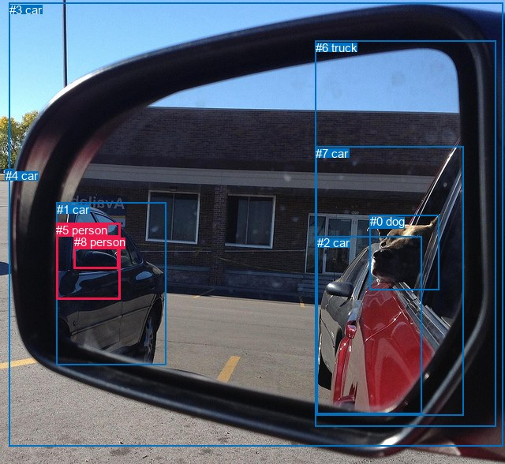
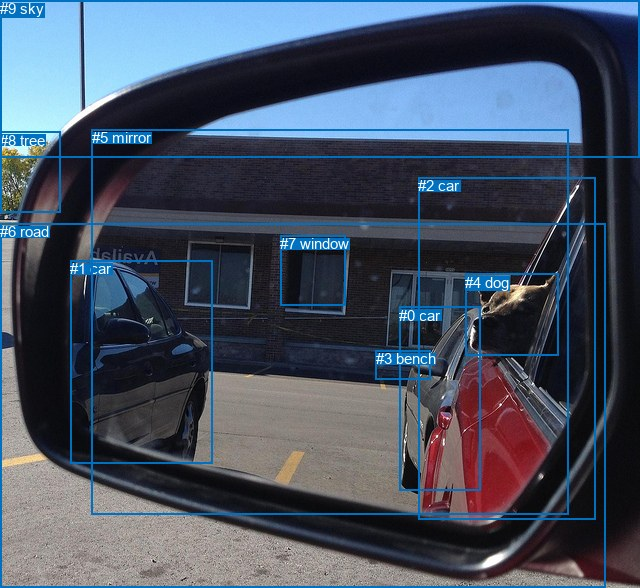

# 图片 1857：2403151.jpg

随机样本序号：418。图片 SHA256：`a0c9dc87e3341b576555e62ffa9592584875d4eb75052ddbe14ba198b9e71edf`。

红色框表示人，蓝色框表示其他物体。两个模式分别保留自身框编号，可依据位置比较对应对象。

## 自动检测框与输出

人的框编号：`[5, 8]`。状态：`ok`。

### 自动检测全部物体框

| 编号 | 类别 | 是否为人 | 检测分数 | 像素坐标 xyxy |
|---|---|---|---|---|
| 0 | dog | False | 0.9981 | 468.5, 272.1, 557.0, 367.1 |
| 1 | car | False | 0.9555 | 71.5, 256.6, 210.3, 462.1 |
| 2 | car | False | 0.8200 | 401.9, 299.3, 534.2, 524.1 |
| 3 | car | False | 0.7042 | 11.7, 3.7, 637.0, 566.0 |
| 4 | car | False | 0.6780 | 6.7, 214.1, 17.6, 219.3 |
| 5 | person | True | 0.6143 | 71.1, 282.5, 152.3, 379.0 |
| 6 | truck | False | 0.5936 | 399.6, 51.7, 628.7, 540.9 |
| 7 | car | False | 0.5931 | 400.3, 185.8, 587.6, 526.6 |
| 8 | person | True | 0.5439 | 93.6, 298.0, 150.5, 340.6 |

### 自动检测 Top50 人相关候选

评分物体对：72；人相关物体对：30；输出关系：50。

| 排名 | 主语编号与类别 | 关系 | 宾语编号与类别 | 类型 | 人与人 | 排序分数 | 原始融合 logit |
|---|---|---|---|---|---|---|---|
| 1 | #5 person | on | #1 car | spatial | False | 0.95182 | 2.9834 |
| 2 | #8 person | on | #1 car | spatial | False | 0.95102 | 2.9660 |
| 3 | #8 person | on | #5 person | spatial | True | 0.88912 | 2.0818 |
| 4 | #5 person | in | #3 car | spatial | False | 0.56280 | 0.2525 |
| 5 | #1 car | in | #5 person | spatial | False | 0.54062 | 0.1628 |
| 6 | #5 person | on | #8 person | spatial | True | 0.48242 | -0.0704 |
| 7 | #8 person | standing on | #1 car | semantic | False | 0.44370 | -0.2262 |
| 8 | #5 person | standing on | #1 car | semantic | False | 0.41799 | -0.3310 |
| 9 | #8 person | in | #3 car | spatial | False | 0.39363 | -0.4321 |
| 10 | #0 dog | looking at | #5 person | semantic | False | 0.36493 | -0.5540 |
| 11 | #1 car | in | #8 person | spatial | False | 0.32362 | -0.7372 |
| 12 | #5 person | wearing | #8 person | semantic | True | 0.27826 | -0.9531 |
| 13 | #8 person | wearing | #5 person | semantic | True | 0.23703 | -1.1690 |
| 14 | #5 person | on | #7 car | spatial | False | 0.18899 | -1.4566 |
| 15 | #1 car | wearing | #5 person | semantic | False | 0.18458 | -1.4856 |
| 16 | #0 dog | looking at | #8 person | semantic | False | 0.15686 | -1.6818 |
| 17 | #5 person | on | #2 car | spatial | False | 0.12244 | -1.9695 |
| 18 | #8 person | on | #7 car | spatial | False | 0.11223 | -2.0681 |
| 19 | #5 person | on | #6 truck | spatial | False | 0.10613 | -2.1309 |
| 20 | #8 person | on | #4 car | spatial | False | 0.09143 | -2.2963 |
| 21 | #5 person | on | #4 car | spatial | False | 0.09092 | -2.3025 |
| 22 | #5 person | looking at | #3 car | semantic | False | 0.08405 | -2.3885 |
| 23 | #1 car | wearing | #8 person | semantic | False | 0.08106 | -2.4281 |
| 24 | #8 person | on | #2 car | spatial | False | 0.07869 | -2.4603 |
| 25 | #0 dog | in | #5 person | spatial | False | 0.07186 | -2.5584 |
| 26 | #8 person | on | #6 truck | spatial | False | 0.05994 | -2.7525 |
| 27 | #4 car | on | #5 person | spatial | False | 0.05671 | -2.8115 |
| 28 | #8 person | looking at | #3 car | semantic | False | 0.05438 | -2.8559 |
| 29 | #8 person | on | #0 dog | spatial | False | 0.05267 | -2.8896 |
| 30 | #4 car | on | #8 person | spatial | False | 0.03381 | -3.3525 |
| 31 | #5 person | on | #0 dog | spatial | False | 0.03344 | -3.3641 |
| 32 | #3 car | on | #5 person | spatial | False | 0.03136 | -3.4304 |
| 33 | #0 dog | in | #8 person | spatial | False | 0.02941 | -3.4965 |
| 34 | #5 person | looking at | #0 dog | semantic | False | 0.02696 | -3.5862 |
| 35 | #7 car | in | #5 person | spatial | False | 0.02593 | -3.6259 |
| 36 | #2 car | in | #5 person | spatial | False | 0.02237 | -3.7773 |
| 37 | #3 car | on | #8 person | spatial | False | 0.01938 | -3.9240 |
| 38 | #5 person | looking at | #4 car | semantic | False | 0.01880 | -3.9548 |
| 39 | #6 truck | on | #5 person | spatial | False | 0.01782 | -4.0094 |
| 40 | #5 person | standing on | #7 car | semantic | False | 0.01782 | -4.0097 |
| 41 | #5 person | looking at | #6 truck | semantic | False | 0.01567 | -4.1403 |
| 42 | #5 person | standing on | #2 car | semantic | False | 0.01478 | -4.1999 |
| 43 | #7 car | in | #8 person | spatial | False | 0.01390 | -4.2622 |
| 44 | #8 person | looking at | #0 dog | semantic | False | 0.01330 | -4.3069 |
| 45 | #8 person | standing on | #7 car | semantic | False | 0.01106 | -4.4929 |
| 46 | #2 car | in | #8 person | spatial | False | 0.01096 | -4.5027 |
| 47 | #6 truck | in | #8 person | spatial | False | 0.00954 | -4.6431 |
| 48 | #8 person | standing on | #2 car | semantic | False | 0.00872 | -4.7335 |
| 49 | #3 car | holding | #5 person | semantic | False | 0.00689 | -4.9703 |
| 50 | #8 person | looking at | #6 truck | semantic | False | 0.00659 | -5.0150 |

### 自动检测逐条人相关 GT 核验

本图没有人相关 GT，R@50 无分母；预测候选继续展示。

## 真实框与输出

人的框编号：`[]`。

### 真实框全部物体框

| 编号 | 类别 | 是否为人 | 检测分数 | 像素坐标 xyxy |
|---|---|---|---|---|
| 0 | car | False | GT | 399.0, 307.0, 480.0, 491.0 |
| 1 | car | False | GT | 70.0, 260.0, 212.0, 463.0 |
| 2 | car | False | GT | 418.0, 177.0, 595.0, 519.0 |
| 3 | bench | False | GT | 376.0, 350.0, 431.0, 379.0 |
| 4 | dog | False | GT | 465.0, 274.0, 558.0, 356.0 |
| 5 | mirror | False | GT | 92.0, 129.0, 569.0, 514.0 |
| 6 | road | False | GT | 0.0, 223.0, 606.0, 588.0 |
| 7 | window | False | GT | 280.0, 235.0, 345.0, 306.0 |
| 8 | tree | False | GT | 0.0, 132.0, 61.0, 212.0 |
| 9 | sky | False | GT | 0.0, 0.0, 640.0, 157.0 |

### 真实框 Top50 人相关候选

评分物体对：0；人相关物体对：0；输出关系：0。

| 排名 | 主语编号与类别 | 关系 | 宾语编号与类别 | 类型 | 人与人 | 排序分数 | 原始融合 logit |
|---|---|---|---|---|---|---|---|

### 真实框逐条人相关 GT 核验

本图没有人相关 GT，R@50 无分母；预测候选继续展示。

## 全部人相关 GT

| 主语编号与类别 | 关系 | 宾语编号与类别 |
|---|---|---|

原始记录、全部人相关物体对的两项预测与分项分数见 [逐图证据 JSON](../evidence/cases/1857.json)。全部56类 logits 保留于本机 HOR/output/random500/logits/。

<!-- HOR_COMPLETE_RESULTS -->

## 六组条件的完整输出对照

以下保留同一图片三种框与候选模式、两种谓词输出规则的全部 Top50。框编号各自在所属模式内解释。

### 自动检测框完整枚举：空间与语义各保留一个谓词

| 排名 | 主语编号与类别 | 谓词 | 宾语编号与类别 | 分组 | 排序分数 | predicate logit | pair logit |
|---|---|---|---|---|---|---|---|
| 1 | #5 person | on | #1 car | spatial | 0.9518177 | 2.8240991 | 0.1592810 |
| 2 | #8 person | on | #1 car | spatial | 0.9510155 | 2.7209368 | 0.2450900 |
| 3 | #8 person | on | #5 person | spatial | 0.8891190 | 2.3707318 | -0.2889583 |
| 4 | #5 person | in | #3 car | spatial | 0.5628020 | 0.7525635 | -0.5000218 |
| 5 | #1 car | in | #5 person | spatial | 0.5406178 | 0.4923458 | -0.3295160 |
| 6 | #5 person | on | #8 person | spatial | 0.4824189 | 0.4972844 | -0.5676379 |
| 7 | #8 person | standing on | #1 car | semantic | 0.4436987 | -0.4712543 | 0.2450900 |
| 8 | #5 person | standing on | #1 car | semantic | 0.4179856 | -0.4903293 | 0.1592810 |
| 9 | #8 person | in | #3 car | spatial | 0.3936273 | 0.1744142 | -0.6065047 |
| 10 | #0 dog | looking at | #5 person | semantic | 0.3649282 | 0.1292748 | -0.6833121 |
| 11 | #1 car | in | #8 person | spatial | 0.3236199 | -0.3929081 | -0.3442773 |
| 12 | #5 person | wearing | #8 person | semantic | 0.2782626 | -0.3854580 | -0.5676379 |
| 13 | #8 person | wearing | #5 person | semantic | 0.2370301 | -0.8800728 | -0.2889583 |
| 14 | #5 person | on | #7 car | spatial | 0.1889887 | -0.7470868 | -0.7095079 |
| 15 | #1 car | wearing | #5 person | semantic | 0.1845814 | -1.1560948 | -0.3295160 |
| 16 | #0 dog | looking at | #8 person | semantic | 0.1568559 | -0.8967907 | -0.7850195 |
| 17 | #5 person | on | #2 car | spatial | 0.1224432 | -1.0670214 | -0.9024734 |
| 18 | #8 person | on | #7 car | spatial | 0.1122335 | -1.3961191 | -0.6720086 |
| 19 | #5 person | on | #6 truck | spatial | 0.1061291 | -1.2804601 | -0.8504454 |
| 20 | #8 person | on | #4 car | spatial | 0.0914309 | -0.6878309 | -1.6084571 |
| 21 | #5 person | on | #4 car | spatial | 0.0909200 | -0.7943223 | -1.5081308 |
| 22 | #5 person | looking at | #3 car | semantic | 0.0840518 | -1.8885045 | -0.5000218 |
| 23 | #1 car | wearing | #8 person | semantic | 0.0810560 | -2.0838075 | -0.3442773 |
| 24 | #8 person | on | #2 car | spatial | 0.0786913 | -1.5748711 | -0.8853921 |
| 25 | #0 dog | in | #5 person | spatial | 0.0718628 | -1.8751090 | -0.6833121 |
| 26 | #8 person | on | #6 truck | spatial | 0.0599431 | -1.9424243 | -0.8101196 |
| 27 | #4 car | on | #5 person | spatial | 0.0567072 | -1.3611906 | -1.4502854 |
| 28 | #8 person | looking at | #3 car | semantic | 0.0543756 | -2.2494252 | -0.6065047 |
| 29 | #8 person | on | #0 dog | spatial | 0.0526715 | -1.9212241 | -0.9683470 |
| 30 | #4 car | on | #8 person | spatial | 0.0338140 | -1.6268566 | -1.7256259 |
| 31 | #5 person | on | #0 dog | spatial | 0.0334351 | -2.2199607 | -1.1441801 |
| 32 | #3 car | on | #5 person | spatial | 0.0313595 | -2.3394675 | -1.0909098 |
| 33 | #0 dog | in | #8 person | spatial | 0.0294122 | -2.7114718 | -0.7850195 |
| 34 | #5 person | looking at | #0 dog | semantic | 0.0269563 | -2.4420335 | -1.1441801 |
| 35 | #7 car | in | #5 person | spatial | 0.0259347 | -2.6031473 | -1.0227512 |
| 36 | #2 car | in | #5 person | spatial | 0.0223719 | -2.7236440 | -1.0536809 |
| 37 | #3 car | on | #8 person | spatial | 0.0193796 | -2.7461119 | -1.1778527 |
| 38 | #5 person | looking at | #4 car | semantic | 0.0188031 | -2.4466200 | -1.5081308 |
| 39 | #6 truck | on | #5 person | spatial | 0.0178215 | -2.4837911 | -1.5255784 |
| 40 | #5 person | standing on | #7 car | semantic | 0.0178162 | -3.3001642 | -0.7095079 |
| 41 | #5 person | looking at | #6 truck | semantic | 0.0156691 | -3.2898231 | -0.8504454 |
| 42 | #5 person | standing on | #2 car | semantic | 0.0147754 | -3.2974348 | -0.9024734 |
| 43 | #7 car | in | #8 person | spatial | 0.0138954 | -3.1908374 | -1.0713700 |
| 44 | #8 person | looking at | #0 dog | semantic | 0.0132961 | -3.3385496 | -0.9683470 |
| 45 | #8 person | standing on | #7 car | semantic | 0.0110638 | -3.8209386 | -0.6720086 |
| 46 | #2 car | in | #8 person | spatial | 0.0109576 | -3.3787913 | -1.1239096 |
| 47 | #6 truck | in | #8 person | spatial | 0.0095357 | -3.0821488 | -1.5609779 |
| 48 | #8 person | standing on | #2 car | semantic | 0.0087190 | -3.8481026 | -0.8853921 |
| 49 | #3 car | holding | #5 person | semantic | 0.0068934 | -3.8793685 | -1.0909098 |
| 50 | #8 person | looking at | #6 truck | semantic | 0.0065942 | -4.2048359 | -0.8101196 |

没有人相关 GT，本条件的召回率无分母。

### 自动检测框完整枚举：每对只保留一个谓词

| 排名 | 主语编号与类别 | 谓词 | 宾语编号与类别 | 分组 | 排序分数 | predicate logit | pair logit |
|---|---|---|---|---|---|---|---|
| 1 | #5 person | on | #1 car | single | 0.9518177 | 2.8240991 | 0.1592810 |
| 2 | #8 person | on | #1 car | single | 0.9510155 | 2.7209368 | 0.2450900 |
| 3 | #8 person | on | #5 person | single | 0.8891190 | 2.3707318 | -0.2889583 |
| 4 | #5 person | in | #3 car | single | 0.5628020 | 0.7525635 | -0.5000218 |
| 5 | #1 car | in | #5 person | single | 0.5406178 | 0.4923458 | -0.3295160 |
| 6 | #5 person | on | #8 person | single | 0.4824189 | 0.4972844 | -0.5676379 |
| 7 | #8 person | in | #3 car | single | 0.3936273 | 0.1744142 | -0.6065047 |
| 8 | #0 dog | looking at | #5 person | single | 0.3649282 | 0.1292748 | -0.6833121 |
| 9 | #1 car | in | #8 person | single | 0.3236199 | -0.3929081 | -0.3442773 |
| 10 | #5 person | on | #7 car | single | 0.1889887 | -0.7470868 | -0.7095079 |
| 11 | #0 dog | looking at | #8 person | single | 0.1568559 | -0.8967907 | -0.7850195 |
| 12 | #5 person | on | #2 car | single | 0.1224432 | -1.0670214 | -0.9024734 |
| 13 | #8 person | on | #7 car | single | 0.1122335 | -1.3961191 | -0.6720086 |
| 14 | #5 person | on | #6 truck | single | 0.1061291 | -1.2804601 | -0.8504454 |
| 15 | #8 person | on | #4 car | single | 0.0914309 | -0.6878309 | -1.6084571 |
| 16 | #5 person | on | #4 car | single | 0.0909200 | -0.7943223 | -1.5081308 |
| 17 | #8 person | on | #2 car | single | 0.0786913 | -1.5748711 | -0.8853921 |
| 18 | #8 person | on | #6 truck | single | 0.0599431 | -1.9424243 | -0.8101196 |
| 19 | #4 car | on | #5 person | single | 0.0567072 | -1.3611906 | -1.4502854 |
| 20 | #8 person | on | #0 dog | single | 0.0526715 | -1.9212241 | -0.9683470 |
| 21 | #4 car | on | #8 person | single | 0.0338140 | -1.6268566 | -1.7256259 |
| 22 | #5 person | on | #0 dog | single | 0.0334351 | -2.2199607 | -1.1441801 |
| 23 | #3 car | on | #5 person | single | 0.0313595 | -2.3394675 | -1.0909098 |
| 24 | #7 car | in | #5 person | single | 0.0259347 | -2.6031473 | -1.0227512 |
| 25 | #2 car | in | #5 person | single | 0.0223719 | -2.7236440 | -1.0536809 |
| 26 | #3 car | on | #8 person | single | 0.0193796 | -2.7461119 | -1.1778527 |
| 27 | #6 truck | on | #5 person | single | 0.0178215 | -2.4837911 | -1.5255784 |
| 28 | #7 car | in | #8 person | single | 0.0138954 | -3.1908374 | -1.0713700 |
| 29 | #2 car | in | #8 person | single | 0.0109576 | -3.3787913 | -1.1239096 |
| 30 | #6 truck | in | #8 person | single | 0.0095357 | -3.0821488 | -1.5609779 |

没有人相关 GT，本条件的召回率无分母。

### 真实框完整枚举：空间与语义各保留一个谓词

| 排名 | 主语编号与类别 | 谓词 | 宾语编号与类别 | 分组 | 排序分数 | predicate logit | pair logit |
|---|---|---|---|---|---|---|---|

没有人相关 GT，本条件的召回率无分母。

### 真实框完整枚举：每对只保留一个谓词

| 排名 | 主语编号与类别 | 谓词 | 宾语编号与类别 | 分组 | 排序分数 | predicate logit | pair logit |
|---|---|---|---|---|---|---|---|

没有人相关 GT，本条件的召回率无分母。

### 真实框400候选：空间与语义各保留一个谓词

| 排名 | 主语编号与类别 | 谓词 | 宾语编号与类别 | 分组 | 排序分数 | predicate logit | pair logit |
|---|---|---|---|---|---|---|---|

没有人相关 GT，本条件的召回率无分母。

### 真实框400候选：每对只保留一个谓词

| 排名 | 主语编号与类别 | 谓词 | 宾语编号与类别 | 分组 | 排序分数 | predicate logit | pair logit |
|---|---|---|---|---|---|---|---|

没有人相关 GT，本条件的召回率无分母。
