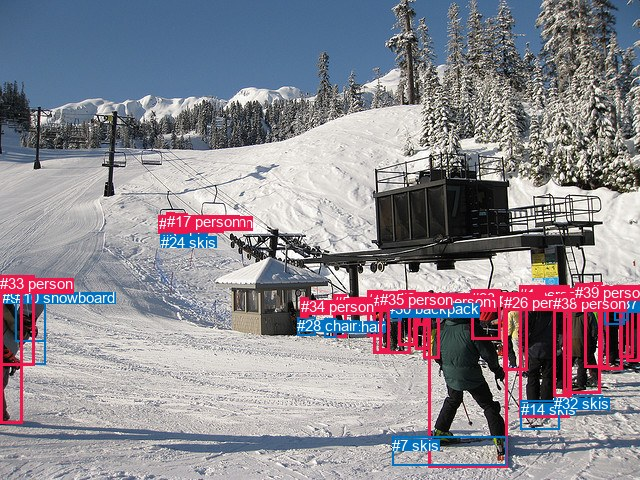
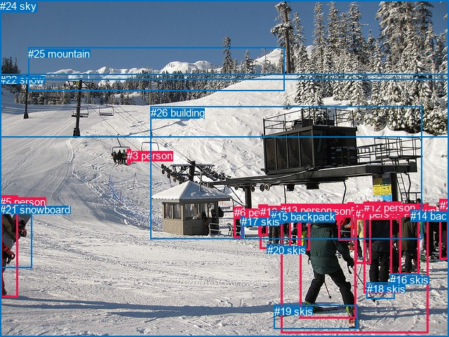

# 图片 1866：2403494.jpg

随机样本序号：183。图片 SHA256：`7cc3c7f7b8412661bb9010a294331533391d99cc637ae25802167600140150a1`。

红色框表示人，蓝色框表示其他物体。两个模式分别保留自身框编号，可依据位置比较对应对象。

## 自动检测框与输出

人的框编号：`[0, 1, 2, 4, 5, 6, 8, 11, 12, 13, 15, 16, 17, 18, 19, 20, 22, 23, 25, 26, 27, 29, 33, 34, 35, 36, 38, 39]`。状态：`ok`。

### 自动检测全部物体框

| 编号 | 类别 | 是否为人 | 检测分数 | 像素坐标 xyxy |
|---|---|---|---|---|
| 0 | person | True | 0.9970 | 428.6, 294.3, 507.9, 467.5 |
| 1 | person | True | 0.9925 | 519.1, 285.7, 569.2, 417.9 |
| 2 | person | True | 0.9845 | 367.6, 290.8, 382.0, 336.1 |
| 3 | skis | False | 0.9717 | 160.7, 230.0, 173.0, 237.5 |
| 4 | person | True | 0.9716 | 563.1, 293.6, 600.7, 393.0 |
| 5 | person | True | 0.9680 | 333.9, 294.1, 346.6, 337.2 |
| 6 | person | True | 0.9627 | 373.6, 292.0, 410.9, 353.7 |
| 7 | skis | False | 0.9602 | 392.4, 436.6, 506.2, 465.5 |
| 8 | person | True | 0.9540 | 158.8, 215.3, 167.7, 233.9 |
| 9 | snowboard | False | 0.9514 | 1.8, 289.3, 45.7, 364.1 |
| 10 | snowboard | False | 0.9069 | 15.3, 289.0, 45.5, 341.2 |
| 11 | person | True | 0.9041 | 600.4, 287.2, 622.2, 369.9 |
| 12 | person | True | 0.8994 | 179.7, 213.7, 187.2, 233.9 |
| 13 | person | True | 0.8971 | 173.3, 213.2, 181.3, 233.3 |
| 14 | skis | False | 0.8820 | 520.6, 400.6, 559.7, 429.7 |
| 15 | person | True | 0.8777 | 0.0, 276.8, 22.7, 423.8 |
| 16 | person | True | 0.8717 | 584.8, 293.7, 608.2, 367.7 |
| 17 | person | True | 0.8695 | 166.8, 212.9, 174.5, 234.0 |
| 18 | person | True | 0.8436 | 626.6, 286.4, 640.0, 361.0 |
| 19 | person | True | 0.8170 | 621.9, 286.8, 635.2, 307.3 |
| 20 | person | True | 0.8001 | 399.0, 290.1, 415.7, 345.6 |
| 21 | chair | False | 0.7955 | 324.7, 318.5, 336.4, 337.4 |
| 22 | person | True | 0.7537 | 415.1, 292.8, 429.1, 349.2 |
| 23 | person | True | 0.7529 | 471.3, 289.9, 500.9, 339.2 |
| 24 | skis | False | 0.7469 | 161.4, 234.0, 173.1, 237.8 |
| 25 | person | True | 0.7402 | 619.2, 286.1, 633.9, 357.6 |
| 26 | person | True | 0.7245 | 504.0, 293.6, 527.9, 370.9 |
| 27 | person | True | 0.7241 | 423.0, 294.1, 439.9, 358.0 |
| 28 | chair | False | 0.6733 | 297.5, 317.4, 315.5, 335.5 |
| 29 | person | True | 0.6535 | 418.2, 292.7, 428.5, 325.0 |
| 30 | backpack | False | 0.6287 | 387.2, 300.2, 401.3, 320.2 |
| 31 | backpack | False | 0.6013 | 604.8, 293.7, 624.0, 324.6 |
| 32 | skis | False | 0.5585 | 554.2, 395.3, 602.8, 405.8 |
| 33 | person | True | 0.5174 | 0.2, 275.2, 34.1, 365.4 |
| 34 | person | True | 0.4991 | 300.7, 297.7, 308.7, 317.3 |
| 35 | person | True | 0.4761 | 379.7, 291.1, 389.2, 350.1 |
| 36 | person | True | 0.4750 | 590.8, 282.5, 602.9, 299.2 |
| 37 | backpack | False | 0.4555 | 614.2, 295.2, 628.5, 320.5 |
| 38 | person | True | 0.4440 | 553.2, 294.6, 571.3, 396.2 |
| 39 | person | True | 0.4341 | 575.4, 283.8, 591.4, 301.1 |

### 自动检测 Top50 人相关候选

评分物体对：1560；人相关物体对：1428；输出关系：50。

| 排名 | 主语编号与类别 | 关系 | 宾语编号与类别 | 类型 | 人与人 | 排序分数 | 原始融合 logit |
|---|---|---|---|---|---|---|---|
| 1 | #15 person | carrying | #10 snowboard | semantic | False | 0.98333 | 4.0771 |
| 2 | #0 person | wearing | #7 skis | semantic | False | 0.98020 | 3.9023 |
| 3 | #15 person | holding | #9 snowboard | semantic | False | 0.97861 | 3.8230 |
| 4 | #11 person | wearing | #31 backpack | semantic | False | 0.97344 | 3.6014 |
| 5 | #17 person | riding | #3 skis | semantic | False | 0.97165 | 3.5345 |
| 6 | #0 person | on | #7 skis | spatial | False | 0.97057 | 3.4957 |
| 7 | #15 person | carrying | #33 person | semantic | True | 0.97021 | 3.4835 |
| 8 | #8 person | riding | #3 skis | semantic | False | 0.96781 | 3.4033 |
| 9 | #1 person | wearing | #14 skis | semantic | False | 0.95946 | 3.1640 |
| 10 | #25 person | wearing | #19 person | semantic | True | 0.95936 | 3.1614 |
| 11 | #17 person | on | #3 skis | spatial | False | 0.95467 | 3.0474 |
| 12 | #8 person | on | #3 skis | spatial | False | 0.95369 | 3.0250 |
| 13 | #1 person | on | #32 skis | spatial | False | 0.94110 | 2.7712 |
| 14 | #6 person | wearing | #30 backpack | semantic | False | 0.94094 | 2.7684 |
| 15 | #1 person | wearing | #32 skis | semantic | False | 0.94032 | 2.7572 |
| 16 | #11 person | in | #31 backpack | spatial | False | 0.94024 | 2.7557 |
| 17 | #1 person | on | #14 skis | spatial | False | 0.94009 | 2.7532 |
| 18 | #25 person | wearing | #37 backpack | semantic | False | 0.93418 | 2.6527 |
| 19 | #33 person | holding | #10 snowboard | semantic | False | 0.93360 | 2.6433 |
| 20 | #17 person | riding | #8 person | semantic | True | 0.92869 | 2.5667 |
| 21 | #17 person | on | #8 person | spatial | True | 0.92603 | 2.5272 |
| 22 | #18 person | wearing | #19 person | semantic | True | 0.92302 | 2.4842 |
| 23 | #12 person | on | #13 person | spatial | True | 0.92150 | 2.4629 |
| 24 | #13 person | on | #12 person | spatial | True | 0.92036 | 2.4473 |
| 25 | #13 person | on | #17 person | spatial | True | 0.91932 | 2.4331 |
| 26 | #13 person | riding | #12 person | semantic | True | 0.91583 | 2.3870 |
| 27 | #22 person | wearing | #29 person | semantic | True | 0.91516 | 2.3783 |
| 28 | #17 person | on | #13 person | spatial | True | 0.90663 | 2.2732 |
| 29 | #15 person | in | #33 person | spatial | True | 0.90649 | 2.2715 |
| 30 | #11 person | wearing | #37 backpack | semantic | False | 0.90592 | 2.2649 |
| 31 | #25 person | in | #19 person | spatial | True | 0.90551 | 2.2600 |
| 32 | #13 person | riding | #17 person | semantic | True | 0.90535 | 2.2582 |
| 33 | #38 person | wearing | #32 skis | semantic | False | 0.89863 | 2.1821 |
| 34 | #33 person | on | #9 snowboard | spatial | False | 0.89551 | 2.1483 |
| 35 | #17 person | riding | #13 person | semantic | True | 0.89498 | 2.1426 |
| 36 | #8 person | on | #17 person | spatial | True | 0.88525 | 2.0431 |
| 37 | #8 person | on | #24 skis | spatial | False | 0.88409 | 2.0318 |
| 38 | #4 person | wearing | #39 person | semantic | True | 0.88243 | 2.0157 |
| 39 | #34 person | standing on | #28 chair | semantic | False | 0.87641 | 1.9589 |
| 40 | #6 person | in | #30 backpack | spatial | False | 0.86601 | 1.8662 |
| 41 | #33 person | holding | #9 snowboard | semantic | False | 0.86163 | 1.8289 |
| 42 | #13 person | on | #3 skis | spatial | False | 0.86049 | 1.8194 |
| 43 | #25 person | in | #37 backpack | spatial | False | 0.85345 | 1.7619 |
| 44 | #22 person | in | #29 person | spatial | True | 0.84326 | 1.6827 |
| 45 | #18 person | in | #19 person | spatial | True | 0.83370 | 1.6121 |
| 46 | #15 person | in | #9 snowboard | spatial | False | 0.83083 | 1.5915 |
| 47 | #8 person | riding | #17 person | semantic | True | 0.83037 | 1.5883 |
| 48 | #17 person | on | #24 skis | spatial | False | 0.82929 | 1.5806 |
| 49 | #12 person | riding | #13 person | semantic | True | 0.82367 | 1.5414 |
| 50 | #15 person | on | #10 snowboard | spatial | False | 0.81380 | 1.4749 |

### 自动检测逐条人相关 GT 核验

R@50：50.00%；命中 1/2。

| GT 主语编号 | GT 关系 | GT 宾语编号 | 结果阶段 | 匹配预测主语编号 | 匹配预测宾语编号 |
|---|---|---|---|---|---|
| 11 | wearing | 19 | hit50 | [0] | [7] |
| 12 | standing on | 18 | wrong_predicate | [1] | [14] |

## 真实框与输出

人的框编号：`[0, 1, 2, 3, 4, 5, 6, 7, 8, 9, 10, 11, 12, 13]`。

### 真实框全部物体框

| 编号 | 类别 | 是否为人 | 检测分数 | 像素坐标 xyxy |
|---|---|---|---|---|
| 0 | person | True | GT | 425.0, 296.0, 442.0, 356.0 |
| 1 | person | True | GT | 482.0, 291.0, 502.0, 342.0 |
| 2 | person | True | GT | 627.0, 284.0, 640.0, 370.0 |
| 3 | person | True | GT | 181.0, 213.0, 186.0, 234.0 |
| 4 | person | True | GT | 496.0, 289.0, 505.0, 304.0 |
| 5 | person | True | GT | 0.0, 279.0, 26.0, 424.0 |
| 6 | person | True | GT | 334.0, 294.0, 346.0, 338.0 |
| 7 | person | True | GT | 506.0, 296.0, 528.0, 376.0 |
| 8 | person | True | GT | 368.0, 291.0, 382.0, 335.0 |
| 9 | person | True | GT | 556.0, 292.0, 597.0, 392.0 |
| 10 | person | True | GT | 371.0, 293.0, 414.0, 354.0 |
| 11 | person | True | GT | 427.0, 292.0, 507.0, 453.0 |
| 12 | person | True | GT | 519.0, 287.0, 572.0, 417.0 |
| 13 | person | True | GT | 400.0, 291.0, 610.0, 475.0 |
| 14 | backpack | False | GT | 585.0, 299.0, 600.0, 310.0 |
| 15 | backpack | False | GT | 386.0, 300.0, 406.0, 319.0 |
| 16 | skis | False | GT | 556.0, 390.0, 598.0, 404.0 |
| 17 | skis | False | GT | 344.0, 307.0, 348.0, 337.0 |
| 18 | skis | False | GT | 523.0, 403.0, 563.0, 426.0 |
| 19 | skis | False | GT | 391.0, 435.0, 509.0, 469.0 |
| 20 | skis | False | GT | 381.0, 348.0, 405.0, 354.0 |
| 21 | snowboard | False | GT | 0.0, 290.0, 46.0, 381.0 |
| 22 | snow | False | GT | 0.0, 105.0, 640.0, 480.0 |
| 23 | tree | False | GT | 0.0, 0.0, 640.0, 195.0 |
| 24 | sky | False | GT | 0.0, 0.0, 640.0, 114.0 |
| 25 | mountain | False | GT | 40.0, 68.0, 405.0, 130.0 |
| 26 | building | False | GT | 215.0, 152.0, 602.0, 341.0 |

### 真实框 Top50 人相关候选

评分物体对：702；人相关物体对：546；输出关系：50。

| 排名 | 主语编号与类别 | 关系 | 宾语编号与类别 | 类型 | 人与人 | 排序分数 | 原始融合 logit |
|---|---|---|---|---|---|---|---|
| 1 | #9 person | wearing | #14 backpack | semantic | False | 0.98509 | 4.1905 |
| 2 | #5 person | holding | #21 snowboard | semantic | False | 0.98431 | 4.1391 |
| 3 | #10 person | wearing | #20 skis | semantic | False | 0.98420 | 4.1319 |
| 4 | #10 person | wearing | #15 backpack | semantic | False | 0.98196 | 3.9970 |
| 5 | #11 person | wearing | #19 skis | semantic | False | 0.96696 | 3.3764 |
| 6 | #12 person | wearing | #18 skis | semantic | False | 0.96504 | 3.3180 |
| 7 | #11 person | on | #19 skis | spatial | False | 0.96277 | 3.2528 |
| 8 | #13 person | wearing | #19 skis | semantic | False | 0.95869 | 3.1444 |
| 9 | #13 person | on | #19 skis | spatial | False | 0.95067 | 2.9587 |
| 10 | #12 person | on | #16 skis | spatial | False | 0.94490 | 2.8420 |
| 11 | #9 person | wearing | #16 skis | semantic | False | 0.94443 | 2.8329 |
| 12 | #12 person | wearing | #16 skis | semantic | False | 0.94441 | 2.8326 |
| 13 | #3 person | in | #22 snow | spatial | False | 0.94419 | 2.8283 |
| 14 | #9 person | on | #16 skis | spatial | False | 0.94275 | 2.8014 |
| 15 | #10 person | standing on | #22 snow | semantic | False | 0.93929 | 2.7391 |
| 16 | #6 person | holding | #17 skis | semantic | False | 0.93921 | 2.7377 |
| 17 | #12 person | on | #18 skis | spatial | False | 0.93496 | 2.6655 |
| 18 | #13 person | wearing | #18 skis | semantic | False | 0.93473 | 2.6617 |
| 19 | #12 person | standing on | #22 snow | semantic | False | 0.93452 | 2.6583 |
| 20 | #10 person | on | #20 skis | spatial | False | 0.92647 | 2.5337 |
| 21 | #3 person | hanging from | #26 building | spatial | False | 0.92324 | 2.4873 |
| 22 | #9 person | standing on | #22 snow | semantic | False | 0.92291 | 2.4826 |
| 23 | #1 person | wearing | #4 person | semantic | True | 0.92080 | 2.4533 |
| 24 | #11 person | standing on | #22 snow | semantic | False | 0.90833 | 2.2935 |
| 25 | #10 person | in | #15 backpack | spatial | False | 0.90817 | 2.2915 |
| 26 | #13 person | on | #18 skis | spatial | False | 0.90300 | 2.2310 |
| 27 | #13 person | on | #22 snow | spatial | False | 0.90278 | 2.2285 |
| 28 | #13 person | standing on | #22 snow | semantic | False | 0.90066 | 2.2046 |
| 29 | #5 person | standing on | #22 snow | semantic | False | 0.89399 | 2.1322 |
| 30 | #9 person | in | #14 backpack | spatial | False | 0.88245 | 2.0158 |
| 31 | #11 person | on | #22 snow | spatial | False | 0.87412 | 1.9379 |
| 32 | #6 person | standing on | #22 snow | semantic | False | 0.87259 | 1.9241 |
| 33 | #6 person | on | #22 snow | spatial | False | 0.85174 | 1.7483 |
| 34 | #13 person | on | #16 skis | spatial | False | 0.84996 | 1.7343 |
| 35 | #5 person | on | #22 snow | spatial | False | 0.84451 | 1.6922 |
| 36 | #8 person | standing on | #22 snow | semantic | False | 0.84165 | 1.6706 |
| 37 | #10 person | on | #22 snow | spatial | False | 0.83667 | 1.6337 |
| 38 | #13 person | wearing | #16 skis | semantic | False | 0.83121 | 1.5942 |
| 39 | #21 snowboard | on | #5 person | spatial | False | 0.82971 | 1.5836 |
| 40 | #10 person | standing on | #26 building | semantic | False | 0.82934 | 1.5810 |
| 41 | #12 person | on | #22 snow | spatial | False | 0.82708 | 1.5651 |
| 42 | #5 person | on | #21 snowboard | spatial | False | 0.81569 | 1.4874 |
| 43 | #21 snowboard | carrying | #5 person | semantic | False | 0.80122 | 1.3939 |
| 44 | #3 person | standing on | #22 snow | semantic | False | 0.79271 | 1.3413 |
| 45 | #11 person | wearing | #0 person | semantic | True | 0.77737 | 1.2504 |
| 46 | #6 person | looking at | #26 building | semantic | False | 0.76551 | 1.1831 |
| 47 | #9 person | wearing | #18 skis | semantic | False | 0.76435 | 1.1767 |
| 48 | #3 person | in | #23 tree | spatial | False | 0.76094 | 1.1579 |
| 49 | #6 person | on | #17 skis | spatial | False | 0.73859 | 1.0387 |
| 50 | #9 person | on | #22 snow | spatial | False | 0.73715 | 1.0312 |

### 真实框逐条人相关 GT 核验

R@50：50.00%；命中 1/2。

| GT 主语编号 | GT 关系 | GT 宾语编号 | 结果阶段 | 匹配预测主语编号 | 匹配预测宾语编号 |
|---|---|---|---|---|---|
| 11 | wearing | 19 | hit50 | [11] | [19] |
| 12 | standing on | 18 | wrong_predicate | [12] | [18] |

## 全部人相关 GT

| 主语编号与类别 | 关系 | 宾语编号与类别 |
|---|---|---|
| #11 person | wearing | #19 skis |
| #12 person | standing on | #18 skis |

原始记录、全部人相关物体对的两项预测与分项分数见 [逐图证据 JSON](../evidence/cases/1866.json)。全部56类 logits 保留于本机 HOR/output/random500/logits/。

<!-- HOR_COMPLETE_RESULTS -->

## 六组条件的完整输出对照

以下保留同一图片三种框与候选模式、两种谓词输出规则的全部 Top50。框编号各自在所属模式内解释。

### 自动检测框完整枚举：空间与语义各保留一个谓词

| 排名 | 主语编号与类别 | 谓词 | 宾语编号与类别 | 分组 | 排序分数 | predicate logit | pair logit |
|---|---|---|---|---|---|---|---|
| 1 | #15 person | carrying | #10 snowboard | semantic | 0.9833258 | 3.7986932 | 0.2783837 |
| 2 | #0 person | wearing | #7 skis | semantic | 0.9802039 | 3.7785554 | 0.1237210 |
| 3 | #15 person | holding | #9 snowboard | semantic | 0.9786050 | 3.6422896 | 0.1806839 |
| 4 | #11 person | wearing | #31 backpack | semantic | 0.9734389 | 3.4457345 | 0.1556536 |
| 5 | #17 person | riding | #3 skis | semantic | 0.9716527 | 3.7742257 | -0.2397580 |
| 6 | #0 person | on | #7 skis | spatial | 0.9705657 | 3.3719974 | 0.1237210 |
| 7 | #15 person | carrying | #33 person | semantic | 0.9702141 | 3.3956561 | 0.0878245 |
| 8 | #8 person | riding | #3 skis | semantic | 0.9678063 | 3.6545939 | -0.2513334 |
| 9 | #1 person | wearing | #14 skis | semantic | 0.9594557 | 3.2354097 | -0.0714371 |
| 10 | #25 person | wearing | #19 person | semantic | 0.9593562 | 3.3371053 | -0.1756881 |
| 11 | #17 person | on | #3 skis | spatial | 0.9546719 | 3.2871971 | -0.2397580 |
| 12 | #8 person | on | #3 skis | spatial | 0.9536897 | 3.2763081 | -0.2513334 |
| 13 | #1 person | on | #32 skis | spatial | 0.9410992 | 2.8515553 | -0.0803618 |
| 14 | #6 person | wearing | #30 backpack | semantic | 0.9409419 | 2.7557449 | 0.0126154 |
| 15 | #1 person | wearing | #32 skis | semantic | 0.9403211 | 2.8376036 | -0.0803618 |
| 16 | #11 person | in | #31 backpack | spatial | 0.9402369 | 2.6000886 | 0.1556536 |
| 17 | #1 person | on | #14 skis | spatial | 0.9400929 | 2.8246207 | -0.0714371 |
| 18 | #25 person | wearing | #37 backpack | semantic | 0.9341778 | 2.6779585 | -0.0252489 |
| 19 | #33 person | holding | #10 snowboard | semantic | 0.9335985 | 2.7739038 | -0.1305775 |
| 20 | #17 person | riding | #8 person | semantic | 0.9286875 | 2.8457952 | -0.2790959 |
| 21 | #17 person | on | #8 person | spatial | 0.9260282 | 2.8063169 | -0.2790959 |
| 22 | #18 person | wearing | #19 person | semantic | 0.9230242 | 2.6353798 | -0.1512154 |
| 23 | #12 person | on | #13 person | spatial | 0.9214992 | 2.7524476 | -0.2895543 |
| 24 | #13 person | on | #12 person | spatial | 0.9203607 | 2.6635938 | -0.2163352 |
| 25 | #13 person | on | #17 person | spatial | 0.9193177 | 2.6916862 | -0.2585731 |
| 26 | #13 person | riding | #12 person | semantic | 0.9158321 | 2.6033545 | -0.2163352 |
| 27 | #22 person | wearing | #29 person | semantic | 0.9151607 | 2.7939596 | -0.4156190 |
| 28 | #17 person | on | #13 person | spatial | 0.9066334 | 2.5541177 | -0.2809120 |
| 29 | #15 person | in | #33 person | spatial | 0.9064884 | 2.1836681 | 0.0878245 |
| 30 | #11 person | wearing | #37 backpack | semantic | 0.9059242 | 2.0914822 | 0.1733720 |
| 31 | #25 person | in | #19 person | spatial | 0.9055098 | 2.4356899 | -0.1756881 |
| 32 | #13 person | riding | #17 person | semantic | 0.9053532 | 2.5167460 | -0.2585731 |
| 33 | #38 person | wearing | #32 skis | semantic | 0.8986301 | 2.1235375 | 0.0585578 |
| 34 | #33 person | on | #9 snowboard | spatial | 0.8955055 | 2.3672571 | -0.2190036 |
| 35 | #17 person | riding | #13 person | semantic | 0.8949779 | 2.4235401 | -0.2809120 |
| 36 | #8 person | on | #17 person | spatial | 0.8852504 | 2.3409014 | -0.2977836 |
| 37 | #8 person | on | #24 skis | spatial | 0.8840944 | 2.2692499 | -0.2374631 |
| 38 | #4 person | wearing | #39 person | semantic | 0.8824323 | 1.9043155 | 0.1113523 |
| 39 | #34 person | standing on | #28 chair | semantic | 0.8764145 | 2.1763783 | -0.2174728 |
| 40 | #6 person | in | #30 backpack | spatial | 0.8660145 | 1.8535547 | 0.0126154 |
| 41 | #33 person | holding | #9 snowboard | semantic | 0.8616268 | 2.0478716 | -0.2190036 |
| 42 | #13 person | on | #3 skis | spatial | 0.8604901 | 2.0451446 | -0.2257773 |
| 43 | #25 person | in | #37 backpack | spatial | 0.8534513 | 1.7871799 | -0.0252489 |
| 44 | #22 person | in | #29 person | spatial | 0.8432553 | 2.0982709 | -0.4156190 |
| 45 | #18 person | in | #19 person | spatial | 0.8336980 | 1.7632813 | -0.1512154 |
| 46 | #15 person | in | #9 snowboard | spatial | 0.8308257 | 1.4108067 | 0.1806839 |
| 47 | #8 person | riding | #17 person | semantic | 0.8303723 | 1.8860517 | -0.2977836 |
| 48 | #17 person | on | #24 skis | spatial | 0.8292931 | 1.8095698 | -0.2289445 |
| 49 | #12 person | riding | #13 person | semantic | 0.8236749 | 1.8310008 | -0.2895543 |
| 50 | #15 person | on | #10 snowboard | spatial | 0.8138041 | 1.1965370 | 0.2783837 |

GT 命中：1/2，R@50=50.00%。

| GT主语 | GT谓词 | GT宾语 | 结果阶段 | 匹配主语框 | 匹配宾语框 |
|---|---|---|---|---|---|
| 11 | wearing | 19 | hit50 | [0] | [7] |
| 12 | standing on | 18 | wrong_predicate | [1] | [14] |

### 自动检测框完整枚举：每对只保留一个谓词

| 排名 | 主语编号与类别 | 谓词 | 宾语编号与类别 | 分组 | 排序分数 | predicate logit | pair logit |
|---|---|---|---|---|---|---|---|
| 1 | #15 person | carrying | #10 snowboard | single | 0.9833258 | 3.7986932 | 0.2783837 |
| 2 | #0 person | wearing | #7 skis | single | 0.9802039 | 3.7785554 | 0.1237210 |
| 3 | #15 person | holding | #9 snowboard | single | 0.9786050 | 3.6422896 | 0.1806839 |
| 4 | #11 person | wearing | #31 backpack | single | 0.9734389 | 3.4457345 | 0.1556536 |
| 5 | #17 person | riding | #3 skis | single | 0.9716527 | 3.7742257 | -0.2397580 |
| 6 | #15 person | carrying | #33 person | single | 0.9702141 | 3.3956561 | 0.0878245 |
| 7 | #8 person | riding | #3 skis | single | 0.9678063 | 3.6545939 | -0.2513334 |
| 8 | #1 person | wearing | #14 skis | single | 0.9594557 | 3.2354097 | -0.0714371 |
| 9 | #25 person | wearing | #19 person | single | 0.9593562 | 3.3371053 | -0.1756881 |
| 10 | #1 person | on | #32 skis | single | 0.9410992 | 2.8515553 | -0.0803618 |
| 11 | #6 person | wearing | #30 backpack | single | 0.9409419 | 2.7557449 | 0.0126154 |
| 12 | #25 person | wearing | #37 backpack | single | 0.9341778 | 2.6779585 | -0.0252489 |
| 13 | #33 person | holding | #10 snowboard | single | 0.9335985 | 2.7739038 | -0.1305775 |
| 14 | #17 person | riding | #8 person | single | 0.9286875 | 2.8457952 | -0.2790959 |
| 15 | #18 person | wearing | #19 person | single | 0.9230242 | 2.6353798 | -0.1512154 |
| 16 | #12 person | on | #13 person | single | 0.9214992 | 2.7524476 | -0.2895543 |
| 17 | #13 person | on | #12 person | single | 0.9203607 | 2.6635938 | -0.2163352 |
| 18 | #13 person | on | #17 person | single | 0.9193177 | 2.6916862 | -0.2585731 |
| 19 | #22 person | wearing | #29 person | single | 0.9151607 | 2.7939596 | -0.4156190 |
| 20 | #17 person | on | #13 person | single | 0.9066334 | 2.5541177 | -0.2809120 |
| 21 | #11 person | wearing | #37 backpack | single | 0.9059242 | 2.0914822 | 0.1733720 |
| 22 | #38 person | wearing | #32 skis | single | 0.8986301 | 2.1235375 | 0.0585578 |
| 23 | #33 person | on | #9 snowboard | single | 0.8955055 | 2.3672571 | -0.2190036 |
| 24 | #8 person | on | #17 person | single | 0.8852504 | 2.3409014 | -0.2977836 |
| 25 | #8 person | on | #24 skis | single | 0.8840944 | 2.2692499 | -0.2374631 |
| 26 | #4 person | wearing | #39 person | single | 0.8824323 | 1.9043155 | 0.1113523 |
| 27 | #34 person | standing on | #28 chair | single | 0.8764145 | 2.1763783 | -0.2174728 |
| 28 | #13 person | on | #3 skis | single | 0.8604901 | 2.0451446 | -0.2257773 |
| 29 | #17 person | on | #24 skis | single | 0.8292931 | 1.8095698 | -0.2289445 |
| 30 | #10 snowboard | on | #33 person | single | 0.8026457 | 1.9798064 | -0.5768939 |
| 31 | #10 snowboard | attached to | #15 person | single | 0.7900671 | 2.0221186 | -0.6967891 |
| 32 | #4 person | standing on | #32 skis | single | 0.7829867 | 1.2087731 | 0.0743837 |
| 33 | #5 person | standing on | #21 chair | single | 0.7693698 | 1.3323936 | -0.1276371 |
| 34 | #13 person | on | #24 skis | single | 0.7682626 | 1.4158053 | -0.2172789 |
| 35 | #16 person | wearing | #39 person | single | 0.7293575 | 1.1467719 | -0.1554065 |
| 36 | #12 person | on | #3 skis | single | 0.7206828 | 1.2066150 | -0.2587638 |
| 37 | #18 person | wearing | #37 backpack | single | 0.7195458 | 0.9428258 | -0.0006161 |
| 38 | #16 person | wearing | #36 person | single | 0.7147679 | 1.0697374 | -0.1510828 |
| 39 | #9 snowboard | carrying | #33 person | single | 0.7144608 | 1.3529463 | -0.4357971 |
| 40 | #3 skis | on | #8 person | single | 0.7082237 | 1.2705331 | -0.3837606 |
| 41 | #3 skis | on | #17 person | single | 0.6829343 | 1.1559024 | -0.3886125 |
| 42 | #25 person | wearing | #31 backpack | single | 0.6709285 | 0.7593441 | -0.0469565 |
| 43 | #35 person | wearing | #30 backpack | single | 0.6440240 | 0.5742869 | 0.0185857 |
| 44 | #17 person | on | #12 person | single | 0.6382126 | 0.8050900 | -0.2374751 |
| 45 | #33 person | on | #15 person | single | 0.6353506 | 1.0549717 | -0.4997309 |
| 46 | #11 person | wearing | #36 person | single | 0.6179708 | 0.5530701 | -0.0721260 |
| 47 | #16 person | wearing | #31 backpack | single | 0.6131957 | 0.3996797 | 0.0610855 |
| 48 | #4 person | wearing | #36 person | single | 0.5994720 | 0.2844310 | 0.1188347 |
| 49 | #13 person | on | #8 person | single | 0.5914199 | 0.6311450 | -0.2613067 |
| 50 | #12 person | on | #24 skis | single | 0.5803995 | 0.5744095 | -0.2499957 |

GT 命中：1/2，R@50=50.00%。

| GT主语 | GT谓词 | GT宾语 | 结果阶段 | 匹配主语框 | 匹配宾语框 |
|---|---|---|---|---|---|
| 11 | wearing | 19 | hit50 | [0] | [7] |
| 12 | standing on | 18 | wrong_predicate | [1] | [14] |

### 真实框完整枚举：空间与语义各保留一个谓词

| 排名 | 主语编号与类别 | 谓词 | 宾语编号与类别 | 分组 | 排序分数 | predicate logit | pair logit |
|---|---|---|---|---|---|---|---|
| 1 | #9 person | wearing | #14 backpack | semantic | 0.9850863 | 3.9330630 | 0.2573895 |
| 2 | #5 person | holding | #21 snowboard | semantic | 0.9843127 | 4.0270181 | 0.1120739 |
| 3 | #10 person | wearing | #20 skis | semantic | 0.9842010 | 4.0605073 | 0.0713803 |
| 4 | #10 person | wearing | #15 backpack | semantic | 0.9819614 | 3.9697738 | 0.0272654 |
| 5 | #11 person | wearing | #19 skis | semantic | 0.9669601 | 3.2588820 | 0.1175603 |
| 6 | #12 person | wearing | #18 skis | semantic | 0.9650421 | 3.3499064 | -0.0318789 |
| 7 | #11 person | on | #19 skis | spatial | 0.9627745 | 3.1352654 | 0.1175603 |
| 8 | #13 person | wearing | #19 skis | semantic | 0.9586885 | 3.3542714 | -0.2098461 |
| 9 | #13 person | on | #19 skis | spatial | 0.9506716 | 3.1685138 | -0.2098461 |
| 10 | #12 person | on | #16 skis | spatial | 0.9449021 | 2.8939557 | -0.0519859 |
| 11 | #9 person | wearing | #16 skis | semantic | 0.9444267 | 2.7884059 | 0.0444679 |
| 12 | #12 person | wearing | #16 skis | semantic | 0.9444101 | 2.8845468 | -0.0519859 |
| 13 | #3 person | in | #22 snow | spatial | 0.9441879 | 3.0005636 | -0.1722298 |
| 14 | #9 person | on | #16 skis | spatial | 0.9427533 | 2.7569666 | 0.0444679 |
| 15 | #10 person | standing on | #22 snow | semantic | 0.9392946 | 2.8608346 | -0.1217377 |
| 16 | #6 person | holding | #17 skis | semantic | 0.9392124 | 2.9791832 | -0.2415286 |
| 17 | #12 person | on | #18 skis | spatial | 0.9349590 | 2.6973634 | -0.0318789 |
| 18 | #13 person | wearing | #18 skis | semantic | 0.9347275 | 3.1561203 | -0.4944358 |
| 19 | #12 person | standing on | #22 snow | semantic | 0.9345201 | 2.7933078 | -0.1350187 |
| 20 | #10 person | on | #20 skis | spatial | 0.9264741 | 2.4623685 | 0.0713803 |
| 21 | #3 person | hanging from | #26 building | spatial | 0.9232434 | 2.9158640 | -0.4286099 |
| 22 | #9 person | standing on | #22 snow | semantic | 0.9229131 | 2.6178617 | -0.1352609 |
| 23 | #1 person | wearing | #4 person | semantic | 0.9207994 | 3.0859966 | -0.6327384 |
| 24 | #11 person | standing on | #22 snow | semantic | 0.9083338 | 2.5709386 | -0.2774807 |
| 25 | #10 person | in | #15 backpack | spatial | 0.9081684 | 2.2642083 | 0.0272654 |
| 26 | #13 person | on | #18 skis | spatial | 0.9030008 | 2.7254562 | -0.4944358 |
| 27 | #13 person | on | #22 snow | spatial | 0.9027810 | 2.6366587 | -0.4081450 |
| 28 | #13 person | standing on | #22 snow | semantic | 0.9006633 | 2.6127605 | -0.4081450 |
| 29 | #5 person | standing on | #22 snow | semantic | 0.8939908 | 2.4352698 | -0.3031000 |
| 30 | #9 person | in | #14 backpack | spatial | 0.8824453 | 1.7584038 | 0.2573895 |
| 31 | #11 person | on | #22 snow | spatial | 0.8741214 | 2.2153816 | -0.2774807 |
| 32 | #6 person | standing on | #22 snow | semantic | 0.8725906 | 2.0139923 | -0.0899308 |
| 33 | #6 person | on | #22 snow | spatial | 0.8517395 | 1.8382411 | -0.0899308 |
| 34 | #13 person | on | #16 skis | spatial | 0.8499624 | 2.4623685 | -0.7280630 |
| 35 | #5 person | on | #22 snow | spatial | 0.8445097 | 1.9952726 | -0.3031000 |
| 36 | #8 person | standing on | #22 snow | semantic | 0.8416506 | 1.9558539 | -0.2852930 |
| 37 | #10 person | on | #22 snow | spatial | 0.8366722 | 1.7554111 | -0.1217377 |
| 38 | #13 person | wearing | #16 skis | semantic | 0.8312106 | 2.3222942 | -0.7280630 |
| 39 | #21 snowboard | on | #5 person | spatial | 0.8297110 | 2.0760760 | -0.4924957 |
| 40 | #10 person | standing on | #26 building | semantic | 0.8293422 | 1.6464667 | -0.0654945 |
| 41 | #12 person | on | #22 snow | spatial | 0.8270804 | 1.7000942 | -0.1350187 |
| 42 | #5 person | on | #21 snowboard | spatial | 0.8156909 | 1.3753471 | 0.1120739 |
| 43 | #21 snowboard | carrying | #5 person | semantic | 0.8012203 | 1.8864341 | -0.4924957 |
| 44 | #3 person | standing on | #22 snow | semantic | 0.7927080 | 1.5135570 | -0.1722298 |
| 45 | #11 person | wearing | #0 person | semantic | 0.7773727 | 1.1879201 | 0.0625009 |
| 46 | #6 person | looking at | #26 building | semantic | 0.7655056 | 1.2716537 | -0.0885486 |
| 47 | #9 person | wearing | #18 skis | semantic | 0.7643497 | 1.2265220 | -0.0498453 |
| 48 | #3 person | in | #23 tree | spatial | 0.7609447 | 1.5887032 | -0.4308373 |
| 49 | #6 person | on | #17 skis | spatial | 0.7385895 | 1.2801790 | -0.2415286 |
| 50 | #9 person | on | #22 snow | spatial | 0.7371510 | 1.1664739 | -0.1352609 |

GT 命中：1/2，R@50=50.00%。

| GT主语 | GT谓词 | GT宾语 | 结果阶段 | 匹配主语框 | 匹配宾语框 |
|---|---|---|---|---|---|
| 11 | wearing | 19 | hit50 | [11] | [19] |
| 12 | standing on | 18 | wrong_predicate | [12] | [18] |

### 真实框完整枚举：每对只保留一个谓词

| 排名 | 主语编号与类别 | 谓词 | 宾语编号与类别 | 分组 | 排序分数 | predicate logit | pair logit |
|---|---|---|---|---|---|---|---|
| 1 | #9 person | wearing | #14 backpack | single | 0.9850863 | 3.9330630 | 0.2573895 |
| 2 | #5 person | holding | #21 snowboard | single | 0.9843127 | 4.0270181 | 0.1120739 |
| 3 | #10 person | wearing | #20 skis | single | 0.9842010 | 4.0605073 | 0.0713803 |
| 4 | #10 person | wearing | #15 backpack | single | 0.9819614 | 3.9697738 | 0.0272654 |
| 5 | #11 person | wearing | #19 skis | single | 0.9669601 | 3.2588820 | 0.1175603 |
| 6 | #12 person | wearing | #18 skis | single | 0.9650421 | 3.3499064 | -0.0318789 |
| 7 | #13 person | wearing | #19 skis | single | 0.9586885 | 3.3542714 | -0.2098461 |
| 8 | #12 person | on | #16 skis | single | 0.9449021 | 2.8939557 | -0.0519859 |
| 9 | #9 person | wearing | #16 skis | single | 0.9444267 | 2.7884059 | 0.0444679 |
| 10 | #3 person | in | #22 snow | single | 0.9441879 | 3.0005636 | -0.1722298 |
| 11 | #10 person | standing on | #22 snow | single | 0.9392946 | 2.8608346 | -0.1217377 |
| 12 | #6 person | holding | #17 skis | single | 0.9392124 | 2.9791832 | -0.2415286 |
| 13 | #13 person | wearing | #18 skis | single | 0.9347275 | 3.1561203 | -0.4944358 |
| 14 | #12 person | standing on | #22 snow | single | 0.9345201 | 2.7933078 | -0.1350187 |
| 15 | #3 person | hanging from | #26 building | single | 0.9232434 | 2.9158640 | -0.4286099 |
| 16 | #9 person | standing on | #22 snow | single | 0.9229131 | 2.6178617 | -0.1352609 |
| 17 | #1 person | wearing | #4 person | single | 0.9207994 | 3.0859966 | -0.6327384 |
| 18 | #11 person | standing on | #22 snow | single | 0.9083338 | 2.5709386 | -0.2774807 |
| 19 | #13 person | on | #22 snow | single | 0.9027810 | 2.6366587 | -0.4081450 |
| 20 | #5 person | standing on | #22 snow | single | 0.8939908 | 2.4352698 | -0.3031000 |
| 21 | #6 person | standing on | #22 snow | single | 0.8725906 | 2.0139923 | -0.0899308 |
| 22 | #13 person | on | #16 skis | single | 0.8499624 | 2.4623685 | -0.7280630 |
| 23 | #8 person | standing on | #22 snow | single | 0.8416506 | 1.9558539 | -0.2852930 |
| 24 | #21 snowboard | on | #5 person | single | 0.8297110 | 2.0760760 | -0.4924957 |
| 25 | #10 person | standing on | #26 building | single | 0.8293422 | 1.6464667 | -0.0654945 |
| 26 | #11 person | wearing | #0 person | single | 0.7773727 | 1.1879201 | 0.0625009 |
| 27 | #6 person | looking at | #26 building | single | 0.7655056 | 1.2716537 | -0.0885486 |
| 28 | #9 person | wearing | #18 skis | single | 0.7643497 | 1.2265220 | -0.0498453 |
| 29 | #3 person | in | #23 tree | single | 0.7609447 | 1.5887032 | -0.4308373 |
| 30 | #13 person | wearing | #14 backpack | single | 0.7154481 | 1.7252717 | -0.8032782 |
| 31 | #2 person | standing on | #22 snow | single | 0.6941835 | 1.2900758 | -0.4703249 |
| 32 | #8 person | standing on | #26 building | single | 0.6825146 | 0.9580402 | -0.1926883 |
| 33 | #11 person | wearing | #4 person | single | 0.6448526 | 1.0015779 | -0.4050891 |
| 34 | #13 person | standing on | #26 building | single | 0.6442608 | 1.2421198 | -0.6482141 |
| 35 | #11 person | on | #13 person | single | 0.6418138 | 1.2572985 | -0.6740534 |
| 36 | #12 person | looking at | #26 building | single | 0.5967213 | 0.8714027 | -0.4795803 |
| 37 | #9 person | looking at | #26 building | single | 0.5737572 | 0.8052936 | -0.5080962 |
| 38 | #2 person | wearing | #14 backpack | single | 0.5634115 | 0.2044625 | 0.0505565 |
| 39 | #19 skis | on | #13 person | single | 0.5249697 | 1.0200438 | -0.9200820 |
| 40 | #12 person | wearing | #14 backpack | single | 0.5151343 | 0.0650635 | -0.0045080 |
| 41 | #26 building | over | #13 person | single | 0.4950792 | 0.8336444 | -0.8533280 |
| 42 | #11 person | standing on | #26 building | single | 0.4863762 | 0.5207448 | -0.5752536 |
| 43 | #18 skis | on | #13 person | single | 0.4465184 | 0.7950687 | -1.0098166 |
| 44 | #7 person | standing on | #22 snow | single | 0.4400434 | 0.3460221 | -0.5870081 |
| 45 | #10 person | holding | #8 person | single | 0.4267862 | 0.0417185 | -0.3366943 |
| 46 | #11 person | on | #18 skis | single | 0.4146566 | -0.1719050 | -0.1728430 |
| 47 | #12 person | standing on | #19 skis | single | 0.4075297 | 0.1809816 | -0.5551687 |
| 48 | #4 person | standing on | #20 skis | single | 0.4016796 | 0.5512567 | -0.9497281 |
| 49 | #15 backpack | on | #10 person | single | 0.3980727 | 0.4425755 | -0.8560776 |
| 50 | #11 person | wearing | #1 person | single | 0.3967291 | -0.0921578 | -0.3269551 |

GT 命中：1/2，R@50=50.00%。

| GT主语 | GT谓词 | GT宾语 | 结果阶段 | 匹配主语框 | 匹配宾语框 |
|---|---|---|---|---|---|
| 11 | wearing | 19 | hit50 | [11] | [19] |
| 12 | standing on | 18 | wrong_predicate | [12] | [18] |

### 真实框400候选：空间与语义各保留一个谓词

| 排名 | 主语编号与类别 | 谓词 | 宾语编号与类别 | 分组 | 排序分数 | predicate logit | pair logit |
|---|---|---|---|---|---|---|---|
| 1 | #9 person | wearing | #14 backpack | semantic | 0.9851723 | 3.9389310 | 0.2573895 |
| 2 | #10 person | wearing | #20 skis | semantic | 0.9830429 | 3.9885879 | 0.0713803 |
| 3 | #5 person | holding | #21 snowboard | semantic | 0.9818218 | 3.8771110 | 0.1120739 |
| 4 | #10 person | wearing | #15 backpack | semantic | 0.9817524 | 3.9580379 | 0.0272654 |
| 5 | #11 person | wearing | #19 skis | semantic | 0.9682937 | 3.3014603 | 0.1175603 |
| 6 | #12 person | wearing | #18 skis | semantic | 0.9646440 | 3.3381705 | -0.0318789 |
| 7 | #13 person | wearing | #19 skis | semantic | 0.9584554 | 3.3484035 | -0.2098461 |
| 8 | #11 person | on | #19 skis | spatial | 0.9575412 | 2.9982762 | 0.1175603 |
| 9 | #13 person | on | #19 skis | spatial | 0.9463926 | 3.0808167 | -0.2098461 |
| 10 | #12 person | standing on | #22 snow | semantic | 0.9460654 | 2.9995599 | -0.1350187 |
| 11 | #10 person | standing on | #22 snow | semantic | 0.9454280 | 2.9738555 | -0.1217377 |
| 12 | #9 person | wearing | #16 skis | semantic | 0.9450784 | 2.8008933 | 0.0444679 |
| 13 | #12 person | wearing | #16 skis | semantic | 0.9434787 | 2.8669434 | -0.0519859 |
| 14 | #12 person | on | #16 skis | spatial | 0.9350255 | 2.7185636 | -0.0519859 |
| 15 | #9 person | standing on | #22 snow | semantic | 0.9333725 | 2.7749476 | -0.1352609 |
| 16 | #9 person | on | #16 skis | spatial | 0.9332010 | 2.5924644 | 0.0444679 |
| 17 | #13 person | wearing | #18 skis | semantic | 0.9305801 | 3.0900698 | -0.4944358 |
| 18 | #12 person | on | #18 skis | spatial | 0.9261155 | 2.5603747 | -0.0318789 |
| 19 | #11 person | standing on | #22 snow | semantic | 0.9140921 | 2.6421371 | -0.2774807 |
| 20 | #10 person | on | #20 skis | spatial | 0.9140022 | 2.2921309 | 0.0713803 |
| 21 | #3 person | in | #22 snow | spatial | 0.9126145 | 2.5182133 | -0.1722298 |
| 22 | #1 person | wearing | #4 person | semantic | 0.9125063 | 2.9773679 | -0.6327384 |
| 23 | #6 person | holding | #17 skis | semantic | 0.9122249 | 2.5826378 | -0.2415286 |
| 24 | #5 person | standing on | #22 snow | semantic | 0.9054992 | 2.5629787 | -0.3031000 |
| 25 | #6 person | standing on | #22 snow | semantic | 0.9024699 | 2.3149052 | -0.0899308 |
| 26 | #13 person | standing on | #22 snow | semantic | 0.9022939 | 2.6311212 | -0.4081450 |
| 27 | #10 person | in | #15 backpack | spatial | 0.9000391 | 2.1703930 | 0.0272654 |
| 28 | #13 person | on | #18 skis | spatial | 0.8913806 | 2.5993567 | -0.4944358 |
| 29 | #13 person | on | #22 snow | spatial | 0.8845761 | 2.4446421 | -0.4081450 |
| 30 | #3 person | hanging from | #26 building | spatial | 0.8814039 | 2.4344015 | -0.4286099 |
| 31 | #8 person | standing on | #22 snow | semantic | 0.8719862 | 2.2039285 | -0.2852930 |
| 32 | #9 person | in | #14 backpack | spatial | 0.8674260 | 1.6209998 | 0.2573895 |
| 33 | #11 person | on | #22 snow | spatial | 0.8634765 | 2.1219511 | -0.2774807 |
| 34 | #13 person | on | #16 skis | spatial | 0.8519970 | 2.4784131 | -0.7280630 |
| 35 | #6 person | on | #22 snow | spatial | 0.8516300 | 1.8373733 | -0.0899308 |
| 36 | #10 person | standing on | #26 building | semantic | 0.8366910 | 1.6993051 | -0.0654945 |
| 37 | #13 person | wearing | #16 skis | semantic | 0.8345820 | 2.3465180 | -0.7280630 |
| 38 | #12 person | on | #22 snow | spatial | 0.8316218 | 1.7321839 | -0.1350187 |
| 39 | #5 person | on | #22 snow | spatial | 0.8303137 | 1.8909521 | -0.3031000 |
| 40 | #10 person | on | #22 snow | spatial | 0.8250772 | 1.6728702 | -0.1217377 |
| 41 | #2 person | standing on | #22 snow | semantic | 0.7975881 | 1.8416123 | -0.4703249 |
| 42 | #6 person | standing on | #26 building | semantic | 0.7899512 | 1.4131799 | -0.0885486 |
| 43 | #5 person | in | #21 snowboard | spatial | 0.7893622 | 1.2090111 | 0.1120739 |
| 44 | #3 person | going down | #22 snow | semantic | 0.7800213 | 1.4380198 | -0.1722298 |
| 45 | #3 person | in | #23 tree | spatial | 0.7645079 | 1.6083927 | -0.4308373 |
| 46 | #9 person | wearing | #18 skis | semantic | 0.7610275 | 1.2081661 | -0.0498453 |
| 47 | #9 person | on | #22 snow | spatial | 0.7490204 | 1.2286553 | -0.1352609 |
| 48 | #11 person | wearing | #0 person | semantic | 0.7287722 | 0.9259009 | 0.0625009 |
| 49 | #21 snowboard | carrying | #5 person | semantic | 0.7010486 | 1.3447914 | -0.4924957 |
| 50 | #8 person | standing on | #26 building | semantic | 0.6907229 | 0.9961896 | -0.1926883 |

GT 命中：1/2，R@50=50.00%。

| GT主语 | GT谓词 | GT宾语 | 结果阶段 | 匹配主语框 | 匹配宾语框 |
|---|---|---|---|---|---|
| 11 | wearing | 19 | hit50 | [11] | [19] |
| 12 | standing on | 18 | wrong_predicate | [12] | [18] |

### 真实框400候选：每对只保留一个谓词

| 排名 | 主语编号与类别 | 谓词 | 宾语编号与类别 | 分组 | 排序分数 | predicate logit | pair logit |
|---|---|---|---|---|---|---|---|
| 1 | #9 person | wearing | #14 backpack | single | 0.9851723 | 3.9389310 | 0.2573895 |
| 2 | #10 person | wearing | #20 skis | single | 0.9830429 | 3.9885879 | 0.0713803 |
| 3 | #5 person | holding | #21 snowboard | single | 0.9818218 | 3.8771110 | 0.1120739 |
| 4 | #10 person | wearing | #15 backpack | single | 0.9817524 | 3.9580379 | 0.0272654 |
| 5 | #11 person | wearing | #19 skis | single | 0.9682937 | 3.3014603 | 0.1175603 |
| 6 | #12 person | wearing | #18 skis | single | 0.9646440 | 3.3381705 | -0.0318789 |
| 7 | #13 person | wearing | #19 skis | single | 0.9584554 | 3.3484035 | -0.2098461 |
| 8 | #12 person | standing on | #22 snow | single | 0.9460654 | 2.9995599 | -0.1350187 |
| 9 | #10 person | standing on | #22 snow | single | 0.9454280 | 2.9738555 | -0.1217377 |
| 10 | #9 person | wearing | #16 skis | single | 0.9450784 | 2.8008933 | 0.0444679 |
| 11 | #12 person | wearing | #16 skis | single | 0.9434787 | 2.8669434 | -0.0519859 |
| 12 | #9 person | standing on | #22 snow | single | 0.9333725 | 2.7749476 | -0.1352609 |
| 13 | #13 person | wearing | #18 skis | single | 0.9305801 | 3.0900698 | -0.4944358 |
| 14 | #11 person | standing on | #22 snow | single | 0.9140921 | 2.6421371 | -0.2774807 |
| 15 | #3 person | in | #22 snow | single | 0.9126145 | 2.5182133 | -0.1722298 |
| 16 | #1 person | wearing | #4 person | single | 0.9125063 | 2.9773679 | -0.6327384 |
| 17 | #6 person | holding | #17 skis | single | 0.9122249 | 2.5826378 | -0.2415286 |
| 18 | #5 person | standing on | #22 snow | single | 0.9054992 | 2.5629787 | -0.3031000 |
| 19 | #6 person | standing on | #22 snow | single | 0.9024699 | 2.3149052 | -0.0899308 |
| 20 | #13 person | standing on | #22 snow | single | 0.9022939 | 2.6311212 | -0.4081450 |
| 21 | #3 person | hanging from | #26 building | single | 0.8814039 | 2.4344015 | -0.4286099 |
| 22 | #8 person | standing on | #22 snow | single | 0.8719862 | 2.2039285 | -0.2852930 |
| 23 | #13 person | on | #16 skis | single | 0.8519970 | 2.4784131 | -0.7280630 |
| 24 | #10 person | standing on | #26 building | single | 0.8366910 | 1.6993051 | -0.0654945 |
| 25 | #2 person | standing on | #22 snow | single | 0.7975881 | 1.8416123 | -0.4703249 |
| 26 | #6 person | standing on | #26 building | single | 0.7899512 | 1.4131799 | -0.0885486 |
| 27 | #3 person | in | #23 tree | single | 0.7645079 | 1.6083927 | -0.4308373 |
| 28 | #9 person | wearing | #18 skis | single | 0.7610275 | 1.2081661 | -0.0498453 |
| 29 | #11 person | wearing | #0 person | single | 0.7287722 | 0.9259009 | 0.0625009 |
| 30 | #21 snowboard | carrying | #5 person | single | 0.7010486 | 1.3447914 | -0.4924957 |
| 31 | #8 person | standing on | #26 building | single | 0.6907229 | 0.9961896 | -0.1926883 |
| 32 | #13 person | wearing | #14 backpack | single | 0.6890669 | 1.5990386 | -0.8032782 |
| 33 | #13 person | standing on | #26 building | single | 0.6521229 | 1.2765980 | -0.6482141 |
| 34 | #7 person | standing on | #22 snow | single | 0.6333203 | 1.1334958 | -0.5870081 |
| 35 | #11 person | on | #13 person | single | 0.6253157 | 1.1862264 | -0.6740534 |
| 36 | #11 person | wearing | #4 person | single | 0.6004017 | 0.8122282 | -0.4050891 |
| 37 | #12 person | looking at | #26 building | single | 0.5912301 | 0.8486333 | -0.4795803 |
| 38 | #9 person | looking at | #26 building | single | 0.5754616 | 0.8122663 | -0.5080962 |
| 39 | #1 person | standing on | #22 snow | single | 0.5547863 | 0.9217358 | -0.7017071 |
| 40 | #26 building | over | #13 person | single | 0.5434116 | 1.0274124 | -0.8533280 |
| 41 | #19 skis | on | #13 person | single | 0.4675758 | 0.7902031 | -0.9200820 |
| 42 | #11 person | standing on | #26 building | single | 0.4651363 | 0.4355721 | -0.5752536 |
| 43 | #2 person | wearing | #14 backpack | single | 0.4629046 | -0.1992111 | 0.0505565 |
| 44 | #12 person | standing on | #19 skis | single | 0.4575580 | 0.3849912 | -0.5551687 |
| 45 | #12 person | wearing | #14 backpack | single | 0.4548914 | -0.1764183 | -0.0045080 |
| 46 | #4 person | standing on | #22 snow | single | 0.4075289 | 0.2659512 | -0.6401412 |
| 47 | #10 person | holding | #8 person | single | 0.3581224 | -0.2468286 | -0.3366943 |
| 48 | #11 person | on | #18 skis | single | 0.3564231 | -0.4180799 | -0.1728430 |
| 49 | #18 skis | on | #13 person | single | 0.3548217 | 0.4119053 | -1.0098166 |
| 50 | #3 person | hanging from | #24 sky | single | 0.3507812 | 0.1474595 | -0.7630667 |

GT 命中：1/2，R@50=50.00%。

| GT主语 | GT谓词 | GT宾语 | 结果阶段 | 匹配主语框 | 匹配宾语框 |
|---|---|---|---|---|---|
| 11 | wearing | 19 | hit50 | [11] | [19] |
| 12 | standing on | 18 | wrong_predicate | [12] | [18] |
