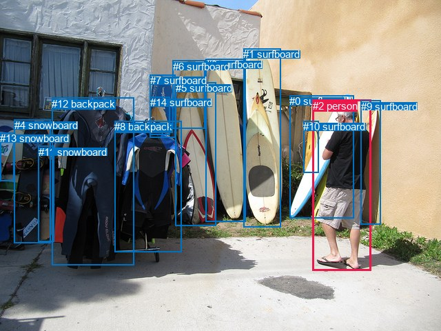
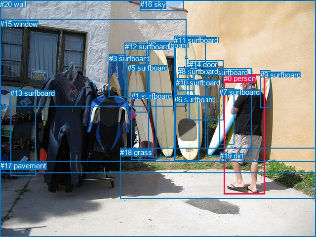

# 图片 1886：2404565.jpg

随机样本序号：81。图片 SHA256：`be40f5772fdbc590f352277ff78975fa231d4a3f272a4f42a954f7326118207c`。

红色框表示人，蓝色框表示其他物体。两个模式分别保留自身框编号，可依据位置比较对应对象。

## 自动检测框与输出

人的框编号：`[2]`。状态：`ok`。

### 自动检测全部物体框

| 编号 | 类别 | 是否为人 | 检测分数 | 像素坐标 xyxy |
|---|---|---|---|---|
| 0 | surfboard | False | 0.9992 | 420.1, 138.0, 513.4, 316.8 |
| 1 | surfboard | False | 0.9988 | 353.0, 70.5, 408.0, 329.6 |
| 2 | person | True | 0.9972 | 453.9, 144.8, 538.9, 392.5 |
| 3 | surfboard | False | 0.9966 | 298.6, 85.1, 356.6, 321.7 |
| 4 | snowboard | False | 0.9934 | 20.7, 173.3, 73.3, 352.5 |
| 5 | surfboard | False | 0.9888 | 254.5, 119.5, 313.8, 327.8 |
| 6 | surfboard | False | 0.9276 | 250.7, 87.8, 297.1, 186.1 |
| 7 | surfboard | False | 0.8661 | 217.7, 108.2, 254.3, 199.7 |
| 8 | backpack | False | 0.7847 | 166.2, 175.2, 263.7, 365.2 |
| 9 | surfboard | False | 0.7840 | 523.7, 145.8, 552.2, 325.6 |
| 10 | surfboard | False | 0.7628 | 440.4, 175.2, 462.3, 250.1 |
| 11 | snowboard | False | 0.5445 | 55.5, 211.8, 78.2, 350.7 |
| 12 | backpack | False | 0.5383 | 75.0, 141.8, 194.7, 384.1 |
| 13 | snowboard | False | 0.4766 | 0.0, 192.3, 20.3, 262.4 |
| 14 | surfboard | False | 0.3884 | 217.7, 140.5, 246.2, 195.6 |

### 自动检测 Top50 人相关候选

评分物体对：210；人相关物体对：28；输出关系：50。

| 排名 | 主语编号与类别 | 关系 | 宾语编号与类别 | 类型 | 人与人 | 排序分数 | 原始融合 logit |
|---|---|---|---|---|---|---|---|
| 1 | #2 person | holding | #0 surfboard | semantic | False | 0.98850 | 4.4534 |
| 2 | #2 person | holding | #9 surfboard | semantic | False | 0.98438 | 4.1433 |
| 3 | #2 person | leaning on | #9 surfboard | spatial | False | 0.97960 | 3.8714 |
| 4 | #2 person | holding | #10 surfboard | semantic | False | 0.97235 | 3.5602 |
| 5 | #2 person | holding | #1 surfboard | semantic | False | 0.89363 | 2.1283 |
| 6 | #2 person | on | #0 surfboard | spatial | False | 0.70586 | 0.8754 |
| 7 | #9 surfboard | on | #2 person | spatial | False | 0.61846 | 0.4830 |
| 8 | #2 person | on | #10 surfboard | spatial | False | 0.60398 | 0.4221 |
| 9 | #9 surfboard | holding | #2 person | semantic | False | 0.58119 | 0.3277 |
| 10 | #0 surfboard | leaning on | #2 person | spatial | False | 0.52551 | 0.1021 |
| 11 | #10 surfboard | on | #2 person | spatial | False | 0.49027 | -0.0389 |
| 12 | #2 person | on | #1 surfboard | spatial | False | 0.42094 | -0.3189 |
| 13 | #2 person | holding | #3 surfboard | semantic | False | 0.34330 | -0.6486 |
| 14 | #0 surfboard | holding | #2 person | semantic | False | 0.24322 | -1.1351 |
| 15 | #10 surfboard | holding | #2 person | semantic | False | 0.12677 | -1.9298 |
| 16 | #2 person | wearing | #12 backpack | semantic | False | 0.08929 | -2.3224 |
| 17 | #2 person | holding | #4 snowboard | semantic | False | 0.08899 | -2.3260 |
| 18 | #2 person | on | #3 surfboard | spatial | False | 0.07758 | -2.4757 |
| 19 | #2 person | holding | #5 surfboard | semantic | False | 0.07098 | -2.5717 |
| 20 | #2 person | holding | #11 snowboard | semantic | False | 0.06993 | -2.5877 |
| 21 | #2 person | in | #12 backpack | spatial | False | 0.06100 | -2.7339 |
| 22 | #2 person | on | #4 snowboard | spatial | False | 0.03404 | -3.3455 |
| 23 | #2 person | holding | #13 snowboard | semantic | False | 0.03088 | -3.4463 |
| 24 | #12 backpack | on | #2 person | spatial | False | 0.02378 | -3.7147 |
| 25 | #2 person | on | #5 surfboard | spatial | False | 0.02177 | -3.8053 |
| 26 | #2 person | in | #11 snowboard | spatial | False | 0.02106 | -3.8390 |
| 27 | #2 person | in | #8 backpack | spatial | False | 0.01825 | -3.9850 |
| 28 | #2 person | standing on | #8 backpack | semantic | False | 0.01608 | -4.1138 |
| 29 | #2 person | holding | #14 surfboard | semantic | False | 0.01594 | -4.1229 |
| 30 | #1 surfboard | on | #2 person | spatial | False | 0.01199 | -4.4113 |
| 31 | #1 surfboard | holding | #2 person | semantic | False | 0.01168 | -4.4379 |
| 32 | #8 backpack | on | #2 person | spatial | False | 0.01157 | -4.4476 |
| 33 | #2 person | holding | #7 surfboard | semantic | False | 0.01066 | -4.5302 |
| 34 | #2 person | in | #13 snowboard | spatial | False | 0.00993 | -4.6020 |
| 35 | #2 person | holding | #6 surfboard | semantic | False | 0.00952 | -4.6445 |
| 36 | #2 person | in | #14 surfboard | spatial | False | 0.00745 | -4.8923 |
| 37 | #8 backpack | holding | #2 person | semantic | False | 0.00731 | -4.9109 |
| 38 | #11 snowboard | on | #2 person | spatial | False | 0.00718 | -4.9291 |
| 39 | #14 surfboard | on | #2 person | spatial | False | 0.00696 | -4.9603 |
| 40 | #13 snowboard | on | #2 person | spatial | False | 0.00636 | -5.0508 |
| 41 | #12 backpack | holding | #2 person | semantic | False | 0.00568 | -5.1648 |
| 42 | #2 person | in | #7 surfboard | spatial | False | 0.00521 | -5.2524 |
| 43 | #2 person | in | #6 surfboard | spatial | False | 0.00480 | -5.3340 |
| 44 | #11 snowboard | holding | #2 person | semantic | False | 0.00461 | -5.3746 |
| 45 | #4 snowboard | beside | #2 person | spatial | False | 0.00412 | -5.4866 |
| 46 | #3 surfboard | beside | #2 person | spatial | False | 0.00399 | -5.5187 |
| 47 | #7 surfboard | on | #2 person | spatial | False | 0.00369 | -5.5983 |
| 48 | #3 surfboard | holding | #2 person | semantic | False | 0.00309 | -5.7771 |
| 49 | #6 surfboard | on | #2 person | spatial | False | 0.00306 | -5.7870 |
| 50 | #4 snowboard | holding | #2 person | semantic | False | 0.00273 | -5.9023 |

### 自动检测逐条人相关 GT 核验

R@50：0.00%；命中 0/2。

| GT 主语编号 | GT 关系 | GT 宾语编号 | 结果阶段 | 匹配预测主语编号 | 匹配预测宾语编号 |
|---|---|---|---|---|---|
| 0 | looking at | 3 | wrong_predicate | [2] | [7] |
| 0 | standing on | 17 | endpoint_missing_or_wrong_class | [2] | [] |

## 真实框与输出

人的框编号：`[0]`。

### 真实框全部物体框

| 编号 | 类别 | 是否为人 | 检测分数 | 像素坐标 xyxy |
|---|---|---|---|---|
| 0 | person | True | GT | 453.0, 150.0, 537.0, 394.0 |
| 1 | surfboard | False | GT | 266.0, 186.0, 317.0, 323.0 |
| 2 | surfboard | False | GT | 300.0, 83.0, 355.0, 318.0 |
| 3 | surfboard | False | GT | 221.0, 110.0, 255.0, 195.0 |
| 4 | surfboard | False | GT | 420.0, 138.0, 509.0, 315.0 |
| 5 | surfboard | False | GT | 258.0, 129.0, 302.0, 227.0 |
| 6 | surfboard | False | GT | 353.0, 193.0, 404.0, 326.0 |
| 7 | surfboard | False | GT | 444.0, 178.0, 474.0, 292.0 |
| 8 | surfboard | False | GT | 360.0, 136.0, 393.0, 184.0 |
| 9 | surfboard | False | GT | 527.0, 143.0, 548.0, 219.0 |
| 10 | surfboard | False | GT | 356.0, 159.0, 394.0, 209.0 |
| 11 | surfboard | False | GT | 352.0, 73.0, 416.0, 301.0 |
| 12 | surfboard | False | GT | 253.0, 86.0, 297.0, 197.0 |
| 13 | surfboard | False | GT | 21.0, 180.0, 72.0, 356.0 |
| 14 | door | False | GT | 383.0, 122.0, 452.0, 243.0 |
| 15 | window | False | GT | 0.0, 40.0, 378.0, 215.0 |
| 16 | sky | False | GT | 284.0, 0.0, 372.0, 22.0 |
| 17 | pavement | False | GT | 0.0, 327.0, 640.0, 480.0 |
| 18 | grass | False | GT | 243.0, 300.0, 640.0, 403.0 |
| 19 | dirt | False | GT | 445.0, 307.0, 459.0, 329.0 |
| 20 | wall | False | GT | 0.0, 0.0, 640.0, 350.0 |

### 真实框 Top50 人相关候选

评分物体对：420；人相关物体对：40；输出关系：50。

| 排名 | 主语编号与类别 | 关系 | 宾语编号与类别 | 类型 | 人与人 | 排序分数 | 原始融合 logit |
|---|---|---|---|---|---|---|---|
| 1 | #0 person | holding | #7 surfboard | semantic | False | 0.98896 | 4.4951 |
| 2 | #0 person | holding | #4 surfboard | semantic | False | 0.98821 | 4.4285 |
| 3 | #0 person | standing on | #17 pavement | semantic | False | 0.98726 | 4.3500 |
| 4 | #0 person | holding | #9 surfboard | semantic | False | 0.96803 | 3.4105 |
| 5 | #0 person | standing on | #18 grass | semantic | False | 0.95193 | 2.9858 |
| 6 | #0 person | leaning on | #20 wall | spatial | False | 0.93984 | 2.7488 |
| 7 | #0 person | on | #17 pavement | spatial | False | 0.92414 | 2.4999 |
| 8 | #0 person | in | #19 dirt | spatial | False | 0.91688 | 2.4007 |
| 9 | #0 person | holding | #19 dirt | semantic | False | 0.91016 | 2.3155 |
| 10 | #0 person | on | #9 surfboard | spatial | False | 0.85866 | 1.8042 |
| 11 | #0 person | holding | #11 surfboard | semantic | False | 0.83935 | 1.6534 |
| 12 | #0 person | on | #18 grass | spatial | False | 0.83500 | 1.6215 |
| 13 | #0 person | standing on | #20 wall | semantic | False | 0.82972 | 1.5837 |
| 14 | #9 surfboard | on | #0 person | spatial | False | 0.82608 | 1.5581 |
| 15 | #0 person | on | #7 surfboard | spatial | False | 0.76970 | 1.2066 |
| 16 | #19 dirt | on | #0 person | spatial | False | 0.76460 | 1.1781 |
| 17 | #0 person | on | #4 surfboard | spatial | False | 0.73749 | 1.0330 |
| 18 | #4 surfboard | leaning on | #0 person | spatial | False | 0.71972 | 0.9431 |
| 19 | #7 surfboard | leaning on | #0 person | spatial | False | 0.70563 | 0.8742 |
| 20 | #7 surfboard | holding | #0 person | semantic | False | 0.62854 | 0.5260 |
| 21 | #0 person | beside | #11 surfboard | spatial | False | 0.52907 | 0.1164 |
| 22 | #9 surfboard | holding | #0 person | semantic | False | 0.48339 | -0.0665 |
| 23 | #18 grass | beside | #0 person | spatial | False | 0.39174 | -0.4400 |
| 24 | #4 surfboard | holding | #0 person | semantic | False | 0.32994 | -0.7084 |
| 25 | #19 dirt | holding | #0 person | semantic | False | 0.30207 | -0.8375 |
| 26 | #0 person | standing on | #2 surfboard | semantic | False | 0.26374 | -1.0266 |
| 27 | #0 person | beside | #2 surfboard | spatial | False | 0.16327 | -1.6341 |
| 28 | #17 pavement | holding | #0 person | semantic | False | 0.12511 | -1.9449 |
| 29 | #17 pavement | in | #0 person | spatial | False | 0.12151 | -1.9782 |
| 30 | #20 wall | beside | #0 person | spatial | False | 0.11649 | -2.0261 |
| 31 | #8 surfboard | holding | #0 person | semantic | False | 0.10953 | -2.0955 |
| 32 | #0 person | holding | #8 surfboard | semantic | False | 0.10632 | -2.1289 |
| 33 | #0 person | pulling | #13 surfboard | semantic | False | 0.10506 | -2.1422 |
| 34 | #18 grass | holding | #0 person | semantic | False | 0.08156 | -2.4213 |
| 35 | #0 person | holding | #6 surfboard | semantic | False | 0.07944 | -2.4500 |
| 36 | #8 surfboard | on | #0 person | spatial | False | 0.05724 | -2.8016 |
| 37 | #0 person | on | #13 surfboard | spatial | False | 0.05039 | -2.9362 |
| 38 | #11 surfboard | beside | #0 person | spatial | False | 0.04752 | -2.9980 |
| 39 | #0 person | in front of | #15 window | spatial | False | 0.04459 | -3.0646 |
| 40 | #0 person | on | #6 surfboard | spatial | False | 0.04160 | -3.1372 |
| 41 | #14 door | beside | #0 person | spatial | False | 0.03410 | -3.3436 |
| 42 | #0 person | looking at | #15 window | semantic | False | 0.03209 | -3.4067 |
| 43 | #20 wall | holding | #0 person | semantic | False | 0.02949 | -3.4939 |
| 44 | #13 surfboard | beside | #0 person | spatial | False | 0.02509 | -3.6599 |
| 45 | #0 person | in | #8 surfboard | spatial | False | 0.02460 | -3.6801 |
| 46 | #11 surfboard | holding | #0 person | semantic | False | 0.02361 | -3.7222 |
| 47 | #2 surfboard | beside | #0 person | spatial | False | 0.02224 | -3.7833 |
| 48 | #6 surfboard | beside | #0 person | spatial | False | 0.02117 | -3.8339 |
| 49 | #0 person | holding | #10 surfboard | semantic | False | 0.01969 | -3.9078 |
| 50 | #10 surfboard | on | #0 person | spatial | False | 0.01751 | -4.0274 |

### 真实框逐条人相关 GT 核验

R@50：50.00%；命中 1/2。

| GT 主语编号 | GT 关系 | GT 宾语编号 | 结果阶段 | 匹配预测主语编号 | 匹配预测宾语编号 |
|---|---|---|---|---|---|
| 0 | looking at | 3 | wrong_predicate | [0] | [3] |
| 0 | standing on | 17 | hit50 | [0] | [17] |

## 全部人相关 GT

| 主语编号与类别 | 关系 | 宾语编号与类别 |
|---|---|---|
| #0 person | looking at | #3 surfboard |
| #0 person | standing on | #17 pavement |

原始记录、全部人相关物体对的两项预测与分项分数见 [逐图证据 JSON](../evidence/cases/1886.json)。全部56类 logits 保留于本机 HOR/output/random500/logits/。

<!-- HOR_COMPLETE_RESULTS -->

## 六组条件的完整输出对照

以下保留同一图片三种框与候选模式、两种谓词输出规则的全部 Top50。框编号各自在所属模式内解释。

### 自动检测框完整枚举：空间与语义各保留一个谓词

| 排名 | 主语编号与类别 | 谓词 | 宾语编号与类别 | 分组 | 排序分数 | predicate logit | pair logit |
|---|---|---|---|---|---|---|---|
| 1 | #2 person | holding | #0 surfboard | semantic | 0.9884955 | 4.7422013 | -0.2887602 |
| 2 | #2 person | holding | #9 surfboard | semantic | 0.9843770 | 4.1123509 | 0.0309132 |
| 3 | #2 person | leaning on | #9 surfboard | spatial | 0.9795963 | 3.8405089 | 0.0309132 |
| 4 | #2 person | holding | #10 surfboard | semantic | 0.9723530 | 3.6766410 | -0.1164410 |
| 5 | #2 person | holding | #1 surfboard | semantic | 0.8936262 | 3.0087256 | -0.8803979 |
| 6 | #2 person | on | #0 surfboard | spatial | 0.7058616 | 1.1641293 | -0.2887602 |
| 7 | #9 surfboard | on | #2 person | spatial | 0.6184594 | 1.0939827 | -0.6109682 |
| 8 | #2 person | on | #10 surfboard | spatial | 0.6039822 | 0.5385265 | -0.1164410 |
| 9 | #9 surfboard | holding | #2 person | semantic | 0.5811897 | 0.9386272 | -0.6109682 |
| 10 | #0 surfboard | leaning on | #2 person | spatial | 0.5255100 | 0.9646711 | -0.8625426 |
| 11 | #10 surfboard | on | #2 person | spatial | 0.4902722 | 0.3811183 | -0.4200346 |
| 12 | #2 person | on | #1 surfboard | spatial | 0.4209355 | 0.5614638 | -0.8803979 |
| 13 | #2 person | holding | #3 surfboard | semantic | 0.3433014 | 0.7177386 | -1.3663552 |
| 14 | #0 surfboard | holding | #2 person | semantic | 0.2432173 | -0.2725782 | -0.8625426 |
| 15 | #10 surfboard | holding | #2 person | semantic | 0.1267736 | -1.5097575 | -0.4200346 |
| 16 | #2 person | wearing | #12 backpack | semantic | 0.0892854 | -1.1755888 | -1.1468022 |
| 17 | #2 person | holding | #4 snowboard | semantic | 0.0889914 | -1.3420997 | -0.9839133 |
| 18 | #2 person | on | #3 surfboard | spatial | 0.0775819 | -1.1093097 | -1.3663552 |
| 19 | #2 person | holding | #5 surfboard | semantic | 0.0709813 | -0.9350445 | -1.6366677 |
| 20 | #2 person | holding | #11 snowboard | semantic | 0.0699333 | -1.6657376 | -0.9219769 |
| 21 | #2 person | in | #12 backpack | spatial | 0.0610013 | -1.5871174 | -1.1468022 |
| 22 | #2 person | on | #4 snowboard | spatial | 0.0340443 | -2.3615432 | -0.9839133 |
| 23 | #2 person | holding | #13 snowboard | semantic | 0.0308807 | -2.1629717 | -1.2832845 |
| 24 | #12 backpack | on | #2 person | spatial | 0.0237825 | -2.0977495 | -1.6169847 |
| 25 | #2 person | on | #5 surfboard | spatial | 0.0217673 | -2.1686726 | -1.6366677 |
| 26 | #2 person | in | #11 snowboard | spatial | 0.0210620 | -2.9170213 | -0.9219769 |
| 27 | #2 person | in | #8 backpack | spatial | 0.0182536 | -2.5463040 | -1.4386650 |
| 28 | #2 person | standing on | #8 backpack | semantic | 0.0160820 | -2.6751766 | -1.4386650 |
| 29 | #2 person | holding | #14 surfboard | semantic | 0.0159389 | -2.6162069 | -1.5067170 |
| 30 | #1 surfboard | on | #2 person | spatial | 0.0119940 | -3.0529037 | -1.3583813 |
| 31 | #1 surfboard | holding | #2 person | semantic | 0.0116828 | -3.0795026 | -1.3583813 |
| 32 | #8 backpack | on | #2 person | spatial | 0.0115714 | -2.7325726 | -1.7150102 |
| 33 | #2 person | holding | #7 surfboard | semantic | 0.0106634 | -2.7934210 | -1.7367953 |
| 34 | #2 person | in | #13 snowboard | spatial | 0.0099321 | -3.3187201 | -1.2832845 |
| 35 | #2 person | holding | #6 surfboard | semantic | 0.0095232 | -2.8041201 | -1.8403407 |
| 36 | #2 person | in | #14 surfboard | spatial | 0.0074486 | -3.3855400 | -1.5067170 |
| 37 | #8 backpack | holding | #2 person | semantic | 0.0073122 | -3.1958666 | -1.7150102 |
| 38 | #11 snowboard | on | #2 person | spatial | 0.0071814 | -3.4146798 | -1.5143766 |
| 39 | #14 surfboard | on | #2 person | spatial | 0.0069617 | -3.2551732 | -1.7051687 |
| 40 | #13 snowboard | on | #2 person | spatial | 0.0063637 | -3.4221373 | -1.6286213 |
| 41 | #12 backpack | holding | #2 person | semantic | 0.0056819 | -3.5477934 | -1.6169847 |
| 42 | #2 person | in | #7 surfboard | spatial | 0.0052075 | -3.5156388 | -1.7367953 |
| 43 | #2 person | in | #6 surfboard | spatial | 0.0048017 | -3.4936218 | -1.8403407 |
| 44 | #11 snowboard | holding | #2 person | semantic | 0.0046114 | -3.8602283 | -1.5143766 |
| 45 | #4 snowboard | beside | #2 person | spatial | 0.0041249 | -3.8683434 | -1.6182464 |
| 46 | #3 surfboard | beside | #2 person | spatial | 0.0039950 | -3.9017363 | -1.6169795 |
| 47 | #7 surfboard | on | #2 person | spatial | 0.0036904 | -3.7042542 | -1.8940666 |
| 48 | #3 surfboard | holding | #2 person | semantic | 0.0030883 | -4.1600752 | -1.6169795 |
| 49 | #6 surfboard | on | #2 person | spatial | 0.0030578 | -3.7985535 | -1.9884555 |
| 50 | #4 snowboard | holding | #2 person | semantic | 0.0027257 | -4.2840648 | -1.6182464 |

GT 命中：0/2，R@50=0.00%。

| GT主语 | GT谓词 | GT宾语 | 结果阶段 | 匹配主语框 | 匹配宾语框 |
|---|---|---|---|---|---|
| 0 | looking at | 3 | wrong_predicate | [2] | [7] |
| 0 | standing on | 17 | endpoint_missing_or_wrong_class | [2] | [] |

### 自动检测框完整枚举：每对只保留一个谓词

| 排名 | 主语编号与类别 | 谓词 | 宾语编号与类别 | 分组 | 排序分数 | predicate logit | pair logit |
|---|---|---|---|---|---|---|---|
| 1 | #2 person | holding | #0 surfboard | single | 0.9884955 | 4.7422013 | -0.2887602 |
| 2 | #2 person | holding | #9 surfboard | single | 0.9843770 | 4.1123509 | 0.0309132 |
| 3 | #2 person | holding | #10 surfboard | single | 0.9723530 | 3.6766410 | -0.1164410 |
| 4 | #2 person | holding | #1 surfboard | single | 0.8936262 | 3.0087256 | -0.8803979 |
| 5 | #9 surfboard | on | #2 person | single | 0.6184594 | 1.0939827 | -0.6109682 |
| 6 | #0 surfboard | leaning on | #2 person | single | 0.5255100 | 0.9646711 | -0.8625426 |
| 7 | #10 surfboard | on | #2 person | single | 0.4902722 | 0.3811183 | -0.4200346 |
| 8 | #2 person | holding | #3 surfboard | single | 0.3433014 | 0.7177386 | -1.3663552 |
| 9 | #2 person | wearing | #12 backpack | single | 0.0892854 | -1.1755888 | -1.1468022 |
| 10 | #2 person | holding | #4 snowboard | single | 0.0889914 | -1.3420997 | -0.9839133 |
| 11 | #2 person | holding | #5 surfboard | single | 0.0709813 | -0.9350445 | -1.6366677 |
| 12 | #2 person | holding | #11 snowboard | single | 0.0699333 | -1.6657376 | -0.9219769 |
| 13 | #2 person | holding | #13 snowboard | single | 0.0308807 | -2.1629717 | -1.2832845 |
| 14 | #12 backpack | on | #2 person | single | 0.0237825 | -2.0977495 | -1.6169847 |
| 15 | #2 person | in | #8 backpack | single | 0.0182536 | -2.5463040 | -1.4386650 |
| 16 | #2 person | holding | #14 surfboard | single | 0.0159389 | -2.6162069 | -1.5067170 |
| 17 | #1 surfboard | on | #2 person | single | 0.0119940 | -3.0529037 | -1.3583813 |
| 18 | #8 backpack | on | #2 person | single | 0.0115714 | -2.7325726 | -1.7150102 |
| 19 | #2 person | holding | #7 surfboard | single | 0.0106634 | -2.7934210 | -1.7367953 |
| 20 | #2 person | holding | #6 surfboard | single | 0.0095232 | -2.8041201 | -1.8403407 |
| 21 | #11 snowboard | on | #2 person | single | 0.0071814 | -3.4146798 | -1.5143766 |
| 22 | #14 surfboard | on | #2 person | single | 0.0069617 | -3.2551732 | -1.7051687 |
| 23 | #13 snowboard | on | #2 person | single | 0.0063637 | -3.4221373 | -1.6286213 |
| 24 | #4 snowboard | beside | #2 person | single | 0.0041249 | -3.8683434 | -1.6182464 |
| 25 | #3 surfboard | beside | #2 person | single | 0.0039950 | -3.9017363 | -1.6169795 |
| 26 | #7 surfboard | on | #2 person | single | 0.0036904 | -3.7042542 | -1.8940666 |
| 27 | #6 surfboard | on | #2 person | single | 0.0030578 | -3.7985535 | -1.9884555 |
| 28 | #5 surfboard | holding | #2 person | single | 0.0021845 | -4.3408127 | -1.7833594 |

GT 命中：0/2，R@50=0.00%。

| GT主语 | GT谓词 | GT宾语 | 结果阶段 | 匹配主语框 | 匹配宾语框 |
|---|---|---|---|---|---|
| 0 | looking at | 3 | wrong_predicate | [2] | [7] |
| 0 | standing on | 17 | endpoint_missing_or_wrong_class | [2] | [] |

### 真实框完整枚举：空间与语义各保留一个谓词

| 排名 | 主语编号与类别 | 谓词 | 宾语编号与类别 | 分组 | 排序分数 | predicate logit | pair logit |
|---|---|---|---|---|---|---|---|
| 1 | #0 person | holding | #7 surfboard | semantic | 0.9889597 | 4.6927381 | -0.1976377 |
| 2 | #0 person | holding | #4 surfboard | semantic | 0.9882087 | 4.6513791 | -0.2228483 |
| 3 | #0 person | standing on | #17 pavement | semantic | 0.9872571 | 4.3107133 | 0.0392424 |
| 4 | #0 person | holding | #9 surfboard | semantic | 0.9680324 | 3.3385015 | 0.0720434 |
| 5 | #0 person | standing on | #18 grass | semantic | 0.9519287 | 3.5722070 | -0.5864019 |
| 6 | #0 person | leaning on | #20 wall | spatial | 0.9398438 | 2.9206028 | -0.1718335 |
| 7 | #0 person | on | #17 pavement | spatial | 0.9241369 | 2.4606876 | 0.0392424 |
| 8 | #0 person | in | #19 dirt | spatial | 0.9168797 | 2.0641732 | 0.3365136 |
| 9 | #0 person | holding | #19 dirt | semantic | 0.9101567 | 1.9790359 | 0.3365136 |
| 10 | #0 person | on | #9 surfboard | spatial | 0.8586558 | 1.7321267 | 0.0720434 |
| 11 | #0 person | holding | #11 surfboard | semantic | 0.8393478 | 2.4885216 | -0.8351383 |
| 12 | #0 person | on | #18 grass | spatial | 0.8350029 | 2.2079091 | -0.5864019 |
| 13 | #0 person | standing on | #20 wall | semantic | 0.8297229 | 1.7554979 | -0.1718335 |
| 14 | #9 surfboard | on | #0 person | spatial | 0.8260807 | 1.9253583 | -0.3672567 |
| 15 | #0 person | on | #7 surfboard | spatial | 0.7697043 | 1.4042802 | -0.1976377 |
| 16 | #19 dirt | on | #0 person | spatial | 0.7646026 | 1.7218738 | -0.5437928 |
| 17 | #0 person | on | #4 surfboard | spatial | 0.7374921 | 1.2558222 | -0.2228483 |
| 18 | #4 surfboard | leaning on | #0 person | spatial | 0.7197217 | 1.7862144 | -0.8431331 |
| 19 | #7 surfboard | leaning on | #0 person | spatial | 0.7056285 | 1.6232858 | -0.7490392 |
| 20 | #7 surfboard | holding | #0 person | semantic | 0.6285384 | 1.2749906 | -0.7490392 |
| 21 | #0 person | beside | #11 surfboard | spatial | 0.5290738 | 0.9515648 | -0.8351383 |
| 22 | #9 surfboard | holding | #0 person | semantic | 0.4833925 | 0.3008022 | -0.3672567 |
| 23 | #18 grass | beside | #0 person | spatial | 0.3917378 | 0.6483393 | -1.0883523 |
| 24 | #4 surfboard | holding | #0 person | semantic | 0.3299422 | 0.1346865 | -0.8431331 |
| 25 | #19 dirt | holding | #0 person | semantic | 0.3020681 | -0.2936764 | -0.5437928 |
| 26 | #0 person | standing on | #2 surfboard | semantic | 0.2637368 | 0.2645116 | -1.2911476 |
| 27 | #0 person | beside | #2 surfboard | spatial | 0.1632716 | -0.3429370 | -1.2911476 |
| 28 | #17 pavement | holding | #0 person | semantic | 0.1251066 | -0.7761247 | -1.1688114 |
| 29 | #17 pavement | in | #0 person | spatial | 0.1215064 | -0.8094299 | -1.1688114 |
| 30 | #20 wall | beside | #0 person | spatial | 0.1164922 | -1.2945216 | -0.7315544 |
| 31 | #8 surfboard | holding | #0 person | semantic | 0.1095329 | -1.3361912 | -0.7593303 |
| 32 | #0 person | holding | #8 surfboard | semantic | 0.1063189 | -1.3061197 | -0.8227859 |
| 33 | #0 person | pulling | #13 surfboard | semantic | 0.1050593 | -1.2069712 | -0.9352618 |
| 34 | #18 grass | holding | #0 person | semantic | 0.0815647 | -1.3329227 | -1.0883523 |
| 35 | #0 person | holding | #6 surfboard | semantic | 0.0794374 | -1.1645062 | -1.2855093 |
| 36 | #8 surfboard | on | #0 person | spatial | 0.0572386 | -2.0422552 | -0.7593303 |
| 37 | #0 person | on | #13 surfboard | spatial | 0.0503948 | -2.0008967 | -0.9352618 |
| 38 | #11 surfboard | beside | #0 person | spatial | 0.0475161 | -1.5602739 | -1.4377302 |
| 39 | #0 person | in front of | #15 window | spatial | 0.0445923 | -1.6849940 | -1.3795834 |
| 40 | #0 person | on | #6 surfboard | spatial | 0.0415971 | -1.8517292 | -1.2855093 |
| 41 | #14 door | beside | #0 person | spatial | 0.0341045 | -2.1856160 | -1.1580104 |
| 42 | #0 person | looking at | #15 window | semantic | 0.0320870 | -2.0271070 | -1.3795834 |
| 43 | #20 wall | holding | #0 person | semantic | 0.0294854 | -2.7623768 | -0.7315544 |
| 44 | #13 surfboard | beside | #0 person | spatial | 0.0250885 | -2.0747166 | -1.5852225 |
| 45 | #0 person | in | #8 surfboard | spatial | 0.0245993 | -2.8573446 | -0.8227859 |
| 46 | #11 surfboard | holding | #0 person | semantic | 0.0236098 | -2.2844701 | -1.4377302 |
| 47 | #2 surfboard | beside | #0 person | spatial | 0.0222423 | -2.1628075 | -1.6204600 |
| 48 | #6 surfboard | beside | #0 person | spatial | 0.0211679 | -2.4821770 | -1.3516964 |
| 49 | #0 person | holding | #10 surfboard | semantic | 0.0196893 | -2.6200695 | -1.2877263 |
| 50 | #10 surfboard | on | #0 person | spatial | 0.0175083 | -2.9684806 | -1.0589375 |

GT 命中：1/2，R@50=50.00%。

| GT主语 | GT谓词 | GT宾语 | 结果阶段 | 匹配主语框 | 匹配宾语框 |
|---|---|---|---|---|---|
| 0 | looking at | 3 | wrong_predicate | [0] | [3] |
| 0 | standing on | 17 | hit50 | [0] | [17] |

### 真实框完整枚举：每对只保留一个谓词

| 排名 | 主语编号与类别 | 谓词 | 宾语编号与类别 | 分组 | 排序分数 | predicate logit | pair logit |
|---|---|---|---|---|---|---|---|
| 1 | #0 person | holding | #7 surfboard | single | 0.9889597 | 4.6927381 | -0.1976377 |
| 2 | #0 person | holding | #4 surfboard | single | 0.9882087 | 4.6513791 | -0.2228483 |
| 3 | #0 person | standing on | #17 pavement | single | 0.9872571 | 4.3107133 | 0.0392424 |
| 4 | #0 person | holding | #9 surfboard | single | 0.9680324 | 3.3385015 | 0.0720434 |
| 5 | #0 person | standing on | #18 grass | single | 0.9519287 | 3.5722070 | -0.5864019 |
| 6 | #0 person | leaning on | #20 wall | single | 0.9398438 | 2.9206028 | -0.1718335 |
| 7 | #0 person | in | #19 dirt | single | 0.9168797 | 2.0641732 | 0.3365136 |
| 8 | #0 person | holding | #11 surfboard | single | 0.8393478 | 2.4885216 | -0.8351383 |
| 9 | #9 surfboard | on | #0 person | single | 0.8260807 | 1.9253583 | -0.3672567 |
| 10 | #19 dirt | on | #0 person | single | 0.7646026 | 1.7218738 | -0.5437928 |
| 11 | #4 surfboard | leaning on | #0 person | single | 0.7197217 | 1.7862144 | -0.8431331 |
| 12 | #7 surfboard | leaning on | #0 person | single | 0.7056285 | 1.6232858 | -0.7490392 |
| 13 | #18 grass | beside | #0 person | single | 0.3917378 | 0.6483393 | -1.0883523 |
| 14 | #0 person | standing on | #2 surfboard | single | 0.2637368 | 0.2645116 | -1.2911476 |
| 15 | #17 pavement | holding | #0 person | single | 0.1251066 | -0.7761247 | -1.1688114 |
| 16 | #20 wall | beside | #0 person | single | 0.1164922 | -1.2945216 | -0.7315544 |
| 17 | #8 surfboard | holding | #0 person | single | 0.1095329 | -1.3361912 | -0.7593303 |
| 18 | #0 person | holding | #8 surfboard | single | 0.1063189 | -1.3061197 | -0.8227859 |
| 19 | #0 person | pulling | #13 surfboard | single | 0.1050593 | -1.2069712 | -0.9352618 |
| 20 | #0 person | holding | #6 surfboard | single | 0.0794374 | -1.1645062 | -1.2855093 |
| 21 | #11 surfboard | beside | #0 person | single | 0.0475161 | -1.5602739 | -1.4377302 |
| 22 | #0 person | in front of | #15 window | single | 0.0445923 | -1.6849940 | -1.3795834 |
| 23 | #14 door | beside | #0 person | single | 0.0341045 | -2.1856160 | -1.1580104 |
| 24 | #13 surfboard | beside | #0 person | single | 0.0250885 | -2.0747166 | -1.5852225 |
| 25 | #2 surfboard | beside | #0 person | single | 0.0222423 | -2.1628075 | -1.6204600 |
| 26 | #6 surfboard | beside | #0 person | single | 0.0211679 | -2.4821770 | -1.3516964 |
| 27 | #0 person | holding | #10 surfboard | single | 0.0196893 | -2.6200695 | -1.2877263 |
| 28 | #10 surfboard | on | #0 person | single | 0.0175083 | -2.9684806 | -1.0589375 |
| 29 | #0 person | in front of | #14 door | single | 0.0173509 | -2.5496402 | -1.4869678 |
| 30 | #16 sky | over | #0 person | single | 0.0124201 | -3.0544894 | -1.3214543 |
| 31 | #0 person | on | #1 surfboard | single | 0.0087545 | -2.9556494 | -1.7737491 |
| 32 | #1 surfboard | beside | #0 person | single | 0.0081756 | -2.9269338 | -1.8714564 |
| 33 | #0 person | holding | #5 surfboard | single | 0.0076591 | -3.0749016 | -1.7892679 |
| 34 | #0 person | holding | #12 surfboard | single | 0.0068824 | -3.2033057 | -1.7685804 |
| 35 | #15 window | beside | #0 person | single | 0.0062992 | -3.4911737 | -1.5698403 |
| 36 | #0 person | looking at | #16 sky | single | 0.0060181 | -3.2593725 | -1.8475701 |
| 37 | #5 surfboard | beside | #0 person | single | 0.0039164 | -3.5707152 | -1.9679443 |
| 38 | #0 person | in | #3 surfboard | single | 0.0036383 | -3.8269577 | -1.7856499 |
| 39 | #12 surfboard | beside | #0 person | single | 0.0035370 | -3.6308978 | -2.0100336 |
| 40 | #3 surfboard | on | #0 person | single | 0.0031091 | -3.8378396 | -1.9324548 |

GT 命中：1/2，R@50=50.00%。

| GT主语 | GT谓词 | GT宾语 | 结果阶段 | 匹配主语框 | 匹配宾语框 |
|---|---|---|---|---|---|
| 0 | looking at | 3 | wrong_predicate | [0] | [3] |
| 0 | standing on | 17 | hit50 | [0] | [17] |

### 真实框400候选：空间与语义各保留一个谓词

| 排名 | 主语编号与类别 | 谓词 | 宾语编号与类别 | 分组 | 排序分数 | predicate logit | pair logit |
|---|---|---|---|---|---|---|---|
| 1 | #0 person | holding | #7 surfboard | semantic | 0.9883510 | 4.6384635 | -0.1976377 |
| 2 | #0 person | holding | #4 surfboard | semantic | 0.9882087 | 4.6513791 | -0.2228483 |
| 3 | #0 person | standing on | #17 pavement | semantic | 0.9872571 | 4.3107133 | 0.0392424 |
| 4 | #0 person | holding | #9 surfboard | semantic | 0.9665014 | 3.2901359 | 0.0720434 |
| 5 | #0 person | standing on | #18 grass | semantic | 0.9519287 | 3.5722070 | -0.5864019 |
| 6 | #0 person | leaning on | #20 wall | spatial | 0.9398438 | 2.9206028 | -0.1718335 |
| 7 | #0 person | on | #17 pavement | spatial | 0.9241369 | 2.4606876 | 0.0392424 |
| 8 | #0 person | in | #19 dirt | spatial | 0.9140372 | 2.0274439 | 0.3365136 |
| 9 | #0 person | holding | #19 dirt | semantic | 0.9076655 | 1.9489446 | 0.3365136 |
| 10 | #0 person | on | #9 surfboard | spatial | 0.8563094 | 1.7129259 | 0.0720434 |
| 11 | #0 person | holding | #11 surfboard | semantic | 0.8393478 | 2.4885216 | -0.8351383 |
| 12 | #0 person | on | #18 grass | spatial | 0.8350029 | 2.2079091 | -0.5864019 |
| 13 | #0 person | standing on | #20 wall | semantic | 0.8297229 | 1.7554979 | -0.1718335 |
| 14 | #9 surfboard | on | #0 person | spatial | 0.8180757 | 1.8706207 | -0.3672567 |
| 15 | #0 person | on | #7 surfboard | spatial | 0.7697043 | 1.4042802 | -0.1976377 |
| 16 | #19 dirt | on | #0 person | spatial | 0.7432941 | 1.6069536 | -0.5437928 |
| 17 | #0 person | on | #4 surfboard | spatial | 0.7374921 | 1.2558222 | -0.2228483 |
| 18 | #4 surfboard | leaning on | #0 person | spatial | 0.7137126 | 1.7566175 | -0.8431331 |
| 19 | #7 surfboard | leaning on | #0 person | spatial | 0.6932904 | 1.5645866 | -0.7490392 |
| 20 | #7 surfboard | holding | #0 person | semantic | 0.6157807 | 1.2207165 | -0.7490392 |
| 21 | #0 person | beside | #11 surfboard | spatial | 0.5290449 | 0.9514489 | -0.8351383 |
| 22 | #9 surfboard | holding | #0 person | semantic | 0.4683830 | 0.2406197 | -0.3672567 |
| 23 | #18 grass | beside | #0 person | spatial | 0.3917241 | 0.6482816 | -1.0883523 |
| 24 | #4 surfboard | holding | #0 person | semantic | 0.3233239 | 0.1045952 | -0.8431331 |
| 25 | #19 dirt | holding | #0 person | semantic | 0.2784976 | -0.4081335 | -0.5437928 |
| 26 | #0 person | standing on | #2 surfboard | semantic | 0.2623133 | 0.2571678 | -1.2911476 |
| 27 | #0 person | beside | #2 surfboard | spatial | 0.1592099 | -0.3729711 | -1.2911476 |
| 28 | #17 pavement | holding | #0 person | semantic | 0.1243004 | -0.7835102 | -1.1688114 |
| 29 | #20 wall | beside | #0 person | spatial | 0.1196141 | -1.2645350 | -0.7315544 |
| 30 | #17 pavement | in | #0 person | spatial | 0.1176401 | -0.8461585 | -1.1688114 |
| 31 | #8 surfboard | holding | #0 person | semantic | 0.1018663 | -1.4173276 | -0.7593303 |
| 32 | #0 person | pulling | #13 surfboard | semantic | 0.1008910 | -1.2521017 | -0.9352618 |
| 33 | #0 person | holding | #8 surfboard | semantic | 0.0980413 | -1.3963935 | -0.8227859 |
| 34 | #18 grass | holding | #0 person | semantic | 0.0802264 | -1.3509228 | -1.0883523 |
| 35 | #0 person | holding | #6 surfboard | semantic | 0.0752491 | -1.2232118 | -1.2855093 |
| 36 | #8 surfboard | on | #0 person | spatial | 0.0511988 | -2.1601529 | -0.7593303 |
| 37 | #0 person | on | #13 surfboard | spatial | 0.0496796 | -2.0159423 | -0.9352618 |
| 38 | #11 surfboard | beside | #0 person | spatial | 0.0475122 | -1.5603607 | -1.4377302 |
| 39 | #0 person | in front of | #15 window | spatial | 0.0445858 | -1.6851473 | -1.3795834 |
| 40 | #0 person | on | #6 surfboard | spatial | 0.0390580 | -1.9173565 | -1.2855093 |
| 41 | #14 door | beside | #0 person | spatial | 0.0326430 | -2.2309265 | -1.1580104 |
| 42 | #0 person | looking at | #15 window | semantic | 0.0320870 | -2.0271070 | -1.3795834 |
| 43 | #20 wall | holding | #0 person | semantic | 0.0298120 | -2.7510240 | -0.7315544 |
| 44 | #13 surfboard | beside | #0 person | spatial | 0.0247222 | -2.0897982 | -1.5852225 |
| 45 | #11 surfboard | holding | #0 person | semantic | 0.0231984 | -2.3024697 | -1.4377302 |
| 46 | #0 person | in | #8 surfboard | spatial | 0.0227834 | -2.9358916 | -0.8227859 |
| 47 | #2 surfboard | beside | #0 person | spatial | 0.0222415 | -2.1628435 | -1.6204600 |
| 48 | #6 surfboard | beside | #0 person | spatial | 0.0205507 | -2.5123985 | -1.3516964 |
| 49 | #0 person | holding | #10 surfboard | semantic | 0.0182356 | -2.6982517 | -1.2877263 |
| 50 | #0 person | in front of | #14 door | spatial | 0.0165929 | -2.5950832 | -1.4869678 |

GT 命中：1/2，R@50=50.00%。

| GT主语 | GT谓词 | GT宾语 | 结果阶段 | 匹配主语框 | 匹配宾语框 |
|---|---|---|---|---|---|
| 0 | looking at | 3 | wrong_predicate | [0] | [3] |
| 0 | standing on | 17 | hit50 | [0] | [17] |

### 真实框400候选：每对只保留一个谓词

| 排名 | 主语编号与类别 | 谓词 | 宾语编号与类别 | 分组 | 排序分数 | predicate logit | pair logit |
|---|---|---|---|---|---|---|---|
| 1 | #0 person | holding | #7 surfboard | single | 0.9883510 | 4.6384635 | -0.1976377 |
| 2 | #0 person | holding | #4 surfboard | single | 0.9882087 | 4.6513791 | -0.2228483 |
| 3 | #0 person | standing on | #17 pavement | single | 0.9872571 | 4.3107133 | 0.0392424 |
| 4 | #0 person | holding | #9 surfboard | single | 0.9665014 | 3.2901359 | 0.0720434 |
| 5 | #0 person | standing on | #18 grass | single | 0.9519287 | 3.5722070 | -0.5864019 |
| 6 | #0 person | leaning on | #20 wall | single | 0.9398438 | 2.9206028 | -0.1718335 |
| 7 | #0 person | in | #19 dirt | single | 0.9140372 | 2.0274439 | 0.3365136 |
| 8 | #0 person | holding | #11 surfboard | single | 0.8393478 | 2.4885216 | -0.8351383 |
| 9 | #9 surfboard | on | #0 person | single | 0.8180757 | 1.8706207 | -0.3672567 |
| 10 | #19 dirt | on | #0 person | single | 0.7432941 | 1.6069536 | -0.5437928 |
| 11 | #4 surfboard | leaning on | #0 person | single | 0.7137126 | 1.7566175 | -0.8431331 |
| 12 | #7 surfboard | leaning on | #0 person | single | 0.6932904 | 1.5645866 | -0.7490392 |
| 13 | #18 grass | beside | #0 person | single | 0.3917241 | 0.6482816 | -1.0883523 |
| 14 | #0 person | standing on | #2 surfboard | single | 0.2623133 | 0.2571678 | -1.2911476 |
| 15 | #17 pavement | holding | #0 person | single | 0.1243004 | -0.7835102 | -1.1688114 |
| 16 | #20 wall | beside | #0 person | single | 0.1196141 | -1.2645350 | -0.7315544 |
| 17 | #8 surfboard | holding | #0 person | single | 0.1018663 | -1.4173276 | -0.7593303 |
| 18 | #0 person | pulling | #13 surfboard | single | 0.1008910 | -1.2521017 | -0.9352618 |
| 19 | #0 person | holding | #8 surfboard | single | 0.0980413 | -1.3963935 | -0.8227859 |
| 20 | #0 person | holding | #6 surfboard | single | 0.0752491 | -1.2232118 | -1.2855093 |
| 21 | #11 surfboard | beside | #0 person | single | 0.0475122 | -1.5603607 | -1.4377302 |
| 22 | #0 person | in front of | #15 window | single | 0.0445858 | -1.6851473 | -1.3795834 |
| 23 | #14 door | beside | #0 person | single | 0.0326430 | -2.2309265 | -1.1580104 |
| 24 | #13 surfboard | beside | #0 person | single | 0.0247222 | -2.0897982 | -1.5852225 |
| 25 | #2 surfboard | beside | #0 person | single | 0.0222415 | -2.1628435 | -1.6204600 |
| 26 | #6 surfboard | beside | #0 person | single | 0.0205507 | -2.5123985 | -1.3516964 |
| 27 | #0 person | holding | #10 surfboard | single | 0.0182356 | -2.6982517 | -1.2877263 |
| 28 | #0 person | in front of | #14 door | single | 0.0165929 | -2.5950832 | -1.4869678 |
| 29 | #10 surfboard | on | #0 person | single | 0.0160642 | -3.0560319 | -1.0589375 |
| 30 | #16 sky | over | #0 person | single | 0.0115003 | -3.1323614 | -1.3214543 |
| 31 | #0 person | on | #1 surfboard | single | 0.0084286 | -2.9939079 | -1.7737491 |
| 32 | #1 surfboard | beside | #0 person | single | 0.0078174 | -2.9720995 | -1.8714564 |
| 33 | #0 person | holding | #5 surfboard | single | 0.0075177 | -3.0936861 | -1.7892679 |
| 34 | #0 person | holding | #12 surfboard | single | 0.0066846 | -3.2326584 | -1.7685804 |
| 35 | #15 window | beside | #0 person | single | 0.0062517 | -3.4987831 | -1.5698403 |
| 36 | #0 person | looking at | #16 sky | single | 0.0059291 | -3.2743745 | -1.8475701 |
| 37 | #5 surfboard | beside | #0 person | single | 0.0039163 | -3.5707440 | -1.9679443 |
| 38 | #0 person | in | #3 surfboard | single | 0.0035515 | -3.8511856 | -1.7856499 |
| 39 | #12 surfboard | beside | #0 person | single | 0.0035107 | -3.6383915 | -2.0100336 |
| 40 | #3 surfboard | on | #0 person | single | 0.0030173 | -3.8679307 | -1.9324548 |

GT 命中：1/2，R@50=50.00%。

| GT主语 | GT谓词 | GT宾语 | 结果阶段 | 匹配主语框 | 匹配宾语框 |
|---|---|---|---|---|---|
| 0 | looking at | 3 | wrong_predicate | [0] | [3] |
| 0 | standing on | 17 | hit50 | [0] | [17] |
