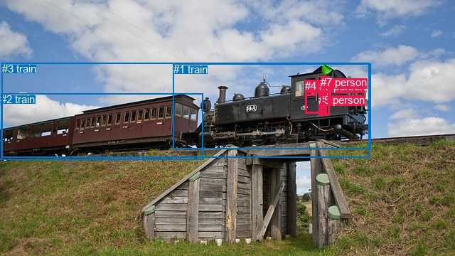
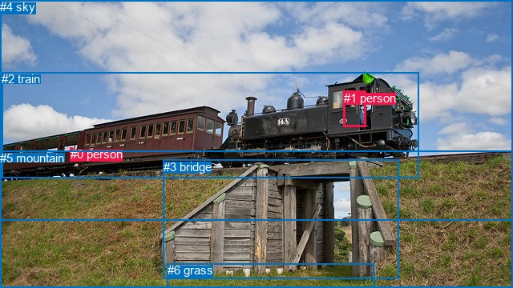

# 图片 1890：2404890.jpg

随机样本序号：216。图片 SHA256：`eaa2b6895dfd05f81a68ed8de944184de6bf17973995d078de75907a6a4d515f`。

红色框表示人，蓝色框表示其他物体。两个模式分别保留自身框编号，可依据位置比较对应对象。

## 自动检测框与输出

人的框编号：`[0, 4, 5, 6, 7]`。状态：`ok`。

### 自动检测全部物体框

| 编号 | 类别 | 是否为人 | 检测分数 | 像素坐标 xyxy |
|---|---|---|---|---|
| 0 | person | True | 0.9926 | 429.8, 113.5, 443.4, 134.5 |
| 1 | train | False | 0.9872 | 243.7, 89.1, 521.9, 209.3 |
| 2 | train | False | 0.9860 | 1.0, 131.3, 285.9, 224.7 |
| 3 | train | False | 0.9171 | 2.7, 88.1, 519.6, 221.2 |
| 4 | person | True | 0.7543 | 429.4, 112.0, 457.1, 159.3 |
| 5 | person | True | 0.5111 | 448.4, 132.0, 459.5, 162.2 |
| 6 | person | True | 0.4716 | 449.0, 113.5, 454.3, 131.0 |
| 7 | person | True | 0.3686 | 451.1, 107.2, 464.0, 161.3 |

### 自动检测 Top50 人相关候选

评分物体对：56；人相关物体对：50；输出关系：50。

| 排名 | 主语编号与类别 | 关系 | 宾语编号与类别 | 类型 | 人与人 | 排序分数 | 原始融合 logit |
|---|---|---|---|---|---|---|---|
| 1 | #4 person | driving on | #1 train | semantic | False | 0.98405 | 4.1219 |
| 2 | #0 person | driving on | #1 train | semantic | False | 0.97903 | 3.8436 |
| 3 | #7 person | driving on | #1 train | semantic | False | 0.96859 | 3.4286 |
| 4 | #4 person | driving on | #3 train | semantic | False | 0.96798 | 3.4089 |
| 5 | #6 person | driving on | #1 train | semantic | False | 0.95590 | 3.0761 |
| 6 | #7 person | driving on | #3 train | semantic | False | 0.95028 | 2.9503 |
| 7 | #7 person | wearing | #5 person | semantic | True | 0.94934 | 2.9307 |
| 8 | #0 person | driving on | #3 train | semantic | False | 0.94817 | 2.9066 |
| 9 | #4 person | in | #1 train | spatial | False | 0.94350 | 2.8153 |
| 10 | #6 person | driving on | #3 train | semantic | False | 0.94075 | 2.7649 |
| 11 | #5 person | riding | #1 train | semantic | False | 0.94064 | 2.7629 |
| 12 | #0 person | in | #1 train | spatial | False | 0.93608 | 2.6840 |
| 13 | #4 person | in | #3 train | spatial | False | 0.93605 | 2.6836 |
| 14 | #5 person | riding | #3 train | semantic | False | 0.93251 | 2.6260 |
| 15 | #7 person | on | #1 train | spatial | False | 0.93073 | 2.5980 |
| 16 | #7 person | in | #3 train | spatial | False | 0.92725 | 2.5452 |
| 17 | #0 person | in | #3 train | spatial | False | 0.92567 | 2.5220 |
| 18 | #6 person | in | #1 train | spatial | False | 0.92154 | 2.4634 |
| 19 | #6 person | in | #3 train | spatial | False | 0.91527 | 2.3797 |
| 20 | #4 person | wearing | #0 person | semantic | True | 0.88458 | 2.0365 |
| 21 | #5 person | on | #1 train | spatial | False | 0.85780 | 1.7972 |
| 22 | #4 person | driving on | #2 train | semantic | False | 0.85036 | 1.7375 |
| 23 | #5 person | in | #3 train | spatial | False | 0.77723 | 1.2496 |
| 24 | #0 person | driving on | #2 train | semantic | False | 0.76761 | 1.1949 |
| 25 | #7 person | riding | #2 train | semantic | False | 0.75417 | 1.1210 |
| 26 | #4 person | on | #2 train | spatial | False | 0.72982 | 0.9937 |
| 27 | #6 person | driving on | #2 train | semantic | False | 0.72710 | 0.9800 |
| 28 | #4 person | wearing | #6 person | semantic | True | 0.69296 | 0.8140 |
| 29 | #7 person | wearing | #6 person | semantic | True | 0.68663 | 0.7844 |
| 30 | #4 person | wearing | #5 person | semantic | True | 0.64290 | 0.5880 |
| 31 | #7 person | on | #2 train | spatial | False | 0.63521 | 0.5546 |
| 32 | #0 person | on | #2 train | spatial | False | 0.62064 | 0.4923 |
| 33 | #6 person | driving on | #4 person | semantic | True | 0.58586 | 0.3469 |
| 34 | #5 person | riding | #2 train | semantic | False | 0.58362 | 0.3376 |
| 35 | #0 person | in | #4 person | spatial | True | 0.51590 | 0.0636 |
| 36 | #6 person | on | #2 train | spatial | False | 0.50976 | 0.0390 |
| 37 | #7 person | in | #5 person | spatial | True | 0.50343 | 0.0137 |
| 38 | #6 person | in | #4 person | spatial | True | 0.49794 | -0.0082 |
| 39 | #4 person | in | #0 person | spatial | True | 0.43455 | -0.2633 |
| 40 | #5 person | on | #4 person | spatial | True | 0.39473 | -0.4275 |
| 41 | #5 person | on | #7 person | spatial | True | 0.35150 | -0.6125 |
| 42 | #0 person | driving on | #4 person | semantic | True | 0.32869 | -0.7141 |
| 43 | #5 person | on | #2 train | spatial | False | 0.27633 | -0.9628 |
| 44 | #5 person | standing on | #4 person | semantic | True | 0.26543 | -1.0179 |
| 45 | #7 person | in | #6 person | spatial | True | 0.21247 | -1.3101 |
| 46 | #5 person | wearing | #7 person | semantic | True | 0.19900 | -1.3925 |
| 47 | #7 person | on | #4 person | spatial | True | 0.19480 | -1.4191 |
| 48 | #4 person | in | #6 person | spatial | True | 0.16391 | -1.6294 |
| 49 | #6 person | in | #7 person | spatial | True | 0.14824 | -1.7485 |
| 50 | #4 person | beside | #7 person | spatial | True | 0.14526 | -1.7723 |

### 自动检测逐条人相关 GT 核验

R@50：0.00%；命中 0/2。

| GT 主语编号 | GT 关系 | GT 宾语编号 | 结果阶段 | 匹配预测主语编号 | 匹配预测宾语编号 |
|---|---|---|---|---|---|
| 0 | in | 2 | endpoint_missing_or_wrong_class | [] | [3] |
| 1 | driving | 2 | wrong_predicate | [4] | [3] |

## 真实框与输出

人的框编号：`[0, 1]`。

### 真实框全部物体框

| 编号 | 类别 | 是否为人 | 检测分数 | 像素坐标 xyxy |
|---|---|---|---|---|
| 0 | person | True | GT | 88.0, 184.0, 91.0, 187.0 |
| 1 | person | True | GT | 429.0, 114.0, 457.0, 159.0 |
| 2 | train | False | GT | 2.0, 90.0, 523.0, 223.0 |
| 3 | bridge | False | GT | 204.0, 200.0, 498.0, 349.0 |
| 4 | sky | False | GT | 0.0, 0.0, 640.0, 276.0 |
| 5 | mountain | False | GT | 0.0, 189.0, 640.0, 360.0 |
| 6 | grass | False | GT | 209.0, 329.0, 467.0, 360.0 |

### 真实框 Top50 人相关候选

评分物体对：42；人相关物体对：22；输出关系：44。

| 排名 | 主语编号与类别 | 关系 | 宾语编号与类别 | 类型 | 人与人 | 排序分数 | 原始融合 logit |
|---|---|---|---|---|---|---|---|
| 1 | #0 person | on | #2 train | spatial | False | 0.97361 | 3.6081 |
| 2 | #1 person | in | #2 train | spatial | False | 0.96872 | 3.4329 |
| 3 | #1 person | driving | #2 train | semantic | False | 0.95735 | 3.1112 |
| 4 | #0 person | riding | #2 train | semantic | False | 0.82798 | 1.5714 |
| 5 | #1 person | in | #4 sky | spatial | False | 0.81668 | 1.4940 |
| 6 | #1 person | in | #3 bridge | spatial | False | 0.71165 | 0.9034 |
| 7 | #2 train | carrying | #1 person | semantic | False | 0.44824 | -0.2078 |
| 8 | #2 train | in | #0 person | spatial | False | 0.41068 | -0.3612 |
| 9 | #1 person | standing on | #3 bridge | semantic | False | 0.29693 | -0.8620 |
| 10 | #2 train | on | #1 person | spatial | False | 0.25152 | -1.0905 |
| 11 | #2 train | wearing | #0 person | semantic | False | 0.20876 | -1.3324 |
| 12 | #1 person | riding | #4 sky | semantic | False | 0.12557 | -1.9407 |
| 13 | #0 person | in | #4 sky | spatial | False | 0.02413 | -3.7000 |
| 14 | #1 person | on | #5 mountain | spatial | False | 0.01881 | -3.9543 |
| 15 | #3 bridge | beside | #1 person | spatial | False | 0.00820 | -4.7960 |
| 16 | #3 bridge | holding | #1 person | semantic | False | 0.00653 | -5.0248 |
| 17 | #0 person | on | #1 person | spatial | True | 0.00578 | -5.1483 |
| 18 | #1 person | walking on | #5 mountain | semantic | False | 0.00538 | -5.2196 |
| 19 | #4 sky | in | #0 person | spatial | False | 0.00407 | -5.5007 |
| 20 | #0 person | standing on | #4 sky | semantic | False | 0.00262 | -5.9423 |
| 21 | #1 person | in | #6 grass | spatial | False | 0.00258 | -5.9568 |
| 22 | #4 sky | in | #1 person | spatial | False | 0.00252 | -5.9806 |
| 23 | #1 person | looking at | #6 grass | semantic | False | 0.00207 | -6.1759 |
| 24 | #1 person | wearing | #0 person | semantic | True | 0.00158 | -6.4506 |
| 25 | #4 sky | wearing | #0 person | semantic | False | 0.00155 | -6.4711 |
| 26 | #0 person | on | #3 bridge | spatial | False | 0.00127 | -6.6696 |
| 27 | #0 person | wearing | #1 person | semantic | True | 0.00124 | -6.6936 |
| 28 | #1 person | in | #0 person | spatial | True | 0.00111 | -6.8010 |
| 29 | #6 grass | in | #1 person | spatial | False | 0.00109 | -6.8236 |
| 30 | #5 mountain | in | #1 person | spatial | False | 0.00099 | -6.9211 |
| 31 | #4 sky | holding | #1 person | semantic | False | 0.00090 | -7.0165 |
| 32 | #5 mountain | in | #0 person | spatial | False | 0.00066 | -7.3287 |
| 33 | #3 bridge | in | #0 person | spatial | False | 0.00058 | -7.4562 |
| 34 | #6 grass | in | #0 person | spatial | False | 0.00055 | -7.5063 |
| 35 | #6 grass | holding | #1 person | semantic | False | 0.00046 | -7.6784 |
| 36 | #5 mountain | holding | #1 person | semantic | False | 0.00045 | -7.7085 |
| 37 | #0 person | on | #5 mountain | spatial | False | 0.00043 | -7.7539 |
| 38 | #3 bridge | holding | #0 person | semantic | False | 0.00038 | -7.8670 |
| 39 | #0 person | walking on | #3 bridge | semantic | False | 0.00038 | -7.8729 |
| 40 | #0 person | looking at | #5 mountain | semantic | False | 0.00029 | -8.1442 |
| 41 | #6 grass | holding | #0 person | semantic | False | 0.00025 | -8.2830 |
| 42 | #5 mountain | holding | #0 person | semantic | False | 0.00021 | -8.4605 |
| 43 | #0 person | in | #6 grass | spatial | False | 0.00010 | -9.1892 |
| 44 | #0 person | looking at | #6 grass | semantic | False | 0.00009 | -9.3020 |

### 真实框逐条人相关 GT 核验

R@50：50.00%；命中 1/2。

| GT 主语编号 | GT 关系 | GT 宾语编号 | 结果阶段 | 匹配预测主语编号 | 匹配预测宾语编号 |
|---|---|---|---|---|---|
| 0 | in | 2 | wrong_predicate | [0] | [2] |
| 1 | driving | 2 | hit50 | [1] | [2] |

## 全部人相关 GT

| 主语编号与类别 | 关系 | 宾语编号与类别 |
|---|---|---|
| #0 person | in | #2 train |
| #1 person | driving | #2 train |

原始记录、全部人相关物体对的两项预测与分项分数见 [逐图证据 JSON](../evidence/cases/1890.json)。全部56类 logits 保留于本机 HOR/output/random500/logits/。

<!-- HOR_COMPLETE_RESULTS -->

## 六组条件的完整输出对照

以下保留同一图片三种框与候选模式、两种谓词输出规则的全部 Top50。框编号各自在所属模式内解释。

### 自动检测框完整枚举：空间与语义各保留一个谓词

| 排名 | 主语编号与类别 | 谓词 | 宾语编号与类别 | 分组 | 排序分数 | predicate logit | pair logit |
|---|---|---|---|---|---|---|---|
| 1 | #4 person | driving on | #1 train | semantic | 0.9840451 | 4.0257039 | 0.0962079 |
| 2 | #0 person | driving on | #1 train | semantic | 0.9790334 | 3.7247558 | 0.1188786 |
| 3 | #7 person | driving on | #1 train | semantic | 0.9685867 | 3.3039660 | 0.1246396 |
| 4 | #4 person | driving on | #3 train | semantic | 0.9679800 | 3.4841704 | -0.0753174 |
| 5 | #6 person | driving on | #1 train | semantic | 0.9558956 | 2.9428167 | 0.1332721 |
| 6 | #7 person | driving on | #3 train | semantic | 0.9502792 | 2.9428620 | 0.0074707 |
| 7 | #7 person | wearing | #5 person | semantic | 0.9493438 | 3.3796840 | -0.4489744 |
| 8 | #0 person | driving on | #3 train | semantic | 0.9481741 | 3.0028458 | -0.0961982 |
| 9 | #4 person | in | #1 train | spatial | 0.9434984 | 2.7191181 | 0.0962079 |
| 10 | #6 person | driving on | #3 train | semantic | 0.9407465 | 2.8223701 | -0.0575194 |
| 11 | #5 person | riding | #1 train | semantic | 0.9406391 | 2.7202988 | 0.0426244 |
| 12 | #0 person | in | #1 train | spatial | 0.9360758 | 2.5651207 | 0.1188786 |
| 13 | #4 person | in | #3 train | spatial | 0.9360535 | 2.7589431 | -0.0753174 |
| 14 | #5 person | riding | #3 train | semantic | 0.9325143 | 2.8061743 | -0.1802068 |
| 15 | #7 person | on | #1 train | spatial | 0.9307298 | 2.4733143 | 0.1246396 |
| 16 | #7 person | in | #3 train | spatial | 0.9272471 | 2.5376801 | 0.0074707 |
| 17 | #0 person | in | #3 train | spatial | 0.9256714 | 2.6182208 | -0.0961982 |
| 18 | #6 person | in | #1 train | spatial | 0.9215366 | 2.3301377 | 0.1332721 |
| 19 | #6 person | in | #3 train | spatial | 0.9152668 | 2.4372277 | -0.0575194 |
| 20 | #4 person | wearing | #0 person | semantic | 0.8845792 | 2.5678258 | -0.5312982 |
| 21 | #5 person | on | #1 train | spatial | 0.8578038 | 1.7545428 | 0.0426244 |
| 22 | #4 person | driving on | #2 train | semantic | 0.8503633 | 2.2810531 | -0.5435992 |
| 23 | #5 person | in | #3 train | spatial | 0.7772345 | 1.4298291 | -0.1802068 |
| 24 | #0 person | driving on | #2 train | semantic | 0.7676135 | 1.7395911 | -0.5447066 |
| 25 | #7 person | riding | #2 train | semantic | 0.7541690 | 1.5594463 | -0.4384739 |
| 26 | #4 person | on | #2 train | spatial | 0.7298239 | 1.5373287 | -0.5435992 |
| 27 | #6 person | driving on | #2 train | semantic | 0.7271028 | 1.4686389 | -0.4886659 |
| 28 | #4 person | wearing | #6 person | semantic | 0.6929635 | 1.3898306 | -0.5758197 |
| 29 | #7 person | wearing | #6 person | semantic | 0.6866304 | 1.2511096 | -0.4666969 |
| 30 | #4 person | wearing | #5 person | semantic | 0.6429010 | 1.1534643 | -0.5654866 |
| 31 | #7 person | on | #2 train | spatial | 0.6352102 | 0.9931087 | -0.4384739 |
| 32 | #0 person | on | #2 train | spatial | 0.6206363 | 1.0369568 | -0.5447066 |
| 33 | #6 person | driving on | #4 person | semantic | 0.5858650 | 0.8669472 | -0.5200499 |
| 34 | #5 person | riding | #2 train | semantic | 0.5836192 | 0.9537115 | -0.6160631 |
| 35 | #0 person | in | #4 person | spatial | 0.5159017 | 0.6224442 | -0.5588156 |
| 36 | #6 person | on | #2 train | spatial | 0.5097556 | 0.5276933 | -0.4886659 |
| 37 | #7 person | in | #5 person | spatial | 0.5034312 | 0.4626994 | -0.4489744 |
| 38 | #6 person | in | #4 person | spatial | 0.4979408 | 0.5118132 | -0.5200499 |
| 39 | #4 person | in | #0 person | spatial | 0.4345498 | 0.2679863 | -0.5312982 |
| 40 | #5 person | on | #4 person | spatial | 0.3947324 | 0.0868969 | -0.5143595 |
| 41 | #5 person | on | #7 person | spatial | 0.3514973 | 0.0292916 | -0.6417559 |
| 42 | #0 person | driving on | #4 person | semantic | 0.3286933 | -0.1552854 | -0.5588156 |
| 43 | #5 person | on | #2 train | spatial | 0.2763274 | -0.3466897 | -0.6160631 |
| 44 | #5 person | standing on | #4 person | semantic | 0.2654274 | -0.5035882 | -0.5143595 |
| 45 | #7 person | in | #6 person | spatial | 0.2124695 | -0.8434067 | -0.4666969 |
| 46 | #5 person | wearing | #7 person | semantic | 0.1990045 | -0.7507718 | -0.6417559 |
| 47 | #7 person | on | #4 person | spatial | 0.1948020 | -0.9161639 | -0.5029403 |
| 48 | #4 person | in | #6 person | spatial | 0.1639099 | -1.0536001 | -0.5758197 |
| 49 | #6 person | in | #7 person | spatial | 0.1482354 | -1.0976338 | -0.6508750 |
| 50 | #4 person | beside | #7 person | spatial | 0.1452573 | -1.0709534 | -0.7013405 |

GT 命中：0/2，R@50=0.00%。

| GT主语 | GT谓词 | GT宾语 | 结果阶段 | 匹配主语框 | 匹配宾语框 |
|---|---|---|---|---|---|
| 0 | in | 2 | endpoint_missing_or_wrong_class | [] | [3] |
| 1 | driving | 2 | wrong_predicate | [4] | [3] |

### 自动检测框完整枚举：每对只保留一个谓词

| 排名 | 主语编号与类别 | 谓词 | 宾语编号与类别 | 分组 | 排序分数 | predicate logit | pair logit |
|---|---|---|---|---|---|---|---|
| 1 | #4 person | driving on | #1 train | single | 0.9840451 | 4.0257039 | 0.0962079 |
| 2 | #0 person | driving on | #1 train | single | 0.9790334 | 3.7247558 | 0.1188786 |
| 3 | #7 person | driving on | #1 train | single | 0.9685867 | 3.3039660 | 0.1246396 |
| 4 | #4 person | driving on | #3 train | single | 0.9679800 | 3.4841704 | -0.0753174 |
| 5 | #6 person | driving on | #1 train | single | 0.9558956 | 2.9428167 | 0.1332721 |
| 6 | #7 person | driving on | #3 train | single | 0.9502792 | 2.9428620 | 0.0074707 |
| 7 | #7 person | wearing | #5 person | single | 0.9493438 | 3.3796840 | -0.4489744 |
| 8 | #0 person | driving on | #3 train | single | 0.9481741 | 3.0028458 | -0.0961982 |
| 9 | #6 person | driving on | #3 train | single | 0.9407465 | 2.8223701 | -0.0575194 |
| 10 | #5 person | riding | #1 train | single | 0.9406391 | 2.7202988 | 0.0426244 |
| 11 | #5 person | riding | #3 train | single | 0.9325143 | 2.8061743 | -0.1802068 |
| 12 | #4 person | wearing | #0 person | single | 0.8845792 | 2.5678258 | -0.5312982 |
| 13 | #4 person | driving on | #2 train | single | 0.8503633 | 2.2810531 | -0.5435992 |
| 14 | #0 person | driving on | #2 train | single | 0.7676135 | 1.7395911 | -0.5447066 |
| 15 | #7 person | riding | #2 train | single | 0.7541690 | 1.5594463 | -0.4384739 |
| 16 | #6 person | driving on | #2 train | single | 0.7271028 | 1.4686389 | -0.4886659 |
| 17 | #4 person | wearing | #6 person | single | 0.6929635 | 1.3898306 | -0.5758197 |
| 18 | #7 person | wearing | #6 person | single | 0.6866304 | 1.2511096 | -0.4666969 |
| 19 | #4 person | wearing | #5 person | single | 0.6429010 | 1.1534643 | -0.5654866 |
| 20 | #6 person | driving on | #4 person | single | 0.5858650 | 0.8669472 | -0.5200499 |
| 21 | #5 person | riding | #2 train | single | 0.5836192 | 0.9537115 | -0.6160631 |
| 22 | #0 person | in | #4 person | single | 0.5159017 | 0.6224442 | -0.5588156 |
| 23 | #5 person | on | #4 person | single | 0.3947324 | 0.0868969 | -0.5143595 |
| 24 | #5 person | on | #7 person | single | 0.3514973 | 0.0292916 | -0.6417559 |
| 25 | #7 person | on | #4 person | single | 0.1948020 | -0.9161639 | -0.5029403 |
| 26 | #6 person | in | #7 person | single | 0.1482354 | -1.0976338 | -0.6508750 |
| 27 | #4 person | beside | #7 person | single | 0.1452573 | -1.0709534 | -0.7013405 |
| 28 | #6 person | wearing | #5 person | single | 0.1004801 | -1.6276002 | -0.5643009 |
| 29 | #1 train | carrying | #4 person | single | 0.0678520 | -1.8632042 | -0.7569590 |
| 30 | #1 train | carrying | #7 person | single | 0.0500334 | -2.0285146 | -0.9152218 |
| 31 | #7 person | standing on | #0 person | single | 0.0422731 | -2.6600058 | -0.4604059 |
| 32 | #1 train | carrying | #0 person | single | 0.0393370 | -2.4264829 | -0.7689741 |
| 33 | #6 person | standing on | #0 person | single | 0.0360855 | -2.7992966 | -0.4858161 |
| 34 | #1 train | carrying | #6 person | single | 0.0342123 | -2.4861827 | -0.8541756 |
| 35 | #5 person | in | #0 person | single | 0.0268567 | -3.0677526 | -0.5222635 |
| 36 | #0 person | looking at | #6 person | single | 0.0258841 | -3.0353498 | -0.5925509 |
| 37 | #3 train | carrying | #4 person | single | 0.0245256 | -2.9556508 | -0.7275535 |
| 38 | #0 person | looking at | #7 person | single | 0.0222665 | -3.0641608 | -0.7179910 |
| 39 | #5 person | standing on | #6 person | single | 0.0218341 | -3.2669568 | -0.5352497 |
| 40 | #1 train | carrying | #5 person | single | 0.0210199 | -2.9642389 | -0.8768019 |
| 41 | #0 person | wearing | #5 person | single | 0.0203405 | -3.2221150 | -0.6524782 |
| 42 | #3 train | carrying | #7 person | single | 0.0165786 | -3.2402072 | -0.8427206 |
| 43 | #3 train | carrying | #0 person | single | 0.0157542 | -3.4137101 | -0.7210578 |
| 44 | #3 train | carrying | #6 person | single | 0.0125452 | -3.5673702 | -0.7984252 |
| 45 | #3 train | carrying | #5 person | single | 0.0088011 | -3.8852673 | -0.8387705 |
| 46 | #2 train | pulling | #4 person | single | 0.0031972 | -4.7277131 | -1.0145665 |
| 47 | #2 train | pulling | #7 person | single | 0.0020310 | -5.1237502 | -1.0734289 |
| 48 | #2 train | pulling | #0 person | single | 0.0014153 | -5.5243220 | -1.0347017 |
| 49 | #2 train | pulling | #6 person | single | 0.0010087 | -5.8251891 | -1.0729231 |
| 50 | #2 train | on | #5 person | single | 0.0009139 | -5.8082094 | -1.1886511 |

GT 命中：0/2，R@50=0.00%。

| GT主语 | GT谓词 | GT宾语 | 结果阶段 | 匹配主语框 | 匹配宾语框 |
|---|---|---|---|---|---|
| 0 | in | 2 | endpoint_missing_or_wrong_class | [] | [3] |
| 1 | driving | 2 | wrong_predicate | [4] | [3] |

### 真实框完整枚举：空间与语义各保留一个谓词

| 排名 | 主语编号与类别 | 谓词 | 宾语编号与类别 | 分组 | 排序分数 | predicate logit | pair logit |
|---|---|---|---|---|---|---|---|
| 1 | #0 person | on | #2 train | spatial | 0.9736125 | 3.5359788 | 0.0721433 |
| 2 | #1 person | in | #2 train | spatial | 0.9687160 | 3.5076833 | -0.0748183 |
| 3 | #1 person | driving | #2 train | semantic | 0.9573538 | 3.1860523 | -0.0748183 |
| 4 | #0 person | riding | #2 train | semantic | 0.8279841 | 1.4992638 | 0.0721433 |
| 5 | #1 person | in | #4 sky | spatial | 0.8166809 | 2.5766149 | -1.0825951 |
| 6 | #1 person | in | #3 bridge | spatial | 0.7116511 | 2.0431676 | -1.1397511 |
| 7 | #2 train | carrying | #1 person | semantic | 0.4482388 | 0.5168171 | -0.7246064 |
| 8 | #2 train | in | #0 person | spatial | 0.4106755 | 0.1029401 | -0.4641140 |
| 9 | #1 person | standing on | #3 bridge | semantic | 0.2969258 | 0.2777710 | -1.1397511 |
| 10 | #2 train | on | #1 person | spatial | 0.2515191 | -0.3659201 | -0.7246064 |
| 11 | #2 train | wearing | #0 person | semantic | 0.2087644 | -0.8682756 | -0.4641140 |
| 12 | #1 person | riding | #4 sky | semantic | 0.1255677 | -0.8581343 | -1.0825951 |
| 13 | #0 person | in | #4 sky | spatial | 0.0241280 | -2.5789349 | -1.1210248 |
| 14 | #1 person | on | #5 mountain | spatial | 0.0188107 | -2.3872619 | -1.5670767 |
| 15 | #3 bridge | beside | #1 person | spatial | 0.0081954 | -3.4857092 | -1.3102469 |
| 16 | #3 bridge | holding | #1 person | semantic | 0.0065301 | -3.7145302 | -1.3102469 |
| 17 | #0 person | on | #1 person | spatial | 0.0057755 | -3.6337898 | -1.5145416 |
| 18 | #1 person | walking on | #5 mountain | semantic | 0.0053805 | -3.6524973 | -1.5670767 |
| 19 | #4 sky | in | #0 person | spatial | 0.0040672 | -3.8771892 | -1.6235266 |
| 20 | #0 person | standing on | #4 sky | semantic | 0.0026191 | -4.8212953 | -1.1210248 |
| 21 | #1 person | in | #6 grass | spatial | 0.0025815 | -4.1927018 | -1.7640996 |
| 22 | #4 sky | in | #1 person | spatial | 0.0025210 | -4.3858619 | -1.5947064 |
| 23 | #1 person | looking at | #6 grass | semantic | 0.0020747 | -4.4117708 | -1.7640996 |
| 24 | #1 person | wearing | #0 person | semantic | 0.0015771 | -4.2677007 | -2.1828799 |
| 25 | #4 sky | wearing | #0 person | semantic | 0.0015451 | -4.8476133 | -1.6235266 |
| 26 | #0 person | on | #3 bridge | spatial | 0.0012674 | -4.4411917 | -2.2283602 |
| 27 | #0 person | wearing | #1 person | semantic | 0.0012373 | -5.1790504 | -1.5145416 |
| 28 | #1 person | in | #0 person | spatial | 0.0011114 | -4.6181355 | -2.1828799 |
| 29 | #6 grass | in | #1 person | spatial | 0.0010866 | -4.9054823 | -1.9180955 |
| 30 | #5 mountain | in | #1 person | spatial | 0.0009858 | -5.0270662 | -1.8940067 |
| 31 | #4 sky | holding | #1 person | semantic | 0.0008962 | -5.4217644 | -1.5947064 |
| 32 | #5 mountain | in | #0 person | spatial | 0.0006560 | -5.3206668 | -2.0080099 |
| 33 | #3 bridge | in | #0 person | spatial | 0.0005775 | -5.2625990 | -2.1936507 |
| 34 | #6 grass | in | #0 person | spatial | 0.0005493 | -4.6181736 | -2.8880765 |
| 35 | #6 grass | holding | #1 person | semantic | 0.0004625 | -5.7603235 | -1.9180955 |
| 36 | #5 mountain | holding | #1 person | semantic | 0.0004488 | -5.8145289 | -1.8940067 |
| 37 | #0 person | on | #5 mountain | spatial | 0.0004289 | -5.7436466 | -2.0102384 |
| 38 | #3 bridge | holding | #0 person | semantic | 0.0003830 | -5.6733470 | -2.1936507 |
| 39 | #0 person | walking on | #3 bridge | semantic | 0.0003808 | -5.6445704 | -2.2283602 |
| 40 | #0 person | looking at | #5 mountain | semantic | 0.0002903 | -6.1339855 | -2.0102384 |
| 41 | #6 grass | holding | #0 person | semantic | 0.0002527 | -5.3949685 | -2.8880765 |
| 42 | #5 mountain | holding | #0 person | semantic | 0.0002116 | -6.4524870 | -2.0080099 |
| 43 | #0 person | in | #6 grass | spatial | 0.0001021 | -6.4092703 | -2.7799668 |
| 44 | #0 person | looking at | #6 grass | semantic | 0.0000912 | -6.5220337 | -2.7799668 |

GT 命中：1/2，R@50=50.00%。

| GT主语 | GT谓词 | GT宾语 | 结果阶段 | 匹配主语框 | 匹配宾语框 |
|---|---|---|---|---|---|
| 0 | in | 2 | wrong_predicate | [0] | [2] |
| 1 | driving | 2 | hit50 | [1] | [2] |

### 真实框完整枚举：每对只保留一个谓词

| 排名 | 主语编号与类别 | 谓词 | 宾语编号与类别 | 分组 | 排序分数 | predicate logit | pair logit |
|---|---|---|---|---|---|---|---|
| 1 | #0 person | on | #2 train | single | 0.9736125 | 3.5359788 | 0.0721433 |
| 2 | #1 person | in | #2 train | single | 0.9687160 | 3.5076833 | -0.0748183 |
| 3 | #1 person | in | #4 sky | single | 0.8166809 | 2.5766149 | -1.0825951 |
| 4 | #1 person | in | #3 bridge | single | 0.7116511 | 2.0431676 | -1.1397511 |
| 5 | #2 train | carrying | #1 person | single | 0.4482388 | 0.5168171 | -0.7246064 |
| 6 | #2 train | in | #0 person | single | 0.4106755 | 0.1029401 | -0.4641140 |
| 7 | #0 person | in | #4 sky | single | 0.0241280 | -2.5789349 | -1.1210248 |
| 8 | #1 person | on | #5 mountain | single | 0.0188107 | -2.3872619 | -1.5670767 |
| 9 | #3 bridge | beside | #1 person | single | 0.0081954 | -3.4857092 | -1.3102469 |
| 10 | #0 person | on | #1 person | single | 0.0057755 | -3.6337898 | -1.5145416 |
| 11 | #4 sky | in | #0 person | single | 0.0040672 | -3.8771892 | -1.6235266 |
| 12 | #1 person | in | #6 grass | single | 0.0025815 | -4.1927018 | -1.7640996 |
| 13 | #4 sky | in | #1 person | single | 0.0025210 | -4.3858619 | -1.5947064 |
| 14 | #1 person | wearing | #0 person | single | 0.0015771 | -4.2677007 | -2.1828799 |
| 15 | #0 person | on | #3 bridge | single | 0.0012674 | -4.4411917 | -2.2283602 |
| 16 | #6 grass | in | #1 person | single | 0.0010866 | -4.9054823 | -1.9180955 |
| 17 | #5 mountain | in | #1 person | single | 0.0009858 | -5.0270662 | -1.8940067 |
| 18 | #5 mountain | in | #0 person | single | 0.0006560 | -5.3206668 | -2.0080099 |
| 19 | #3 bridge | in | #0 person | single | 0.0005775 | -5.2625990 | -2.1936507 |
| 20 | #6 grass | in | #0 person | single | 0.0005493 | -4.6181736 | -2.8880765 |
| 21 | #0 person | on | #5 mountain | single | 0.0004289 | -5.7436466 | -2.0102384 |
| 22 | #0 person | in | #6 grass | single | 0.0001021 | -6.4092703 | -2.7799668 |

GT 命中：0/2，R@50=0.00%。

| GT主语 | GT谓词 | GT宾语 | 结果阶段 | 匹配主语框 | 匹配宾语框 |
|---|---|---|---|---|---|
| 0 | in | 2 | wrong_predicate | [0] | [2] |
| 1 | driving | 2 | wrong_predicate | [1] | [2] |

### 真实框400候选：空间与语义各保留一个谓词

| 排名 | 主语编号与类别 | 谓词 | 宾语编号与类别 | 分组 | 排序分数 | predicate logit | pair logit |
|---|---|---|---|---|---|---|---|
| 1 | #0 person | on | #2 train | spatial | 0.9736125 | 3.5359788 | 0.0721433 |
| 2 | #1 person | in | #2 train | spatial | 0.9687160 | 3.5076833 | -0.0748183 |
| 3 | #1 person | driving on | #2 train | semantic | 0.9572554 | 3.1836457 | -0.0748183 |
| 4 | #0 person | riding | #2 train | semantic | 0.8279841 | 1.4992638 | 0.0721433 |
| 5 | #1 person | in | #4 sky | spatial | 0.8176724 | 2.5832524 | -1.0825951 |
| 6 | #1 person | in | #3 bridge | spatial | 0.7116511 | 2.0431676 | -1.1397511 |
| 7 | #2 train | carrying | #1 person | semantic | 0.4554029 | 0.5457430 | -0.7246064 |
| 8 | #2 train | in | #0 person | spatial | 0.4114789 | 0.1062589 | -0.4641140 |
| 9 | #1 person | standing on | #3 bridge | semantic | 0.2976931 | 0.2814436 | -1.1397511 |
| 10 | #2 train | on | #1 person | spatial | 0.2561873 | -0.3412738 | -0.7246064 |
| 11 | #2 train | wearing | #0 person | semantic | 0.2107721 | -0.8561640 | -0.4641140 |
| 12 | #1 person | riding | #4 sky | semantic | 0.1239383 | -0.8730576 | -1.0825951 |
| 13 | #0 person | in | #4 sky | spatial | 0.0265211 | -2.4819124 | -1.1210248 |
| 14 | #1 person | on | #5 mountain | spatial | 0.0192068 | -2.3660185 | -1.5670767 |
| 15 | #3 bridge | beside | #1 person | spatial | 0.0084436 | -3.4556179 | -1.3102469 |
| 16 | #3 bridge | holding | #1 person | semantic | 0.0066978 | -3.6890078 | -1.3102469 |
| 17 | #0 person | on | #1 person | spatial | 0.0058467 | -3.6214664 | -1.5145416 |
| 18 | #1 person | walking on | #5 mountain | semantic | 0.0052808 | -3.6713026 | -1.5670767 |
| 19 | #4 sky | in | #0 person | spatial | 0.0040672 | -3.8771892 | -1.6235266 |
| 20 | #0 person | standing on | #4 sky | semantic | 0.0027583 | -4.7693386 | -1.1210248 |
| 21 | #1 person | in | #6 grass | spatial | 0.0026205 | -4.1776562 | -1.7640996 |
| 22 | #4 sky | in | #1 person | spatial | 0.0025242 | -4.3845892 | -1.5947064 |
| 23 | #1 person | looking at | #6 grass | semantic | 0.0021061 | -4.3967252 | -1.7640996 |
| 24 | #1 person | wearing | #0 person | semantic | 0.0015849 | -4.2627702 | -2.1828799 |
| 25 | #4 sky | wearing | #0 person | semantic | 0.0015639 | -4.8355017 | -1.6235266 |
| 26 | #0 person | on | #3 bridge | spatial | 0.0013123 | -4.4063001 | -2.2283602 |
| 27 | #0 person | wearing | #1 person | semantic | 0.0012580 | -5.1624436 | -1.5145416 |
| 28 | #1 person | in | #0 person | spatial | 0.0011231 | -4.6076808 | -2.1828799 |
| 29 | #6 grass | in | #1 person | spatial | 0.0010934 | -4.8992314 | -1.9180955 |
| 30 | #5 mountain | in | #1 person | spatial | 0.0009715 | -5.0417252 | -1.8940067 |
| 31 | #4 sky | holding | #1 person | semantic | 0.0008996 | -5.4179173 | -1.5947064 |
| 32 | #5 mountain | in | #0 person | spatial | 0.0006592 | -5.3157649 | -2.0080099 |
| 33 | #3 bridge | in | #0 person | spatial | 0.0005868 | -5.2465458 | -2.1936507 |
| 34 | #6 grass | in | #0 person | spatial | 0.0005542 | -4.6093783 | -2.8880765 |
| 35 | #6 grass | holding | #1 person | semantic | 0.0004625 | -5.7603235 | -1.9180955 |
| 36 | #5 mountain | holding | #1 person | semantic | 0.0004461 | -5.8205748 | -1.8940067 |
| 37 | #0 person | on | #5 mountain | spatial | 0.0004415 | -5.7147555 | -2.0102384 |
| 38 | #0 person | walking on | #3 bridge | semantic | 0.0003903 | -5.6197457 | -2.2283602 |
| 39 | #3 bridge | holding | #0 person | semantic | 0.0003889 | -5.6582327 | -2.1936507 |
| 40 | #0 person | looking at | #5 mountain | semantic | 0.0002947 | -6.1189399 | -2.0102384 |
| 41 | #6 grass | holding | #0 person | semantic | 0.0002562 | -5.3813658 | -2.8880765 |
| 42 | #5 mountain | holding | #0 person | semantic | 0.0002142 | -6.4403958 | -2.0080099 |
| 43 | #0 person | in | #6 grass | spatial | 0.0001040 | -6.3909063 | -2.7799668 |
| 44 | #0 person | looking at | #6 grass | semantic | 0.0000933 | -6.4996395 | -2.7799668 |

GT 命中：0/2，R@50=0.00%。

| GT主语 | GT谓词 | GT宾语 | 结果阶段 | 匹配主语框 | 匹配宾语框 |
|---|---|---|---|---|---|
| 0 | in | 2 | wrong_predicate | [0] | [2] |
| 1 | driving | 2 | wrong_predicate | [1] | [2] |

### 真实框400候选：每对只保留一个谓词

| 排名 | 主语编号与类别 | 谓词 | 宾语编号与类别 | 分组 | 排序分数 | predicate logit | pair logit |
|---|---|---|---|---|---|---|---|
| 1 | #0 person | on | #2 train | single | 0.9736125 | 3.5359788 | 0.0721433 |
| 2 | #1 person | in | #2 train | single | 0.9687160 | 3.5076833 | -0.0748183 |
| 3 | #1 person | in | #4 sky | single | 0.8176724 | 2.5832524 | -1.0825951 |
| 4 | #1 person | in | #3 bridge | single | 0.7116511 | 2.0431676 | -1.1397511 |
| 5 | #2 train | carrying | #1 person | single | 0.4554029 | 0.5457430 | -0.7246064 |
| 6 | #2 train | in | #0 person | single | 0.4114789 | 0.1062589 | -0.4641140 |
| 7 | #0 person | in | #4 sky | single | 0.0265211 | -2.4819124 | -1.1210248 |
| 8 | #1 person | on | #5 mountain | single | 0.0192068 | -2.3660185 | -1.5670767 |
| 9 | #3 bridge | beside | #1 person | single | 0.0084436 | -3.4556179 | -1.3102469 |
| 10 | #0 person | on | #1 person | single | 0.0058467 | -3.6214664 | -1.5145416 |
| 11 | #4 sky | in | #0 person | single | 0.0040672 | -3.8771892 | -1.6235266 |
| 12 | #1 person | in | #6 grass | single | 0.0026205 | -4.1776562 | -1.7640996 |
| 13 | #4 sky | in | #1 person | single | 0.0025242 | -4.3845892 | -1.5947064 |
| 14 | #1 person | wearing | #0 person | single | 0.0015849 | -4.2627702 | -2.1828799 |
| 15 | #0 person | on | #3 bridge | single | 0.0013123 | -4.4063001 | -2.2283602 |
| 16 | #6 grass | in | #1 person | single | 0.0010934 | -4.8992314 | -1.9180955 |
| 17 | #5 mountain | in | #1 person | single | 0.0009715 | -5.0417252 | -1.8940067 |
| 18 | #5 mountain | in | #0 person | single | 0.0006592 | -5.3157649 | -2.0080099 |
| 19 | #3 bridge | in | #0 person | single | 0.0005868 | -5.2465458 | -2.1936507 |
| 20 | #6 grass | in | #0 person | single | 0.0005542 | -4.6093783 | -2.8880765 |
| 21 | #0 person | on | #5 mountain | single | 0.0004415 | -5.7147555 | -2.0102384 |
| 22 | #0 person | in | #6 grass | single | 0.0001040 | -6.3909063 | -2.7799668 |

GT 命中：0/2，R@50=0.00%。

| GT主语 | GT谓词 | GT宾语 | 结果阶段 | 匹配主语框 | 匹配宾语框 |
|---|---|---|---|---|---|
| 0 | in | 2 | wrong_predicate | [0] | [2] |
| 1 | driving | 2 | wrong_predicate | [1] | [2] |
