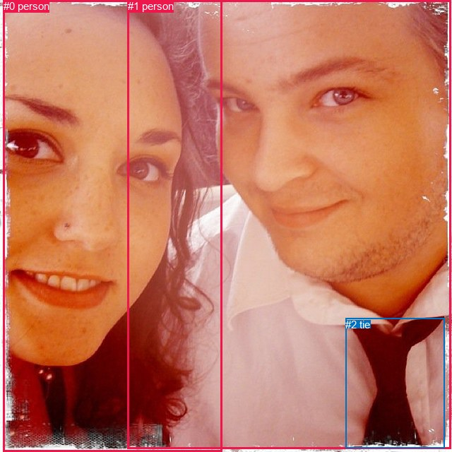

# 图片 1896：2405341.jpg

随机样本序号：33。图片 SHA256：`bb34286f1ee05d8451cdd991c6f5647c1f8a7fbc744267b5d3c5a3f4d544647e`。

红色框表示人，蓝色框表示其他物体。两个模式分别保留自身框编号，可依据位置比较对应对象。

## 自动检测框与输出

人的框编号：`[0, 1]`。状态：`ok`。

### 自动检测全部物体框

| 编号 | 类别 | 是否为人 | 检测分数 | 像素坐标 xyxy |
|---|---|---|---|---|
| 0 | person | True | 0.9989 | 4.5, 0.0, 314.8, 639.4 |
| 1 | person | True | 0.9971 | 180.9, 0.0, 638.8, 635.3 |
| 2 | tie | False | 0.9885 | 489.4, 450.8, 629.4, 634.8 |

### 自动检测 Top50 人相关候选

评分物体对：6；人相关物体对：6；输出关系：12。

| 排名 | 主语编号与类别 | 关系 | 宾语编号与类别 | 类型 | 人与人 | 排序分数 | 原始融合 logit |
|---|---|---|---|---|---|---|---|
| 1 | #1 person | wearing | #2 tie | semantic | False | 0.99457 | 5.2095 |
| 2 | #0 person | beside | #1 person | spatial | True | 0.98756 | 4.3747 |
| 3 | #1 person | beside | #0 person | spatial | True | 0.98484 | 4.1738 |
| 4 | #2 tie | on | #1 person | spatial | False | 0.97578 | 3.6961 |
| 5 | #2 tie | wearing | #1 person | semantic | False | 0.92171 | 2.4659 |
| 6 | #1 person | looking at | #0 person | semantic | True | 0.89860 | 2.1818 |
| 7 | #0 person | looking at | #1 person | semantic | True | 0.85565 | 1.7797 |
| 8 | #1 person | over | #2 tie | spatial | False | 0.69772 | 0.8365 |
| 9 | #0 person | beside | #2 tie | spatial | False | 0.57049 | 0.2839 |
| 10 | #2 tie | beside | #0 person | spatial | False | 0.49795 | -0.0082 |
| 11 | #2 tie | wearing | #0 person | semantic | False | 0.19845 | -1.3960 |
| 12 | #0 person | holding | #2 tie | semantic | False | 0.13126 | -1.8899 |

### 自动检测逐条人相关 GT 核验

R@50：75.00%；命中 3/4。

| GT 主语编号 | GT 关系 | GT 宾语编号 | 结果阶段 | 匹配预测主语编号 | 匹配预测宾语编号 |
|---|---|---|---|---|---|
| 0 | beside | 1 | hit50 | [1] | [0] |
| 0 | holding | 1 | wrong_predicate | [1] | [0] |
| 0 | wearing | 2 | hit50 | [1] | [2] |
| 1 | beside | 0 | hit50 | [0] | [1] |

## 真实框与输出

人的框编号：`[0, 1]`。

### 真实框全部物体框

| 编号 | 类别 | 是否为人 | 检测分数 | 像素坐标 xyxy |
|---|---|---|---|---|
| 0 | person | True | GT | 250.0, 0.0, 639.0, 636.0 |
| 1 | person | True | GT | 1.0, 4.0, 305.0, 634.0 |
| 2 | tie | False | GT | 494.0, 447.0, 630.0, 629.0 |

### 真实框 Top50 人相关候选

评分物体对：6；人相关物体对：6；输出关系：12。

| 排名 | 主语编号与类别 | 关系 | 宾语编号与类别 | 类型 | 人与人 | 排序分数 | 原始融合 logit |
|---|---|---|---|---|---|---|---|
| 1 | #0 person | wearing | #2 tie | semantic | False | 0.99462 | 5.2206 |
| 2 | #0 person | beside | #1 person | spatial | True | 0.98485 | 4.1743 |
| 3 | #1 person | beside | #0 person | spatial | True | 0.98481 | 4.1719 |
| 4 | #2 tie | on | #0 person | spatial | False | 0.97525 | 3.6739 |
| 5 | #2 tie | wearing | #0 person | semantic | False | 0.92462 | 2.5069 |
| 6 | #0 person | looking at | #1 person | semantic | True | 0.88460 | 2.0367 |
| 7 | #1 person | looking at | #0 person | semantic | True | 0.84893 | 1.7262 |
| 8 | #0 person | over | #2 tie | spatial | False | 0.68566 | 0.7799 |
| 9 | #1 person | beside | #2 tie | spatial | False | 0.57405 | 0.2984 |
| 10 | #2 tie | beside | #1 person | spatial | False | 0.50644 | 0.0257 |
| 11 | #2 tie | wearing | #1 person | semantic | False | 0.18802 | -1.4629 |
| 12 | #1 person | holding | #2 tie | semantic | False | 0.12714 | -1.9265 |

### 真实框逐条人相关 GT 核验

R@50：75.00%；命中 3/4。

| GT 主语编号 | GT 关系 | GT 宾语编号 | 结果阶段 | 匹配预测主语编号 | 匹配预测宾语编号 |
|---|---|---|---|---|---|
| 0 | beside | 1 | hit50 | [0] | [1] |
| 0 | holding | 1 | wrong_predicate | [0] | [1] |
| 0 | wearing | 2 | hit50 | [0] | [2] |
| 1 | beside | 0 | hit50 | [1] | [0] |

## 全部人相关 GT

| 主语编号与类别 | 关系 | 宾语编号与类别 |
|---|---|---|
| #0 person | beside | #1 person |
| #0 person | holding | #1 person |
| #0 person | wearing | #2 tie |
| #1 person | beside | #0 person |

原始记录、全部人相关物体对的两项预测与分项分数见 [逐图证据 JSON](../evidence/cases/1896.json)。全部56类 logits 保留于本机 HOR/output/random500/logits/。

<!-- HOR_COMPLETE_RESULTS -->

## 六组条件的完整输出对照

以下保留同一图片三种框与候选模式、两种谓词输出规则的全部 Top50。框编号各自在所属模式内解释。

### 自动检测框完整枚举：空间与语义各保留一个谓词

| 排名 | 主语编号与类别 | 谓词 | 宾语编号与类别 | 分组 | 排序分数 | predicate logit | pair logit |
|---|---|---|---|---|---|---|---|
| 1 | #1 person | wearing | #2 tie | semantic | 0.9945654 | 4.6523919 | 0.5571204 |
| 2 | #0 person | beside | #1 person | spatial | 0.9875643 | 3.8931632 | 0.4815057 |
| 3 | #1 person | beside | #0 person | spatial | 0.9848399 | 3.8921227 | 0.2816850 |
| 4 | #2 tie | on | #1 person | spatial | 0.9757800 | 3.4291091 | 0.2669476 |
| 5 | #2 tie | wearing | #1 person | semantic | 0.9217142 | 2.1989222 | 0.2669476 |
| 6 | #1 person | looking at | #0 person | semantic | 0.8986003 | 1.9000835 | 0.2816850 |
| 7 | #0 person | looking at | #1 person | semantic | 0.8556544 | 1.2981501 | 0.4815057 |
| 8 | #1 person | over | #2 tie | spatial | 0.6977185 | 0.2793365 | 0.5571204 |
| 9 | #0 person | beside | #2 tie | spatial | 0.5704924 | 0.6953807 | -0.4115204 |
| 10 | #2 tie | beside | #0 person | spatial | 0.4979537 | 0.8436251 | -0.8518102 |
| 11 | #2 tie | wearing | #0 person | semantic | 0.1984549 | -0.5441694 | -0.8518102 |
| 12 | #0 person | holding | #2 tie | semantic | 0.1312577 | -1.4783633 | -0.4115204 |

GT 命中：3/4，R@50=75.00%。

| GT主语 | GT谓词 | GT宾语 | 结果阶段 | 匹配主语框 | 匹配宾语框 |
|---|---|---|---|---|---|
| 0 | beside | 1 | hit50 | [1] | [0] |
| 0 | holding | 1 | wrong_predicate | [1] | [0] |
| 0 | wearing | 2 | hit50 | [1] | [2] |
| 1 | beside | 0 | hit50 | [0] | [1] |

### 自动检测框完整枚举：每对只保留一个谓词

| 排名 | 主语编号与类别 | 谓词 | 宾语编号与类别 | 分组 | 排序分数 | predicate logit | pair logit |
|---|---|---|---|---|---|---|---|
| 1 | #1 person | wearing | #2 tie | single | 0.9945654 | 4.6523919 | 0.5571204 |
| 2 | #0 person | beside | #1 person | single | 0.9875643 | 3.8931632 | 0.4815057 |
| 3 | #1 person | beside | #0 person | single | 0.9848399 | 3.8921227 | 0.2816850 |
| 4 | #2 tie | on | #1 person | single | 0.9757800 | 3.4291091 | 0.2669476 |
| 5 | #0 person | beside | #2 tie | single | 0.5704924 | 0.6953807 | -0.4115204 |
| 6 | #2 tie | beside | #0 person | single | 0.4979537 | 0.8436251 | -0.8518102 |

GT 命中：3/4，R@50=75.00%。

| GT主语 | GT谓词 | GT宾语 | 结果阶段 | 匹配主语框 | 匹配宾语框 |
|---|---|---|---|---|---|
| 0 | beside | 1 | hit50 | [1] | [0] |
| 0 | holding | 1 | wrong_predicate | [1] | [0] |
| 0 | wearing | 2 | hit50 | [1] | [2] |
| 1 | beside | 0 | hit50 | [0] | [1] |

### 真实框完整枚举：空间与语义各保留一个谓词

| 排名 | 主语编号与类别 | 谓词 | 宾语编号与类别 | 分组 | 排序分数 | predicate logit | pair logit |
|---|---|---|---|---|---|---|---|
| 1 | #0 person | wearing | #2 tie | semantic | 0.9946249 | 4.6641269 | 0.5564685 |
| 2 | #0 person | beside | #1 person | spatial | 0.9848476 | 3.9523044 | 0.2220249 |
| 3 | #1 person | beside | #0 person | spatial | 0.9848117 | 3.7137723 | 0.4581539 |
| 4 | #2 tie | on | #0 person | spatial | 0.9752505 | 3.4018855 | 0.2720072 |
| 5 | #2 tie | wearing | #0 person | semantic | 0.9246233 | 2.2348814 | 0.2720072 |
| 6 | #0 person | looking at | #1 person | semantic | 0.8845984 | 1.8146906 | 0.2220249 |
| 7 | #1 person | looking at | #0 person | semantic | 0.8489274 | 1.2680593 | 0.4581539 |
| 8 | #0 person | over | #2 tie | spatial | 0.6856594 | 0.2234354 | 0.5564685 |
| 9 | #1 person | beside | #2 tie | spatial | 0.5740479 | 0.7568498 | -0.4584640 |
| 10 | #2 tie | beside | #1 person | spatial | 0.5064354 | 0.9334650 | -0.9077219 |
| 11 | #2 tie | wearing | #1 person | semantic | 0.1880224 | -0.5551896 | -0.9077219 |
| 12 | #1 person | holding | #2 tie | semantic | 0.1271399 | -1.4680235 | -0.4584640 |

GT 命中：3/4，R@50=75.00%。

| GT主语 | GT谓词 | GT宾语 | 结果阶段 | 匹配主语框 | 匹配宾语框 |
|---|---|---|---|---|---|
| 0 | beside | 1 | hit50 | [0] | [1] |
| 0 | holding | 1 | wrong_predicate | [0] | [1] |
| 0 | wearing | 2 | hit50 | [0] | [2] |
| 1 | beside | 0 | hit50 | [1] | [0] |

### 真实框完整枚举：每对只保留一个谓词

| 排名 | 主语编号与类别 | 谓词 | 宾语编号与类别 | 分组 | 排序分数 | predicate logit | pair logit |
|---|---|---|---|---|---|---|---|
| 1 | #0 person | wearing | #2 tie | single | 0.9946249 | 4.6641269 | 0.5564685 |
| 2 | #0 person | beside | #1 person | single | 0.9848476 | 3.9523044 | 0.2220249 |
| 3 | #1 person | beside | #0 person | single | 0.9848117 | 3.7137723 | 0.4581539 |
| 4 | #2 tie | on | #0 person | single | 0.9752505 | 3.4018855 | 0.2720072 |
| 5 | #1 person | beside | #2 tie | single | 0.5740479 | 0.7568498 | -0.4584640 |
| 6 | #2 tie | beside | #1 person | single | 0.5064354 | 0.9334650 | -0.9077219 |

GT 命中：3/4，R@50=75.00%。

| GT主语 | GT谓词 | GT宾语 | 结果阶段 | 匹配主语框 | 匹配宾语框 |
|---|---|---|---|---|---|
| 0 | beside | 1 | hit50 | [0] | [1] |
| 0 | holding | 1 | wrong_predicate | [0] | [1] |
| 0 | wearing | 2 | hit50 | [0] | [2] |
| 1 | beside | 0 | hit50 | [1] | [0] |

### 真实框400候选：空间与语义各保留一个谓词

| 排名 | 主语编号与类别 | 谓词 | 宾语编号与类别 | 分组 | 排序分数 | predicate logit | pair logit |
|---|---|---|---|---|---|---|---|
| 1 | #0 person | wearing | #2 tie | semantic | 0.9946249 | 4.6641269 | 0.5564685 |
| 2 | #1 person | beside | #0 person | spatial | 0.9856845 | 3.7738395 | 0.4581539 |
| 3 | #0 person | beside | #1 person | spatial | 0.9848476 | 3.9523044 | 0.2220249 |
| 4 | #2 tie | on | #0 person | spatial | 0.9753817 | 3.4073300 | 0.2720072 |
| 5 | #2 tie | wearing | #0 person | semantic | 0.9262943 | 2.2591047 | 0.2720072 |
| 6 | #0 person | looking at | #1 person | semantic | 0.8845984 | 1.8146906 | 0.2220249 |
| 7 | #1 person | looking at | #0 person | semantic | 0.8451188 | 1.2386646 | 0.4581539 |
| 8 | #0 person | over | #2 tie | spatial | 0.6798576 | 0.1966491 | 0.5564685 |
| 9 | #1 person | beside | #2 tie | spatial | 0.5813764 | 0.7868900 | -0.4584640 |
| 10 | #2 tie | beside | #1 person | spatial | 0.5064499 | 0.9335232 | -0.9077219 |
| 11 | #2 tie | wearing | #1 person | semantic | 0.1880224 | -0.5551896 | -0.9077219 |
| 12 | #1 person | holding | #2 tie | semantic | 0.1277559 | -1.4624844 | -0.4584640 |

GT 命中：3/4，R@50=75.00%。

| GT主语 | GT谓词 | GT宾语 | 结果阶段 | 匹配主语框 | 匹配宾语框 |
|---|---|---|---|---|---|
| 0 | beside | 1 | hit50 | [0] | [1] |
| 0 | holding | 1 | wrong_predicate | [0] | [1] |
| 0 | wearing | 2 | hit50 | [0] | [2] |
| 1 | beside | 0 | hit50 | [1] | [0] |

### 真实框400候选：每对只保留一个谓词

| 排名 | 主语编号与类别 | 谓词 | 宾语编号与类别 | 分组 | 排序分数 | predicate logit | pair logit |
|---|---|---|---|---|---|---|---|
| 1 | #0 person | wearing | #2 tie | single | 0.9946249 | 4.6641269 | 0.5564685 |
| 2 | #1 person | beside | #0 person | single | 0.9856845 | 3.7738395 | 0.4581539 |
| 3 | #0 person | beside | #1 person | single | 0.9848476 | 3.9523044 | 0.2220249 |
| 4 | #2 tie | on | #0 person | single | 0.9753817 | 3.4073300 | 0.2720072 |
| 5 | #1 person | beside | #2 tie | single | 0.5813764 | 0.7868900 | -0.4584640 |
| 6 | #2 tie | beside | #1 person | single | 0.5064499 | 0.9335232 | -0.9077219 |

GT 命中：3/4，R@50=75.00%。

| GT主语 | GT谓词 | GT宾语 | 结果阶段 | 匹配主语框 | 匹配宾语框 |
|---|---|---|---|---|---|
| 0 | beside | 1 | hit50 | [0] | [1] |
| 0 | holding | 1 | wrong_predicate | [0] | [1] |
| 0 | wearing | 2 | hit50 | [0] | [2] |
| 1 | beside | 0 | hit50 | [1] | [0] |
